# 第一章 数据结构入门

## 1.数据结构与算法入门

- **核心公式**：程序（Program）= 数据结构（Data Structure）+ 算法（Algorithm）。
- 数据结构是介于数学、计算机硬件、计算机软件之间的一门核心课程，是数据库、程序、操作系统、游戏等设计的基础。
- 它的三个典型用途：计算机专业考研指定科目、大厂面试常考、中学与大学的学科竞赛必备。
- 算法与数据结构互相依存：算法依赖数据结构来组织数据，数据结构又直接决定算法的效率，从而决定一个程序的好坏。
- 学习前提：至少掌握一门编程语言；具备一定的数学基础与逻辑思考能力。
- 学好它的唯一途径：多读、多写、多练。只读书不写代码，不足以成为合格的程序员，必须与题库习题结合。
- 阅读建议：先复习 C/C++ 基础（尤其指针）；顺序阅读、弄懂原理再抄代码；适当手写摘抄以加深记忆。
- 本教程默认 IDE 为 Dev-C++（轻量、跨平台，NOIP、蓝桥杯等竞赛常用）。

## 2.数学基础

- 本节只为后面分析复杂度做工具准备，深入学习需参考《高等数学》《离散数学》《数论》。
- **指数**：aⁿ 中 a 为底数、n 为指数，表示 n 个 a 相乘（如 4³ = 4×4×4）。
- **对数**：对数是求幂的逆运算，与除法是乘法的逆运算同理，满足 aˣ = N 时 x = logₐN。
- **级数**：把数列各项用加号连接，用 Σ（西格玛）表示求和。
- **几何级数**：n 趋于无穷时整个式子的变化趋势，常用于分析时空复杂度与归纳法推导。
- **Π 运算**：与 Σ 法则相同，只是把加法换成乘法，表示连乘。
- 这些公式不需要立刻用上，但学到复杂度分析、递归式求解时会反复出现。

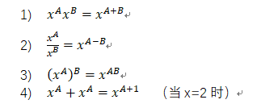
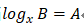
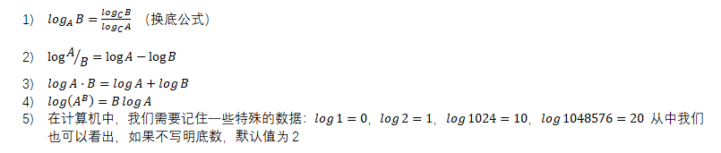
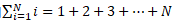
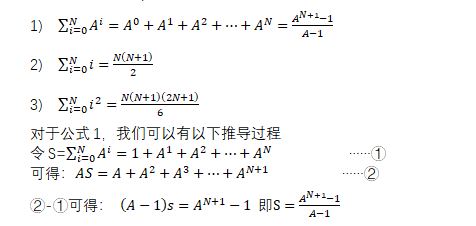
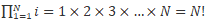

## 3.数据结构与算法

- 牢记：程序 = 数据结构 + 算法。
- **发展史三阶段**：无结构阶段 → 结构化阶段 → 面向对象阶段，与程序设计的发展阶段一致。
- 1968 年克努特《计算机程序设计技巧》第一卷《基本算法》，被视为数据结构系统概念的开端；70 年代初数据结构成为大学独立课程。
- **无结构阶段（40~60 年代）**：以科学计算为主，机器语言/汇编语言编程，处理纯数值，数据关系靠数学公式描述，尚无明确的数据结构概念。
- **结构化阶段（60~80 年代）**：计算机进入非数值处理领域，提出程序结构模块化，形成数据结构与抽象数据类型；沃斯提出“程序 = 数据结构 + 算法”。
- **面向对象阶段（80 年代至今）**：大量封装类出现，数据结构日益丰富，大幅减少重复设计。
- **何为算法**：以 1+2+…+100 为例，循环累加需要约 100 次运算，而等差数列公式 (1+100)×100/2 只需 1 次运算。
- 结论：同一问题可以有多种解法，差别体现在运算次数上；规模越大（如算到 1000000），算法优劣的差距越悬殊。

## 4.算法基础

- **输入输出**：算法有零个或多个输入，但至少要有一个输出；没有输出的算法没有意义。
- **确定性**：每一步含义唯一、无二义性，相同输入必得相同输出。随机数看似违背，实为用线性同余等算法结合 CPU 时间产生，时间完全相同时结果仍相同。
- **有穷性**：在输入合法的前提下，算法必须在有限步骤内结束。这是算法与程序最主要的区别——程序可以无限循环。
- **可行性**：每一步都能通过已实现的基本运算、执行有限次完成。
- **正确性**：满足预定功能与性能要求，分四层——无语法错误；几组输入结果正确；非法输入给出符合要求的处理；对精心构造的严苛数据仍正确。
- **健壮性**：输入不合法时能做出相应处理，而不是产生不可预计的后果。
- **可读性**：可阅读、可理解、可交流。
- **高效性**：耗时低、占用空间少——这正是数据结构与算法研究的核心目标。

## 5.数据结构基础

- **数据**：信息的载体，能被计算机识别、存储、加工，既含数值也含字符、声音、图像等非数值类型。
- **数据元素**：描述数据的基本单位，也称记录，由若干数据项组成（如鸡、鸭都是“禽类”这一集合中的数据元素）。
- **数据项**：描述数据的最小单位，分组合项（可再分割，如“2019年4月25日”）与原子项（不可再分割，如单取“25日”）。
- **数据对象**：性质相同的一类数据元素的集合，是数据的子集，可有限也可无限。
- **数据结构**：数据 + 关系的集合，关系指数据间的前后逻辑，与存储位置无关。
- **四大逻辑结构**：
  - 集合结构：元素之间除同属一个集合外，无其他关系。
  - 线性结构：元素之间“一对一”。
  - 树形结构：元素之间“一对多”的层次关系。
  - 图形结构（网状结构）：元素之间“多对多”（多表示至少一个）。
- **数据类型**：数据的取值范围 + 允许的操作的总和，规定程序中对象的特性。
- **抽象数据类型（ADT）**：一个数学模型及定义在其上的一组操作，只描述取值范围与操作集合，不涉及实现。
- ADT 的本质特征是**实现与操作分离**，从而实现封装（如《魂斗罗》中“打、跳、移动”就是一组抽象操作）。

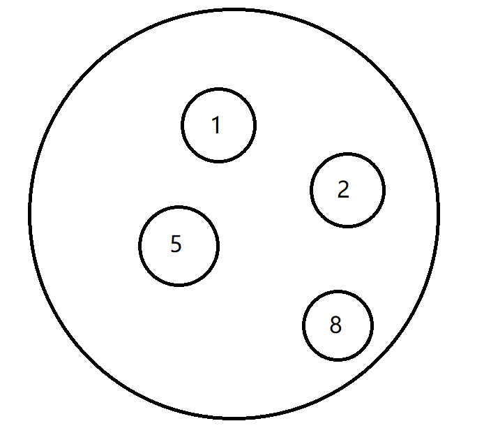
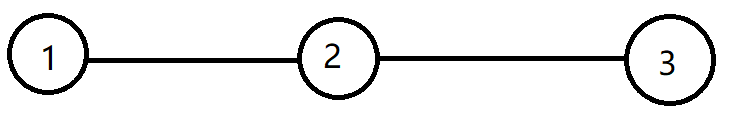
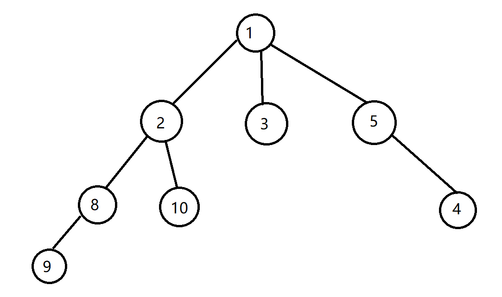
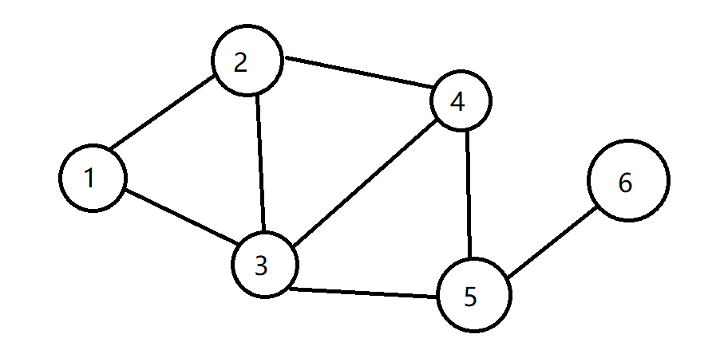

## 6.理解复杂度概念

- **时间复杂度**：衡量算法运行所需时间，实际值需在具体机器上测，通常只比较量级即可。
- **时间频度 T(n)**：算法中基本操作重复执行的次数，是问题规模 n 的函数。
- 若存在 f(n) 使 n→∞ 时 T(n)/f(n) 的极限为非零常数，则 T(n) = O(f(n))，称 O(f(n)) 为渐进时间复杂度，简称为时间复杂度。
- **空间复杂度**：程序运行所需内存大小，含两部分——固定部分（指令空间、常量、简单变量，属静态空间）与可变部分（动态分配空间、递归栈空间，与算法有关）。
- **事后统计法**：运行后用计时器比较。缺陷：严重依赖机器环境；测试数据难以设计，同一算法对不同数据效果不同。
- **事先估计法**：编译前用时间频度与函数思想估算，是主流做法。
- 常用符号：O 表示最坏情况（最常用）、Ω 表示最好情况、θ 表示平均情况；n 为问题规模，主要看循环结构的执行次数。
- **三条化简公式**：
  - O(a) = O(1)，a 为常数。
  - O(an) = O(n)，a 为常数。
  - O(an² + bn + c) = O(n²)，只保留最高次项。

## 7.时间复杂度的度量方法

- 度量关键：只看**循环结构**，一层循环代表执行 n 次，其余单条语句一般视为一次，常数项可忽略。
- **O(1)**：无循环或循环次数固定，无论执行几次常数语句，均记常数阶。
- **O(n)**：单层循环执行 n 次，如 for(i=0;i<n;i++) 累加，总次数 n×1+2，化简为 O(n)，线性阶。
- **O(n²)**：两层循环嵌套，n×n 次，平方阶；三层嵌套为 O(n³) 立方阶。
- **O(log n)**：循环变量倍增（i*=2）而非累加，会更早到达边界，属对数阶。
- **O(n log n)**：外层 n 次循环内嵌倍增循环，如 O(n×(logn+1)+2) 化简为 O(n·logn)。
- 其他量级：O(n!) 阶乘级、O(2ⁿ) 指数级，复杂度极高、运行极慢；复杂情形还可能需要多个变量描述（如 O(nm)）。
- **量级比较**：O(1) < O(log n) < O(n) < O(n log n) < O(n²) < O(n³) < O(2ⁿ)。
- 从曲线看：n 较小时差异不明显，n 达到万级后，平方、立方几乎贴着 y 轴竖直上升，log n 几乎贴着 x 轴水平延伸。
- 实践原则：高计算需求的环节，绝不能采用过高的时间复杂度。

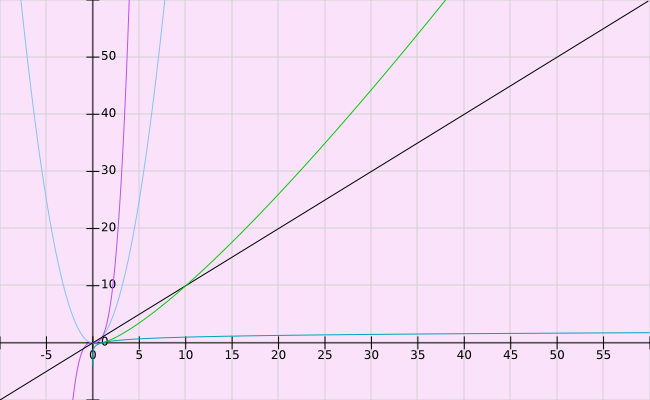
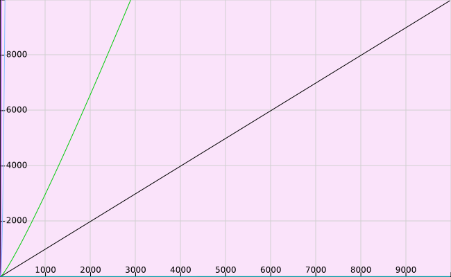

## 8.程序运行时的内存与地址

- 内存中每一段数据都有对应的**地址**，地址常用十六进制表示（0x + 十六进制数）。
- C 语言数组是顺序存储的，可直接打印每个元素及其地址：

```cpp
char array[10]="ACDEQSFVCK";
for(i=0;i<10;i++)
    printf("The %c Address is %x \n",array[i],&array[i]); // %p 可显示完整位数
```

- 输出可见地址连续递增（如 62fe40、62fe41、62fe42…）；换成 int 型则每 4 字节一跳，因为 char 占 1 字节、int 占 4 字节。
- **指针与内存**：指针就是为灵活操纵内存而设计的，使内存地址能像数据一样被赋值、修改，极其灵活（也有风险）。
- 结论：指针是 C/C++ 的灵魂，务必巩固，这是后续实现链表、树、图的基础。

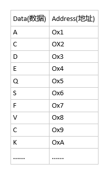

## 9.编程预备

- **malloc**（stdlib.h）：在堆上申请 size 字节的连续内存，成功返回起始地址指针，失败返回 NULL。
- **free**（stdlib.h）：释放 p 指向的内存空间。
- 二者是本教程最常用的两个函数，务必牢记“申请—判断—使用—释放”的固定套路。
- **新手三大坑**：
  - 不判断 malloc 是否失败（失败不报错会一路崩溃）。
  - 只 malloc 不 free，产生内存垃圾、效率下降。
  - 指针随意移动，产生莫名位移，极难排查。
- **标准流程**：定义变量与指针 → 申请内存 → 判断是否成功（失败则报错/退出）→ 对空间赋值、修改、查询、删除 → 释放指针。
- 释放后 p 成为**野指针**，必须立即置 NULL。
- **new 与 malloc 的区别**：new 从自由存储区（free store，C++ 基于 new 的抽象概念）分配；malloc 从堆上分配（操作系统维护的动态内存区），由 free 释放。

```cpp
int *p;
p = (int*)malloc(5*sizeof(int));
if(p == NULL){ exit(1); }   // 申请失败
p[0] = 1000;
free(p); p = NULL;          // 释放后置空，避免野指针
```
