# 第二章 链表

## 1.顺序存储和链式存储

- **顺序存储（数组）**：元素在内存中连续存放，可随机访问，但插入、删除要成片移动元素。
- 举例：在 {1,2,3,4,5,6,7} 第 2 个位置插入 'A'，需要把后面所有元素整体后移再覆盖，步骤繁琐。
- 数组两大弊端：① 移动元素多，浪费算力；② 必须预先开足够大的空间，否则有溢出风险。
- **链式存储（链表）**：元素分散存放，靠指针把结点串起来，内存随用随申请、自适应大小。
- 结点由「数据域 + 指针域」组成：DATA 可为 int、结构体等任意类型；NEXT 指向下一个结点，尾结点的 NEXT 指向 NULL。
- 插入、删除只需修改指针指向，不必搬运数据，这是链表最大的优势。
- 代价：每个结点要多存一个指针，空间开销更大，且不支持随机访问（不能按下标直接取）。
- 本章依次讲三种形态：单链表、双链表（双向链表）、循环单链表，思路大同小异。

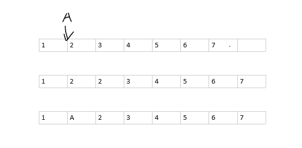

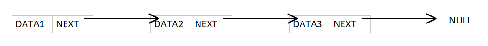
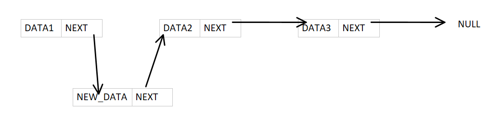
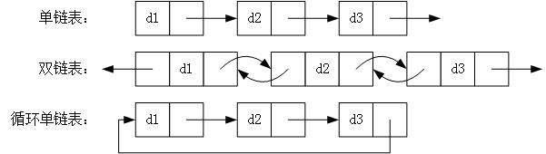

## 2.单链表的基本设计（C语言代码实现）

- **概念**：用“结点的序列”表示的线性表称单链表，属链式存取结构；结点 = 数据元素 + 指向后继的指针。
- **结点定义**（`Node` 为结点类型，`LinkedList` 为指向结点的指针类型）：

```cpp
typedef struct Node {
    int data;              // 数据域
    struct Node *next;     // 指针域
} Node, *LinkedList;
```

- **初始化**：申请一个头结点空间，`next` 置 NULL 表示空表；务必判断 `L == NULL`（申请失败要报错或退出），生产环境可用 C++ 的 try-catch 兜底。
- **头插法**：新结点插在头结点之后，代码只需两句——`p->next = L->next; L->next = p;`。特点：写法简单，但得到的是**逆序**链表。
- **尾插法**：必须额外维护尾指针 `r`（初始指向头结点），每次 `r->next = p; r = p;`，最后 `r->next = NULL`。特点：结果与输入顺序**一致**。
- 两种创建方式无本质区别，都是逐个 malloc 新结点再挂接指针，只是挂接位置不同。


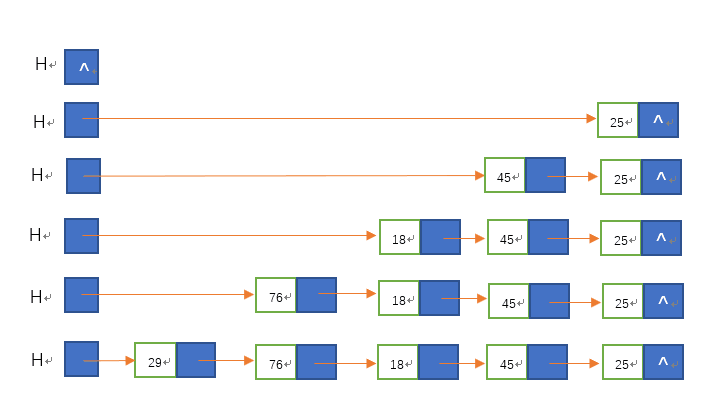
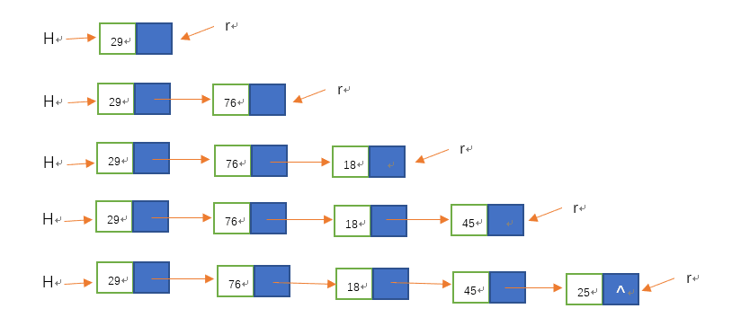

## 3.单链表的基本操作及C语言代码实现

- **遍历**：从头结点的下一个结点开始，`while(p){ ...; p = p->next; }`；遍历可衍生出打印、查询、修改、统计长度等操作。
- 只读操作可用 `void` 返回；涉及修改结构的操作习惯返回 `LinkedList`。
- **插入（第 i 个位置插入 x）**：先找第 i 个位置的**前驱** pre（循环 i-1 次），再执行

```cpp
p->next = pre->next;
pre->next = p;   // 顺序不能反，否则断链
```

- **删除（删除值为 x 的结点）**：用 pre 和 p 双指针查找，命中后 `pre->next = p->next; free(p);`。
- 删除必须 free 被删结点，否则内存泄漏；插入删除的时间开销主要在“找位置”，为 O(n)。
- 完整实现一般包含 6 个函数：初始化、头插建表、尾插建表、插入、删除、修改，加 `printList` 输出验证。
- 推荐配套练习：Dotcpp 1676 题、1052 题。


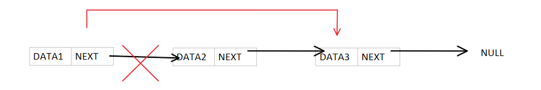

## 4.双向链表的基本设计（C语言代码实现）

- **单链表的不足**：只有一个后继指针，单向访问；想回溯或从后往前找，只能反复从头遍历。
- **双向链表**：每个结点有两个指针，`pre` 指向前驱、`next` 指向后继，从任一结点都能方便地访问前后结点。
- 完整形态：头结点的 `pre` 为空，尾结点的 `next` 为空，其余结点前后互链。
- **结点定义**：

```cpp
typedef struct line {
    int data;
    struct line *pre;    // 前驱
    struct line *next;   // 后继
} line, *a;
```

- **创建**：先建头结点（注意：双链表头结点**也存数据**，这点与单链表的“空头结点”不同），再逐个 malloc 新结点，执行
  `list->next = body; body->pre = list; list = list->next;`
- 理解技巧：把过程拆成“建头结点 → 建新结点 → 双向挂接 → 再建新结点”，反复对照代码看两遍即可。


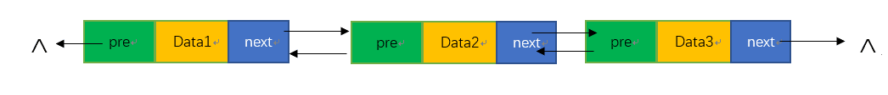
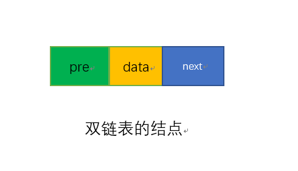

## 5.双向链表的基本操作及C语言代码实现

- **插入**：先 malloc 新结点 temp 并赋数据；插在表头要单独处理（`temp->next = head; head->pre = temp; head = temp;`）。
- 插在中间/表尾：先找插入位置的前一个结点 body，然后分两种情况：
  - body 已是尾结点（`body->next == NULL`）：`body->next = temp; temp->pre = body;`
  - 插在中间，四句指针修改：`body->next->pre = temp; temp->next = body->next; body->next = temp; temp->pre = body;`
- **删除**：命中结点后两步改指针，再 free：
  `list->pre->next = list->next; list->next->pre = list->pre; free(list);`
- 注意：删除头结点或尾结点时，`list->pre` / `list->next` 为空会出问题，实际实现需特判。
- **遍历**：与单链表一样沿 `next` 走即可，`while(list)` 与 `while(list->next)` 判空效果等价；也可反向利用 `pre` 指针遍历。
- 双链表练习较少，可拿单链表的题（1676、1585）改用双链表实现来练手。

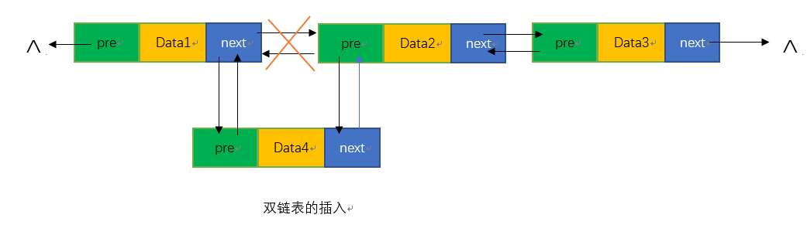
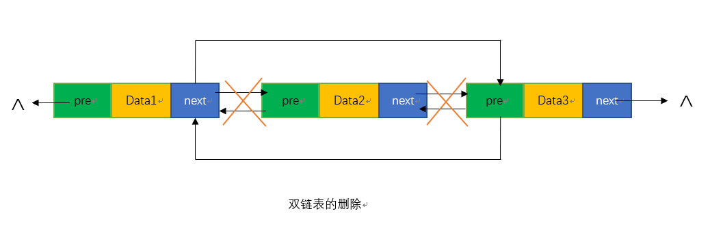

## 6.循环链表的介绍及创建（C语言代码实现）

- **核心差别**：非循环链表尾结点指向 NULL，循环链表尾结点指向**头结点**，从而首尾相接、可无限绕圈。
- 把单链表的尾结点指向头结点，即得循环单链表（Circular Linked List）。
- 结点设计与单链表完全一致（data + next），只是尾结点的 next 指向开头；只有一个结点时 next 指向自身。
- **初始化**：malloc 头结点，成功后将 `head->next = head`（也可在 init 里置 NULL，调用后再手动指向自身，方便后续复用插入函数）。
- **创建**：逐个插入——从 head 出发 `while(p->next != head) p = p->next;` 找到尾结点，再 `p->next = node; node->next = head;`
- 循环链表的最大坑是**遍历没有 NULL 终点**，必须靠“回到 head”（或计数）来判断结束。

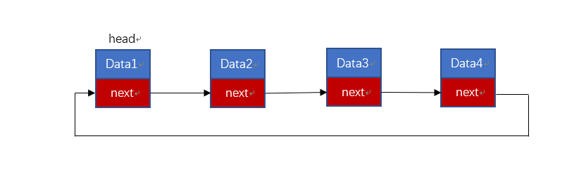
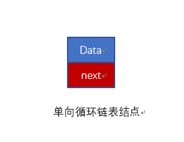
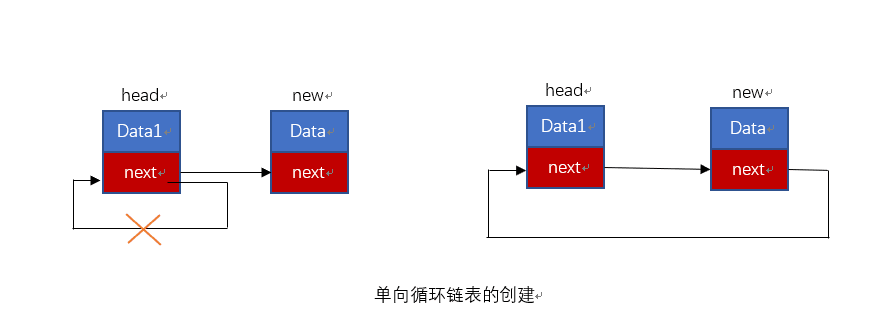

## 7.循环链表的基本操作及C语言代码实现

- **插入**：与单链表一致，找到第 pos 个结点 t，然后 `node->next = t->next; t->next = node;`。
- **删除**：核心口诀是「**前驱.next = 自身.next**」，这样写可省去大部分头尾特判；但删除尾结点时要让新的尾结点指回 head。
- **删除实现要点**：用 temp 记录头结点作“退出点”，ptr 从头结点的下一个结点开始，`while(ptr != head)` 循环；若 `ptr->next == head`（是尾结点），则 `temp->next = head; free(ptr);`
- **遍历**：不能用判 NULL 的方式，要用 `while(p->next != head)`；另一种方式是计数器 count 与结点数比较后退出（缺点是仍需先知道结点数）。
- 三种链表对比记忆：单链表尾指 NULL；双链表双向指、首尾为空；循环链表尾指 head。

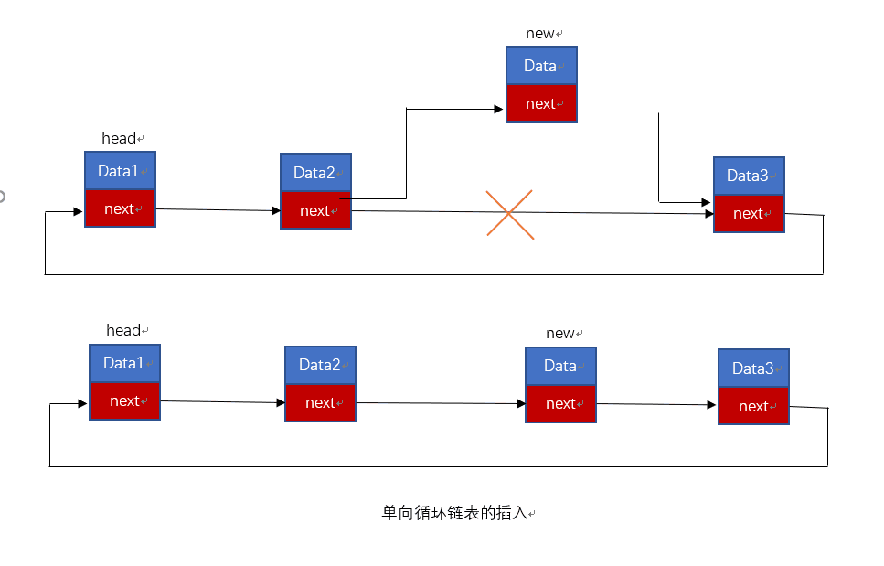
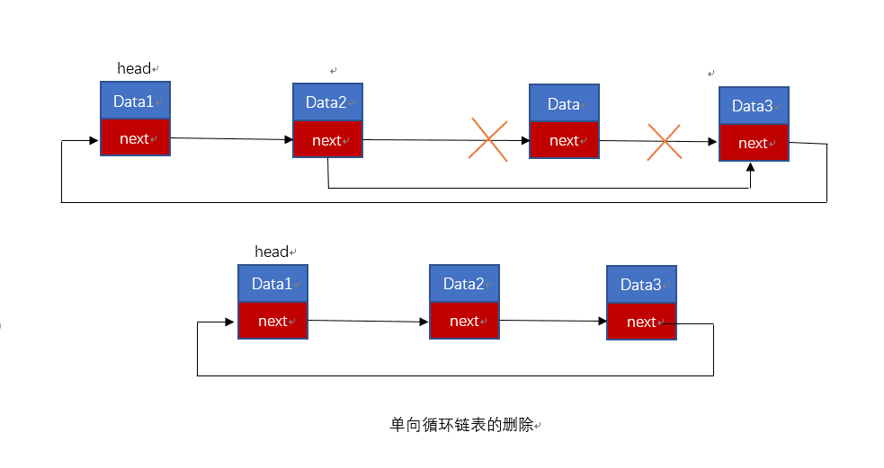
