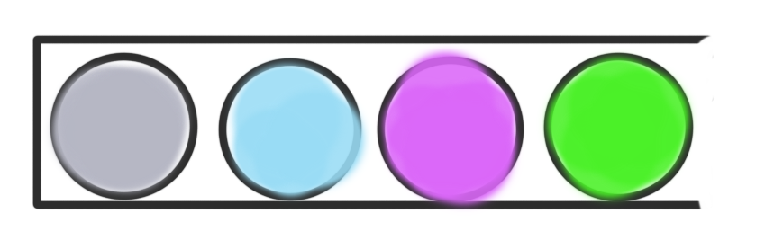
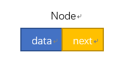
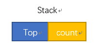
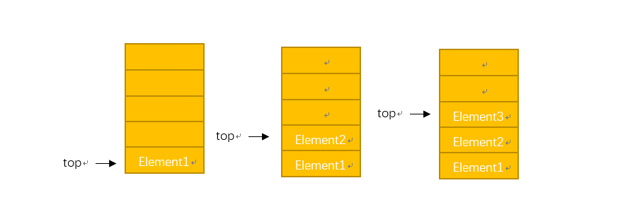
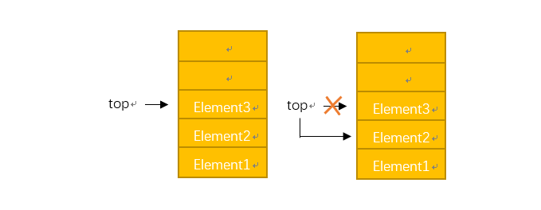

# 第三章 栈

## 1.栈（先进后出的数据结构）的设计与实现

- **一句话定义**：栈是一种**先进后出（LIFO）**的数据结构。
- 严格定义：栈是线性结构，只允许在**一端（栈顶）**插入和删除，禁止直接访问其余位置的数据。
- 直观理解：像单管装球——球只能从开口端取放，先放进去的球最后才能取出。
- 与前文呼应：只保留“在表尾插入新结点、删除末尾结点”两种操作的单链表，本质上就是栈。
- **分类**：
  - 数组栈：用数组模拟，实现快、书写简便。
  - 链表栈：用链表实现，稍麻烦但更稳定；又分静态（容量固定）与动态（按需申请，理论上无上限）。
- 本节以**动态链表栈**为例，这也是各语言标准模板库中栈的实现方式。
- **结点设计**：仿单链表结点（data + next），再加一个栈结构体保存 `top`（永远指向栈顶）与 `count`（元素个数）：
  - 判空方式一：`count == 0`；方式二：`top` 与 `bottom` 指向同一空间。

```cpp
typedef struct node { int data; struct node *next; } Node;
typedef struct stack { Node *top; int count; } Link_Stack;
```

- **入栈（push）**：malloc 新结点 → `temp->next = p->top; p->top = temp; p->count++;`，即“头插”思想。






## 2.栈的基本操作及C语言代码实现

- **出栈（pop）**：必须**先判空**；非空时 `p->top = p->top->next; free(temp); p->count--;`
- **遍历**：只能从栈顶往下走，所以输出天然是**逆序**的（从栈顶到栈底）；`while(temp) { ...; temp = temp->next; }`。
- **数组栈（快速模拟实现）**：结构体含 `int data[maxn]` 与 `int top`（也可加 bottom）。
  - 初始化：malloc + `memset` 清零 + `top = 0`（用 top 表示“当前元素个数/下一个可写的下标”）。
  - 入栈：`s->data[s->top++] = data;`
  - 出栈：`if(s->top != 0){ ...; s->top--; }`
  - 打印：下标从 `top-1` 倒着输出。
- 链表栈 vs 数组栈：前者空间动态、无溢出但每次要 malloc；后者 O(1) 且缓存友好，但需预估容量。
- **配套练习**：进制转换（1055 十进制转八进制、1192 十进制转二进制）；用栈代替递归（1131 斐波那契），这是理解 DFS 的基础。



## 3.栈数组与栈链表C语言代码实现

- **数组栈完整流程**：`init()` 建栈 → 循环 `push()` 5 个数据 → `print_stack()` 打印 → `pop()` 一次 → 再打印，可直观验证后进先出。
- **链表栈完整流程**：`Creat_stack()`（`count = 0; top = NULL`）→ 循环 `Push_stack()` → `show_stack()` → `Pop_stack()` → 再 `show_stack()`。
- 两种实现都遵循“**建栈 → 入栈 → 遍历 → 出栈 → 再遍历**”的验证套路，写题时可直接套用。
- 栈的价值：先进后出的特性天然适配“括号匹配、表达式求值、进制转换、函数调用/递归、DFS 回溯、撤销操作”等场景。
