# 第四章 队列

## 1.顺序队列的介绍及C/C++代码实现

- **一句话定义**：队列是**先进先出（FIFO）**的数据结构。
- 严格定义：只允许在一端（队尾 rear）插入、另一端（队头 front）删除的线性结构，禁止直接访问两端以外的数据。
- 直观理解：像两端相通的水管，一端放球、另一端取球，先放进去的最先取出。
- 与链表的关系：只允许在表尾插入、表头删除的单链表，就是队列。
- **队列家族**：顺序队列、循环队列，以及后续 STL 章中的优先队列，均由基本队列衍生。
- 队列通常用**链式**实现（不像栈那样容易用数组模拟，因为两端都在动）。
- **结构设计**：结点同样是 data + next；队列结构体只存两个指针：

```cpp
typedef struct node { int data; struct node *next; } node;
typedef struct queue { node *front; node *rear; } queue;   // 头指针 / 尾指针
```

- **初始化**分两级：`init_node()` 申请结点空间（失败 exit）；`init_queue()` 申请队列空间，并把 `front = rear = NULL` 表示空队列。
- **判空**：`q->front == NULL` 即为空；可直接 `return q->front == NULL;` 一行搞定（注意原文注释写反，返回 1 表示“空”更符合语义）。


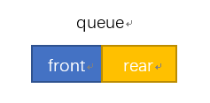

## 2.顺序队列的基本操作（入队出队遍历）及C/C++代码实现

- **入队（push）**：新建结点 `n`，`n->next = NULL`，采用尾插法；若队列为空，则 `front = rear = n`；否则 `rear->next = n; rear = n;`
- 注意：入队只动 rear，出队只动 front，这正是队列“两头分工”的本质。
- **出队（pop）**：先判空再操作，分两种情况：
  - 只有一个元素（`front == rear`）：`front = rear = NULL; free(n);`
  - 多于一个元素：`front = front->next; free(n);`
- **遍历/打印**：从 `front` 出发沿 next 走到 NULL，即从队头到队尾**顺序**输出（与栈的逆序相反）。
- 遍历可变形为统计元素个数：设 `cnt` 计数器边走边加，或直接把 count 存进结构体，避免每次都遍历。
- 完整实现包含：init_node、init_queue、empty、push、pop、print_queue，再加 main 做“入队 6 个 → 出队 5 个”的验证。
- **应用**：BFS 广度优先搜索、图论算法几乎都离不开队列；练手题 1895。

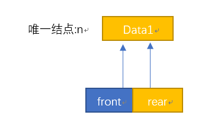
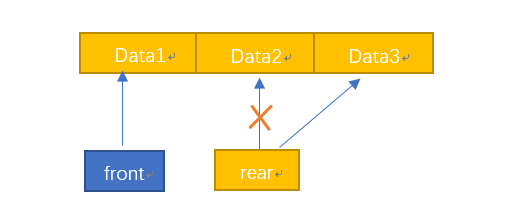
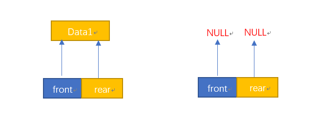
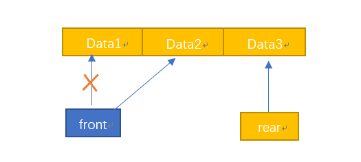

## 3.循环队列及假溢出的现象图文详解

- **假溢出现象**：顺序队列每次入队 rear 后移、出队 front 后移，可用空间不断向后偏移，最终 rear 越界——存储区明明没满，却“溢出”了。
- 举例：容量 5 的队列先放 4 个元素，再出队 2 个，然后入队 2 个，rear 就跑到可操作范围之外，这就是假溢出。
- **动态链表队列同样有隐患**：出队释放的空间无法复用，指针仍一路向后，直到撞上进程内存上界被迫终止，频繁队列操作时很致命。
- **循环队列**：预先给定容量，rear 到末尾后回绕到开头继续用，实现空间重复利用。
- 环形只是**逻辑**上的环，物理上仍是线性数组；结构设计（用数组模拟，不用链式，否则无法确定何时回到队头）：

```cpp
#define maxsize 10
typedef struct cir_queue {
    int data[maxsize];
    int rear;    // 入队时移动
    int front;   // 出队时移动
} cir_queue;
```

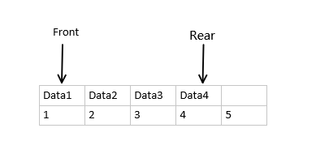
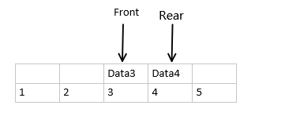
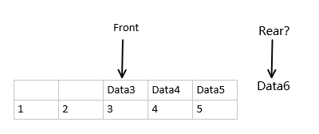
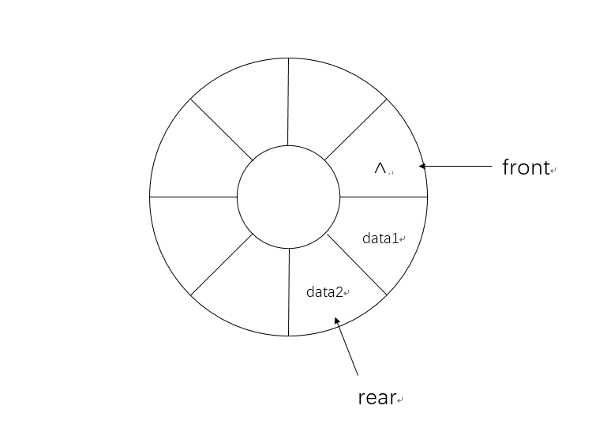
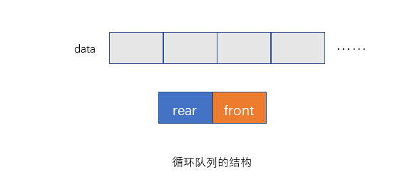

## 4.循环队列的基本操作及C语言代码实现

- **初始化**：malloc 空间，`front = rear = 0`（第 0 个位置作为空位/分界），必要时 memset 清零。
- **判空**：`rear == front`。
- **判满**：`(rear + 1) % maxsize == front`——即尾指针的下一个位置撞上队头。因此循环队列**实际最多存 maxsize - 1 个元素**，牺牲一格来区分空与满。
- **入队**：先判满，满则输出溢出提示并返回；否则 `rear = (rear + 1) % maxsize; data[rear] = x;`
- **出队**：先判空，空则返回；否则清掉 `data[front]`，再 `front = (front + 1) % maxsize;`
- **遍历**：用临时变量 `i = front`，`while(i != rear){ i = (i+1) % maxsize; 输出 data[i]; }`
- 关键细节：移动指针必须用取余法 `(x+1) % maxsize`，不要写成 `rear++` 之类的自增，否则越界后直接崩溃。
- 验证套路：入队 6 个 → 打印 → 连续出队 3 次并每次打印，观察 front 回绕。
- 推荐练习：1895 题；可用普通队列题再练循环队列实现。

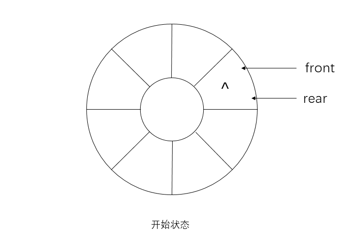
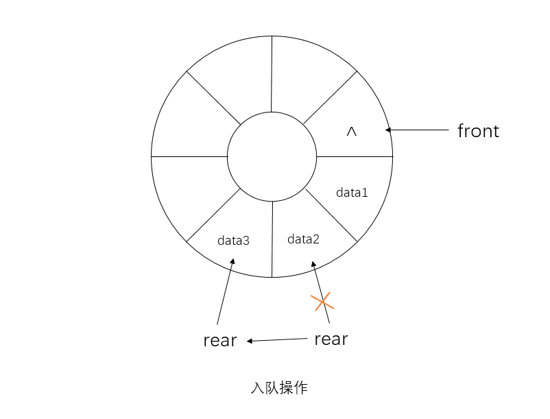
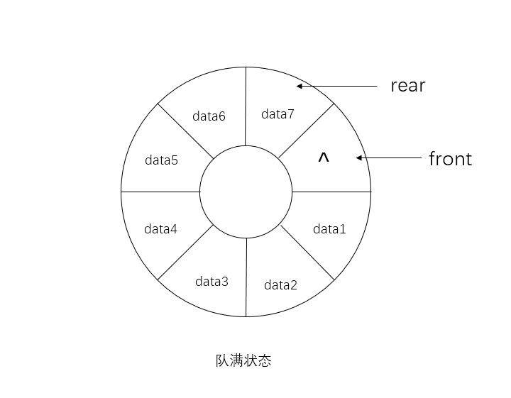
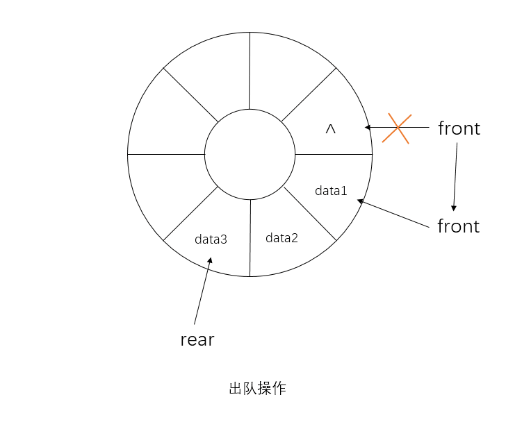
