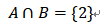
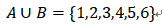
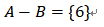

# 第五章 C++ STL 库教程（附带题库）

## 1.C++的区别

- C++ 由 Bjarne Stroustrup 于 1980 年前后着手创建，是在 C 语言基础上改进而来的**面向对象**语言。
- C++ 是 C 的超集，兼容 C，新增关键字与面向对象特性；本教程只从数据结构角度使用 C++ 的便利特性。
- **头文件写法**：C 用 `#include<stdio.h>`，C++ 直接 `#include<cstdio>`（C 系库前加 c 表示来自 C 语言）。
- **输入输出**：C 的 `scanf/printf` 需指定格式符；C++ 用流 `cin >> n; cout << n;`，自动判类型但速度较慢（后文有加速方案）。
- **STL** = Standard Template Library，标准模板库，由惠普实验室的 Stepanov 等人开发，本质是“容器 + 算法”的集合。
- STL 的目的：组件标准化，已实现的数据结构与算法直接调用，无需重复开发，且是 C++ 标准的一部分、无需额外安装。
- C++ 标准中 STL 组织为 13 个头文件：algorithm、deque、functional、iterator、vector、list、map、memory、numeric、queue、set、stack、utility。
- 关键提醒：**先懂原理再用 STL**，否则就是乱用。

## 2.C++STL教程入门

- STL 六大组件，重点是前三项：
  - **容器（Container）**：已实现的数据结构，如 list、vector、stack、queue，以模板类提供。
  - **迭代器（Iterator）**：一种特殊指针，是容器与算法之间的“胶合剂”，可安全访问容器元素。
  - **算法（Algorithm）**：泛型算法模板，能直接作用于容器，也能作用于数组、自定义结构体。
- 次重点三项（带 * 号）：
  - 仿函数（function object）：行为像函数，可理解为重载了 `()` 的类/结构体。
  - 迭代适配器（Iterator Adaptor）：修饰容器或仿函数的接口，支持逆向、安插、与流配合等模式。
  - 空间配置器（allocator）：负责容器空间的申请与释放，类似 malloc/free、new/delete。
- 一句话：不学 STL 的 C++ 是不完整的 C++。

## 3.C++STL之Vector容器

- **本质**：动态数组——连续存储、支持按下标随机访问，但大小可自动增长，空间由容器管理。
- 头文件 `#include <vector>`；定义格式 `vector<类型> 名字;`
- **五种初始化**：
  - `vector<int> v1;` 空向量
  - `vector<int> v2(10);` 开辟 10 个元素（相当于 int v[10]）
  - `vector<int> v3(10,5);` 10 个元素全为 5
  - `vector<int> v4(v3.begin(),v3.end());` 区间拷贝
  - `vector<int> v5(v4);` 复制构造
- **迭代器遍历**：`vector<int>::iterator it; for(it=v.begin(); it!=v.end(); it++) cout<<*it;`；也可直接下标 `v[i]`（新手更常用）。
- **常用接口**：
  - `push_back(val)` 尾部插入，`pop_back()` 尾部删除
  - `insert(pos, val)` 指定位置插单值；`insert(pos, n, val)` 插 n 个；`insert(pos, first, last)` 插一段
  - `erase(pos)` 删单个；`erase(first, last)` 删区间（左闭右开）
  - `clear()` 清空全部；`size()` 元素个数
  - `capacity()` 已开辟容量（只增不减，与 size 可不等）
  - `max_size()` 该机器可支持的最大容量（极大值，随机器不同）
- 理解要点：capacity 反映“容器已经要了多大空间”，size 反映“实际装了多个”，这正是动态数组扩容的核心机制。

## 4.C++STL之List容器

- **本质**：STL 提供的链表容器，适合频繁在任意位置插入删除，代价是不支持随机访问。
- 头文件 `#include <list>`；初始化与 vector 一致：`list<int> l1;`、`list<int> l2(10);`、`list<int> l3(5,20);`、`list<int> l4(l3.begin(),l3.end());`、`list<int> l5(l4);`
- **迭代器遍历**写法与 vector 相同，只是把类型换成 `list<int>::iterator`。
- **常用接口**：
  - `empty()` 判空、`size()` 取元素个数
  - `push_front(x)` / `pop_front()` 头部插入、删除
  - `push_back(x)` / `pop_back()` 尾部插入、删除
  - `insert(pos, val)`、`insert(pos, n, val)`、`insert(pos, first, last)`
  - `erase(pos)`、`erase(first, last)`
- **排序**：`sort()` 默认升序；`sort(cmp)` 传自定义比较函数，如 `bool cmp(const int &a, const int &b){ return a>b; }` 得到降序。
- 注意：list 只能用自己的成员函数 `sort()`，不能用 algorithm 的全局 `sort`（因为需要随机访问迭代器）。
- **逆序**：`reverse()` 直接把整个链表反转，比自定义降序更省事。

## 5.C++STL之stack栈容器

- **本质**：先进后出（LIFO）；STL 直接用模板类实现，不必再手写结构体链条。
- 头文件 `#include <stack>`；初始化：`stack<int> s;`、`stack<int> v(s);`
- 特殊写法：`stack<int, vector<int> > s(v);`，用 vector 作为底层容器——注意 `> >` 之间**必须有空格**，否则被当成右移运算符。
- **无迭代器**：栈只能通过“访问栈顶 → 弹出”的方式逐个取完，属于访问受限容器。
- **常用接口**：
  - `size()` 元素个数
  - `top()` 取栈顶（可读也可改，如 `s.top() += 100`）
  - `push(val)` 入栈
  - `pop()` 出栈，**无返回值**，要取值需先 top 再 pop
  - `empty()` 判空
- 遍历套路：`while(!s.empty()){ cout<<s.top(); s.pop(); }`；注意这会清空原栈，想保留要先复制一份。
- 练习：用 STL 重做进制转换（1055、1192）与斐波那契（1131）。

## 6.C++STL之Queue容器

- **本质**：先进先出（FIFO）；STL 队列是快速构建搜索算法、图论/数论状态存储的基础，务必掌握。
- 头文件 `#include <queue>`；初始化：`queue<int> q;`、`queue<int> qoo(q);`；也可 `queue<int, vector<int> > s(v);`
- **无迭代器**：只能访问队头并不断出队来遍历。
- **常用接口**：
  - `size()` 元素个数
  - `push(val)` 入队（队尾插入）
  - `pop()` 出队（队头弹出，无返回值）
  - `front()` 访问队头（常用，可修改）
  - `back()` 访问队尾（较少用）
  - `empty()` 判空
- 遍历套路：`while(!q.empty()){ cout<<q.front(); q.pop(); }`
- 练习：用 STL 重做队列基本操作（1895）。

## 7.C++STL之Priority_queue（优先队列）

- **本质**：不遵守先进先出，而是给每个元素一个权值，按权值排序，**权值最大（或最小）的永远在队头**。
- 底层是非线性的堆结构（因此只允许访问堆顶），属于较高级的数据结构。
- 头文件仍用 `#include <queue>`。
- **模板参数**：`priority_queue<T, Container, Compare>`
  - T：元素类型
  - Container：底层容器，必须是用数组实现的容器（vector、deque 可以，**list 不行**），默认 vector
  - Compare：比较方式，类似 sort 的第三个参数，但**必须写成结构体的运算符重载**，不能直接写 `bool cmp(int a,int b)`

```cpp
struct cmp {
    bool operator()(int &a, int &b) const { return a > b; }  // 小根堆
};
priority_queue<int, vector<int>, cmp> q;
priority_queue<int> pq;   // 默认大根堆
```

- **常用接口**：`size()`、`push()`、`pop()`、`top()`（只允许访问队头，命名沿用栈的 top）、`empty()`
- 示例流程：依次 push 10、20、30、40、50、15、4，再逐个取 top 输出，结果为从小到大 4、10、15、20、30、40、50（即小根堆）。
- 应用价值：是 Dijkstra 等图论最短路算法堆优化的关键；练手题 1169。

## 8.C++STL之Set容器

- **本质**：关联式容器，底层为**红黑树**，插入即自动排序，且元素**唯一**（不重复）。
- 因此 set 天然可做数学意义上的集合，支持交、并、差等运算。
- 头文件 `#include <set>`；初始化模板三个参数：值类型、比较器（默认 `less<T>`，升序）、空间配置器；实际只写 `set<int> s;` 即可。
- **迭代器**：C98 写法 `for(set<int>::iterator it=s.begin(); it!=s.end(); ++it) cout<<*it;`
- C11 起可用 auto：`for(auto it=s.cbegin(); it!=s.cend(); ++it)`，省去类型声明（需编译器开启 C11）。
- **常用接口**：
  - `size()` 元素个数
  - `insert(val)` 插入（原型返回 `pair<iterator,bool>`，bool 表示是否插入成功，可用于判重）
  - `erase(pos)` / `erase(first,last)` 删除单个/区间
  - `clear()` 清空元素（已占用的内存空间不归还）
  - `find(val)` 返回**迭代器**，取值要解引用 `*s.find(4)`；`s.erase(s.find(4))` 可按值删除
- 复杂度：插入、删除、查找均 O(log n)，比手写链表按值查找 O(n) 高效得多。

## 9.set theory（集合论）

- 集合论是数学基本分支，研究“集合、元素、成员关系”，高中已接触交、并、差运算。
- 示例集合：A = {2,4,6}，B = {1,2,3,4,5}。
- **algorithm 头文件**：STL 的标准算法集合，如 `sort(a, a+6)` 一行即可对数组排序。
- 集合三大运算函数（都在 `<algorithm>` 中）：
  - `set_union(a.begin(),a.end(),b.begin(),b.end(),back_inserter(c))` 并集
  - `set_intersection(...)` 交集
  - `set_difference(...)` 差集（A 减去 B 中 A 也有的元素）
- 调用形式统一：`第一集合起止 + 第二集合起止 + 输出插入器`，结果常放进 vector。
- 这些函数要求两个区间**已按相同规则有序**（set 天然有序，正好满足）。
- 掌握这三个函数即可组合出更多集合论功能。





## 10.C++STL之Map容器

- **本质**：关联容器，存储**键—值对**，可理解为“关联数组”，键唯一、不允许重复，底层同样自动排序。
- 头文件 `#include <map>`；模板四参数：Key、T（值）、比较器（默认 less<Key>）、配置器；常用只写 `map<char,int> s;`
- **迭代器**：不能用 `*it` 直接输出，因为 map 元素是复合类型，要用 `it->first` 取键、`it->second` 取值。
- **常用接口**：
  - `size()` 元素个数
  - `insert(pair<char,int>('d',4))` 插入；更简便的写法是下标赋值 `s['d'] = 4;`（键不存在则新建）
  - `erase(pos)`、`erase(first,last)`、`clear()`
  - `find('d')` 返回迭代器，取值用 `s.find('d')->second`；`s.erase(s.find('d'))` 按值删除
- 与 set 的关系：map 是“带值”的 set，set 是“只有键”的 map。
- 典型用途：计数、映射、去重、字典查找，是算法题中出现频率最高的 STL 容器之一。

## 11.C++STL之Pair类模板

- **本质**：把两个数据（类型可不同）合成一组，像一个小结构体，因此可直接访问成员。
- 两个典型用途：map 的键值成对使用；函数需要返回两个值时。
- 头文件 `#include <utility>`（实际多数编译器不写也能用，pair 已在 std 中）。
- **初始化与访问**：`pair<int,int> p;`、`pair<int,int> p(10,20);`，用 `p.first` / `p.second` 访问。
- **make_pair**：`p = make_pair(10,20);` 免去分别赋值，且会自动做隐式类型转换（如传 float 会转成 int，灵活但需留意精度问题）。
- 排序特性：pair 默认先按 first 再按 second 比较，常用于“坐标 + 权值”这类二元数据。
- 练习：1096 扫雷题，可用 pair 存 (x, y) 二维坐标。

## 12.C++STL之multiset与multimap容器

- **multiset**：拥有 set 的全部功能，但**允许重复元素**，插入总是成功（只要数据合法）。
- `find(x)` 只返回第一个匹配元素的迭代器（如 {10,20,20,20} 查 20 返回第一个 20）；`lower_bound()` 等同理。
- 迭代器是“匿名”的：只提供顺序访问，不告诉你元素是第几个；要算位置需自己从头计数。
- 示例：依次插入 10、20、10、20、30、50，自动排成 {10,10,20,20,30,50}。
- **multimap**：拥有 map 的全部功能，但**键可重复**，即一个 key 可对应多个 value（如一个学生有多门成绩）。
- 三种遍历同一 key 全部值的方法：
  - 方法一：`find(key)` 找到首个，再循环 `count(key)` 次，迭代器 `m++` 逐个输出。
  - 方法二：`lower_bound(key)` 到 `upper_bound(key)` 区间遍历。
  - 方法三：`equal_range(key)` 得到一对迭代器（first、second）再遍历。
- 三种思想本质相同，按习惯取舍即可。

## 13.C/C++如何设计函数多返回值？

- **全局变量法**：函数内直接给全局变量赋值，看似能“返回”多个值，实为自欺欺人。
  - 缺陷：多次调用或递归时数据紊乱；工程中滥用会引发意外后果，不推荐。
- **pair 法**：适合恰好两个返回值的场景，最理想也最简洁。
  `pair<string,int> getClass(int id){ return make_pair("DOTCPP!", id); }`
- **指针返回法（数组返回法）**：返回指针，指向一段连续内存，适合多个**同类型**返回值。
  - 注意用 `new` 申请、`delete[]` 释放，否则内存泄漏。
- **结构体返回法**：超过两个值、且类型不同时最推荐的写法，把各种类型打包成一个 struct 返回。
  - 这与此前章节定义结点结构体的思路完全相通。
- C/C++ 本身不支持逗号式多返回值，是历史设计遗留；Python 可直接 `return a,b,c` 并用 `x,y,z=getWay(97)` 接收。

## 14.C/C++如何加速输入输出效率（上）

- **痛点**：大数据量时 cin/cout 常导致明明算法正确却超时，换成 scanf/printf 就过。
- **原因**：cin 为了与 scanf 混用不出错，维护了同步缓冲区，牺牲了一部分效率。
- **加速三件套**：

```cpp
ios::sync_with_stdio(false);   // 关闭与 stdio 的同步（默认开启）
cin.tie(0);                    // 解除 cin 与 cout 的绑定
cout.tie(0);                   // 进一步松绑 C++ 运行库层面的传输
```

- `sync_with_stdio(false)` 相当于“是否兼容 stdio”的开关；tie 解除的是运行库层面的绑定，操作系统层面的 stdin/stdout 绑定无法解除。
- 可用宏简化：`#define jiasu ios::sync_with_stdio(false),cin.tie(0),cout.tie(0);`
- 注意：解除绑定后**不要再混用 scanf/printf 与 cin/cout**，否则可能乱码。
- 实测数据（Windows，1e5 数据量）：解除绑定的 cout 约 29~30 秒，未解除约 47~51 秒，C++ 文件里的 printf 约 76~85 秒，C 文件 printf 约 29~30 秒。
- 结论：解除绑定后 cout 已经是最快的输出方式之一，输入仍需配合“快读”（下一节）。

## 15.C/C++如何加速输入输出效率（下）

- **快读思想**：用 `getchar()` 逐字符读入，按位拼数。
- 核心流程：判断是否为数字 → 按位读取 → ASCII 转数字 → 继续读 → 每次乘 10 再累加 → 结束返回。
- 负数处理：设 flag 标记，读到 '-' 时置 flag=0，最后返回负数（用 `~(X-1)` 取负）。
- 基础快读模板：

```cpp
inline int read(){
    int X=0; bool flag=1; char ch=getchar();
    while(ch<'0'||ch>'9'){ if(ch=='-') flag=0; ch=getchar(); }
    while(ch>='0'&&ch<='9'){ X=(X<<1)+(X<<3)+ch-'0'; ch=getchar(); }
    if(flag) return X;
    return ~(X-1);
}
```

- 使用：`int tmp = read();`；加 `inline` 可进一步提升效率。
- **快速输出**：思路相反，按位拆解输出，用递归先输出高位：

```cpp
inline void write(int X){
    if(X<0){ X=~(X-1); putchar('-'); }
    if(X>9) write(X/10);
    putchar(X%10+'0');
}
```

- **高级模板**：用命名空间 IO + 模板 + `fread` 缓冲区，可 `read<long long>()` 自动指定返回类型，效率最高但代码长、不易上手。
- 取舍建议：日常刷题用 `ios::sync_with_stdio(false)` 三件套足够；卡时间极限时再上快读/快写。
