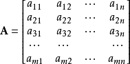
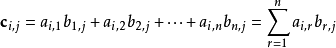
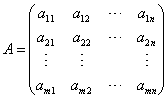
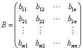
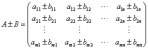
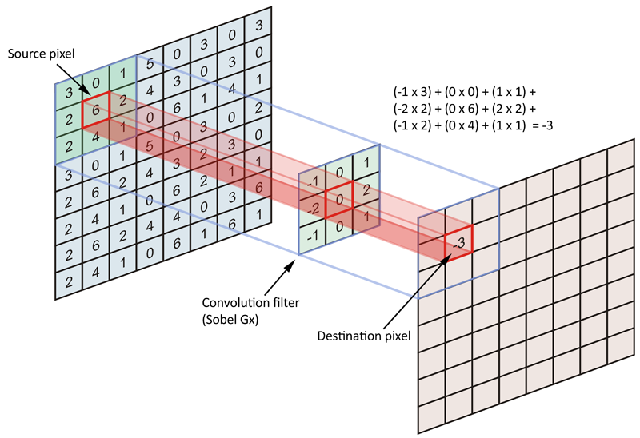
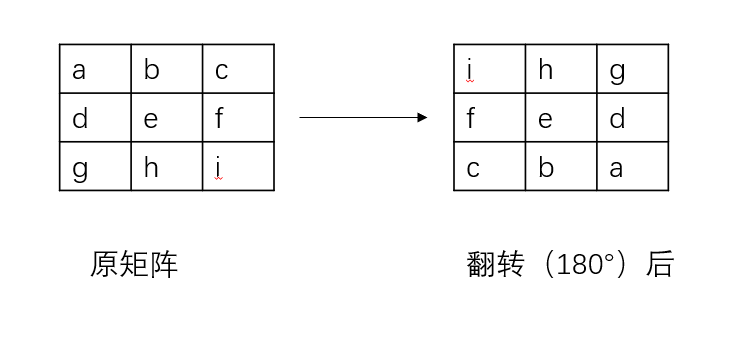
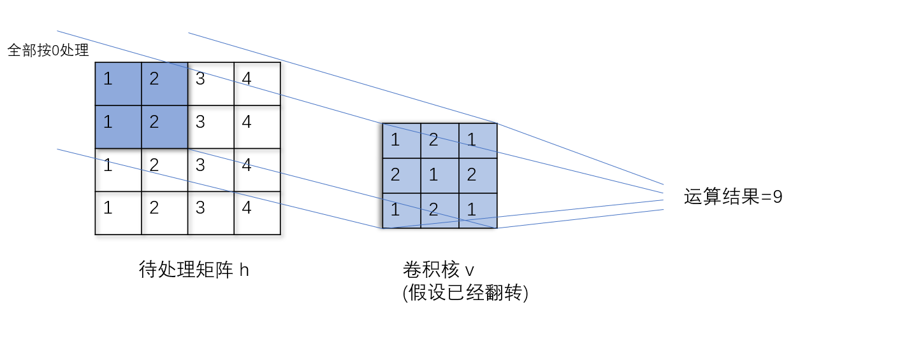
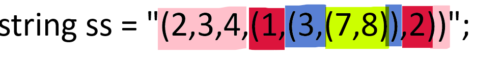
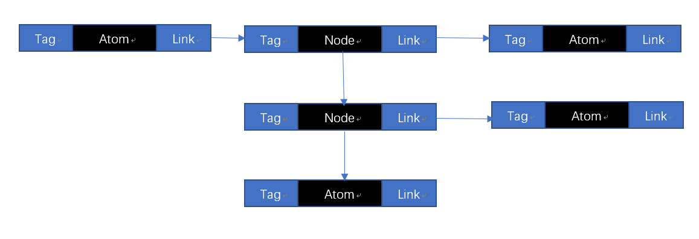

# 第六章 串、数组、矩阵和广义表

## 1.C++字符串常用操作（一）

- 字符串是由单个字符构成的**线性**串，常以 ASCII 表示；C 语言里它以 `'\0'` 结尾，本质是字符数组。
- 这些操作在 `<string.h>`（C++ 中为 `<cstring>`）中已有封装，本节讲其**手写实现原理**。
- **求长度（strlen）**：循环计数直到 `str[i] != '\0'` 为止，返回计数 i。例 "Hello My DotCpp.com" 长度为 19。
- **求字符位置（strchr）**：从头扫描，`str[i] != '\0' && str[i] != c`，返回首次出现的下标（hello 找 l 得 3）。
  - 扩展练习：改成返回该字符出现的**所有**位置，需循环扫描并记录多次命中的下标。
- **子串截取 substr(i, j)**：把 `[i, j)` 区间的字符逐个拷到新串，末尾补 `'\0'`；"Hello My DotCpp.com" 取 0~5 得 "Hello"。
- **前缀 prefix(m)**：只取前 m 个字符，同样要补结束符；取 5 个得 "Hello"。
- **后缀 suffix(m)**：先求总长 len，再从 `len-m` 拷到 len，补结束符；取 3 个得 "com"。
- 关键细节：所有新串末尾**必须手动补 `'\0'`**，否则不是合法 C 字符串；suffix 用局部数组 `char backup[500]` 而非 `char *backup`，避免返回局部指针的内存错误。

## 2.C++字符串常用操作（二）

- **连接（strcat）**：先让 dest 指针走到自身末尾（`while(*dest)`），再把 src 逐字符复制过去，最后补 `'\0'`，并返回原 dest 首地址。
- **比较（strcmp）**：逐字符相减，`ret == 0` 表示相等，`ret > 0` 表示前者大，`ret < 0` 表示后者小；实现上把结果规整为 -1/0/1。
- 比较时要转成 **`unsigned char`**，因为 char 的符号位可能被扩展，直接相减在大值字符上会出错。
- **暴力匹配（BF）思想**：主串 T 与模式串 P，外层遍历 T 的每个起点，内层逐字符比对 P；失配就回到外层起点的下一个字符重新比。
- 以 n = |T|、m = |P| 计，BF 的时间复杂度为 **O(n·m)**；现实里 n ≫ m ≫ 2，代价很大。
- 典型最坏情况：T = 47 个 'A' 加 'B'，P = "AAAAAB"，每轮都要比到最后一个字符才失配，约 47×6 次比较。
- 结论：BF 易理解但低效，是引出 KMP 的动机。

## 3.字符串的KMP算法详解及C/C++代码实现

- KMP（Knuth、Pratt、Morris，1977）的核心优势：失配时**不回退主串指针**，只按 next 表移动模式串，复杂度由 O(n·m) 优化到 **O(n+m)**。
- **前后缀概念**：字符串 "ABCD" 的前缀为 "A"、"AB"、"ABC"（不含本身），后缀为 "D"、"CD"、"BCD"。
- **next 表含义**：模式串每一位对应“该位之前的子串中，最长的相等前后缀长度”。
- 例："ABCABDE" 的 next 表为 **-1 0 0 0 1 2 0**（首位置 -1；也有教程首位取 0，本质等价）。
- **构造规则**：以已算好的前一位为基础递推——若当前字符与前缀后一位字符相等，则 `next[i] = next[i-1] + 1`；否则回退（`t = next[t]`）继续尝试，仍不匹配则填 0。
- **匹配过程**：i 走主串、j 走模式串；`T[i] == P[j]` 则双指针前进；失配则 `j = next[j]`（j 可能变成 -1，此时 i、j 同时前进）。
- 匹配完成后返回 `i - j` 即模式串首字符在主串中的位置；示例 "ABABABABABD" 中找 "ABABD"，返回 6（第 7 位匹配，从 0 计数为 6）。
- 记忆点：BF 的浪费在于“失配后从头再比”，KMP 用 next 表把已经确认相等的前缀信息复用起来。
- 注意：动态申请的 next 数组用完要 `delete[] next`。

## 4.C++中string字符串类型介绍

- `string` 是 C++ 的模板类，比 C 的字符数组更安全方便，可自动管理长度。
- 头文件 `#include <string>`——**不是** `<string.h>`（C 的头文件）也不是 `<cstring>`（C++ 兼容 C 的头文件）；且需 `using namespace std;`
- **初始化六种写法**：
  - `string str;` 空串
  - `string str1 = "Hello Dotcpp.com";`
  - `string str2(str1);` 拷贝构造
  - `string str3(str1, 6);` 从下标 6 到末尾 → "Dotcpp.com"
  - `string str4(str1, 6, 6);` 从 6 起取 6 个 → "Dotcpp"
  - `string str5(5, 'D');` 5 个 'D' → "DDDDD"
  - `string str6(str1.begin(), str1.end());` 区间构造
- **比较**：直接用 `==`、`!=`、`>`、`<`、`>=`、`<=`，不必再写 strcmp，运算符重载更符合直觉。
- **连接**：直接用 `+`，如 `"a" + "b" + "c" + "d"`，无需 strcat。
- **常用接口**：
  - `length()` 长度，`size()` 大小（两者等价）
  - `empty()` 判空
  - `resize(len, chr)` 重设长度：多则截断，少则用 chr 补齐，会改变占用空间（如 "HEllo" resize(8,'K') → "HElloKKK"）
- `string` 与 STL 一脉相承，后续大量题目直接用 `string` 比字符数组省心。

## 5.用数组实现模拟算法C/C++实现（配例题）

- 数组是**顺序存储**的数据结构：内存连续，随机寻址快，插入删除需整体挪动。
- 与链表对比：数组读取更灵活，链表增删更便捷；但链表有指针开销，实际开发要按场景选型，不必迷信高级结构。
- **模拟**不是某种算法，而是一种思维：按题目描述，用简单直观的方式一步步用代码复现过程。
- 以「分糖果」（1431）为例，思路：
  - 用数组 `kid[i]` 表示每个小朋友的糖果数，答案计数器 `ans`。
  - 循环条件：所有人糖果数相等（`kid[0]` 与其余逐一比较，全等则 break）。
  - 每轮：全体减半（题目保证偶数，无需处理进位）→ 用临时变量 `temp = kid[n-1]`，每人加上前一个人的数，`kid[0] += temp`（环形传递）→ 奇数者加 1 且 `ans++`。
  - 最后输出 `ans`。
- 模拟题通用套路：**建数组表示状态 → 定循环 → 定退出条件 → 每轮按规则更新 → 计数/输出**。
- 推荐练习（均为蓝桥杯真题）：分糖果 1431、蚂蚁感冒 1454、计算器 1560；题库中可按“模拟”标签筛选。

## 6.矩阵的介绍及乘法运算（附C语言实现代码）

- 矩阵：m×n 个数 aᵢⱼ 排列成的数表，记 Aₘₙ；aᵢⱼ 称 (i,j) 元。19 世纪由凯利提出，源于方程组系数。
- 应用：线性代数、统计分析、物理（电路/力学/光学/量子）、计算机图形学与图像处理（像素矩阵）。
- **乘法前提**：A 的**列数**等于 B 的**行数**（A 为 m×n，B 为 n×p），结果 C 为 m×p。
- 元素计算：`C[i][j] = Σ A[i][k] * B[k][j]`（k 从 0 到 n-1），即“A 的第 i 行 × B 的第 j 列”。
- 实现三重循环：外层遍历 C 的行、中层遍历 C 的列、内层做点积累加，答案矩阵先 `memset` 清零。
- 复杂度 O(m·n·p)，这是朴素矩阵乘法的代价（快速幂、Strassen 等属于进阶优化）。

## 7.矩阵加减法操作及C语言代码实现

- **加法规则**：同型矩阵（行数、列数都相同）对应位置元素相加，`C[i][j] = A[i][j] + B[i][j]`，满足交换律 A+B = B+A。
- **减法规则**：同样要求同型，对应位置相减，`C[i][j] = A[i][j] - B[i][j]`，不满足交换律。
- 实现极简：双重循环遍历 n 行 m 列，把运算符换掉即可；输入、输出也各是一套双重循环。
- 注意：非齐型矩阵不能相加减，代码里应先判断维度是否一致。
- 学习路线建议（原文给出）：基本概念 → 加减乘 → 秩、点阵、运算值 → 翻转等特殊操作 → 卷积核、稀疏矩阵、增广矩阵。
- 进阶练习：用 C++ 类封装矩阵，重载 `+ - *` 运算符；再扩展矩阵幂与快速幂。

## 8.矩阵扩展-算卷积算法介绍及C语言代码实现

- 卷积：用一个模板（卷积核）在图上滑动逐位置做加权求和，常用于**锐化、边缘提取**，也是 CNN 图像处理的基础。
- 本节用 **Zero padding、unit stride**（零填充、步长为 1）的最简形式讲解，不展开复杂公式。
- 运算两步：
  - 先把卷积核**旋转 180°**（倒置）；
  - 再把核与原图对应区域逐元素相乘求和，得该位置的输出值。
- 举例（3×3 核）：`0*1+0*2+0*3+0*2+1*1+2*2+0*1+1*2+2*1 = 9`，边界按 0 参与计算。
- 代码技巧：二维数组从下标 1 开始存数据，边界留出 0，这样遍历 `i=1..n, j=1..m` 时可直接用 `org[i-1+a][j-1+b]` 取 3×3 邻域，天然实现零填充。
- 卷积核输入时可直接倒着读（`for(i=2;i>=0;i--) cin>>ker[i][2]>>ker[i][1]>>ker[i][0];`），省去额外翻转。
- 复杂度：n×m 个位置，每个位置做 k² 次乘法，O(n·m·k²)。
- 本质仍是二维数组的遍历应用，理解“滑动窗口 + 加权求和”即可迁移到图像滤波、池化等。

## 9.广义表的介绍及设计（C语言实现）

- 广义表是**线性表的推广**，元素既可以是不可再分的原子，也可以是一个子表，因此是多层次的线性表。
- 记法 GL = (a₁, a₂, …, aₙ)，n 为长度（n≥0，n=0 为空表）；aᵢ 为原子或子表。
- **六条重要特性**：
  - 元素之间有相对次序。
  - 长度 = 最外层元素个数。
  - 深度 = 所含括号的重数；原子深度为 0，空表深度为 1。
  - 可被其他广义表共享 → 再入表。
  - 可以是自身的子表 → 递归表（深度无穷，长度有限）。
  - 任意非空广义表可分解为表头 `head(GL) = a₁` 与表尾 `tail(GL) = (a₂,…,aₙ)`。
- 因规模不定，广义表用**动态链式**存储，结点三部分：`tag`（标志）+ `atom/ptr`（值或指针，用 union 节省空间）+ `link/tp`（同层下一个结点）。
- **两种结点设计**：
  - 头尾链表法：LIST 结点用 `hp`（表头指针）+ `tp`（表尾指针）。
  - 扩展线性表（子表法）：`hp` 指向本层第一个元素，`tp` 指向本层下一个元素。
- 用 `enum{ATOM, LIST}` 定义 tag（0 原子 / 1 子表），用 `union` 让原子值与指针共用同一块内存——**同一时刻只能存在一种**，因此必须严格用 if/else 区分，切勿混用。

## 10.广义表的创建及C语言代码实现

- 以 `(2,3,4,(1,(3,(7,8)),2))` 为例：每层括号代表下一层，共 4 层，故可用括号级数表示广义表。
- 创建思路：先按 `tag` 判断当前结点是原子还是子表，再按类型分别挂接 `hp` / `tp`。
- **核心工具函数 sever(str, hstr)**：把非空串切分成“表头 hstr”与“剩余表尾 sub”。
  - 用 `k` 记录尚未配对的 `(` 数量，遇到 `(` 则 k++、`)` 则 k--；
  - 只在 `k == 0` 且遇到 `,` 处切分，这样才能跳过子表内部的逗号；
  - 若一直没找到逗号，则整串作为表头，剩余串置空。
- **CreateGList 递归流程**：
  - 空串 → L = NULL；
  - 单个字符 → 建原子结点（`tag = ATOM`）；
  - 否则 → 建表结点（`tag = LIST`），先去掉最外层括号 `s.substr(1, s.size()-2)`，再循环：sever 分出表头 → 递归创建 `p->ptr.hp` → 若还有剩余就新建表尾结点并用 `q->ptr.tp = p` 连接 → 最后 `q->ptr.tp = NULL`。
- **求深度 GListDepth（递归）**：
  - 空表返回 1；原子返回 0；
  - 否则沿同层 `pp = pp->ptr.tp` 遍历，递归求每个表头的深度取最大值；
  - 返回 `max + 1`（加 1 表示加上当前这一层括号）。
- 易错点：union 两成员不能同时有效；创建时要记得给表尾最后置 NULL；字符串下标与括号配对必须逐一校验。

