# 第七章 树

## 1.树的概念

- **定义**：树是 n 个结点的有限集合，属于非线性结构，无环。n=0 为空树；n>0 时有 1 个根结点，其余结点分成 m 个互不相交的有限集，每个子集都是一棵子树。
- **结点相关术语**：
  - 结点的度：该结点子树的个数。
  - 树的度：所有结点度的最大值。
  - 分支结点：度不为 0；叶子结点：度为 0。
  - 路径 i→j：两结点间的通路；路径长度 = 路径经过结点数减 1。
- **关系术语**：孩子（后继）、双亲（父母）、兄弟（同一双亲的孩子）、子孙（所有子树中的结点）、祖先（根到该结点路径上的结点）。
- **层次与高度**：根为第 1 层；树的高度 = 结点的最大层次。
- **有序树**：子树从左到右有序、次序不可改变；无序树则相反。
- **森林**：互不相交的树的集合（可以为 0 棵）。
- **四条性质**：
  - 树的结点总数 = 所有结点度数之和 + 1（多的 1 是根）。
  - 度为 m 的树第 i 层最多有 m^(i-1) 个结点。
  - 高度为 h 的 m 次树至多有 (mʰ − 1)/(m − 1) 个结点。
  - 含 n 个结点的 m 次树最小高度为 ⌈logₘ(n(m−1) + 1)⌉。

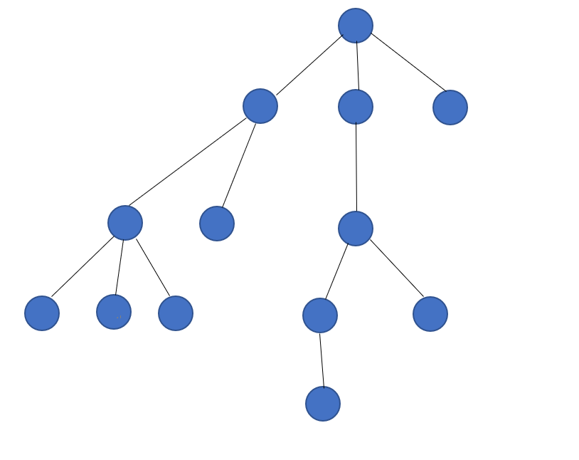

## 2.二叉树及分类介绍

- **定义**：n（n≥0）个结点的有限集合，或为空，或由根结点 + 两棵互不相交的左子树、右子树组成。
- **三个特点**：
  - 每个结点最多两棵子树，不存在度 > 2 的结点。
  - 左子树与右子树**有顺序**，次序不能颠倒。
  - 即使只有一棵子树，也要区分是左还是右。
- **四条性质**：
  - 第 i 层最多 2^(i-1) 个结点（i≥1）。
  - 深度为 k 的二叉树至多 2ᵏ − 1 个结点。
  - 含 n 个结点的二叉树高度至少为 log₂(n+1)。
  - 任意二叉树中，叶子数 n0 与度为 2 的结点数 n2 满足 **n0 = n2 + 1**（最常考）。
- **三种特殊形态**：
  - 斜树：所有结点都只有左子树（左斜树）或只有右子树（右斜树）。
  - 满二叉树：所有分支结点都有左右子树，且所有叶子都在同一层；非叶子结点度必为 2；同深度中结点数、叶子数最多。
  - 完全二叉树：按层编号后，每个编号 i 的结点位置与同深度满二叉树中编号 i 的位置完全相同——即只允许最下层右侧“缺角”，不允许中间空缺。

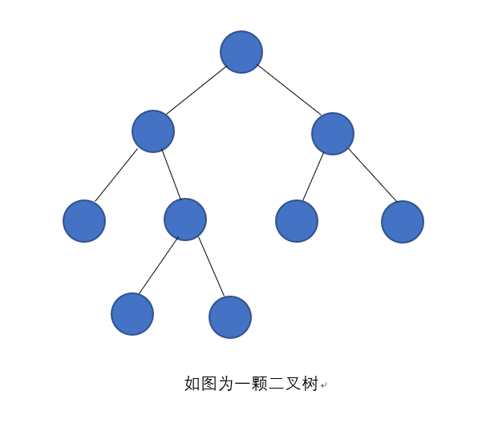
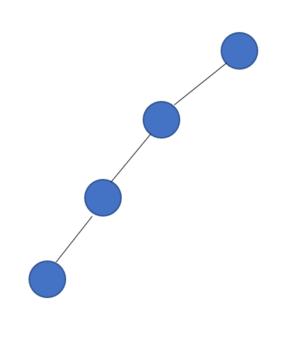
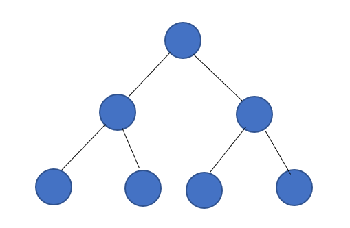
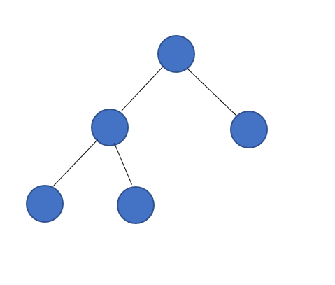

## 3.二叉树的存储（C语言实现）

- 本节以**二叉排序树**的插入为例演示链式存储：按大小关系自动把数据放进左/右位置。
- **结点设计**（parent 指针可选，可省内存，加了便于向上查找）：

```cpp
typedef struct node { int data; struct node *left, *right; } Node;
typedef struct { Node *root; } Tree;   // 树根
```

- **创建/插入思路**：
  - 先 malloc 新结点并赋数据，左右置 NULL；
  - 若 `tree->root == NULL`，直接让根指向它；
  - 否则从根开始循环比较：小于当前结点就往左走，大于就往右走；走到空位就挂上并 return。
- 这样建成的树就是**二叉排序树**，中序遍历即可得到有序序列。
- **中序遍历参考**：`if(node){ inorder(node->left); 输出; inorder(node->right); }`
- 主流程：建空树 `tree.root = NULL` → 循环读入 n 个数并 insert → inorder 输出。
- 练手题：1731（二叉树的基本创建）。

## 4.树的遍历之先序遍历二叉树

- 三句口诀：**先序 根左右**、**中序 左根右**、**后序 左右根**。
- 为什么要约定局部次序：二叉树本身没有全局次序，只能通过结点与孩子之间的局部访问顺序间接定义全局顺序。
- **先序过程**：先访问根 A → 进入左子树 B，B 又作为子树根继续下钻到 D → D 下钻到 E，E 无子结点 → 回退访问 F → 左子树完成 → 访问 G……
- 示例树先序结果为 **ABDEFGCH**。
- **递归代码**（就三行顺序不同）：

```cpp
void preorder(Node* node){
    if(node != NULL){ printf("%d ", node->data); preorder(node->left); preorder(node->right); }
}
```

- **扩展：前缀表达式（波兰式）**——先序遍历算术表达式的二叉树即得。如 (a+b)*c 的波兰式为 `*+cab`。
- 波兰式无需括号即可表示优先级，更适合计算机处理；实现常规式↔波兰式的转换一般借助栈。
- 练手题：1734（二叉树的遍历）。

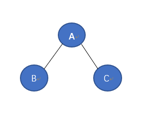
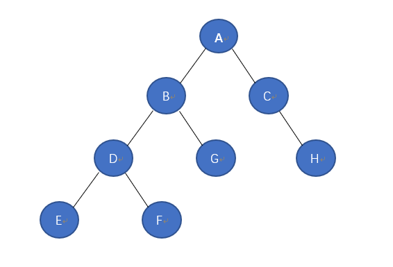
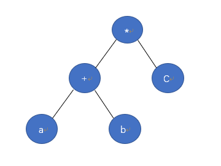
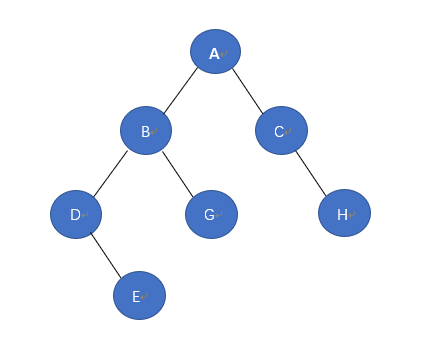

## 5.树的遍历之中序遍历二叉树

- 口诀：**左根右**。最简情形：访问 B → A → C。
- 实际过程：进入 ABC 后先走左子树 B；B 是 BDG 的根，继续下钻；遇到 DEF 这一组先得 EDF；把 EDF 整体当 BDG 的左部分回溯，得 EDFBG；再把 EDFBG 当作 ABC 的左部分，得 EDFBGAC；最后访问右部分 C。
- 示例树中序结果为 **EDFBGACH**。
- **递归代码**：`inorder(left); 输出; inorder(right);`
- **应用：中缀表达式**——中序遍历表达式二叉树即得我们熟悉的 `(a+b)*c`，需靠括号表达优先级，嵌套多时括号多。
- 关系记忆：先序 ↔ 波兰式，中序 ↔ 常规式，后序 ↔ 逆波兰式。
- 练习：1734；另可自己画出 `((a+b)+(c+d))*e` 的中缀表达式二叉树。


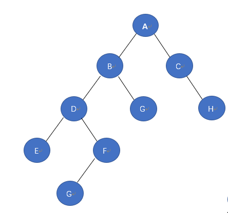

## 6.树的遍历之后序遍历二叉树

- 口诀：**左右根**。最简情形：B → C → A。
- 实际过程：先处理最深的左分支，E 与 F 都在末端，得到 EFD；EFD 作为 D 的结果，再与 G 合成 **EFDGB**；右分支 ^HC 中空结点跳过，得 **HC**；最后 EFDGB（左）+ HC（右）+ A（根）。
- 示例树后序结果为 **EFDGBHCA**。
- **递归代码**：`postorder(left); postorder(right); 输出;`
- **应用：后缀表达式（逆波兰式）**——后序遍历得 `ab+c*`。
- 逆波兰式的读取与计算天然契合**栈**的思路；考试中常见“波兰式 / 常规式 / 逆波兰式互相转换 + 求值”题型。
- 练习：1734；并思考 `((a+b)+(c+d))*e` 的后缀表达式写法。


## 7.DFS（深度优先搜索）算法讲解（附模板及习题）

- **DFS**：沿一条分支尽可能深地搜索，走不通就回溯到上一个分叉，直到所有结点被访问。
- DFS 的访问顺序称 **DFS 序**；同一棵树的 DFS 序可能不唯一（取决于子结点访问次序）。
- 与先序遍历本质一致，区别只在：树的子结点可以是多个分支，而不止左右两个。
- 复杂度代价：未加优化时，深度为 n 的二叉树上做 DFS 可达 **O(2ⁿ)**。
- **剪枝**：提前判断该分支已不可能产生解，直接舍弃其后的所有结点，是提升 DFS 效率的关键手段。
- **标准模板**：

```cpp
bool check(参数){ if(满足条件) return true; return false; }

void dfs(int step){
    判断边界;              // 到边界则执行相应操作并 return
    for(尝试每一种可能){
        if(check()){ 标记; dfs(step+1); 恢复初始状态; }  // 回溯必须恢复现场
    }
}
```

- 三步要点：边界判断、状态标记、回溯恢复——缺一不可。
- 练手题：1177 三角形（含一点 DP 思维）、1861 程序员爬楼梯、1531 数的划分。

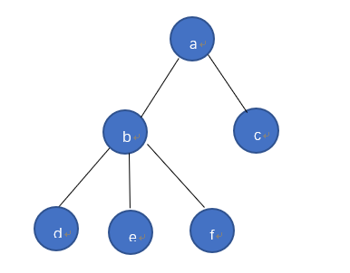

## 8.树形模拟法的运用（C语言例题讲解）

- 实战中很少真去建树，通常用**多个数组模拟**：一个数组存“指向的下标”，一个数组存“值”，二者一一对应。
- 数组模拟的核心：`nxt[i]` 记录第 i 个结点的孩子下标，天然跳过 malloc 与指针，写起来更快。
- **例题一：全排列**
  - 暴力思路要写 10 层 for 循环 + if 判重，极其臃肿；
  - DFS 思路：用 `p[x]` 记录第 x 位放什么数，`vis[i]` 标记 i 是否用过，递归层数即 for 的层数；
  - 边界：`x == n+1` 时输出整组排列并 return；
  - 每层枚举 1..n，未使用则填入 → 标记 → 递归 → 恢复标记。
- C++ 已有现成解法：`next_permutation`。
- **例题二：程序员爬楼梯**（每次走 1 步或 3 步，求走到第 n 格的方案数）
  - 把“已走步数 k”作为状态建二叉树：k 的两个孩子是 k+1 与 k+3；
  - `dfs(k)`：`k == n` 则 ans++ 返回；`k > n` 则直接返回（剪枝）；否则递归 `dfs(k+1)`、`dfs(k+3)`。
- 模拟 + DFS 的通用体会：用数组替代指针结构，用递归替代多层循环，用边界判断与标记数组控制状态。

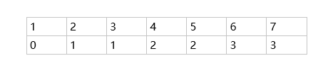
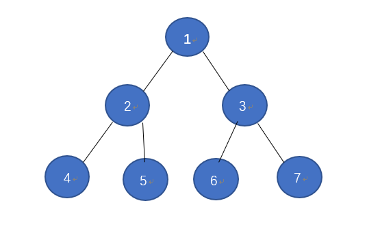
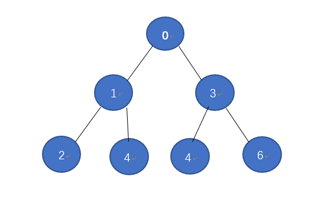

## 9.二叉树(树)与森林的相互转换

- **森林**：m（≥0）棵互不相交的树的集合，可把每棵树视为一个点。
- **树 → 二叉树**三步：
  - 加线：在兄弟之间加连线；
  - 抹线：每个结点只保留与第一个孩子的连线，其余孩子的连线抹掉；
  - 旋转：以根为轴心顺时针旋转 45°。
- 结论：树转成的二叉树，其**右子树一定为空**。
- **二叉树 → 树**三步：
  - 加线：若 p 是双亲的左孩子，把 p 的右孩子、右孩子的右孩子……（沿右分支的所有结点）都与 p 的双亲连起来；
  - 抹线：抹掉原二叉树中双亲与右孩子的连线；
  - 调整：按层次排列成树形。
- **森林 → 二叉树**：各树先各自转成二叉树 → 把各棵树的根用线连起来 → 以第一棵树的根为总根，顺时针旋转 45°。
- **二叉树 → 森林**：抹掉根与其右孩子、以及沿右分支所有右孩子之间的连线，变成若干孤立二叉树 → 再把每棵孤立二叉树还原成树。

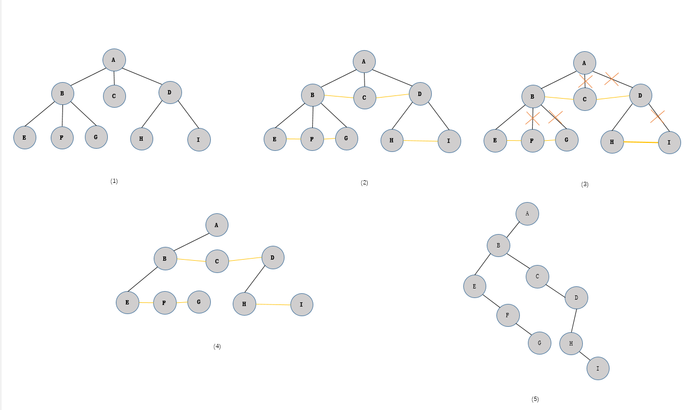
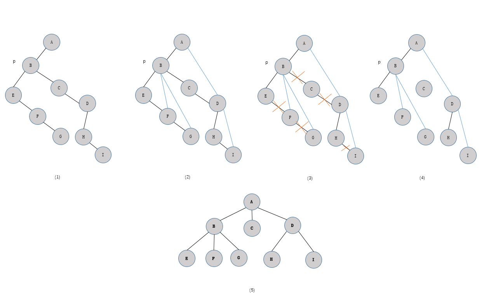
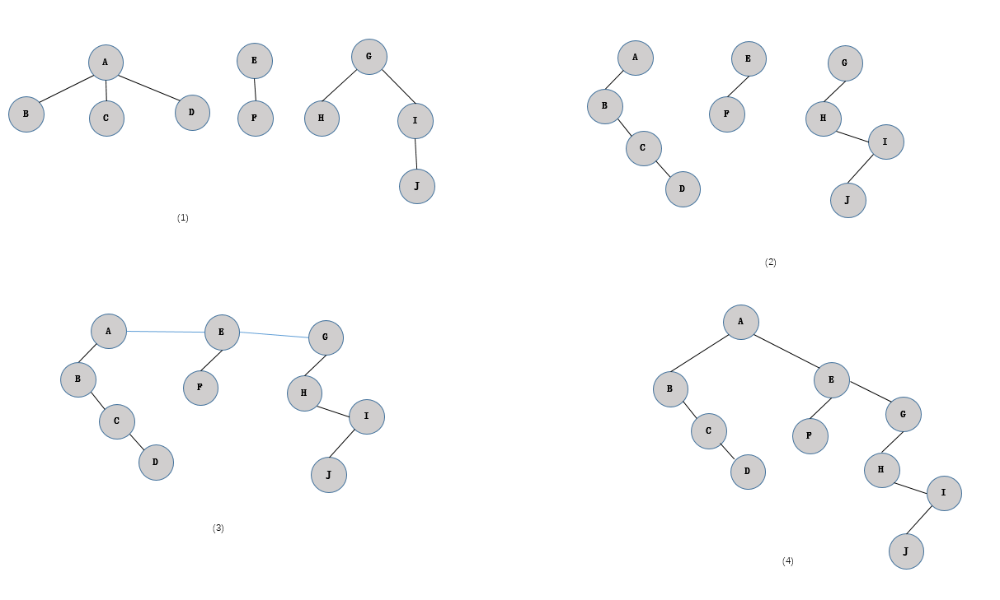
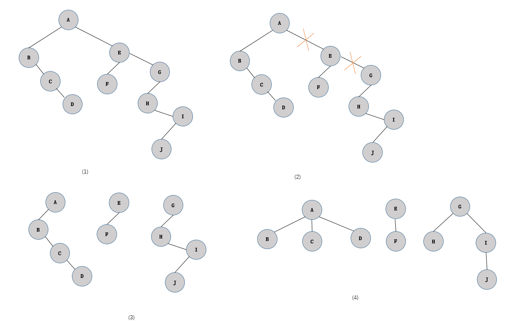

## 10.哈夫曼树的介绍及C语言代码实现

- **哈夫曼树（最优二叉树）**：给定 N 个权值作为 N 个叶子结点，构造二叉树使**带权路径长度 WPL 最小**的树；权值越大离根越近。
- **术语**：
  - 路径：结点间的通路；路径长度：每经过一个结点加 1（根到第 i 层的路径长度为 i−1）。
  - 结点的权：赋予该结点的数值。
  - 结点的带权路径长度 = 路径长度 × 权值。
  - **WPL** = 所有叶子结点的带权路径长度之和。
- **构建规则（贪心）**：
  - 先取权值最小的两个作为左右孩子，根的权为二者之和；
  - 把新根放回待处理集合，再取最小的与它组成新的一层；
  - 重复直到只剩一个根。
- 示例（叶子权 1、4、6、8）：WPL = 8×1 + 6×2 + 1×3 + 4×3 = **35**（原文此处写作 273，按公式应为 35，属笔误）。
- **结点结构**（用数组存，靠下标索引孩子与双亲，需 parent 域）：

```cpp
typedef struct { int weight; int parent, left, right; } HTNode, *HuffmanTree;
```

- **建树流程**（n 个叶子 → 共 2n−1 个结点，0 号位不用）：
  - 初始化 1..n 为叶子（weight 赋权值，parent/left/right 置 0）；
  - 初始化 n+1..2n−1 为待生成的内部结点（全 0）；
  - 循环 i = n+1..2n−1：调用 Select 找两个无父结点且权最小的 s1、s2 → 令二者 parent = i，i 的 left = s1、right = s2，weight = 两者之和。
- `if(n <= 1) return;` 特判：只有一个编码时无需构树。

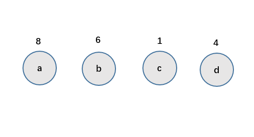
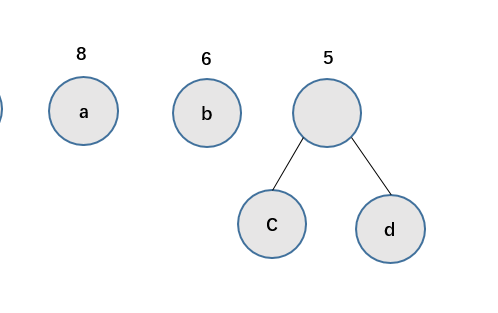
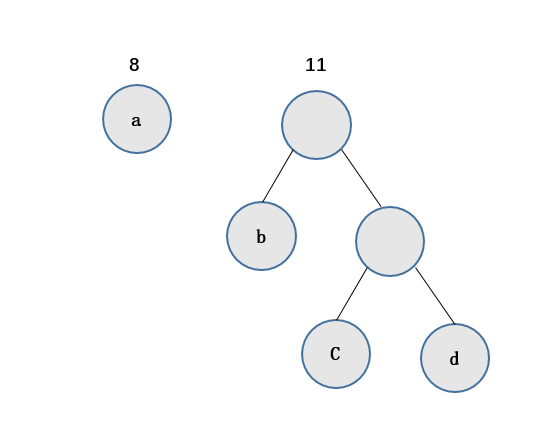
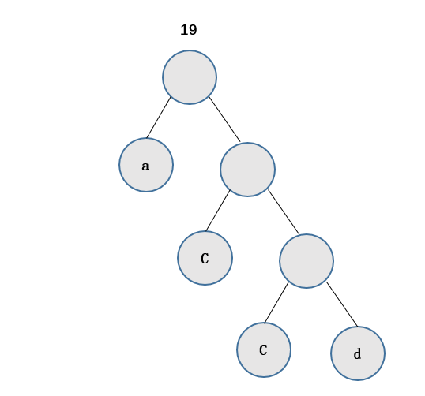

## 11.哈夫曼树编码与查找算法（C语言实现）

- **Select 的作用**：在 1..end 中挑出两个 parent 为 0（尚未被用）的最小权结点，返回其下标。
- **挑选逻辑**：
  先找到第一个未使用结点记为 min1（s1），再找第二个作 min2（s2），二者比较，小的记 min1、大的记 min2；
  之后逐个扫描其余未使用结点，分两种情况：
  - 比 min1 还小：min2 ← min1，min1 ← 新值，s2 ← s1，s1 ← j；
  - 介于两者之间：min2 ← 新值，s2 ← j。
- **哈夫曼编码**：可变字长编码（VLC），按字符出现概率构造，使平均码长最短，又称最佳编码。
- 目的：出现频率高的字符用更短的 0/1 串（更靠近根），从而最大化压缩存储空间。
- 关键性质：它是**无前缀编码**——任一编码都不是另一编码的前缀，因此解码时不会混淆。
- 应用：数据压缩、加密解密、文件传输。
- 实现提示：从叶子出发沿 parent 向上回溯，左分支记 0、右分支记 1，再把得到的序列逆序即为该字符编码。

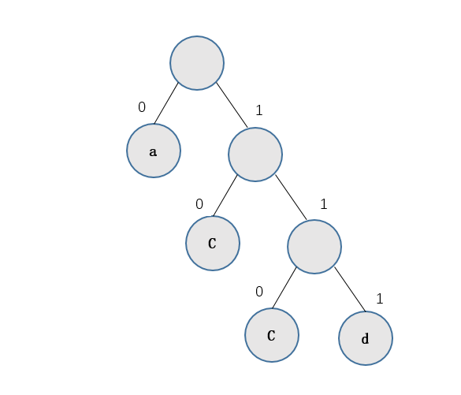
