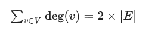
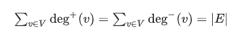
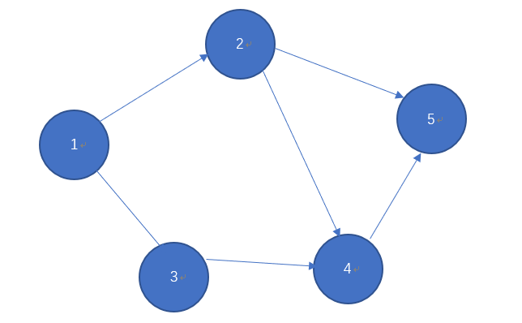
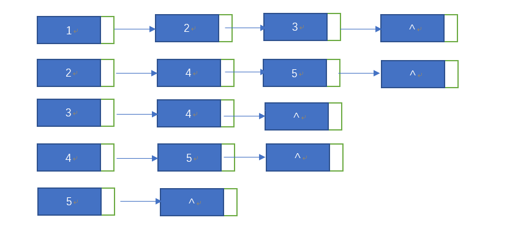
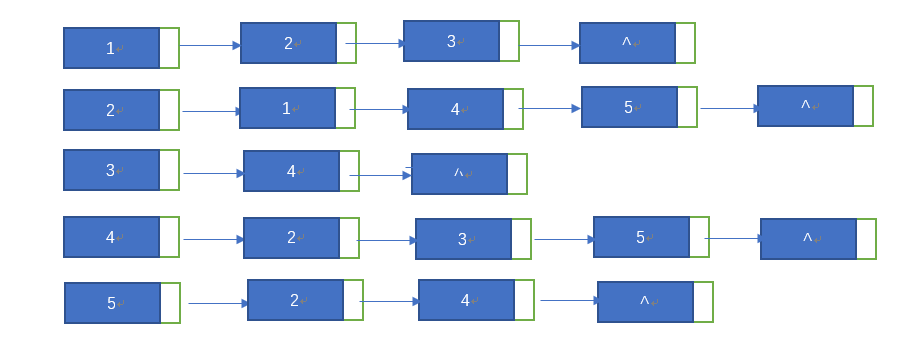
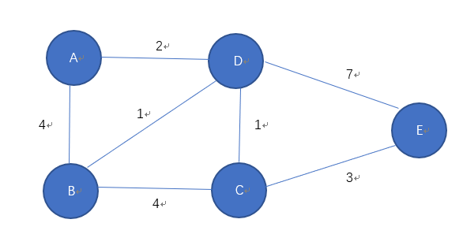

# 第八章 图

## 1.图的存储-邻接矩阵及C/++代码实现

- 图论起源于欧拉 1736 年解决的柯尼斯堡七桥问题，是数学的一个分支，也是图算法的理论基础。
- **定义**：图 G 是二元组 `<V, E>`，V 为有限非空顶点集，E 为边集，边 eᵢ 对应 V 中的结点。
- **基本概念**：
  - 无向图 / 有向图 / 混合图（部分边有向、部分无向）。
  - 有限图（点集、边集都有穷）、零图（边集为空）、平凡图（只有一个结点、无边）。
  - 关联：边 e=(u,v) 关联 u 与 v；孤立点：无边关联的点；自环：边的两端点是同一结点。
  - 邻接：同一条边的两个点是邻接的；同一个点的两条边也是邻接的。
- **两条定理**：任意图中所有顶点度数之和 = 2×边数；有向图中所有点入度之和 = 出度之和（“上坡与下坡一样多”）。
- 推论：任意图中**度数为奇数的顶点必有偶数个**。
- 树与森林都是特殊的图（连通且无环）。
- **邻接矩阵**：`bool adj[n][n]`（或 `int adj[n][n]` 直接存边权），`adj[i][j]` 表示 i 与 j 之间是否有边。
  - 优点：O(1) 判断两点是否相邻、O(1) 取边权。
  - 缺点：空间 O(n²)，稀疏图浪费严重。
- 无向图赋值要**双向**写：`adj[x-1][y-1] = 1; adj[y-1][x-1] = 1;`（下标从 0 开始，输入从 1 开始时记得减 1）。




## 2.邻接表的定义及C/C++代码实现

- **邻接表**：用链表（或数组模拟链表）表示邻接关系，采用“顺序分配 + 链式分配”结合的方式，类似树的孩子链表表示法。
- 结构：n 个表头结点（存该顶点与第一条边指针），每个表头挂一条单向链表，链上依次存放它的所有邻接顶点。
- 链表末尾要留空或特殊标记表示结束；双向图中同一条边要在两端各出现一次。
- 结论：n 个顶点、e 条边的无向图，邻接表有 n 个顶点表结点、**2e 个边表结点**。
- **与邻接矩阵对比**（矩阵的缺点）：
  - 浪费空间：存稀疏图有大量无效 0；
  - 浪费时间：统计边数要扫全矩阵。
- 复杂度：邻接表 O(n + e)，邻接矩阵 O(n²)；稀疏图（点多边少、弱连接）必须用邻接表。
- **指针实现的关键结构**：

```cpp
typedef struct ArcNode { int adjvex; struct ArcNode *nextarc; } ArcNode;   // 边结点
typedef struct { int data; ArcNode *firstarc; } Vnode;                    // 顶点结点
typedef struct { Vnode adjlist[maxSize]; int n, e; } AGraph;
```

- 建表流程：初始化所有 `firstarc = NULL` → 逐条读边 (u,v) → 申请边结点并写入 adjvex → 若首边为空直接挂上，否则遍历到链尾再插入（`insertNode`）。
- 遍历输出：对每个顶点，沿 `firstarc` 走链表输出 adjvex。





## 3.图的存储：链式向前星

- **前向星**：把边集数组按“起点升序、起点相同则终点升序”排序，并记录每个起点的边在数组中的起始位置与长度。
- 排序代价 O(e log e)，链式向前星就是为省掉这次排序而做的优化。
- **本质**：用链表思想把同起点的边串起来，无需排序即可直接定位到目标边。
- **结构设计**：

```cpp
struct Edge { int w; int to; int next; } edge[10005];   // 边：权、指向、下一条边序号
int cnt = 0;      // 边计数
int head[10005];  // head[x] 记录以 x 为起点的第一条边序号
```

- **加边（头插）**：`edge[cnt].to = to; edge[cnt].w = w; edge[cnt].next = head[from]; head[from] = cnt++;`
- 遍历某点 u 的所有出边：`for(int i = head[u]; i != -1; i = edge[i].next)`。
- 初始化要点：`head[]` 全部赋 **-1**（或任意负数）作为边界判定，方便查错。
- 优点：构建与遍历都极快，是算法竞赛与高效图论算法的首选；缺点：理解门槛高、构造麻烦。
- 对比记忆：矩阵 O(1) 判边、O(n²) 空间；邻接表 O(n+e)；链式向前星同为 O(n+e) 且常数最小。


## 4.图的遍历DFS深搜优先搜索及C语言代码实现

- **遍历**：从某点出发，把图中每个点访问且只访问一遍。
- **DFS 过程**：沿一条路一直往深处走，走不动就回退一步，再换分支；直到找到解或走完全部点。
- 与**栈**思想一致，因此两种实现：显式栈 或 递归（递归自动借用系统栈）。
- **三步法**：
  - 访问指定起点；
  - 若当前点有未访问的邻接点，任选一个访问；没有就回退到最近访问过的点，直到所有与起点连通的点都被遍历；
  - 若还有未访问点，说明图不连通，取一个作新起点重复上述过程。
- 示例图从 1 出发的 DFS 序（不唯一）：**1-2-4-5-3**。
- **通用模板**：边界判断（到达终点/越界/不合法则 return）→ 剪枝判断 → 枚举扩展方式，合法则修改、标记、递归、（可选）还原标记。
- **图论版核心**：`visited[pos] = 1;` 打印；沿 `firstarc` 遍历邻接点，未访问则递归，指针后移。
- 笔记：加不加“还原标记”决定了是 DFS 还是回溯法——纯遍历不必还原，求所有方案时必须还原。


## 5.图的遍历BFS广度优先搜索

- **BFS**：不“死磕”一条路，而是按层推进——先把当前点的全部邻接点走完，再走下一层，类似树的层序遍历。
- **队列实现四步**：
  - 访问起点；
  - 把起点所有未访问的邻接点入队；
  - 队首出队，访问其邻接点并入队，直到队列为空；
  - 若仍有未访问点（非连通图），另选起点重复。
- 示例图从 1 出发的 BFS 序：**1-2-3-4-5**（先把 2、3 一层走完，再走 4、5）。
- **模板要点**：队列存“状态”，`step` 记录当前层数；每轮先取 `size = queue.size()` 做分层遍历，命中 target 返回 `step-1`；扩展邻居常借助方向数组。
- **图论版实现**：用数组模拟队列（`head`、`tail` 指针），起点入队并标记 → `while(head != tail)` 出队打印 → 扫邻接点，未访问则入队并标记。
- BFS 效率通常优于 DFS（不需要回溯），适合求**最短步数/最短路径（边权为 1）**。
- 应用：地图搜索、迷宫寻路、GPS 导航、游戏 AI（A*、双向广搜等由其改进而来）。


## 6.最小生成树，普利姆（Prim）算法及C/C++代码实现

- **最小生成树（最小权重生成树）**：把 n 个点连通且边权总和最小的子图；必然是 n 个点、**n−1 条边**的树形结构。
- 典型问题：n 个村庄之间修路，使任意两村可达且总造价最低。
- **Prim 思路（“加点法”）**：
  - 任取起点 u 放入集合 U，标记 visited；
  - 在“U 内点 ↔ U 外点”的所有边中找权值最小且不成环的一条，把对应外部点并入 U，边记入结果；
  - 重复直到 U == V，此时得到 n−1 条边。
- 本质是贪心扩张，适合**稠密图**；朴素实现 O(n²)，配优先队列可优化到 O((n+e) log n)。
- 实现要点：邻接矩阵中对角线置 0、其余置一个极大值（如 10000）表示不通；读边时**双向**赋值。
- 数组实现技巧：用边集 T 记录“当前每个外部点到 U 的最短边”，每轮选出最小者交换到第 k 位，再用新并入的点 j 更新其余各点的候选边权（`if(GA[j][u] < T[i].weight)` 则替换）。
- 复杂度与选择：稠密图（边多）优先考虑 Prim。

## 7.最小生成树，克鲁斯卡尔（Kruskal）算法及C/C++代码实现

- **Kruskal 思路（“加边法”）**：
  - 先只保留所有顶点，去掉全部边；
  - 从边集中取权值最小的边，连接它的两个顶点；
  - 继续取次小边，若会构成回路就放弃，取下一条；
  - 直到所有顶点连通且无环，得到最小生成树。
- **两个核心问题**：
  - 边按权值排序 → 直接排序算法即可（O(e log e)）。
  - 如何判环 → 用**并查集**：记录每个顶点的“终点”，加边前比较两端点的终点，相同则成环，放弃。
- **并查集代码要点**：`parent[]` 全置 0；`Find(parent, f)` 沿 `parent[f]` 一路向上找到根；`if(Find(u) != Find(v)) parent[n] = m;` 则合并并采纳该边。
- 复杂度由排序主导 O(e log e)，适合**稀疏图**；Prim 与 Kruskal 的选择本质就是看图的稠密程度。

## 8.最短路径，迪杰斯特拉（Dijkstra）算法及C/C++代码实现

- **最短路径问题四类**：定起点、定终点、定起点+终点、全局（所有点对）。
- 无向图中“定终点”等价于“定起点”；有向图中则相当于把所有边反向后的定起点问题。
- **Dijkstra 核心（两个集合 S / U）**：
  - S 存已确定最短路的点及其距离，U 存未确定的点及当前“暂定距离”（无直接边时为 ∞）；
  - 初始化：S 只含起点，`dist[起点] = 0`；U 中填起点到各点的直接边权；
  - 每轮从 U 中取距离最小的点并入 S；
  - 用它去**松弛** U 中其余点：若 `dist[v] + w(v,u) < dist[u]` 则更新；
  - 重复直到 U 为空。
- 示例：A→B=4、A→D=2，A→C/E=∞；先取 D，再经 D 松弛 B、C、E，逐轮得到 A 到所有点的最短路。
- 实现要点：`final[]` 标记是否已入 S；`D[]` 存最短距离；`p[][]` 存路径（`-1` 表示无路径，`p[v][0]=v0`、`p[v][1]=v` 记录路径顶点）；每轮找 `!final[w] && D[w] < min` 的 w。
- 朴素 O(n²)，堆优化 O((n+e) log n)；**不能处理负权边**（负权要用 Bellman-Ford / SPFA）。



## 9.最短路径，弗洛伊德（Floyd）算法及C/C++代码实现

- **Floyd 思路**：从带权邻接矩阵 A = D(0) 出发，依次以每个点 k 作为“中转点”更新全矩阵，迭代 n 次得 D(n)，即任意两点间的最短距离矩阵。
- **状态转移方程**：`map[i][j] = min(map[i][k] + map[k][j], map[i][j])`，k 穷举 i、j 之间的断点。
- 实现就是三重循环：外层 k（中转点）、中层 i、内层 j ——**k 必须在最外层**，否则结果错误。
- 初始条件：`map[n][n]` 初值取 0（自身到自身），不可达取一个极大值（如 65535）。
- 附带 `path` 矩阵记录前驱/后继，可还原具体路径。
- 采用**松弛技术**，时间复杂度 O(n³)、空间 O(n²)；优点是代码极短、可求全源最短路、支持负权（不能有负权环）。
- 选择口诀：单源稠密用 Dijkstra，单源稀疏（含负权）用 SPFA/Bellman-Ford，**多源（n 较小，≤ 几百）用 Floyd**。


