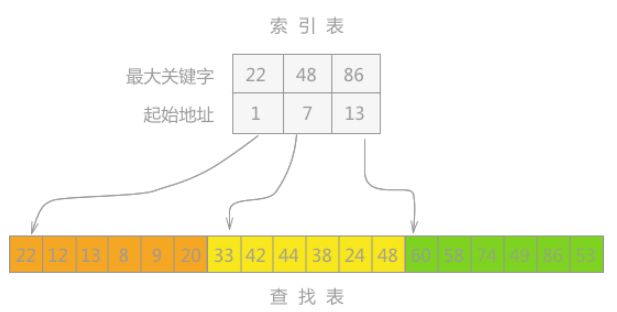
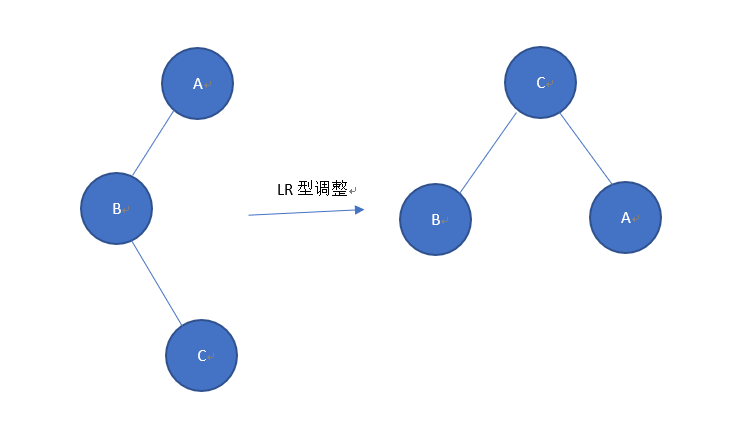

# 第九章 查找算法

## 1.线性（顺序）查找介绍与实现

- **查找算法**：在一批数据中定位某个特定数据的方法；与遍历高度相似，区别是它未必访问全部数据（如二分查找）。
- 典型场景：已知特征，从一堆商品中挑出次品。
- **顺序（线性）查找**：从一个端点开始依次访问每个数据，直到找到目标；本质上就是遍历。
- 实现即一层 for 循环：`if(a[i] == 目标){ 记录/输出位置; }`
- 例题：6 件商品重量为 10，其中一件为 9 的次品，用数组存后遍历即可定位。
- 复杂度：平均 O(n)，最坏 O(n)；优点是无须有序、实现最简单，适合小数据量或无序数据。
- 前提对比：顺序查找适用于无序表或链式存储；一旦数据有序且顺序存储，就应改用更快的折半查找。
- 静态查找（顺序、折半、分块）在本章前半部分，动态查找（二叉排序树、平衡二叉树）在后半部分。

## 2.折半查找（二分查找）介绍与实现

- **前提条件**：线性表必须**顺序存储**，且元素**按关键字有序**（特殊数据情形可例外，如“只有一个次品”的场景）。
- **基本思想**：每次取中点 a[n/2] 与 x 比较：
  - 相等 → 找到，结束；
  - x < a[n/2] → 到左半部分继续找；
  - x > a[n/2] → 到右半部分继续找。
- **复杂度推导**：剩余元素数依次为 n, n/2, n/4, …, n/2ᵏ，令 n/2ᵏ = 1 得 k = log₂n，故时间复杂度 **O(log₂n)**。
- **代码要点**：`low = 0, high = len-1`，`while(low <= high)` 循环，`mid = (low+high)/2`；相等则返回，大于则 `high = mid-1`，小于则 `low = mid+1`；循环结束未找到返回 -1。
- 易错点：`==` 不能写成 `=`；循环条件必须是 `low <= high`（用 `<` 会漏掉最后一个元素）。
- 变体：找第一个 ≥ x 的位置（lower_bound）、最后一个 ≤ x 的位置（upper_bound），是二分答案的基础。
- 记忆：二分只对有序数据有效，无序先用排序（O(n log n)）再二分，通常比顺序查找划算。

## 3.分块查找算法介绍与实现

- **定位**：折半查找与顺序查找的折中改进——只要求**索引表有序**，块内元素可任意存放，因此特别适合结点动态变化的数据。
- **两个核心**：① 建立索引表；② 分块处理。
- **分块要求**：把线性表分成若干块，块内任意，但**块与块之间必须有序**——第 i 块所有关键码都小于第 i+1 块所有关键码（非递减）。
- **索引表**：每块的最大关键码 + 该块起始位置，按块顺序存入辅助数组，天然有序。
- **查找过程（两步）**：
  - 先在索引表中查找（可顺序也可折半）确定目标所在块；
  - 再在该块内顺序查找，定位具体元素。
- 示例：查 38 时，索引表最大关键码为 22、48、86，因 22 < 38 < 48 锁定第二块；第二块起始位置为第 7 位，从第 7 位顺序查到第 10 位命中。
- **复杂度**：总代价 ≈ 索引查找 + 块内顺序查找，均摊 O(√n)，介于 O(log n) 与 O(n) 之间。
- **生活映射**：学校按班级存档，先定班级（索引），再在班级内查找学生——正是分块查找。

## 4.动态查找-二叉排序树介绍与实现

- **二叉排序树（BST）**：插入即自动保持有序的树结构，属动态查找；STL 的 set 底层红黑树即同类结构。
- **三条性质**：
  - 左子树不空时，左子树上所有结点值 ≤ 根值；
  - 右子树不空时，右子树上所有结点值 ≥ 根值；
  - 左右子树本身也都是二叉排序树。
- **查找**：空树则失败；值等于根则命中；小于根走左子树，大于根走右子树。平均 O(log n)，最坏退化成链 O(n)。
- **插入**：按查找路径走到空位置再挂上新结点。递归实现：`t == NULL` 时新建结点（置左右为空）返回；`key < t->data` 递归插左，否则递归插右。
- **建树**：循环对数组每个元素调用 `InsertBST`，即得到整棵树；中序遍历必为有序序列。
- **删除四种情况**：
  - 叶子结点：直接删（断开父指针）；
  - 只有左子树：用左子树顶替该位置；
  - 只有右子树：用右子树顶替该位置；
  - 左右子树都有：找**中序前驱**（左子树中最右的结点）s，用 `s->data` 覆盖待删结点，再删掉 s（s 现在至多只有左子树）。
- 代码要点：`Delete` 里用 `q` 记住 s 的双亲，`q != *p` 时接 `q->rchild = s->lchild`，否则 `q->lchild = s->lchild`；最后 `free(s)`。

## 5.动态查找-平衡二叉树

- **定义**：空树，或左右子树高度差绝对值 ≤ 1 且左右子树都是平衡二叉树的二叉排序树。
- **常见实现**：AVL 树（最经典）、红黑树、替罪羊树、Treap、伸展树。
- **AVL 性质**：
  - 必须是二叉查找树；
  - 左右子树都是平衡二叉树，深度差绝对值不超过 1；
  - **平衡因子 BF** = 左子树深度 − 右子树深度，只能取 **-1、0、1**；
  - 任一结点 BF 绝对值大于 1 即失衡。
- **实现思路**：按 BST 方式插入 → 若失衡，按“新插入结点与**最低不平衡结点**的位置关系”调整，共四种类型：
  - **LL 型**（在左孩子的左子树插入）→ 右单旋；
  - **RR 型**（在右孩子的右子树插入）→ 左单旋；
  - **LR 型**（在左孩子的右子树插入）→ 先左旋再右旋（双旋）；
  - **RL 型**（在右孩子的左子树插入）→ 先右旋再左旋（双旋）。
- **LR 型调整三步**（以 A 为失衡点、B 为左孩子、C 为 B 的右孩子为例）：
  - 把 B 的左孩子 C 提升为新的根；
  - 原根 A 降为 C 的右孩子；
  - 其余子树按大小关系挂接：BL 与 AR 位置不变，CL 调整为 B 的右子树，CR 调整为 A 的左子树。
- 复杂度：AVL 树高度始终 O(log n)，查找、插入、删除均为 O(log n)，代价是维护平衡的旋转开销。

