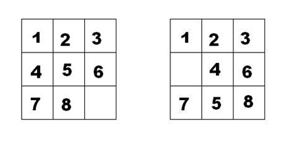
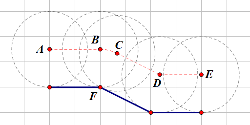
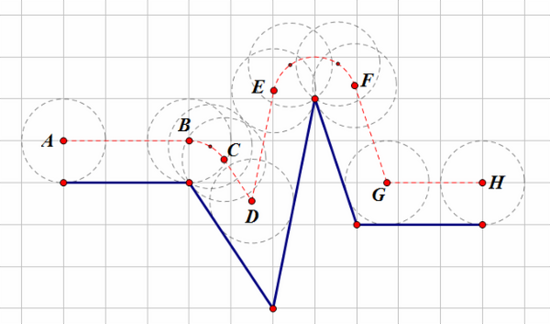

# 蓝桥杯 2012年及以前 真题（全部组别合并，按题号排列）

> 来源: Dotcpp 蓝桥杯真题 https://www.dotcpp.com/oj/lanqiao/ ｜ 抓取时间: 2026-11-27
> 本年有效试卷 1 套、14 题次，去重后 14 道题。

## 本年试卷构成

| 赛段 | 科目 | 组别 | 题数 | 备注 | 题集页 |
| --- | --- | --- | --- | --- | --- |
| 真题 | 未分类 | 综合 | 14 |  | [题集](https://www.dotcpp.com/oj/1014/) |

## 题目一览

| 题号 | 标题 | 难度 | 通过率 | 考过的语言/组别 |
| --- | --- | --- | --- | --- |
| 1426 | 九宫重排 | 中等 | 30.46% | 未区分科目 |
| 1434 | 回文数字 | 简单 | 41.42% | 未区分科目 |
| 1435 | 国王的烦恼 | 中等 | 27.21% | 未区分科目 |
| 1437 | 城市建设 | 困难 | 21.10% | 未区分科目 |
| 1439 | 小朋友排队 | 困难 | 21.54% | 未区分科目 |
| 1443 | 数字游戏 | 中等 | 17.05% | 未区分科目 |
| 1445 | 最大子阵 | 中等 | 31.44% | 未区分科目 |
| 1451 | 约数倍数选卡片 | 困难 | 11.32% | 未区分科目 |
| 1452 | 网络寻路 | 中等 | 41.76% | 未区分科目 |
| 1453 | 翻硬币 | 简单 | 51.20% | 未区分科目 |
| 1454 | 蚂蚁感冒 | 简单 | 44.35% | 未区分科目 |
| 1455 | 车轮轴迹 | 中等 | 34.81% | 未区分科目 |
| 1456 | 连号区间数 | 简单 | 48.34% | 未区分科目 |
| 1457 | 邮局 | 困难 | 18.33% | 未区分科目 |

## 题目详情

### 1426 · 九宫重排

> 题号 1426 ｜ 难度 中等 ｜ 时间 1s ｜ 内存 128MB
> 通过率 30.46% ｜ 题面原文 https://www.dotcpp.com/oj/problem1426.html
> 考过的语言/组别：未区分科目（省赛及国赛合订卷）

#### 题目描述

如下面第一个图的九宫格中，放着  1~8  的数字卡片，还有一个格子空着。与空格子相邻的格子中的卡片可以移动到空格中。经过若干次移动，可以形成第二个图所示的局面。



我们把第一个图的局面记为：12345678.

把第二个图的局面记为：123.46758

显然是按从上到下，从左到右的顺序记录数字，空格记为句点。

本题目的任务是已知九宫的初态和终态，求最少经过多少步的移动可以到达。如果无论多少步都无法到达，则输出-1。

#### 输入格式

输入第一行包含九宫的初态，第二行包含九宫的终态。

#### 输出格式

输出最少的步数，如果不存在方案，则输出-1。

#### 样例输入

```
12345678. 

123.46758 
```

#### 提示

零基础同学可以先学习视频课程，包含C/C++、Python、百练、蓝桥杯辅导、算法数据结构等课程，提供视频讲解以及配套习题，还有老师答疑，点击这里了解课程详情

---

### 1434 · 回文数字

> 题号 1434 ｜ 难度 简单 ｜ 时间 1s ｜ 内存 128MB
> 通过率 41.42% ｜ 题面原文 https://www.dotcpp.com/oj/problem1434.html
> 考过的语言/组别：未区分科目（省赛及国赛合订卷）

#### 题目描述

观察数字：12321，123321  都有一个共同的特征，无论从左到右读还是从右向左读，都是相同的。这样的数字叫做：回文数字。

本题要求你找到一些5位或6位的十进制数字。满足如下要求：

该数字的各个数位之和等于输入的整数。

#### 输入格式

一个正整数  n  (10< n< 100),  表示要求满足的数位和。

#### 输出格式

若干行，每行包含一个满足要求的5位或6位整数。

数字按从小到大的顺序排列。

如果没有满足条件的，输出：-1

#### 样例输入

```
44 
```

#### 提示

零基础同学可以先学习视频课程，包含C/C++、Python、百练、蓝桥杯辅导、算法数据结构等课程，提供视频讲解以及配套习题，还有老师答疑，点击这里了解课程详情

---

### 1435 · 国王的烦恼

> 题号 1435 ｜ 难度 中等 ｜ 时间 1s ｜ 内存 128MB
> 通过率 27.21% ｜ 题面原文 https://www.dotcpp.com/oj/problem1435.html
> 考过的语言/组别：未区分科目（省赛及国赛合订卷）

#### 题目描述

C国由n个小岛组成，为了方便小岛之间联络，C国在小岛间建立了m座大桥，每座大桥连接两座小岛。两个小岛间可能存在多座桥连接。然而，由于海水冲刷，有一些大桥面临着不能使用的危险。

如果两个小岛间的所有大桥都不能使用，则这两座小岛就不能直接到达了。然而，只要这两座小岛的居民能通过其他的桥或者其他的小岛互相到达，他们就会安然无事。但是，如果前一天两个小岛之间还有方法可以到达，后一天却不能到达了，居民们就会一起抗议。

现在C国的国王已经知道了每座桥能使用的天数，超过这个天数就不能使用了。现在他想知道居民们会有多少天进行抗议。

下文中的样例说明

第一天后2和3之间的桥不能使用，不影响。

第二天后1和2之间，以及1和3之间的桥不能使用，居民们会抗议。

第三天后3和4之间的桥不能使用，居民们会抗议。

#### 输入格式

输入的第一行包含两个整数n,  m，分别表示小岛的个数和桥的数量。

接下来m行，每行三个整数a,  b,  t，分别表示该座桥连接a号和b号两个小岛，能使用t天。小岛的编号从1开始递增。

数据规模和约定

对于100%的数据，1< =n< =10000，1< =m< =100000，1< =a,  b< =n，  1< =t< =100000。

#### 输出格式

输出一个整数，表示居民们会抗议的天数。

#### 样例输入

```
4 4

1 2 2

1 3 2

2 3 1

3 4 3
```

#### 提示

零基础同学可以先学习视频课程，包含C/C++、Python、百练、蓝桥杯辅导、算法数据结构等课程，提供视频讲解以及配套习题，还有老师答疑，点击这里了解课程详情

---

### 1437 · 城市建设

> 题号 1437 ｜ 难度 困难 ｜ 时间 1s ｜ 内存 128MB
> 通过率 21.10% ｜ 题面原文 https://www.dotcpp.com/oj/problem1437.html
> 考过的语言/组别：未区分科目（省赛及国赛合订卷）

#### 题目描述

栋栋居住在一个繁华的C市中，然而，这个城市的道路大都年久失修。市长准备重新修一些路以方便市民，于是找到了栋栋，希望栋栋能帮助他。

C市中有n个比较重要的地点，市长希望这些地点重点被考虑。现在可以修一些道路来连接其中的一些地点，每条道路可以连接其中的两个地点。另外由于C市有一条河从中穿过，也可以在其中的一些地点建设码头，所有建了码头的地点可以通过河道连接。

栋栋拿到了允许建设的道路的信息，包括每条可以建设的道路的花费，以及哪些地点可以建设码头和建设码头的花费。

市长希望栋栋给出一个方案，使得任意两个地点能只通过新修的路或者河道互达，同时花费尽量小。

样例说明

建设第2、3、4条道路，在地点4、5建设码头，总的花费为9。

#### 输入格式

输入的第一行包含两个整数n,  m，分别表示C市中重要地点的个数和可以建设的道路条数。所有地点从1到n依次编号。

接下来m行，每行三个整数a,  b,  c，表示可以建设一条从地点a到地点b的道路，花费为c。若c为正，表示建设是花钱的，如果c为负，则表示建设了道路后还可以赚钱（比如建设收费道路）。

接下来一行，包含n个整数w_1,  w_2,  …,  w_n。如果w_i为正数，则表示在地点i建设码头的花费，如果w_i为-1，则表示地点i无法建设码头。

输入保证至少存在一个方法使得任意两个地点能只通过新修的路或者河道互达。

数据规模和约定

对于100%的数据，1  < =  n  < =  10000，1  < =  m  < =  100000，-1000< =c< =1000，-1< =w_i< =1000，w_i≠0。

#### 输出格式

输出一行，包含一个整数，表示使得所有地点通过新修道路或者码头连接的最小花费。如果满足条件的情况下还能赚钱，那么你应该输出一个负数。

#### 样例输入

```
5 5

1 2 4

1 3 -1

2 3 3

2 4 5

4 5 10

-1 10 10 1 1
```

#### 提示

零基础同学可以先学习视频课程，包含C/C++、Python、百练、蓝桥杯辅导、算法数据结构等课程，提供视频讲解以及配套习题，还有老师答疑，点击这里了解课程详情

---

### 1439 · 小朋友排队

> 题号 1439 ｜ 难度 困难 ｜ 时间 1s ｜ 内存 128MB
> 通过率 21.54% ｜ 题面原文 https://www.dotcpp.com/oj/problem1439.html
> 考过的语言/组别：未区分科目（省赛及国赛合订卷）

#### 题目描述

n  个小朋友站成一排。现在要把他们按身高从低到高的顺序排列，但是每次只能交换位置相邻的两个小朋友。

每个小朋友都有一个不高兴的程度。开始的时候，所有小朋友的不高兴程度都是0。

如果某个小朋友第一次被要求交换，则他的不高兴程度增加1，如果第二次要求他交换，则他的不高兴程度增加2（即不高兴程度为3），依次类推。当要求某个小朋友第k次交换时，他的不高兴程度增加k。

请问，要让所有小朋友按从低到高排队，他们的不高兴程度之和最小是多少。

如果有两个小朋友身高一样，则他们谁站在谁前面是没有关系的。

样例说明

首先交换身高为3和2的小朋友，再交换身高为3和1的小朋友，再交换身高为2和1的小朋友，每个小朋友的不高兴程度都是3，总和为9。

#### 输入格式

输入的第一行包含一个整数n，表示小朋友的个数。

第二行包含  n  个整数  H1  H2  …  Hn，分别表示每个小朋友的身高。

数据规模和约定

对于100%的数据，1< =n< =100000，0< =Hi< =1000000。

#### 输出格式

输出一行，包含一个整数，表示小朋友的不高兴程度和的最小值。

#### 样例输入

```
3

3 2 1
```

#### 提示

零基础同学可以先学习视频课程，包含C/C++、Python、百练、蓝桥杯辅导、算法数据结构等课程，提供视频讲解以及配套习题，还有老师答疑，点击这里了解课程详情

---

### 1443 · 数字游戏

> 题号 1443 ｜ 难度 中等 ｜ 时间 1s ｜ 内存 128MB
> 通过率 17.05% ｜ 题面原文 https://www.dotcpp.com/oj/problem1443.html
> 考过的语言/组别：未区分科目（省赛及国赛合订卷）

#### 题目描述

栋栋正在和同学们玩一个数字游戏。

游戏的规则是这样的：栋栋和同学们一共n个人围坐在一圈。栋栋首先说出数字1。接下来，坐在栋栋左手边的同学要说下一个数字2。再下面的一个同学要从上一个同学说的数字往下数两个数说出来，也就是说4。下一个同学要往下数三个数，说7。依次类推。

为了使数字不至于太大，栋栋和同学们约定，当在心中数到  k-1  时，下一个数字从0开始数。例如，当k=13时，栋栋和同学们报出的前几个数依次为：

1,  2,  4,  7,  11,  3,  9,  3,  11,  7。

游戏进行了一会儿，栋栋想知道，到目前为止，他所有说出的数字的总和是多少。

样例说明

栋栋说出的数依次为1,  7,  9，和为17。

#### 输入格式

输入的第一行包含三个整数  n,k,T，其中  n  和  k  的意义如上面所述，T  表示到目前为止栋栋一共说出的数字个数。

数据规模和约定

1  <   n,k,T  <   1,000,000；

#### 输出格式

输出一行，包含一个整数，表示栋栋说出所有数的和。

#### 样例输入

```
3 13 3
```

#### 提示

零基础同学可以先学习视频课程，包含C/C++、Python、百练、蓝桥杯辅导、算法数据结构等课程，提供视频讲解以及配套习题，还有老师答疑，点击这里了解课程详情

---

### 1445 · 最大子阵

> 题号 1445 ｜ 难度 中等 ｜ 时间 1s ｜ 内存 128MB
> 通过率 31.44% ｜ 题面原文 https://www.dotcpp.com/oj/problem1445.html
> 考过的语言/组别：未区分科目（省赛及国赛合订卷）

#### 题目描述

给定一个n*m的矩阵A，求A中的一个非空子矩阵，使这个子矩阵中的元素和最大。

其中，A的子矩阵指在A中行和列均连续的一块。

样例说明

取最后一列，和为10。

#### 输入格式

输入的第一行包含两个整数n,  m，分别表示矩阵A的行数和列数。

接下来n行，每行m个整数，表示矩阵A。

数据规模和约定

对于100%的数据，1< =n,  m< =500，A中每个元素的绝对值不超过5000。

#### 输出格式

输出一行，包含一个整数，表示A中最大的子矩阵中的元素和。

#### 样例输入

```
3 3 

-1 -4 3

3 4 -1

-5 -2 8
```

#### 提示

零基础同学可以先学习视频课程，包含C/C++、Python、百练、蓝桥杯辅导、算法数据结构等课程，提供视频讲解以及配套习题，还有老师答疑，点击这里了解课程详情

---

### 1451 · 约数倍数选卡片

> 题号 1451 ｜ 难度 困难 ｜ 时间 1s ｜ 内存 128MB
> 通过率 11.32% ｜ 题面原文 https://www.dotcpp.com/oj/problem1451.html
> 考过的语言/组别：未区分科目（省赛及国赛合订卷）

#### 题目描述

闲暇时，福尔摩斯和华生玩一个游戏：

在N张卡片上写有N个整数。两人轮流拿走一张卡片。要求下一个人拿的数字一定是前一个人拿的数字的约数或倍数。例如，某次福尔摩斯拿走的卡片上写着数字“6”，则接下来华生可以拿的数字包括：

1，2，3,  6，12，18，24  ....

当轮到某一方拿卡片时，没有满足要求的卡片可选，则该方为输方。

请你利用计算机的优势计算一下，在已知所有卡片上的数字和可选哪些数字的条件下，怎样选择才能保证必胜！

当选多个数字都可以必胜时，输出其中最小的数字。如果无论如何都会输，则输出-1。

#### 输入格式

输入数据为2行。第一行是若干空格分开的整数（每个整数介于1~100间），表示当前剩余的所有卡片。

第二行也是若干空格分开的整数，表示可以选的数字。当然，第二行的数字必须完全包含在第一行的数字中。

#### 输出格式

程序则输出必胜的招法！！

#### 样例输入

```
1 2 2 3 3 4 5

3 4 5
```

#### 提示

零基础同学可以先学习视频课程，包含C/C++、Python、百练、蓝桥杯辅导、算法数据结构等课程，提供视频讲解以及配套习题，还有老师答疑，点击这里了解课程详情

---

### 1452 · 网络寻路

> 题号 1452 ｜ 难度 中等 ｜ 时间 1s ｜ 内存 128MB
> 通过率 41.76% ｜ 题面原文 https://www.dotcpp.com/oj/problem1452.html
> 考过的语言/组别：未区分科目（省赛及国赛合订卷）

#### 题目描述

X  国的一个网络使用若干条线路连接若干个节点。节点间的通信是双向的。某重要数据包，为了安全起见，必须恰好被转发两次到达目的地。该包可能在任意一个节点产生，我们需要知道该网络中一共有多少种不同的转发路径。

源地址和目标地址可以相同，但中间节点必须不同。

如下图所示的网络。

1  ->   2  ->   3  ->   1  是允许的

1  ->   2  ->   1  ->   2  或者  1  ->   2  ->   3  ->   2  都是非法的。

#### 输入格式

输入数据的第一行为两个整数N  M，分别表示节点个数和连接线路的条数(1< =N< =10000;  0< =M< =100000)。

接下去有M行，每行为两个整数  u  和  v，表示节点u  和  v  联通(1< =u,v< =N  ,  u!=v)。

输入数据保证任意两点最多只有一条边连接，并且没有自己连自己的边，即不存在重边和自环。

#### 输出格式

输出一个整数，表示满足要求的路径条数。

#### 样例输入

```
4 4

1 2

2 3

3 1

1 4
```

#### 提示

零基础同学可以先学习视频课程，包含C/C++、Python、百练、蓝桥杯辅导、算法数据结构等课程，提供视频讲解以及配套习题，还有老师答疑，点击这里了解课程详情

---

### 1453 · 翻硬币

> 题号 1453 ｜ 难度 简单 ｜ 时间 1s ｜ 内存 128MB
> 通过率 51.20% ｜ 题面原文 https://www.dotcpp.com/oj/problem1453.html
> 考过的语言/组别：未区分科目（省赛及国赛合订卷）

#### 题目描述

小明正在玩一个“翻硬币”的游戏。

桌上放着排成一排的若干硬币。我们用  *  表示正面，用  o  表示反面（是小写字母，不是零）。

比如，可能情形是：**oo***oooo

如果同时翻转左边的两个硬币，则变为：oooo***oooo

现在小明的问题是：如果已知了初始状态和要达到的目标状态，每次只能同时翻转相邻的两个硬币,那么对特定的局面，最少要翻动多少次呢？

我们约定：把翻动相邻的两个硬币叫做一步操作。

#### 输入格式

两行等长的字符串，分别表示初始状态和要达到的目标状态。每行的长度< 1000

#### 输出格式

一个整数，表示最小操作步数。

#### 样例输入

```
*o**o***o*** 

*o***o**o*** 
```

#### 提示

零基础同学可以先学习视频课程，包含C/C++、Python、百练、蓝桥杯辅导、算法数据结构等课程，提供视频讲解以及配套习题，还有老师答疑，点击这里了解课程详情

---

### 1454 · 蚂蚁感冒

> 题号 1454 ｜ 难度 简单 ｜ 时间 1s ｜ 内存 128MB
> 通过率 44.35% ｜ 题面原文 https://www.dotcpp.com/oj/problem1454.html
> 考过的语言/组别：未区分科目（省赛及国赛合订卷）

#### 题目描述

长100厘米的细长直杆子上有n只蚂蚁。它们的头有的朝左，有的朝右。

每只蚂蚁都只能沿着杆子向前爬，速度是1厘米/秒。

当两只蚂蚁碰面时，它们会同时掉头往相反的方向爬行。

这些蚂蚁中，有1只蚂蚁感冒了。并且在和其它蚂蚁碰面时，会把感冒传染给碰到的蚂蚁。

请你计算，当所有蚂蚁都爬离杆子时，有多少只蚂蚁患上了感冒。

#### 输入格式

第一行输入一个整数n  (1  <   n  <   50),  表示蚂蚁的总数。

接着的一行是n个用空格分开的整数  Xi  (-100  <   Xi  <   100),  Xi的绝对值，表示蚂蚁离开杆子左边端点的距离。正值表示头朝右，负值表示头朝左，数据中不会出现0值，也不会出现两只蚂蚁占用同一位置。其中，第一个数  据代表的蚂蚁感冒了。

#### 输出格式

要求输出1个整数，表示最后感冒蚂蚁的数目。

#### 样例输入

```
5

-10 8 -20 12 25
```

#### 提示

零基础同学可以先学习视频课程，包含C/C++、Python、百练、蓝桥杯辅导、算法数据结构等课程，提供视频讲解以及配套习题，还有老师答疑，点击这里了解课程详情

---

### 1455 · 车轮轴迹

> 题号 1455 ｜ 难度 中等 ｜ 时间 1s ｜ 内存 128MB
> 通过率 34.81% ｜ 题面原文 https://www.dotcpp.com/oj/problem1455.html
> 考过的语言/组别：未区分科目（省赛及国赛合订卷）

#### 题目描述

栋栋每天骑自行车回家需要经过一条狭长的林荫道。道路由于年久失修，变得非常不平整。虽然栋栋每次都很颠簸，但他仍把骑车经过林荫道当成一种乐趣。

由于颠簸，栋栋骑车回家的路径是一条上下起伏的曲线，栋栋想知道，他回家的这条曲线的长度究竟是多长呢？更准确的，栋栋想知道从林荫道的起点到林荫道的终点，他的车前轮的轴（圆心）经过的路径的长度。

栋栋对路面进行了测量。他把道路简化成一条条长短不等的直线段，这些直线段首尾相连，且位于同一平面内。并在该平面内建立了一个直角坐标系，把所有线段的端点坐标都计算好。

假设栋栋的自行车在行进的过程中前轮一直是贴着路面前进的。



上图给出了一个简单的路面的例子，其中蓝色实线为路面，红色虚线为车轮轴经过的路径。在这个例子中，栋栋的前轮轴从A点出发，水平走到B点，然后绕着  地面的F点到C点（绕出一个圆弧），再沿直线下坡到D点，最后水平走到E点，在这个图中地面的坐标依次为：(0,  0),  (2,  0),  (4,  -1),  (6,  -1)，前轮半径为1.50，前轮轴前进的距离依次为：

AB=2.0000；弧长BC=0.6955；CD=1.8820；DE=1.6459。

总长度为6.2233。

下图给出了一个较为复杂的路面的例子，在这个例子中，车轮在第一个下坡还没下完时（D点）就开始上坡了，之后在坡的顶点要从E绕一个较大的圆弧到F点。这个图中前轮的半径为1，每一段的长度依次为：

AB=3.0000；弧长BC=0.9828；CD=1.1913；DE=2.6848；弧长EF=2.6224；  FG=2.4415；GH=2.2792。

总长度为15.2021。



现在给出了车轮的半径和路面的描述，请求出车轮轴轨迹的总长度。

样例说明

这个样例对应第一个图。

#### 输入格式

输入的第一行包含一个整数n和一个实数r，用一个空格分隔，表示描述路面的坐标点数和车轮的半径。

接下来n行，每个包含两个实数，其中第i行的两个实数x[i],  y[i]表示描述路面的第i个点的坐标。

路面定义为所有路面坐标点顺次连接起来的折线。给定的路面的一定满足以下性质：

*第一个坐标点一定是(0,  0)；

*第一个点和第二个点的纵坐标相同；

*倒数第一个点和倒数第二个点的纵坐标相同；

*第一个点和第二个点的距离不少于车轮半径；

*倒数第一个点和倒数第二个点的的距离不少于车轮半径；

*后一个坐标点的横坐标大于前一个坐标点的横坐标，即对于所有的i，x[i+1]> x[i]。

数据规模和约定

对于100%的数据，4≤n≤100，0.5≤r≤20.0，x[i]  ≤2000.0，-2000.0≤y[i]  ≤2000.0。

#### 输出格式

输出一个实数，四舍五入保留两个小数，表示车轮轴经过的总长度。

你的结果必须和参考答案一模一样才能得分。数据保证答案精确值的小数点后第三位不是4或5。

#### 样例输入

```
4 1.50

0.00 0.00

2.00 0.00

4.00 -1.00

6.00 -1.00
```

#### 提示

零基础同学可以先学习视频课程，包含C/C++、Python、百练、蓝桥杯辅导、算法数据结构等课程，提供视频讲解以及配套习题，还有老师答疑，点击这里了解课程详情

---

### 1456 · 连号区间数

> 题号 1456 ｜ 难度 简单 ｜ 时间 1s ｜ 内存 128MB
> 通过率 48.34% ｜ 题面原文 https://www.dotcpp.com/oj/problem1456.html
> 考过的语言/组别：未区分科目（省赛及国赛合订卷）

#### 题目描述

小明这些天一直在思考这样一个奇怪而有趣的问题：

在1~N的某个全排列中有多少个连号区间呢？这里所说的连号区间的定义是：

如果区间[L,  R]  里的所有元素（即此排列的第L个到第R个元素）递增排序后能得到一个长度为R-L+1的“连续”数列，则称这个区间连号区间。

当N很小的时候，小明可以很快地算出答案，但是当N变大的时候，问题就不是那么简单了，现在小明需要你的帮助。

#### 输入格式

第一行是一个正整数N  (1  < =  N  < =  50000),  表示全排列的规模。

第二行是N个不同的数字Pi(1  < =  Pi  < =  N)，  表示这N个数字的某一全排列。

#### 输出格式

输出一个整数，表示不同连号区间的数目。

#### 样例输入

```
5

3 4 2 5 1
```

#### 提示

零基础同学可以先学习视频课程，包含C/C++、Python、百练、蓝桥杯辅导、算法数据结构等课程，提供视频讲解以及配套习题，还有老师答疑，点击这里了解课程详情

---

### 1457 · 邮局

> 题号 1457 ｜ 难度 困难 ｜ 时间 1s ｜ 内存 128MB
> 通过率 18.33% ｜ 题面原文 https://www.dotcpp.com/oj/problem1457.html
> 考过的语言/组别：未区分科目（省赛及国赛合订卷）

#### 题目描述

C村住着n户村民，由于交通闭塞，C村的村民只能通过信件与外界交流。为了方便村民们发信，C村打算在C村建设k个邮局，这样每户村民可以去离自己家最近的邮局发信。

现在给出了m个备选的邮局，请从中选出k个来，使得村民到自己家最近的邮局的距离和最小。其中两点之间的距离定义为两点之间的直线距离。

#### 输入格式

输入的第一行包含三个整数n,  m,  k，分别表示村民的户数、备选的邮局数和要建的邮局数。

接下来n行，每行两个整数x,  y，依次表示每户村民家的坐标。

接下来m行，每行包含两个整数x,  y，依次表示每个备选邮局的坐标。

在输入中，村民和村民、村民和邮局、邮局和邮局的坐标可能相同，但你应把它们看成不同的村民或邮局。

数据规模和约定

对于100%的数据，1< =n< =50，1< =m< =25，1< =k< =10。

#### 输出格式

输出一行，包含k个整数，从小到大依次表示你选择的备选邮局编号。（备选邮局按输入顺序由1到m编号）

#### 样例输入

```
5 4 2

0 0

2 0

3 1

3 3

1 1

0 1

1 0

2 1

3 2
```

#### 提示

零基础同学可以先学习视频课程，包含C/C++、Python、百练、蓝桥杯辅导、算法数据结构等课程，提供视频讲解以及配套习题，还有老师答疑，点击这里了解课程详情

---
