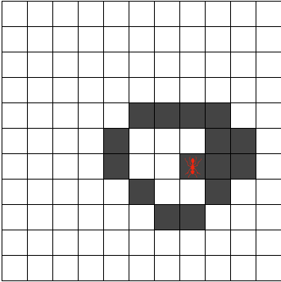
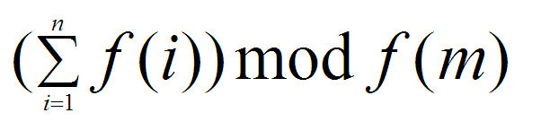
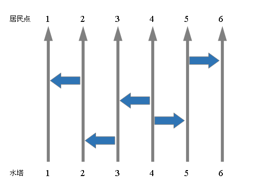
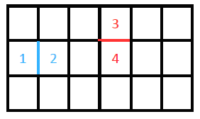

# 蓝桥杯 2014年第五届 真题（全部组别合并，按题号排列）

> 来源: Dotcpp 蓝桥杯真题 https://www.dotcpp.com/oj/lanqiao/ ｜ 抓取时间: 2026-11-27
> 本年有效试卷 1 套、16 题次，去重后 16 道题。

## 本年试卷构成

| 赛段 | 科目 | 组别 | 题数 | 备注 | 题集页 |
| --- | --- | --- | --- | --- | --- |
| 省赛及国赛 | 未分类 | 综合 | 16 |  | [题集](https://www.dotcpp.com/oj/1015/) |

## 题目一览

| 题号 | 标题 | 难度 | 通过率 | 考过的语言/组别 |
| --- | --- | --- | --- | --- |
| 1429 | 兰顿蚂蚁 | 简单 | 46.11% | 未区分科目 |
| 1431 | 分糖果 | 入门 | 48.13% | 未区分科目 |
| 1436 | 地宫取宝 | 中等 | 29.78% | 未区分科目 |
| 1444 | 斐波那契 | 困难 | 9.84% | 未区分科目 |
| 1449 | 波动数列 | 中等 | 35.86% | 未区分科目 |
| 1450 | 矩阵翻硬币 | 困难 | 17.39% | 未区分科目 |
| 1815 | 排列序数 | 简单 | 57.57% | 未区分科目 |
| 1816 | 重复模式 | 简单 | 57.81% | 未区分科目 |
| 1817 | 供水设施 | 困难 | 4.46% | 未区分科目 |
| 1818 | 生物芯片 | 困难 | 29.08% | 未区分科目 |
| 1819 | Log大侠 | 入门 | 71.28% | 未区分科目 |
| 1820 | 殖民地 | 中等 | 2.04% | 未区分科目 |
| 1821 | 拼接平方数 | 简单 | 46.34% | 未区分科目 |
| 1822 | 套娃 | 困难 | 1.16% | 未区分科目 |
| 1823 | 幂一矩阵 | 困难 | 5.20% | 未区分科目 |
| 1824 | 稍大的串 | 中等 | 31.44% | 未区分科目 |

## 题目详情

### 1429 · 兰顿蚂蚁

> 题号 1429 ｜ 难度 简单 ｜ 时间 1s ｜ 内存 128MB
> 通过率 46.11% ｜ 题面原文 https://www.dotcpp.com/oj/problem1429.html
> 考过的语言/组别：未区分科目（省赛及国赛合订卷）

#### 题目描述



兰顿蚂蚁，是于1986年，由克里斯·兰顿提出来的，属于细胞自动机的一种。

平面上的正方形格子被填上黑色或白色。在其中一格正方形内有一只“蚂蚁”。

蚂蚁的头部朝向为：上下左右其中一方。

蚂蚁的移动规则十分简单：

若蚂蚁在黑格，右转90度，将该格改为白格，并向前移一格；

若蚂蚁在白格，左转90度，将该格改为黑格，并向前移一格。

规则虽然简单，蚂蚁的行为却十分复杂。刚刚开始时留下的路线都会有接近对称，像是会重复，但不论起始状态如何，蚂蚁经过漫长的混乱活动后，会开辟出一条规则的“高速公路”。

蚂蚁的路线是很难事先预测的。

你的任务是根据初始状态，用计算机模拟兰顿蚂蚁在第n步行走后所处的位置。

#### 输入格式

输入数据的第一行是  m  n  两个整数（3  <   m,  n  <   100），表示正方形格子的行数和列数。

接下来是  m  行数据。

每行数据为  n  个被空格分开的数字。0  表示白格，1  表示黑格。

接下来是一行数据：x  y  s  k,  其中x  y为整数，表示蚂蚁所在行号和列号（行号从上到下增长，列号从左到右增长，都是从0开始编号）。s  是一个大写字母，表示蚂蚁头的朝向，我们约定：上下左右分别用：UDLR表示。k  表示蚂蚁走的步数。

#### 输出格式

输出数据为一个空格分开的整数  p  q,  分别表示蚂蚁在k步后，所处格子的行号和列号。

#### 样例输入

```
5 6 

0 0 0 0 0 0 

0 0 0 0 0 0 

0 0 1 0 0 0 

0 0 0 0 0 0 

0 0 0 0 0 0 

2 3 L 5
```

#### 提示

零基础同学可以先学习视频课程，包含C/C++、Python、百练、蓝桥杯辅导、算法数据结构等课程，提供视频讲解以及配套习题，还有老师答疑，点击这里了解课程详情

---

### 1431 · 分糖果

> 题号 1431 ｜ 难度 入门 ｜ 时间 1s ｜ 内存 128MB
> 通过率 48.13% ｜ 题面原文 https://www.dotcpp.com/oj/problem1431.html
> 考过的语言/组别：未区分科目（省赛及国赛合订卷）

#### 题目描述

有n个小朋友围坐成一圈。老师给每个小朋友随机发偶数个糖果，然后进行下面的游戏：

每个小朋友都把自己的糖果分一半给左手边的孩子。

一轮分糖后，拥有奇数颗糖的孩子由老师补给1个糖果，从而变成偶数。

反复进行这个游戏，直到所有小朋友的糖果数都相同为止。

你的任务是预测在已知的初始糖果情形下，老师一共需要补发多少个糖果。

#### 输入格式

程序首先读入一个整数N(2< N< 100)，表示小朋友的人数。

接着是一行用空格分开的N个偶数（每个偶数不大于1000，不小于2）

#### 输出格式

要求程序输出一个整数，表示老师需要补发的糖果数。

#### 样例输入

```
3 

2 2 4 
```

#### 提示

零基础同学可以先学习视频课程，包含C/C++、Python、百练、蓝桥杯辅导、算法数据结构等课程，提供视频讲解以及配套习题，还有老师答疑，点击这里了解课程详情

---

### 1436 · 地宫取宝

> 题号 1436 ｜ 难度 中等 ｜ 时间 1s ｜ 内存 128MB
> 通过率 29.78% ｜ 题面原文 https://www.dotcpp.com/oj/problem1436.html
> 考过的语言/组别：未区分科目（省赛及国赛合订卷）

#### 题目描述

X  国王有一个地宫宝库。是  n  x  m  个格子的矩阵。每个格子放一件宝贝。每个宝贝贴着价值标签。

地宫的入口在左上角，出口在右下角。

小明被带到地宫的入口，国王要求他只能向右或向下行走。

走过某个格子时，如果那个格子中的宝贝价值比小明手中任意宝贝价值都大，小明就可以拿起它（当然，也可以不拿）。

当小明走到出口时，如果他手中的宝贝恰好是k件，则这些宝贝就可以送给小明。

请你帮小明算一算，在给定的局面下，他有多少种不同的行动方案能获得这k件宝贝。

#### 输入格式

输入一行3个整数，用空格分开：n  m  k  (1< =n,m< =50,  1< =k< =12)

接下来有  n  行数据，每行有  m  个整数  Ci  (0< =Ci< =12)代表这个格子上的宝物的价值

#### 输出格式

要求输出一个整数，表示正好取k个宝贝的行动方案数。该数字可能很大，输出它对  1000000007  取模的结果。

#### 样例输入

```
2 3 2

1 2 3

2 1 5
```

#### 提示

零基础同学可以先学习视频课程，包含C/C++、Python、百练、蓝桥杯辅导、算法数据结构等课程，提供视频讲解以及配套习题，还有老师答疑，点击这里了解课程详情

---

### 1444 · 斐波那契

> 题号 1444 ｜ 难度 困难 ｜ 时间 1s ｜ 内存 128MB
> 通过率 9.84% ｜ 题面原文 https://www.dotcpp.com/oj/problem1444.html
> 考过的语言/组别：未区分科目（省赛及国赛合订卷）

#### 题目描述

斐波那契数列大家都非常熟悉。它的定义是：

f(x)  =  1  ....  (x=1,2)

f(x)  =  f(x-1)  +  f(x-2)  ....  (x> 2)

对于给定的整数  n  和  m，我们希望求出：

f(1)  +  f(2)  +  ...  +  f(n)  的值。但这个值可能非常大，所以我们把它对  f(m)  取模。

公式如下



但这个数字依然很大，所以需要再对  p  求模。

#### 输入格式

输入为一行用空格分开的整数  n  m  p  (0  <   n,  m,  p  <   10^18)

#### 输出格式

输出为1个整数，表示答案

#### 样例输入

```
2 3 5
```

#### 提示

零基础同学可以先学习视频课程，包含C/C++、Python、百练、蓝桥杯辅导、算法数据结构等课程，提供视频讲解以及配套习题，还有老师答疑，点击这里了解课程详情

---

### 1449 · 波动数列

> 题号 1449 ｜ 难度 中等 ｜ 时间 1s ｜ 内存 128MB
> 通过率 35.86% ｜ 题面原文 https://www.dotcpp.com/oj/problem1449.html
> 考过的语言/组别：未区分科目（省赛及国赛合订卷）

#### 题目描述

观察这个数列：

1  3  0  2  -1  1  -2  ...

这个数列中后一项总是比前一项增加2或者减少3。

栋栋对这种数列很好奇，他想知道长度为  n  和为  s  而且后一项总是比前一项增加a或者减少b的整数数列可能有多少种呢？

样例说明

这两个数列分别是2  4  1  3和7  4  1  -2。

#### 输入格式

输入的第一行包含四个整数  n  s  a  b，含义如前面说述。

数据规模和约定

对于100%的数据，1< =n< =1000，-1,000,000,000< =s< =1,000,000,000，1< =a,  b< =1,000,000。

#### 输出格式

输出一行，包含一个整数，表示满足条件的方案数。由于这个数很大，请输出方案数除以100000007的余数。

#### 样例输入

```
4 10 2 3
```

#### 提示

零基础同学可以先学习视频课程，包含C/C++、Python、百练、蓝桥杯辅导、算法数据结构等课程，提供视频讲解以及配套习题，还有老师答疑，点击这里了解课程详情

---

### 1450 · 矩阵翻硬币

> 题号 1450 ｜ 难度 困难 ｜ 时间 1s ｜ 内存 128MB
> 通过率 17.39% ｜ 题面原文 https://www.dotcpp.com/oj/problem1450.html
> 考过的语言/组别：未区分科目（省赛及国赛合订卷）

#### 题目描述

小明先把硬币摆成了一个  n  行  m  列的矩阵。

随后，小明对每一个硬币分别进行一次  Q  操作。

对第x行第y列的硬币进行  Q  操作的定义：将所有第  i*x  行，第  j*y  列的硬币进行翻转。

其中i和j为任意使操作可行的正整数，行号和列号都是从1开始。

当小明对所有硬币都进行了一次  Q  操作后，他发现了一个奇迹——所有硬币均为正面朝上。

小明想知道最开始有多少枚硬币是反面朝上的。于是，他向他的好朋友小M寻求帮助。

聪明的小M告诉小明，只需要对所有硬币再进行一次Q操作，即可恢复到最开始的状态。然而小明很懒，不愿意照做。于是小明希望你给出他更好的方法。帮他计算出答案。

#### 输入格式

输入数据包含一行，两个正整数  n  m，含义见题目描述。

数据规模和约定

对于100%的数据，n、m  < =  10^1000（10的1000次方）。

#### 输出格式

输出一个正整数，表示最开始有多少枚硬币是反面朝上的。

#### 样例输入

```
2 3
```

#### 提示

零基础同学可以先学习视频课程，包含C/C++、Python、百练、蓝桥杯辅导、算法数据结构等课程，提供视频讲解以及配套习题，还有老师答疑，点击这里了解课程详情

---

### 1815 · 排列序数

> 题号 1815 ｜ 难度 简单 ｜ 时间 1s ｜ 内存 128MB
> 通过率 57.57% ｜ 题面原文 https://www.dotcpp.com/oj/problem1815.html
> 考过的语言/组别：未区分科目（省赛及国赛合订卷）

#### 题目描述

如果用a b c d这4个字母组成一个串，有4!=24种，如果把它们排个序，每个串都对应一个序号：

abcd  0

abdc  1

acbd  2

acdb  3

adbc  4

adcb  5

bacd  6

badc  7

bcad  8

bcda  9

bdac  10

bdca  11

cabd  12

cadb  13

cbad  14

cbda  15

cdab  16

cdba  17

...

现在有不多于10个两两不同的小写字母，给出它们组成的串，你能求出该串在所有排列中的序号吗？

#### 输入格式

一行，一个串。

#### 输出格式

一行，一个整数，表示该串在其字母所有排列生成的串中的序号。注意：最小的序号是0。

#### 样例输入

```
bdca
```

#### 提示

零基础同学可以先学习视频课程，包含C/C++、Python、百练、蓝桥杯辅导、算法数据结构等课程，提供视频讲解以及配套习题，还有老师答疑，点击这里了解课程详情

---

### 1816 · 重复模式

> 题号 1816 ｜ 难度 简单 ｜ 时间 1s ｜ 内存 128MB
> 通过率 57.81% ｜ 题面原文 https://www.dotcpp.com/oj/problem1816.html
> 考过的语言/组别：未区分科目（省赛及国赛合订卷）

#### 题目描述

作为 drd 的好朋友，技术男 atm 在 drd 生日时送给他一个超长字符串 S 。atm 要 drd 在其中找出一个最长的字符串 T ，使得 T 在 S 中至少出现了两次，而他想说的秘密就藏在 T 中。

由于字符串实在是太长了，drd 总是找不到合适的 T 。于是 drd 请你帮他找到这个 T 的长度。

#### 输入格式

一行。一个字符串，即题目中说的S 。

#### 输出格式

一行。一个整数，表示最长的 T 的长度。

#### 样例输入

```
ababa
```

#### 提示

零基础同学可以先学习视频课程，包含C/C++、Python、百练、蓝桥杯辅导、算法数据结构等课程，提供视频讲解以及配套习题，还有老师答疑，点击这里了解课程详情

---

### 1817 · 供水设施

> 题号 1817 ｜ 难度 困难 ｜ 时间 1s ｜ 内存 128MB
> 通过率 4.46% ｜ 题面原文 https://www.dotcpp.com/oj/problem1817.html
> 考过的语言/组别：未区分科目（省赛及国赛合订卷）

#### 题目描述

X星球的居民点很多。Pear决定修建一个浩大的水利工程，以解决他管辖的N个居民点的供水问题。现在一共有N个水塔，同时也有N个居民点，居民点在北侧从1号到N号自西向东排成一排；水塔在南侧也从1号到N号自西向东排成一排。



N条单向输水线（有水泵动力），将水从南侧的水塔引到北侧对应的居民点。

我们不妨将居民点和水塔都看做平面上的点，居民点坐标为(1,K)~(N,K)，水塔为(1,0)~(N,0)。

除了N条纵向输水线以外，还有M条单向的横向输水线，连接(Xi,Yi)和(Xi,(Yi)+1)或者(Xi,Yi)和(Xi,(Yi)-1)。前者被称为向右的水路，而后者是向左的。不会有两条水路重叠，即便它们方向不同。

布局的示意图如所示。

显然，每个水塔的水都可以到达若干个居民点（而不仅仅是对应的那个）。例如上图中，4号水塔可以到达3、4、5、6四个居民点。

现在Pear决定在此基础上，再修建一条横向单向输水线。为了方便考虑，Pear认为这条水路应当是自左向右的，也就是连接了一个点和它右侧的点（例如上图中连接5和6两个纵线的横向水路）。

Pear的目标是，修建了这条水路之后，能有尽可能多对水塔和居民点之间能到达。换句话说，设修建之后第i个水塔能到达Ai个点，你要最大化A1+A2+...+An。

根据定义，这条路必须和X轴平行，但Y坐标不一定要是整数。注意：虽然输入中没有重叠的水路，但是你的方案可以将新修的输水线路与已有的水路重叠。

#### 输入格式

输入第一行包含三个正整数N，M，K，含义如题面所述：N是纵向线数，M横向线数，K是居民点纵坐标。

接下来M行，每行三个整数。前两个正整数Xi Yi表示水路的起点坐标；
1<=Xi<=N,0<Yi<K。
接下来一个数0或者1，如果是0表示这条水路向左，否则向右。
保证水路都是合法的，也就是不会流向没有定义的地方。

#### 输出格式

输出一行。是一个正整数，即：题目中要求的最大化的A1+A2+...+An。

#### 样例输入

```
4 3 2

1 1 1

3 1 0

3 1 1
```

#### 提示

零基础同学可以先学习视频课程，包含C/C++、Python、百练、蓝桥杯辅导、算法数据结构等课程，提供视频讲解以及配套习题，还有老师答疑，点击这里了解课程详情

---

### 1818 · 生物芯片

> 题号 1818 ｜ 难度 困难 ｜ 时间 1s ｜ 内存 128MB
> 通过率 29.08% ｜ 题面原文 https://www.dotcpp.com/oj/problem1818.html
> 考过的语言/组别：未区分科目（省赛及国赛合订卷）

#### 题目描述

X博士正在研究一种生物芯片，其逻辑密集度、容量都远远高于普通的半导体芯片。

博士在芯片中设计了 n 个微型光源，每个光源操作一次就会改变其状态，即：点亮转为关闭，或关闭转为点亮。

这些光源的编号从 1 到 n，开始的时候所有光源都是关闭的。

博士计划在芯片上执行如下动作：

所有编号为2的倍数的光源操作一次，也就是把 2 4 6 8 ... 等序号光源打开

所有编号为3的倍数的光源操作一次, 也就是对 3 6 9 ... 等序号光源操作，注意此时6号光源又关闭了。

所有编号为4的倍数的光源操作一次。

.....

直到编号为 n 的倍数的光源操作一次。

X博士想知道：经过这些操作后，某个区间中的哪些光源是点亮的。

#### 输入格式

3个用空格分开的整数：N L R  (L<R<N<10^15)  N表示光源数，L表示区间的左边界，R表示区间的右边界。

#### 输出格式

输出1个整数，表示经过所有操作后，[L,R] 区间中有多少个光源是点亮的。

#### 样例输入

```
5 2 3
```

#### 提示

零基础同学可以先学习视频课程，包含C/C++、Python、百练、蓝桥杯辅导、算法数据结构等课程，提供视频讲解以及配套习题，还有老师答疑，点击这里了解课程详情

---

### 1819 · Log大侠

> 题号 1819 ｜ 难度 入门 ｜ 时间 1s ｜ 内存 128MB
> 通过率 71.28% ｜ 题面原文 https://www.dotcpp.com/oj/problem1819.html
> 考过的语言/组别：未区分科目（省赛及国赛合订卷）

#### 题目描述

atm参加了速算训练班，经过刻苦修炼，对以2为底的对数算得飞快，人称Log大侠。

一天，Log大侠的好友 drd 有一些整数序列需要变换，Log大侠正好施展法力...

变换的规则是： 对其某个子序列的每个整数变为: [log_2 (x) + 1]  其中 [] 表示向下取整，就是对每个数字求以2为底的对数，然后取下整。

例如对序列 3 4 2 操作一次后，这个序列会变成 2 3 2。

drd需要知道，每次这样操作后，序列的和是多少。

#### 输入格式

第一行两个正整数 n m 。

第二行 n 个数，表示整数序列，都是正数。

接下来 m 行，每行两个数 L R 表示 atm 这次操作的是区间 [L, R]，数列序号从1开始。

#### 输出格式

输出 m 行，依次表示 atm 每做完一个操作后，整个序列的和。

#### 样例输入

```
3 3

5 6 4

1 2

2 3

1 3
```

#### 提示

零基础同学可以先学习视频课程，包含C/C++、Python、百练、蓝桥杯辅导、算法数据结构等课程，提供视频讲解以及配套习题，还有老师答疑，点击这里了解课程详情

---

### 1820 · 殖民地

> 题号 1820 ｜ 难度 中等 ｜ 时间 1s ｜ 内存 128MB
> 通过率 2.04% ｜ 题面原文 https://www.dotcpp.com/oj/problem1820.html
> 考过的语言/组别：未区分科目（省赛及国赛合订卷）

#### 题目描述



带着殖民扩张的野心，Pear和他的星际舰队登上X星球的某平原。为了评估这块土地的潜在价值，Pear把它划分成了M*N格，每个格子上用一个整数（可正可负）表示它的价值。

Pear要做的事很简单——选择一些格子，占领这些土地，通过建立围栏把它们和其它土地隔开。对于M*N的格子，一共有(M+1)*N+M*(N+1)条围栏，即每个格子都有上下左右四个围栏；不在边界上的围栏被相邻的两个格子公用。大概如下图【p1.png】所示。

图中，蓝色的一段是围栏，属于格子1和2；红色的一段是围栏，属于格子3和4。

每个格子有一个可正可负的收益，而建围栏的代价则一定是正的。

你需要选择一些格子，然后选择一些围栏把它们围起来，使得所有选择的格子和所有没被选的格子严格的被隔开。选择的格子可以不连通，也可以有“洞”，即一个连通块中间有一些格子没选。注意，若中间有“洞”，那么根据定义，“洞”和连通块也必须被隔开。

Pear的目标很明确，花最小的代价，获得最大的收益。

#### 输入格式

输入第一行两个正整数M N，表示行数和列数。

接下来M行，每行N个整数，构成矩阵A，A[i,j]表示第i行第j列格子的价值。

接下来M+1行，每行N个整数，构成矩阵B，B[i,j]表示第i行第j列上方的围栏建立代价。

特别的，B[M+1,j]表示第M行第j列下方的围栏建立代价。

接下来M行，每行N+1个整数，构成矩阵C，C[i,j]表示第i行第j列左方的围栏建立代价。

特别的，C[i,N+1]表示第i行第N列右方的围栏建立代价。

#### 输出格式

一行。只有一个正整数，表示最大收益。

#### 样例输入

```
3 3

65 -6 -11

15 65 32

-8 5 66

4 1 6

7 3 11

23 21 22

5 25 22

26 1 1 13

16 3 3 4

6 3 1 2
```

#### 提示

零基础同学可以先学习视频课程，包含C/C++、Python、百练、蓝桥杯辅导、算法数据结构等课程，提供视频讲解以及配套习题，还有老师答疑，点击这里了解课程详情

---

### 1821 · 拼接平方数

> 题号 1821 ｜ 难度 简单 ｜ 时间 1s ｜ 内存 128MB
> 通过率 46.34% ｜ 题面原文 https://www.dotcpp.com/oj/problem1821.html
> 考过的语言/组别：未区分科目（省赛及国赛合订卷）

#### 题目描述

小明发现49很有趣，首先，它是个平方数。它可以拆分为4和9，拆分出来的部分也是平方数。169也有这个性质，我们权且称它们为：拼接平方数。

100可拆分1 00，这有点勉强，我们规定，0 00 000 等都不算平方数。

小明想：还有哪些数字是这样的呢？

你的任务出现了：找到某个区间的所有拼接平方数。

#### 输入格式

两个正整数  a b (a<b<10^6)

#### 输出格式

若干行，每行一个正整数。表示所有的区间[a,b]中的拼接平方数

#### 样例输入

```
1 200
```

#### 提示

零基础同学可以先学习视频课程，包含C/C++、Python、百练、蓝桥杯辅导、算法数据结构等课程，提供视频讲解以及配套习题，还有老师答疑，点击这里了解课程详情

---

### 1822 · 套娃

> 题号 1822 ｜ 难度 困难 ｜ 时间 1s ｜ 内存 128MB
> 通过率 1.16% ｜ 题面原文 https://www.dotcpp.com/oj/problem1822.html
> 考过的语言/组别：未区分科目（省赛及国赛合订卷）

#### 题目描述

作为 drd 送的生日礼物，atm 最近得到了一个俄罗斯娃娃。他对这个俄罗斯娃娃的构造很感兴趣。

俄罗斯娃娃是一层一层套起来的。假设：一个大小为 x 的俄罗斯娃娃里面可能会放任意多个大小小于 x 的俄罗斯娃娃（而市场上的套娃一般大娃里只能放一个小娃）。

drd 告诉 atm ，这个俄罗斯娃娃是由 n 个小娃娃组成的，它们的大小各不相同。    我们把这些小娃娃的大小从小到大依次记为 1 到 n 。

如果 atm 想观赏大小为 k 的小娃娃，他会先看这个小娃娃是否已经在桌子上了。    如果已经在桌子上，那么他就可以观赏了。否则他就打开桌子上某一个俄罗斯娃娃，将它套住的所有的小娃娃拿出来，摆在桌子上。

一开始桌子上只有 drd 送的大小为 n 的娃娃。注意，他只会将其中所有小娃娃拿出来，如果小娃娃里面还套着另外的小娃娃，他是不会将这些更里层的这些小娃娃拿出来的。

而且 atm 天生具有最优化的强迫症。他会最小化他所需要打开的娃娃的数目。

atm 是一个怪人。有时候他只想知道观看大小为 x 的娃娃时需要打开多少个娃娃（但并不去打开）；有时候听 drd 说某个娃娃特别漂亮，于是他会打开看。现在请你输出他每次需要打开多少个娃娃。

#### 输入格式

第一行两个数 n m ，表示娃娃的数目以及 atm 想看的娃娃的数目。

接下来 n - 1 行，每行两个数 u v，表示大小为 u 的娃娃里面套着一个大小为 v 的娃娃。保证 u > v 。

接下来 m 行，每行形如：

P x ：表示 atm 一定要看到大小为 x 的娃娃；

Q x ：表示 atm 只想知道为了看大小为 x 的娃娃，他需要打开多少个娃娃，但实际上并不打开他们。

#### 输出格式

输出 m 行。对应输入中P操作或Q操作需要打开（或假想打开）多少个俄罗斯娃娃。

#### 样例输入

```
5 5

5 3

5 4

3 2

3 1

Q 1

Q 4

P 2

Q 1

Q 4
```

#### 提示

零基础同学可以先学习视频课程，包含C/C++、Python、百练、蓝桥杯辅导、算法数据结构等课程，提供视频讲解以及配套习题，还有老师答疑，点击这里了解课程详情

---

### 1823 · 幂一矩阵

> 题号 1823 ｜ 难度 困难 ｜ 时间 1s ｜ 内存 128MB
> 通过率 5.20% ｜ 题面原文 https://www.dotcpp.com/oj/problem1823.html
> 考过的语言/组别：未区分科目（省赛及国赛合订卷）

#### 题目描述

天才少年的邻居 atm 最近学习了线性代数相关的理论，他对“矩阵”这个概念特别感兴趣。矩阵中有个概念叫做幂零矩阵。对于一个方阵 M ，如果存在一个正整数 k 满足 M^k = 0 ，那么 M 就是一个幂零矩阵。（^ 表示乘方）

atm 不满足幂零矩阵，他自己设想了一个幂一矩阵：对于一个方阵 M ，如果存在一个正整数 k 满足 M^k = I ，其中 I 是单位矩阵，那么 M 就是一个幂一矩阵。

atm 特别钟情于这样一种方阵：每行每列有且仅有一个 1 。经过 atm 不断实验，他发现这种矩阵都是幂一矩阵。

现在，他的问题是，给定一个满足以上条件的方阵，他想求最小的 k 是多少。

#### 输入格式

第一行一个正整数 n ，表示矩阵大小是 n * n 。

接下来 n 行，每行两个正整数 i j 表示方阵的第 i 行第 j 列为 1。

1 <= i, j <= n 。

行号，列号都从1开始。

#### 输出格式

一行。一个正整数，即题目中所说最小的 k 。

#### 样例输入

```
5

3 1

1 2

4 4

2 3

5 5
```

#### 提示

零基础同学可以先学习视频课程，包含C/C++、Python、百练、蓝桥杯辅导、算法数据结构等课程，提供视频讲解以及配套习题，还有老师答疑，点击这里了解课程详情

---

### 1824 · 稍大的串

> 题号 1824 ｜ 难度 中等 ｜ 时间 1s ｜ 内存 128MB
> 通过率 31.44% ｜ 题面原文 https://www.dotcpp.com/oj/problem1824.html
> 考过的语言/组别：未区分科目（省赛及国赛合订卷）

#### 题目描述

串可以按照字典序进行比较。例如：
abcd 小于 abdc
如果给定一个串，打乱组成它的字母，重新排列，可以得到许多不同的串，在这些不同的串中，有一个串刚好给定的串稍微大一些。科学地说：它是大于已知串的所有串中最小的串。你的任务就是求出这个“稍大的串”。

#### 输入格式

输入一个串，长度不超过1000个字符。

#### 输出格式

输出这个稍大的串

#### 样例输入

```
abfxy
```

#### 提示

零基础同学可以先学习视频课程，包含C/C++、Python、百练、蓝桥杯辅导、算法数据结构等课程，提供视频讲解以及配套习题，还有老师答疑，点击这里了解课程详情

---
