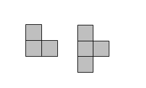
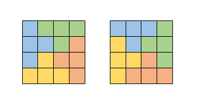
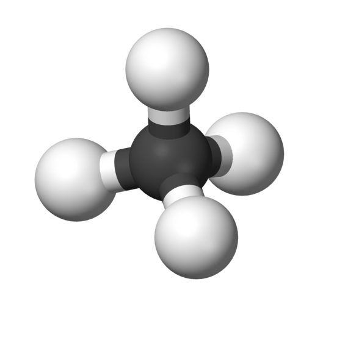
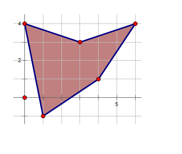
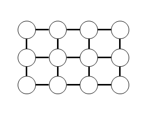
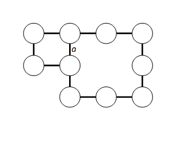

# 蓝桥杯 2015年第六届 真题（全部组别合并，按题号排列）

> 来源: Dotcpp 蓝桥杯真题 https://www.dotcpp.com/oj/lanqiao/ ｜ 洛谷蓝桥杯题单补充 5 题 https://www.luogu.com.cn/problem/list?type=luogu&tag=361,363 ｜ 抓取时间: 2026-11-27
> 本年有效试卷 1 套、13 题次，Dotcpp 去重 13 道题，另补洛谷题 5 道。

## 本年试卷构成

| 赛段 | 科目 | 组别 | 题数 | 备注 | 题集页 |
| --- | --- | --- | --- | --- | --- |
| 省赛及国赛 | 未分类 | 综合 | 13 |  | [题集](https://www.dotcpp.com/oj/1016/) |

## 题目一览

| 题号 | 标题 | 难度 | 通过率 | 考过的语言/组别 |
| --- | --- | --- | --- | --- |
| 1825 | 穿越雷区 | 入门 | 68.31% | 未区分科目 |
| 1826 | 切开字符串 | 简单 | 59.86% | 未区分科目 |
| 1827 | 铺瓷砖 | 困难 | 4.44% | 未区分科目 |
| 1828 | 密文搜索 | 入门 | 61.47% | 未区分科目 |
| 1829 | 居民集会 | 困难 | 1.84% | 未区分科目 |
| 1830 | 模型染色 | 入门 | 78.26% | 未区分科目 |
| 1831 | 机器人繁殖 | 中等 | 31.76% | 未区分科目 |
| 1832 | 表格计算 | 入门 | 64.72% | 未区分科目 |
| 1833 | 奇怪的数列 | 入门 | 67.38% | 未区分科目 |
| 1837 | 机器人塔 | 入门 | 63.73% | 未区分科目 |
| 1838 | 广场舞 | 简单 | 49.38% | 未区分科目 |
| 1839 | 生成树计数 | 中等 | 31.45% | 未区分科目 |
| 1840 | 赢球票 | 中等 | 37.84% | 未区分科目 |
| — | 移动距离 | 简单 | 51.25% | 省赛 C/C++ 大学B组 |
| — | 垒骰子 | 中等 | 27.68% | 省赛 C/C++ 大学AB组 |
| — | 生命之树 | 中等 | 33.71% | 省赛 C/C++ 大学B组 |
| — | 灾后重建 | 困难 | 24.04% | 省赛 C/C++ 大学A组 |
| — | 饮料换购 | 简单 | 66.91% | 省赛 C/C++ 大学A组 |

## 题目详情

### 1825 · 穿越雷区

> 题号 1825 ｜ 难度 入门 ｜ 时间 1s ｜ 内存 128MB
> 通过率 68.31% ｜ 题面原文 https://www.dotcpp.com/oj/problem1825.html
> 考过的语言/组别：未区分科目（省赛及国赛合订卷）

#### 题目描述

X星的坦克战车很奇怪，它必须交替地穿越正能量辐射区和负能量辐射区才能保持正常运转，否则将报废。

某坦克需要从A区到B区去（A，B区本身是安全区，没有正能量或负能量特征），怎样走才能路径最短？

已知的地图是一个方阵，上面用字母标出了A，B区，其它区都标了正号或负号分别表示正负能量辐射区。

例如：

A + - + -

- + - - +

- + + + -

+ - + - +

B + - + -

坦克车只能水平或垂直方向上移动到相邻的区。

#### 输入格式

输入第一行是一个整数n，表示方阵的大小， 4<=n<100

接下来是n行，每行有n个数据，可能是A，B，+，-中的某一个，中间用空格分开。

A，B都只出现一次。

#### 输出格式

要求输出一个整数，表示坦克从A区到B区的最少移动步数。

如果没有方案，则输出-1

#### 样例输入

```
5

A + - + -

- + - - +

- + + + -

+ - + - +

B + - + -
```

#### 提示

零基础同学可以先学习视频课程，包含C/C++、Python、百练、蓝桥杯辅导、算法数据结构等课程，提供视频讲解以及配套习题，还有老师答疑，点击这里了解课程详情

---

### 1826 · 切开字符串

> 题号 1826 ｜ 难度 简单 ｜ 时间 1s ｜ 内存 128MB
> 通过率 59.86% ｜ 题面原文 https://www.dotcpp.com/oj/problem1826.html
> 考过的语言/组别：未区分科目（省赛及国赛合订卷）

#### 题目描述

Pear有一个字符串，不过他希望把它切成两段。
这是一个长度为N（<=10^5）的字符串。
Pear希望选择一个位置，把字符串不重复不遗漏地切成两段，长度分别是t和N-t（这两段都必须非空）。

Pear用如下方式评估切割的方案：
定义“正回文子串”为：长度为奇数的回文子串。
设切成的两段字符串中，前一段中有A个不相同的正回文子串，后一段中有B个不相同的非正回文子串，则该方案的得分为A*B。

注意，后一段中的B表示的是：“...非正回文...”，而不是: “...正回文...”。
那么所有的切割方案中，A*B的最大值是多少呢？

#### 输入格式

输入第一行一个正整数N（<=10^5）
接下来一行一个字符串，长度为N。该字符串仅包含小写英文字母。

#### 输出格式

一行一个正整数，表示所求的A*B的最大值。

#### 样例输入

```
10

bbaaabcaba
```

#### 提示

零基础同学可以先学习视频课程，包含C/C++、Python、百练、蓝桥杯辅导、算法数据结构等课程，提供视频讲解以及配套习题，还有老师答疑，点击这里了解课程详情

---

### 1827 · 铺瓷砖

> 题号 1827 ｜ 难度 困难 ｜ 时间 8s ｜ 内存 128MB
> 通过率 4.44% ｜ 题面原文 https://www.dotcpp.com/oj/problem1827.html
> 考过的语言/组别：未区分科目（省赛及国赛合订卷）

#### 题目描述



图1                                                            图2

为了让蓝桥杯竞赛更顺利的进行，主办方决定给竞赛的机房重新铺放瓷砖。机房可以看成一个n*m的矩形，而这次使用的瓷砖比较特别，有两种形状，如图1所示。在铺放瓷砖时，可以旋转。

主办方想知道，如果使用这两种瓷砖把机房铺满，有多少种方案。

#### 输入格式

输入的第一行包含两个整数，分别表示机房两个方向的长度。

#### 输出格式

输出一个整数，表示可行的方案数。这个数可能很大，请输出这个数除以65521的余数。

#### 样例输入

```
4 4
```

#### 提示

零基础同学可以先学习视频课程，包含C/C++、Python、百练、蓝桥杯辅导、算法数据结构等课程，提供视频讲解以及配套习题，还有老师答疑，点击这里了解课程详情

---

### 1828 · 密文搜索

> 题号 1828 ｜ 难度 入门 ｜ 时间 1s ｜ 内存 128MB
> 通过率 61.47% ｜ 题面原文 https://www.dotcpp.com/oj/problem1828.html
> 考过的语言/组别：未区分科目（省赛及国赛合订卷）

#### 题目描述

福尔摩斯从X星收到一份资料，全部是小写字母组成。
他的助手提供了另一份资料：许多长度为8的密码列表。
福尔摩斯发现，这些密码是被打乱后隐藏在先前那份资料中的。

请你编写一个程序，从第一份资料中搜索可能隐藏密码的位置。要考虑密码的所有排列可能性。

#### 输入格式

输入第一行：一个字符串s，全部由小写字母组成，长度小于1024*1024
紧接着一行是一个整数n,表示以下有n行密码，1<=n<=1000
紧接着是n行字符串，都是小写字母组成，长度都为8

#### 输出格式

一个整数, 表示每行密码的所有排列在s中匹配次数的总和。

#### 样例输入

```
aaaabbbbaabbcccc

2

aaaabbbb

abcabccc
```

#### 提示

零基础同学可以先学习视频课程，包含C/C++、Python、百练、蓝桥杯辅导、算法数据结构等课程，提供视频讲解以及配套习题，还有老师答疑，点击这里了解课程详情

---

### 1829 · 居民集会

> 题号 1829 ｜ 难度 困难 ｜ 时间 5s ｜ 内存 128MB
> 通过率 1.84% ｜ 题面原文 https://www.dotcpp.com/oj/problem1829.html
> 考过的语言/组别：未区分科目（省赛及国赛合订卷）

#### 题目描述

蓝桥村的居民都生活在一条公路的边上，公路的长度为L，每户家庭的位置都用这户家庭到公路的起点的距离来计算，第i户家庭距起点的距离为di。

每年，蓝桥村都要举行一次集会。今年，由于村里的人口太多，村委会决定要在4个地方举行集会，其中3个位于公路中间，1个位最公路的终点。

已知每户家庭都会向着远离公路起点的方向去参加集会，参加集会的路程开销为家庭内的人数ti与距离的乘积。

给定每户家庭的位置di和人数ti，请为村委会寻找最好的集会举办地：p1, p2, p3, p4 (p1<=p2<=p3<=p4=L),使得村内所有人的路程开销和最小。

#### 输入格式

输入的第一行包含两个整数n, L，分别表示蓝桥村的家庭数和公路长度。

接下来n行，每行两个整数di, ti，分别表示第i户家庭距离公路起点的距离和家庭中的人数。

#### 输出格式

输出一行，包含一个整数，表示村内所有人路程的开销和。

#### 样例输入

```
6 10

1 3

2 2

4 5

5 20

6 5

8 7
```

#### 提示

零基础同学可以先学习视频课程，包含C/C++、Python、百练、蓝桥杯辅导、算法数据结构等课程，提供视频讲解以及配套习题，还有老师答疑，点击这里了解课程详情

---

### 1830 · 模型染色

> 题号 1830 ｜ 难度 入门 ｜ 时间 1s ｜ 内存 128MB
> 通过率 78.26% ｜ 题面原文 https://www.dotcpp.com/oj/problem1830.html
> 考过的语言/组别：未区分科目（省赛及国赛合订卷）

#### 题目描述

在电影《超能陆战队》中，小宏可以使用他的微型机器人组合成各种各样的形状。

现在他用他的微型机器人拼成了一个大玩具给小朋友们玩。为了更加美观，他决定给玩具染色。

小宏的玩具由n个球型的端点和m段连接这些端点之间的边组成。下图给出了一个由5个球型端点和4条边组成的玩具，看上去很像一个分子的球棍模型。

由于小宏的微型机器人很灵活，这些球型端点可以在空间中任意移动，同时连接相邻两个球型端点的边可以任意的伸缩，这样一个玩具可以变换出不同的形状。在变换的过程中，边不会增加，也不会减少。

小宏想给他的玩具染上不超过k种颜色，这样玩具看上去会不一样。如果通过变换可以使得玩具变成完全相同的颜色模式，则认为是本质相同的染色。现在小宏想知道，可能有多少种本质不同的染色。



#### 输入格式

输入的第一行包含三个整数n, m, k，

分别表示小宏的玩具上的端点数、边数和小宏可能使用的颜色数。端点从1到n编号。

接下来m行每行两个整数a, b，表示第a个端点和第b个端点之间有一条边。输入保证不会出现两条相同的边。

#### 输出格式

输出一行，表示本质不同的染色的方案数。由于方案数可能很多，请输入方案数除10007的余数。

#### 样例输入

```
3 2 2

1 2

3 2
```

#### 提示

零基础同学可以先学习视频课程，包含C/C++、Python、百练、蓝桥杯辅导、算法数据结构等课程，提供视频讲解以及配套习题，还有老师答疑，点击这里了解课程详情

---

### 1831 · 机器人繁殖

> 题号 1831 ｜ 难度 中等 ｜ 时间 1s ｜ 内存 128MB
> 通过率 31.76% ｜ 题面原文 https://www.dotcpp.com/oj/problem1831.html
> 考过的语言/组别：未区分科目（省赛及国赛合订卷）

#### 题目描述

X星系的机器人可以自动复制自己。它们用1年的时间可以复制出2个自己，然后就失去复制能力。

每年X星系都会选出1个新出生的机器人发往太空。也就是说，如果X星系原有机器人5个，

1年后总数是：5 + 9 = 14

2年后总数是：5 + 9 + 17 = 31

如果已经探测经过n年后的机器人总数s，你能算出最初有多少机器人吗？

#### 输入格式

输入一行两个数字n和s，用空格分开，含义如上。n不大于100，s位数不超过50位。

#### 输出格式

要求输出一行，一个整数，表示最初有机器人多少个。

#### 样例输入

```
2 31
```

#### 提示

零基础同学可以先学习视频课程，包含C/C++、Python、百练、蓝桥杯辅导、算法数据结构等课程，提供视频讲解以及配套习题，还有老师答疑，点击这里了解课程详情

---

### 1832 · 表格计算

> 题号 1832 ｜ 难度 入门 ｜ 时间 1s ｜ 内存 128MB
> 通过率 64.72% ｜ 题面原文 https://www.dotcpp.com/oj/problem1832.html
> 考过的语言/组别：未区分科目（省赛及国赛合订卷）

#### 题目描述

某次无聊中， atm 发现了一个很老的程序。这个程序的功能类似于 Excel ，它对一个表格进行操作。

不妨设表格有 n 行，每行有 m 个格子。

每个格子的内容可以是一个正整数，也可以是一个公式。

公式包括三种：

1. SUM(x1,y1:x2,y2) 表示求左上角是第 x1 行第 y1 个格子，右下角是第 x2 行第 y2 个格子这个矩形内所有格子的值的和。

2. AVG(x1,y1:x2,y2) 表示求左上角是第 x1 行第 y1 个格子，右下角是第 x2 行第 y2 个格子这个矩形内所有格子的值的平均数。

3. STD(x1,y1:x2,y2) 表示求左上角是第 x1 行第 y1 个格子，右下角是第 x2 行第 y2 个格子这个矩形内所有格子的值的标准差。

标准差即为方差的平方根。

方差就是：每个数据与平均值的差的平方的平均值，用来衡量单个数据离开平均数的程度。

公式都不会出现嵌套。

如果这个格子内是一个数，则这个格子的值等于这个数，否则这个格子的值等于格子公式求值结果。

输入这个表格后，程序会输出每个格子的值。atm 觉得这个程序很好玩，他也想实现一下这个程序。

#### 输入格式

第一行两个数 n, m 。

接下来 n 行输入一个表格。每行 m 个由空格隔开的字符串，分别表示对应格子的内容。

输入保证不会出现循环依赖的情况，即不会出现两个格子 a 和 b 使得 a 的值依赖 b 的值且 b 的值依赖 a 的值。

#### 输出格式

输出一个表格，共 n 行，每行 m 个保留两位小数的实数。

数据保证不会有格子的值超过 1e6 。

#### 样例输入

```
3 2

1 SUM(2,1:3,1)

2 AVG(1,1:1,2)

SUM(1,1:2,1) STD(1,1:2,2)
```

#### 提示

零基础同学可以先学习视频课程，包含C/C++、Python、百练、蓝桥杯辅导、算法数据结构等课程，提供视频讲解以及配套习题，还有老师答疑，点击这里了解课程详情

---

### 1833 · 奇怪的数列

> 题号 1833 ｜ 难度 入门 ｜ 时间 1s ｜ 内存 128MB
> 通过率 67.38% ｜ 题面原文 https://www.dotcpp.com/oj/problem1833.html
> 考过的语言/组别：未区分科目（省赛及国赛合订卷）

#### 题目描述

从X星截获一份电码，是一些数字，如下：

13

1113

3113

132113

1113122113

....

YY博士经彻夜研究，发现了规律：

第一行的数字随便是什么，以后每一行都是对上一行“读出来”

比如第2行，是对第1行的描述，意思是：1个1，1个3，所以是：1113

第3行，意思是：3个1,1个3，所以是：3113

请你编写一个程序，可以从初始数字开始，连续进行这样的变换。

#### 输入格式

第一行输入一个数字组成的串，不超过100位

第二行，一个数字n，表示需要你连续变换多少次，n不超过20

输出一个串，表示最后一次变换完的结果。

#### 输出格式

输出一个串，表示最后一次变换完的结果。

#### 样例输入

```
5

7
```

#### 提示

零基础同学可以先学习视频课程，包含C/C++、Python、百练、蓝桥杯辅导、算法数据结构等课程，提供视频讲解以及配套习题，还有老师答疑，点击这里了解课程详情

---

### 1837 · 机器人塔

> 题号 1837 ｜ 难度 入门 ｜ 时间 1s ｜ 内存 128MB
> 通过率 63.73% ｜ 题面原文 https://www.dotcpp.com/oj/problem1837.html
> 考过的语言/组别：未区分科目（省赛及国赛合订卷）

#### 题目描述

X星球的机器人表演拉拉队有两种服装，A和B。

他们这次表演的是搭机器人塔。

类似：

A

B B

A B A

A A B B

B B B A B

A B A B B A

队内的组塔规则是：

A 只能站在 AA 或 BB 的肩上。

B 只能站在 AB 或 BA 的肩上。

你的任务是帮助拉拉队计算一下，在给定A与B的人数时，可以组成多少种花样的塔。

输入一行两个整数 M 和 N，空格分开（0<M,N<500）,分别表示A、B的人数，保证人数合理性。

要求输出一个整数，表示可以产生的花样种数。

#### 输入格式

输入一行两个整数 M 和 N，空格分开（0<M,N<500）,分别表示A、B的人数，保证人数合理性。

#### 输出格式

要求输出一个整数，表示可以产生的花样种数。

#### 样例输入

```
1 2
```

#### 提示

零基础同学可以先学习视频课程，包含C/C++、Python、百练、蓝桥杯辅导、算法数据结构等课程，提供视频讲解以及配套习题，还有老师答疑，点击这里了解课程详情

---

### 1838 · 广场舞

> 题号 1838 ｜ 难度 简单 ｜ 时间 1s ｜ 内存 128MB
> 通过率 49.38% ｜ 题面原文 https://www.dotcpp.com/oj/problem1838.html
> 考过的语言/组别：未区分科目（省赛及国赛合订卷）

#### 题目描述

LQ市的市民广场是一个多边形，广场上铺满了大理石的地板砖。

地板砖铺得方方正正，就像坐标轴纸一样。
以某四块砖相接的点为原点，地板砖的两条边为两个正方向，一块砖的边长为横纵坐标的单位长度，则所有横纵坐标都为整数的点都是四块砖的交点（如果在广场内）。

广场的砖单调无趣，却给跳广场舞的市民们提供了绝佳的参照物。每天傍晚，都会有大批市民前来跳舞。
舞者每次都会选一块完整的砖来跳舞，两个人不会选择同一块砖，如果一块砖在广场边上导致缺角或者边不完整，则没人会选这块砖。

（广场形状的例子参考：）



现在，告诉你广场的形状，请帮LQ市的市长计算一下，同一时刻最多有多少市民可以在广场跳舞。

#### 输入格式

输入的第一行包含一个整数n，表示广场是n边形的（因此有n个顶点）。
接下来n行，每行两个整数，依次表示n边形每个顶点的坐标（也就是说广场边缘拐弯的地方都在砖的顶角上。数据保证广场是一个简单多边形。

#### 输出格式

输出一个整数，表示最多有多少市民可以在广场跳舞。

#### 样例输入

```
5

3 3

6 4

4 1

1 -1

0 4
```

#### 提示

零基础同学可以先学习视频课程，包含C/C++、Python、百练、蓝桥杯辅导、算法数据结构等课程，提供视频讲解以及配套习题，还有老师答疑，点击这里了解课程详情

---

### 1839 · 生成树计数

> 题号 1839 ｜ 难度 中等 ｜ 时间 3s ｜ 内存 128MB
> 通过率 31.45% ｜ 题面原文 https://www.dotcpp.com/oj/problem1839.html
> 考过的语言/组别：未区分科目（省赛及国赛合订卷）

#### 题目描述

给定一个 n*m 的格点图，包含 n 行 m 列共 n*m 个顶点，相邻的顶点之间有一条边。
【图1.png】给出了一个3*4的格点图的例子。



如果在图中删除部分顶点和其相邻的边，如上图删除第2行第3列和第3行第1列的顶点后，如【图2.png】所示。



图的生成树指包含图中的所有顶点和其中的一部分边，使得任意两个顶点之间都有由边构成的唯一路径。如果两个生成树包含有不同的边即被认为不同，则上图中共有31种不同的生成树，其中a边不选有10种，a边选有21种。
给出格点图中保留的顶点的信息，请计算该图一共有多少种不同的生成树。

#### 输入格式

输入的第一行包含两个整数n, m，用空格分隔，表示格点图的行数和列数。
接下来n行，每行m个字母（中间没有分隔字符），每个字母必然是大写E或大写N，E表示对应的顶点存在，N表示对应的顶点不存在。保证存在至少一个顶点。

#### 输出格式

输出一行，包含一个整数，表示生成树的个数。答案可能很大，你只需要计算答案除以1000000007的余数即可。

#### 样例输入

```
3 4

EEEE

EENE

NEEE
```

#### 提示

零基础同学可以先学习视频课程，包含C/C++、Python、百练、蓝桥杯辅导、算法数据结构等课程，提供视频讲解以及配套习题，还有老师答疑，点击这里了解课程详情

---

### 1840 · 赢球票

> 题号 1840 ｜ 难度 中等 ｜ 时间 1s ｜ 内存 128MB
> 通过率 37.84% ｜ 题面原文 https://www.dotcpp.com/oj/problem1840.html
> 考过的语言/组别：未区分科目（省赛及国赛合订卷）

#### 题目描述

某机构举办球票大奖赛。获奖选手有机会赢得若干张球票。

主持人拿出 N 张卡片（上面写着 1~N 的数字），打乱顺序，排成一个圆圈。

你可以从任意一张卡片开始顺时针数数: 1,2,3.....

如果数到的数字刚好和卡片上的数字相同，则把该卡片收入囊中，从下一个卡片重新数数。

直到再无法收获任何卡片，游戏结束。囊中卡片数字的和就是赢得球票的张数。

比如：

卡片排列是：1 2 3

我们从1号卡开始数，就把1号卡拿走。再从2号卡开始，但数的数字无法与卡片对上，

很快数字越来越大，不可能再拿走卡片了。因此这次我们只赢得了1张球票。

还不算太坏！如果我们开始就傻傻地从2或3号卡片数起，那就一张卡片都拿不到了。

如果运气好，卡片排列是 2 1 3

那我们可以顺利拿到所有的卡片！

本题的目标就是：已知顺时针卡片序列。

随便你从哪里开始数，求最多能赢多少张球票（就是收入囊中的卡片数字之和）

#### 输入格式

第一行一个整数N(N<100)，表示卡片数目

第二行 N 个整数，表示顺时针排列的卡片

#### 输出格式

一行，一个整数，表示最好情况下能赢得多少张球票

#### 样例输入

```
3

1 2 3
```

#### 提示

零基础同学可以先学习视频课程，包含C/C++、Python、百练、蓝桥杯辅导、算法数据结构等课程，提供视频讲解以及配套习题，还有老师答疑，点击这里了解课程详情

---

### — · 移动距离

> 题号 洛谷 P8623 ｜ 难度 简单（洛谷 普及−） ｜ 时间 1.00s ｜ 内存 128MB
> 通过率 51.25%（洛谷站内口径） ｜ 题面原文 https://www.luogu.com.cn/problem/P8623
> 考过的语言/组别：省赛 C/C++ 大学B组（洛谷题单）

#### 题目描述

X 星球居民小区的楼房全是一样的，并且按矩阵样式排列。其楼房的编号为 $1,2,3, \cdots $ 。

当排满一行时，从下一行相邻的楼往反方向排号。

比如：当小区排号宽度为 $6$ 时，开始情形如下：

```
1  2  3  4  5  6
12 11 10 9  8  7
13 14 15 .....
```

我们的问题是：已知了两个楼号 $m$ 和 $n$，需要求出它们之间的最短移动距离。（不能斜线方向移动）

#### 输入格式

输入为 $3$ 个整数 $w,m,n$，空格分开，都在 $1$ 到 $10000$ 范围内。

$w$ 为排号宽度，$m,n$ 为待计算的楼号。

#### 输出格式

要求输出一个整数，表示 $m$ 与 $n$ 两楼间最短移动距离。

#### 样例输入 1

```
6 8 2
```

#### 样例输出 1

```
4
```

#### 样例输入 2

```
4 7 20
```

#### 样例输出 2

```
5
```

#### 提示

时限 1 秒, 256M。

蓝桥杯 2015 年省赛 B 组 H 题。

---

### — · 垒骰子

> 题号 洛谷 P8624 ｜ 难度 中等（洛谷 普及+/提高−） ｜ 时间 1.00s ｜ 内存 128MB
> 通过率 27.68%（洛谷站内口径） ｜ 题面原文 https://www.luogu.com.cn/problem/P8624
> 考过的语言/组别：省赛 C/C++ 大学AB组（洛谷题单）

#### 题目描述

赌圣 atm 晚年迷恋上了垒骰子，就是把骰子一个垒在另一个上边，不能歪歪扭扭，要垒成方柱体。

经过长期观察，atm 发现了稳定骰子的奥秘：有些数字的面贴着会互相排斥！

我们先来规范一下骰子：$1$ 的对面是 $4$，$2$ 的对面是 $5$，$3$ 的对面是 $6$。

假设有 $m$ 组互斥现象，每组中的那两个数字的面紧贴在一起，骰子就不能稳定的垒起来。

atm 想计算一下有多少种不同的可能的垒骰子方式。

两种垒骰子方式相同，当且仅当这两种方式中对应高度的骰子的对应数字的朝向都相同。

由于方案数可能过多，请输出模 $10^9+7$ 的结果。

不要小看了 atm 的骰子数量哦～。

#### 输入格式

第一行两个整数 $n$，$m$。

$n$ 表示骰子数目。

接下来 $m$ 行，每行两个整数 $a$，$b$，表示 $a$ 和 $b$ 数字不能紧贴在一起。

#### 输出格式

一行一个数，表示答案模 $10^9+7$ 的结果。

#### 样例输入

```
2 1
1 2
```

#### 样例输出

```
544
```

#### 提示

对于 $30\%$ 的数据：$n \le 5$。

对于 $60\%$ 的数据：$n \le 100$。

对于 $100\%$ 的数据：$0<n \le 10^9,m \le 36$。

时限 2 秒, 256M

蓝桥杯 2015 年省赛 AB 组 I 题。

---

### — · 生命之树

> 题号 洛谷 P8625 ｜ 难度 中等（洛谷 普及） ｜ 时间 1.00s ｜ 内存 128MB
> 通过率 33.71%（洛谷站内口径） ｜ 题面原文 https://www.luogu.com.cn/problem/P8625
> 考过的语言/组别：省赛 C/C++ 大学B组（洛谷题单）

#### 题目描述

在 X 森林里，上帝创建了生命之树。

他给每棵树的每个节点（叶子也称为一个节点）上，都标了一个整数，代表这个点的和谐值。

上帝要在这棵树内选出一个节点集合 $S$（允许为空集），使得对于 $S$ 中的任意两个点 $a,b$，都存在一个点列 ${a,v_1,v_2, \cdots ,v_k,b}$ 使得这个点列中的每个点都是 $S$ 里面的元素，且序列中相邻两个点间有一条边相连。

在这个前提下，上帝要使得 $S$ 中的点所对应的整数的和尽量大。

这个最大的和就是上帝给生命之树的评分。

经过 atm 的努力，他已经知道了上帝给每棵树上每个节点上的整数。但是由于 atm 不擅长计算，他不知道怎样有效的求评分。他需要你为他写一个程序来计算一棵树的分数。

#### 输入格式

第一行一个整数 $n$ 表示这棵树有 $n$ 个节点。

第二行 $n$ 个整数，依次表示每个节点的评分。

接下来 $n-1$ 行，每行 $2$ 个整数 $u,v$，表示存在一条 $u$ 到 $v$ 的边。由于这是一棵树，所以是不存在环的。

#### 输出格式

输出一行一个数，表示上帝给这棵树的分数。

#### 样例输入

```
5
1 -2 -3 4 5
4 2
3 1
1 2
2 5
```

#### 样例输出

```
8
```

#### 提示

对于 $30\%$ 的数据，$n \le 10$。

对于 $100\%$ 的数据，$0<n \le 10^5,$ 每个节点的评分的绝对值不超过 $10^6$。

时限 3 秒, 256M。

蓝桥杯 2015 省赛 B 组 J 题。

---

### — · 灾后重建

> 题号 洛谷 P8626 ｜ 难度 困难（洛谷 省选/NOI−） ｜ 时间 2.00s ｜ 内存 256MB
> 通过率 24.04%（洛谷站内口径） ｜ 题面原文 https://www.luogu.com.cn/problem/P8626
> 考过的语言/组别：省赛 C/C++ 大学A组（洛谷题单）

#### 题目描述

Pear 市一共有 $N$（$ \le 50000$）个居民点，居民点之间有 $M$（$ \le 2\times 10^5$）条双向道路相连。这些居民点两两之间都可以通过双向道路到达。这种情况一直持续到最近，一次严重的地震毁坏了全部 $M$ 条道路。

震后，Pear 打算修复其中一些道路，修理第 $i$ 条道路需要 $P_i$ 的时间。不过，Pear 并不打算让全部的点连通，而是选择一些标号特殊的点让他们连通。

Pear 有 $Q$（$ \le 50000$）次询问，每次询问，他会选择所有编号在 $[l,r]$ 之间，并且编号 $\bmod{K}=C$ 的点，修理一些路使得它们连通。由于所有道路的修理可以同时开工，所以完成修理的时间取决于花费时间最长的一条路，即涉及到的道路中 $P_i$ 的最大值。

你能帮助 Pear 计算出每次询问时需要花费的最少时间么？这里询问是独立的，也就是上一个询问里的修理计划并没有付诸行动。

#### 输入格式

第一行三个正整数 $N$、$M$、$Q$，含义如题面所述。

接下来 $M$ 行，每行三个正整数 $X_i$、$Y_i$、$P_i$，表示一条连接 $X_i$ 和 $Y_i$ 的双向道路，修复需要 $P_i$ 的时间。可能有自环，可能有重边。$1 \le P_i \le 10^6$。

接下来 $Q$ 行，每行四个正整数 $L_i$、$R_i$、$K_i$、$C_i$，表示这次询问的点是 $[L_i,R_i]$ 区间中所有编号 $\bmod{K_i}=C_i$ 的点。保证参与询问的点至少有两个。

#### 输出格式

输出 $Q$ 行，每行一个正整数表示对应询问的答案。

#### 样例输入

```
7 10 4
1 3 10
2 6 9
4 1 5
3 7 4
3 6 9
1 5 8
2 7 4
3 2 10
1 7 6
7 6 9
1 7 1 0
1 7 3 1
2 5 1 0
3 7 2 1
```

#### 样例输出

```
9
6
8
8
```

#### 提示

对于 $20\%$ 的数据，$N,M,Q \le 30$。

对于 $40\%$ 的数据，$N,M,Q \le 2000$。

对于 $100\%$ 的数据，$N \le 50000,M \le 2 \times 10^5,Q \le 50000.P_i \le 10^6.L_i,R_i,K_i$ 均在 $[1,N]$ 范围内，$C_i$ 在 $[0,K_i)$ 范围内。

时限 5 秒, 256M。在洛谷上按照 2 秒评测。

蓝桥杯 2015 年省赛 A 组 J 题。

---

### — · 饮料换购

> 题号 洛谷 P8627 ｜ 难度 简单（洛谷 入门） ｜ 时间 1.00s ｜ 内存 128MB
> 通过率 66.91%（洛谷站内口径） ｜ 题面原文 https://www.luogu.com.cn/problem/P8627
> 考过的语言/组别：省赛 C/C++ 大学A组（洛谷题单）

#### 题目描述

乐羊羊饮料厂正在举办一次促销优惠活动。乐羊羊 C 型饮料，凭 $3$ 个瓶盖可以再换一瓶 C 型饮料，并且可以一直循环下去(但不允许暂借或赊账)。

请你计算一下，如果小明不浪费瓶盖，尽量地参加活动，那么，对于他初始买入的 $n$ 瓶饮料，最后他一共能喝到多少瓶饮料。

#### 输入格式

一个整数 $n$，表示开始购买的饮料数量。（$0<n<10000$）

#### 输出格式

一个整数，表示实际得到的饮料数。

#### 样例输入 1

```
100
```

#### 样例输出 1

```
149
```

#### 样例输入 2

```
101
```

#### 样例输出 2

```
151
```

#### 提示

2015 年蓝桥杯省赛 A 组 H 题。

---
