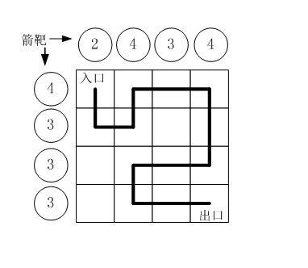

# 蓝桥杯 2016年第七届 真题（全部组别合并，按题号排列）

> 来源: Dotcpp 蓝桥杯真题 https://www.dotcpp.com/oj/lanqiao/ ｜ 洛谷蓝桥杯题单补充 1 题 https://www.luogu.com.cn/problem/list?type=luogu&tag=361,363 ｜ 抓取时间: 2026-11-27
> 本年有效试卷 1 套、9 题次，Dotcpp 去重 9 道题，另补洛谷题 1 道。

## 本年试卷构成

| 赛段 | 科目 | 组别 | 题数 | 备注 | 题集页 |
| --- | --- | --- | --- | --- | --- |
| 省赛及国赛 | 未分类 | 综合 | 9 |  | [题集](https://www.dotcpp.com/oj/1017/) |

## 题目一览

| 题号 | 标题 | 难度 | 通过率 | 考过的语言/组别 |
| --- | --- | --- | --- | --- |
| 1834 | 路径之谜 | 简单 | 59.04% | 未区分科目 |
| 1835 | 碱基 | 中等 | 43.81% | 未区分科目 |
| 1836 | 圆圈舞 | 入门 | 64.84% | 未区分科目 |
| 2267 | 取球博弈 | 中等 | 30.35% | 未区分科目 |
| 2268 | 密码脱落 | 困难 | 29.60% | 未区分科目 |
| 2269 | 冰雹数 | 困难 | 22.40% | 未区分科目 |
| 2270 | 四平方和 | 中等 | 28.82% | 未区分科目 |
| 2271 | 压缩变换 | 困难 | 12.91% | 未区分科目 |
| 2272 | 最大比例 | 困难 | 16.76% | 未区分科目 |
| — | 交换瓶子 | 中等 | 51.36% | 省赛 C/C++ 大学B组 |

## 题目详情

### 1834 · 路径之谜

> 题号 1834 ｜ 难度 简单 ｜ 时间 1s ｜ 内存 128MB
> 通过率 59.04% ｜ 题面原文 https://www.dotcpp.com/oj/problem1834.html
> 考过的语言/组别：未区分科目（省赛及国赛合订卷）

#### 题目描述



小明冒充X星球的骑士，进入了一个奇怪的城堡。

城堡里边什么都没有，只有方形石头铺成的地面。

假设城堡地面是 n x n 个方格。【如图1.png】所示。

按习俗，骑士要从西北角走到东南角。
可以横向或纵向移动，但不能斜着走，也不能跳跃。
每走到一个新方格，就要向正北方和正西方各射一箭。
（城堡的西墙和北墙内各有 n 个靶子）

同一个方格只允许经过一次。但不必走完所有的方格。
如果只给出靶子上箭的数目，你能推断出骑士的行走路线吗？
有时是可以的，比如图1.png中的例子。
本题的要求就是已知箭靶数字，求骑士的行走路径（测试数据保证路径唯一）

#### 输入格式

第一行一个整数N(0<N<20)，表示地面有 N x N 个方格
第二行N个整数，空格分开，表示北边的箭靶上的数字（自西向东）
第三行N个整数，空格分开，表示西边的箭靶上的数字（自北向南）

#### 输出格式

一行若干个整数，表示骑士路径。

为了方便表示，我们约定每个小格子用一个数字代表，从西北角开始编号: 0,1,2,3....
比如，图1.png中的方块编号为：

0  1  2  3
4  5  6  7
8  9  10 11
12 13 14 15

#### 样例输入

```
4

2 4 3 4

4 3 3 3
```

#### 提示

零基础同学可以先学习视频课程，包含C/C++、Python、百练、蓝桥杯辅导、算法数据结构等课程，提供视频讲解以及配套习题，还有老师答疑，点击这里了解课程详情

---

### 1835 · 碱基

> 题号 1835 ｜ 难度 中等 ｜ 时间 1s ｜ 内存 128MB
> 通过率 43.81% ｜ 题面原文 https://www.dotcpp.com/oj/problem1835.html
> 考过的语言/组别：未区分科目（省赛及国赛合订卷）

#### 题目描述

生物学家正在对n个物种进行研究。

其中第i个物种的DNA序列为s[i]，其中的第j个碱基为s[i][j],碱基一定是A、T、G、C之一。

生物学家想找到这些生物中一部分生物的一些共性，他们现在关注那些至少在m个生物中出现的长度为k的连续碱基序列。准确的说，科学家关心的序列用2m元组(i1,p1,i2,p2....im,pm)表示，

满足:

1<=i1<i2<....<im<=n;

且对于所有q(0<=q<k), s[i1][p1+q]=s[i2][p2+q]=....=s[im][pm+q]。

现在给定所有生物的DNA序列，请告诉科学家有多少的2m元组是需要关注的。如果两个2m元组有任何一个位置不同，则认为是不同的元组。

#### 输入格式

输入的第一行包含三个整数n、m、k，两个整数之间用一个空格分隔，意义如题目所述。

接下来n行，每行一个字符串表示一种生物的DNA序列。

DNA序列从1至n编号，每个序列中的碱基从1开始依次编号，不同的生物的DNA序列长度可能不同。

#### 输出格式

输出一个整数，表示关注的元组个数。

答案可能很大，你需要输出答案除以1000000007的余数。

#### 样例输入

```
3 2 2

ATC

TCG

ACG
```

#### 提示

零基础同学可以先学习视频课程，包含C/C++、Python、百练、蓝桥杯辅导、算法数据结构等课程，提供视频讲解以及配套习题，还有老师答疑，点击这里了解课程详情

---

### 1836 · 圆圈舞

> 题号 1836 ｜ 难度 入门 ｜ 时间 1s ｜ 内存 128MB
> 通过率 64.84% ｜ 题面原文 https://www.dotcpp.com/oj/problem1836.html
> 考过的语言/组别：未区分科目（省赛及国赛合订卷）

#### 题目描述

春天温暖的阳光照耀着大地，正是草原上的小动物们最快乐的时候。小动物们在草原上开了一个舞会，欢度这美好的时光。

舞会上最重要的一个环节就是跳圆舞曲，n只小动物手拉手围成一大圈，随着音乐跳起来。在跳的过程中，小动物们可能会变换队形。它们的变换方式是动物A松开自己右手，动物B松开自己的左手，动物A和B手拉到一起，而它们对应的松开的手（如果有的话）也拉到一起。

例如，假设有10只小动物，按顺序围成一圈，动物1的右手拉着动物2的左手，动物2的右手拉着动物3的左手，依次类推，最后动物10的右手拉着动物1的左手。如果通过动物2和8变换队形，则动物2的右手拉着动物8的左手，而对应的动物3的左手拉着动物7的右手，这样形成了1-2-8-9-10和3-4-5-6-7两个圈。如果此时通过动物2和6变换队形，则将形成1-2-6-7-3-4-5-8-9-10一个大圈。注意，如果此时通过动物1和2变换队形，那么队形不会改变，因为动物1的右手和动物2的左手松开后又拉到一起了。

在跳舞的过程中，每个动物i都有一个欢乐值Hi和一个感动值Fi。

如果两个动物在一个圈中，欢乐值会彼此影响，产生欢乐能量。如果两个动物i, j（i≠j）在同一个大小为t的圈中，而动物i在动物j右手的第p个位置（动物j右手的第1个位置就是动物j右手所拉着的动物，而第2个位置就是右手第1个位置的动物右手拉着的动物，依次类推），则产生的欢乐能量为(t-p)*Hj*Fi。在跳舞的过程中，动物们的欢乐值和感动值有可能发生变化。

圆舞曲开始的时候，所有的动物按编号顺序围成一个圈，动物n右手的第i个位置正好是动物i。现在已知小动物们变换队形的过程和欢乐值、感动值变化的过程，求每次变换后所有动物所产生的欢迎能量之和。

#### 输入格式

输入的第一行包含一个整数n，表示动物的数量。

接下来n行，每行两个用空格分隔的整数Hi, Fi，按编号顺序给出每只动物的欢乐值和感动值。

接下来一行包含一个整数m，表示队形、欢乐值、感动值的变化次数。

接下来m行，每行三个用空格分隔的整数k, p, q，当k=1时，表示小动物们通过动物p和动物q变换了队形，当k=2时，表示动物p的欢乐值变为q，当k=3时，表示动物p的感动值变为了q。

#### 输出格式

输出m行，每行一个整数，表示每次变化后所有动物产生的能量之和。

答案可能很大，你需要计算答案除以1000000007的余数。

#### 样例输入

```
10

1 1

1 1

1 1

1 1

1 1

1 1

1 1

1 1

1 1

1 1

9

1 2 8

1 2 6

2 8 10

3 5 10

1 1 2

1 2 1

2 5 5

1 4 8

1 4 5
```

#### 提示

零基础同学可以先学习视频课程，包含C/C++、Python、百练、蓝桥杯辅导、算法数据结构等课程，提供视频讲解以及配套习题，还有老师答疑，点击这里了解课程详情

---

### 2267 · 取球博弈

> 题号 2267 ｜ 难度 中等 ｜ 时间 1s ｜ 内存 128MB
> 通过率 30.35% ｜ 题面原文 https://www.dotcpp.com/oj/problem2267.html
> 考过的语言/组别：未区分科目（省赛及国赛合订卷）

#### 题目描述

两个人玩取球的游戏。

一共有N个球，每人轮流取球，每次可取集合{n1,n2,n3}中的任何一个数目。

如果无法继续取球，则游戏结束。

此时，持有奇数个球的一方获胜。

如果两人都是奇数，则为平局。

假设双方都采用最聪明的取法，

第一个取球的人一定能赢吗？

试编程解决这个问题。

#### 输入格式

第一行3个正整数n1 n2 n3，空格分开，表示每次可取的数目 (0<n1,n2,n3<100)

第二行5个正整数x1 x2 ... x5，空格分开，表示5局的初始球数(0<xi<1000)

#### 输出格式

一行5个字符，空格分开。分别表示每局先取球的人能否获胜。

能获胜则输出+，

次之，如有办法逼平对手，输出0，

无论如何都会输，则输出-

#### 样例输入

```
1 2 3

1 2 3 4 5
```

#### 提示

零基础同学可以先学习视频课程，包含C/C++、Python、百练、蓝桥杯辅导、算法数据结构等课程，提供视频讲解以及配套习题，还有老师答疑，点击这里了解课程详情

---

### 2268 · 密码脱落

> 题号 2268 ｜ 难度 困难 ｜ 时间 1s ｜ 内存 128MB
> 通过率 29.60% ｜ 题面原文 https://www.dotcpp.com/oj/problem2268.html
> 考过的语言/组别：未区分科目（省赛及国赛合订卷）

#### 题目描述

X星球的考古学家发现了一批古代留下来的密码。

这些密码是由A、B、C、D 四种植物的种子串成的序列。

仔细分析发现，这些密码串当初应该是前后对称的（也就是我们说的镜像串）。

由于年代久远，其中许多种子脱落了，因而可能会失去镜像的特征。

你的任务是：

给定一个现在看到的密码串，计算一下从当初的状态，它要至少脱落多少个种子，才可能会变成现在的样子

#### 输入格式

输入一行，表示现在看到的密码串（长度不大于1000）

#### 输出格式

要求输出一个正整数，表示至少脱落了多少个种子。

#### 样例输入

```
ABCBA
```

#### 提示

零基础同学可以先学习视频课程，包含C/C++、Python、百练、蓝桥杯辅导、算法数据结构等课程，提供视频讲解以及配套习题，还有老师答疑，点击这里了解课程详情

---

### 2269 · 冰雹数

> 题号 2269 ｜ 难度 困难 ｜ 时间 1s ｜ 内存 128MB
> 通过率 22.40% ｜ 题面原文 https://www.dotcpp.com/oj/problem2269.html
> 考过的语言/组别：未区分科目（省赛及国赛合订卷）

#### 题目描述

任意给定一个正整数N，

如果是偶数，执行： N / 2

如果是奇数，执行： N * 3 + 1

生成的新的数字再执行同样的动作，循环往复。

通过观察发现，这个数字会一会儿上升到很高，

一会儿又降落下来。

就这样起起落落的，但最终必会落到“1”

这有点像小冰雹粒子在冰雹云中翻滚增长的样子。

比如N=9

9,28,14,7,22,11,34,17,52,26,13,40,20,10,5,16,8,4,2,1

可以看到，N=9的时候，这个“小冰雹”最高冲到了52这个高度。

#### 输入格式

一个正整数N（N<1000000）

#### 输出格式

一个正整数，表示不大于N的数字，经过冰雹数变换过程中，最高冲到了多少。

#### 样例输入

```
10
```

#### 提示

零基础同学可以先学习视频课程，包含C/C++、Python、百练、蓝桥杯辅导、算法数据结构等课程，提供视频讲解以及配套习题，还有老师答疑，点击这里了解课程详情

---

### 2270 · 四平方和

> 题号 2270 ｜ 难度 中等 ｜ 时间 1s ｜ 内存 128MB
> 通过率 28.82% ｜ 题面原文 https://www.dotcpp.com/oj/problem2270.html
> 考过的语言/组别：未区分科目（省赛及国赛合订卷）

#### 题目描述

四平方和定理，又称为拉格朗日定理：

每个正整数都可以表示为至多4个正整数的平方和。

如果把0包括进去，就正好可以表示为4个数的平方和。

比如：

5 = 0^2 + 0^2 + 1^2 + 2^2

7 = 1^2 + 1^2 + 1^2 + 2^2

（^符号表示乘方的意思）

对于一个给定的正整数，可能存在多种平方和的表示法。

要求你对4个数排序：

0 <= a <= b <= c <= d

并对所有的可能表示法按 a,b,c,d 为联合主键升序排列，最后输出第一个表示法

#### 输入格式

程序输入为一个正整数N (N<5000000)

#### 输出格式

要求输出4个非负整数，按从小到大排序，中间用空格分开

#### 样例输入

```
5
```

#### 提示

零基础同学可以先学习视频课程，包含C/C++、Python、百练、蓝桥杯辅导、算法数据结构等课程，提供视频讲解以及配套习题，还有老师答疑，点击这里了解课程详情

---

### 2271 · 压缩变换

> 题号 2271 ｜ 难度 困难 ｜ 时间 1s ｜ 内存 128MB
> 通过率 12.91% ｜ 题面原文 https://www.dotcpp.com/oj/problem2271.html
> 考过的语言/组别：未区分科目（省赛及国赛合订卷）

#### 题目描述

小明最近在研究压缩算法。

他知道，压缩的时候如果能够使得数值很小，就能通过熵编码得到较高的压缩比。

然而，要使数值很小是一个挑战。

最近，小明需要压缩一些正整数的序列，这些序列的特点是，后面出现的数字很大可能是刚出现过不久的数字。对于这种特殊的序列，小明准备对序列做一个变换来减小数字的值。

变换的过程如下：

从左到右枚举序列，每枚举到一个数字，如果这个数字没有出现过，刚将数字变换成它的相反数，如果数字出现过，则看它在原序列中最后的一次出现后面（且在当前数前面）出现了几种数字，用这个种类数替换原来的数字。

比如，序列(a1, a2, a3, a4, a5)=(1, 2, 2, 1, 2)在变换过程为：

a1: 1未出现过，所以a1变为-1；

a2: 2未出现过，所以a2变为-2；

a3: 2出现过，最后一次为原序列的a2，在a2后、a3前有0种数字，所以a3变为0；

a4: 1出现过，最后一次为原序列的a1，在a1后、a4前有1种数字，所以a4变为1；

a5: 2出现过，最后一次为原序列的a3，在a3后、a5前有1种数字，所以a5变为1。

现在，给出原序列，请问，按这种变换规则变换后的序列是什么。

#### 输入格式

输入第一行包含一个整数n，表示序列的长度。

第二行包含n个正整数，表示输入序列。

对于30%的数据，n<=1000；

对于50%的数据，n<=30000；

对于100%的数据，1 <=n<=100000，1<=ai<=10^9

#### 输出格式

输出一行，包含n个数，表示变换后的序列。

#### 样例输入

```
5

1 2 2 1 2
```

#### 提示

零基础同学可以先学习视频课程，包含C/C++、Python、百练、蓝桥杯辅导、算法数据结构等课程，提供视频讲解以及配套习题，还有老师答疑，点击这里了解课程详情

---

### 2272 · 最大比例

> 题号 2272 ｜ 难度 困难 ｜ 时间 1s ｜ 内存 128MB
> 通过率 16.76% ｜ 题面原文 https://www.dotcpp.com/oj/problem2272.html
> 考过的语言/组别：未区分科目（省赛及国赛合订卷）

#### 题目描述

X星球的某个大奖赛设了M级奖励。每个级别的奖金是一个正整数。

并且，相邻的两个级别间的比例是个固定值。

也就是说：所有级别的奖金数构成了一个等比数列。比如：

16,24,36,54

其等比值为：3/2

现在，我们随机调查了一些获奖者的奖金数。

请你据此推算可能的最大的等比值。

#### 输入格式

第一行为数字 N (0<N<100)，表示接下的一行包含N个正整数

第二行N个正整数Xi(Xi<1 000 000 000 000)，用空格分开。每个整数表示调查到的某人的奖金数额

#### 输出格式

一个形如A/B的分数，要求A、B互质。表示可能的最大比例系数

测试数据保证了输入格式正确，并且最大比例是存在的。

#### 样例输入

```
3

1250 200 32
```

#### 提示

零基础同学可以先学习视频课程，包含C/C++、Python、百练、蓝桥杯辅导、算法数据结构等课程，提供视频讲解以及配套习题，还有老师答疑，点击这里了解课程详情

---

### — · 交换瓶子

> 题号 洛谷 P8637 ｜ 难度 中等（洛谷 普及） ｜ 时间 1.00s ｜ 内存 128MB
> 通过率 51.36%（洛谷站内口径） ｜ 题面原文 https://www.luogu.com.cn/problem/P8637
> 考过的语言/组别：省赛 C/C++ 大学B组（洛谷题单）

#### 题目描述

有 $N$ 个瓶子，编号 $1 \sim N$，放在架子上。

比如有 $5$ 个瓶子：

$$2,1,3,5,4$$

要求每次拿起 $2$ 个瓶子，交换它们的位置。

经过若干次后，使得瓶子的序号为：

$$1,2,3,4,5$$

对于这么简单的情况，显然，至少需要交换 $2$ 次就可以复位。

如果瓶子更多呢？你可以通过编程来解决。

#### 输入格式

第一行：一个正整数 $N$（$N<10000$），表示瓶子的数目。

第二行：$N$ 个正整数，用空格分开，表示瓶子目前的排列情况。

#### 输出格式

输出数据为一行一个正整数，表示至少交换多少次，才能完成排序。

#### 样例输入 1

```
5
3 1 2 5 4
```

#### 样例输出 1

```
3
```

#### 样例输入 2

```
5
5 4 3 2 1
```

#### 样例输出 2

```
2
```

#### 提示

时限 1 秒, 256M。蓝桥杯 2016 年第七届省赛

蓝桥杯 2016 年省赛 B 组 I 题。

---
