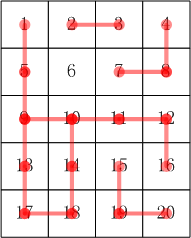
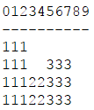
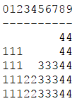
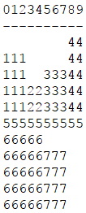

# 蓝桥杯 2017年第八届 真题（全部组别合并，按题号排列）

> 来源: Dotcpp 蓝桥杯真题 https://www.dotcpp.com/oj/lanqiao/ ｜ 洛谷蓝桥杯题单补充 1 题 https://www.luogu.com.cn/problem/list?type=luogu&tag=361,363 ｜ 抓取时间: 2026-11-27
> 本年有效试卷 1 套、20 题次，Dotcpp 去重 20 道题，另补洛谷题 1 道。

## 本年试卷构成

| 赛段 | 科目 | 组别 | 题数 | 备注 | 题集页 |
| --- | --- | --- | --- | --- | --- |
| 省赛及国赛 | 未分类 | 综合 | 20 |  | [题集](https://www.dotcpp.com/oj/1018/) |

## 题目一览

| 题号 | 标题 | 难度 | 通过率 | 考过的语言/组别 |
| --- | --- | --- | --- | --- |
| 1841 | 发现环 | 中等 | 31.62% | 未区分科目 |
| 1842 | 对局匹配 | 简单 | 44.83% | 未区分科目 |
| 1843 | 观光铁路 | 简单 | 48.30% | 未区分科目 |
| 1844 | 小计算器 | 中等 | 37.37% | 未区分科目 |
| 1845 | 填字母游戏 | 困难 | 16.77% | 未区分科目 |
| 1846 | 区间移位 | 困难 | 26.56% | 未区分科目 |
| 1873 | 合根植物 | 中等 | 42.05% | 未区分科目 |
| 1874 | 分考场 | 困难 | 24.38% | 未区分科目 |
| 1875 | 小数第n位 | 困难 | 25.14% | 未区分科目 |
| 1876 | 数组操作 | 困难 | 1.48% | 未区分科目 |
| 1877 | 图形排版 | 困难 | 15.10% | 未区分科目 |
| 1878 | 青蛙跳杯子 | 中等 | 41.46% | 未区分科目 |
| 1879 | 拉马车 | 简单 | 53.34% | 未区分科目 |
| 1880 | 九宫幻方 | 简单 | 51.90% | 未区分科目 |
| 1881 | Excel地址 | 中等 | 38.95% | 未区分科目 |
| 1882 | k倍区间 | 困难 | 23.84% | 未区分科目 |
| 1883 | 日期问题 | 困难 | 24.49% | 未区分科目 |
| 1884 | 油漆面积 | 困难 | 9.89% | 未区分科目 |
| 1885 | 分巧克力 | 中等 | 36.62% | 未区分科目 |
| 1886 | 包子凑数 | 中等 | 33.63% | 未区分科目 |
| — | 正则问题 | 中等 | 46.54% | 省赛 C/C++ 大学A组 |

## 题目详情

### 1841 · 发现环

> 题号 1841 ｜ 难度 中等 ｜ 时间 1s ｜ 内存 128MB
> 通过率 31.62% ｜ 题面原文 https://www.dotcpp.com/oj/problem1841.html
> 考过的语言/组别：未区分科目（省赛及国赛合订卷）

#### 题目描述

小明的实验室有N台电脑，编号1~N。原本这N台电脑之间有N-1条数据链接相连，恰好构成一个树形网络。在树形网络上，任意两台电脑之间有唯一的路径相连。

不过在最近一次维护网络时，管理员误操作使得某两台电脑之间增加了一条数据链接，于是网络中出现了环路。环路上的电脑由于两两之间不再是只有一条路径，使得这些电脑上的数据传输出现了BUG。

为了恢复正常传输。小明需要找到所有在环路上的电脑，你能帮助他吗？

#### 输入格式

第一行包含一个整数N。

以下N行每行两个整数a和b，表示a和b之间有一条数据链接相连。

对于30%的数据，1 <= N <= 1000

对于100%的数据, 1 <= N <= 100000， 1 <= a, b <= N

输入保证合法。

#### 输出格式

按从小到大的顺序输出在环路上的电脑的编号，中间由一个空格分隔。

#### 样例输入

```
5

1 2

3 1

2 4

2 5

5 3
```

#### 提示

零基础同学可以先学习视频课程，包含C/C++、Python、百练、蓝桥杯辅导、算法数据结构等课程，提供视频讲解以及配套习题，还有老师答疑，点击这里了解课程详情

---

### 1842 · 对局匹配

> 题号 1842 ｜ 难度 简单 ｜ 时间 1s ｜ 内存 128MB
> 通过率 44.83% ｜ 题面原文 https://www.dotcpp.com/oj/problem1842.html
> 考过的语言/组别：未区分科目（省赛及国赛合订卷）

#### 题目描述

小明喜欢在一个围棋网站上找别人在线对弈。这个网站上所有注册用户都有一个积分，代表他的围棋水平。

小明发现网站的自动对局系统在匹配对手时，只会将积分差恰好是K的两名用户匹配在一起。如果两人分差小于或大于K，系统都不会将他们匹配。

现在小明知道这个网站总共有N名用户，以及他们的积分分别是A1, A2, ... AN。

小明想了解最多可能有多少名用户同时在线寻找对手，但是系统却一场对局都匹配不起来(任意两名用户积分差不等于K)？

#### 输入格式

第一行包含两个个整数N和K。

第二行包含N个整数A1, A2, ... AN。

对于30%的数据，1 <= N <= 10

对于100%的数据，1 <= N <= 100000, 0 <= Ai <= 100000, 0 <= K <= 100000

#### 输出格式

一个整数，代表答案。

#### 样例输入

```
10 0

1 4 2 8 5 7 1 4 2 8
```

#### 提示

零基础同学可以先学习视频课程，包含C/C++、Python、百练、蓝桥杯辅导、算法数据结构等课程，提供视频讲解以及配套习题，还有老师答疑，点击这里了解课程详情

---

### 1843 · 观光铁路

> 题号 1843 ｜ 难度 简单 ｜ 时间 1s ｜ 内存 128MB
> 通过率 48.30% ｜ 题面原文 https://www.dotcpp.com/oj/problem1843.html
> 考过的语言/组别：未区分科目（省赛及国赛合订卷）

#### 题目描述

跳蚤国正在大力发展旅游业，每个城市都被打造成了旅游景点。

许多跳蚤想去其他城市旅游，但是由于跳得比较慢，它们的愿望难以实现。这时，小C听说有一种叫做火车的交通工具，在铁路上跑得很快，便抓住了商机，创立了一家铁路公司，向跳蚤国王请示在每两个城市之间都修建铁路。

然而，由于小C不会扳道岔，火车到一个城市以后只能保证不原路返回，而会随机等概率地驶向与这个城市有铁路连接的另外一个城市。

跳蚤国王向广大居民征求意见，结果跳蚤们不太满意，因为这样修建铁路以后有可能只游览了3个城市（含出发的城市）以后就回来了，它们希望能多游览几个城市。于是跳蚤国王要求小C提供一个方案，使得每只跳蚤坐上火车后能多游览几个城市才回来。

小C提供了一种方案给跳蚤国王。跳蚤国王想知道这个方案中每个城市的居民旅游的期望时间（设火车经过每段铁路的时间都为1），请你来帮跳蚤国王。

#### 输入格式

输入的第一行包含两个正整数n、m，其中n表示城市的数量，m表示方案中的铁路条数。

接下来m行，每行包含两个正整数u、v，表示方案中城市u和城市v之间有一条铁路。

保证方案中无重边无自环，每两个城市之间都能经过铁路直接或间接到达，且火车由任意一条铁路到任意一个城市以后一定有路可走。

#### 输出格式

输出n行，第i行包含一个实数ti，表示方案中城市i的居民旅游的期望时间。你应当输出足够多的小数位数，以保证输出的值和真实值之间的绝对或相对误差不超过1e-9。

#### 样例输入

```
4 5

1 2

2 3

3 4

4 1

1 3
```

#### 提示

零基础同学可以先学习视频课程，包含C/C++、Python、百练、蓝桥杯辅导、算法数据结构等课程，提供视频讲解以及配套习题，还有老师答疑，点击这里了解课程详情

---

### 1844 · 小计算器

> 题号 1844 ｜ 难度 中等 ｜ 时间 1s ｜ 内存 128MB
> 通过率 37.37% ｜ 题面原文 https://www.dotcpp.com/oj/problem1844.html
> 考过的语言/组别：未区分科目（省赛及国赛合订卷）

#### 题目描述

模拟程序型计算器，依次输入指令，可能包含的指令有

1. 数字：'NUM X'，X为一个只包含大写字母和数字的字符串，表示一个当前进制的数

2. 运算指令：'ADD','SUB','MUL','DIV','MOD'，分别表示加减乘，除法取商，除法取余

3. 进制转换指令：'CHANGE K'，将当前进制转换为K进制(2≤K≤36)

4. 输出指令：'EQUAL'，以当前进制输出结果

5. 重置指令：'CLEAR'，清除当前数字

指令按照以下规则给出：

数字，运算指令不会连续给出，进制转换指令，输出指令，重置指令有可能连续给出

运算指令后出现的第一个数字，表示参与运算的数字。且在该运算指令和该数字中间不会出现运算指令和输出指令

重置指令后出现的第一个数字，表示基础值。且在重置指令和第一个数字中间不会出现运算指令和输出指令

进制转换指令可能出现在任何地方

运算过程中中间变量均为非负整数，且小于2^63。

以大写的'A'~'Z'表示10~35

#### 输入格式

第1行：1个n，表示指令数量

第2..n+1行：每行给出一条指令。指令序列一定以'CLEAR'作为开始，并且满足指令规则

#### 输出格式

依次给出每一次'EQUAL'得到的结果

#### 样例输入

```
7

CLEAR

NUM 1024

CHANGE 2

ADD

NUM 100000

CHANGE 8

EQUAL
```

#### 提示

零基础同学可以先学习视频课程，包含C/C++、Python、百练、蓝桥杯辅导、算法数据结构等课程，提供视频讲解以及配套习题，还有老师答疑，点击这里了解课程详情

---

### 1845 · 填字母游戏

> 题号 1845 ｜ 难度 困难 ｜ 时间 1s ｜ 内存 128MB
> 通过率 16.77% ｜ 题面原文 https://www.dotcpp.com/oj/problem1845.html
> 考过的语言/组别：未区分科目（省赛及国赛合订卷）

#### 题目描述

小明经常玩 LOL 游戏上瘾，一次他想挑战K大师，不料K大师说：

“我们先来玩个空格填字母的游戏，要是你不能赢我，就再别玩LOL了”。

K大师在纸上画了一行n个格子，要小明和他交替往其中填入字母。

并且：

1. 轮到某人填的时候，只能在某个空格中填入L或O

2. 谁先让字母组成了“LOL”的字样，谁获胜。

3. 如果所有格子都填满了，仍无法组成LOL，则平局。

小明试验了几次都输了，他很惭愧，希望你能用计算机帮他解开这个谜。

#### 输入格式

第一行，数字n（n<10），表示下面有n个初始局面。

接下来，n行，每行一个串，表示开始的局面。

比如：“******”, 表示有6个空格。

“L****”,   表示左边是一个字母L，它的右边是4个空格。

#### 输出格式

要求输出n个数字，表示对每个局面，如果小明先填，当K大师总是用最强着法的时候，小明的最好结果。

1 表示能赢

-1 表示必输

0 表示可以逼平

#### 样例输入

```
4

***

L**L

L**L***L

L*****L
```

#### 提示

零基础同学可以先学习视频课程，包含C/C++、Python、百练、蓝桥杯辅导、算法数据结构等课程，提供视频讲解以及配套习题，还有老师答疑，点击这里了解课程详情

---

### 1846 · 区间移位

> 题号 1846 ｜ 难度 困难 ｜ 时间 1s ｜ 内存 128MB
> 通过率 26.56% ｜ 题面原文 https://www.dotcpp.com/oj/problem1846.html
> 考过的语言/组别：未区分科目（省赛及国赛合订卷）

#### 题目描述

数轴上有n个闭区间：D1,...,Dn。

其中区间Di用一对整数[ai, bi]来描述，满足ai < bi。

已知这些区间的长度之和至少有10000。

所以，通过适当的移动这些区间，你总可以使得他们的“并”覆盖[0, 10000]——也就是说[0, 10000]这个区间内的每一个点都落于至少一个区间内。

你希望找一个移动方法，使得位移差最大的那个区间的位移量最小。

具体来说，假设你将Di移动到[ai+ci, bi+ci]这个位置。你希望使得maxi{|ci|} 最小。

#### 输入格式

输入的第一行包含一个整数n，表示区间的数量。

接下来有n行，每行2个整数ai, bi，以一个空格分开，表示区间[ai, bi]。

保证区间的长度之和至少是10000。

#### 输出格式

输出一个数字，表示答案。如果答案是整数，只输出整数部分。如果答案不是整数，输出时四舍五入保留一位小数。

#### 样例输入

```
2

10 5010

4980 9980
```

#### 提示

零基础同学可以先学习视频课程，包含C/C++、Python、百练、蓝桥杯辅导、算法数据结构等课程，提供视频讲解以及配套习题，还有老师答疑，点击这里了解课程详情

---

### 1873 · 合根植物

> 题号 1873 ｜ 难度 中等 ｜ 时间 1s ｜ 内存 128MB
> 通过率 42.05% ｜ 题面原文 https://www.dotcpp.com/oj/problem1873.html
> 考过的语言/组别：未区分科目（省赛及国赛合订卷）

#### 题目描述

w星球的一个种植园，被分成 m * n 个小格子（东西方向m行，南北方向n列）。每个格子里种了一株合根植物。

这种植物有个特点，它的根可能会沿着南北或东西方向伸展，从而与另一个格子的植物合成为一体。

如果我们告诉你哪些小格子间出现了连根现象，你能说出这个园中一共有多少株合根植物吗？



#### 输入格式

第一行，两个整数m，n，用空格分开，表示格子的行数、列数（1<m,n<1000）。

接下来一行，一个整数k，表示下面还有k行数据(0<k<100000)

接下来k行，第行两个整数a，b，表示编号为a的小格子和编号为b的小格子合根了。

格子的编号一行一行，从上到下，从左到右编号。

比如：5 * 4 的小格子，编号：

1 2 3 4

5 6 7 8

9 10 11 12

13 14 15 16

17 18 19 20

#### 输出格式

多少株

#### 样例输入

```
5 4

16

2 3

1 5

5 9

4 8

7 8

9 10

10 11

11 12

10 14

12 16

14 18

17 18

15 19

19 20

9 13

13 17
```

#### 提示

零基础同学可以先学习视频课程，包含C/C++、Python、百练、蓝桥杯辅导、算法数据结构等课程，提供视频讲解以及配套习题，还有老师答疑，点击这里了解课程详情

---

### 1874 · 分考场

> 题号 1874 ｜ 难度 困难 ｜ 时间 1s ｜ 内存 128MB
> 通过率 24.38% ｜ 题面原文 https://www.dotcpp.com/oj/problem1874.html
> 考过的语言/组别：未区分科目（省赛及国赛合订卷）

#### 题目描述

n个人参加某项特殊考试。

为了公平，要求任何两个认识的人不能分在同一个考场。

求是少需要分几个考场才能满足条件。

#### 输入格式

第一行，一个整数n(1<n<100)，表示参加考试的人数。

第二行，一个整数m，表示接下来有m行数据

以下m行每行的格式为：两个整数a，b，用空格分开 (1<=a,b<=n) 表示第a个人与第b个人认识。

#### 输出格式

一行一个整数，表示最少分几个考场。

#### 样例输入

```
5

8

1 2

1 3

1 4

2 3

2 4

2 5

3 4

4 5
```

#### 提示

零基础同学可以先学习视频课程，包含C/C++、Python、百练、蓝桥杯辅导、算法数据结构等课程，提供视频讲解以及配套习题，还有老师答疑，点击这里了解课程详情

---

### 1875 · 小数第n位

> 题号 1875 ｜ 难度 困难 ｜ 时间 1s ｜ 内存 128MB
> 通过率 25.14% ｜ 题面原文 https://www.dotcpp.com/oj/problem1875.html
> 考过的语言/组别：未区分科目（省赛及国赛合订卷）

#### 题目描述

我们知道，整数做除法时，有时得到有限小数，有时得到无限循环小数。

如果我们把有限小数的末尾加上无限多个0，它们就有了统一的形式。

本题的任务是：在上面的约定下，求整数除法小数点后的第n位开始的3位数。

#### 输入格式

一行三个整数：a b n，用空格分开。a是被除数，b是除数，n是所求的小数后位置（0<a,b,n<1000000000）

#### 输出格式

一行3位数字，表示：a除以b，小数后第n位开始的3位数字。

#### 样例输入

```
1 8 1
```

#### 提示

零基础同学可以先学习视频课程，包含C/C++、Python、百练、蓝桥杯辅导、算法数据结构等课程，提供视频讲解以及配套习题，还有老师答疑，点击这里了解课程详情

---

### 1876 · 数组操作

> 题号 1876 ｜ 难度 困难 ｜ 时间 1s ｜ 内存 128MB
> 通过率 1.48% ｜ 题面原文 https://www.dotcpp.com/oj/problem1876.html
> 考过的语言/组别：未区分科目（省赛及国赛合订卷）

#### 题目描述

给出一个长度为 n 的数组 {A_i}，由 1 到 n 标号 ， 你需要维护 m 个操作。

操作分为三种，输入格式为：

1 l r d，将数组中下标 l 到 r 的位置都加上 d，即对于 l<=i<=r，执行A_i=A_i+d。

2 l_1 r_1 l_2 r_2，将数组中下标为 l_1 到 r_1 的位置，赋值成 l_2 到 r_2 的值，保证 r_1-l_1=r_2-l_2。

换句话说先对 0<=i<=r_2-l_2 执行 B_i=A_(l_2+i)，再对 0<=i<=r_1-l_1 执行 A_(l_1+i)=B_i，其中 {B_i} 为一个临时数组。

3 l r，求数组中下标 l 到 r 的位置的和，即求出 ∑_(i=l到r) A_i 。

#### 输入格式

从标准输入读入数据。

第一行一个整数 Case，表示测试点编号，其中 Case=0 表示该点为样例。

第二行包含两个整数 n,m。保证 1<=n,m<=10^5。

第三行包含 n 个整数 A_i，表示这个数组的初值。保证 0<=A_i<=10^5。

接下来 m 每行描述一个操作，格式如问题描述所示。

对于操作中提到每个数，满足 0<=d<=10^5，1<=l<=r<=n，1<=l_1<=r_1<=n，1<=l_2<=r_2<=n，r_1-l_1=r_2-l_2。

#### 输出格式

输出到标准输出。

对于每次 3 操作输出一行一个数，表示求和的结果。

#### 样例输入

```
0

5 6

1 2 3 4 5

2 1 3 3 5

3 3 5

1 2 4 2

3 3 5

2 1 3 3 5

3 1 5
```

#### 提示

零基础同学可以先学习视频课程，包含C/C++、Python、百练、蓝桥杯辅导、算法数据结构等课程，提供视频讲解以及配套习题，还有老师答疑，点击这里了解课程详情

---

### 1877 · 图形排版

> 题号 1877 ｜ 难度 困难 ｜ 时间 1s ｜ 内存 128MB
> 通过率 15.10% ｜ 题面原文 https://www.dotcpp.com/oj/problem1877.html
> 考过的语言/组别：未区分科目（省赛及国赛合订卷）

#### 题目描述

小明需要在一篇文档中加入 N 张图片，其中第 i 张图片的宽度是 Wi，高度是 Hi。
假设纸张的宽度是 M，小明使用的文档编辑工具会用以下方式对图片进行自动排版：

1. 该工具会按照图片顺序，在宽度 M 以内，将尽可能多的图片排在一行。该行的高度是行内最高的图片的高度。例如在 M=10 的纸张上依次打印 3x4, 2x2, 3x3 三张图片，则效果如下图所示，这一行高度为4。(分割线以上为列标尺，分割线以下为排版区域；数字组成的矩形为第x张图片占用的版面)



2. 如果当前行剩余宽度大于0，并且小于下一张图片，则下一张图片会按比例缩放到宽度为当前行剩余宽度(高度向上取整)，然后放入当前行。例如再放入一张4x9的图片，由于剩余宽度是2，这张图片会被压缩到2x5，再被放入第一行的末尾。此时该行高度为5：



3. 如果当前行剩余宽度为0，该工具会从下一行开始继续对剩余的图片进行排版，直到所有图片都处理完毕。此时所有行的总高度和就是这 N 张图片的排版高度。例如再放入11x1, 5x5, 3x4 的图片后，效果如下图所示，总高度为11：



现在由于排版高度过高，图片的先后顺序也不能改变，小明只好从 N 张图片中选择一张删除掉以降低总高度。他希望剩余N-1张图片按原顺序的排版高度最低，你能求出最低高度是多少么？

#### 输入格式

第一行包含两个整数 M 和 N，分别表示纸张宽度和图片的数量。
接下来 N 行，每行2个整数Wi, Hi，表示第 i 个图大小为 Wi*Hi。

对于30%的数据，满足1<=N<=1000
对于100%的数据，满足1<=N<=100000，1<=M, Wi, Hi<=100

#### 输出格式

一个整数，表示在删除掉某一张图片之后，排版高度最少能是多少。

#### 样例输入

```
4 3

2 2

2 3

2 2
```

#### 提示

零基础同学可以先学习视频课程，包含C/C++、Python、百练、蓝桥杯辅导、算法数据结构等课程，提供视频讲解以及配套习题，还有老师答疑，点击这里了解课程详情

---

### 1878 · 青蛙跳杯子

> 题号 1878 ｜ 难度 中等 ｜ 时间 1s ｜ 内存 128MB
> 通过率 41.46% ｜ 题面原文 https://www.dotcpp.com/oj/problem1878.html
> 考过的语言/组别：未区分科目（省赛及国赛合订卷）

#### 题目描述

X星球的流行宠物是青蛙，一般有两种颜色：白色和黑色。

X星球的居民喜欢把它们放在一排茶杯里，这样可以观察它们跳来跳去。

如下图，有一排杯子，左边的一个是空着的，右边的杯子，每个里边有一只青蛙。

*WWWBBB

其中，W字母表示白色青蛙，B表示黑色青蛙，*表示空杯子。

X星的青蛙很有些癖好，它们只做3个动作之一：

1. 跳到相邻的空杯子里。

2. 隔着1只其它的青蛙（随便什么颜色）跳到空杯子里。

3. 隔着2只其它的青蛙（随便什么颜色）跳到空杯子里。

对于上图的局面，只要1步，就可跳成下图局面：

WWW*BBB

本题的任务就是已知初始局面，询问至少需要几步，才能跳成另一个目标局面。

输入为2行，2个串，表示初始局面和目标局面。

输出要求为一个整数，表示至少需要多少步的青蛙跳。

#### 输入格式

输入为2行，2个串，表示初始局面和目标局面。

#### 输出格式

输出要求为一个整数，表示至少需要多少步的青蛙跳。

#### 样例输入

```
*WWBB

WWBB*
```

#### 提示

零基础同学可以先学习视频课程，包含C/C++、Python、百练、蓝桥杯辅导、算法数据结构等课程，提供视频讲解以及配套习题，还有老师答疑，点击这里了解课程详情

---

### 1879 · 拉马车

> 题号 1879 ｜ 难度 简单 ｜ 时间 1s ｜ 内存 128MB
> 通过率 53.34% ｜ 题面原文 https://www.dotcpp.com/oj/problem1879.html
> 考过的语言/组别：未区分科目（省赛及国赛合订卷）

#### 题目描述

小的时候，你玩过纸牌游戏吗？

有一种叫做“拉马车”的游戏，规则很简单，却很吸引小朋友。

其规则简述如下：

假设参加游戏的小朋友是A和B，游戏开始的时候，他们得到的随机的纸牌序列如下：

A方：[K, 8, X, K, A, 2, A, 9, 5, A]

B方：[2, 7, K, 5, J, 5, Q, 6, K, 4]

其中的X表示“10”，我们忽略了纸牌的花色。

从A方开始，A、B双方轮流出牌。

当轮到某一方出牌时，他从自己的纸牌队列的头部拿走一张，放到桌上，并且压在最上面一张纸牌上（如果有的话）。

此例中，游戏过程：

A出K，B出2，A出8，B出7，A出X，此时桌上的序列为：

K,2,8,7,X

当轮到B出牌时，他的牌K与桌上的纸牌序列中的K相同，则把包括K在内的以及两个K之间的纸牌都赢回来，放入自己牌的队尾。注意：为了操作方便，放入牌的顺序是与桌上的顺序相反的。

此时，A、B双方的手里牌为：

A方：[K, A, 2, A, 9, 5, A]

B方：[5, J, 5, Q, 6, K, 4, K, X, 7, 8, 2, K]

赢牌的一方继续出牌。也就是B接着出5，A出K，B出J，A出A，B出5，又赢牌了。

5,K,J,A,5

此时双方手里牌：

A方：[2, A, 9, 5, A]

B方：[Q, 6, K, 4, K, X, 7, 8, 2, K, 5, A, J, K, 5]

注意：更多的时候赢牌的一方并不能把桌上的牌都赢走，而是拿走相同牌点及其中间的部分。但无论如何，都是赢牌的一方继续出牌，有的时候刚一出牌又赢了，也是允许的。

当某一方出掉手里最后一张牌，但无法从桌面上赢取牌时，游戏立即结束。

对于本例的初始手牌情况下，最后A会输掉，而B最后的手里牌为：

9K2A62KAX58K57KJ5

本题的任务就是已知双方初始牌序，计算游戏结束时，赢的一方手里的牌序。当游戏无法结束时，输出-1。

#### 输入格式

输入为2行，2个串，分别表示A、B双方初始手里的牌序列。

我们约定，输入的串的长度不超过30

#### 输出格式

输出为1行，1个串，表示A先出牌，最后赢的一方手里的牌序。

#### 样例输入

```
96J5A898QA

6278A7Q973
```

#### 提示

零基础同学可以先学习视频课程，包含C/C++、Python、百练、蓝桥杯辅导、算法数据结构等课程，提供视频讲解以及配套习题，还有老师答疑，点击这里了解课程详情

---

### 1880 · 九宫幻方

> 题号 1880 ｜ 难度 简单 ｜ 时间 1s ｜ 内存 128MB
> 通过率 51.90% ｜ 题面原文 https://www.dotcpp.com/oj/problem1880.html
> 考过的语言/组别：未区分科目（省赛及国赛合订卷）

#### 题目描述

小明最近在教邻居家的小朋友小学奥数，而最近正好讲述到了三阶幻方这个部分，三阶幻方指的是将1~9不重复的填入一个3*3的矩阵当中，使得每一行、每一列和每一条对角线的和都是相同的。

三阶幻方又被称作九宫格，在小学奥数里有一句非常有名的口诀：“二四为肩，六八为足，左三右七，戴九履一，五居其中”，通过这样的一句口诀就能够非常完美的构造出一个九宫格来。

4 9 2

3 5 7

8 1 6

有意思的是，所有的三阶幻方，都可以通过这样一个九宫格进行若干镜像和旋转操作之后得到。现在小明准备将一个三阶幻方（不一定是上图中的那个）中的一些数抹掉，交给邻居家的小朋友来进行还原，并且希望她能够判断出究竟是不是只有一个解。

而你呢，也被小明交付了同样的任务，但是不同的是，你需要写一个程序~

#### 输入格式

输入仅包含单组测试数据。

每组测试数据为一个3*3的矩阵，其中为0的部分表示被小明抹去的部分。

对于100%的数据，满足给出的矩阵至少能还原出一组可行的三阶幻方。

#### 输出格式

如果仅能还原出一组可行的三阶幻方，则将其输出，否则输出“Too Many”（不包含引号）。

#### 样例输入

```
0 7 2

0 5 0

0 3 0
```

#### 提示

零基础同学可以先学习视频课程，包含C/C++、Python、百练、蓝桥杯辅导、算法数据结构等课程，提供视频讲解以及配套习题，还有老师答疑，点击这里了解课程详情

---

### 1881 · Excel地址

> 题号 1881 ｜ 难度 中等 ｜ 时间 1s ｜ 内存 128MB
> 通过率 38.95% ｜ 题面原文 https://www.dotcpp.com/oj/problem1881.html
> 考过的语言/组别：未区分科目（省赛及国赛合订卷）

#### 题目描述

Excel单元格的地址表示很有趣，它使用字母来表示列号。

比如，

A表示第1列，

B表示第2列，

Z表示第26列，

AA表示第27列，

AB表示第28列，

BA表示第53列，

....

当然Excel的最大列号是有限度的，所以转换起来不难。

如果我们想把这种表示法一般化，可以把很大的数字转换为很长的字母序列呢？

本题目即是要求对输入的数字, 输出其对应的Excel地址表示方式。

#### 输入格式

输入数字

#### 输出格式

对应的excel地址

#### 样例输入

```
26
```

#### 提示

零基础同学可以先学习视频课程，包含C/C++、Python、百练、蓝桥杯辅导、算法数据结构等课程，提供视频讲解以及配套习题，还有老师答疑，点击这里了解课程详情

---

### 1882 · k倍区间

> 题号 1882 ｜ 难度 困难 ｜ 时间 1s ｜ 内存 128MB
> 通过率 23.84% ｜ 题面原文 https://www.dotcpp.com/oj/problem1882.html
> 考过的语言/组别：未区分科目（省赛及国赛合订卷）

#### 题目描述

给定一个长度为N的数列，A1, A2, ... AN，如果其中一段连续的子序列Ai, Ai+1, ... Aj(i <= j)之和是K的倍数，我们就称这个区间[i, j]是K倍区间。

你能求出数列中总共有多少个K倍区间吗？

#### 输入格式

第一行包含两个整数N和K。(1 <= N, K <= 100000)

以下N行每行包含一个整数Ai。(1 <= Ai <= 100000)

#### 输出格式

输出一个整数，代表K倍区间的数目。

#### 样例输入

```
5 2

1

2

3

4

5
```

#### 提示

零基础同学可以先学习视频课程，包含C/C++、Python、百练、蓝桥杯辅导、算法数据结构等课程，提供视频讲解以及配套习题，还有老师答疑，点击这里了解课程详情

---

### 1883 · 日期问题

> 题号 1883 ｜ 难度 困难 ｜ 时间 1s ｜ 内存 128MB
> 通过率 24.49% ｜ 题面原文 https://www.dotcpp.com/oj/problem1883.html
> 考过的语言/组别：未区分科目（省赛及国赛合订卷）

#### 题目描述

小明正在整理一批历史文献。这些历史文献中出现了很多日期。小明知道这些日期都在1960年1月1日至2059年12月31日。令小明头疼的是，这些日期采用的格式非常不统一，有采用年/月/日的，有采用月/日/年的，还有采用日/月/年的。更加麻烦的是，年份也都省略了前两位，使得文献上的一个日期，存在很多可能的日期与其对应。   比如02/03/04，可能是2002年03月04日、2004年02月03日或2004年03月02日。

给出一个文献上的日期，你能帮助小明判断有哪些可能的日期对其对应吗？

#### 输入格式

一个日期，格式是"AA/BB/CC"。 (0 <= A, B, C <= 9)

#### 输出格式

输出若干个不相同的日期，每个日期一行，格式是"yyyy-MM-dd"。多个日期按从早到晚排列。

#### 样例输入

```
02/03/04
```

#### 提示

零基础同学可以先学习视频课程，包含C/C++、Python、百练、蓝桥杯辅导、算法数据结构等课程，提供视频讲解以及配套习题，还有老师答疑，点击这里了解课程详情

---

### 1884 · 油漆面积

> 题号 1884 ｜ 难度 困难 ｜ 时间 1s ｜ 内存 128MB
> 通过率 9.89% ｜ 题面原文 https://www.dotcpp.com/oj/problem1884.html
> 考过的语言/组别：未区分科目（省赛及国赛合订卷）

#### 题目描述

X星球的一批考古机器人正在一片废墟上考古。

该区域的地面坚硬如石、平整如镜。

管理人员为方便，建立了标准的直角坐标系。

每个机器人都各有特长、身怀绝技。它们感兴趣的内容也不相同。

经过各种测量，每个机器人都会报告一个或多个矩形区域，作为优先考古的区域。

矩形的表示格式为(x1,y1,x2,y2)，代表矩形的两个对角点坐标。

为了醒目，总部要求对所有机器人选中的矩形区域涂黄色油漆。

小明并不需要当油漆工，只是他需要计算一下，一共要耗费多少油漆。

其实这也不难，只要算出所有矩形覆盖的区域一共有多大面积就可以了。

注意，各个矩形间可能重叠。

本题的输入为若干矩形，要求输出其覆盖的总面积。

#### 输入格式

第一行，一个整数n，表示有多少个矩形(1<=n<10000)

接下来的n行，每行有4个整数x1 y1 x2 y2，空格分开，表示矩形的两个对角顶点坐标。

(0<= x1,y1,x2,y2 <=10000)

#### 输出格式

一行一个整数，表示矩形覆盖的总面积面积。

#### 样例输入

```
3

1 5 10 10

3 1 20 20

2 7 15 17
```

#### 提示

零基础同学可以先学习视频课程，包含C/C++、Python、百练、蓝桥杯辅导、算法数据结构等课程，提供视频讲解以及配套习题，还有老师答疑，点击这里了解课程详情

---

### 1885 · 分巧克力

> 题号 1885 ｜ 难度 中等 ｜ 时间 1s ｜ 内存 128MB
> 通过率 36.62% ｜ 题面原文 https://www.dotcpp.com/oj/problem1885.html
> 考过的语言/组别：未区分科目（省赛及国赛合订卷）

#### 题目描述

儿童节那天有K位小朋友到小明家做客。小明拿出了珍藏的巧克力招待小朋友们。

小明一共有N块巧克力，其中第i块是Hi x Wi的方格组成的长方形。

为了公平起见，小明需要从这 N 块巧克力中切出K块巧克力分给小朋友们。切出的巧克力需要满足：

1. 形状是正方形，边长是整数

2. 大小相同

例如一块6x5的巧克力可以切出6块2x2的巧克力或者2块3x3的巧克力。

当然小朋友们都希望得到的巧克力尽可能大，你能帮小Hi计算出最大的边长是多少么？

#### 输入格式

第一行包含两个整数N和K。(1 <= N, K <= 100000)

以下N行每行包含两个整数Hi和Wi。(1 <= Hi, Wi <= 100000)

输入保证每位小朋友至少能获得一块1x1的巧克力。

#### 输出格式

输出切出的正方形巧克力最大可能的边长。

#### 样例输入

```
2 10

6 5

5 6
```

#### 提示

零基础同学可以先学习视频课程，包含C/C++、Python、百练、蓝桥杯辅导、算法数据结构等课程，提供视频讲解以及配套习题，还有老师答疑，点击这里了解课程详情

---

### 1886 · 包子凑数

> 题号 1886 ｜ 难度 中等 ｜ 时间 1s ｜ 内存 128MB
> 通过率 33.63% ｜ 题面原文 https://www.dotcpp.com/oj/problem1886.html
> 考过的语言/组别：未区分科目（省赛及国赛合订卷）

#### 题目描述

小明几乎每天早晨都会在一家包子铺吃早餐。他发现这家包子铺有N种蒸笼，其中第i种蒸笼恰好能放Ai个包子。每种蒸笼都有非常多笼，可以认为是无限笼。

每当有顾客想买X个包子，卖包子的大叔就会迅速选出若干笼包子来，使得这若干笼中恰好一共有X个包子。比如一共有3种蒸笼，分别能放3、4和5个包子。当顾客想买11个包子时，大叔就会选2笼3个的再加1笼5个的（也可能选出1笼3个的再加2笼4个的）。

当然有时包子大叔无论如何也凑不出顾客想买的数量。比如一共有3种蒸笼，分别能放4、5和6个包子。而顾客想买7个包子时，大叔就凑不出来了。

小明想知道一共有多少种数目是包子大叔凑不出来的。

#### 输入格式

第一行包含一个整数N。(1 <= N <= 100)

以下N行每行包含一个整数Ai。(1 <= Ai <= 100)

#### 输出格式

一个整数代表答案。如果凑不出的数目有无限多个，输出INF。

#### 样例输入

```
2

4

5
```

#### 提示

零基础同学可以先学习视频课程，包含C/C++、Python、百练、蓝桥杯辅导、算法数据结构等课程，提供视频讲解以及配套习题，还有老师答疑，点击这里了解课程详情

---

### — · 正则问题

> 题号 洛谷 P8650 ｜ 难度 中等（洛谷 普及+/提高−） ｜ 时间 1.00s ｜ 内存 256MB
> 通过率 46.54%（洛谷站内口径） ｜ 题面原文 https://www.luogu.com.cn/problem/P8650
> 考过的语言/组别：省赛 C/C++ 大学A组（洛谷题单）

#### 题目描述

考虑一种简单的正则表达式：

只由 `x` `(` `)` `|` 组成的正则表达式。

小明想求出这个正则表达式能接受的最长字符串的长度。

例如 `((xx|xxx)x|(x|xx))xx` 能接受的最长字符串是： `xxxxxx`，长度是 $6$。

#### 输入格式

一个由 `x()|` 组成的正则表达式。输入长度不超过 $100$，保证合法。

#### 输出格式

这个正则表达式能接受的最长字符串的长度。

#### 样例输入

```
((xx|xxx)x|(x|xx))xx
```

#### 样例输出

```
6
```

#### 提示

蓝桥杯 2022 省赛 A 组 G 题。

---
