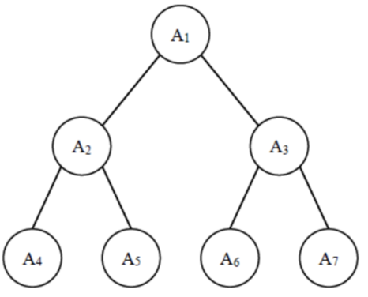
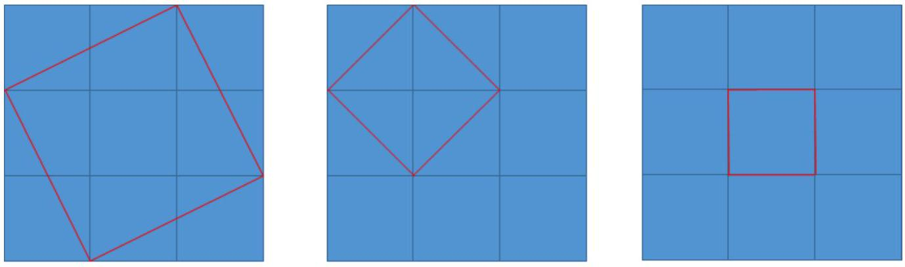

# 蓝桥杯 2019年第十届 真题（全部组别合并，按题号排列）

> 来源: Dotcpp 蓝桥杯真题 https://www.dotcpp.com/oj/lanqiao/ ｜ 洛谷蓝桥杯题单补充 6 题 https://www.luogu.com.cn/problem/list?type=luogu&tag=361,363 ｜ 抓取时间: 2026-11-27
> 本年有效试卷 1 套、20 题次，Dotcpp 去重 20 道题，另补洛谷题 6 道。

## 本年试卷构成

| 赛段 | 科目 | 组别 | 题数 | 备注 | 题集页 |
| --- | --- | --- | --- | --- | --- |
| 省赛及国赛 | 未分类 | 综合 | 20 |  | [题集](https://www.dotcpp.com/oj/1020/) |

## 题目一览

| 题号 | 标题 | 难度 | 通过率 | 考过的语言/组别 |
| --- | --- | --- | --- | --- |
| 2299 | 完全二叉树的权值 | 中等 | 27.81% | 未区分科目 |
| 2300 | 外卖店优先级 | 困难 | 19.09% | 未区分科目 |
| 2301 | 修改数组 | 中等 | 23.82% | 未区分科目 |
| 2302 | 糖果 | 中等 | 29.78% | 未区分科目 |
| 2303 | 组合数问题 | 困难 | 7.95% | 未区分科目 |
| 2304 | 特别数的和 | 入门 | 67.23% | 未区分科目 |
| 2305 | 等差数列 | 中等 | 23.72% | 未区分科目 |
| 2306 | 后缀表达式 | 困难 | 17.48% | 未区分科目 |
| 2307 | 灵能传输 | 困难 | 20.41% | 未区分科目 |
| 2308 | 旋转 | 入门 | 61.43% | 未区分科目 |
| 2309 | 人物相关性分析 | 困难 | 12.20% | 未区分科目 |
| 2310 | 扫地机器人 | 困难 | 27.97% | 未区分科目 |
| 2311 | Fibonacci 数列与黄金分割 | 中等 | 27.48% | 未区分科目 |
| 2312 | 空间跳跃 | 困难 | 0.00% | 未区分科目 |
| 2557 | 大胖子走迷宫 | 中等 | 30.70% | 未区分科目 |
| 2558 | 估计人数 | 困难 | 12.16% | 未区分科目 |
| 2559 | 轨道炮 | 困难 | 23.48% | 未区分科目 |
| 2560 | 分考场 | 困难 | 0.00% | 未区分科目 |
| 2561 | 逃出生天 | 困难 | 4.55% | 未区分科目 |
| 2562 | 最优包含 | 中等 | 35.34% | 未区分科目 |
| — | 数正方形 | 中等 | 40.37% | 国赛 C/C++ 大学C组 |
| — | 最长子序列 | 简单 | 41.31% | 国赛 C/C++ 大学C组 |
| — | 排列数 | 中等 | 40.69% | 国赛 C/C++ 大学B组 |
| — | 解谜游戏 | 简单 | 40.05% | 国赛 C/C++ 大学B组 |
| — | 第八大奇迹 | 困难 | 39.83% | 国赛 C/C++ 大学B组 |
| — | 燃烧权杖 | 困难 | 0.87% | 国赛 C/C++ 大学B组 |

## 题目详情

### 2299 · 完全二叉树的权值

> 题号 2299 ｜ 难度 中等 ｜ 时间 1s ｜ 内存 128MB
> 通过率 27.81% ｜ 题面原文 https://www.dotcpp.com/oj/problem2299.html
> 考过的语言/组别：未区分科目（省赛及国赛合订卷）

#### 题目描述

给定一棵包含 N 个节点的完全二叉树，树上每个节点都有一个权值，按从

上到下、从左到右的顺序依次是 A1, A2, · · · AN，如下图所示:



现在小明要把相同深度的节点的权值加在一起，他想知道哪个深度的节点

权值之和最大?如果有多个深度的权值和同为最大，请你输出其中最小的深度。

注:根的深度是 1。

#### 输入格式

第一行包含一个整数 N。

第二行包含N个整数A1,A2,··· AN。

对于所有评测用例，1≤ N ≤100000，−100000≤ Ai ≤100000。

#### 输出格式

输出一个整数代表答案。

#### 样例输入

```
7

1 6 5 4 3 2 1
```

#### 提示

零基础同学可以先学习视频课程，包含C/C++、Python、百练、蓝桥杯辅导、算法数据结构等课程，提供视频讲解以及配套习题，还有老师答疑，点击这里了解课程详情

---

### 2300 · 外卖店优先级

> 题号 2300 ｜ 难度 困难 ｜ 时间 1s ｜ 内存 128MB
> 通过率 19.09% ｜ 题面原文 https://www.dotcpp.com/oj/problem2300.html
> 考过的语言/组别：未区分科目（省赛及国赛合订卷）

#### 题目描述

“饱了么”外卖系统中维护着 N 家外卖店，编号 1 ∼ N。每家外卖店都有

一个优先级，初始时 (0 时刻) 优先级都为 0。

每经过 1 个时间单位，如果外卖店没有订单，则优先级会减少 1，最低减

到 0;而如果外卖店有订单，则优先级不减反加，每有一单优先级加 2。

如果某家外卖店某时刻优先级大于 5，则会被系统加入优先缓存中;如果

优先级小于等于 3，则会被清除出优先缓存。

给定 T 时刻以内的 M 条订单信息，请你计算 T 时刻时有多少外卖店在优

先缓存中。

#### 输入格式

第一行包含 3 个整数 N、M 和 T。

以下 M 行每行包含两个整数 ts 和 id，表示 ts 时刻编号 id 的外卖店收到一个订单。

对于 80% 的评测用例，1 ≤ N, M, T ≤ 10000。 对于所有评测用例，1 ≤ N,M,T ≤ 100000，1 ≤ ts ≤ T，1 ≤ id ≤ N。

#### 输出格式

输出一个整数代表答案。

#### 样例输入

```
2 6 6

1 1

5 2

3 1

6 2

2 1

6 2
```

#### 提示

零基础同学可以先学习视频课程，包含C/C++、Python、百练、蓝桥杯辅导、算法数据结构等课程，提供视频讲解以及配套习题，还有老师答疑，点击这里了解课程详情

---

### 2301 · 修改数组

> 题号 2301 ｜ 难度 中等 ｜ 时间 1s ｜ 内存 128MB
> 通过率 23.82% ｜ 题面原文 https://www.dotcpp.com/oj/problem2301.html
> 考过的语言/组别：未区分科目（省赛及国赛合订卷）

#### 题目描述

给定一个长度为 N 的数组 A = [A1, A2, · · · AN ]，数组中有可能有重复出现

的整数。

现在小明要按以下方法将其修改为没有重复整数的数组。小明会依次修改

A2,A3,··· ,AN。

当修改 Ai 时，小明会检查 Ai 是否在 A1 ∼ Ai−1 中出现过。如果出现过，则

小明会给 Ai 加上 1 ;如果新的 Ai 仍在之前出现过，小明会持续给 Ai 加 1 ，直

到 Ai 没有在 A1 ∼ Ai−1 中出现过。

当 AN 也经过上述修改之后，显然 A 数组中就没有重复的整数了。

现在给定初始的 A 数组，请你计算出最终的 A 数组

#### 输入格式

第一行包含一个整数 N。

第二行包含N个整数A1,A2,··· ,AN

对于 80% 的评测用例，1 ≤ N ≤ 10000。

对于所有评测用例，1 ≤ N ≤ 100000，1 ≤ Ai ≤ 1000000。

#### 输出格式

输出N个整数，依次是最终的A1,A2,··· ,AN。

#### 样例输入

```
5

2 1 1 3 4
```

#### 提示

零基础同学可以先学习视频课程，包含C/C++、Python、百练、蓝桥杯辅导、算法数据结构等课程，提供视频讲解以及配套习题，还有老师答疑，点击这里了解课程详情

---

### 2302 · 糖果

> 题号 2302 ｜ 难度 中等 ｜ 时间 1s ｜ 内存 128MB
> 通过率 29.78% ｜ 题面原文 https://www.dotcpp.com/oj/problem2302.html
> 考过的语言/组别：未区分科目（省赛及国赛合订卷）

#### 题目描述

糖果店的老板一共有 M 种口味的糖果出售。为了方便描述，我们将 M 种

口味编号 1 ∼ M。

小明希望能品尝到所有口味的糖果。遗憾的是老板并不单独出售糖果，而

是 K 颗一包整包出售。

幸好糖果包装上注明了其中 K 颗糖果的口味，所以小明可以在买之前就知

道每包内的糖果口味。

给定 N 包糖果，请你计算小明最少买几包，就可以品尝到所有口味的糖

果。

#### 输入格式

第一行包含三个整数 N、M 和 K。

接下来 N 行每行 K 这整数 T1, T2, · · · , TK，代表一包糖果的口味

(对于 30% 的评测用例，1 ≤ N ≤ 20 。

对于所有评测样例，1 ≤ N ≤ 100，1 ≤ M ≤ 20，1 ≤ K ≤ 20，1 ≤ Ti ≤ M 。)

#### 输出格式

一个整数表示答案。如果小明无法品尝所有口味，输出 −1。

#### 样例输入

```
6 5 3

1 1 2

1 2 3

1 1 3

2 3 5

5 4 2

5 1 2
```

#### 提示

零基础同学可以先学习视频课程，包含C/C++、Python、百练、蓝桥杯辅导、算法数据结构等课程，提供视频讲解以及配套习题，还有老师答疑，点击这里了解课程详情

---

### 2303 · 组合数问题

> 题号 2303 ｜ 难度 困难 ｜ 时间 1s ｜ 内存 128MB
> 通过率 7.95% ｜ 题面原文 https://www.dotcpp.com/oj/problem2303.html
> 考过的语言/组别：未区分科目（省赛及国赛合订卷）

#### 题目描述

给n,m,k，求有多少对(i,j)满足1 ≤ i ≤ n,0 ≤ j ≤ min(i,m)且Cij ≡

0(mod k)，k 是质数。其中 Cij 是组合数，表示从 i 个不同的数中选出 j 个组成

一个集合的方案数。

#### 输入格式

第一行两个数 t, k，其中 t 代表该测试点包含 t 组询问，k 的意思与上文中

相同。

接下来 t 行每行两个整数 n, m，表示一组询问。

(n,m ≤ 10<sup>18</sup>, t ≤ 10<sup>5 </sup>)

#### 输出格式

输出 t 行，每行一个整数表示对应的答案。由于答案可能很大，请输出答

案除以 109 + 7 的余数。

#### 样例输入

```
1 2

3 3
```

#### 提示

零基础同学可以先学习视频课程，包含C/C++、Python、百练、蓝桥杯辅导、算法数据结构等课程，提供视频讲解以及配套习题，还有老师答疑，点击这里了解课程详情

---

### 2304 · 特别数的和

> 题号 2304 ｜ 难度 入门 ｜ 时间 1s ｜ 内存 128MB
> 通过率 67.23% ｜ 题面原文 https://www.dotcpp.com/oj/problem2304.html
> 考过的语言/组别：未区分科目（省赛及国赛合订卷）

#### 题目描述

小明对数位中含有 2、0、1、9 的数字很感兴趣(不包括前导 0)，在 1 到

40 中这样的数包括 1、2、9、10 至 32、39 和 40，共 28 个，他们的和是 574。

请问，在 1 到 n 中，所有这样的数的和是多少?

#### 输入格式

输入一行包含两个整数 n。

(对于 20% 的评测用例，1 ≤ n ≤ 10。

对于 50% 的评测用例，1 ≤ n ≤ 100。

对于 80% 的评测用例，1 ≤ n ≤ 1000。

对于所有评测用例，1 ≤ n ≤ 10000。)

#### 输出格式

输出一行，包含一个整数，表示满足条件的数的和

#### 样例输入

```
40
```

#### 提示

零基础同学可以先学习视频课程，包含C/C++、Python、百练、蓝桥杯辅导、算法数据结构等课程，提供视频讲解以及配套习题，还有老师答疑，点击这里了解课程详情

---

### 2305 · 等差数列

> 题号 2305 ｜ 难度 中等 ｜ 时间 1s ｜ 内存 128MB
> 通过率 23.72% ｜ 题面原文 https://www.dotcpp.com/oj/problem2305.html
> 考过的语言/组别：未区分科目（省赛及国赛合订卷）

#### 题目描述

数学老师给小明出了一道等差数列求和的题目。但是粗心的小明忘记了一

部分的数列，只记得其中 N 个整数。

现在给出这 N 个整数，小明想知道包含这 N 个整数的最短的等差数列有

几项?

#### 输入格式

输入的第一行包含一个整数 N。

第二行包含N个整数A1,A2,···,AN。(注意A1 ∼AN并不一定是按等差数

列中的顺序给出)

(对于所有评测用例，2≤ N ≤100000，0≤ Ai ≤10<sup>9</sup>。)

#### 输出格式

输出一个整数表示答案

#### 样例输入

```
5

2 6 4 10 20
```

#### 提示

零基础同学可以先学习视频课程，包含C/C++、Python、百练、蓝桥杯辅导、算法数据结构等课程，提供视频讲解以及配套习题，还有老师答疑，点击这里了解课程详情

---

### 2306 · 后缀表达式

> 题号 2306 ｜ 难度 困难 ｜ 时间 1s ｜ 内存 128MB
> 通过率 17.48% ｜ 题面原文 https://www.dotcpp.com/oj/problem2306.html
> 考过的语言/组别：未区分科目（省赛及国赛合订卷）

#### 题目描述

给定 N 个加号、M 个减号以及 N + M + 1 个整数 A1, A2, · · · , AN+M+1，小

明想知道在所有由这 N 个加号、M 个减号以及 N + M + 1 个整数凑出的合法的

后缀表达式中，结果最大的是哪一个?

请你输出这个最大的结果。

例如使用1 2 3 + -，则 “2 3 + 1 -” 这个后缀表达式结果是 4，是最大的。

#### 输入格式

第一行包含两个整数 N 和 M。

第二行包含 N + M + 1 个整数 A1, A2, · · · , AN+M+1。

(对于所有评测用例，0≤ N,M ≤100000，−10<sup>9</sup> ≤ Ai ≤10<sup>9</sup>。)

#### 输出格式

输出一个数，表示答案

#### 样例输入

```
1 1

1 2 3
```

#### 提示

零基础同学可以先学习视频课程，包含C/C++、Python、百练、蓝桥杯辅导、算法数据结构等课程，提供视频讲解以及配套习题，还有老师答疑，点击这里了解课程详情

---

### 2307 · 灵能传输

> 题号 2307 ｜ 难度 困难 ｜ 时间 1s ｜ 内存 128MB
> 通过率 20.41% ｜ 题面原文 https://www.dotcpp.com/oj/problem2307.html
> 考过的语言/组别：未区分科目（省赛及国赛合订卷）

#### 题目描述

在游戏《星际争霸 II》中，高阶圣堂武士作为星灵的重要 AOE 单位，在

游戏的中后期发挥着重要的作用，其技能”灵能风暴“可以消耗大量的灵能对

一片区域内的敌军造成毁灭性的伤害。经常用于对抗人类的生化部队和虫族的

刺蛇飞龙等低血量单位。

你控制着 n 名高阶圣堂武士，方便起见标为 1, 2, · · · , n。每名高阶圣堂武士

需要一定的灵能来战斗，每个人有一个灵能值 ai 表示其拥有的灵能的多少(ai

非负表示这名高阶圣堂武士比在最佳状态下多余了 ai 点灵能，ai 为负则表示这

名高阶圣堂武士还需要 −ai 点灵能才能到达最佳战斗状态)。现在系统赋予了

你的高阶圣堂武士一个能力，传递灵能，每次你可以选择一个 i ∈ [2, n − 1]，若

ai ≥ 0 则其两旁的高阶圣堂武士，也就是 i − 1、i + 1 这两名高阶圣堂武士会从

i 这名高阶圣堂武士这里各抽取 ai 点灵能;若 ai < 0 则其两旁的高阶圣堂武士，

也就是 i − 1, i + 1 这两名高阶圣堂武士会给 i 这名高阶圣堂武士 −ai 点灵能。形

式化来讲就是 ai−1+ = ai, ai+1+ = ai, ai− = 2ai。

灵能是非常高效的作战工具，同时也非常危险且不稳定，一位高阶圣堂

武士拥有的灵能过多或者过少都不好，定义一组高阶圣堂武士的不稳定度为

maxn |ai|，请你通过不限次数的传递灵能操作使得你控制的这一组高阶圣堂武

i=1

士的不稳定度最小。

#### 输入格式

本题包含多组询问。输入的第一行包含一个正整数 T 表示询问组数。

接下来依次输入每一组询问。

每组询问的第一行包含一个正整数 n，表示高阶圣堂武士的数量。

接下来一行包含n个数a1,a2,··· ,an。

(对于所有评测用例，T ≤ 3，3 ≤ n ≤ 300000，|ai| ≤ 10<sup>9</sup>。)

#### 输出格式

输出 T 行。每行一个整数依次表示每组询问的答案

#### 样例输入

```
3

3

5 -2 3 

4 

0 0 0 0 

3

1 2 3
```

#### 提示

零基础同学可以先学习视频课程，包含C/C++、Python、百练、蓝桥杯辅导、算法数据结构等课程，提供视频讲解以及配套习题，还有老师答疑，点击这里了解课程详情

---

### 2308 · 旋转

> 题号 2308 ｜ 难度 入门 ｜ 时间 1s ｜ 内存 128MB
> 通过率 61.43% ｜ 题面原文 https://www.dotcpp.com/oj/problem2308.html
> 考过的语言/组别：未区分科目（省赛及国赛合订卷）

#### 题目描述

图片旋转是对图片最简单的处理方式之一，在本题中，你需要对图片顺时

针旋转 90 度。

我们用一个 n × m 的二维数组来表示一个图片，例如下面给出一个 3 × 4 的

图片的例子:

1 3 5 7

9 8 7 6

3 5 9 7

这个图片顺时针旋转 90 度后的图片如下:

3 9 1

5 8 3

9 7 5

7 6 7

给定初始图片，请计算旋转后的图片

#### 输入格式

输入的第一行包含两个整数 n 和 m，分别表示行数和列数。

接下来 n 行，每行 m 个整数，表示给定的图片。图片中的每个元素(像

素)为一个值为 0 至 255 之间的整数(包含 0 和 255)。

(对于 30% 的评测用例，1≤n,m≤10。 对于 60% 的评测用例，1≤n,m≤30。 对于所有评测用例，1≤n,m≤100。)

#### 输出格式

输出 m 行 n 列，表示旋转后的图片。

#### 样例输入

```
3 4 

1 3 5 7 

9 8 7 6 

3 5 9 7
```

#### 提示

零基础同学可以先学习视频课程，包含C/C++、Python、百练、蓝桥杯辅导、算法数据结构等课程，提供视频讲解以及配套习题，还有老师答疑，点击这里了解课程详情

---

### 2309 · 人物相关性分析

> 题号 2309 ｜ 难度 困难 ｜ 时间 1s ｜ 内存 128MB
> 通过率 12.20% ｜ 题面原文 https://www.dotcpp.com/oj/problem2309.html
> 考过的语言/组别：未区分科目（省赛及国赛合订卷）

#### 题目描述

小明正在分析一本小说中的人物相关性。他想知道在小说中 Alice 和 Bob

有多少次同时出现。

更准确的说，小明定义 Alice 和 Bob“同时出现”的意思是:在小说文本

中 Alice 和 Bob 之间不超过 K 个字符。

例如以下文本:

This is a story about Alice and Bob. Alice wants to send a private message to Bob.

假设 K = 20，则 Alice 和 Bob 同时出现了 2 次，分别是”Alice and Bob”

和”Bob. Alice”。前者 Alice 和 Bob 之间有 5 个字符，后者有 2 个字符。

注意:

1. Alice 和 Bob 是大小写敏感的，alice 或 bob 等并不计算在内。

2. Alice 和 Bob 应为单独的单词，前后可以有标点符号和空格，但是不能

有字母。例如 Bobbi 並不算出现了 Bob。

#### 输入格式

第一行包含一个整数 K。

第二行包含一行字符串，只包含大小写字母、标点符号和空格。长度不超

过 1000000。

(对于所有评测用例，1≤ K ≤1000000。)

#### 输出格式

输出一个整数，表示 Alice 和 Bob 同时出现的次数

#### 样例输入

```
20

This is a story about Alice and Bob. Alice wants to send a private message to Bob.
```

#### 提示

零基础同学可以先学习视频课程，包含C/C++、Python、百练、蓝桥杯辅导、算法数据结构等课程，提供视频讲解以及配套习题，还有老师答疑，点击这里了解课程详情

---

### 2310 · 扫地机器人

> 题号 2310 ｜ 难度 困难 ｜ 时间 1s ｜ 内存 128MB
> 通过率 27.97% ｜ 题面原文 https://www.dotcpp.com/oj/problem2310.html
> 考过的语言/组别：未区分科目（省赛及国赛合订卷）

#### 题目描述

小明公司的办公区有一条长长的走廊，由 N 个方格区域组成，如下图所

示。

|

R

|

|

|

R

|

|

|

|

|

R

|

走廊内部署了 K 台扫地机器人，其中第 i 台在第 Ai 个方格区域中。

已知扫地机器人每分钟可以移动到左右相邻的方格中，并将该区域清扫干净

请你编写一个程序，计算每台机器人的清扫路线，使得

1. 它们最终都返回出发方格，

2. 每个方格区域都至少被清扫一遍，

3. 从机器人开始行动到最后一台机器人归位花费的时间最少。

注意多台机器人可以同时清扫同一方块区域，它们不会互相影响

输出最少花费的时间。

在上图所示的例子中，最少花费时间是 6。第一台路线:2-1-2-3-4-3-2，清

扫了 1、2、3、4 号区域。第二台路线 5-6-7-6-5，清扫了 5、6、7。第三台路线

10-9-8-9-10，清扫了 8、9 和 10。

#### 输入格式

第一行包含两个整数 N 和 K。

接下来 K 行，每行一个整数 Ai。

(对于 30% 的评测用例，1≤ K < N ≤10。 对于 60% 的评测用例，1≤ K < N ≤1000。 对于所有评测用例，1≤ K < N ≤100000，1≤ Ai ≤ N。)

#### 输出格式

输出一个整数表示答案

#### 样例输入

```
10 3 

5

2

10
```

#### 提示

零基础同学可以先学习视频课程，包含C/C++、Python、百练、蓝桥杯辅导、算法数据结构等课程，提供视频讲解以及配套习题，还有老师答疑，点击这里了解课程详情

---

### 2311 · Fibonacci 数列与黄金分割

> 题号 2311 ｜ 难度 中等 ｜ 时间 1s ｜ 内存 128MB
> 通过率 27.48% ｜ 题面原文 https://www.dotcpp.com/oj/problem2311.html
> 考过的语言/组别：未区分科目（省赛及国赛合订卷）

#### 题目描述

Fibonacci 数列是非常著名的数列:

F[1] = 1,

F[2] = 1,

对于 i > 3，F[i] = F[i − 1] + F[i − 2]

Fibonacci 数列有一个特殊的性质，前一项与后一项的比值，F[i]/F[i + 1]，

会趋近于黄金分割。

为了验证这一性质，给定正整数 N，请你计算 F[N]/F[N + 1]，并保留 8 位

小数。

#### 输入格式

一个正整数 N。(1 ≤ N ≤ 2000000000)

#### 输出格式

F[N]/F[N + 1]。答案保留 8 位小数。

#### 样例输入

```
2
```

#### 提示

零基础同学可以先学习视频课程，包含C/C++、Python、百练、蓝桥杯辅导、算法数据结构等课程，提供视频讲解以及配套习题，还有老师答疑，点击这里了解课程详情

---

### 2312 · 空间跳跃

> 题号 2312 ｜ 难度 困难 ｜ 时间 1s ｜ 内存 128MB
> 通过率 0.00% ｜ 题面原文 https://www.dotcpp.com/oj/problem2312.html
> 考过的语言/组别：未区分科目（省赛及国赛合订卷）

#### 题目描述

在游戏《星际争霸 II》中，战列巡航舰作为人类的终极作战武器，在后期

以及一些中期战术中发挥着空中堡垒的作用，其 “战术跳跃” 技能能让其在游戏

中期在敌军基地上空造成打击之后在血量较低时撤离，进行无战损骚扰，在人

类 vs 异虫对抗中经常用来压制异虫中期的发展。

你在玩一个游戏，游戏中有 n 个地点和 m 条单向时空航道。每条时空航道形如 (u, v, w, x)，其中 u，v 表示这条时空航道的起点终点，w 表示通过这条航道需要的时间(注意这个时间是现实当中游戏者的时间也是游戏内的时间)，x表示这条航道使用的频繁程度。时空航道不会成环，但可能会有两条航道的起别为x ,x ,x ,···x，那么选择第i个航道的概率就是∑ xi 。你的目的是在L

123 k kj=1xj点相同同时终点也相同。游戏开始的时候，你的战列巡航舰到达了地点 1，每当你到达一个地点的时候，战舰的电脑会按照每个起点为该地点的时空航道的频繁程度随机选择一个航道并花费 w 单位时间到达该航道的终点。具体来说，对于一个时间点 u，假如有 k 个起点为该地点的时空航道，他们的频繁程度分别为x ,x ,x ,···x，那么选择第i个航道的概率就是∑ xi 。你的目的是在L

123 k kj=1xj单位游戏时间内到达一个没有任何以该地点为起点的时空航道的地点。当然你

可以在到达某一个地点时重新开始游戏，如果你重新开始这个游戏，你就能回

到游戏开始的那一刻(即 1 号地点)并重置游戏内的时间(即你又可以有 L 单

位的时间去跳跃了)，你也可以在没有任何以该地点为起点的地点重新开始，且

无次数限制。你需要最小化你在现实中花费的时间。当然在你运气足够好的情

况下，你一定可以达成游戏目标。

保证一定有至少一条以 1 号地点为起点的航道。

请阅读样例以更清晰地理解题意。

#### 输入格式

第一行三个正整数 n，m，L。

接下来 m 行，每行四个正整数 u，v，w，x。

(2 ≤ n ≤ 100，1 ≤ m ≤ 200，w, x ≤ 100，0 ≤ L ≤ 10<sup>9</sup>)

#### 输出格式

一行一个浮点数表示答案，令你的答案为 a，标准答案为 b，如果满足

|a−b|/max(1,b) ≤ 10−9(即绝对误差或者相对误差不超过 10−9)即为正确。

#### 样例输入

```
3 2 3 

1 2 2 1 

1 2 4 1
```

#### 提示

零基础同学可以先学习视频课程，包含C/C++、Python、百练、蓝桥杯辅导、算法数据结构等课程，提供视频讲解以及配套习题，还有老师答疑，点击这里了解课程详情

---

### 2557 · 大胖子走迷宫

> 题号 2557 ｜ 难度 中等 ｜ 时间 1s ｜ 内存 128MB
> 通过率 30.70% ｜ 题面原文 https://www.dotcpp.com/oj/problem2557.html
> 考过的语言/组别：未区分科目（省赛及国赛合订卷）

#### 题目描述

小明是个大胖子，或者说是个大大胖子，如果说正常人占用 1 × 1 的面积，小明要占用 5 × 5 的面积。

由于小明太胖了，所以他行动起来很不方便。当玩一些游戏时，小明相比小伙伴就吃亏很多。小明的朋友们制定了一个计划，帮助小明减肥。计划的主要内容是带小明玩一些游戏，让小明在游戏中运动消耗脂肪。走迷宫是计划中的重要环节。朋友们设计了一个迷宫，迷宫可以看成是一个由 n × n 个方阵组成的方阵，正常人每次占用方阵中 1 × 1 的区域，而小明要占用 5 × 5 的区域。小明的位置定义为小明最正中的一个方格。迷宫四周都有障碍物。为了方便小明，朋友们把迷宫的起点设置在了第 3 行第 3 列，终点设置在了第 n 2 行第 n 2 列。小明在时刻 0 出发，每单位时间可以向当前位置的上、下、左、右移动单位 1 的距离，也可以停留在原地不动。小明走迷宫走得很辛苦，如果他在迷宫里面待的时间很长，则由于消耗了很多脂肪，他会在时刻 k 变成一个胖子，只占用 3 × 3 的区域。如果待的时间更长，他会在时刻 2k 变成一个正常人，只占用 1 × 1 的区域。注意，当小明变瘦时迷宫的起点和终点不变。

请问，小明最少多长时间能走到迷宫的终点。注意，小明走到终点时可能变瘦了也可能没有变瘦。

#### 输入格式

输入的第一行包含两个整数 n, k。

接下来 n 行，每行一个由 n 个字符组成的字符串，字符为 + 表示为空地，

字符为 * 表示为阻碍物。

#### 输出格式

输出一个整数，表示答案。

#### 样例输入

```
9 5

+++++++++

+++++++++

+++++++++

+++++++++

+++++++++

***+*****

+++++++++

+++++++++

+++++++++
```

---

### 2558 · 估计人数

> 题号 2558 ｜ 难度 困难 ｜ 时间 1s ｜ 内存 128MB
> 通过率 12.16% ｜ 题面原文 https://www.dotcpp.com/oj/problem2558.html
> 考过的语言/组别：未区分科目（省赛及国赛合订卷）

#### 题目描述

给定一个 N × M 的方格矩阵，矩阵中每个方格标记 0 或者 1 代表这个方格是不是有人踩过。

已知一个人可能从任意方格开始，之后每一步只能向右或者向下走一格。走了若干步之后，这个人可以离开矩阵。这个人经过的方格都会被标记为 1，包括开始和结束的方格。注意开始和结束的方格不需要一定在矩阵边缘。请你计算至少有多少人在矩阵上走过。

#### 输入格式

输入第一行包含两个整数 N、M。

以下 N 行每行包含 M 个整数 (0/1)，代表方格矩阵。

#### 输出格式

输出一个整数代表答案。

#### 样例输入

```
5 5

00100

11111

00100

11111

00100
```

---

### 2559 · 轨道炮

> 题号 2559 ｜ 难度 困难 ｜ 时间 1s ｜ 内存 128MB
> 通过率 23.48% ｜ 题面原文 https://www.dotcpp.com/oj/problem2559.html
> 考过的语言/组别：未区分科目（省赛及国赛合订卷）

#### 题目描述

小明在玩一款战争游戏。地图上一共有 N 个敌方单位，可以看作 2D 平面上的点。其中第 i 个单位在 0 时刻的位置是 (Xi, Yi)，方向是 Di (上下左右之一, 用’U’/’D’/’L’/’R’ 表示)，速度是 Vi。小明的武器是轨道炮，只能使用一次，不过杀伤力巨大。小明可以选择在某个非负整数时刻释放轨道炮，轨道炮一次可以消灭在一条直线 (平行于坐标轴) 上的所有敌方单位。请你计算小明最多能消灭多少敌方单位。

#### 输入格式

输入第一行包含一个整数 N。

以下 N 行每行包含 3 个整数 Xi, Yi, Vi，以及一个大写字符 Di。

#### 输出格式

输出一个整数代表答案。

#### 样例输入

```
4

0 0 1 R

0 10 1 R

10 10 2 D

2 3 2 L
```

#### 提示

对于所有评测用例，1 ≤ N ≤ 1000， 1000000 ≤ Xi, Yi ≤ 1000000，0 ≤ Vi ≤1000000。

---

### 2560 · 分考场

> 题号 2560 ｜ 难度 困难 ｜ 时间 1s ｜ 内存 256MB
> 通过率 0.00% ｜ 题面原文 https://www.dotcpp.com/oj/problem2560.html
> 考过的语言/组别：未区分科目（省赛及国赛合订卷）

#### 题目描述

古语有云：春风得意马蹄疾，一日看尽长安花。当然在一场考试中所有人都春风得意马蹄疾是不可能的，尤其是碰到一些毒瘤出题人的时候。

又到了每月一次的月考，又是 xf 老师出题。

上一次 xf 老师出的题太毒瘤了，平均分只有 40 多，同学们都非常不满意，毕竟别的科的平均分都是 80 多。这次 xf 为了不被同学们寄刀片，想了一个办法：只公布所有考场的平均分的平均分。这样他就可以通过调整考场的分配方式，使得平均分显得高。（每个考场都可以容纳无限人）每次考试也不是所有同学都参加的，只有学号在 [l,r] 这个区间中的同学会参加。他想知道对于每次考试，他调整过考场后，所有考场的平均分的平均分的最大值。当然，同学们也可能会努力学习或整日颓废使成绩发生改变。

#### 输入格式

输入的第一行包含一个整数 n。

第二行包含 n 个整数，第 i 个数 vi，表示开始时每个同学的成绩。第三行包含一个整数 q，表示有 q 次操作。之后 q 行，每行描述一个操作，第一个数表示操作类型。如果操作为 1 p x，表示学号为 p 的同学分数变为 x。如果操作为 2 l r k, 表示把学号在 [l,r] 中的同学分成 k 个考场，求这 k 个考场的平均分的平均分的最大值。

#### 输出格式

对于每个 2 操作输出一行，四舍五入保留正好 3 位小数。

#### 样例输入

```
5

5 3 4 2 1

5

2 1 4 3

1 4 8

2 3 5 3

1 2 2

2 1 3 2
```

#### 提示

【样例说明】

第一个操作询问学号在 [1, 4] 之间的同学分成 3 个考场的平均分的平均分

的最大值，最优策略是：{1}, {2, 4}, {3}，平均分是(5/1 +(3+2)/2 + 4/1)/3 。

第二个操作把学号为 4 的同学的分数变为 8。

第三个操作询问学号在 [3, 5] 之间的同学分成 3 个考场的平均分的平均分

的最大值，最优策略是：{3}, {4}, {5}。

第四个操作把学号为 2 的同学分数变为 2。

第五个操作询问学号在 [1, 3] 之间的同学分成 2 个考场的平均分的平均分

的最大值，最优策略是：{1}, {2 3}。

【评测用例规模与约定】

对于全部评测用列，n ≤ 200000, q ≤ 200000, 任意时刻同学的分数 vi ≤ 10^9， k ≤ r- l + 1。

评测时将使用 10 个评测用例测试你的程序，每个评测用例的限制如下：

评测用例编号     n ≤     q ≤     特殊说明

1                         10         1          无

2,3                     100       100       无

4∼6                    2000     2000     无

7∼9                    50000   50000    无

10∼12                200000 200000  没有 1 操作

13∼20                 200000 200000 无

---

### 2561 · 逃出生天

> 题号 2561 ｜ 难度 困难 ｜ 时间 1s ｜ 内存 128MB
> 通过率 4.55% ｜ 题面原文 https://www.dotcpp.com/oj/problem2561.html
> 考过的语言/组别：未区分科目（省赛及国赛合订卷）

#### 题目描述

“终于逃出这该死的塔了”。

在塔的底部，你看到了一扇门，这是距你获得自由的最后一道屏障了。当然，打开这扇门是需要密码的，密码可抽象为一个只包含小写字母的字符串。你并不知道密码具体是多少，但通过某种方式得到了生成密码的模版串s，并且知道密码一定是模板串的一个子串。你会尝试若干次，每次将得到一个字符串 t 和一段区间 [l,r]，你会从选出 t 的一个子串去和 sl...r 匹配，定义两个字符串的匹配度为两个字符串的最长公共后缀长度 (最大的 x 使得两个串的后 x位相同)。你准备随机选出 t 的一个子串和 s 的这段区间匹配，并想知道匹配度的期望是多少，为了防止浮点误差，只需求出所有方案的匹配度的和即可。有时，你会发现你求的模板串出现了一些问题，需要对其中的一位进行修改，这个修改将会应用到以后的尝试上。更形式化地说，你需要维护以下两个操作：

• 1 x c，表示将 sx (即 s 的第 x 个字符) 修改为字符 c，保证 c 是小写字母；

• 2 t l r，表示给出一个字符串 t，求 t 的所有子串和 sl...r 的匹配度之和，匹配度的定义见上。

你决定玩一玩这个无聊的游戏，毕竟闲着也是闲着。

#### 输入格式

输入的第一行包含一个只包含小写字母的字符串 s，表示生成密码的模板。

第二行包含一个正整数 n，表示操作次数。

接下来 n 行，每行形如 1 x c 或者 2 t l r，意义如题目所述。

#### 输出格式

对于每组询问，输出一个整数，表示 t 的所有子串和 sl...r 的匹配度之和。

#### 样例输入

```
bcca

4

2 acba 1 2

2 cab 1 4

1 2 b

2 bca 2 4
```

---

### 2562 · 最优包含

> 题号 2562 ｜ 难度 中等 ｜ 时间 1s ｜ 内存 128MB
> 通过率 35.34% ｜ 题面原文 https://www.dotcpp.com/oj/problem2562.html
> 考过的语言/组别：未区分科目（省赛及国赛合订卷）

#### 题目描述

我们称一个字符串 S 包含字符串 T 是指 T 是 S 的一个子序列，即可以从字符串 S 中抽出若干个字符，它们按原来的顺序组合成一个新的字符串与 T 完全一样。

给定两个字符串 S 和 T，请问最少修改 S 中的多少个字符，能使 S 包含T ？

#### 输入格式

输入两行，每行一个字符串。第一行的字符串为 S，第二行的字符串为 T。两个字符串均非空而且只包含大写英文字母。

#### 输出格式

输出一个整数，表示答案。

#### 样例输入

```
ABCDEABCD

XAABZ
```

---

### — · 数正方形

> 题号 洛谷 P8692 ｜ 难度 中等（洛谷 普及） ｜ 时间 1.00s ｜ 内存 128MB
> 通过率 40.37%（洛谷站内口径） ｜ 题面原文 https://www.luogu.com.cn/problem/P8692
> 考过的语言/组别：国赛 C/C++ 大学C组（洛谷题单）

#### 题目描述

在一个 $N \times N$ 的点阵上，取其中 $4$ 个点恰好组成一个正方形的 $4$ 个顶点，一共有多少种不同的取法？

由于结果可能非常大，你只需要输出模 $10^9 + 7$ 的余数。



如上图所示的正方形都是合法的。

#### 输入格式

输入包含一个整数 $N$。

#### 输出格式

输出一个整数代表答案。

#### 样例输入

```
4
```

#### 样例输出

```
20
```

#### 提示

对于所有评测用例，$2 ≤ N ≤ 10^6$。

蓝桥杯 2019 年国赛 C 组 G 题

---

### — · 最长子序列

> 题号 洛谷 P8697 ｜ 难度 简单（洛谷 普及−） ｜ 时间 1.00s ｜ 内存 128MB
> 通过率 41.31%（洛谷站内口径） ｜ 题面原文 https://www.luogu.com.cn/problem/P8697
> 考过的语言/组别：国赛 C/C++ 大学C组（洛谷题单）

#### 题目描述

我们称一个字符串 $S$ 包含字符串 $T$ 是指 $T$ 是 $S$ 的一个子序列，即可以从字符串 $S$ 中抽出若干个字符，它们按原来的顺序组合成一个新的字符串与 $T$ 完全一样。给定两个字符串 $S$ 和 $T$，请问 $T$ 中从第一个字符开始最长连续多少个字符被 $S$ 包含？

#### 输入格式

输入两行，每行一个字符串。第一行的字符串为 $S$，第二行的字符串为 $T$。两个字符串均非空而且只包含大写英文字母。

#### 输出格式

输出一个整数，表示答案。

#### 样例输入

```
ABCDEABCD
AABZ
```

#### 样例输出

```
3
```

#### 提示

对于 $20\%$ 的评测用例，$1 \le |T| \le |S| \le 20$；

对于 $40\%$ 的评测用例，$1 \le |T| \le |S| \le 100$；

对于所有评测用例，$1 \le |T| \le |S| \le 1000$。

蓝桥杯 2019 年国赛 C 组 F 题。

---

### — · 排列数

> 题号 洛谷 P8699 ｜ 难度 中等（洛谷 普及+/提高−） ｜ 时间 1.00s ｜ 内存 128MB
> 通过率 40.69%（洛谷站内口径） ｜ 题面原文 https://www.luogu.com.cn/problem/P8699
> 考过的语言/组别：国赛 C/C++ 大学B组（洛谷题单）

#### 题目描述

在一个排列中，一个折点是指排列中的一个元素，它同时小于两边的元素，或者同时大于两边的元素。

对于一个 $1 ∼ n$ 的排列，如果可以将这个排列中包含 $t$ 个折点，则它称为一个 $t + 1$ 单调排列。

例如，排列 $(1, 4, 2, 3)$ 是一个 $3$ 单调排列，其中 $4$ 和 $2$ 都是折点。

给定 $n$ 和 $k$，请问 $1 ∼ n$ 的所有排列中有多少个 $k$ 单调排列？

#### 输入格式

输入一行包含两个整数 $n$, $k$。

#### 输出格式

输出一个整数，表示答案。答案可能很大，你可需要输出满足条件的排列
数量除以 $123456$ 的余数即可。

#### 样例输入

```
4 2
```

#### 样例输出

```
12
```

#### 提示

对于 $20 \%$ 的评测用例, $1 \leq k \leq n \leq 10$;

对于 $40 \%$ 的评测用例, $1 \leq k \leq n \leq 20$; 对于 $60 \%$ 的评测用例, $1 \leq k \leq n \leq 100$;

对于所有评测用例， $1 \leq k \leq n \leq 500$ 。

蓝桥杯 2019 年国赛 B 组 G 题。

---

### — · 解谜游戏

> 题号 洛谷 P8700 ｜ 难度 简单（洛谷 普及−） ｜ 时间 1.00s ｜ 内存 128MB
> 通过率 40.05%（洛谷站内口径） ｜ 题面原文 https://www.luogu.com.cn/problem/P8700
> 考过的语言/组别：国赛 C/C++ 大学B组（洛谷题单）

#### 题目背景


#### 题目描述

小明正在玩一款解谜游戏。谜题由 $24$ 根塑料棒组成，其中黄色塑料棒 $4$ 根，红色 $8$ 根，绿色 $12$ 根 (后面用 `Y` 表示黄色、`R` 表示红色、`G` 表示绿色)。初始时这些塑料棒排成三圈，如上图所示，外圈 $12$ 根，中圈 $8$ 根，内圈 $4$ 根。

小明可以进行三种操作：

1. 将三圈塑料棒都顺时针旋转一个单位。例如当前外圈从 $0$ 点位置开始顺时针依次是 `YRYGRYGRGGGG`，中圈是 `RGRGGRRY`，内圈是 `GGGR`。那么顺时针旋转一次之后，外圈、中圈、内圈依次变为：`GYRYGRYGRGGG`、`YRGRGGRR` 和 `RGGG`。
2. 将三圈塑料棒都逆时针旋转一个单位。例如当前外圈从 $0$ 点位置开始顺时针依次是 `YRYGRYGRGGGG`，中圈是 `RGRGGRRY`，内圈是 `GGGR`。那么逆时针旋转一次之后，外圈、中圈、内圈依次变为：`RYGRYGRGGGGY`、`GRGGRRYR` 和 `GGRG`。
3. 将三圈 $0$ 点位置的塑料棒做一个轮换。具体来说：外圈 $0$ 点塑料棒移动到内圈 $0$ 点，内圈 $0$ 点移动到中圈 $0$ 点，中圈 $0$ 点移动到外圈 $0$ 点。例如当前外圈从 $0$ 点位置开始顺时针依次是 `YRYGRYGRGGGG`，中圈是 `RGRGGRRY`，内圈是 `GGGR`。那么轮换一次之后，外圈、中圈、内圈依次变为：`RRYGRYGRGGGG`、`GGRGGRRY` 和 `YGGR`。

小明的目标是把所有绿色移动到外圈、所有红色移动中圈、所有黄色移动到内圈。给定初始状态，请你判断小明是否可以达成目标？

#### 输入格式

第一行包含一个整数 $T$，代表询问的组数。$(1 \le T \le 100)$。

每组询问包含 $3$ 行：

第一行包含 $12$ 个大写字母，代表外圈从 $0$ 点位置开始顺时针每个塑料棒的颜色。

第二行包含 $8$ 个大写字母，代表中圈从 $0$ 点位置开始顺时针每个塑料棒的颜色。

第三行包含 $4$ 个大写字母，代表内圈从 $0$ 点位置开始顺时针每个塑料棒的颜色。

#### 输出格式

对于每组询问，输出一行 `YES` 或者 `NO`，代表小明是否可以达成目标。

#### 样例输入

```
2
GYGGGGGGGGGG
RGRRRRRR
YRYY
YGGGRRRRGGGY
YGGGRRRR
YGGG
```

#### 样例输出

```
YES
NO
```

#### 提示

蓝桥杯 2019 年国赛 B 组 H 题。

---

### — · 第八大奇迹

> 题号 洛谷 P8701 ｜ 难度 困难（洛谷 提高） ｜ 时间 1.00s ｜ 内存 128MB
> 通过率 39.83%（洛谷站内口径） ｜ 题面原文 https://www.luogu.com.cn/problem/P8701
> 考过的语言/组别：国赛 C/C++ 大学B组（洛谷题单）

#### 题目背景

在一条 R 河流域，繁衍着一个古老的名族 Z。他们世代沿河而居，也在河边发展出了璀璨的文明。

Z 族在 R 河沿岸修建了很多建筑，最近，他们热衷攀比起来。他们总是在比谁的建筑建得最奇特。

幸好 Z 族人对奇特的理解都差不多，他们很快给每栋建筑都打了分，这样评选谁最奇特就轻而易举了。

于是，根据分值，大家很快评出了最奇特的建筑，称为大奇迹。后来他们又陆续评选了第二奇特、第三奇特、……、第七奇特的建筑，依次称为第二大奇迹、第三大奇迹、……、第七大奇迹。

最近，他们开始评选第八奇特的建筑，准备命名为第八大奇迹。在评选中，他们遇到了一些问题。

#### 题目描述

首先，Z 族一直在发展，有的建筑被拆除又建了新的建筑，新建筑的奇特值和原建筑不一样，这使得评选不那么容易了。

其次，Z 族的每个人所生活的范围可能不一样，他们见过的建筑并不是所有的建筑，他们坚持他们自己所看到的第八奇特的建筑就是第八大奇迹。

Z 族首领最近很头疼这个问题，他害怕因为意见不一致导致 Z 族发生分歧。他找到你，他想先了解一下，民众自己认为的奇迹是怎样的。

现在告诉在 R 河周边的建筑的变化情况，以及在变化过程中一些人的生活范围，请编程求出每个人认为的第八大奇迹的奇特值是多少。

#### 输入格式

输入的第一行包含两个整数 $L$, $N$，分别表示河流的长度和要你处理的信息的数量。开始时河流沿岸没有建筑，或者说所有的奇特值为 $0$。接下来 $N$ 行，每行一条你要处理的信息。

如果信息为 `C p x`，表示流域中第 $p$ 个位置 $(1 \le p \le L)$ 建立了一个建筑，其奇特值为 $x$。如果这个位置原来有建筑，原来的建筑会被拆除。

如果信息为 `Q a b`，表示有个人生活的范围是河流的第 $a$ 到 $b$ 个位置（包含 $a$ 和 $b$，$a \le b$），这时你要算出这个区间的第八大奇迹的奇特值，并输出。如果找不到第八大奇迹，输出 $0$。

#### 输出格式

对于每个为 $Q$ 的信息，你需要输出一个整数，表示区间中第八大奇迹的奇特值。

#### 样例输入

```
10 15
C 1 10
C 2 20
C 3 30
C 4 40
C 5 50
C 6 60
C 7 70
C 8 80
C 9 90
C 10 100
Q 1 2
Q 1 10
Q 1 8
C 10 1
Q 1 10
```

#### 样例输出

```
0
30
10
20
```

#### 提示

对于 $20\%$ 的评测用例，$1 \le L \le 1000$，$1 \le N \le 1000$。

对于 $40\%$ 的评测用例，$1 \le L \le 10000$，$1 \le N \le 10000$。

对于 $100\%$ 的评测用例，$1 \le L \le 10^5$，$1 \le N \le 10^5$。所有奇特值为不超过 $10^9$ 的非负整数。

蓝桥杯 2019 年国赛 B 组 I 题。

---

### — · 燃烧权杖

> 题号 洛谷 P8702 ｜ 难度 困难（洛谷 省选/NOI−） ｜ 时间 1.00s ｜ 内存 128MB
> 通过率 0.87%（洛谷站内口径） ｜ 题面原文 https://www.luogu.com.cn/problem/P8702
> 考过的语言/组别：国赛 C/C++ 大学B组（洛谷题单）

#### 题目描述

小 C 最近迷上了一款游戏。现在，在游戏中，小 C 有一个英雄，生命值为 $x$；敌人也有一个英雄，生命值为 $y$。除此以外，还有 $k$ 个士兵，生命值分别为 $a_1,a_2,\cdots,a_k$。现在小 C 打算使用一个叫做“燃烧权杖”的技能。

“燃烧权杖”会每次等概率随机选择一个活着的角色（英雄或士兵），扣减其 $10$ 点生命值，然后如果该角色的生命值小于或等于 $0$，则该角色死亡，不会再被“燃烧权杖”选中。“燃烧权杖”会重复做上述操作，直至任意一名英雄死亡。小 C 想知道使用“燃烧权杖”后敌方英雄死亡（即，小 C 的英雄存活）的概率。为了避免精度误差，你只需要输出答案模一个质数 $p$ 的结果，具体见输出格式。

#### 输入格式

输入包含多组数据。

输入第一行包含一个正整数 $T$，表示数据组数。

接下来 $T$ 组，每组数据第一行包含四个非负整数 $x$、$y$、$p$、$k$，分别表示小 C 的英雄的生命值、敌方英雄的生命值，模数和士兵个数。

第二行包含 $k$ 个正整数 $a_1,a_2,\cdots,a_k$，分别表示每个士兵的生命值。

#### 输出格式

对于每组数据，输出一行一个非负整数，表示答案模质数 p 的余数。
可以证明，答案一定为有理数。设答案为 $a/b$（$a$ 和 $b$ 为互质的正整数），你输出的数为 $x$，则你需要保证 $a$ 与 $b\times x$ 模 $p$ 同余；也即，$x \equiv a\times b^{-1} \pmod p$，其中 $b^{-1}$ 表示 $b$ 模 $p$ 的逆元。

#### 样例输入

```
6
1 10 101 0
100 1 101 0
50 30 4903 2
1 1
987 654 233 1
321
1000000000 999999999 233 3
1 2 3
1000000000 999999999 3 3
1 2 3
```

#### 样例输出

```
51
37
1035
118
117
2
```

#### 提示

【样例说明】
对于第一组数据，所求概率即为“燃烧权杖”第一次就扣减敌方英雄 $10$ 点生命值的概率，即 $1/2$。$2 \times 51$ 模 $101$ 余 $1$。

对于第二组数据，答案为 $1023/1024$，$1024 \times 37$ 与 $1023$ 模 $101$ 同余。

对于第三组数据，答案为 $99/128$。

【评测用例规模与约定】

对于 $10\%$ 的评测用例，$x, y, a_1,\cdots, a_k \le 10$。

对于 $20\%$ 的评测用例，$x, y, a_1,\cdots, a_k \le 100$。

对于 $50\%$ 的评测用例，$x, y, a_1,\cdots, a_k \le 1000$。

对于全部评测用例，$1\leq T\leq 100$，$1 ≤ x, y, a_1,\cdots, a_k ≤ 10^9$，$3 \le p \le 10000$ 且 $p$ 为质数，$0 \le k \le 10$。

蓝桥杯 2019 年国赛 B 组 J 题。

---
