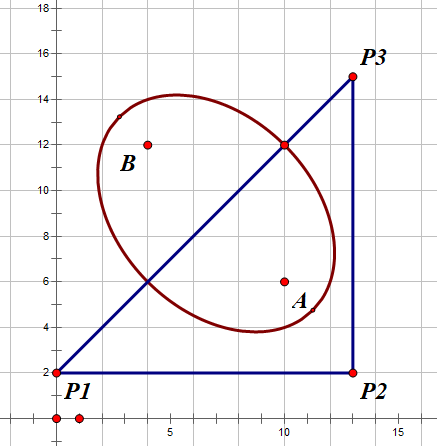
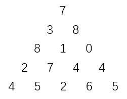
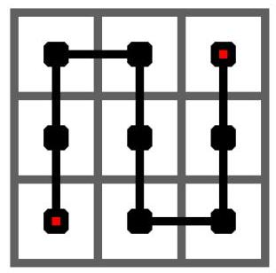
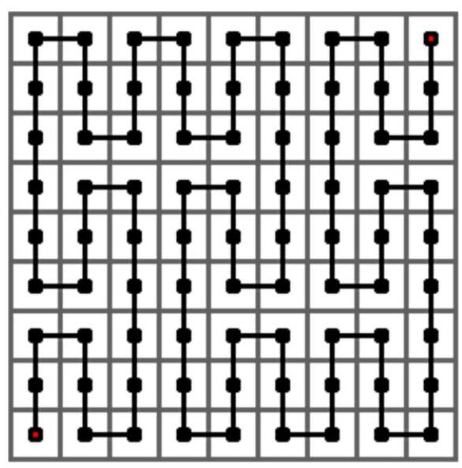
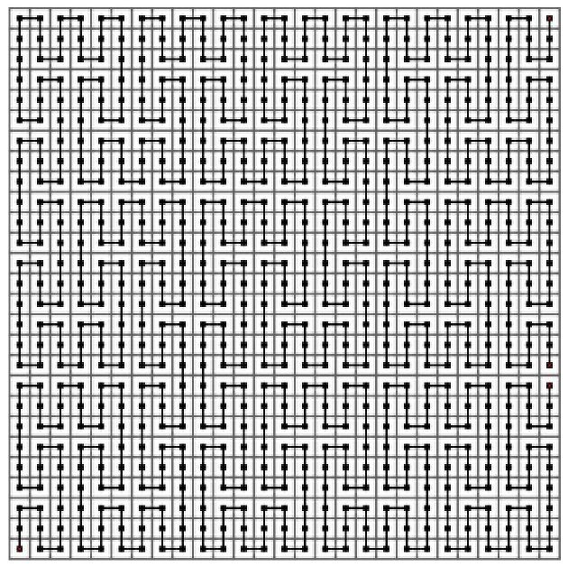
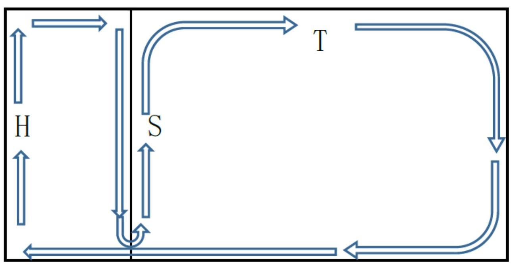

# 蓝桥杯 2020年第十一届 真题（全部组别合并，按题号排列）

> 来源: Dotcpp 蓝桥杯真题 https://www.dotcpp.com/oj/lanqiao/ ｜ 洛谷蓝桥杯题单补充 16 题 https://www.luogu.com.cn/problem/list?type=luogu&tag=361,363 ｜ 抓取时间: 2026-11-27
> 本年有效试卷 1 套、20 题次，Dotcpp 去重 20 道题，另补洛谷题 16 道。

## 本年试卷构成

| 赛段 | 科目 | 组别 | 题数 | 备注 | 题集页 |
| --- | --- | --- | --- | --- | --- |
| 省赛及国赛 | 未分类 | 综合 | 20 |  | [题集](https://www.dotcpp.com/oj/1021/) |

## 题目一览

| 题号 | 标题 | 难度 | 通过率 | 考过的语言/组别 |
| --- | --- | --- | --- | --- |
| 2570 | 成绩分析 | 简单 | 51.10% | 未区分科目 |
| 2571 | 回文日期 | 中等 | 27.11% | 未区分科目 |
| 2572 | 子串分值 | 困难 | 24.30% | 未区分科目 |
| 2573 | 荒岛探测 | 困难 | 13.27% | 未区分科目 |
| 2574 | 字串排序 | 困难 | 10.68% | 未区分科目 |
| 2575 | 整除序列 | 中等 | 39.96% | 未区分科目 |
| 2576 | 解码 | 简单 | 47.27% | 未区分科目 |
| 2577 | 走方格 | 中等 | 34.45% | 未区分科目 |
| 2578 | 整数拼接 | 困难 | 12.74% | 未区分科目 |
| 2579 | 网络分析 | 困难 | 17.44% | 未区分科目 |
| 2580 | 分类计数 | 入门 | 66.88% | 未区分科目 |
| 2581 | 字符串编码 | 中等 | 30.64% | 未区分科目 |
| 2582 | 整数小拼接 | 困难 | 10.47% | 未区分科目 |
| 2583 | 单词分析 | 简单 | 48.66% | 未区分科目 |
| 2584 | 数字三角形 | 中等 | 32.84% | 未区分科目 |
| 2585 | 子串分值和 | 困难 | 24.10% | 未区分科目 |
| 2586 | 装饰珠 | 困难 | 18.98% | 未区分科目 |
| 2587 | 八次求和 | 中等 | 36.37% | 未区分科目 |
| 2588 | BST插入节点问题 | 困难 | 7.81% | 未区分科目 |
| 2589 | 平面切分 | 中等 | 29.96% | 未区分科目 |
| — | 超级胶水 | 中等 | 44.68% | 省赛 C/C++ 大学A1组 |
| — | 日期识别 | 简单 | 54.33% | 省赛 C/C++ 大学AB3组 |
| — | 乘法表 | 简单 | 32.07% | 省赛 C/C++ 大学AB3组 |
| — | 限高杆 | 中等 | 36.58% | 省赛 C/C++ 大学AB3组 |
| — | 画中漂流 | 中等 | 42.47% | 省赛 C/C++ 大学AB3组 |
| — | 旅行家 | 困难 | 32.76% | 省赛 C/C++ 大学AB3组 |
| — | 皮亚诺曲线距离 | 中等 | 26.44% | 国赛 C/C++ 大学ABC组 |
| — | 出租车 | 困难 | 14.40% | 国赛 C/C++ 大学AB组 |
| — | 答疑 | 中等 | 48.65% | 国赛 C/C++ 大学ABC组 |
| — | 补给 | 中等 | 35.03% | 国赛 C/C++ 大学C组 |
| — | 奇偶覆盖 | 困难 | 30.81% | 国赛 C/C++ 大学A组 |
| — | 蓝跳跳 | 困难 | 8.17% | 国赛 C/C++ 大学A组 |
| — | 游园安排 | 中等 | 29.58% | 国赛 C/C++ 大学B组 |
| — | 质数行者 | 困难 | 23.68% | 国赛 C/C++ 大学B组 |
| — | 天干地支 | 简单 | 46.66% | 国赛 C/C++ 大学C组 |
| — | 重复字符串 | 简单 | 31.99% | 国赛 C/C++ 大学C组 |

## 题目详情

### 2570 · 成绩分析

> 题号 2570 ｜ 难度 简单 ｜ 时间 1s ｜ 内存 128MB
> 通过率 51.10% ｜ 题面原文 https://www.dotcpp.com/oj/problem2570.html
> 考过的语言/组别：未区分科目（省赛及国赛合订卷）

#### 题目描述

小蓝给学生们组织了一场考试，卷面总分为100 分，每个学生的得分都是一个0 到100 的整数。请计算这次考试的最高分、最低分和平均分。

#### 输入格式

输入的第一行包含一个整数n，表示考试人数。

接下来n 行，每行包含一个0 至100 的整数，表示一个学生的得分。

#### 输出格式

输出三行。

第一行包含一个整数，表示最高分。

第二行包含一个整数，表示最低分。

第三行包含一个实数，四舍五入保留正好两位小数，表示平均分。

#### 样例输入

```
7

80

92

56

74

88

99

10
```

#### 提示

对于50% 的评测用例， 1 ≤ n ≤ 100。

对于所有评测用例，1 ≤ n ≤10000。

---

### 2571 · 回文日期

> 题号 2571 ｜ 难度 中等 ｜ 时间 1s ｜ 内存 128MB
> 通过率 27.11% ｜ 题面原文 https://www.dotcpp.com/oj/problem2571.html
> 考过的语言/组别：未区分科目（省赛及国赛合订卷）

#### 题目描述

2020 年春节期间，有一个特殊的日期引起了大家的注意：2020年2月2日。因为如果将这个日期按“yyyymmdd” 的格式写成一个8 位数是20200202，

恰好是一个回文数。我们称这样的日期是回文日期。

有人表示20200202 是“千年一遇” 的特殊日子。对此小明很不认同，因为不到2年之后就是下一个回文日期：20211202 即2021年12月2日。

也有人表示20200202 并不仅仅是一个回文日期，还是一个ABABBABA型的回文日期。对此小明也不认同，因为大约100 年后就能遇到下一个ABABBABA 型的回文日期：21211212 即2121 年12 月12 日。算不上“千年一遇”，顶多算“千年两遇”。

给定一个8 位数的日期，请你计算该日期之后下一个回文日期和下一个ABABBABA型的回文日期各是哪一天。

#### 输入格式

输入包含一个八位整数N，表示日期。

#### 输出格式

输出两行，每行1 个八位数。第一行表示下一个回文日期，第二行表示下

一个ABABBABA 型的回文日期。

#### 样例输入

```
20200202
```

#### 提示

对于所有评测用例，10000101 ≤ N ≤ 89991231，保证N 是一个合法日期的8位数表示。

---

### 2572 · 子串分值

> 题号 2572 ｜ 难度 困难 ｜ 时间 1s ｜ 内存 128MB
> 通过率 24.30% ｜ 题面原文 https://www.dotcpp.com/oj/problem2572.html
> 考过的语言/组别：未区分科目（省赛及国赛合订卷）

#### 题目描述

对于一个字符串S，我们定义S 的分值 f(S) 为S中恰好出现一次的字符个数。例如f (”aba”) = 1，f (”abc”) = 3, f (”aaa”) = 0。

现在给定一个字符串S[0…n-1]（长度为n），请你计算对于所有S的非空子串S[i…j](0 ≤ i ≤ j < n)， f (S[i… j]) 的和是多少。

#### 输入格式

输入一行包含一个由小写字母组成的字符串S。

#### 输出格式

输出一个整数表示答案。

#### 样例输入

```
ababc
```

#### 提示

样例说明：

子串f值：

a     1

ab    2

aba   1

abab  0

ababc 1

b    1

ba   2

bab  1

babc 2

a   1

ab  2

abc 3

b  1

bc 2

c 1

对于20% 的评测用例，1 ≤ n ≤ 10；

对于40% 的评测用例，1 ≤ n ≤ 100；

对于50% 的评测用例，1 ≤ n ≤ 1000；

对于60% 的评测用例，1 ≤ n ≤ 10000；

对于所有评测用例，1 ≤ n ≤ 100000。

---

### 2573 · 荒岛探测

> 题号 2573 ｜ 难度 困难 ｜ 时间 1s ｜ 内存 128MB
> 通过率 13.27% ｜ 题面原文 https://www.dotcpp.com/oj/problem2573.html
> 考过的语言/组别：未区分科目（省赛及国赛合订卷）

#### 题目描述

科学家小蓝来到了一个荒岛，准备对这个荒岛进行探测考察。小蓝使用了一个超声定位设备来对自己进行定位。为了使用这个设备，小蓝需要在不同的点分别安装一个固定的发射器和一个固定的接收器。小蓝手中还有一个移动设备。定位设备需要从发射器发射一个信号到移动设备，移动设备收到后马上转发，最后由接收器接收，根据这些设备之间传递的时间差就能计算出移动设备距离发射器和接收器的两个距离，从而实现定位。
小蓝在两个位置已经安装了发射器和接收器，其中发射器安装在坐标 ( xA , yA ) (xA, yA) (xA,yA)，接收器安装在坐标 (xB , yB ) (xB, yB) (xB ,yB)。小蓝的发射器和接收器可能在岛上，也可能不在岛上。小蓝的定位设备设计有些缺陷，当发射器到移动设备的距离加上移动设备到接收器的距离之和大于L 时，定位设备工作不正常。当和小于等于L 时，定位设备工作正常。为了安全，小蓝只在定位设备工作正常的区域探测考察。
已知荒岛是一个三角形，三个顶点的坐标分别为 ( x1 , y1 ) (x1, y1) (x1,y1), ( x2 , y2 ) (x2, y2) (x2,y2), (x3, y3 ) (x3, y3) (x3,y3)。请计算，小蓝在荒岛上可以探测到的面积有多大？

#### 输入格式

输入的第一行包含五个整数，分别为xA、yA、xB、xB、L

第二行包含六个整数，分别为x1、y1、x2 、y2、 x3、 y3

#### 输出格式

输出一行，包含一个实数，四舍五入保留2位小数，表示答案。
考虑到计算中的误差，只要你的输出与参考输出相差不超过0.01即可得分。

#### 样例输入

```
10 6 4 12 12

0 2 13 2 13 15
```

#### 提示

荒岛的形状和定位设备工作正常的区域如下图所示，蓝色的三角形表示荒岛，红色的曲线围成的区域为定位设备工作正常的区域。



当输出为39.98、39.99或 40.00时可以得分。

对于所有评测用例，保证发射器的两个坐标不同，-1000<=xA,yA,xB,yB<=1000,-1000<=x1,y1,x2,y2,x3,y3<=1000,-1000<=L<=1000

---

### 2574 · 字串排序

> 题号 2574 ｜ 难度 困难 ｜ 时间 1s ｜ 内存 128MB
> 通过率 10.68% ｜ 题面原文 https://www.dotcpp.com/oj/problem2574.html
> 考过的语言/组别：未区分科目（省赛及国赛合订卷）

#### 题目描述

小蓝最近学习了一些排序算法，其中冒泡排序让他印象深刻。在冒泡排序中，每次只能交换相邻的两个元素。小蓝发现，如果对一个字符串中的字符排序，只允许交换相邻的两个字符，则在所有可能的排序方案中，冒泡排序的总交换次数是最少的。

例如，对于字符串 lan 排序，只需要 1 次交换。对于字符串 qiao 排序，

总共需要 4 次交换。小蓝找到了很多字符串试图排序，他恰巧碰到一个字符串，需要 V 次交换，可是他忘了把这个字符串记下来，现在找不到了。

请帮助小蓝找一个只包含小写英文字母且没有字母重复出现的字符串，对该串的字符排序，正好需要 V 次交换。如果可能找到多个，请告诉小蓝最短的那个。如果最短的仍然有多个，请告诉小蓝字典序最小的那个。请注意字符串中可以包含相同的字符。

#### 输入格式

输入的第一行包含一个整数V，小蓝的幸运数字。

#### 输出格式

题面要求的一行字符串。

#### 样例输入

```
4
```

#### 提示

对于30% 的评测用例，1 ≤ n ≤ 20；

对于50% 的评测用例，1 ≤ n ≤ 100；

对于100% 的评测用例，1 ≤ n ≤ 10000；

---

### 2575 · 整除序列

> 题号 2575 ｜ 难度 中等 ｜ 时间 1s ｜ 内存 128MB
> 通过率 39.96% ｜ 题面原文 https://www.dotcpp.com/oj/problem2575.html
> 考过的语言/组别：未区分科目（省赛及国赛合订卷）

#### 题目描述

有一个序列，序列的第一个数是 ，后面的每个数是前一个数整除 2，请输出这个序列中值为正数的项。

#### 输入格式

输入一行包含一个整数 。

#### 输出格式

输出一行，包含多个整数，相邻的整数之间用一个空格分隔，表示答案。

#### 样例输入

```
20
```

#### 提示

对于 80% 的数据， 。

对于 100% 的数据，  。

---

### 2576 · 解码

> 题号 2576 ｜ 难度 简单 ｜ 时间 1s ｜ 内存 128MB
> 通过率 47.27% ｜ 题面原文 https://www.dotcpp.com/oj/problem2576.html
> 考过的语言/组别：未区分科目（省赛及国赛合订卷）

#### 题目描述

小明有一串很长的英文字母，可能包含大写和小写。

在这串字母中，有很多连续的是重复的。小明想了一个办法将这串字母表达得更短：将连续的几个相同字母写成字母 + 出现次数的形式。

例如，连续的 5 个 a ，即 aaaaa ，小明可以简写成 a5 （也可能简写成 a4a 、 aa3a 等）。

对于这个例子：HHHellllloo ，小明可以简写成 H3el5o2 。为了方便表达，小明不会将连续的超过 9 个相同的字符写成简写的形式。

现在给出简写后的字符串，请帮助小明还原成原来的串。

#### 输入格式

输入一行包含一个字符串。

#### 输出格式

输出一个字符串，表示还原后的串。

#### 样例输入

```
H3el5o2
```

#### 提示

对于所有评测用例，字符串由大小写英文字母和数字组成，长度不超过 100 。

请注意原来的串长度可能超过 100 。

---

### 2577 · 走方格

> 题号 2577 ｜ 难度 中等 ｜ 时间 1s ｜ 内存 128MB
> 通过率 34.45% ｜ 题面原文 https://www.dotcpp.com/oj/problem2577.html
> 考过的语言/组别：未区分科目（省赛及国赛合订卷）

#### 题目描述

在平面上有一些二维的点阵。

这些点的编号就像二维数组的编号一样，从上到下依次为第 1 至第 n 行，从左到右依次为第 1 至第 m 列，每一个点可以用行号和列号来表示。

现在有个人站在第 1 行第 1 列，要走到第 n 行第 m 列。

只能向右或者向下走。

注意，如果行号和列数都是偶数，不能走入这一格中。问有多少种方案。

#### 输入格式

输入一行包含两个整数 n,m。

#### 输出格式

输出一个整数，表示答案。

#### 样例输入

```
3 4
```

#### 提示

对于所有评测用例，1≤n≤30,1≤m≤30。

---

### 2578 · 整数拼接

> 题号 2578 ｜ 难度 困难 ｜ 时间 1s ｜ 内存 128MB
> 通过率 12.74% ｜ 题面原文 https://www.dotcpp.com/oj/problem2578.html
> 考过的语言/组别：未区分科目（省赛及国赛合订卷）

#### 题目描述

给定一个长度为  的序列  。

你可以从中选出两个数  ，然后将  一前一后拼成一个新的整数。

例如 12 和 345 可以拼成 12345 或 34512 。

注意交换  的顺序总是被视为 2 种拼法，即便是  。

给定一整数  ，问有多少种拼法满足拼出的整数是  的倍数。

#### 输入格式

第一行包含 2 个整数  和  。

第二行包含  个整数  。

#### 输出格式

一个整数代表答案。

#### 样例输入

```
4 2

1 2 3 4
```

#### 提示

对于 100% 的数据，  ，  ，  。

---

### 2579 · 网络分析

> 题号 2579 ｜ 难度 困难 ｜ 时间 1s ｜ 内存 128MB
> 通过率 17.44% ｜ 题面原文 https://www.dotcpp.com/oj/problem2579.html
> 考过的语言/组别：未区分科目（省赛及国赛合订卷）

#### 题目描述

小明正在做一个网络实验。他设置了n台电脑，称为节点，用于收发和存储数据。初始时，所有节点都是独立的，不存在任何连接。小明可以通过网线将两个节点连接起来，连接后两个节点就可以互相通信了。两个节点如果存在网线连接，称为相邻。小明有时会测试当时的网络，他会在某个节点发送一条信息，信息会发送到每个相邻的节点，之后这些节点又会转发到自己相邻的节点，直到所有直接或间接相邻的节点都收到了信息。所有发送和接收的节点都会将信息存储下来。一条信息只存储一次。给出小明连接和测试的过程，请计算出每个节点存储信息的大小。

#### 输入格式

输入的第一行包含两个整数n,m，分别表示节点数量和操作数量。节点从 1 至 n编号。

接下来m行，每行三个整数，表示一个操作。

如果操作为1 a b，表示将节点a 和节点b 通过网线连接起来。当a=b 时，表示连接了一个自环，对网络没有实质影响。

如果操作为2 p t，表示在节点p 上发送一条大小为t 的信息。

#### 输出格式

输出一行，包含 n个整数，相邻整数之间用一个空格分割，依次表示进行

完上述操作后节点 1 至节点n上存储信息的大小。

#### 样例输入

```
4 8

1 1 2

2 1 10

2 3 5

1 4 1

2 2 2

1 1 2

1 2 4

2 2 1
```

#### 提示

对于 30% 的评测用例 1<=n<=20,1<=m<=100

对于 50% 的评测用例 1<=n<=100,1<=m<=1000

对于 70% 的评测用例 1<=n<=1000,1<=m<=10000

对于所有评测用例 1<=n<=10000,1<=m<=100000,1<=t<=100

---

### 2580 · 分类计数

> 题号 2580 ｜ 难度 入门 ｜ 时间 1s ｜ 内存 128MB
> 通过率 66.88% ｜ 题面原文 https://www.dotcpp.com/oj/problem2580.html
> 考过的语言/组别：未区分科目（省赛及国赛合订卷）

#### 题目描述

输入一个字符串，请输出这个字符串包含多少个大写字母，多少个小写字母，多少个数字。

#### 输入格式

输入一行包含一个字符串。

#### 输出格式

输出三行，每行一个整数，分别表示大写字母、小写字母和数字的个数。

#### 样例输入

```
1+a=Aab
```

#### 提示

对于所有评测用例，字符串由可见字符组成，长度不超过 100。

---

### 2581 · 字符串编码

> 题号 2581 ｜ 难度 中等 ｜ 时间 1s ｜ 内存 128MB
> 通过率 30.64% ｜ 题面原文 https://www.dotcpp.com/oj/problem2581.html
> 考过的语言/组别：未区分科目（省赛及国赛合订卷）

#### 题目描述

小明发明了一种给由全大写字母组成的字符串编码的方法。对于每一个大写字母，小明将它转换成它在 26 个英文字母中序号，即 A → 1, B → 2, … Z →26。

这样一个字符串就能被转化成一个数字序列：比如 ABCXYZ → 123242526。

现在给定一个转换后的数字序列，小明想还原出原本的字符串。当然这样的还原有可能存在多个符合条件的字符串。小明希望找出其中字典序最大的字符串。

#### 输入格式

一个数字序列。

#### 输出格式

一个只包含大写字母的字符串，代表答案

#### 样例输入

```
123242526
```

#### 提示

对于 20% 的评测用例，输入的长度不超过 20。

对于所有评测用例，输入的长度不超过 200000。

---

### 2582 · 整数小拼接

> 题号 2582 ｜ 难度 困难 ｜ 时间 1s ｜ 内存 128MB
> 通过率 10.47% ｜ 题面原文 https://www.dotcpp.com/oj/problem2582.html
> 考过的语言/组别：未区分科目（省赛及国赛合订卷）

#### 题目描述

给定一个长度为  的数组  。你可以从中选出两个数  ，然后将  和  一前一后拼成一个新的整数。例如 12 和 345 可以拼成 12345 或 34512 。注意交换  和  的顺序被视为 2 种拼法，即便是  。

请你计算有多少种拼法满足拼出的整数小于等于  。

#### 输入格式

第一行包含 2 个整数  和  。

第二行包含  个整数  。

#### 输出格式

一个整数代表答案。

#### 样例输入

```
4 33

1 2 3 4
```

#### 提示

对于 30% 的评测用例，  ,  ,  。

对于所有评测用例，  ,  ,  。

---

### 2583 · 单词分析

> 题号 2583 ｜ 难度 简单 ｜ 时间 1s ｜ 内存 128MB
> 通过率 48.66% ｜ 题面原文 https://www.dotcpp.com/oj/problem2583.html
> 考过的语言/组别：未区分科目（省赛及国赛合订卷）

#### 题目描述

小蓝正在学习一门神奇的语言，这门语言中的单词都是由小写英文字母组成，有些单词很长，远远超过正常英文单词的长度。小蓝学了很长时间也记不住一些单词，他准备不再完全记忆这些单词，而是根据单词中哪个字母出现得最多来分辨单词。

现在，请你帮助小蓝，给了一个单词后，帮助他找到出现最多的字母和这个字母出现的次数。

#### 输入格式

输入一行包含一个单词，单词只由小写英文字母组成。

#### 输出格式

输出两行，第一行包含一个英文字母，表示单词中出现得最多的字母是哪个。如果有多个字母出现的次数相等，输出字典序最小的那个。

第二行包含一个整数，表示出现得最多的那个字母在单词中出现的次数。

#### 样例输入

```
lanqiao
```

#### 提示

对于所有的评测用例，输入的单词长度不超过 1000。

---

### 2584 · 数字三角形

> 题号 2584 ｜ 难度 中等 ｜ 时间 1s ｜ 内存 128MB
> 通过率 32.84% ｜ 题面原文 https://www.dotcpp.com/oj/problem2584.html
> 考过的语言/组别：未区分科目（省赛及国赛合订卷）

#### 题目描述



上图给出了一个数字三角形。从三角形的顶部到底部有很多条不同的路径。对于每条路径，把路径上面的数加起来可以得到一个和，你的任务就是找到最大的和。

路径上的每一步只能从一个数走到下一层和它最近的左边的那个数或者右边的那个数。此外，向左下走的次数与向右下走的次数相差不能超过 1。

#### 输入格式

输入的第一行包含一个整数N(1<N≤100)，表示三角形的行数。下面的 N行给出数字三角形。数字三角形上的数都是 0至 100之间的整数。

#### 输出格式

输出一个整数，表示答案。

#### 样例输入

```
5

7

3 8

8 1 0 

2 7 4 4

4 5 2 6 5
```

#### 提示

零基础同学可以先学习视频课程，包含C/C++、Python、百练、蓝桥杯辅导、算法数据结构等课程，提供视频讲解以及配套习题，还有老师答疑，点击这里了解课程详情

---

### 2585 · 子串分值和

> 题号 2585 ｜ 难度 困难 ｜ 时间 1s ｜ 内存 128MB
> 通过率 24.10% ｜ 题面原文 https://www.dotcpp.com/oj/problem2585.html
> 考过的语言/组别：未区分科目（省赛及国赛合订卷）

#### 题目描述

对于一个字符串S，我们定义S 的分值 f(S) 为S中恰好出现一次的字符个数。例如f (”aba”) = 2，f (”abc”) = 3, f (”aaa”) = 1。

现在给定一个字符串S[0…n-1]（长度为n），请你计算对于所有S的非空子串S[i…j](0 ≤ i ≤ j < n)， f (S[i… j]) 的和是多少。

#### 输入格式

输入一行包含一个由小写字母组成的字符串 S。

#### 输出格式

输出一个整数表示答案。

#### 样例输入

```
ababc
```

#### 提示

```
子串  f值

a     1

ab    2

aba   2

abab  2

ababc 3

 b    1

 ba   2

 bab  2

 babc 3

  a   1

  ab  2

  abc 3

   b  1

   bc 2

    c 1
```

---

### 2586 · 装饰珠

> 题号 2586 ｜ 难度 困难 ｜ 时间 1s ｜ 内存 128MB
> 通过率 18.98% ｜ 题面原文 https://www.dotcpp.com/oj/problem2586.html
> 考过的语言/组别：未区分科目（省赛及国赛合订卷）

#### 题目描述

在怪物猎人这一款游戏中，玩家可以通过给装备镶嵌不同的装饰珠来获取相应的技能，以提升自己的战斗能力。

已知猎人身上一共有 6件装备，每件装备可能有若干个装饰孔，每个装饰孔有各自的等级，可以镶嵌一颗小于等于自身等级的装饰珠(也可以选择不镶嵌)。装饰珠有M种，编号1至M，分别对应M种技能，第i种装饰珠的等级为 Li，只能镶嵌在等级大于等于 Li的装饰孔中。

对第 i种技能来说，当装备相应技能的装饰珠数量达到 Ki个时，会产生 Wi(Ki)

的价值。镶嵌同类技能的数量越多，产生的价值越大，即 Wi(Ki−1)<Wi(Ki)。但每个技能都有上限 Pi(1≤Pi≤7)，当装备的珠子数量超过 Pi时，只会产生 Wi(Pi)的价值。

对于给定的装备和装饰珠数据，求解如何镶嵌装饰珠，使得 6件装备能得到的总价值达到最大。

#### 输入格式

输入的第1至6行，包含6件装备的描述。其中第i的第一个整数Ni表示第i件装备的装饰孔数量。后面紧接着Ni个整数，分别表示该装备上每个装饰孔的等级 L(1≤L≤4)。第7行包含一个正整数M，表示装饰珠(技能)种类数量。第8至 M+7行，每行描述一种装饰珠(技能)的情况。每行的前两个整数 Lj(1≤Lj≤4)和 Pj(1≤Pj≤7)分别表示第j种装饰珠的等级和上限。接下来 Pj个整数，其中第 k个数表示装备该中装饰珠数量为 k时的价值 Wj(k)。

#### 输出格式

输出一行包含一个整数，表示能够得到的最大价值。

#### 样例输入

```
1 1

2 1 2

1 1

2 2 2

1 1

1 3

3

1 5 1 2 3 5 8

2 4 2 4 8 15

3 2 5 10
```

#### 提示

样例说明：

按照如下方式镶嵌珠子得到最大价值 20，括号内表示镶嵌的装饰珠的种类编号：

```
1: (1)

2: (1) (2)

3: (1)

4: (2) (2)

5: (1)

6: (2)
```

4颗技能 1装饰珠，4颗技能2装饰珠 W1(4)+W2(4)=5+15=20。

【评测用例规模与约定】

对于30的评测用例，1≤Ni≤10, 1≤M≤20, 1≤Wj(k)≤500；对于所有评测用例，1≤Ni≤50, 1≤M≤10000, 1≤Wj(k)≤10000。

---

### 2587 · 八次求和

> 题号 2587 ｜ 难度 中等 ｜ 时间 1s ｜ 内存 128MB
> 通过率 36.37% ｜ 题面原文 https://www.dotcpp.com/oj/problem2587.html
> 考过的语言/组别：未区分科目（省赛及国赛合订卷）

#### 题目描述

给定正整数  ，求  。其中 mod 表示取余。

#### 输入格式

输入的第一行包含一个整数  。

#### 输出格式

输出一行，包含一个整数，表示答案。

#### 样例输入

```
2
```

#### 提示

对于 20% 的评测用例，  。

对于 60% 的评测用例， 。

对于所有评测用例，  。

---

### 2588 · BST插入节点问题

> 题号 2588 ｜ 难度 困难 ｜ 时间 1s ｜ 内存 128MB
> 通过率 7.81% ｜ 题面原文 https://www.dotcpp.com/oj/problem2588.html
> 考过的语言/组别：未区分科目（省赛及国赛合订卷）

#### 题目描述

**此题已加强，卡了  的解法**。如果数据有误请联系管理员。

给定  个结点的一颗二叉搜索树，结点编号  。每个结点  有一整数点权  。给定一整数  ，问有多少个整数  使得  插入这棵二叉搜索树后是结点  的子结点。

保证  不重复，  不能和  重复。

#### 输入格式

第一行两个整数  。

接下来  行，每行两个整数  ，表示结点  的父结点编号为  ，结点  点权为  。

#### 输出格式

输出一个整数，表示  的个数。如果  可取无限多个，则输出 1 。

#### 样例输入

```
4 3

0 10

1 0

1 20

3 30
```

#### 提示

数据范围

对于 60% 的数据，  ，  。

对于 100% 的数据，  ，  。

样例解释

0102030

如果  ，那么答案为 0 。因为 1 号结点已经有左右子结点，不能再增加子结点了。

如果  ，那么答案为无穷大。因为任何一个负数都可以作为 2 的左子结点。

如果  ，那么答案为 9 。因为  都可以作为 3 的左子结点。

---

### 2589 · 平面切分

> 题号 2589 ｜ 难度 中等 ｜ 时间 1s ｜ 内存 128MB
> 通过率 29.96% ｜ 题面原文 https://www.dotcpp.com/oj/problem2589.html
> 考过的语言/组别：未区分科目（省赛及国赛合订卷）

#### 题目描述

平面上有N条直线，其中第 i 条直线是y=Ai⋅x+Bi。请计算这些直线将平面分成了几个部分。

#### 输入格式

第一行包含一个整数 N。以下N行，每行包含两个整数 Ai,Bi。

#### 输出格式

一个整数代表答案。

#### 样例输入

```
3

1 1

2 2

3 3
```

#### 提示

对于50的评测用例，1≤N≤4, −10≤Ai,Bi≤10。对于所有评测用例，1≤N≤1000, −100000≤Ai,Bi≤100000。

---

### — · 超级胶水

> 题号 洛谷 P8709 ｜ 难度 中等（洛谷 普及） ｜ 时间 1.00s ｜ 内存 128MB
> 通过率 44.68%（洛谷站内口径） ｜ 题面原文 https://www.luogu.com.cn/problem/P8709
> 考过的语言/组别：省赛 C/C++ 大学A1组（洛谷题单）

#### 题目描述

小明有 $n$ 颗石子，按顺序摆成一排，他准备用胶水将这些石子粘在一起。

每颗石子有自己的重量，如果将两颗石子粘在一起，将合并成一颗新的石子，重量是这两颗石子的重量之和。

为了保证石子粘贴牢固，粘贴两颗石子所需要的胶水与两颗石子的重量乘积成正比，本题不考虑物理单位，认为所需要的胶水在数值上等于两颗石子重量的乘积。

每次合并，小明只能合并位置相邻的两颗石子，并将合并出的新石子放在原来的位置。

现在，小明想用最少的胶水将所有石子粘在一起，请帮助小明计算最少需要多少胶水。

#### 输入格式

输入的第一行包含一个整数 $n$，表示初始时的石子数量。

第二行包含 $n$ 个整数 $w_1, w_2, \cdots, w_n$ 依次表示每颗石子的重量。

#### 输出格式

输出一行包含一个整数，表示最少需要的胶水数。

#### 样例输入 1

```
3
3 4 5
```

#### 样例输出 1

```
47
```

#### 样例输入 2

```
8
1 5 2 6 3 7 4 8
```

#### 样例输出 2

```
546
```

#### 提示

对于 $20\%$ 的评测用例，$1 \le n \le 15$。

对于 $60\%$ 的评测用例，$1\leq n \leq 100$。

对于 $80\%$ 的评测用例，$1\leq n \leq 1000$。

对于所有评测用例，$1\leq n \leq 10^5$，$1 \leq w_i \leq 1000$。

蓝桥杯 2020 第一轮省赛 A 组 I 题。

---

### — · 日期识别

> 题号 洛谷 P8722 ｜ 难度 简单（洛谷 入门） ｜ 时间 1.00s ｜ 内存 128MB
> 通过率 54.33%（洛谷站内口径） ｜ 题面原文 https://www.luogu.com.cn/problem/P8722
> 考过的语言/组别：省赛 C/C++ 大学AB3组（洛谷题单）

#### 题目描述

小蓝要处理非常多的数据, 其中有一些数据是日期。

在小蓝处理的日期中有两种常用的形式：英文形式和数字形式。

英文形式采用每个月的英文的前三个字母作为月份标识，后面跟两位数字表示日期，月份标识第一个字母大写，后两个字母小写, 日期小于 $10$ 时要补前导 $0$。$1$ 月到 $12$ 月英文的前三个字母分别是 `Jan`、`Feb`、`Mar`、`Apr`、`May`、`Jun`、`Jul`、`Aug`、`Sep`、`Oct`、`Nov`、`Dec`。

数字形式直接用两个整数表达，中间用一个空格分隔，两个整数都不写前 导 `0`。其中月份用 $1$ 至 $12$ 分别表示 $1$ 月到 $12$ 月。

输入一个日期的英文形式, 请输出它的数字形式。

#### 输入格式

输入一个日期的英文形式。

#### 输出格式

输出一行包含两个整数，分别表示日期的月和日。

#### 样例输入 1

```
Feb08
```

#### 样例输出 1

```
2 8
```

#### 样例输入 2

```
Oct18
```

#### 样例输出 2

```
10 18
```

#### 提示

蓝桥杯 2020 第三轮省赛 AB 组 F 题。

---

### — · 乘法表

> 题号 洛谷 P8723 ｜ 难度 简单（洛谷 普及−） ｜ 时间 1.00s ｜ 内存 128MB
> 通过率 32.07%（洛谷站内口径） ｜ 题面原文 https://www.luogu.com.cn/problem/P8723
> 考过的语言/组别：省赛 C/C++ 大学AB3组（洛谷题单）

#### 题目描述

九九乘法表是学习乘法时必须要掌握的。在不同进制数下，需要不同的乘法表。

例如, 四进制下的乘法表如下所示：

```
1*1=1
2*1=2 2*2=10
3*1=3 3*2=12 3*3=21
```

请注意，乘法表中两个数相乘的顺序必须为样例中所示的顺序，不能随意交换两个乘数。

给定 $P$，请输出 $P$ 进制下的乘法表。

#### 输入格式

输入一个整数 $P$。

#### 输出格式

输出 $P$ 进制下的乘法表。$P$ 进制中大于等于 $10$ 的数字用大写字母 `A`、`B`、`C`、$\cdots$ 表示。

#### 样例输入 1

```
4
```

#### 样例输出 1

```
1*1=1
2*1=2 2*2=10
3*1=3 3*2=12 3*3=21
```

#### 样例输入 2

```
8
```

#### 样例输出 2

```
1*1=1
2*1=2 2*2=4
3*1=3 3*2=6 3*3=11
4*1=4 4*2=10 4*3=14 4*4=20
5*1=5 5*2=12 5*3=17 5*4=24 5*5=31
6*1=6 6*2=14 6*3=22 6*4=30 6*5=36 6*6=44
7*1=7 7*2=16 7*3=25 7*4=34 7*5=43 7*6=52 7*7=61
```

#### 提示

对于所有评测数据, $2 \leq P \leq 36$。

蓝桥杯 2020 第三轮省赛 AB 组 G 题。

---

### — · 限高杆

> 题号 洛谷 P8724 ｜ 难度 中等（洛谷 普及+/提高−） ｜ 时间 1.00s ｜ 内存 128MB
> 通过率 36.58%（洛谷站内口径） ｜ 题面原文 https://www.luogu.com.cn/problem/P8724
> 考过的语言/组别：省赛 C/C++ 大学AB3组（洛谷题单）

#### 题目描述

某市有 $n$ 个路口，有 $m$ 段道路连接这些路口，组成了该市的公路系统。其中一段道路两端一定连接两个不同的路口。道路中间不会穿过路口。

由于各种原因，在一部分道路的中间设置了一些限高杆，有限高杆的路段货车无法通过。

在该市有两个重要的市场 $A$ 和 $B$，分别在路口 $1$ 和 $n$ 附近，货车从市场 $A$ 出发，首先走到路口 $1$，然后经过公路系统走到路口 $n$，才能到达市场 $B$。两个市场非常繁华，每天有很多货车往返于两个市场之间。

市长发现，由于限高杆很多，导致货车可能需要绕行才能往返于市场之间，这使得货车在公路系统中的行驶路程变长，增加了对公路系统的损耗，增加了能源的消耗，同时还增加了环境污染。

市长决定要将两段道路中的限高杆拆除，使得市场 $A$ 和市场 $B$ 之间的路程变短。请问最多能减少多长的距离?

#### 输入格式

输入的第一行包含两个整数 $n$，$m$，分别表示路口的数量和道路的段数。

接下来 $m$ 行，每行四个整数 $a$，$b$，$c$，$d$，表示路口 $a$ 和路口 $b$ 之间有一段长度为 $c$ 的道路。如果 $d$ 为 $0$，表示这段道路上没有限高杆; 如果 $d$ 为 $1$，表示 这段道路上有限高杆。两个路口之间可能有多段道路。

输入数据保证在不拆除限高杆的情况下，货车能通过公路系统从路口 $1$ 正常行驶到路口 $n$ 。

#### 输出格式

输出一行，包含一个整数，表示拆除两段道路的限高杆后，市场 $A$ 和市场 $B$ 之间的路程最大减少多长距离。

#### 样例输入

```
5 7
1 2 1 0
2 3 2 1
1 3 9 0
5 3 8 0
4 3 5 1
4 3 9 0
4 5 4 0
```

#### 样例输出

```
6
```

#### 提示

**【样例说明】**

只有两段道路有限高杆，全部拆除后，$1$ 到 $n$ 的路程由原来的 $17$ 变为了 $11$，减少了 $6$。

**【评测用例规模与约定】**

对于 $30 \%$ 的评测样例，$2 \leq n \leq 10,1 \leq m \leq 20,1 \leq c \leq 100$。

对于 $50 \%$ 的评测样例，$2 \leq n \leq 100,1 \leq m \leq 1000,1 \leq c \leq 1000$。

对于 $70 \%$ 的评测样例，$2 \leq n \leq 1000,1 \leq m \leq 10000,1 \leq c \leq 10000$。

对于所有评测样例，$2 \leq n \leq 10000,2 \leq m \leq 10^5,1 \leq c \leq 10000$，至少 有两段道路有限高杆。

蓝桥杯 2020 第三轮省赛 AB 组 H 题。

---

### — · 画中漂流

> 题号 洛谷 P8725 ｜ 难度 中等（洛谷 普及） ｜ 时间 1.00s ｜ 内存 128MB
> 通过率 42.47%（洛谷站内口径） ｜ 题面原文 https://www.luogu.com.cn/problem/P8725
> 考过的语言/组别：省赛 C/C++ 大学AB3组（洛谷题单）

#### 题目描述

在梦境中，你踏上了一只木䇝，在江上漂流。

根据对当地的了解，你知道在你下游 $D$ 米处有一个峡谷，如果你向下游前进大于等于 $D$ 米则必死无疑。

现在你打响了急救电话，$T$ 秒后救援队会到达并将你救上岸。水流速度是 $1 \mathrm{~m} / \mathrm{s}$，你现在有 $M$ 点体力。每消耗一点体力，你可以划一秒桨使船向上游前进 $1 \mathrm{~m}$，否则会向下游前进 $1 \mathrm{~m}$ (水流)。$M$ 点体力需在救援队赶来前花光。因为江面太宽了，凭借你自己的力量不可能上岸。

请问，有多少种划桨的方案可以让你得救。

两个划桨方案不同是指：存在某一秒钟，一个方案划桨，另一个方案不划。

#### 输入格式

输入一行包含三个整数 $D$，$T$，$M$。

#### 输出格式

输出一个整数，表示可以让你得救的总方案数，答案可能很大，请输出方案数除以 $1000000007$（即 $10^9+7$）的余数。

#### 样例输入

```
1 6 3
```

#### 样例输出

```
5
```

#### 提示

对于 $50 \%$ 的评测用例，$1 \leq T \leq 350$。

对于所有评测用例，$1 \leq T \leq 3000,1 \leq D \leq T，1 \leq M \leq 1500$。

蓝桥杯 2020 第三轮省赛 AB 组 I 题。

---

### — · 旅行家

> 题号 洛谷 P8726 ｜ 难度 困难（洛谷 省选/NOI−） ｜ 时间 1.00s ｜ 内存 512MB
> 通过率 32.76%（洛谷站内口径） ｜ 题面原文 https://www.luogu.com.cn/problem/P8726
> 考过的语言/组别：省赛 C/C++ 大学AB3组（洛谷题单）

#### 题目描述

从前，在海上有 $n$ 个岛屿，编号 $1$ 至 $n$。居民们深受洋流困扰，无法到达比自己当前所在岛屿编号更小的岛屿。经过数年以后，岛屿上的人数随着岛屿的编号递增（可能相等）。作为一名出色的旅行家（$\mathrm{RP}$ 学家），你想从 $1$ 号岛屿出发开启一次旅程，以获得更多的 $\mathrm{RP}$，因为受到海洋的洋流影响，你只能去到比当前岛屿编号更大的岛屿。因为你比较善良，你会在离开一个岛屿的时候将你的 $\mathrm{RP}$ 分散给岛民，具体地：你的 $\mathrm{RP}$ 会除以 $2$（用去尾法取整，或者说向零取整）（当你的 $\mathrm{RP}$ 小于零时，岛民也依旧要帮你分担，毕竟你们已经建立起了深厚的友谊)。

第 $i$ 号岛屿有 $T_{i}$ 人，但是你很挑剔，每次你从 $j$ 号岛屿到达 $i$ 号岛屿时，你只会在到达的岛屿上做 $T_{i} \times T_{j}$ 件好事（一件好事可以获得 $1$ 点 $\mathrm{RP}$ )。

唯一不足的是，由于你在岛上住宿，劳民伤财，你会扣除巨量 RP，第 $i$ 号岛屿的住宿扣除 $F_{i}$ 点 $\mathrm{RP}$。

注意: 将离开一个岛屿时，先将 $\mathrm{RP}$ 扣除一半，再扣除住宿的 $\mathrm{RP}$，最后在新到达的岛屿上做好事，增加 $\mathrm{RP}$。离开 $1$ 号岛屿时需要扣除在 $1$ 号岛屿住宿的 $\mathrm{RP}$，当到达这段旅程的最后一个岛屿上时，要做完好事，行程才能结束，也就是说不用扣除在最后到达的岛屿上住宿的 $\mathrm{RP}$ 。

你因为热爱旅行（RP），所以从 $1$ 号岛屿开始旅行，初始时你有 $0$ 点 $\mathrm{RP}$。你希望选择一些岛屿经过，最终选择一个岛屿停下来，求最大的 $\mathrm{RP}$ 值是多少?

#### 输入格式

输入的第一行包含一个数 $n$，表示岛屿的总数。

第二行包含 $n$ 个整数 $T_{1},T_{2},\cdots,T_{n}$，表示每个岛屿的人口数。

第三行包含 $n$ 个整数 $F_{1},F_{2},\cdots,F_{n}$，表示每个岛屿旅馆损失的 $\mathrm{RP}$。

#### 输出格式

输出一个数，表示最大获得的 $\mathrm{RP}$ 值。

#### 样例输入 1

```
3
4 4 5
1 10 3
```

#### 样例输出 1

```
19
```

#### 样例输入 2

```
5
969 980 1013 1016 1021
888423 945460 865822 896150 946615
```

#### 样例输出 2

```
246172
```

#### 提示

**【样例说明】**

从一号岛屿直接走到三号岛屿最优，初始 $0$ 点 $\mathrm{RP}$，扣除一半取整变成 $0$ 点。扣除在一号节点住宿的 $1 \mathrm{RP}$，在三号岛屿做好事产生 $4 \times 5=20$ 点 $\mathrm{RP}$。最终得到 $19$ 点 $R P$ 。

**【评测用例规模与约定】**

对于 $20 \%$ 的评测用例，$1 \leq n \leq 15$;

对于 $70 \%$ 的评测用例，$1 \leq n \leq 5000$;

对于所有评测用例，$1 \leq n \leq 5\times10^5,1 \leq T_{i} \leq 20000,1 \leq F_{i} \leq 2\times 10^8$。给定的 $T_{i}$ 已经按照升序排序。

建议使用 64 位有符号整数进行运算。

蓝桥杯 2020 第三轮省赛 AB 组 J 题。

Upd.2024.7.13 已添加hack数据

---

### — · 皮亚诺曲线距离

> 题号 洛谷 P8730 ｜ 难度 中等（洛谷 普及） ｜ 时间 1.00s ｜ 内存 128MB
> 通过率 26.44%（洛谷站内口径） ｜ 题面原文 https://www.luogu.com.cn/problem/P8730
> 考过的语言/组别：国赛 C/C++ 大学ABC组（洛谷题单）

#### 题目描述

皮亚诺曲线是一条平面内的曲线。

下图给出了皮亚诺曲线的 1 阶情形, 它是从左下角出发, 经过一个 $3 \times 3$ 的 方格中的每一个格子, 最终到达右上角的一条曲线。



下图给出了皮亚诺曲线的 2 阶情形, 它是经过一个 $3^{2} \times 3^{2}$ 的方格中的每一 个格子的一条曲线。它是将 1 阶曲线的每个方格由 1 阶曲线替换而成。



下图给出了皮亚诺曲线的 3 阶情形, 它是经过一个 $3^{3} \times 3^{3}$ 的方格中的每一 个格子的一条曲线。它是将 2 阶曲线的每个方格由 1 阶曲线替换而成。（注：下面这张图的最后一列因为画图错误少连了一条边。）



皮亚诺曲线总是从左下角开始出发, 最终到达右上角。

我们将这些格子放到坐标系中, 对于 $k$ 阶皮亚诺曲线, 左下角的坐标是 $(0,0)$, 右上角坐标是 $\left(3^{k}-1,3^{k}-1\right)$, 右下角坐标是 $\left(3^{k}-1,0\right)$, 左上角坐标是 $\left(0,3^{k}-1\right)$ 。

给定 $k$ 阶皮亚诺曲线上的两个点的坐标, 请问这两个点之间, 如果沿着皮 亚诺曲线走, 距离是多少?

#### 输入格式

输入的第一行包含一个正整数 $k$, 皮亚诺曲线的阶数。

第二行包含两个整数 $x_{1}, y_{1}$, 表示第一个点的坐标。 第三行包含两个整数 $x_{2}, y_{2}$, 表示第二个点的坐标。

#### 输出格式

输出一个整数, 表示给定的两个点之间的距离。

#### 样例输入 1

```
1
0 0
2 2
```

#### 样例输出 1

```
8
```

#### 样例输入 2

```
2
0 2
0 3
```

#### 样例输出 2

```
13
```

#### 提示

对于 $30 \%$ 的评测用例, $0 \leq k \leq 10$ 。

对于 $50 \%$ 的评测用例, $0 \leq k \leq 20$ 。

对于所有评测用例, $0 \leq k \leq 100,0 \leq x_{1}, y_{1}, x_{2}, y_{2}<3^{k}, x_{1}, y_{1}, x_{2}, y_{2} \leq 10^{18}$ 。 数据保证答案不超过 $10^{18}$ 。

蓝桥杯 2020 年国赛 A 组 F 题（B 组 F 题, C 组 H 题）。

---

### — · 出租车

> 题号 洛谷 P8731 ｜ 难度 困难（洛谷 提高） ｜ 时间 1.00s ｜ 内存 512MB
> 通过率 14.40%（洛谷站内口径） ｜ 题面原文 https://www.luogu.com.cn/problem/P8731
> 考过的语言/组别：国赛 C/C++ 大学AB组（洛谷题单）

#### 题目背景

小蓝在 $L$ 市开出租车。

#### 题目描述

$L$ 市的规划很规整，所有的路都是正东西向或者正南北向的，道路都可以看成直线段。东西向的道路互相平行, 南北向的道路互相平行，任何一条东西向道路垂直于任何一条南北向道路。

从北到南一共有 $n$ 条东西向道路，依次标号为 $H_{1}, H_{2}, \cdots, H_{n}$ 。从西到东 一共有 $m$ 条南北向的道路，依次标号为 $S_{1}, S_{2}, \cdots, S_{m}$ 。

每条道路都有足够长，每一条东西向道路和每一条南北向道路都相交，$H_{i}$ 与 $S_{j}$ 的交叉路口记为 $(i, j)$ 。

从 $H_{1}$ 和 $S_{1}$ 的交叉路口 $(1,1)$ 开始，向南遇到的路口与 $(1,1)$ 的距离分别 是 $h_{1}, h_{2}, \cdots, h_{n-1}$，向东遇到路口与 $(1,1)$ 的距离分别是 $w_{1}, w_{2}, \cdots, w_{m-1}$ 。

道路的每个路口都有一个红绿灯。

时刻 $0$ 的时候，南北向绿灯亮，东西向红灯亮，南北向的绿灯会持续一段时间（每个路口不同)，然后南北向变成红灯，东西向变成绿灯，持续一段时间后，再变成南北向绿灯，东西向红灯。

已知路口 $(i, j)$ 的南北向绿灯每次持续的时间为 $g_{i j}$, 东西向的绿灯每次持续的时间为 $r_{i j}$, 红绿灯的变换时间忽略。

当一辆车走到路口时，如果是绿灯，可以直行、左转或右转。如果是红灯，可以右转，不能直行或左转。如果到路口的时候刚好由红灯变为绿灯，则视为看到绿灯；如果刚好由绿灯变为红灯，则视为看到红灯。

每段道路都是双向道路，道路中间有隔离栏杆，在道路中间不能掉头, 只能在红绿灯路口掉头。掉头时不管是红灯还是绿灯都可以直接掉头。掉头的时间可以忽略。

小蓝时刻 $0$ 从家出发。今天，他接到了 $q$ 个预约的订单，他打算按照订单 的顺序依次完成这些订单，就回家休息。中途小蓝不准备再拉其他乘客。小蓝的家在两个路口的中点，小蓝喜欢用 $x_{1}, y_{1}, x_{2}, y_{2}$ 来表示自己家的位 置, 即路口 $\left(x_{1}, y_{1}\right)$ 到路口 $\left(x_{2}, y_{2}\right)$ 之间的道路中点的右侧, 保证两个路口相邻 (中间没有其他路口)。请注意当两个路口交换位置时，表达的是路的不同两边，路中间有栏杆，因此这两个位置实际要走比较远才能到达。

小蓝的订单也是从某两个路口间的中点出发，到某两个路口间的中点结束。小蓝必须按照给定的顺序处理订单，而且一个时刻只能处理一个订单，不能图省时间而同时接两位乘客，也不能揷队完成后面的订单。

小蓝只对 $L$ 市比较熟，因此他只会在给定的 $n$ 条东西向道路和 $m$ 条南北向道路上行驶，而且不会驶出 $H_{1}, H_{n}, S_{1}, S_{m}$ 这几条道路所确定的矩形区域 (可 以到边界。

小蓝行车速度一直为 $1$，乘客上下车的时间忽略不计。

请问，小蓝最早什么时候能完成所有订单回到家。

#### 输入格式

输入第一行包含两个整数 $n, m$，表示东西向道路的数量和南北向道路的数 量。

第二行包含 $n-1$ 个整数 $h_{1}, h_{2}, \cdots, h_{n-1}$ 。

第三行包含 $m-1$ 个整数 $w_{1}, w_{2}, \cdots, w_{m-1}$ 。

接下来 $n$ 行, 每行 $m$ 个整数，描述每个路口南北向绿灯的时间，其中的第 $i$ 行第 $j$ 列表示 $g_{i j}$ 。

接下来 $n$ 行, 每行 $m$ 个整数，描述每个路口东西向绿灯的时间，其中的第 $i$ 行第 $j$ 列表示 $r_{i j}$ 。

接下来一行包含四个整数 $x_{1}, y_{1}, x_{2}, y_{2}$，表示小蓝家的位置在路口 $\left(x_{1}, y_{1}\right)$ 到路口 $\left(x_{2}, y_{2}\right)$ 之间的道路中点的右侧。

接下来一行包含一个整数 $q$，表示订单数量。

接下来 $q$ 行，每行描述一个订单，其中第 $i$ 行包含八个整数 $x_{i 1}, y_{i 1}, x_{i 2}, y_{i 2}$，$x_{i 3}, y_{i 3}, x_{i 4}, y_{i 4}$，表示第 $i$ 个订单的起点为路口 $\left(x_{i 1}, y_{i 1}\right)$ 到路口 $\left(x_{i 2}, y_{i 2}\right)$ 之间的道 路中点的右侧，第 $i$ 个订单的终点为路口 $\left(x_{i 3}, y_{i 3}\right)$ 到路口 $\left(x_{i 4}, y_{i 4}\right)$ 之间的道路中 点的右侧。

#### 输出格式

输出一个实数，表示小蓝完成所有订单最后回到家的最早时刻。四舍五入保留一位小数。

#### 样例输入

```
2 3
200
100 400
10 20 10
20 40 30
20 20 20
20 20 20
2 1 1 1
1
2 2 1 2 1 2 1 3
```

#### 样例输出

```
1620.0
```

#### 提示

**【样例说明】**

蓝有一个订单, 他的行车路线如下图所示。其中 $\mathrm{H}$ 表示他家的位置, $\mathrm{S}$ 表示订单的起点, $\mathrm{T}$ 表示订单的终点。小小明在最后回家时要在直行的红绿灯路 口等绿灯, 等待时间为 $20$。



**【评测用例规模与约定】**

对于 $20 \%$ 的评测用例, $1 \leq n, m \leq 5,1 \leq q \leq 10$ 。

对于 $50 \%$ 的评测用例, $1 \leq n, m \leq 30,1 \leq q \leq 30$ 。

对于所有评测用例, $1 \leq n, m \leq 100,1 \leq q \leq 30,1 \leq h_{1}<h_{2}<\cdots<h_{n-1} \leq$ $100000,1 \leq w_{1}<w_{2}<\cdots<w_{m-1} \leq 100000,1 \leq g_{i j} \leq 1000,1 \leq r_{i j} \leq 1000$, 给定的路口一定合法。

---

### — · 答疑

> 题号 洛谷 P8732 ｜ 难度 中等（洛谷 普及） ｜ 时间 1.00s ｜ 内存 128MB
> 通过率 48.65%（洛谷站内口径） ｜ 题面原文 https://www.luogu.com.cn/problem/P8732
> 考过的语言/组别：国赛 C/C++ 大学ABC组（洛谷题单）

#### 题目描述

有 $n$ 位同学同时找老师答疑。每位同学都预先估计了自己答疑的时间。老师可以安排答疑的顺序，同学们要依次进入老师办公室答疑。

一位同学答疑的过程如下:

1. 首先进入办公室，编号为 $i$ 的同学需要 $s_{i}$ 毫秒的时间。

2. 然后同学问问题老师解答，编号为 $i$ 的同学需要 $a_{i}$ 毫秒的时间。

3. 答疑完成后，同学很高兴，会在课程群里面发一条消息，需要的时间可以忽略。

4. 最后同学收拾东西离开办公室，需要 $e_{i}$ 毫秒的时间。一般需要 $10$ 秒、$20$ 秒或 $30$ 秒，即 $e_{i}$ 取值为 $10000$、$20000$ 或 $30000$。

一位同学离开办公室后，紧接着下一位同学就可以进入办公室了。

答疑从 $0$ 时刻开始。老师想合理的安排答疑的顺序，使得同学们在课程群里面发消息的时刻之和最小。

#### 输入格式

输入第一行包含一个整数 $n$，表示同学的数量。

接下来 $n$ 行, 描述每位同学的时间。其中第 $i$ 行包含三个整数 $s_{i}, a_{i}, e_{i}$，意义如上所述。

#### 输出格式

输出一个整数，表示同学们在课程群里面发消息的时刻之和最小是多少。

#### 样例输入

```
3
10000 10000 10000
20000 50000 20000
30000 20000 30000
```

#### 样例输出

```
280000
```

#### 提示

**【样例说明】**

按照 $1,3,2$ 的顺序答疑，发消息的时间分别是 $20000,80000,180000$ 。

**【评测用例规模与约定】**

对于 $30 \%$ 的评测用例, $1 \leq n \leq 20$ 。

对于 $60 \%$ 的评测用例, $1 \leq n \leq 200$ 。

对于所有评测用例, $1 \leq n \leq 1000,1 \leq s_{i} \leq 60000,1 \leq a_{i} \leq 1000000$, $e_{i} \in\{10000,20000,30000\}$ ，即 $e_{i}$ 一定是 $10000 、 20000 、 30000$ 之一。

蓝桥杯 2020 年国赛 A 组 H 题（B 组 H 题, C 组 J 题）。

---

### — · 补给

> 题号 洛谷 P8733 ｜ 难度 中等（洛谷 普及+/提高−） ｜ 时间 2.00s ｜ 内存 256MB
> 通过率 35.03%（洛谷站内口径） ｜ 题面原文 https://www.luogu.com.cn/problem/P8733
> 考过的语言/组别：国赛 C/C++ 大学C组（洛谷题单）

#### 题目描述

小蓝是一个直升飞机驾驶员，他负责给山区的 $n$ 个村庄运送物资。

每个月，他都要到每个村庄至少一次，可以多于一次，将村庄需要的物资运送过去。

每个村庄都正好有一个直升机场，每两个村庄之间的路程都正好是村庄之间的直线距离。

由于直升机的油箱大小有限，小蓝单次飞行的距离不能超过 $D$。每个直升机场都有加油站，可以给直升机加满油。

每个月，小蓝都是从总部出发，给各个村庄运送完物资后回到总部。如果方便，小蓝中途也可以经过总部来加油。

总部位于编号为 $1$ 的村庄。

请问，要完成一个月的任务，小蓝至少要飞行多长距离？

#### 输入格式

输入的第一行包含两个整数 $n$，$D$，分别表示村庄的数量和单次飞行的距离。

接下来 $n$ 行描述村庄的位置，其中第 $i$ 行两个整数 $x_i$，$y_i$ 分别表示编号为 $i$ 的村庄的坐标。村庄 $i$ 和村庄 $j$ 之间的距离为 $\sqrt{(x_i-x_j)^2+(y_i-y_j)^2}$。

#### 输出格式

输出一行，包含一个实数，四舍五入保留正好 $2$ 位小数，表示答案。

#### 样例输入

```
4 6
1 1
4 5
8 5
11 1
```

#### 样例输出

```
28.00
```

#### 提示

对于所有数据，保证，$1\le n\le20,1\le x_i,y_i\le10^4,1\le D\le10^5$。

蓝桥杯 2020 年国赛 C 组 I 题。

---

### — · 奇偶覆盖

> 题号 洛谷 P8734 ｜ 难度 困难（洛谷 提高） ｜ 时间 1.00s ｜ 内存 128MB
> 通过率 30.81%（洛谷站内口径） ｜ 题面原文 https://www.luogu.com.cn/problem/P8734
> 考过的语言/组别：国赛 C/C++ 大学A组（洛谷题单）

#### 题目描述

在平面内有一些矩形，它们的两条边都平行于坐标轴。

我们称一个点被某个矩形覆盖，是指这个点在矩形的内部或者边界上。

请问，被奇数个矩形覆盖和被偶数 $(\geq 2)$ 个矩形覆盖的点的面积分别是多少?

#### 输入格式

输入的第一行包含一个整数 $n$，表示矩形的个数。

接下来 $n$ 行描述这些矩形，其中第 $i$ 行包含四个整数 $l_{i}, b_{i}, r_{i}, t_{i}$，表示矩形的两个对角坐标分别为 $\left(l_{i}, b_{i}\right),\left(r_{i}, t_{i}\right)$ 。

#### 输出格式

输出两行。

第一行包含一个整数，表示被奇数个矩形覆盖的点的面积。

第二行包含一个整数，表示被偶数 $(\geq 2)$ 个矩形覆盖的点的面积。

#### 样例输入

```
3
1 1 3 3
2 2 4 4
3 3 5 5
```

#### 样例输出

```
8
2
```

#### 提示

对于 $20 \%$ 的评测用例, $1 \leq n \leq 10,0 \leq l_{i}\leq r_{i} \leq 100,0 \leq b_{i}\leq t_{i} \leq 100$ 。

对于 $40 \%$ 的评测用例, $1 \leq n \leq 1000,0 \leq l_{i}\leq r_{i} \leq 100,0 \leq b_{i}\leq t_{i} \leq 100$ 。

对于 $60 \%$ 的评测用例, $1 \leq n \leq 10000,0 \leq l_{i}\leq r_{i} \leq 1000,0 \leq b_{i}\leq t_{i} \leq 1000$ 。

对于 $80 \%$ 的评测用例, $1 \leq n \leq 10^5,0 \leq l_{i}\leq r_{i} \leq 10^5,0 \leq b_{i}\leq t_{i} \leq 10^5$。

对于所有评测用例, $1 \leq n \leq 10^5,0 \leq l_{i}\leq r_{i} \leq 10^{9}, 0 \leq b_{i}\leq t_{i} \leq 10^{9}$。

蓝桥杯 2020 年国赛 A 组 I 题。

---

### — · 蓝跳跳

> 题号 洛谷 P8735 ｜ 难度 困难（洛谷 NOI/NOI+/CTS） ｜ 时间 2.00s ｜ 内存 256MB
> 通过率 8.17%（洛谷站内口径） ｜ 题面原文 https://www.luogu.com.cn/problem/P8735
> 考过的语言/组别：国赛 C/C++ 大学A组（洛谷题单）

#### 题目描述

小蓝制作了一个机器人，取名为蓝跳跳，因为这个机器人走路的时候基本靠跳跃。

蓝跳跳可以跳着走，也可以掉头。蓝跳跳每步跳的距离都必须是整数，每步可以跳不超过 $k$ 的长度。由于蓝跳跳的平衡性设计得不太好，如果连续两次都是跳跃，而且两次跳跃的距离都至少是 $p$，则蓝跳跳会摔倒，这是小蓝不愿意看到的。

小蓝接到一个特别的任务，要在一个长为 $L$ 舞台上展示蓝跳跳。小蓝要控制蓝跳跳从舞台的左边走到右边，然后掉头，然后从右边走到左边，然后掉头，然后再从左边走到右边，然后掉头，再从右边走到左边，然后掉头，如此往复。

为了让观者不至于太无趣，小蓝决定让蓝跳跳每次用不同的方式来走。小蓝将蓝跳跳每一步跳的距离记录下来，按顺序排成一列，显然这一列数每个都不超过 $k$ 且和是 $L$。这样走一趟就会出来一列数。如果两列数的长度不同，或者两列数中存在一个位置数值不同，就认为是不同的方案。

请问蓝跳跳在不摔倒的前提下，有多少种不同的方案从舞台一边走到另一边。

#### 输入格式

输入一行包含三个整数 $k, p, L$。

#### 输出格式

输出一个整数, 表示答案。答案可能很大, 请输出答案除以 $20201114$ 的余数。

#### 样例输入 1

```
3 2 5
```

#### 样例输出 1

```
9
```

#### 样例输入 2

```
5 3 10
```

#### 样例输出 2

```
397
```

#### 提示

**【样例说明】**

蓝跳跳有以下 9 种跳法:

1. $1+1+1+1+1$

2. $1+1+1+2$

3. $1+1+2+1$

4. $1+2+1+1$

5. $2+1+1+1$

6. $2+1+2$

7. $1+1+3$

8. $1+3+1$

9. $3+1+1$

**【评测用例规模与约定】**

对于 $30 \%$ 的评测用例, $1 \leq p \leq k \leq 50,1 \leq L \leq 1000$ 。

对于 $60 \%$ 的评测用例, $1 \leq p \leq k \leq 50,1 \leq L \leq 10^{9}$ 。

对于 $80 \%$ 的评测用例, $1 \leq p \leq k \leq 200,1 \leq L \leq 10^{18}$ 。

对于所有评测用例, $1 \leq p \leq k \leq 1000,1 \leq L \leq 10^{18}$ 。

蓝桥杯 2020 年国赛 A 组 J 题。

---

### — · 游园安排

> 题号 洛谷 P8736 ｜ 难度 中等（洛谷 普及） ｜ 时间 1.00s ｜ 内存 128MB
> 通过率 29.58%（洛谷站内口径） ｜ 题面原文 https://www.luogu.com.cn/problem/P8736
> 考过的语言/组别：国赛 C/C++ 大学B组（洛谷题单）

#### 题目描述

$\mathrm{L}$ 星球游乐园非常有趣，吸引着各个星球的游客前来游玩。小蓝是 $\mathrm{L}$ 星球 游乐园的管理员。

为了更好的管理游乐园，游乐园要求所有的游客提前预约，小蓝能看到系统上所有预约游客的名字。每个游客的名字由一个大写英文字母开始，后面跟 $0$ 个或多个小写英文字母。游客可能重名。

小蓝特别喜欢递增的事物。今天，他决定在所有预约的游客中，选择一部分游客在上午游玩，其他的游客都在下午游玩，在上午游玩的游客要求按照预约的顺序排列后，名字是单调递增的，即排在前面的名字严格小于排在后面的名字。

一个名字 $A$ 小于另一个名字 $B$ 是指：存在一个整数 $i$，使得 $A$ 的前 $i$ 个字母与 $B$ 的前 $i$ 个字母相同，且 $A$ 的第 $i+1$ 个字母小于 $B$ 的第 $i+1$ 个字母。(如果 $A$ 不存在第 $i+1$ 个字母且 $B$ 存在第 $i+1$ 个字母, 也视为 $A$ 的第 $i+1$ 个字母小于 $B$ 的第 $i+1$ 个字母)

作为小蓝的助手，你要按照小蓝的想法安排游客，同时你又希望上午有尽量多的游客游玩，请告诉小蓝让哪些游客上午游玩。如果方案有多种，请输出上午游玩的第一个游客名字最小的方案。如果此时还有多种方案，请输出第一个游客名字最小的前提下第二个游客名字最小的方案。如果仍然有多种，依此类推选择第三个、第四个……游客名字最小的方案。

#### 输入格式

输入包含一个字符串，按预约的顺序给出所有游客的名字，相邻的游客名字之间没有字符分隔。

#### 输出格式

按预约顺序输出上午游玩的游客名单，中间不加任何分隔字符。

#### 样例输入

```
WoAiLanQiaobei
```

#### 样例输出

```
AiLanQiaobei
```

#### 提示

对于 $20 \%$ 的评测数据, 输入的总长度不超过 $20$ 个字母。

对于 $50 \%$ 的评测数据, 输入的总长度不超过 $300$ 个字母。

对于 $70 \%$ 的评测数据, 输入的总长度不超过 $10000$ 个字母。

对于所有评测数据, 每个名字的长度不超过 $10$ 个字母, 输入的总长度不超过 $10^6$ 个字母。

蓝桥杯 2020 年国赛 B 组 G 题。

---

### — · 质数行者

> 题号 洛谷 P8737 ｜ 难度 困难（洛谷 提高） ｜ 时间 1.00s ｜ 内存 128MB
> 通过率 23.68%（洛谷站内口径） ｜ 题面原文 https://www.luogu.com.cn/problem/P8737
> 考过的语言/组别：国赛 C/C++ 大学B组（洛谷题单）

#### 题目背景

小蓝在玩一个叫质数行者的游戏。

#### 题目描述

游戏在一个 $n \times m \times w$ 的立体方格图上进行, 从北到南依次标号为第 $1$ 行到 第 $n$ 行, 从西到东依次标号为第 $1$ 列到第 $m$ 列, 从下到上依次标号为第 $1$ 层到 第 $w$ 层。

小蓝要控制自己的角色从第 $1$ 行第 $1$ 列第 $1$ 层移动到第 $n$ 行第 $m$ 列第 $w$ 层。每一步, 他可以向东走质数格、向南走质数格或者向上走质数格。每走到 一个位置, 小蓝的角色要稍作停留。

在游戏中有两个陷阱, 分别为第 $r_{1}$ 行第 $c_{1}$ 列第 $h_{1}$ 层和第 $r_{2}$ 行第 $c_{2}$ 列第 $h_{2}$ 层。这两个陷阱的位置可以跨过, 但不能停留。也就是说, 小蓝不能控制角 色某一步正好走到陷阱上，但是某一步中间跨过了陷阱是允许的。

小蓝最近比较清闲, 因此他想用不同的走法来完成这个游戏。所谓两个走法不同, 是指小蓝稍作停留的位置集合不同。

请帮小蓝计算一下，他总共有多少种不同的走法。

提示：请注意内存限制, 如果你的程序运行时超过内存限制将不得分。

#### 输入格式

输入第一行包含两个整数 $n, m, w$, 表示方格图的大小。

第二行包含 $6$ 个整数, $r_{1}, c_{1}, h_{1}, r_{2}, c_{2}, h_{2}$ ，表示陷阱的位置。

#### 输出格式

输出一行, 包含一个整数, 表示走法的数量。答案可能非常大, 请输出答 案除以 $1000000007$（即 $10^9+7$） 的余数。

#### 样例输入

```
5 6 1
3 4 1 1 2 1
```

#### 样例输出

```
11
```

#### 提示

**【样例说明】**

用 $(r, c, h)$ 表示第 $r$ 行第 $c$ 列第 $h$ 层, 可能的走法有以下几种:

1. $(1,1,1)-(1,3,1)-(1,6,1)-(3,6,1)-(5,6,1)$ 。

2. $(1,1,1)-(1,3,1)-(3,3,1)-(3,6,1)-(5,6,1)$ 。

3. $(1,1,1)-(1,3,1)-(3,3,1)-(5,3,1)-(5,6,1)$ 。

4. $(1,1,1)-(3,1,1)-(3,3,1)-(3,6,1)-(5,6,1)$ 。

5. $(1,1,1)-(3,1,1)-(3,3,1)-(5,3,1)-(5,6,1)$ 。

6. $(1,1,1)-(3,1,1)-(5,1,1)-(5,3,1)-(5,6,1)$ 。

7. $(1,1,1)-(3,1,1)-(5,1,1)-(5,4,1)-(5,6,1)$ 。

8. $(1,1,1)-(1,4,1)-(1,6,1)-(3,6,1)-(5,6,1)$ 。

9. $(1,1,1)-(1,6,1)-(3,6,1)-(5,6,1)$ 。

10. $(1,1,1)-(3,1,1)-(3,6,1)-(5,6,1)$ 。

11. $(1,1,1)-(3,1,1)-(5,1,1)-(5,6,1)$ 。

**【评测用例规模与约定】**

对于 $30 \%$ 的评测用例 $1 \leq n, m, w \leq 50$ 。

对于 $60 \%$ 的评测用例 $1 \leq n, m, w \leq 300$ 。

对于所有评测用例, $1 \leq n, m, w \leq 1000,1 \leq r_{1}, r_{2} \leq n, 1 \leq c_{1}, c_{2} \leq m$, $1 \leq h_{1}, h_{2} \leq w$, 陷阱不在起点或终点, 两个陷阱不同。

蓝桥杯 2020 年国赛 B 组 J 题。

---

### — · 天干地支

> 题号 洛谷 P8738 ｜ 难度 简单（洛谷 普及−） ｜ 时间 1.00s ｜ 内存 128MB
> 通过率 46.66%（洛谷站内口径） ｜ 题面原文 https://www.luogu.com.cn/problem/P8738
> 考过的语言/组别：国赛 C/C++ 大学C组（洛谷题单）

#### 题目描述

古代中国使用天干地支来记录当前的年份。

天干一共有十个，分别为：甲（jiǎ）、乙（yǐ）、丙（bǐng）、丁（dīng）、戊
（wù）、己（jǐ）、庚（gēng）、辛（xīn）、壬（rén）、癸（guǐ）。

地支一共有十二个，分别为：子（zǐ）、丑（chǒu）、寅（yín）、卯（mǎo）、辰（chén）、巳（sì）、午（wǔ）、未（wèi）、申（shēn）、酉（yǒu）、戌（xū）、亥（hài）。

将天干和地支连起来，就组成了一个天干地支的年份，例如：甲子。2020 年是庚子年。

每过一年，天干和地支都会移动到下一个。例如 2021 年是辛丑年。

每过 60 年，天干会循环 6 轮，地支会循环 5 轮，所以天干地支纪年每 60年轮回一次。例如 1900 年，1960 年，2020 年都是庚子年。

给定一个公元纪年的年份，请输出这一年的天干地支年份。

#### 输入格式

输入一行包含一个正整数，表示公元年份。

#### 输出格式

输出一个拼音，表示天干地支的年份，天干和地支都用小写拼音表示（不表示声调），之间不要加入任何多余的字符。

#### 样例输入

```
2020
```

#### 样例输出

```
gengzi
```

#### 提示

对于所有评测用例，输入的公元年份为不超过 $9999$ 的正整数。

蓝桥杯 2020 年国赛 C 组 F 题。

---

### — · 重复字符串

> 题号 洛谷 P8739 ｜ 难度 简单（洛谷 普及−） ｜ 时间 1.00s ｜ 内存 128MB
> 通过率 31.99%（洛谷站内口径） ｜ 题面原文 https://www.luogu.com.cn/problem/P8739
> 考过的语言/组别：国赛 C/C++ 大学C组（洛谷题单）

#### 题目描述

如果一个字符串 $S$ 恰好可以由某个字符串重复 $K$ 次得到，我们就称 $S$ 是 $K$ 次重复字符串。例如 `abcabcabc` 可以看作是 `abc` 重复 $3$ 次得到，所以 `abcabcabc` 是 $3$ 次重复字符串。

同理 `aaaaaa` 既是 $2$ 次重复字符串、又是 $3$ 次重复字符串和 $6$ 次重复字符串。

现在给定一个字符串 $S$，请你计算最少要修改其中几个字符，可以使 $S$ 变为一个 $K$ 次字符串？

#### 输入格式

输入第一行包含一个整数 $K$。

第二行包含一个只含小写字母的字符串 $S$。

#### 输出格式

输出一个整数代表答案。如果 $S$ 无法修改成 $K$ 次重复字符串，输出 $−1$。

#### 样例输入

```
2
aabbaa
```

#### 样例输出

```
2
```

#### 提示

其中，$1 \le K \le 10^5$，$1 \le |S| \le 10^5$。其中 $|S|$ 表示 $S$ 的 长度。

蓝桥杯 2020 年国赛 C 组 G 题。

---
