# 蓝桥杯 2022年第十三届 真题（全部组别合并，按题号排列）

> 来源: Dotcpp 蓝桥杯真题 https://www.dotcpp.com/oj/lanqiao/ ｜ 洛谷蓝桥杯题单补充 4 题 https://www.luogu.com.cn/problem/list?type=luogu&tag=361,363 ｜ 抓取时间: 2026-11-27
> 本年有效试卷 24 套、192 题次，Dotcpp 去重 92 道题，另补洛谷题 4 道。

## 本年试卷构成

| 赛段 | 科目 | 组别 | 题数 | 备注 | 题集页 |
| --- | --- | --- | --- | --- | --- |
| 省赛 | C++ | 大学A组 | 8 |  | [题集](https://www.dotcpp.com/oj/1025/) |
| 省赛 | C++ | 大学B组 | 8 |  | [题集](https://www.dotcpp.com/oj/1026/) |
| 省赛 | C++ | 大学C组 | 8 |  | [题集](https://www.dotcpp.com/oj/1027/) |
| 省赛 | C++ | 研究生组 | 8 |  | [题集](https://www.dotcpp.com/oj/1028/) |
| 省赛 | Java | 大学A组 | 8 |  | [题集](https://www.dotcpp.com/oj/1029/) |
| 省赛 | Java | 大学B组 | 8 |  | [题集](https://www.dotcpp.com/oj/1030/) |
| 省赛 | Java | 大学C组 | 8 |  | [题集](https://www.dotcpp.com/oj/1031/) |
| 省赛 | Java | 研究生组 | 8 |  | [题集](https://www.dotcpp.com/oj/1032/) |
| 省赛 | Python | 大学A组 | 8 |  | [题集](https://www.dotcpp.com/oj/1033/) |
| 省赛 | Python | 大学B组 | 8 |  | [题集](https://www.dotcpp.com/oj/1034/) |
| 省赛 | Python | 大学C组 | 8 |  | [题集](https://www.dotcpp.com/oj/1035/) |
| 省赛 | Python | 研究生组 | 8 |  | [题集](https://www.dotcpp.com/oj/1036/) |
| 省赛 | 未分类 | 综合 | 20 | 合并版（题目与各组重复，不计入题次） | [题集](https://www.dotcpp.com/oj/1023/) |
| 决赛 | C++ | 大学A组 | 8 |  | [题集](https://www.dotcpp.com/oj/1037/) |
| 决赛 | C++ | 大学B组 | 8 |  | [题集](https://www.dotcpp.com/oj/1038/) |
| 决赛 | C++ | 大学C组 | 8 |  | [题集](https://www.dotcpp.com/oj/1039/) |
| 决赛 | C++ | 研究生组 | 8 |  | [题集](https://www.dotcpp.com/oj/1040/) |
| 决赛 | Java | 大学A组 | 8 |  | [题集](https://www.dotcpp.com/oj/1041/) |
| 决赛 | Java | 大学B组 | 8 |  | [题集](https://www.dotcpp.com/oj/1042/) |
| 决赛 | Java | 大学C组 | 8 |  | [题集](https://www.dotcpp.com/oj/1043/) |
| 决赛 | Java | 研究生组 | 8 |  | [题集](https://www.dotcpp.com/oj/1044/) |
| 决赛 | Python | 大学A组 | 8 |  | [题集](https://www.dotcpp.com/oj/1045/) |
| 决赛 | Python | 大学B组 | 8 |  | [题集](https://www.dotcpp.com/oj/1046/) |
| 决赛 | Python | 大学C组 | 8 |  | [题集](https://www.dotcpp.com/oj/1047/) |
| 决赛 | Python | 研究生组 | 8 |  | [题集](https://www.dotcpp.com/oj/1048/) |
| 国赛 | 未分类 | 综合 | 20 | 合并版（题目与各组重复，不计入题次） | [题集](https://www.dotcpp.com/oj/1024/) |

## 题目一览

| 题号 | 标题 | 难度 | 通过率 | 考过的语言/组别 |
| --- | --- | --- | --- | --- |
| 2656 | 刷题统计 | 中等 | 16.91% | C++大学B组 |
| 2657 | 修剪灌木 | 入门 | 52.67% | C++大学B组 |
| 2658 | X进制减法 | 中等 | 21.46% | C++大学B组 |
| 2659 | 统计子矩阵 | 困难 | 20.92% | C++大学B组 |
| 2660 | 积木画 | 中等 | 31.22% | C++大学B组 |
| 2661 | 扫雷 | 困难 | 12.62% | C++大学B组 |
| 2662 | 李白打酒加强版 | 中等 | 27.32% | C++大学B组 |
| 2663 | 砍竹子 | 中等 | 28.32% | C++大学B组 |
| 2664 | 求和 | 中等 | 23.34% | Java大学C组、Java大学A组、C++大学C组、C++大学A组 |
| 2665 | 选数异或 | 困难 | 17.41% | Java大学C组、C++研究生组、C++大学C组、C++大学A组 |
| 2666 | 爬树的甲壳虫 | 困难 | 28.06% | Python研究生组、Java研究生组、C++研究生组、C++大学A组 |
| 2667 | 青蛙过河 | 中等 | 30.14% | Python大学C组、Java大学C组、Java大学A组、C++大学A组 |
| 2668 | 最长不下降子序列 | 困难 | 10.87% | Python大学B组、Python大学A组、Java大学C组、C++大学A组 |
| 2669 | 扫描游戏 | 困难 | 12.44% | Python研究生组、C++研究生组、C++大学A组 |
| 2670 | 数的拆分 | 困难 | 6.09% | Python研究生组、Python大学A组、C++研究生组、C++大学A组 |
| 2671 | 推导部分和 | 困难 | 17.63% | Java研究生组、Java大学A组、C++大学A组 |
| 2672 | 字符统计 | 简单 | 50.22% | Java大学B组 |
| 2673 | 最少刷题数 | 困难 | 13.09% | Java大学B组 |
| 2674 | 求阶乘 | 困难 | 17.07% | Java大学B组 |
| 2675 | 最大子矩阵 | 困难 | 9.88% | Java大学B组 |
| 2676 | 数组切分 | 困难 | 26.61% | Java大学B组 |
| 2677 | 回忆迷宫 | 困难 | 14.05% | Java大学B组 |
| 2678 | 红绿灯 | 困难 | 20.34% | Java大学B组 |
| 2679 | 拉箱子 | 中等 | 29.27% | Java大学B组 |
| 2680 | 纸张尺寸 | 简单 | 46.93% | Python大学C组、Python大学B组、Java大学C组、C++大学C组 |
| 2681 | 矩形拼接 | 困难 | 29.61% | Python研究生组、Python大学C组、Python大学A组、Java大学C组 |
| 2682 | GCD | 中等 | 26.28% | Python大学C组、Java大学C组、Java大学A组、C++研究生组 |
| 2683 | 因数平方和 | 困难 | 14.59% | Python研究生组、Python大学C组、Java大学C组、Java大学A组 |
| 2684 | 数位排序 | 简单 | 37.42% | Python大学C组、Python大学B组、Java研究生组、C++大学C组 |
| 2685 | 蜂巢 | 困难 | 26.95% | Python大学C组、Python大学B组、Java研究生组、Java大学A组 |
| 2686 | 消除游戏 | 困难 | 3.31% | Python研究生组、Python大学B组、Python大学A组、C++大学C组 |
| 2687 | 全排列的价值 | 困难 | 20.26% | Python大学B组、Python大学A组、Java大学A组、C++研究生组 |
| 2688 | 技能升级 | 困难 | 10.85% | Python研究生组、Python大学B组、Java研究生组、C++大学C组 |
| 2689 | 最优清零方案 | 困难 | 12.52% | Python大学B组、Python大学A组、Java研究生组、Java大学A组 |
| 2690 | 重新排序 | 困难 | 21.58% | Python大学C组、Python大学A组、Java研究生组、C++大学C组 |
| 2691 | 重复的数 | 困难 | 17.41% | C++研究生组、C++大学C组 |
| 2692 | 质因数个数 | 困难 | 12.54% | Python研究生组、Python大学A组、Java研究生组、C++研究生组 |
| 2693 | 卡牌 | 困难 | 15.00% | C++大学B组 |
| 2694 | 最大数字 | 困难 | 22.49% | C++大学B组 |
| 2695 | 出差 | 中等 | 26.00% | C++大学B组 |
| 2696 | 费用报销 | 困难 | 18.28% | C++大学B组 |
| 2697 | 故障 | 中等 | 30.35% | C++大学B组 |
| 2698 | 机房 | 困难 | 20.71% | C++大学B组 |
| 2699 | 齿轮 | 困难 | 24.10% | C++大学B组 |
| 2700 | 搬砖 | 困难 | 24.95% | C++大学B组 |
| 2701 | 取模（C/C++/Java组） | 困难 | 19.72% | Java大学C组、C++大学C组 |
| 2702 | 内存空间（C/C++/Java组） | 困难 | 19.01% | Java大学C组、Java大学A组、C++大学C组、C++大学A组 |
| 2703 | 斐波那契数组（C/C++/Java组） | 困难 | 19.52% | Java研究生组、Java大学C组、Java大学A组、C++大学C组 |
| 2704 | 近似 GCD（C/C++组） | 困难 | 24.57% | C++研究生组、C++大学C组 |
| 2705 | 数组个数（C/C++/Java组） | 困难 | 21.05% | Java大学A组、C++大学C组 |
| 2706 | 六六大顺（C/C++/Java组） | 困难 | 2.97% | Java大学A组、C++研究生组、C++大学C组 |
| 2707 | 打折（C/C++/Java组） | 困难 | 18.04% | Java大学C组、C++大学C组 |
| 2708 | 替换字符（C/C++组） | 困难 | 14.92% | C++大学C组、C++大学A组 |
| 2709 | 最大公约数（C/C++/Java组） | 困难 | 16.08% | Java研究生组、Java大学C组、C++大学A组 |
| 2710 | owo（C/C++/Java组） | 困难 | 13.17% | Java研究生组、C++研究生组、C++大学A组 |
| 2711 | 环境治理（C/C++/Java组） | 困难 | 24.36% | Java研究生组、C++大学A组 |
| 2712 | 选素数 | 困难 | 21.49% | Java大学A组、C++研究生组、C++大学A组 |
| 2713 | 三角序列（C/C++组） | 困难 | 0.81% | C++大学A组 |
| 2714 | 括号序列树 | 困难 | 28.00% | Java大学A组、C++大学A组 |
| 2715 | 交通信号（C/C++/Java组） | 困难 | 14.69% | Java大学C组、Java大学A组、C++研究生组 |
| 2716 | 图书借阅（Java组） | 困难 | 12.00% | Java大学A组 |
| 2717 | 左移右移 | 困难 | 18.23% | Java大学B组 |
| 2718 | 窗口 | 困难 | 9.60% | Java大学B组 |
| 2719 | 迷宫 | 困难 | 21.43% | Java大学B组 |
| 2720 | 小球称重 | 困难 | 11.23% | Java大学B组 |
| 2721 | 背包与魔法 | 困难 | 19.30% | Java大学B组 |
| 2722 | 修路 | 困难 | 28.36% | Java大学B组 |
| 2723 | 围栏 | 中等 | 40.48% | Java大学B组 |
| 2724 | 好数之和 | 困难 | 17.77% | Java大学B组 |
| 2725 | 点亮（Java组） | 中等 | 35.00% | Java研究生组、Java大学C组 |
| 2726 | 宝石收集（Java组） | 中等 | 29.09% | Java大学C组 |
| 2727 | 近似 GCD（Python组） | 困难 | 22.93% | Python研究生组、Python大学B组 |
| 2728 | 交通信号（Python组） | 困难 | 7.23% | Python研究生组、Python大学C组、Python大学B组 |
| 2729 | 数组个数（Python组) | 困难 | 17.31% | Python研究生组、Python大学A组 |
| 2730 | 打折（Python组） | 困难 | 14.47% | Python研究生组、Python大学B组 |
| 2731 | 宝石收集（Python 组） | 困难 | 20.07% | Python研究生组、Python大学C组、Python大学A组 |
| 2732 | 最少的 1（Python组） | 困难 | 4.38% | Python研究生组 |
| 2733 | 图书借阅（Python组） | 困难 | 3.08% | Python研究生组、Python大学A组 |
| 2734 | 分石头（Python组） | 困难 | 16.16% | Python研究生组 |
| 2735 | 取模（Python组） | 困难 | 19.08% | Python大学C组、Python大学B组、Python大学A组 |
| 2736 | 内存空间（Python组） | 困难 | 27.48% | Python大学C组、Python大学B组 |
| 2737 | 点亮（Python组） | 中等 | 29.11% | Python大学C组、Python大学B组 |
| 2738 | owo（Python组） | 困难 | 1.34% | Python大学C组、Python大学B组 |
| 2739 | 替换字符（Python组） | 困难 | 12.08% | Python大学B组、Python大学A组 |
| 2740 | 最少的 1（C/C++/Java组） | 困难 | 10.89% | Java研究生组、C++研究生组 |
| 2741 | 好等差数列 | 困难 | 7.45% | Java研究生组、C++研究生组 |
| 2742 | 三角序列（Java组） | 困难 | 0.00% | Java研究生组 |
| 2743 | 斐波那契数组（Python组） | 困难 | 20.03% | Python大学C组 |
| 2744 | 最大公约数（Python组） | 困难 | 12.55% | Python大学C组、Python大学A组 |
| 2745 | 分石头（C/C++组） | 困难 | 21.85% | C++研究生组 |
| 2746 | 六六大顺（Python组） | 困难 | 3.20% | Python大学A组 |
| 2747 | 环境治理（Python组） | 困难 | 16.83% | Python大学A组 |
| — | 排列字母 | 简单 | 64.89% | 省赛 Python 大学B组 |
| — | 寻找整数 | 中等 | 69.50% | 省赛 Python 大学B组 |
| — | 星期计算 | 简单 | 52.99% | 省赛 Java 大学B组 |
| — | 山 | 简单 | 44.29% | 省赛 Java 大学B组 |

## 题目详情

### 2656 · 刷题统计

> 题号 2656 ｜ 难度 中等 ｜ 时间 1s ｜ 内存 256MB
> 通过率 16.91% ｜ 题面原文 https://www.dotcpp.com/oj/problem2656.html
> 考过的语言/组别：C++ 大学B组

#### 题目描述

小明决定从下周一开始努力刷题准备蓝桥杯竞赛。他计划周一至周五每天做 a 道题目，周六和周日每天做 b 道题目。请你帮小明计算，按照计划他将在第几天实现做题数大于等于 n 题？

#### 输入格式

输入一行包含三个整数 a, b 和 n.

#### 输出格式

输出一个整数代表天数。

#### 样例输入

```
10 20 99
```

#### 提示

对于 50% 的评测用例，1 ≤ a, b, n ≤ 10<sup>6</sup> .

对于 100% 的评测用例，1 ≤ a, b, n ≤ 10<sup>18</sup> .

---

### 2657 · 修剪灌木

> 题号 2657 ｜ 难度 入门 ｜ 时间 1s ｜ 内存 256MB
> 通过率 52.67% ｜ 题面原文 https://www.dotcpp.com/oj/problem2657.html
> 考过的语言/组别：C++ 大学B组

#### 题目描述

爱丽丝要完成一项修剪灌木的工作。有 N 棵灌木整齐的从左到右排成一排。爱丽丝在每天傍晚会修剪一棵灌木，让灌木的高度变为 0 厘米。爱丽丝修剪灌木的顺序是从最左侧的灌木开始，每天向右修剪一棵灌木。当修剪了最右侧的灌木后，她会调转方向，下一天开始向左修剪灌木。直到修剪了最左的灌木后再次调转方向。然后如此循环往复。灌木每天从早上到傍晚会长高 1 厘米，而其余时间不会长高。在第一天的早晨，所有灌木的高度都是 0 厘米。爱丽丝想知道每棵灌木最高长到多高。

#### 输入格式

一个正整数 N ，含义如题面所述。

#### 输出格式

输出 N 行，每行一个整数，第i行表示从左到右第 i 棵树最高能长到多高。

#### 样例输入

```
3
```

#### 提示

对于 30% 的数据，N ≤ 10.

对于 100% 的数据，1 < N ≤ 10000.

---

### 2658 · X进制减法

> 题号 2658 ｜ 难度 中等 ｜ 时间 1s ｜ 内存 256MB
> 通过率 21.46% ｜ 题面原文 https://www.dotcpp.com/oj/problem2658.html
> 考过的语言/组别：C++ 大学B组

#### 题目描述

进制规定了数字在数位上逢几进一。

X 进制是一种很神奇的进制，因为其每一数位的进制并不固定！例如说某种 X 进制数，最低数位为二进制，第二数位为十进制，第三数位为八进制，则

X 进制数 321 转换为十进制数为 65。

现在有两个 X 进制表示的整数 A 和 B，但是其具体每一数位的进制还不确定，只知道 A 和 B 是同一进制规则，且每一数位最高为 N 进制，最低为二进制。请你算出 A − B 的结果最小可能是多少。

请注意，你需要保证 A 和 B 在 X 进制下都是合法的，即每一数位上的数字要小于其进制。

#### 输入格式

第一行一个正整数 N，含义如题面所述。

第二行一个正整数 Ma，表示 X 进制数 A 的位数。

第三行 Ma 个用空格分开的整数，表示 X 进制数 A 按从高位到低位顺序各个数位上的数字在十进制下的表示。

第四行一个正整数 Mb，表示 X 进制数 B 的位数。

第五行 Mb 个用空格分开的整数，表示 X 进制数 B 按从高位到低位顺序各个数位上的数字在十进制下的表示。

请注意，输入中的所有数字都是十进制的。

#### 输出格式

输出一行一个整数，表示 X 进制数 A − B 的结果的最小可能值转换为十进制后再模 1000000007 的结果。

#### 样例输入

```
11

3

10 4 0

3

1 2 0
```

#### 提示

当进制为：最低位 2 进制，第二数位 5 进制，第三数位 11 进制时，减法得到的差最小。此时 A 在十进制下是 108，B 在十进制下是 14，差值是 94。

对于 30% 的数据，N ≤ 10; Ma, Mb ≤ 8.

对于 100% 的数据，2 ≤ N ≤ 1000; 1 ≤ Ma, Mb ≤ 100000; A ≥ B.

---

### 2659 · 统计子矩阵

> 题号 2659 ｜ 难度 困难 ｜ 时间 1s ｜ 内存 256MB
> 通过率 20.92% ｜ 题面原文 https://www.dotcpp.com/oj/problem2659.html
> 考过的语言/组别：C++ 大学B组

#### 题目描述

给定一个 N × M 的矩阵 A，请你统计有多少个子矩阵 (最小 1 × 1，最大

N × M) 满足子矩阵中所有数的和不超过给定的整数 K?

#### 输入格式

第一行包含三个整数 N, M 和 K.

之后 N 行每行包含 M 个整数，代表矩阵 A.

#### 输出格式

一个整数代表答案。

#### 样例输入

```
3 4 10

1 2 3 4

5 6 7 8

9 10 11 12
```

#### 提示

满足条件的子矩阵一共有 19，包含：

大小为 1 × 1 的有 10 个。

大小为 1 × 2 的有 3 个。

大小为 1 × 3 的有 2 个。

大小为 1 × 4 的有 1 个。

大小为 2 × 1 的有 3 个。

对于 30% 的数据，N, M ≤ 20.

对于 70% 的数据，N, M ≤ 100.

对于 100% 的数据，1 ≤ N, M ≤ 500; 0 ≤ Ai j ≤ 1000; 1 ≤ K ≤ 250000000.

---

### 2660 · 积木画

> 题号 2660 ｜ 难度 中等 ｜ 时间 1s ｜ 内存 256MB
> 通过率 31.22% ｜ 题面原文 https://www.dotcpp.com/oj/problem2660.html
> 考过的语言/组别：C++ 大学B组

#### 题目描述

小明最近迷上了积木画，有这么两种类型的积木，分别为 I 型（大小为 2

个单位面积）和 L 型（大小为 3 个单位面积）：


同时，小明有一块面积大小为 2 × N 的画布，画布由 2 × N 个 1 × 1 区域构成。小明需要用以上两种积木将画布拼满，他想知道总共有多少种不同的方式？

积木可以任意旋转，且画布的方向固定。

#### 输入格式

输入一个整数 N，表示画布大小。

#### 输出格式

输出一个整数表示答案。由于答案可能很大，所以输出其对 1000000007 取模后的值。

#### 样例输入

```
3
```

#### 提示

五种情况如下图所示，颜色只是为了标识不同的积木：

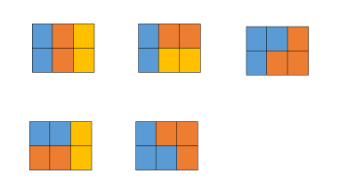

对于所有测试用例，1 ≤ N ≤ 10000000.

---

### 2661 · 扫雷

> 题号 2661 ｜ 难度 困难 ｜ 时间 1s ｜ 内存 256MB
> 通过率 12.62% ｜ 题面原文 https://www.dotcpp.com/oj/problem2661.html
> 考过的语言/组别：C++ 大学B组

#### 题目描述

小明最近迷上了一款名为《扫雷》的游戏。其中有一个关卡的任务如下，

在一个二维平面上放置着 n 个炸雷，第 i 个炸雷 (xi

, yi

,ri) 表示在坐标 (xi

, yi) 处存在一个炸雷，它的爆炸范围是以半径为 ri 的一个圆。

为了顺利通过这片土地，需要玩家进行排雷。玩家可以发射 m 个排雷火箭，小明已经规划好了每个排雷火箭的发射方向，第 j 个排雷火箭 (xj

, yj

,rj) 表示这个排雷火箭将会在 (xj

, yj) 处爆炸，它的爆炸范围是以半径为 rj 的一个圆，在其爆炸范围内的炸雷会被引爆。同时，当炸雷被引爆时，在其爆炸范围内的炸雷也会被引爆。现在小明想知道他这次共引爆了几颗炸雷？

你可以把炸雷和排雷火箭都视为平面上的一个点。一个点处可以存在多个炸雷和排雷火箭。当炸雷位于爆炸范围的边界上时也会被引爆。

#### 输入格式

输入的第一行包含两个整数 n、m.

接下来的 n 行，每行三个整数 xi

, yi

,ri，表示一个炸雷的信息。

再接下来的 m 行，每行三个整数 xj

, yj

,rj，表示一个排雷火箭的信息。

#### 输出格式

输出一个整数表示答案。

#### 样例输入

```
2 1

2 2 4

4 4 2

0 0 5
```

#### 提示

示例图如下，排雷火箭 1 覆盖了炸雷 1，所以炸雷 1 被排除；炸雷 1 又覆盖了炸雷 2，所以炸雷 2 也被排除。

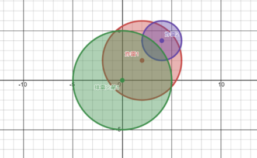

对于 40% 的评测用例：0 ≤ x, y ≤ 109

, 0 ≤ n, m ≤ 103

, 1 ≤ r ≤ 10.

对于 100% 的评测用例：0 ≤ x, y ≤ 109

, 0 ≤ n, m ≤ 5 × 104

, 1 ≤ r ≤ 10.

---

### 2662 · 李白打酒加强版

> 题号 2662 ｜ 难度 中等 ｜ 时间 1s ｜ 内存 256MB
> 通过率 27.32% ｜ 题面原文 https://www.dotcpp.com/oj/problem2662.html
> 考过的语言/组别：C++ 大学B组

#### 题目描述

话说大诗人李白，一生好饮。幸好他从不开车。

一天，他提着酒壶，从家里出来，酒壶中有酒 2 斗。他边走边唱：

无事街上走，提壶去打酒。

逢店加一倍，遇花喝一斗。

这一路上，他一共遇到店 N 次，遇到花 M 次。已知最后一次遇到的是花，

他正好把酒喝光了。

请你计算李白这一路遇到店和花的顺序，有多少种不同的可能？

注意：壶里没酒 ( 0 斗) 时遇店是合法的，加倍后还是没酒；但是没酒时遇花是不合法的。

#### 输入格式

第一行包含两个整数 N 和 M.

#### 输出格式

输出一个整数表示答案。由于答案可能很大，输出模 1000000007 的结果。

#### 样例输入

```
5 10
```

#### 提示

如果我们用 0 代表遇到花，1 代表遇到店，14 种顺序如下：

010101101000000

010110010010000

011000110010000

100010110010000

011001000110000

100011000110000

100100010110000

010110100000100

011001001000100

100011001000100

100100011000100

011010000010100

100100100010100

101000001010100

对于 40% 的评测用例：1 ≤ N, M ≤ 10。

对于 100% 的评测用例：1 ≤ N, M ≤ 100。

---

### 2663 · 砍竹子

> 题号 2663 ｜ 难度 中等 ｜ 时间 1s ｜ 内存 256MB
> 通过率 28.32% ｜ 题面原文 https://www.dotcpp.com/oj/problem2663.html
> 考过的语言/组别：C++ 大学B组

#### 题目描述

这天，小明在砍竹子，他面前有 n 棵竹子排成一排，一开始第 i 棵竹子的高度为 h<sub>i</sub> .

他觉得一棵一棵砍太慢了，决定使用魔法来砍竹子。魔法可以对连续的一段相同高度的竹子使用，假设这一段竹子的高度为 H，那么使用一次魔法可以把这一段竹子的高度都变为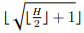，其中 ⌊x⌋ 表示对 x 向下取整。小明想知道他最少使用多少次魔法可以让所有的竹子的高度都变为 1。

#### 输入格式

第一行为一个正整数 n，表示竹子的棵数。

第二行共 n 个空格分开的正整数 h<sub>i</sub>，表示每棵竹子的高度。

#### 输出格式

一个整数表示答案。

#### 样例输入

```
6

2 1 4 2 6 7
```

#### 提示

其中一种方案：

2 1 4 2 6 7

→ 2 1 4 2 6 2

→ 2 1 4 2 2 2

→ 2 1 1 2 2 2

→ 1 1 1 2 2 2

→ 1 1 1 1 1 1

共需要 5 步完成。

对于 20% 的数据，保证 n ≤ 1000, h<sub>i</sub> ≤ 10<sup>6</sup>。

对于 100% 的数据，保证 n ≤ 2 × 10<sup>5</sup>, h<sub>i</sub> ≤ 10<sup>18</sup>。

---

### 2664 · 求和

> 题号 2664 ｜ 难度 中等 ｜ 时间 1s ｜ 内存 256MB
> 通过率 23.34% ｜ 题面原文 https://www.dotcpp.com/oj/problem2664.html
> 考过的语言/组别：Java 大学C组、Java 大学A组、C++ 大学C组、C++ 大学A组

#### 题目描述

给定 n 个整数 a<sub>1</sub>, a<sub>2</sub>, · · · , a<sub>n</sub> ，求它们两两相乘再相加的和，即

S = a<sub>1</sub> · a<sub>2</sub> + a<sub>1</sub> · a<sub>3</sub> + · · · + a<sub>1</sub> · a<sub>n</sub> + a<sub>2</sub> · a<sub>3</sub> + · · · + a<sub>n-2</sub> · a<sub>n-1</sub> + a<sub>n-2</sub> · a<sub>n</sub> + a<sub>n-1</sub> · a<sub>n</sub>.

#### 输入格式

输入的第一行包含一个整数 n 。

第二行包含 n 个整数 a<sub>1</sub>, a<sub>2</sub>, · · · a<sub>n</sub>。

#### 输出格式

输出一个整数 S，表示所求的和。请使用合适的数据类型进行运算。

#### 样例输入

```
4

1 3 6 9
```

#### 提示

对于 30% 的数据，1 ≤ n ≤ 1000，1 ≤ a<sub>i</sub> ≤ 100。

对于所有评测用例，1 ≤ n ≤ 200000，1 ≤ a<sub>i</sub> ≤ 1000。

---

### 2665 · 选数异或

> 题号 2665 ｜ 难度 困难 ｜ 时间 1s ｜ 内存 256MB
> 通过率 17.41% ｜ 题面原文 https://www.dotcpp.com/oj/problem2665.html
> 考过的语言/组别：Java 大学C组、C++ 研究生组、C++ 大学C组、C++ 大学A组

#### 题目描述

给定一个长度为 n 的数列 A<sub>1</sub>, A<sub>2</sub>, · · · , A<sub>n</sub> 和一个非负整数 x，给定 m 次查询, 每次询问能否从某个区间 [l,r] 中选择两个数使得他们的异或等于 x 。

#### 输入格式

输入的第一行包含三个整数 n, m, x 。

第二行包含 n 个整数 A<sub>1</sub>, A<sub>2</sub>, · · · , A<sub>n</sub> 。

接下来 m 行，每行包含两个整数 l<sub>i</sub> ,r<sub>i</sub> 表示询问区间 [l<sub>i</sub> ,r<sub>i</sub> ] 。

#### 输出格式

对于每个询问, 如果该区间内存在两个数的异或为 x 则输出 yes, 否则输出

no。

#### 样例输入

```
4 4 1

1 2 3 4

1 4

1 2

2 3

3 3
```

#### 提示

显然整个数列中只有 2, 3 的异或为 1。

对于 20% 的评测用例，1 ≤ n, m ≤ 100；

对于 40% 的评测用例，1 ≤ n, m ≤ 1000；

对于所有评测用例，1 ≤ n, m ≤ 100000 ，0 ≤ x < 2<sup>20</sup> ，1 ≤ l<sub>i</sub> ≤ r<sub>i</sub> ≤ n ，

0 ≤ A<sub>i</sub> < 2<sup>20</sup>。

---

### 2666 · 爬树的甲壳虫

> 题号 2666 ｜ 难度 困难 ｜ 时间 1s ｜ 内存 256MB
> 通过率 28.06% ｜ 题面原文 https://www.dotcpp.com/oj/problem2666.html
> 考过的语言/组别：Python 研究生组、Java 研究生组、C++ 研究生组、C++ 大学A组

#### 题目描述

有一只甲壳虫想要爬上一颗高度为 n 的树，它一开始位于树根，高度为 0，当它尝试从高度 i − 1 爬到高度为 i 的位置时有 P<sub>i</sub> 的概率会掉回树根，求它从树根爬到树顶时，经过的时间的期望值是多少。

#### 输入格式

输入第一行包含一个整数 n 表示树的高度。

接下来 n 行每行包含两个整数 x<sub>i</sub> , yi，用一个空格分隔，表示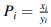。

#### 输出格式

输出一行包含一个整数表示答案，答案是一个有理数，请输出答案对质数 998244353 取模的结果。其中有理数对质数 P 取模的结果是整数 c 满足

0 ≤ c < P 且 c · b ≡ a (mod P)。

#### 样例输入

```
1

1 2
```

#### 提示

对于 20% 的评测用例，n ≤ 2，1 ≤ x<sub>i</sub> < y<sub>i</sub> ≤ 20 ；

对于 50% 的评测用例，n ≤ 500，1 ≤ x<sub>i</sub> < y<sub>i</sub> ≤ 200 ；

对于所有评测用例，1 ≤ n ≤ 100000，1 ≤ x<sub>i</sub> < y<sub>i</sub> ≤ 10<sup>9</sup> 。

---

### 2667 · 青蛙过河

> 题号 2667 ｜ 难度 中等 ｜ 时间 1s ｜ 内存 256MB
> 通过率 30.14% ｜ 题面原文 https://www.dotcpp.com/oj/problem2667.html
> 考过的语言/组别：Python 大学C组、Java 大学C组、Java 大学A组、C++ 大学A组

#### 题目描述

小青蛙住在一条河边，它想到河对岸的学校去学习。小青蛙打算经过河里的石头跳到对岸。

河里的石头排成了一条直线，小青蛙每次跳跃必须落在一块石头或者岸上。不过，每块石头有一个高度，每次小青蛙从一块石头起跳，这块石头的高度就会下降 1，当石头的高度下降到 0 时小青蛙不能再跳到这块石头上（某次跳跃后使石头高度下降到 0 是允许的）。

小青蛙一共需要去学校上 x 天课，所以它需要往返 2x 次。当小青蛙具有一个跳跃能力 y 时，它能跳不超过 y 的距离。

请问小青蛙的跳跃能力至少是多少才能用这些石头上完 x 次课。

#### 输入格式

输入的第一行包含两个整数 n, x，分别表示河的宽度和小青蛙需要去学校的天数。请注意 2x 才是实际过河的次数。

第二行包含 n − 1 个非负整数 H<sub>1</sub>, H<sub>2</sub>, · · · , H<sub>n-1</sub>，其中 H<sub>i</sub> > 0 表示在河中与小青蛙的家相距 i 的地方有一块高度为 H<sub>i</sub> 的石头，H<sub>i</sub> = 0 表示这个位置没有石头。

#### 输出格式

输出一行，包含一个整数，表示小青蛙需要的最低跳跃能力。

#### 样例输入

```
5 1

1 0 1 0
```

#### 提示

由于只有两块高度为 1 的石头，所以往返只能各用一块。第 1 块石头和对岸的距离为 4，如果小青蛙的跳跃能力为 3 则无法满足要求。所以小青蛙最少需要 4 的跳跃能力。

对于 30% 的评测用例，n ≤ 100；

对于 60% 的评测用例，n ≤ 1000；

对于所有评测用例，1 ≤ n ≤ 10<sup>5</sup> , 1 ≤ x ≤ 10<sup>9</sup> , 1 ≤ H<sub>i</sub> ≤ 10<sup>4</sup>。

---

### 2668 · 最长不下降子序列

> 题号 2668 ｜ 难度 困难 ｜ 时间 1s ｜ 内存 256MB
> 通过率 10.87% ｜ 题面原文 https://www.dotcpp.com/oj/problem2668.html
> 考过的语言/组别：Python 大学B组、Python 大学A组、Java 大学C组、C++ 大学A组

#### 题目描述

给定一个长度为 N 的整数序列：A<sub>1</sub>, A<sub>2</sub>, · · · , A<sub>N</sub>。现在你有一次机会，将其中连续的 K 个数修改成任意一个相同值。请你计算如何修改可以使修改后的数列的最长不下降子序列最长，请输出这个最长的长度。

最长不下降子序列是指序列中的一个子序列，子序列中的每个数不小于在它之前的数。

#### 输入格式

输入第一行包含两个整数 N 和 K。

第二行包含 N 个整数 A<sub>1</sub>, A<sub>2</sub>, · · · , A<sub>N</sub>。

#### 输出格式

输出一行包含一个整数表示答案。

#### 样例输入

```
5 1

1 4 2 8 5
```

#### 提示

对于 20% 的评测用例，1 ≤ K ≤ N ≤ 100；

对于 30% 的评测用例，1 ≤ K ≤ N ≤ 1000；

对于 50% 的评测用例，1 ≤ K ≤ N ≤ 10000；

对于所有评测用例，1 ≤ K ≤ N ≤ 10<sup>5</sup>，1 ≤ A<sub>i</sub> ≤ 10<sup>6</sup>。

---

### 2669 · 扫描游戏

> 题号 2669 ｜ 难度 困难 ｜ 时间 1s ｜ 内存 256MB
> 通过率 12.44% ｜ 题面原文 https://www.dotcpp.com/oj/problem2669.html
> 考过的语言/组别：Python 研究生组、C++ 研究生组、C++ 大学A组

#### 题目描述

有一根围绕原点 O 顺时针旋转的棒 OA，初始时指向正上方（Y 轴正向）。

在平面中有若干物件，第 i 个物件的坐标为 (x<sub>i</sub> , y<sub>i</sub>) ，价值为 z<sub>i</sub>。当棒扫到某个物件时，棒的长度会瞬间增长 z<sub>i</sub>，且物件瞬间消失（棒的顶端恰好碰到物件也视为扫到），如果此时增长完的棒又额外碰到了其他物件，也按上述方式消去

（它和上述那个点视为同时消失）。

如果将物件按照消失的时间排序，则每个物件有一个排名，同时消失的物件排名相同，请输出每个物件的排名，如果物件永远不会消失则输出 −1。

#### 输入格式

输入第一行包含两个整数 n、L，用一个空格分隔，分别表示物件数量和棒的初始长度。

接下来 n 行每行包含第三个整数 x<sub>i</sub> , y<sub>i</sub> ,z<sub>i</sub>。

#### 输出格式

输出一行包含 n 整数，相邻两个整数间用一个空格分隔，依次表示每个物件的排名。

#### 样例输入

```
5 2

0 1 1

0 3 2

4 3 5

6 8 1

-51 -33 2
```

#### 提示

对于 30% 的评测用例，1 ≤ n ≤ 500 ；

对于 60% 的评测用例，1 ≤ n ≤ 5000 ；

对于所有评测用例，1 ≤ n ≤ 200000，−10<sup>9</sup> ≤ x<sub>i</sub> , y<sub>i</sub> ≤ 10<sup>9</sup>，1 ≤ L,z<sub>i</sub> ≤ 10<sup>9</sup> 。

---

### 2670 · 数的拆分

> 题号 2670 ｜ 难度 困难 ｜ 时间 1s ｜ 内存 256MB
> 通过率 6.09% ｜ 题面原文 https://www.dotcpp.com/oj/problem2670.html
> 考过的语言/组别：Python 研究生组、Python 大学A组、C++ 研究生组、C++ 大学A组

#### 题目描述

给定 T 个正整数 a<sub>i</sub>，分别问每个 a<sub>i</sub> 能否表示为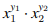的形式，其中 x<sub>1</sub>, x<sub>2</sub> 为正整数，y<sub>1</sub>, y<sub>2</sub> 为大于等于 2 的正整数。

#### 输入格式

输入第一行包含一个整数 T 表示询问次数。

接下来 T 行，每行包含一个正整数 a<sub>i </sub>。

#### 输出格式

对于每次询问, 如果 a<sub>i </sub>能够表示为题目描述的形式则输出 yes，否则输出

no 。

#### 样例输入

```
7

2

6

12

4

8

24

72
```

#### 提示

第 4,5,7 个数分别可以表示为：

a<sub>4</sub> = 2<sup>2</sup> × 1<sup>2 </sup>；

a<sub>5</sub> = 2<sup>3</sup> × 1<sup>2 </sup>；

a<sub>7</sub> = 2<sup>3</sup> × 3<sup>2</sup> 。

【评测用例规模与约定】

对于 10% 的评测用例，1 ≤ T ≤ 200，a<sub>i</sub> ≤ 10<sup>9 </sup>；

对于 30% 的评测用例，1 ≤ T ≤ 300，a<sub>i</sub> ≤ 10<sup>18 </sup>；

对于 60% 的评测用例，1 ≤ T ≤ 10000，a<sub>i</sub> ≤ 10<sup>18 </sup>；

对于所有评测用例，1 ≤ T ≤ 100000，1 ≤ a<sub>i</sub> ≤ 10<sup>18 </sup>。

---

### 2671 · 推导部分和

> 题号 2671 ｜ 难度 困难 ｜ 时间 1s ｜ 内存 256MB
> 通过率 17.63% ｜ 题面原文 https://www.dotcpp.com/oj/problem2671.html
> 考过的语言/组别：Java 研究生组、Java 大学A组、C++ 大学A组

#### 题目描述

对于一个长度为 N 的整数数列 A<sub>1</sub>, A<sub>2</sub>, · · · A<sub>N</sub>，小蓝想知道下标 l 到 r 的部分和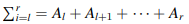是多少？

然而，小蓝并不知道数列中每个数的值是多少，他只知道它的 M 个部分和的值。其中第 i 个部分和是下标 l<sub>i</sub> 到 r<sub>i</sub> 的部分和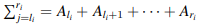，值是 S <sub>i </sub>。

#### 输入格式

第一行包含 3 个整数 N、M 和 Q。分别代表数组长度、已知的部分和数量和询问的部分和数量。

接下来 M 行，每行包含 3 个整数 l<sub>i</sub> ,r<sub>i</sub> , S <sub>i</sub>。

接下来 Q 行，每行包含 2 个整数 l 和 r ，代表一个小蓝想知道的部分和。

#### 输出格式

对于每个询问，输出一行包含一个整数表示答案。如果答案无法确定，输出 UNKNOWN。

#### 样例输入

```
5 3 3

1 5 15

4 5 9

2 3 5

1 5

1 3

1 2
```

#### 提示

对于 10% 的评测用例，1 ≤ N, M, Q ≤ 10，−100 ≤ S <sub>i</sub> ≤ 100。

对于 20% 的评测用例，1 ≤ N, M, Q ≤ 20，−1000 ≤ S <sub>i</sub> ≤ 1000。

对于 30% 的评测用例，1 ≤ N, M, Q ≤ 50，−10000 ≤ S <sub>i</sub> ≤ 10000。

对于 40% 的评测用例，1 ≤ N, M, Q ≤ 1000，−10<sup>6</sup> ≤ S <sub>i</sub> ≤ 10<sup>6</sup>。

对于 60% 的评测用例，1 ≤ N, M, Q ≤ 10000，−10<sup>9</sup> ≤ S <sub>i</sub> ≤ 10<sup>9</sup>。

对于所有评测用例，1 ≤ N, M, Q ≤ 10<sup>5</sup>，−10<sup>12</sup> ≤ S <sub>i</sub> ≤ 10<sup>12</sup>，1 ≤ l<sub>i</sub> ≤ r<sub>i</sub> ≤ N，

1 ≤ l ≤ r ≤ N。数据保证没有矛盾。

---

### 2672 · 字符统计

> 题号 2672 ｜ 难度 简单 ｜ 时间 1s ｜ 内存 512MB
> 通过率 50.22% ｜ 题面原文 https://www.dotcpp.com/oj/problem2672.html
> 考过的语言/组别：Java 大学B组

#### 题目描述

给定一个只包含大写字母的字符串 S，请你输出其中出现次数最多的字母。

如果有多个字母均出现了最多次，按字母表顺序依次输出所有这些字母。

#### 输入格式

一个只包含大写字母的字符串 S .

#### 输出格式

若干个大写字母，代表答案。

#### 样例输入

```
BABBACAC
```

#### 提示

对于 100% 的评测用例，1 ≤ |S | ≤ 10<sup>6</sup> .

---

### 2673 · 最少刷题数

> 题号 2673 ｜ 难度 困难 ｜ 时间 1s ｜ 内存 512MB
> 通过率 13.09% ｜ 题面原文 https://www.dotcpp.com/oj/problem2673.html
> 考过的语言/组别：Java 大学B组

#### 题目描述

小蓝老师教的编程课有 N 名学生，编号依次是 1 . . . N。第 i 号学生这学期刷题的数量是 A<sub>i</sub>。

对于每一名学生，请你计算他至少还要再刷多少道题，才能使得全班刷题比他多的学生数不超过刷题比他少的学生数。

#### 输入格式

第一行包含一个正整数 N。

第二行包含 N 个整数：A<sub>1</sub>, A<sub>2</sub>, A<sub>3</sub>, . . . , A<sub>N</sub>.

#### 输出格式

输出 N 个整数，依次表示第 1 . . . N 号学生分别至少还要再刷多少道题。

#### 样例输入

```
5

12 10 15 20 6
```

#### 提示

对于 30% 的数据，1 ≤ N ≤ 1000, 0 ≤ A<sub>i</sub> ≤ 1000.

对于 100% 的数据，1 ≤ N ≤ 100000, 0 ≤ A<sub>i</sub> ≤ 100000.

---

### 2674 · 求阶乘

> 题号 2674 ｜ 难度 困难 ｜ 时间 1s ｜ 内存 512MB
> 通过率 17.07% ｜ 题面原文 https://www.dotcpp.com/oj/problem2674.html
> 考过的语言/组别：Java 大学B组

#### 题目描述

满足 N! 的末尾恰好有 K 个 0 的最小的 N 是多少?

如果这样的 N 不存在输出 −1。

#### 输入格式

一个整数 K。

#### 输出格式

一个整数代表答案。

#### 样例输入

```
2
```

#### 提示

对于 30% 的数据，1 ≤ K ≤ 10<sup>6</sup> .

对于 100% 的数据，1 ≤ K ≤ 10<sup>18</sup> .

---

### 2675 · 最大子矩阵

> 题号 2675 ｜ 难度 困难 ｜ 时间 1s ｜ 内存 512MB
> 通过率 9.88% ｜ 题面原文 https://www.dotcpp.com/oj/problem2675.html
> 考过的语言/组别：Java 大学B组

#### 题目描述

小明有一个大小为 N × M 的矩阵，可以理解为一个 N 行 M 列的二维数组。

我们定义一个矩阵 m 的稳定度 f(m) 为 f(m) = max(m) − min(m)，其中 max(m)

表示矩阵 m 中的最大值，min(m) 表示矩阵 m 中的最小值。现在小明想要从这个矩阵中找到一个稳定度不大于 limit 的子矩阵，同时他还希望这个子矩阵的面积越大越好（面积可以理解为矩阵中元素个数）。

子矩阵定义如下：从原矩阵中选择一组连续的行和一组连续的列，这些行列交点上的元素组成的矩阵即为一个子矩阵。

#### 输入格式

第一行输入两个整数 N，M，表示矩阵的大小。

接下来 N 行，每行输入 M 个整数，表示这个矩阵。

最后一行输入一个整数 limit，表示限制。

#### 输出格式

输出一个整数，分别表示小明选择的子矩阵的最大面积。

#### 样例输入

```
3 4

2 0 7 9

0 6 9 7

8 4 6 4

8
```

#### 提示

满足稳定度不大于 8 的且面积最大的子矩阵总共有三个，他们的面积都是 6（粗体表示子矩阵元素）：

2 0 7 9

0 6 9 7

8 4 6 4

2 0 7 9

0 6 9 7

8 4 6 4

2 0 7 9

0 6 9 7

8 4 6 4

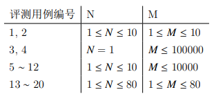

对于所有评测用例，0 ≤ 矩阵元素值, limit ≤ 10<sup>5</sup>。

---

### 2676 · 数组切分

> 题号 2676 ｜ 难度 困难 ｜ 时间 1s ｜ 内存 512MB
> 通过率 26.61% ｜ 题面原文 https://www.dotcpp.com/oj/problem2676.html
> 考过的语言/组别：Java 大学B组

#### 题目描述

已知一个长度为 N 的数组：A<sub>1</sub>, A<sub>2</sub>, A<sub>3</sub>, ...A<sub>N</sub> 恰好是 1 ∼ N 的一个排列。现在要求你将 A 数组切分成若干个 (最少一个，最多 N 个) 连续的子数组，并且每个子数组中包含的整数恰好可以组成一段连续的自然数。

例如对于 A = {1, 3, 2, 4}, 一共有 5 种切分方法：

{1}{3}{2}{4}：每个单独的数显然是 (长度为 1 的) **一段连续的自然数**。

{1}{3, 2}{4}：{3, 2} 包含 2 到 3，是 **一段连续的自然数**，另外 {1} 和 {4} 显然也是。

{1}{3, 2, 4}：{3, 2, 4} 包含 2 到 4，是 **一段连续的自然数**，另外 {1} 显然也是。

{1, 3, 2}{4}：{1, 3, 2} 包含 1 到 3，是 **一段连续的自然数**，另外 {4} 显然也是。

{1, 3, 2, 4}：只有一个子数组，包含 1 到 4，是 **一段连续的自然数**。

#### 输入格式

第一行包含一个整数 N。第二行包含 N 个整数，代表 A 数组。

#### 输出格式

输出一个整数表示答案。由于答案可能很大，所以输出其对 1000000007 取模后的值。

#### 样例输入

```
4

1 3 2 4
```

#### 提示

对于 30% 评测用例，1 ≤ N ≤ 20.

对于 100% 评测用例，1 ≤ N ≤ 10000.

---

### 2677 · 回忆迷宫

> 题号 2677 ｜ 难度 困难 ｜ 时间 1s ｜ 内存 512MB
> 通过率 14.05% ｜ 题面原文 https://www.dotcpp.com/oj/problem2677.html
> 考过的语言/组别：Java 大学B组

#### 题目描述

爱丽丝刚从一处地下迷宫中探险归来，你能根据她对于自己行动路径的回忆，帮她画出迷宫地图吗？

迷宫地图是基于二维网格的。爱丽丝会告诉你一系列她在迷宫中的移动步骤，每个移动步骤可能是上下左右四个方向中的一种，表示爱丽丝往这个方向走了一格。你需要根据这些移动步骤给出一个迷宫地图，并满足以下条件：

1、爱丽丝能在迷宫内的某个空地开始，顺利的走完她回忆的所有移动步骤。

2、迷宫内不存在爱丽丝没有走过的空地。

3、迷宫是封闭的，即可通过墙分隔迷宫内与迷宫外。任意方向的无穷远处视为迷宫外，所有不与迷宫外联通的空地都视为是迷宫内。（迷宫地图为四联通，即只有上下左右视为联通）

4、在满足前面三点的前提下，迷宫的墙的数量要尽可能少。

#### 输入格式

第一行一个正整数 N，表示爱丽丝回忆的步骤数量。

接下来一行 N 个英文字符，仅包含 UDLR 四种字符，分别表示上（Up）、下（Down）、左（Left）、右（Right）。

#### 输出格式

请通过字符画的形式输出迷宫地图。迷宫地图可能包含许多行，用字符 ‘*’

表示墙，用 ‘ ’（空格）表示非墙。

你的输出需要保证以下条件：

1、至少有一行第一个字符为 ‘*’。

2、第一行至少有一个字符为 ‘*’。

3、每一行的最后一个字符为 ‘*’。

4、最后一行至少有一个字符为 ‘*’。

#### 样例输入

```
17

UUUULLLLDDDDRRRRU
```

#### 提示

爱丽丝可以把第六行第六个字符作为起点。

外墙墙墙墙墙外

墙内内内内内墙

墙内墙墙墙内墙

墙内墙墙墙内墙

墙内墙墙墙内墙

墙内内内内内墙

外墙墙墙墙墙外

对于所有数据，0 < N ≤ 100.

---

### 2678 · 红绿灯

> 题号 2678 ｜ 难度 困难 ｜ 时间 1s ｜ 内存 512MB
> 通过率 20.34% ｜ 题面原文 https://www.dotcpp.com/oj/problem2678.html
> 考过的语言/组别：Java 大学B组

#### 题目描述

爱丽丝要开车去上班，上班的路上有许多红绿灯，这让爱丽丝很难过。为了上班不迟到，她给自己的车安装了氮气喷射装置。现在她想知道自己上班最短需要多少时间。

爱丽丝的车最高速度是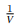米每秒，并且经过改装后，可以瞬间加速到小于等于最高速的任意速度，也可以瞬间停止。

爱丽丝家离公司有 N 米远，路上有 M 个红绿灯，第 i 个红绿灯位于离爱丽丝家 A<sub>i</sub> 米远的位置，绿灯持续 B<sub>i</sub> 秒，红灯持续 C<sub>i</sub> 秒。在初始时（爱丽丝开始计时的瞬间），所有红绿灯都恰好从红灯变为绿灯。如果爱丽丝在绿灯变红的瞬间到达红绿灯，她会停下车等红灯，因为她是遵纪守法的好市民。

氮气喷射装置可以让爱丽丝的车瞬间加速到超光速（且不受相对论效应的影响！），达到瞬移的效果，但是爱丽丝是遵纪守法的好市民，在每个红绿灯前她都会停下氮气喷射，即使是绿灯，因为红绿灯处有斑马线，而使用氮气喷射装置通过斑马线是违法的。此外，氮气喷射装置不能连续启动，需要一定时间的冷却，表现为通过 K 个红绿灯后才能再次使用。（也就是说，如果 K = 1，就能一直使用啦！）初始时，氮气喷射装置处于可用状态。

#### 输入格式

第一行四个正整数 N、M、K、V，含义如题面所述。

接下来 M 行，每行三个正整数 A<sub>i</sub>、B<sub>i</sub>、C<sub>i</sub>，含义如题面所述。

#### 输出格式

输出一个正整数 T，表示爱丽丝到达公司最短需要多少秒。

#### 样例输入

```
90 2 2 2

30 20 20

60 20 20
```

#### 提示

爱丽丝在最开始直接使用氮气喷射装置瞬间到达第一个红绿灯，然后绿灯通过，以最高速行进 60 秒后到达第二个红绿灯，此时绿灯刚好变红，于是她等待 20 秒再次变为绿灯后通过该红绿灯，此时氮气喷射装置冷却完毕，爱丽丝再次使用瞬间到达公司，总共用时 80 秒。

对于 30% 的数据，N ≤ 100; M ≤ 10; M < K; V = 1.

对于 60% 的数据，N ≤ 1000; M ≤ 100; K ≤ 50; B<sub>i</sub> ,C<sub>i</sub> ≤ 100; V ≤ 10.

对于 100% 的数据，0 < N ≤ 10<sup>8</sup> ; M ≤ 1000; K ≤ 1000; 0 < B<sub>i </sub>,C<sub>i</sub> ≤ 10<sup>6</sup> ; 0 <

V ≤ 10<sup>6</sup> ; 0 < A<sub>i</sub> < N; 对任意 i < j, 有 A<sub>i </sub>< A<sub>j</sub> .

---

### 2679 · 拉箱子

> 题号 2679 ｜ 难度 中等 ｜ 时间 1s ｜ 内存 1024MB
> 通过率 29.27% ｜ 题面原文 https://www.dotcpp.com/oj/problem2679.html
> 考过的语言/组别：Java 大学B组

#### 题目描述

推箱子是一款经典电子游戏，爱丽丝很喜欢玩，但是她有点玩腻了，现在她想设计一款拉箱子游戏。

拉箱子游戏需要玩家在一个 N × M 的网格地图中，控制小人上下左右移动，将箱子拉到终点以获得胜利。

现在爱丽丝想知道，在给定地形（即所有墙的位置）的情况下，有多少种不同的可解的初始局面。

【初始局面】 的定义如下：

1、初始局面由排列成 N × M 矩形网格状的各种元素组成，每个网格中有且只有一种元素。可能的元素有：空地、墙、小人、箱子、终点。

2、初始局面中有且只有一个小人。

3、初始局面中有且只有一个箱子。

4、初始局面中有且只有一个终点。

【可解】 的定义如下：

通过有限次数的移动小人（可以在移动的同时拉箱子），箱子能够到达终点所在的网格。

【移动】 的定义如下：

在一次移动中，小人可以移动到相邻（上、下、左、右四种选项）的一个网格中，前提是满足以下条件：

1、小人永远不能移动到 N × M 的网格外部。

2、小人永远不能移动到墙上或是箱子上。

3、小人可以移动到空地或是终点上。

【拉箱子】 的定义如下：

在一次合法移动的同时，如果小人初始所在网格沿小人移动方向的反方向上的相邻网格上恰好是箱子，小人可以拉动箱子一起移动，让箱子移动到小人初始所在网格。

即使满足条件，小人也可以只移动而不拉箱子。

#### 输入格式

第一行两个正整数 N 和 M，表示网格的大小。

接下来 N 行，每行 M 个由空格隔开的整数 0 或 1 描述给定的地形。其中

1 表示墙，0 表示未知的元素，未知元素可能是小人或箱子或空地或终点，但不能是墙。

#### 输出格式

输出一个正整数，表示可解的初始局面数量。

#### 样例输入

```
2 4

0 0 0 0

1 1 1 0
```

#### 提示

13 种可解的初始局面示意图如下：

人终箱空

墙墙墙空

********

人终空箱

墙墙墙空

********

人空终箱

墙墙墙空

********

箱人终空

墙墙墙空

********

空人终箱

墙墙墙空

********

箱终人空

墙墙墙空

********

空终人箱

墙墙墙空

********

箱终空人

墙墙墙空

********

箱空终人

墙墙墙空

********

空箱终人

墙墙墙空

********

箱终空空

墙墙墙人

********

箱空终空

墙墙墙人

********

空箱终空

墙墙墙人

对于 30% 的数据，N, M ≤ 3.

对于 100% 的数据，0 < N, M ≤ 10.

---

### 2680 · 纸张尺寸

> 题号 2680 ｜ 难度 简单 ｜ 时间 1s ｜ 内存 512MB
> 通过率 46.93% ｜ 题面原文 https://www.dotcpp.com/oj/problem2680.html
> 考过的语言/组别：Python 大学C组、Python 大学B组、Java 大学C组、C++ 大学C组

#### 题目描述

在 ISO 国际标准中定义了 A0 纸张的大小为 1189mm × 841mm，将 A0 纸沿长边对折后为 A1 纸，大小为 841mm × 594mm，在对折的过程中长度直接取下整（实际裁剪时可能有损耗）。将 A1 纸沿长边对折后为 A2 纸，依此类推。

输入纸张的名称，请输出纸张的大小。

#### 输入格式

输入一行包含一个字符串表示纸张的名称，该名称一定是 A0、A1、A2、A3、A4、A5、A6、A7、A8、A9 之一。

#### 输出格式

输出两行，每行包含一个整数，依次表示长边和短边的长度。

#### 样例输入

```
A0
```

#### 提示

零基础同学可以先学习视频课程，包含C/C++、Python、百练、蓝桥杯辅导、算法数据结构等课程，提供视频讲解以及配套习题，还有老师答疑，点击这里了解课程详情

---

### 2681 · 矩形拼接

> 题号 2681 ｜ 难度 困难 ｜ 时间 1s ｜ 内存 512MB
> 通过率 29.61% ｜ 题面原文 https://www.dotcpp.com/oj/problem2681.html
> 考过的语言/组别：Python 研究生组、Python 大学C组、Python 大学A组、Java 大学C组

#### 题目描述

已知 3 个矩形的大小依次是 a<sub>1</sub> × b<sub>1</sub>, a<sub>2</sub> × b<sub>2</sub> 和 a<sub>3</sub> × b<sub>3</sub>。用这 3 个矩形能拼出的所有多边形中，边数最少可以是多少？例如用 3 × 2 的矩形（用 A 表示）、4 × 1 的矩形（用 B 表示）和 2 × 4 的矩形（用 C 表示）可以拼出如下 4 边形。

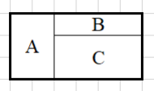

例如用 3 × 2 的矩形（用 A 表示）、3 × 1 的矩形（用 B 表示）和 1 × 1 的矩形（用 C 表示）可以拼出如下 6 边形。

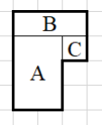

#### 输入格式

输入包含多组数据。

第一行包含一个整数 T，代表数据组数。

以下 T 行，每行包含 6 个整数 a<sub>1</sub>, b<sub>1</sub>, a<sub>2</sub>, b<sub>2</sub>, a<sub>3</sub>, b<sub>3</sub>，其中 a<sub>1</sub>, b<sub>1</sub> 是第一个矩形的边长，a<sub>2</sub>, b<sub>2</sub> 是第二个矩形的边长，a<sub>3</sub>, b<sub>3</sub> 是第三个矩形的边长。

#### 输出格式

对于每组数据，输出一个整数代表答案。

#### 样例输入

```
2

2 3 4 1 2 4

1 2 3 4 5 6
```

#### 提示

对于 10% 的评测用例，1 ≤ T ≤ 5，1 ≤ a<sub>1</sub>, b<sub>1</sub>, a<sub>2</sub>, b<sub>2</sub>, a<sub>3</sub>, b<sub>3</sub> ≤ 10，a<sub>1</sub> = a<sub>2</sub> =

a<sub>3</sub>。

对于 30% 的评测用例，1 ≤ T ≤ 5，1 ≤ a<sub>1</sub>, b<sub>1</sub>, a<sub>2</sub>, b<sub>2</sub>, a<sub>3</sub>, b<sub>3</sub> ≤ 10。

对于 60% 的评测用例，1 ≤ T ≤ 10，1 ≤ a<sub>1</sub>, b<sub>1</sub>, a<sub>2</sub>, b<sub>2</sub>, a<sub>3</sub>, b<sub>3</sub> ≤ 20。

对于所有评测用例，1 ≤ T ≤ 1000，1 ≤ a<sub>1</sub>, b<sub>1</sub>, a<sub>2</sub>, b<sub>2</sub>, a<sub>3</sub>, b<sub>3</sub> ≤ 100。

---

### 2682 · GCD

> 题号 2682 ｜ 难度 中等 ｜ 时间 1s ｜ 内存 512MB
> 通过率 26.28% ｜ 题面原文 https://www.dotcpp.com/oj/problem2682.html
> 考过的语言/组别：Python 大学C组、Java 大学C组、Java 大学A组、C++ 研究生组

#### 题目描述

给定两个不同的正整数 a, b，求一个正整数 k 使得 gcd(a + k, b + k) 尽可能大，其中 gcd(a, b) 表示 a 和 b 的最大公约数，如果存在多个 k，请输出所有满足条件的 k 中最小的那个。

#### 输入格式

输入一行包含两个正整数 a, b，用一个空格分隔。

#### 输出格式

输出一行包含一个正整数 k。

#### 样例输入

```
5 7
```

#### 提示

对于 20% 的评测用例，a < b ≤ 10<sup>5</sup> ；

对于 40% 的评测用例，a < b ≤ 10<sup>9</sup> ；

对于所有评测用例，1 ≤ a < b ≤ 10<sup>18</sup> 。

---

### 2683 · 因数平方和

> 题号 2683 ｜ 难度 困难 ｜ 时间 1s ｜ 内存 512MB
> 通过率 14.59% ｜ 题面原文 https://www.dotcpp.com/oj/problem2683.html
> 考过的语言/组别：Python 研究生组、Python 大学C组、Java 大学C组、Java 大学A组

#### 题目描述

记 f(x) 为 x 的所有因数的平方的和。例如：f(12) = 1<sup>2</sup> + 2<sup>2</sup> + 3<sup>2</sup> + 4<sup>2</sup> + 6<sup>2</sup> +

12<sup>2</sup>。

定义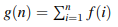。给定 n, 求 g(n) 除以 10<sup>9</sup> + 7 的余数。

#### 输入格式

输入一行包含一个正整数 n。

#### 输出格式

输出一个整数表示答案 g(n) 除以 10<sup>9</sup> + 7 的余数。

#### 样例输入

```
100000
```

#### 提示

对于 20% 的评测用例，n ≤ 10<sup>5</sup>。

对于 30% 的评测用例，n ≤ 10<sup>7</sup>。

对于所有评测用例，1 ≤ n ≤ 10<sup>9</sup>。

---

### 2684 · 数位排序

> 题号 2684 ｜ 难度 简单 ｜ 时间 1s ｜ 内存 512MB
> 通过率 37.42% ｜ 题面原文 https://www.dotcpp.com/oj/problem2684.html
> 考过的语言/组别：Python 大学C组、Python 大学B组、Java 研究生组、C++ 大学C组

#### 题目描述

小蓝对一个数的数位之和很感兴趣，今天他要按照数位之和给数排序。当两个数各个数位之和不同时，将数位和较小的排在前面，当数位之和相等时，将数值小的排在前面。

例如，2022 排在 409 前面，因为 2022 的数位之和是 6，小于 409 的数位之和 13。

又如，6 排在 2022 前面，因为它们的数位之和相同，而 6 小于 2022。

给定正整数 n，m，请问对 1 到 n 采用这种方法排序时，排在第 m 个的元素是多少？

#### 输入格式

输入第一行包含一个正整数 n。

第二行包含一个正整数 m。

#### 输出格式

输出一行包含一个整数，表示答案。

#### 样例输入

```
13

5
```

#### 提示

1 到 13 的排序为：1, 10, 2, 11, 3, 12, 4, 13, 5, 6, 7, 8, 9。第 5 个数为 3。

对于 30% 的评测用例，1 ≤ m ≤ n ≤ 300。

对于 50% 的评测用例，1 ≤ m ≤ n ≤ 1000。

对于所有评测用例，1 ≤ m ≤ n ≤ 10<sup>6</sup>。

---

### 2685 · 蜂巢

> 题号 2685 ｜ 难度 困难 ｜ 时间 1s ｜ 内存 512MB
> 通过率 26.95% ｜ 题面原文 https://www.dotcpp.com/oj/problem2685.html
> 考过的语言/组别：Python 大学C组、Python 大学B组、Java 研究生组、Java 大学A组

#### 题目描述

蜂巢由大量的六边形拼接而成，定义蜂巢中的方向为：0 表示正西方向，1

表示西偏北 60<sup>◦</sup>，2 表示东偏北 60<sup>◦</sup>，3 表示正东，4 表示东偏南 60<sup>◦</sup>，5 表示西偏南 60<sup>◦</sup>。

对于给定的一点 O，我们以 O 为原点定义坐标系，如果一个点 A 由 O 点先向 d 方向走 p 步再向 (d + 2) mod 6 方向（d 的顺时针 120<sup>◦</sup> 方向）走 q 步到达，则这个点的坐标定义为 (d, p, q)。在蜂窝中，一个点的坐标可能有多种。

下图给出了点 B(0, 5, 3) 和点 C(2, 3, 2) 的示意。

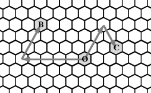

给定点 (d<sub>1</sub>, p<sub>1</sub>, q<sub>1</sub>) 和点 (d<sub>2</sub>, p<sub>2</sub>, q<sub>2</sub>)，请问他们之间最少走多少步可以到达？

#### 输入格式

输入一行包含 6 个整数 d<sub>1</sub>, p<sub>1</sub>, q<sub>1</sub>, d<sub>2</sub>, p<sub>2</sub>, q<sub>2</sub> 表示两个点的坐标，相邻两个整数之间使用一个空格分隔。

#### 输出格式

输出一行包含一个整数表示两点之间最少走多少步可以到达。

#### 样例输入

```
0 5 3 2 3 2
```

#### 提示

对于 25% 的评测用例，p<sub>1</sub>, p<sub>2</sub> ≤ 10<sup>3</sup> ；

对于 50% 的评测用例，p<sub>1</sub>, p<sub>2</sub> ≤ 10<sup>5</sup> ；

对于 75% 的评测用例，p<sub>1</sub>, p<sub>2</sub> ≤ 10<sup>7</sup> ；

对于所有评测用例，0 ≤ d<sub>1</sub>, d<sub>2</sub> ≤ 5，0 ≤ q<sub>1</sub> < p<sub>1</sub> ≤ 10<sup>9</sup>，0 ≤ q<sub>2</sub> < p<sub>2</sub> ≤ 10<sup>9</sup> 。

---

### 2686 · 消除游戏

> 题号 2686 ｜ 难度 困难 ｜ 时间 3s ｜ 内存 512MB
> 通过率 3.31% ｜ 题面原文 https://www.dotcpp.com/oj/problem2686.html
> 考过的语言/组别：Python 研究生组、Python 大学B组、Python 大学A组、C++ 大学C组

#### 题目描述

在一个字符串 S 中，如果 S <sub>i</sub> = S <sub>i−1</sub> 且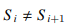，则称 S <sub>i</sub> 和 S<sub> i+1</sub> 为边缘字符。如果且 S<sub> i</sub> = S <sub>i+1</sub>，则 S <sub>i−1</sub> 和 S <sub>i</sub> 也称为边缘字符。其它的字符都不是边缘字符。

对于一个给定的串 S，一次操作可以一次性删除该串中的所有边缘字符（操作后可能产生新的边缘字符）。

请问经过 2<sup>64 </sup>次操作后，字符串 S 变成了怎样的字符串，如果结果为空则输出 EMPTY。

#### 输入格式

输入一行包含一个字符串 S 。

#### 输出格式

输出一行包含一个字符串表示答案，如果结果为空则输出 EMPTY。

#### 样例输入

```
edda
```

#### 提示

对于 25% 的评测用例，|S | ≤ 10<sup>3</sup> ，其中 |S | 表示 S 的长度；

对于 50% 的评测用例，|S | ≤ 10<sup>4</sup> ；

对于 75% 的评测用例，|S | ≤ 10<sup>5</sup> ；

对于所有评测用例，|S | ≤ 10<sup>6</sup>，S 中仅含小写字母。

---

### 2687 · 全排列的价值

> 题号 2687 ｜ 难度 困难 ｜ 时间 1s ｜ 内存 512MB
> 通过率 20.26% ｜ 题面原文 https://www.dotcpp.com/oj/problem2687.html
> 考过的语言/组别：Python 大学B组、Python 大学A组、Java 大学A组、C++ 研究生组

#### 题目描述

对于一个排列 A = (a<sub>1</sub>, a<sub>2</sub>, · · · , a<sub>n</sub>)，定义价值 c<sub>i</sub> 为 a<sub>1</sub> 至 a<sub>i−1</sub> 中小于 a<sub>i </sub>的数的个数，即 b<sub>i</sub> = |{a<sub>j</sub> | j < i, a<sub>j</sub> < a<sub>i</sub>}|。定义 A 的价值为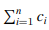。

给定 n，求 1 至 n 的全排列中所有排列的价值之和。

#### 输入格式

输入一行包含一个整数 n 。

#### 输出格式

输出一行包含一个整数表示答案，由于所有排列的价值之和可能很大，请输出这个数除以 998244353 的余数。

#### 样例输入

```
3
```

#### 提示

1 至 3 构成的所有排列的价值如下:

(1, 2, 3) : 0 + 1 + 2 = 3 ；

(1, 3, 2) : 0 + 1 + 1 = 2 ；

(2, 1, 3) : 0 + 0 + 2 = 2 ；

(2, 3, 1) : 0 + 1 + 0 = 1 ；

(3, 1, 2) : 0 + 0 + 1 = 1 ；

(3, 2, 1) : 0 + 0 + 0 = 0 ；

故总和为 3 + 2 + 2 + 1 + 1 = 9。

对于 40% 的评测用例，n ≤ 20 ；

对于 70% 的评测用例，n ≤ 5000 ；

对于所有评测用例，2 ≤ n ≤ 10<sup>6</sup> 。

---

### 2688 · 技能升级

> 题号 2688 ｜ 难度 困难 ｜ 时间 1s ｜ 内存 512MB
> 通过率 10.85% ｜ 题面原文 https://www.dotcpp.com/oj/problem2688.html
> 考过的语言/组别：Python 研究生组、Python 大学B组、Java 研究生组、C++ 大学C组

#### 题目描述

小蓝最近正在玩一款 RPG 游戏。他的角色一共有 N 个可以加攻击力的技能。其中第 i 个技能首次升级可以提升 A<sub>i</sub> 点攻击力，以后每次升级增加的点数都会减少 B<sub>i</sub>。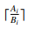(上取整) 次之后，再升级该技能将不会改变攻击力。

现在小蓝可以总计升级 M 次技能，他可以任意选择升级的技能和次数。请你计算小蓝最多可以提高多少点攻击力？

#### 输入格式

输入第一行包含两个整数 N 和 M。

以下 N 行每行包含两个整数 A<sub>i</sub> 和 B<sub>i</sub>。

#### 输出格式

输出一行包含一个整数表示答案。

#### 样例输入

```
3 6

10 5

9 2

8 1
```

#### 提示

对于 40% 的评测用例，1 ≤ N, M ≤ 1000；

对于 60% 的评测用例，1 ≤ N ≤ 10<sup>4</sup> , 1 ≤ M ≤ 10<sup>7</sup>；

对于所有评测用例，1 ≤ N ≤ 10<sup>5</sup>，1 ≤ M ≤ 2 × 10<sup>9</sup>，1 ≤ A<sub>i</sub> , B<sub>i</sub> ≤ 10<sup>6</sup>。

---

### 2689 · 最优清零方案

> 题号 2689 ｜ 难度 困难 ｜ 时间 3s ｜ 内存 512MB
> 通过率 12.52% ｜ 题面原文 https://www.dotcpp.com/oj/problem2689.html
> 考过的语言/组别：Python 大学B组、Python 大学A组、Java 研究生组、Java 大学A组

#### 题目描述

给定一个长度为 N 的数列 A<sub>1</sub>, A<sub>2</sub>, · · · , A<sub>N</sub>。现在小蓝想通过若干次操作将这个数列中每个数字清零。

每次操作小蓝可以选择以下两种之一：

1. 选择一个大于 0 的整数，将它减去 1；

2. 选择连续 K 个大于 0 的整数，将它们各减去 1。

小蓝最少经过几次操作可以将整个数列清零？

#### 输入格式

输入第一行包含两个整数 N 和 K。

第二行包含 N 个整数 A<sub>1</sub>, A<sub>2</sub>, · · · , A<sub>N</sub>。

#### 输出格式

输出一个整数表示答案。

#### 样例输入

```
4 2

1 2 3 4
```

#### 提示

对于 20% 的评测用例，1 ≤ K ≤ N ≤ 10。

对于 40% 的评测用例，1 ≤ K ≤ N ≤ 100。

对于 50% 的评测用例，1 ≤ K ≤ N ≤ 1000。

对于 60% 的评测用例，1 ≤ K ≤ N ≤ 10000。

对于 70% 的评测用例，1 ≤ K ≤ N ≤ 100000。

对于所有评测用例，1 ≤ K ≤ N ≤ 1000000, 0 ≤ A<sub>i</sub> ≤ 1000000。

---

### 2690 · 重新排序

> 题号 2690 ｜ 难度 困难 ｜ 时间 1s ｜ 内存 256MB
> 通过率 21.58% ｜ 题面原文 https://www.dotcpp.com/oj/problem2690.html
> 考过的语言/组别：Python 大学C组、Python 大学A组、Java 研究生组、C++ 大学C组

#### 题目描述

给定一个数组 A 和一些查询 L<sub>i </sub>, R<sub>i</sub>，求数组中第 L<sub>i </sub>至第 R<sub>i </sub>个元素之和。

小蓝觉得这个问题很无聊，于是他想重新排列一下数组，使得最终每个查询结果的和尽可能地大。小蓝想知道相比原数组，所有查询结果的总和最多可以增加多少?

#### 输入格式

输入第一行包含一个整数 n。

第二行包含 n 个整数 A<sub>1</sub>, A<sub>2</sub>, · · · , A<sub>n</sub>，相邻两个整数之间用一个空格分隔。

第三行包含一个整数 m 表示查询的数目。

接下来 m 行，每行包含两个整数 L<sub>i</sub>、R<sub>i</sub> ，相邻两个整数之间用一个空格分隔。

#### 输出格式

输出一行包含一个整数表示答案。

#### 样例输入

```
5

1 2 3 4 5

2

1 3

2 5
```

#### 提示

原来的和为 6 + 14 = 20，重新排列为 (1, 4, 5, 2, 3) 后和为 10 + 14 = 24，增加了 4。

对于 30% 的评测用例，n, m ≤ 50 ；

对于 50% 的评测用例，n, m ≤ 500 ；

对于 70% 的评测用例，n, m ≤ 5000 ；

对于所有评测用例，1 ≤ n, m ≤ 10<sup>5</sup>，1 ≤ A<sub>i </sub>≤ 10<sup>6</sup>，1 ≤ L<sub>i</sub> ≤ R<sub>i </sub>≤ 10<sup>6</sup> 。

---

### 2691 · 重复的数

> 题号 2691 ｜ 难度 困难 ｜ 时间 1s ｜ 内存 256MB
> 通过率 17.41% ｜ 题面原文 https://www.dotcpp.com/oj/problem2691.html
> 考过的语言/组别：C++ 研究生组、C++ 大学C组

#### 题目描述

给定一个数列 A = (a<sub>1</sub>, a<sub>2</sub>, · · · , a<sub>n</sub>)，给出若干询问，每次询问某个区间 [l<sub>i</sub> ,r<sub>i</sub> ]

内恰好出现 k<sub>i</sub> 次的数有多少个。

#### 输入格式

输入第一行包含一个整数 n 表示数列长度。

第二行包含 n 个整数 a<sub>1</sub>, a<sub>2</sub>, · · · , a<sub>n</sub>，表示数列中的数。

第三行包含一个整数 m 表示询问次数。

接下来 m 行描述询问，其中第 i 行包含三个整数 l<sub>i</sub> ,r<sub>i</sub> , k<sub>i</sub> 表示询问 [l<sub>i</sub> ,r<sub>i</sub> ] 区间内有多少数出现了 k<sub>i</sub> 次。

#### 输出格式

输出 m 行，分别对应每个询问的答案。

#### 样例输入

```
3

1 2 2

5

1 1 1

1 1 2

1 2 1

1 2 2

1 3 2
```

#### 提示

对于 20% 的评测用例，n, m ≤ 500, 1 ≤ a<sub>1</sub>, a<sub>2</sub>, · · · , a<sub>n</sub> ≤ 1000；

对于 40% 的评测用例，n, m ≤ 5000；

对于所有评测用例，1 ≤ n, m ≤ 100000, 1 ≤ a<sub>1</sub>, a<sub>2</sub>, · · · , a<sub>n</sub> ≤ 100000, 1 ≤ l<sub>i</sub> ≤

r<sub>i</sub> ≤ n, 1 ≤ k<sub>i</sub> ≤ n。

---

### 2692 · 质因数个数

> 题号 2692 ｜ 难度 困难 ｜ 时间 2s ｜ 内存 256MB
> 通过率 12.54% ｜ 题面原文 https://www.dotcpp.com/oj/problem2692.html
> 考过的语言/组别：Python 研究生组、Python 大学A组、Java 研究生组、C++ 研究生组

#### 题目描述

给定正整数 n，请问有多少个质数是 n 的约数。

#### 输入格式

输入的第一行包含一个整数 n。

#### 输出格式

输出一个整数，表示 n 的质数约数个数。

#### 样例输入

```
396
```

#### 提示

396 有 2, 3, 11 三个质数约数。

对于 30% 的评测用例，1 ≤ n ≤ 10000。

对于 60% 的评测用例，1 ≤ n ≤ 10<sup>9</sup>。

对于所有评测用例，1 ≤ n ≤ 10<sup>16</sup>。

---

### 2693 · 卡牌

> 题号 2693 ｜ 难度 困难 ｜ 时间 1s ｜ 内存 256MB
> 通过率 15.00% ｜ 题面原文 https://www.dotcpp.com/oj/problem2693.html
> 考过的语言/组别：C++ 大学B组

#### 题目描述

这天，小明在整理他的卡牌。

他一共有 n 种卡牌，第 i 种卡牌上印有正整数数 i(i ∈ [1, n])，且第 i 种卡牌

现有 a<sub>i</sub> 张。

而如果有 n 张卡牌，其中每种卡牌各一张，那么这 n 张卡牌可以被称为一

套牌。小明为了凑出尽可能多套牌，拿出了 m 张空白牌，他可以在上面写上数

i，将其当做第 i 种牌来凑出套牌。然而小明觉得手写的牌不太美观，决定第 i

种牌最多手写 b<sub>i</sub> 张。

请问小明最多能凑出多少套牌？

#### 输入格式

输入共 3 行，第一行为两个正整数 n, m。

第二行为 n 个正整数 a<sub>1</sub>, a<sub>2</sub>, ..., a<sub>n</sub>。

第三行为 n 个正整数 b<sub>1</sub>, b<sub>2</sub>, ..., b<sub>n</sub>。

#### 输出格式

一行，一个整数表示答案。

#### 样例输入

```
4 5

1 2 3 4

5 5 5 5
```

#### 提示

这 5 张空白牌中，拿 2 张写 1，拿 1 张写 2，这样每种牌的牌数就变为了

3, 3, 3, 4，可以凑出 3 套牌，剩下 2 张空白牌不能再帮助小明凑出一套。

对于 30% 的数据，保证 n ≤ 2000 ；

对于 100% 的数据，保证 n ≤ 2 × 10<sup>5</sup> ; a<sub>i</sub> , b<sub>i</sub> ≤ 2n; m ≤ n<sup>2</sup> 。

---

### 2694 · 最大数字

> 题号 2694 ｜ 难度 困难 ｜ 时间 1s ｜ 内存 256MB
> 通过率 22.49% ｜ 题面原文 https://www.dotcpp.com/oj/problem2694.html
> 考过的语言/组别：C++ 大学B组

#### 题目描述

给定一个正整数 N。你可以对 N 的任意一位数字执行任意次以下 2 种操作：

1. 将该位数字加 1。如果该位数字已经是 9，加 1 之后变成 0。

2. 将该位数字减 1。如果该位数字已经是 0，减 1 之后变成 9。

你现在总共可以执行 1 号操作不超过 A 次，2 号操作不超过 B 次。

请问你最大可以将 N 变成多少？

#### 输入格式

第一行包含 3 个整数：N, A, B。

#### 输出格式

一个整数代表答案。

#### 样例输入

```
123 1 2
```

#### 提示

对百位数字执行 2 次 2 号操作，对十位数字执行 1 次 1 号操作。

对于 30% 的数据，1 ≤ N ≤ 100; 0 ≤ A, B ≤ 10

对于 100% 的数据，1 ≤ N ≤ 10<sup>17</sup>; 0 ≤ A, B ≤ 100

---

### 2695 · 出差

> 题号 2695 ｜ 难度 中等 ｜ 时间 1s ｜ 内存 256MB
> 通过率 26.00% ｜ 题面原文 https://www.dotcpp.com/oj/problem2695.html
> 考过的语言/组别：C++ 大学B组

#### 题目描述

A 国有 N 个城市，编号为 1 . . . N。小明是编号为 1 的城市中一家公司的员工，今天突然接到了上级通知需要去编号为 N 的城市出差。

由于疫情原因，很多直达的交通方式暂时关闭，小明无法乘坐飞机直接从城市 1 到达城市 N，需要通过其他城市进行陆路交通中转。小明通过交通信息网，查询到了 M 条城市之间仍然还开通的路线信息以及每一条路线需要花费的时间。

同样由于疫情原因，小明到达一个城市后需要隔离观察一段时间才能离开该城市前往其他城市。通过网络，小明也查询到了各个城市的隔离信息。（由于小明之前在城市 1，因此可以直接离开城市 1，不需要隔离）

由于上级要求，小明希望能够尽快赶到城市 N，因此他求助于你，希望你能帮他规划一条路线，能够在最短时间内到达城市 N。

#### 输入格式

第 1 行：两个正整数 N, M, N 表示 A 国的城市数量，M 表示未关闭的路线数量

第 2 行：N 个正整数，第 i 个整数 C<sub>i</sub> 表示到达编号为 i 的城市后需要隔离的时间

第 3 . . . M + 2 行：每行 3 个正整数，u, v, c，表示有一条城市 u 到城市 v 的双向路线仍然开通着，通过该路线的时间为 c

#### 输出格式

第 1 行：1 个正整数，表示小明从城市 1 出发到达城市 N 的最短时间（到达城市 N，不需要计算城市 N 的隔离时间）

#### 样例输入

```
4 4

5 7 3 4

1 2 4

1 3 5

2 4 3

3 4 5
```

#### 提示

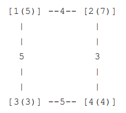

路线 1：1 -> 2 -> 4，时间为 4+7(隔离)+3=14

路线 2：1 -> 3 -> 4，时间为 5+3(隔离)+5=13

对于 100% 的数据，1 ≤ N ≤ 1000 , 1 ≤ M ≤ 10000, 1 ≤ C<sub>i</sub> ≤ 200, 1 ≤ u, v ≤

N, 1 ≤ c ≤ 1000

---

### 2696 · 费用报销

> 题号 2696 ｜ 难度 困难 ｜ 时间 1s ｜ 内存 256MB
> 通过率 18.28% ｜ 题面原文 https://www.dotcpp.com/oj/problem2696.html
> 考过的语言/组别：C++ 大学B组

#### 题目描述

小明在出差结束后返回了公司所在的城市，在填写差旅报销申请时，粗心的小明发现自己弄丢了出差过程中的票据。

为了弥补小明的损失，公司同意小明用别的票据进行报销，但是公司财务要求小明提交的票据中任意两张的日期差不小于 K 天，且总金额不得超过实际差旅费用 M。

比如财务要求 K = 7 时，若小明提交了一张 1 月 8 日的票据，小明就不能提交 1 月 2 日至 1 月 14 日之间的其他票据，1 月 1 日及之前和 1 月 15 日及之后的票据则可以提交。

公司的同事们一起给小明凑了 N 张票据，小明现在想要请你帮他整理一下，从中选取出符合财务要求的票据，并使总金额尽可能接近 M。

需要注意，由于这些票据都是同一年的，因此 12 月底的票据不会影响到 1

月初票据的提交。这一年不是闰年。

#### 输入格式

第 1 行：3 个整数，N, M, K

第 2 . . . N + 1 行：每行 3 个整数 m<sub>i</sub> , d<sub>i</sub> , v<sub>i</sub>，第 i + 1 行表示第 i 张票据时间的月份 m<sub>i</sub> 和日期 d<sub>i</sub>，v<sub>i</sub> 表示该票据的面值

#### 输出格式

第 1 行：1 个整数，表示小明能够凑出的最大报销金额

#### 样例输入

```
4 16 3

1 1 1

1 3 2

1 4 4

1 6 8
```

#### 提示

选择 1 月 3 日和 1 月 6 日的票据

对于 100% 的评测用例，1 ≤ N ≤ 1000, 1 ≤ M ≤ 5000, 1 ≤ K ≤ 50, 1 ≤ m<sub>i</sub> ≤

12, 1 ≤ d<sub>i</sub> ≤ 31, 1 ≤ v<sub>i</sub> ≤ 400

日期保证合法。

---

### 2697 · 故障

> 题号 2697 ｜ 难度 中等 ｜ 时间 1s ｜ 内存 256MB
> 通过率 30.35% ｜ 题面原文 https://www.dotcpp.com/oj/problem2697.html
> 考过的语言/组别：C++ 大学B组

#### 题目描述

在软件或系统开发中，我们会遇到各种各样的故障。为了从故障现象反推故障原因，工程师们会总结一种叫做相关性矩阵的二维表格，来表示故障原因与故障现象之间的关系。比如：

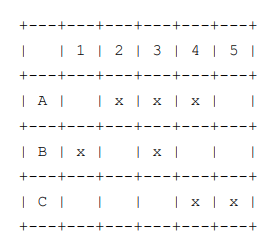

其中每行表示一种故障原因，每一列表示一种故障现象。该矩阵表示故障原因 A 可能产生故障现象 2、3、4，故障原因 B 可能产生故障现象 1、3。

在实际开发过程中，如果出现了故障原因，工程师就可以根据故障现象，去计算每种故障原因产生的概率，并按照概率大小对故障原因进行排查，以达到快速定位故障原因的目的。

现在，我们假设系统开发中同一时间只会出现一种故障原因，并且故障原因引起各故障现象是独立事件。举个例子来说：

假设系统现在发生了故障原因 A，有 1/3 的概率出现故障现象 2，有 1/4 的概率出现故障现象 3，有 1/2 的概率出现故障现象 4。由于 3 种现象是独立发生的，因此有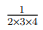的概率同时出现故障 2、3、4。

约定若相关性矩阵中没有 ‘x’ 记号，则表示该故障原因一定不会产生某故障现象，比如故障原因 A，一定不会产生故障现象 1。

根据历史经验数据，我们统计得到了每一种故障原因出现的概率以及每一

种故障原因对应的故障现象产生概率。

现在已知系统出现的故障现象，求问各个故障原因发生的概率。

#### 输入格式

第 1 行：2 个正整数 N, M，N 表示故障原因的个数（编号 1 . . . N），M 表示故障现象的个数（编号 1 . . . M）.

第 2 行：N 个整数，第 i 个数表示故障原因 i 产生的概率 P<sub>i </sub>.

第 3 . . . N + 2 行：每行 M 个整数，第 i + 2 行第 j 个整数 P<sub>ij</sub> 表示故障原因 i 出现故障现象 j 的概率（百分比）.

第 N + 3 行：1 个正整数 K，表示目前出现的故障现象数量。

第 N + 4 行：K 个正整数，依次为当前出现的故障现象编号，不会重复。

#### 输出格式

第 1 . . . N 行：按概率从高到低输出每种故障原因及其可能的概率，若出现概率相同则优先输出编号小的故障原因。第 1 个数为故障原因编号，第 2 个数为故障概率（百分比），保留 2 位小数。

#### 样例输入

```
3 5

30 20 50

0 50 33 25 0

30 0 35 0 0

0 0 0 25 60

1

3
```

#### 提示

对于所有测试用例，1 ≤ N ≤ 40, 1 ≤ M ≤ 20, 0 ≤ P<sub>i</sub> ≤ 100, ∑

(P<sub>i</sub>) = 100, 0 ≤ P<sub>ij</sub> ≤ 100.

---

### 2698 · 机房

> 题号 2698 ｜ 难度 困难 ｜ 时间 1s ｜ 内存 256MB
> 通过率 20.71% ｜ 题面原文 https://www.dotcpp.com/oj/problem2698.html
> 考过的语言/组别：C++ 大学B组

#### 题目描述

这天，小明在机房学习。

他发现机房里一共有 n 台电脑，编号为 1 到 n，电脑和电脑之间有网线连接，一共有 n − 1 根网线将 n 台电脑连接起来使得任意两台电脑都直接或者间接地相连。

小明发现每台电脑转发、发送或者接受信息需要的时间取决于这台电脑和多少台电脑直接相连，而信息在网线中的传播时间可以忽略。比如如果某台电脑用网线直接连接了另外 d 台电脑，那么任何经过这台电脑的信息都会延迟 d 单位时间 (发送方和接收方也会产生这样的延迟，当然如果发送方和接收方都是同一台电脑就只会产生一次延迟)。

小明一共产生了 m 个疑问：如果电脑 u<sub>i</sub> 向电脑 v<sub>i</sub> 发送信息，那么信息从

u<sub>i</sub> 传到 v<sub>i</sub> 的最短时间是多少？

#### 输入格式

输入共 n + m 行，第一行为两个正整数 n, m。

后面 n − 1 行，每行两个正整数 x, y 表示编号为 x 和 y 的两台电脑用网线直接相连。

后面 m 行，每行两个正整数 u<sub>i </sub>, v<sub>i</sub> 表示小明的第 i 个疑问。

#### 输出格式

输出共 m 行，第 i 行一个正整数表示小明第 i 个疑问的答案。

#### 样例输入

```
4 3

1 2

1 3

2 4

2 3

3 4

3 3
```

#### 提示

这四台电脑各自的延迟分别为 2, 2, 1, 1。

对于第一个询问，从 2 到 3 需要经过 2, 1, 3，所以时间和为 2 + 2 + 1 = 5。

对于第二个询问，从 3 到 4 需要经过 3, 1, 2, 4，所以时间和为 1+2+2+1 =

6。

对于第三个询问，从 3 到 3 只会产生一次延迟，所以时间为 1。

对于 30% 的数据，保证 n, m ≤ 1000；

对于 100% 的数据，保证 n, m ≤ 100000 。

---

### 2699 · 齿轮

> 题号 2699 ｜ 难度 困难 ｜ 时间 1s ｜ 内存 256MB
> 通过率 24.10% ｜ 题面原文 https://www.dotcpp.com/oj/problem2699.html
> 考过的语言/组别：C++ 大学B组

#### 题目描述

这天，小明在组装齿轮。

他一共有 n 个齿轮，第 i 个齿轮的半径为 r<sub>i</sub>，他需要把这 n 个齿轮按一定顺序从左到右组装起来，这样最左边的齿轮转起来之后，可以传递到最右边的齿轮，并且这些齿轮能够起到提升或者降低转速 (角速度) 的作用。

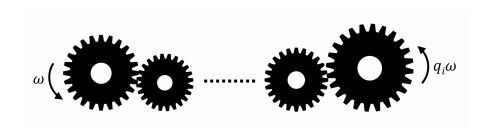

小明看着这些齿轮，突然有 Q 个疑问：能否按一定顺序组装这些齿轮使得最右边的齿轮的转速是最左边的齿轮的 q<sub>i</sub> 倍？

#### 输入格式

输入共 Q + 2 行，第一行为两个正整数 n, Q，表示齿轮数量和询问数量。

第二行为 n 个正整数 r<sub>1</sub>,r<sub>2</sub>, ...,r<sub>n</sub>，表示每个齿轮的半径。

后面 Q 行，每行一个正整数 q<sub>i</sub> 表示询问。

#### 输出格式

Q 行，对于每个询问，如果存在至少一种组装方案满足条件，输出 ‘YES‘，否则输出 ‘NO‘。

#### 样例输入

```
5 3

4 2 3 3 1

2

4

6
```

#### 提示

询问 1 方案之一：2 3 3 4 1 。

询问 2 方案之一：4 2 3 3 1 。

询问 3 没有方案。

对于 15% 的数据，保证 n, Q ≤ 100 ；

对于 30% 的数据，保证 n, Q ≤ 2000 ；

对于 100% 的数据，保证 n, Q ≤ 2 × 10<sup>5</sup> ; r<sub>i</sub> , q<sub>i</sub> ≤ 2 × 10<sup>5</sup> 。

---

### 2700 · 搬砖

> 题号 2700 ｜ 难度 困难 ｜ 时间 1s ｜ 内存 256MB
> 通过率 24.95% ｜ 题面原文 https://www.dotcpp.com/oj/problem2700.html
> 考过的语言/组别：C++ 大学B组

#### 题目描述

这天，小明在搬砖。

他一共有 n 块砖，他发现第 i 砖的重量为 w<sub>i</sub>，价值为 v<sub>i</sub>。他突然想从这些砖中选一些出来从下到上堆成一座塔，并且对于塔中的每一块砖来说，它上面所有砖的重量和不能超过它自身的价值。

他想知道这样堆成的塔的总价值（即塔中所有砖块的价值和）最大是多少。

#### 输入格式

输入共 n + 1 行，第一行为一个正整数 n，表示砖块的数量。

后面 n 行，每行两个正整数 w<sub>i</sub> , v<sub>i </sub>分别表示每块砖的重量和价值。

#### 输出格式

一行，一个整数表示答案。

#### 样例输入

```
5

4 4

1 1

5 2

5 5

4 3
```

#### 提示

选择第 1、2、4 块砖，从上到下按照 2、1、4 的顺序堆成一座塔，总价值为 4 + 1 + 5 = 10 。

对于 20% 的数据，保证 n ≤ 10；

对于 100% 的数据，保证 n ≤ 1000; w<sub>i</sub> ≤ 20; v<sub>i</sub> ≤ 20000 。

---

### 2701 · 取模（C/C++/Java组）

> 题号 2701 ｜ 难度 困难 ｜ 时间 1s ｜ 内存 256MB
> 通过率 19.72% ｜ 题面原文 https://www.dotcpp.com/oj/problem2701.html
> 考过的语言/组别：Java 大学C组、C++ 大学C组

#### 题目描述

给定 n, m ，问是否存在两个不同的数 x, y 使得 1 ≤ x < y ≤ m 且 n mod x =

n mod y 。

#### 输入格式

输入包含多组独立的询问。

第一行包含一个整数 T 表示询问的组数。

接下来 T 行每行包含两个整数 n, m，用一个空格分隔，表示一组询问。

#### 输出格式

输出 T 行，每行依次对应一组询问的结果。如果存在，输出单词 Yes；如果不存在，输出单词 No。

#### 样例输入

```
3

1 2

5 2

999 99
```

#### 提示

对于 20% 的评测用例，T ≤ 100 ，n, m ≤ 1000；

对于 50% 的评测用例，T ≤ 10000 ，n, m ≤ 10<sup>5</sup>；

对于所有评测用例，1 ≤ T ≤ 10<sup>5</sup> ，1 ≤ n ≤ 10<sup>9</sup> ，2 ≤ m ≤ 10<sup>9</sup>。

本试题适用于用c/c++/java代码来完成，如用Python代码出现时间超限问题建议转到：https://www.dotcpp.com/oj/problem2735.html链接

---

### 2702 · 内存空间（C/C++/Java组）

> 题号 2702 ｜ 难度 困难 ｜ 时间 1s ｜ 内存 256MB
> 通过率 19.01% ｜ 题面原文 https://www.dotcpp.com/oj/problem2702.html
> 考过的语言/组别：Java 大学C组、Java 大学A组、C++ 大学C组、C++ 大学A组

#### 题目描述

小蓝最近总喜欢计算自己的代码中定义的变量占用了多少内存空间。

为了简化问题，变量的类型只有以下三种：

int：整型变量，一个 int 型变量占用 4 Byte 的内存空间。

long：长整型变量，一个 long 型变量占用 8 Byte 的内存空间。

String：字符串变量，占用空间和字符串长度有关，设字符串长度为 L，则字符串占用 L Byte 的内存空间，如果字符串长度为 0 则占用 0 Byte 的内存空间。

定义变量的语句只有两种形式，第一种形式为：

type var1=value1,var2=value2…;

定义了若干个 type 类型变量 var1、var2…，并且用 value1、value2

…初始化，

多个变量之间用’,’ 分隔，语句以’;’ 结尾，type 可能是 int、long 或

String。例如 int a=1,b=5,c=6; 占用空间为 12 Byte；long a=1,b=5;

占用空间为 16 Byte；String s1=””,s2=”hello”,s3=”world”; 占用空间为 10 Byte。

第二种形式为：

type[] arr1=new type[size1],arr2=new type[size2]…;

定义了若干 type 类型的一维数组变量 arr1、arr2…，且数组的大小为

size1、size2…，多个变量之间用’,’ 进行分隔，语句以’;’ 结尾，type 只可能是 int 或 long。例如 int[] a1=new int[10]; 占用的内存空间为 40 Byte；long[] a1=new long[10],a2=new long[10]; 占用的内存空间为

160 Byte。

已知小蓝有 T 条定义变量的语句，请你帮他统计下一共占用了多少内存空间。结果的表示方式为：aGBbMBcKBdB，其中 a、b、c、d 为统计的结果，GB、MB、KB、B 为单位。优先用大的单位来表示，1GB=1024MB，

1MB=1024KB，1KB=1024B，其中 B 表示 Byte。如果 a、b、c、d 中的某几个数字为 0，那么不必输出这几个数字及其单位。题目保证一行中只有一句定义变量的语句，且每条语句都满足题干中描述的定义格式，所有的变量名都是合法的且均不重复。题目中的数据很规整，和上述给出的例子类似，除了类型后面有一个空格，以及定义数组时 new 后面的一个空格之外，不会出现多余的空格。

#### 输入格式

输入的第一行包含一个整数 T ，表示有 T 句变量定义的语句。

接下来 T 行，每行包含一句变量定义语句。

#### 输出格式

输出一行包含一个字符串，表示所有语句所占用空间的总大小。

#### 样例输入

```
1

long[] nums=new long[131072];
```

#### 提示

样例 1，占用的空间为 131072 × 8 = 1048576 B，换算过后正好是 1MB，其它三个单位 GB、KB、B 前面的数字都为 0 ，所以不用输出。

样例 2，占用的空间为 4 × 2 + 8 × 2 + 10 + 8 × 100000 × 2 B，换算后是

1MB538KB546B。

对于所有评测用例，1 ≤ T ≤ 10，每条变量定义语句的长度不会超过 1000

。所有的变量名称长度不会超过 10，且都由小写字母和数字组成。对于整型变量，初始化的值均是在其表示范围内的十进制整数，初始化的值不会是变量。

对于 String 类型的变量，初始化的内容长度不会超过 50，且内容仅包含小写字母和数字，初始化的值不会是变量。对于数组类型变量，数组的长度为一个

整数，范围为：[0, 2<sup>30</sup>]，数组的长度不会是变量。T 条语句定义的变量所占的内存空间总大小不会超过 1 GB，且大于 0 B。

本试题适用于用c/c++/java代码来完成，如用Python代码出现时间超限问题建议转到：https://www.dotcpp.com/oj/problem2736.html链接

---

### 2703 · 斐波那契数组（C/C++/Java组）

> 题号 2703 ｜ 难度 困难 ｜ 时间 1s ｜ 内存 256MB
> 通过率 19.52% ｜ 题面原文 https://www.dotcpp.com/oj/problem2703.html
> 考过的语言/组别：Java 研究生组、Java 大学C组、Java 大学A组、C++ 大学C组

#### 题目描述

如果数组 A = (a<sub>0</sub>, a<sub>1</sub>, · · · , a<sub>n−1</sub>) 满足以下条件，就说它是一个斐波那契数组：

1. n ≥ 2；

2. a<sub>0</sub> = a<sub>1</sub>；

3. 对于所有的 i(i ≥ 2)，都满足 a<sub>i</sub> = a<sub>i−1</sub> + a<sub>i−2</sub>。

现在，给出一个数组 A ，你可以执行任意次修改，每次修改将数组中的某个位置的元素修改为一个大于 0 的整数。请问最少修改几个元素之后，数组 A

会变成一个斐波那契数组。

#### 输入格式

输入的第一行包含一个整数 n ，表示数组 A 中的元素个数。

第二行包含 n 个整数 a<sub>0</sub>, a<sub>1</sub>, · · · , a<sub>n−1</sub>，相邻两个整数之间用一个空格分隔。

#### 输出格式

输出一行包含一个整数表示最少需要修改数组 A 中的几个元素之后，数组

A 可以变为一个斐波那契数组。

#### 样例输入

```
5

1 2 2 4 8
```

#### 提示

将原数组修改为 (1, 1, 2, 3, 5)，最少修改三个元素变成了一个斐波那契数组。

对于所有评测用例，2 ≤ n ≤ 10<sup>5 </sup>，1 ≤ a<sub>i</sub> ≤ 10<sup>6</sup>。

---

### 2704 · 近似 GCD（C/C++组）

> 题号 2704 ｜ 难度 困难 ｜ 时间 1s ｜ 内存 256MB
> 通过率 24.57% ｜ 题面原文 https://www.dotcpp.com/oj/problem2704.html
> 考过的语言/组别：C++ 研究生组、C++ 大学C组

#### 题目描述

小蓝有一个长度为 n 的数组 A = (a<sub>1</sub>, a<sub>2</sub>, · · · , a<sub>n</sub>)，数组的子数组被定义为从原数组中选出连续的一个或多个元素组成的数组。数组的最大公约数指的是数组中所有元素的最大公约数。如果最多更改数组中的一个元素之后，数组的最大公约数为 g，那么称 g 为这个数组的近似 GCD。一个数组的近似 GCD 可能有多种取值。

具体的，判断 g 是否为一个子数组的近似 GCD 如下：

1. 如果这个子数组的最大公约数就是 g，那么说明 g 是其近似 GCD。

2. 在修改这个子数组中的一个元素之后（可以改成想要的任何值），子数组的最大公约数为 g，那么说明 g 是这个子数组的近似 GCD。

小蓝想知道，数组 A 有多少个长度大于等于 2 的子数组满足近似 GCD 的值为 g。

#### 输入格式

输入的第一行包含两个整数 n, g，用一个空格分隔，分别表示数组 A 的长度和 g 的值。

第二行包含 n 个整数 a<sub>1</sub>, a<sub>2</sub>, · · · , a<sub>n</sub>，相邻两个整数之间用一个空格分隔。

#### 输出格式

输出一行包含一个整数表示数组 A 有多少个长度大于等于 2 的子数组的近似 GCD 的值为 g 。

#### 样例输入

```
5 3

1 3 6 4 10
```

#### 提示

满足条件的子数组有 5 个：

[1, 3]：将 1 修改为 3 后，这个子数组的最大公约数为 3 ，满足条件。

[1, 3, 6]：将 1 修改为 3 后，这个子数组的最大公约数为 3 ，满足条件。

[3, 6]：这个子数组的最大公约数就是 3 ，满足条件。

[3, 6, 4]：将 4 修改为 3 后，这个子数组的最大公约数为 3 ，满足条件。

[6, 4]：将 4 修改为 3 后，这个子数组的最大公约数为 3，满足条件。

对于 20% 的评测用例，2 ≤ n ≤ 10<sup>2</sup> ；

对于 40% 的评测用例，2 ≤ n ≤ 10<sup>3</sup>；

对于所有评测用例，2 ≤ n ≤ 10<sup>5</sup> , 1 ≤ g, a<sub>i</sub> ≤ 10<sup>9</sup>。

---

### 2705 · 数组个数（C/C++/Java组）

> 题号 2705 ｜ 难度 困难 ｜ 时间 1s ｜ 内存 256MB
> 通过率 21.05% ｜ 题面原文 https://www.dotcpp.com/oj/problem2705.html
> 考过的语言/组别：Java 大学A组、C++ 大学C组

#### 题目描述

小蓝有一个长度为 n 的数组 B = (b<sub>0</sub>, b<sub>1</sub>, · · · , b<sub>n−1</sub>)，数组 B 是由另一个长度为 n 的环形数组 A = (a<sub>0</sub>, a<sub>1</sub>, · · · , a<sub>n−1</sub>) 经过一次相邻最大化操作得到的，其中 a<sub>i</sub> 与 a<sub>i+1</sub> 相邻，a<sub>0</sub> 与 a<sub>n−1</sub> 相邻。

形式化描述为：

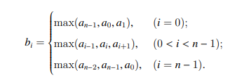

小蓝想知道，可能有多少个满足条件的数组 A，经过一次相邻最大化操作后能得到数组 B，注意 A 中的每个元素都要求为非负整数。

#### 输入格式

输入的第一行包含一个整数 n ，表示数组长度。

第二行包含 n 个整数 b<sub>0</sub>, b<sub>1</sub>, · · · , b<sub>n−1</sub>，相邻两个整数之间用一个空格分隔。

#### 输出格式

输出一行包含一个整数表示答案，答案可能很大，请输出答案除以

1000000007 后的余数。

#### 样例输入

```
5

8 6 1 8 8
```

#### 提示

可能的 A 数组有 7 个：(6, 0, 0, 1, 8)、(6, 0, 1, 0, 8)、(6, 0, 1, 1, 8)、(6, 1, 0, 0, 8)、(6, 1, 0, 1, 8)、(6, 1, 1, 0, 8)、(6, 1, 1, 1, 8) 。

对于 30% 的评测用例，3 ≤ n ≤ 10；

对于 60% 的评测用例，3 ≤ n ≤ 100；

对于所有评测用例，3 ≤ n ≤ 1000 ，0 ≤ b<sub>i</sub> ≤ 10。

---

### 2706 · 六六大顺（C/C++/Java组）

> 题号 2706 ｜ 难度 困难 ｜ 时间 1s ｜ 内存 256MB
> 通过率 2.97% ｜ 题面原文 https://www.dotcpp.com/oj/problem2706.html
> 考过的语言/组别：Java 大学A组、C++ 研究生组、C++ 大学C组

#### 题目描述

六六大顺，本指农历六月初六。多用于祝福中年人士家庭幸福，工作顺利，事业有成，身体健康。源自《左传》“君义，臣行，父慈，子孝，兄爱，弟敬，此数者累谓六顺也。”

6 在我国自古以来是一个吉祥的数字，定义数列 A = (a<sub>1</sub>, a<sub>2</sub>, · · · , a<sub>i</sub> , · · ·) ，其中 a<sub>1</sub> = 6 , a<sub>2</sub> = 66 , · · · , a<sub>i</sub> = 10 · a<sub>i−1</sub> + 6。

定义一个数列 B = (b<sub>1</sub>, b<sub>2</sub>, · · · , b<sub>i</sub> , · · ·)，其中 b<sub>1</sub> = 6 × 6, b<sub>2</sub> = 66 × 66, · · · ,

b<sub>i</sub> = a<sub>i</sub> · a<sub>i</sub>。

现在小蓝想知道数列 B 的前 n 项的和是多少，你能帮帮小蓝吗？

#### 输入格式

输入一行包含一个正整数 n 。

#### 输出格式

输出一行包含一个整数表示数列 B 前 n 项的和。

#### 样例输入

```
3
```

#### 提示

b<sub>1</sub> = 6 × 6 = 36, b<sub>2</sub> = 66 × 66 = 4356, b<sub>3</sub> = 666 × 666 = 443556，所以前三项的和为 36 + 4356 + 443556 = 447948 。

对于 20% 的评测用例，1 ≤ n ≤ 100；

对于 50% 的评测用例，1 ≤ n ≤ 100000；

对于所有评测用例，1 ≤ n ≤ 10000000 。

---

### 2707 · 打折（C/C++/Java组）

> 题号 2707 ｜ 难度 困难 ｜ 时间 2s ｜ 内存 256MB
> 通过率 18.04% ｜ 题面原文 https://www.dotcpp.com/oj/problem2707.html
> 考过的语言/组别：Java 大学C组、C++ 大学C组

#### 题目描述

小蓝打算采购 n 种物品，每种物品各需要 1 个。

小蓝所住的位置附近一共有 m 个店铺，每个店铺都出售着各种各样的物品。

第 i 家店铺会在第 s<sub>i</sub> 天至第 t<sub>i</sub> 天打折，折扣率为 p<sub>i</sub>，对于原件为 b 的物品，折后价格为。其它时间需按原价购买。

小蓝很忙，他只能选择一天的时间去采购这些物品。请问，他最少需要花多少钱才能买到需要的所有物品。

题目保证小蓝一定能买到需要的所有物品。

#### 输入格式

输入的第一行包含两个整数 n, m，用一个空格分隔，分别表示物品的个数和店铺的个数。

接下来依次包含每个店铺的描述。每个店铺由若干行组成，其中第一行包含四个整数 s<sub>i</sub> , t<sub>i</sub> , p<sub>i</sub> , c<sub>i</sub>，相邻两个整数之间用一个空格分隔，分别表示商店优惠的起始和结束时间、折扣率以及商店内的商品总数。之后接 c<sub>i </sub>行，每行包含两个整数 a<sub>j</sub> , b<sub>j</sub> ，用一个空格分隔，分别表示该商店的第 j 个商品的类型和价格。商品的类型由 1 至 n 编号。

#### 输出格式

输出一行包含一个整数表示小蓝需要花费的最少的钱数。

#### 样例输入

```
2 2

1 2 89 1

1 97

3 4 77 1

2 15
```

#### 提示

对于 40% 的评测用例，n, m ≤ 500 ，s<sub>i</sub> ≤ t<sub>i</sub> ≤ 100 ，

∑

c<sub>i</sub> ≤ 2000 ；

对于 70% 的评测用例，n, m ≤ 5000 ，

∑

c<sub>i </sub>≤ 20000 ；

对于所有评测用例，1 ≤ n, m ≤ 100000 ，1 ≤ c<sub>i</sub> ≤ n ，

∑

c<sub>i </sub>≤ 400000 ，

1 ≤ s<sub>i</sub> ≤ t<sub>i</sub> ≤ 10<sup>9 </sup>，1 < p<sub>i</sub> < 100 ，1 ≤ a<sub>j</sub> ≤ n ，1 ≤ b<sub>j</sub> ≤ 10<sup>9</sup> 。

本试题适用于用c/c++/java代码来完成，如用Python代码出现时间超限问题建议转到：https://www.dotcpp.com/oj/problem2730.html链接

---

### 2708 · 替换字符（C/C++组）

> 题号 2708 ｜ 难度 困难 ｜ 时间 1s ｜ 内存 256MB
> 通过率 14.92% ｜ 题面原文 https://www.dotcpp.com/oj/problem2708.html
> 考过的语言/组别：C++ 大学C组、C++ 大学A组

#### 题目描述

给定一个仅含小写英文字母的字符串 s，每次操作选择一个区间 [l<sub>i</sub> ,r<sub>i</sub> ] 将 s

的该区间中的所有字母 x<sub>i</sub> 全部替换成字母 y<sub>i</sub>，问所有操作做完后，得到的字符串是什么。

#### 输入格式

输入的第一行包含一个字符串 s 。

第二行包含一个整数 m 。

接下来 m 行，每行包含 4 个参数 l<sub>i</sub> ,r<sub>i</sub> , x<sub>i</sub> , y<sub>i</sub>，相邻两个参数之间用一个空格分隔，其中 l<sub>i</sub> ,r<sub>i</sub> 为整数，x<sub>i</sub> , y<sub>i</sub> 为小写字母。

#### 输出格式

输出一行包含一个字符串表示答案。

#### 样例输入

```
abcaaea

4

1 7 c e

3 3 e b

3 6 b e

1 4 a c
```

#### 提示

对于 40% 的评测用例，|s|, m ≤ 5000；

对于所有评测用例，1 ≤ |s|，m ≤ 10<sup>5</sup> ，1 ≤ l<sub>i</sub> ≤ r<sub>i</sub> ≤ |s| ，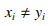，其中 |s| 表示字符串 s 的长度。

---

### 2709 · 最大公约数（C/C++/Java组）

> 题号 2709 ｜ 难度 困难 ｜ 时间 1s ｜ 内存 256MB
> 通过率 16.08% ｜ 题面原文 https://www.dotcpp.com/oj/problem2709.html
> 考过的语言/组别：Java 研究生组、Java 大学C组、C++ 大学A组

#### 题目描述

给定一个数组，每次操作可以选择数组中任意两个相邻的元素 x, y 并将其中的一个元素替换为 gcd(x, y) ，其中 gcd(x, y) 表示 x 和 y 的最大公约数。

请问最少需要多少次操作才能让整个数组只含 1 。

#### 输入格式

输入的第一行包含一个整数 n ，表示数组长度。

第二行包含 n 个整数 a<sub>1</sub>, a<sub>2</sub>, · · · , a<sub>n</sub>，相邻两个整数之间用一个空格分隔。

#### 输出格式

输出一行包含一个整数，表示最少操作次数。如果无论怎么操作都无法满足要求，输出 −1 。

#### 样例输入

```
3

4 6 9
```

#### 提示

对于 30% 的评测用例，n ≤ 500 ，a<sub>i</sub> ≤ 1000；

对于 50% 的评测用例，n ≤ 5000 ，a<sub>i</sub> ≤ 10<sup>6</sup>；

对于所有评测用例，1 ≤ n ≤ 100000 ，1 ≤ a<sub>i</sub> ≤ 10<sup>9</sup>。

---

### 2710 · owo（C/C++/Java组）

> 题号 2710 ｜ 难度 困难 ｜ 时间 1s ｜ 内存 256MB
> 通过率 13.17% ｜ 题面原文 https://www.dotcpp.com/oj/problem2710.html
> 考过的语言/组别：Java 研究生组、C++ 研究生组、C++ 大学A组

#### 题目描述

小蓝很喜欢 owo ，他现在有一些字符串，他想将这些字符串拼接起来，使得最终得到的字符串中出现尽可能多的 owo 。

在计算数量时，允许字符重叠，即 owowo 计算为 2 个，owowowo 计算为

3 个。

请算出最优情况下得到的字符串中有多少个 owo。

#### 输入格式

输入的第一行包含一个整数 n ，表示小蓝拥有的字符串的数量。

接下来 n 行，每行包含一个由小写英文字母组成的字符串 s<sub>i</sub> 。

#### 输出格式

输出 n 行，每行包含一个整数，表示前 i 个字符串在最优拼接方案中可以得到的 owo 的数量。

#### 样例输入

```
3

owo

w

ow
```

#### 提示

对于 10% 的评测用例，n ≤ 10；

对于 40% 的评测用例，n ≤ 300；

对于 60% 的评测用例，n ≤ 5000；

对于所有评测用例，1 ≤ n ≤ 10<sup>6</sup> ，1 ≤ |s<sub>i</sub> | ，

∑

|s<sub>i</sub> | ≤ 10<sup>6</sup>，其中 |s<sub>i</sub> | 表示字符串 s<sub>i</sub> 的长度。

本试题适用于用c/c++/java代码来完成，如用Python代码出现时间超限问题建议转到：https://www.dotcpp.com/oj/problem.php?id=2738链接

---

### 2711 · 环境治理（C/C++/Java组）

> 题号 2711 ｜ 难度 困难 ｜ 时间 1s ｜ 内存 256MB
> 通过率 24.36% ｜ 题面原文 https://www.dotcpp.com/oj/problem2711.html
> 考过的语言/组别：Java 研究生组、C++ 大学A组

#### 题目描述

LQ 国拥有 n 个城市，从 0 到 n − 1 编号，这 n 个城市两两之间都有且仅有一条双向道路连接，这意味着任意两个城市之间都是可达的。每条道路都有一个属性 D ，表示这条道路的灰尘度。当从一个城市 A 前往另一个城市 B 时，可能存在多条路线，每条路线的灰尘度定义为这条路线所经过的所有道路的灰尘度之和，LQ 国的人都很讨厌灰尘，所以他们总会优先选择灰尘度最小的路线。

LQ 国很看重居民的出行环境，他们用一个指标 P 来衡量 LQ 国的出行环境，P 定义为：

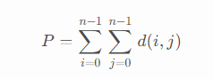

其中 d(i, j) 表示城市 i 到城市 j 之间灰尘度最小的路线对应的灰尘度的值。

为了改善出行环境，每个城市都要有所作为，当某个城市进行道路改善时，会将与这个城市直接相连的所有道路的灰尘度都减少 1，但每条道路都有一个灰尘度的下限值 L，当灰尘度达到道路的下限值时，无论再怎么改善，道路的灰尘度也不会再减小了。

具体的计划是这样的：

第 1 天，0 号城市对与其直接相连的道路环境进行改善；

第 2 天，1 号城市对与其直接相连的道路环境进行改善；

…

第 n 天，n − 1 号城市对与其直接相连的道路环境进行改善；

第 n + 1 天，0 号城市对与其直接相连的道路环境进行改善；

第 n + 2 天，1 号城市对与其直接相连的道路环境进行改善；

…

LQ 国想要使得 P 指标满足 P ≤ Q。请问最少要经过多少天之后，P 指标可以满足 P ≤ Q。如果在初始时就已经满足条件，则输出 0 ；如果永远不可能满足，则输出 −1。

#### 输入格式

输入的第一行包含两个整数 n, Q，用一个空格分隔，分别表示城市个数和期望达到的 P 指标。

接下来 n 行，每行包含 n 个整数，相邻两个整数之间用一个空格分隔，其中第 i 行第 j 列的值 D<sub>ij</sub> (D<sub>ij</sub> = D<sub>ji</sub>, D<sub>ii</sub> = 0) 表示城市 i 与城市 j 之间直接相连的那条道路的灰尘度。

接下来 n 行，每行包含 n 个整数，相邻两个整数之间用一个空格分隔，其中第 i 行第 j 列的值 L<sub>ij</sub> (L<sub>ij</sub> = L<sub>ji</sub>, L<sub>ii</sub> = 0) 表示城市 i 与城市 j 之间直接相连的那条道路的灰尘度的下限值。

#### 输出格式

输出一行包含一个整数表示答案。

#### 样例输入

```
3 10

0 2 4

2 0 1

4 1 0

0 2 2

2 0 0

2 0 0
```

#### 提示

初始时的图如下所示，每条边上的数字表示这条道路的灰尘度：

此时每对顶点之间的灰尘度最小的路线对应的灰尘度为：

d(0, 0) = 0, d(0, 1) = 2, d(0, 2) = 3,

d(1, 0) = 2, d(1, 1) = 0, d(1, 2) = 1,

d(2, 0) = 3, d(2, 1) = 1, d(2, 2) = 0.

初始时的 P 指标为 (2 + 3 + 1) × 2 = 12，不满足 P ≤ Q = 10;

第一天，0 号城市进行道路改善，改善后的图示如下：

注意到边 (0, 2) 的值减小了 1 ，但 (0, 1) 并没有减小，因为 L<sub>0,1</sub> = 2 ，所以

(0, 1) 的值不可以再减小了。此时每对顶点之间的灰尘度最小的路线对应的灰尘度为：

d(0, 0) = 0, d(0, 1) = 2, d(0, 2) = 3,

d(1, 0) = 2, d(1, 1) = 0, d(1, 2) = 1,

d(2, 0) = 3, d(2, 1) = 1, d(2, 2) = 0.

此时 P 仍为 12 。

第二天，1 号城市进行道路改善，改善后的图示如下：

此时每对顶点之间的灰尘度最小的路线对应的灰尘度为：

d(0, 0) = 0, d(0, 1) = 2, d(0, 2) = 2,

d(1, 0) = 2, d(1, 1) = 0, d(1, 2) = 0,

d(2, 0) = 2, d(2, 1) = 0, d(2, 2) = 0.

此时的 P 指标为 (2 + 2) × 2 = 8 < Q ，此时已经满足条件。

所以答案是 2。

对于 30% 的评测用例，1 ≤ n ≤ 10 ，0 ≤ L<sub>ij</sub> ≤ D<sub>ij</sub> ≤ 10；

对于 60% 的评测用例，1 ≤ n ≤ 50 ，0 ≤ L<sub>ij</sub> ≤ D<sub>ij</sub> ≤ 100000；

对于所有评测用例，1 ≤ n ≤ 100 ，0 ≤ L<sub>ij</sub> ≤ D<sub>ij</sub> ≤ 100000 ，0 ≤ Q ≤ 2<sup>31</sup> − 1。

---

### 2712 · 选素数

> 题号 2712 ｜ 难度 困难 ｜ 时间 1s ｜ 内存 256MB
> 通过率 21.49% ｜ 题面原文 https://www.dotcpp.com/oj/problem2712.html
> 考过的语言/组别：Java 大学A组、C++ 研究生组、C++ 大学A组

#### 题目描述

小蓝有一个数 x，每次操作小蓝会选择一个小于 x 的素数 p，然后在 x 成为 p 的倍数前不断将 x 加 1，(如果 x 一开始就是 p 的倍数则 x 不变)。

小乔看到了小蓝进行了 2 次上述操作后得到的结果 n，他想知道 x 在一开始是多少。如果有多种可能，他想知道 x 一开始最小可以是多少，而如果不存在任何解，说明小乔看错了，此时请输出 −1。

#### 输入格式

输入一行包含一个整数 n ，表示经过两次操作后 x 的值。

#### 输出格式

输出一行包含一个整数表示 x 的初始值。如果有多个解，输出最小的。如果不存在解，请输出 −1 。

#### 样例输入

```
22
```

#### 提示

对于 60% 的评测用例，1 ≤ n ≤ 5000；

对于所有评测用例，1 ≤ n ≤ 10<sup>6</sup>。

---

### 2713 · 三角序列（C/C++组）

> 题号 2713 ｜ 难度 困难 ｜ 时间 3s ｜ 内存 512MB
> 通过率 0.81% ｜ 题面原文 https://www.dotcpp.com/oj/problem2713.html
> 考过的语言/组别：C++ 大学A组

#### 题目描述

给定 n 组成对的数 a<sub>i</sub> , b<sub>i</sub>，每组数表示一个 a<sub>i</sub> 行 a<sub>i</sub> 列的如图所示的三角形：

其中 b<sub>i</sub> 为 0 时左边较低，为 1 时右边较低。

将每组数对应的三角按数的顺序从左到右拼接起来。

现给出 m 组询问 l<sub>i</sub> ,r<sub>i</sub> , v<sub>i</sub>，对每组询问求最低高度 h<sub>i</sub> 使得 l<sub>i</sub> 到 r<sub>i</sub> 列之间的高度在 h<sub>i</sub> 以内的 o 的数量大于等于 v<sub>i</sub>。

#### 输入格式

输入的第一行包含两个整数 n, m，用一个空格分隔。

接下来 n 行，每行包含两个整数 a<sub>i</sub> , b<sub>i</sub>，用一个空格分隔。

接下来 m 行，每行包含三个整数 l<sub>i</sub> ,r<sub>i</sub> , v<sub>i</sub>，相邻两个整数之间用一个空格分隔。

#### 输出格式

输出 m 行，每行包含一个整数 h<sub>i</sub> ，依次表示每次询问对应的答案。如果不存在这样的 h<sub>i</sub>，请输出 −1。

#### 样例输入

```
6 6

3 0

4 0

2 1

3 1

5 0

1 1

3 9 12

3 9 13

3 4 4

14 16 7

9 15 12

1 18 42
```

#### 提示

第一个询问对应的范围如图所示：

对于 30% 的评测用例，1 ≤ n, m, a<sub>i</sub> ≤ 500；

对于 50% 的评测用例，1 ≤ n, m, a<sub>i</sub> ≤ 5000；

对于所有评测用例，1 ≤ n, m ≤ 200000 ，1 ≤ a<sub>i</sub> ≤ 10<sup>6</sup> ，0 ≤ b<sub>i</sub> ≤ 1 ，

1 ≤ l<sub>i</sub> ≤ r<sub>i</sub> ≤

∑

a<sub>i</sub> ，1 ≤ v<sub>i</sub> ≤ 10<sup>18</sup>。

---

### 2714 · 括号序列树

> 题号 2714 ｜ 难度 困难 ｜ 时间 1s ｜ 内存 256MB
> 通过率 28.00% ｜ 题面原文 https://www.dotcpp.com/oj/problem2714.html
> 考过的语言/组别：Java 大学A组、C++ 大学A组

#### 题目描述

有一棵二叉树，根结点上有一个空字符串，每个点的左儿子上的字符串为其父亲结点的字符串尾部额外加一个左括号，右儿子则是在尾部加一个右括号。树中的每个叶子结点上的字符串都分别和每个由 n 对括号组成的合法括号序列一一对应。

给定 n，求此时这棵树的最大匹配所含的边数。

#### 输入格式

输入一行包含一个整数 n。

#### 输出格式

输出一行包含一个整数表示满足条件的序列的数量，答案可能很大，请输出答案除以 998244353 的余数。

#### 样例输入

```
9
```

#### 提示

对于 20% 的评测用例，n ≤ 10 ；

对于 40% 的评测用例，n ≤ 300 ；

对于 60% 的评测用例，n ≤ 5000 ；

对于 85% 的评测用例，n ≤ 10<sup>5</sup> ；

对于所有评测用例，1 ≤ n ≤ 10<sup>6</sup> 。

---

### 2715 · 交通信号（C/C++/Java组）

> 题号 2715 ｜ 难度 困难 ｜ 时间 1s ｜ 内存 256MB
> 通过率 14.69% ｜ 题面原文 https://www.dotcpp.com/oj/problem2715.html
> 考过的语言/组别：Java 大学C组、Java 大学A组、C++ 研究生组

#### 题目描述

LQ 市的交通系统可以看成由 n 个结点和 m 条有向边组成的有向图。在每条边上有一个信号灯，会不断按绿黄红黄绿黄红黄... 的顺序循环 (初始时刚好变到绿灯)。当信号灯为绿灯时允许正向通行，红灯时允许反向通行，黄灯时不允许通行。每条边上的信号灯的三种颜色的持续时长都互相独立，其中黄灯的持续时长等同于走完路径的耗时。当走到一条边上时，需要观察边上的信号灯，如果允许通行则可以通过此边，在通行过程中不再受信号灯的影响；否则需要等待，直到允许通行。

请问从结点 s 到结点 t 所需的最短时间是多少，如果 s 无法到达 t 则输出

−1。

#### 输入格式

输入的第一行包含四个整数 n, m, s, t，相邻两个整数之间用一个空格分隔。

接下来 m 行，每行包含五个整数 u<sub>i</sub> , v<sub>i</sub> , g<sub>i</sub> ,r<sub>i</sub> , d<sub>i</sub> ，相邻两个整数之间用一个空格分隔，分别表示一条边的起点，终点，绿灯、红灯的持续时长和距离（黄灯的持续时长）。

#### 输出格式

输出一行包含一个整数表示从结点 s 到达 t 所需的最短时间。

#### 样例输入

```
4 4 1 4

1 2 1 2 6

4 2 1 1 5

1 3 1 1 1

3 4 1 99 1
```

#### 提示

对于 40% 的评测用例，n ≤ 500 ，1 ≤ g<sub>i</sub> ,r<sub>i</sub> , d<sub>i</sub> ≤ 100 ；

对于 70% 的评测用例，n ≤ 5000 ；

对于所有评测用例，1 ≤ n ≤ 100000 ，1 ≤ m ≤ 200000 ，1 ≤ s, t ≤ n ，

1 ≤ u<sub>i</sub> , v<sub>i</sub> ≤ n ，1 ≤ g<sub>i</sub> ,r<sub>i</sub> , d<sub>i</sub> ≤ 10<sup>9</sup> 。

---

### 2716 · 图书借阅（Java组）

> 题号 2716 ｜ 难度 困难 ｜ 时间 2s ｜ 内存 512MB
> 通过率 12.00% ｜ 题面原文 https://www.dotcpp.com/oj/problem2716.html
> 考过的语言/组别：Java 大学A组

#### 题目描述

小蓝是一所图书馆的管理员，图书馆中目前有 n 种书，第 i 种书有 a<sub>i</sub> 本。

小蓝目前有 m 条未来若干天中用户的预约借阅记录，每个借阅记录由

b<sub>i</sub> , l<sub>i</sub> ,r<sub>i</sub> 组成，表示在 l<sub>i</sub> 日要借用一本书 b<sub>i</sub> ，r<sub>i</sub> 日归还，r<sub>i</sub> 日结束后图书馆才可以将这本书重新借出。

小蓝分析了一下预约借阅记录，发现现有的书不一定能满足所有人的预约请求，于是小蓝打算额外购买一些书加入到图书馆。小蓝的预算有限，请问如果额外添加不超过 x 本书，最多有多少条预约记录能得到满足? 小蓝可以选取一部分记录使其满足，不一定需要按借阅或预定的时间顺序满足。

#### 输入格式

输入的第一行包含三个整数 n, m, x ，相邻两个整数之间用一个空格分隔。

第二行包含 n 个整数 a<sub>1</sub>, a<sub>2</sub>, · · · , a<sub>n</sub>，相邻两个整数之间用一个空格分隔，表示目前拥有的每种书的本数。

接下来 m 行，每行包含 3 个整数 b<sub>i</sub> , l<sub>i</sub> , r<sub>i</sub>，相邻两个整数之间用一个空格分隔，表示一条预约借阅记录。

#### 输出格式

输出一行包含一个整数表示给定条件下最多能满足预约借阅的记录数。

#### 样例输入

```
3 11 3

1 0 2

1 2 4

1 1 2

1 4 5

1 3 5

1 1 3

2 1 1

2 2 2

2 3 3

2 1 2

2 3 4

3 1 5
```

#### 提示

对于 10% 的评测用例，n, m ≤ 10 ，l<sub>i</sub> ≤ r<sub>i</sub> ≤ 10；

对于 50% 的评测用例，n, m ≤ 2000 ，l<sub>i</sub> ≤ r<sub>i</sub> ≤ 5000；

对于所有评测用例，1 ≤ n ≤ 100000 ，1 ≤ x ≤ m ≤ 200000 ，1 ≤ b<sub>i</sub> ≤ n ，

1 ≤ l<sub>i</sub> ≤ r<sub>i</sub> ≤ 10<sup>6</sup> ，0 ≤ a<sub>i</sub> ≤ 10<sup>5</sup>。

---

### 2717 · 左移右移

> 题号 2717 ｜ 难度 困难 ｜ 时间 3s ｜ 内存 512MB
> 通过率 18.23% ｜ 题面原文 https://www.dotcpp.com/oj/problem2717.html
> 考过的语言/组别：Java 大学B组

#### 题目描述

小蓝有一个长度为 N 的数组，初始时从左到右依次是 1, 2, 3, . . . N。

之后小蓝对这个数组进行了 M 次操作，每次操作可能是以下 2 种之一：

1. 左移 x，即把 x 移动到最左边。

2. 右移 x，即把 x 移动到最右边。

请你回答经过 M 次操作之后，数组从左到右每个数是多少？

#### 输入格式

第一行包含 2 个整数，N 和 M。

以下 M 行每行一个操作，其中 “L x”表示左移 x，“R x”表示右移 x。

#### 输出格式

输出 N 个数，代表操作后的数组。

#### 样例输入

```
5 3

L 3

L 2

R 1
```

#### 提示

样例中的数组变化如下：

[1, 2, 3, 4, 5] → [3, 1, 2, 4, 5] → [2, 3, 1, 4, 5] → [2, 3, 4, 5, 1]

对于 50% 的评测用例，1 ≤ N, M ≤ 10000；

对于 100% 的评测用例，1 ≤ N, M ≤ 200000, 1 ≤ x ≤ N。

---

### 2718 · 窗口

> 题号 2718 ｜ 难度 困难 ｜ 时间 3s ｜ 内存 512MB
> 通过率 9.60% ｜ 题面原文 https://www.dotcpp.com/oj/problem2718.html
> 考过的语言/组别：Java 大学B组

#### 题目描述

在平时使用电脑的过程中，经常会打开各种各样的窗口，各个窗口会在桌面上重叠，并按照一定的层次关系显示。有的窗口能够看到全部内容，而有的窗口只能看到局部。

现在给定一组操作桌面窗口的过程序列，请你通过 ASCII 艺术图来绘制最后桌面的状态。

已知桌面的大小为 N × M，即桌面高度为 N 个像素，宽度为 M 个像素，其中左上角坐标为 (0, 0)，右下角坐标为 (N − 1, M − 1)。

对于窗口的操作有如下 5 种：

1. new 操作 - 打开一个新窗口

new [PID] [top] [left] [height] [width]

如：new 12 20 30 80 100

表示打开一个 PID 为 12 的窗口，窗口左上角的坐标为 (20, 30)，该窗口宽度为 100 个像素，高度为 80 个像素；新创建的窗口，其层级为顶层。

2. move 操作 - 移动一个窗口

move [PID] [vertical] [horizontal]

如: move 12 -5 10

表示将 PID 为 12 的窗口在垂直方向上移动 −5 个像素，在水平方向上移动 10 个像素。若窗口左上角原位置为 (20, 30)，此时则在 (15, 40)；移动后的窗口，其层级为顶层。

3. resize 操作 - 改变窗口大小

resize [PID] [height] [width]

如：resize 12 90 110

表示保持左上角坐标不变的情况下，改变 PID 为 12 的窗口大小，调整为高度 90 像素，宽度 110 像素；改变大小后的窗口，其层级为顶层。

4. close 操作 - 关闭窗口

close [PID]

如：close 12

表示关闭 PID 为 12 的窗口；

5. active 操作 - 激活窗口

active [PID]

如：active 12

表示激活 PID 为 12 的窗口，此时该窗口的层级被置为顶层。

#### 输入格式

第 1 行：2 个正整数 N, M，表示桌面大小；

第 2 行：1 个正整数 K，表示操作序列的长度；

第 3 . . . K + 2 行：每行一个操作，格式见题目描述。

#### 输出格式

第 1 . . . N 行：每行 M 个字符，仅包含 ‘.’, ‘+’, ‘-’, ‘|’, ‘ ’ 五种字符。

‘.’ 表示桌面背景，即该部分未被任何窗口覆盖，‘+’ 表示窗口的四个角，‘-’

表示窗口的横边, ‘|’ 表示窗口的竖边，‘ ’ 表示窗口内部。

#### 样例输入

```
7 10

8

new 1 0 3 2 5

new 2 4 4 2 5

new 3 3 3 4 6

resize 3 3 6

move 1 0 5

close 2

new 4 1 1 3 5

active 3
```

#### 提示

对于 100% 的数据，1 ≤ N, M ≤ 256, 1 ≤ K ≤ 10000。

输入数据保证：

1. 同一时间不会有两个相同 PID 的窗口存在，可能存在关闭某个 PID 的

窗口后，再新建一个同样 PID 的窗口，PID 的取值范围为 1 ≤ PID ≤ 100000；

2. 同时存在的窗口数量不超过 200 个；

3. 窗口尺寸不会小于 2 × 2，即窗口高度和宽度均不会小于 2，不会大于

N × M；

4. 窗口在移动过程中，可能有部分界面超出桌面显示范围；

5. 所有输入的数值均不超过 ±100000。

6. move resize close 只会对未关闭的窗口操作。

---

### 2719 · 迷宫

> 题号 2719 ｜ 难度 困难 ｜ 时间 5s ｜ 内存 512MB
> 通过率 21.43% ｜ 题面原文 https://www.dotcpp.com/oj/problem2719.html
> 考过的语言/组别：Java 大学B组

#### 题目描述

这天，小明在玩迷宫游戏。

迷宫为一个 n × n 的网格图，小明可以在格子中移动，左上角为 (1, 1)，右下角 (n, n) 为终点。迷宫中除了可以向上下左右四个方向移动一格以外，还有

m 个双向传送门可以使用，传送门可以连接两个任意格子。

假如小明处在格子 (x<sub>1</sub>, y<sub>1</sub>)，同时有一个传送门连接了格子 (x<sub>1</sub>, y<sub>1</sub>) 和

(x<sub>2</sub>, y<sub>2</sub>)，那么小明既可以花费 1 的步数向上下左右四个方向之一走一格 (不能越过边界)，也可以花费 1 的步数通过传送门走到格子 (x<sub>2</sub>, y<sub>2</sub>) 去。

而对于同一个迷宫，小明每次进入的初始格子是在这 n × n 个格子中均匀随机的 (当然运气好可以直接随机到终点)，他想知道从初始格子走到终点的最短步数的期望值是多少。

#### 输入格式

输入共 1 + m 行，第一行为两个正整数 n, m。

后面 m 行，每行四个正整数 x<sub>i1</sub>, y<sub>i1</sub>, x<sub>i2</sub>, y<sub>i2</sub> 表示第 i 个传送门连接的两个格子坐标。

#### 输出格式

输出共一行，一个浮点数表示答案 (请保留两位小数)。

#### 样例输入

```
2 1

1 1 2 2
```

#### 提示

由于传送门的存在，从 (1, 1) 出发到终点 (2, 2) 只需要一步；而从 (1, 2) 和

(2, 1) 出发也只需要向下/右走一步；从 (2, 2) 出发需要 0 步。所以步数期望为  = 0.75。

对于 20% 的数据，保证 n, m ≤ 20；

对于 100% 的数据，保证 n, m ≤ 2000; x<sub>i1</sub>, y<sub>i1</sub>, x<sub>i2</sub>, y<sub>i2</sub> ≤ n 。

---

### 2720 · 小球称重

> 题号 2720 ｜ 难度 困难 ｜ 时间 2s ｜ 内存 512MB
> 通过率 11.23% ｜ 题面原文 https://www.dotcpp.com/oj/problem2720.html
> 考过的语言/组别：Java 大学B组

#### 题目描述

小蓝有 N 个小球，编号 1 至 N。其中 N − 1 是正品，重量相同；有 1 个是次品，重量比正品轻。

为了找出次品，小蓝已经用天平进行了 M 次称重，并且记录下来每次两边放的小球编号，和称重结果。

请你根据记录，判断还剩下几个小球有次品的嫌疑。

#### 输入格式

第一行包含 2 个整数 N 和 M。

以下包含 M 次称重记录，每个记录占 4 行。

第一行是一个整数 K，表示天平两边各放了 K 个小球。

第二行包含 K 个整数，代表放在天平左边的小球编号。

第三行包含 K 个整数，代表放在天平右边的小球编号。

第四行是一个字符，为 ‘>’, ‘<’, ‘=’ 之一。‘>’ 代表左边比右边重，‘<’ 代表左边比右边轻，‘=’ 代表两边重量相等。

在一次称重中保证每个小球最多出现 1 次。

#### 输出格式

输出一个整数，代表答案。

#### 样例输入

```
10 2

3

1 2 3

4 5 6

<

2

3 7

8 9

=
```

#### 提示

{1, 2, 3} < {4, 5, 6} 能判断出次品在 {1, 2, 3} 之中。

{3, 7} = {8, 9} 能判断出 3 不可能是次品。

所以只剩下 {1, 2} 可能是次品。

对于 40% 的数据，1 ≤ N ≤ 10<sup>6</sup> ;

对于 100% 的数据，1 ≤ N ≤ 10<sup>9</sup> , 1 ≤ M ≤ 10<sup>5</sup> , 参与 M 次称重的小球总数

≤ 10<sup>6</sup> .

---

### 2721 · 背包与魔法

> 题号 2721 ｜ 难度 困难 ｜ 时间 3s ｜ 内存 1024MB
> 通过率 19.30% ｜ 题面原文 https://www.dotcpp.com/oj/problem2721.html
> 考过的语言/组别：Java 大学B组

#### 题目描述

小蓝面前有 N 件物品，其中第 i 件重量是 W<sub>i</sub>，价值是 V<sub>i</sub>。她还有一个背包，最大承重是 M。

小蓝想知道在背包称重范围内，她最多能装总价值多少的物品？

特别值得一提的是，小蓝可以使用一个魔法，将一件物品的重量增加 K，同时价值翻倍。(当然小蓝也可以不使用魔法）

#### 输入格式

第一行包含 3 个整数 N、M 和 K。

以下 N 行，每行两个整数 W<sub>i</sub> 和 V<sub>i</sub>。

#### 输出格式

一个整数代表答案。

#### 样例输入

```
3 10 3

5 10

4 9

3 8
```

#### 提示

选择第二件和第三件物品，同时对第二件物品使用魔法。

对于 30% 的数据，1 ≤ N, M, K ≤ 100.

对于 100% 的数据，1 ≤ N ≤ 2000, 1 ≤ M, K ≤ 10000, 0 ≤ W<sub>i</sub> , V<sub>i</sub> ≤ 10000.

---

### 2722 · 修路

> 题号 2722 ｜ 难度 困难 ｜ 时间 3s ｜ 内存 512MB
> 通过率 28.36% ｜ 题面原文 https://www.dotcpp.com/oj/problem2722.html
> 考过的语言/组别：Java 大学B组

#### 题目描述

这天，小明在修路。

他需要修理两条平行的道路 A, B，两条路上面分别有 n 个和 m 个点需要维修，它们相对于道路起点的距离分别为 a<sub>1</sub>, a<sub>2</sub>, . . . , a<sub>n</sub> 和 b<sub>1</sub>, b<sub>2</sub>, b, ..., b<sub>m</sub>。如图，两条路之间的距离为 d 且它们起点 (最左端) 的连线和两条路都垂直。小明的起点为道路 A 的起点，他需要尽可能快地遍历这些需要维修的 n + m 个点，他既可以沿着道路 **向右** 行走，也可以在两条道路之间的空地上 **随意** 行走。

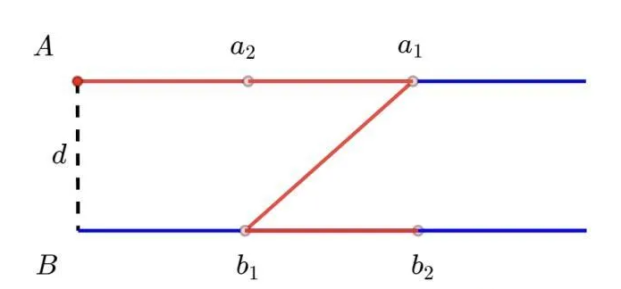

小明想知道遍历这些点的最短路程是多少。

#### 输入格式

输入共三行，第一行为三个正整数 n, m, d。

第二行为 n 个由空格隔开的正整数 a<sub>1</sub>, a<sub>2</sub>, ..., a<sub>n</sub>。

第三行为 m 个由空格隔开的正整数 b<sub>1</sub>, b<sub>2</sub>, ..., b<sub>m</sub>。

#### 输出格式

一行，一个浮点数，表示答案，保留两位小数。

#### 样例输入

```
2 2 2

2 1

1 2
```

#### 提示

图中红线指出了样例的最短路线，

对于 30% 的数据，保证 n + m ≤ 10；

对于 100% 的数据，保证 n, m ≤ 2000, d ≤ 4 × 10<sup>6</sup> , a<sub>i</sub> , b<sub>i</sub> ≤ 10<sup>6</sup> 。

---

### 2723 · 围栏

> 题号 2723 ｜ 难度 中等 ｜ 时间 3s ｜ 内存 512MB
> 通过率 40.48% ｜ 题面原文 https://www.dotcpp.com/oj/problem2723.html
> 考过的语言/组别：Java 大学B组

#### 题目描述

这天，小明在造围栏。

他提前在地上 (二维平面) 打好了 n 个洞，这 n 个洞的位置形成了一个凸多边形。当他准备把固定围栏的木杆插进去的时候，突然发现自己少准备了两根木杆。

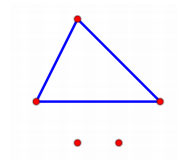

如图，他现在只能在这 n 个洞中选出 n − 2 个来放置木杆，他想知道用这

n − 2 个木杆能围成的凸多边形的最大的面积是多少。

#### 输入格式

输入共 n + 1 行，第一行为一个正整数 n。

后面 n 行，每行两个整数 x<sub>i</sub> , y<sub>i</sub> 表示第 i 个洞的坐标。

保证按照逆时针的顺序输入这 n 个点的坐标。

#### 输出格式

一行，一个正整数，表示答案。

为了避免小数，请输出面积的两倍。

#### 样例输入

```
5

0 0

1 0

2 1

0 3

-1 1
```

#### 提示

选择 (−1, 1) (2, 1) (0, 3) 这三个点构成的多边形面积最大，为 3，所以输出

6。

对于 100% 的数据，保证 5 ≤ n ≤ 100；|x<sub>i</sub> |, |y<sub>i</sub> | ≤ 10<sup>6</sup>。

---

### 2724 · 好数之和

> 题号 2724 ｜ 难度 困难 ｜ 时间 3s ｜ 内存 512MB
> 通过率 17.77% ｜ 题面原文 https://www.dotcpp.com/oj/problem2724.html
> 考过的语言/组别：Java 大学B组

#### 题目描述

一个整数如果包含连续的 2022 四个数字，我们就称之为 “好数”。

例如 2022、52022、20223、7020224 都是好数，而 2202、20022、2222 都不是好数。

给定 L 和 R，请你计算在 L 到 R 之间（包含 L 和 R）所有好数的和是多少？

#### 输入格式

两个整数 L 和 R。

#### 输出格式

一个整数代表答案。

#### 样例输入

```
1 20000
```

#### 提示

满足条件的好数有 2022、12022，它们的和是 14044。

对于 60% 的评测用例，R − L ≤ 10<sup>8</sup> ；

对于 100% 的评测用例，1 ≤ L ≤ R ≤ 10<sup>9</sup> 。

---

### 2725 · 点亮（Java组）

> 题号 2725 ｜ 难度 中等 ｜ 时间 1s ｜ 内存 256MB
> 通过率 35.00% ｜ 题面原文 https://www.dotcpp.com/oj/problem2725.html
> 考过的语言/组别：Java 研究生组、Java 大学C组

#### 题目描述

小蓝最近迷上了一款名为《点亮》的谜题游戏，游戏在一个 n × n 的格子棋盘上进行，棋盘由黑色和白色两种格子组成，玩家在白色格子上放置灯泡，确保任意两个灯泡不会相互照射，直到整个棋盘上的白色格子都被点亮（每个谜题均为唯一解）。灯泡只会往水平和垂直方向发射光线，照亮整行和整列，除非它的光线被黑色格子挡住。黑色格子上可能有从 0 到 4 的整数数字，表示与其上下左右四个相邻的白色格子共有几个灯泡；也可能没有数字，这表示可以在上下左右四个相邻的白色格子处任意选择几个位置放置灯泡。游戏的目标是选择合适的位置放置灯泡，使得整个棋盘上的白色格子都被照亮。

例如，有一个黑色格子处数字为 4，这表示它周围必须有 4 个灯泡，需要在他的上、下、左、右处分别放置一个灯泡；如果一个黑色格子处数字为 2，它的上下左右相邻格子只有 3 个格子是白色格子，那么需要从这三个白色格子中选择两个来放置灯泡；如果一个黑色格子没有标记数字，且其上下左右相邻格子全是白色格子，那么可以从这 4 个白色格子中任选出 0 至 4 个来放置灯泡。

题目保证给出的数据是合法的，黑色格子周围一定有位置可以放下对应数量的灯泡。且保证所有谜题的解都是唯一的。

现在，给出一个初始的棋盘局面，请在上面放置好灯泡，使得整个棋盘上的白色格子被点亮。

#### 输入格式

输入的第一行包含一个整数 n，表示棋盘的大小。

接下来 n 行，每行包含 n 个字符，表示给定的棋盘。字符 . 表示对应的格子为白色，数字字符 0、1、2、3、4 表示一个有数字标识的黑色格子，大写字母 X 表示没有数字标识的黑色格子。

#### 输出格式

输出 n 行，每行包含 n 个字符，表示答案。大写字母 O 表示对应的格子包含灯泡，其它字符的意义与输入相同。

#### 样例输入

```
5

.....

.2.4.

..4..

.2.X.

.....
```

#### 提示

答案对应的棋盘布局如下图所示：

对于所有评测用例，2 ≤ n ≤ 5 ，且棋盘上至少有 15% 的格子是黑色格子。

---

### 2726 · 宝石收集（Java组）

> 题号 2726 ｜ 难度 中等 ｜ 时间 2s ｜ 内存 256MB
> 通过率 29.09% ｜ 题面原文 https://www.dotcpp.com/oj/problem2726.html
> 考过的语言/组别：Java 大学C组

#### 题目描述

小蓝最近迷上了一款收集宝石的游戏，在游戏中给出了一幅藏宝图，藏宝图可以看做是由 n 个顶点组成的一个有向图，顶点编号为 0, 1, 2, · · · , n − 1。每个顶点有且仅有一颗宝石，可能是红宝石或蓝宝石。

小蓝有一次收集宝石的机会，他可以任意选择一个顶点当做起点，沿着有向边前进，经过的顶点上的宝石都会被自动收集（包括起点和终点），直到前方无路可走或者小蓝想退出时停止本次收集。小蓝可以多次经过同一个顶点，但只会在第一次到达顶点时获得宝石，后面再次到达时不会再获得宝石。

收集结束后，小蓝可以用手中的宝石合成紫晶宝石：一颗红宝石加一颗蓝宝石就可以合成一颗紫晶宝石。

小蓝想在收集结束后合成尽可能多的紫晶宝石，请帮他规划出一条最优路径，告诉他最多可以合成多少颗紫晶宝石。

#### 输入格式

输入的第一行包含一个整数 n，表示有顶点的个数。

第二行包含一个由 0、1 组成的长度为 n 的字符串，从左至右依次表示第

0 至 n − 1 个顶点处宝石的种类，0 表示红宝石，1 表示蓝宝石。

第三行包含一个整数 m ，表示图中有 m 条有向边。

接下来 m 行，每行包含两个整数 s, t ，用一个空格分隔，表示一条从 s 到

t 的有向边。

#### 输出格式

输出一行包含一个整数，表示小蓝最多能合成几颗紫晶宝石。

#### 样例输入

```
6

000111

6

0 1

1 2

3 1

2 3

2 4

2 5
```

#### 提示

样例如上图所示，选择 0 号顶点作为起点，按照 0 → 1 → 2 → 3 → 1 →

2 → 4 的行进路线，可以获得 3 颗红宝石和 2 颗蓝宝石，最终可以合成 2 颗紫晶宝石；他也可以按照 1 → 2 → 3 → 1 → 2 → 4 行进，结果也是 2 。找不到比

2 更大的答案了。

对于所有的评测用例，1 ≤ n ≤ 2000 ，0 ≤ m ≤ 105 ，0 ≤ s ≤ n − 1 ，0 ≤ t ≤ n − 1。

---

### 2727 · 近似 GCD（Python组）

> 题号 2727 ｜ 难度 困难 ｜ 时间 1s ｜ 内存 256MB
> 通过率 22.93% ｜ 题面原文 https://www.dotcpp.com/oj/problem2727.html
> 考过的语言/组别：Python 研究生组、Python 大学B组

#### 题目描述

小蓝有一个长度为 n 的数组 A = (a<sub>1</sub>, a<sub>2</sub>, · · · , a<sub>n</sub>)，数组的子数组被定义为从原数组中选出连续的一个或多个元素组成的数组。数组的最大公约数指的是数组中所有元素的最大公约数。如果最多更改数组中的一个元素之后，数组的最大公约数为 g，那么称 g 为这个数组的近似 GCD。一个数组的近似 GCD 可能有多种取值。

具体的，判断 g 是否为一个子数组的近似 GCD 如下：

1. 如果这个子数组的最大公约数就是 g，那么说明 g 是其近似 GCD。

2. 在修改这个子数组中的一个元素之后（可以改成想要的任何值），子数组的最大公约数为 g，那么说明 g 是这个子数组的近似 GCD。

小蓝想知道，数组 A 有多少个长度大于等于 2 的子数组满足近似 GCD 的值为 g。

#### 输入格式

输入的第一行包含两个整数 n, g，用一个空格分隔，分别表示数组 A 的长度和 g 的值。

第二行包含 n 个整数 a<sub>1</sub>, a<sub>2</sub>, · · · , a<sub>n</sub>，相邻两个整数之间用一个空格分隔。

#### 输出格式

输出一行包含一个整数表示数组 A 有多少个长度大于等于 2 的子数组的近似 GCD 的值为 g 。

#### 样例输入

```
5 3

1 3 6 4 10
```

#### 提示

满足条件的子数组有 5 个：

[1, 3]：将 1 修改为 3 后，这个子数组的最大公约数为 3 ，满足条件。

[1, 3, 6]：将 1 修改为 3 后，这个子数组的最大公约数为 3 ，满足条件。

[3, 6]：这个子数组的最大公约数就是 3 ，满足条件。

[3, 6, 4]：将 4 修改为 3 后，这个子数组的最大公约数为 3 ，满足条件。

[6, 4]：将 4 修改为 3 后，这个子数组的最大公约数为 3，满足条件。

对于 20% 的评测用例，2 ≤ n ≤ 10<sup>2</sup>；

对于 40% 的评测用例，2 ≤ n ≤ 10<sup>3</sup>；

对于所有评测用例，2 ≤ n ≤ 10<sup>5</sup> ，1 ≤ g, a<sub>i </sub>≤ 10<sup>9</sup>。

---

### 2728 · 交通信号（Python组）

> 题号 2728 ｜ 难度 困难 ｜ 时间 1s ｜ 内存 256MB
> 通过率 7.23% ｜ 题面原文 https://www.dotcpp.com/oj/problem2728.html
> 考过的语言/组别：Python 研究生组、Python 大学C组、Python 大学B组

#### 题目描述

LQ 市的交通系统可以看成由 n 个结点和 m 条有向边组成的有向图。在每条边上有一个信号灯，会不断按绿黄红黄绿黄红黄... 的顺序循环 (初始时刚好变到绿灯)。当信号灯为绿灯时允许正向通行，红灯时允许反向通行，黄灯时不允许通行。每条边上的信号灯的三种颜色的持续时长都互相独立，其中黄灯的持续时长等同于走完路径的耗时。当走到一条边上时，需要观察边上的信号灯，如果允许通行则可以通过此边，在通行过程中不再受信号灯的影响；否则需要等待，直到允许通行。请问从结点 s 到结点 t 所需的最短时间是多少，如果 s 无法到达 t 则输出−1。

#### 输入格式

输入的第一行包含四个整数 n, m, s, t，相邻两个整数之间用一个空格分隔。

接下来 m 行，每行包含五个整数 u<sub>i</sub>, v<sub>i</sub>, g<sub>i</sub>,r<sub>i</sub>, d<sub>i</sub> ，相邻两个整数之间用一个空格分隔，分别表示一条边的起点，终点，绿灯、红灯的持续时长和距离（黄灯的持续时长）。

#### 输出格式

输出一行包含一个整数表示从结点 s 到达 t 所需的最短时间。

#### 样例输入

```
4 4 1 4

1 2 1 2 6

4 2 1 1 5

1 3 1 1 1

3 4 1 99 1
```

#### 提示

对于 40% 的评测用例，n ≤ 500 ，1 ≤ g<sub>i</sub>,r<sub>i</sub>, d<sub>i</sub> ≤ 100 ；

对于 70% 的评测用例，n ≤ 5000 ；

对于所有评测用例，1 ≤ n ≤ 100000 ，1 ≤ m ≤ 200000 ，1 ≤ s, t ≤ n ，1 ≤ u<sub>i</sub>, v<sub>i</sub> ≤ n ，1 ≤ g<sub>i</sub>,r<sub>i</sub>, d<sub>i</sub> ≤ 10<sup>9</sup> 。

---

### 2729 · 数组个数（Python组)

> 题号 2729 ｜ 难度 困难 ｜ 时间 1s ｜ 内存 256MB
> 通过率 17.31% ｜ 题面原文 https://www.dotcpp.com/oj/problem2729.html
> 考过的语言/组别：Python 研究生组、Python 大学A组

#### 题目描述

小蓝有一个长度为 n 的数组 B = (b<sub>0</sub>, b<sub>1</sub>, · · · , b<sub>n−1</sub>)，数组 B 是由另一个长度为 n 的环形数组 A = (a<sub>0</sub>, a<sub>1</sub>, · · · , a<sub>n−1</sub>) 经过一次相邻最大化操作得到的，其中 a<sub>i</sub>与 a<sub>i+1</sub> 相邻，a<sub>0</sub> 与 a<sub>n−1 </sub>相邻。

形式化描述为：

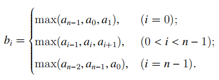

小蓝想知道，可能有多少个满足条件的数组A，经过一次相邻最大化操作后能得到数组 B，注意 A 中的每个元素都要求为非负整数。

#### 输入格式

输入的第一行包含一个整数 n ，表示数组长度。

第二行包含 n 个整数 b<sub>0</sub>, b<sub>1</sub>, · · · , b<sub>n−1</sub>，相邻两个整数之间用一个空格分隔。

#### 输出格式

输出一行包含一个整数表示答案，答案可能很大，请输出答案除以 1000000007 后的余数。

#### 样例输入

```
5

8 6 1 8 8
```

#### 提示

对于 30% 的评测用例，3 ≤ n ≤ 10；

对于 60% 的评测用例，3 ≤ n ≤ 100；

对于所有评测用例，3 ≤ n ≤ 1000 ，0 ≤ b<sub>i</sub> ≤ 10。

---

### 2730 · 打折（Python组）

> 题号 2730 ｜ 难度 困难 ｜ 时间 2s ｜ 内存 256MB
> 通过率 14.47% ｜ 题面原文 https://www.dotcpp.com/oj/problem2730.html
> 考过的语言/组别：Python 研究生组、Python 大学B组

#### 题目描述

小蓝打算采购 n 种物品，每种物品各需要 1 个。

小蓝所住的位置附近一共有 m 个店铺，每个店铺都出售着各种各样的物品。

第 i 家店铺会在第 s<sub>i</sub> 天至第 t<sub>i</sub> 天打折，折扣率为 p<sub>i</sub>，对于原件为 b 的物品，折后价格为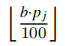  。其它时间需按原价购买。

小蓝很忙，他只能选择一天的时间去采购这些物品。请问，他最少需要花多少钱才能买到需要的所有物品。

题目保证小蓝一定能买到需要的所有物品。

#### 输入格式

输入的第一行包含两个整数 n, m，用一个空格分隔，分别表示物品的个数和店铺的个数。

接下来依次包含每个店铺的描述。每个店铺由若干行组成，其中第一行包含四个整数 s<sub>i</sub>, t<sub>i</sub>, p<sub>i</sub>, c<sub>i</sub>，相邻两个整数之间用一个空格分隔，分别表示商店优惠的起始和结束时间、折扣率以及商店内的商品总数。之后接 c<sub>i </sub>行，每行包含两个整数 a<sub>j</sub>, b<sub>j</sub> ，用一个空格分隔，分别表示该商店的第 j 个商品的类型和价格。商品的类型由 1 至 n 编号。

#### 输出格式

输出一行包含一个整数表示小蓝需要花费的最少的钱数。

#### 样例输入

```
2 2

1 2 89 1

1 97

3 4 77 1

2 15
```

#### 提示

对于 40% 的评测用例，n, m ≤ 500 ，s<sub>i</sub> ≤ t<sub>i</sub> ≤ 100 ，∑ c<sub>i</sub> ≤ 200000 ；

对于 70% 的评测用例，n, m ≤ 5000 ，∑ c<sub>i</sub> ≤ 200000 ；

对于所有评测用例，1 ≤ n, m ≤ 100000，1≤ c<sub>i</sub>≤ n ， ∑ c<sub>i</sub> ≤ 400000 ，1 ≤ s<sub>i</sub> ≤ t<sub>i</sub> ≤ 10<sup>9</sup> ，1 < p<sub>i</sub> < 100 ，1 ≤ a<sub>j</sub> ≤ n ，1 ≤ b<sub>j</sub> ≤ 10<sup>9</sup> 。

本试题适用于用Python代码来完成，如用c/c++/java代码建议转到：https://www.dotcpp.com/oj/problem2707.html链接

---

### 2731 · 宝石收集（Python 组）

> 题号 2731 ｜ 难度 困难 ｜ 时间 2s ｜ 内存 256MB
> 通过率 20.07% ｜ 题面原文 https://www.dotcpp.com/oj/problem2731.html
> 考过的语言/组别：Python 研究生组、Python 大学C组、Python 大学A组

#### 题目描述

小蓝最近迷上了一款收集宝石的游戏，在游戏中给出了一幅藏宝图，藏宝图可以看做是由 n 个顶点组成的一个有向图，顶点编号为 0, 1, 2, · · · , n − 1。每个顶点有且仅有一颗宝石，可能是红宝石或蓝宝石。

小蓝有一次收集宝石的机会，他可以任意选择一个顶点当做起点，沿着有向边前进，经过的顶点上的宝石都会被自动收集（包括起点和终点），直到前方无路可走或者小蓝想退出时停止本次收集。小蓝可以多次经过同一个顶点，但只会在第一次到达顶点时获得宝石，后面再次到达时不会再获得宝石。

收集结束后，小蓝可以用手中的宝石合成紫晶宝石：一颗红宝石加一颗蓝宝石就可以合成一颗紫晶宝石。

小蓝想在收集结束后合成尽可能多的紫晶宝石，请帮他规划出一条最优路径，告诉他最多可以合成多少颗紫晶宝石。

#### 输入格式

输入的第一行包含一个整数 n，表示有顶点的个数。

第二行包含一个由 0、1 组成的长度为 n 的字符串，从左至右依次表示第 0 至 n − 1 个顶点处宝石的种类，0 表示红宝石，1 表示蓝宝石。

第三行包含一个整数 m ，表示图中有 m 条有向边。

接下来 m 行，每行包含两个整数 s, t ，用一个空格分隔，表示一条从 s 到 t 的有向边。

#### 输出格式

输出一行包含一个整数，表示小蓝最多能合成几颗紫晶宝石。

#### 样例输入

```
6

000111

6

0 1

1 2

3 1

2 3

2 4

2 5
```

#### 提示

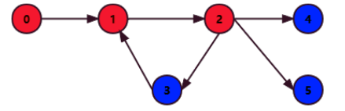

样例如上图所示，选择 0 号顶点作为起点，按照 0 → 1 → 2 → 3 → 1 → 2 → 4 的行进路线，可以获得 3 颗红宝石和 2 颗蓝宝石，最终可以合成 2 颗紫晶宝石；他也可以按照 1 → 2 → 3 → 1 → 2 → 4 行进，结果也是 2 。找不到比 2 更大的答案了。

对于所有的评测用例，1 ≤ n ≤ 2000 ，0 ≤ m ≤ 10<sup>5</sup> ，0 ≤ s ≤ n − 1 ，0 ≤ t ≤ n − 1。

---

### 2732 · 最少的 1（Python组）

> 题号 2732 ｜ 难度 困难 ｜ 时间 1s ｜ 内存 256MB
> 通过率 4.38% ｜ 题面原文 https://www.dotcpp.com/oj/problem2732.html
> 考过的语言/组别：Python 研究生组

#### 题目描述

给定一个正整数 n ，找出所有 n 的倍数的二进制表示中最少有多少个1。

#### 输入格式

输入一行包含一个整数 n 。

#### 输出格式

输出一行包含一个整数表示答案。

#### 样例输入

```
7
```

#### 提示

14 是 7 的倍数，其二进制表示为 1110，有 3 个 1。7 也是 7 的倍数，二进制表示中也有 3 个 1 。可以证明 7 的其他倍数的二进制表示不会具有更少的 1。

对于 10% 的评测用例，n ≤ 10；

对于 25% 的评测用例，n ≤ 200；

对于 50% 的评测用例，n ≤ 5000；

对于所有评测用例，1 ≤ n ≤ 10<sup>6</sup>。

---

### 2733 · 图书借阅（Python组）

> 题号 2733 ｜ 难度 困难 ｜ 时间 2s ｜ 内存 512MB
> 通过率 3.08% ｜ 题面原文 https://www.dotcpp.com/oj/problem2733.html
> 考过的语言/组别：Python 研究生组、Python 大学A组

#### 题目描述

小蓝是一所图书馆的管理员，图书馆中目前有 n 种书，第 i 种书有 a<sub>i</sub> 本。

小蓝目前有 m 条未来若干天中用户的预约借阅记录，每个借阅记录由 b<sub>i</sub> , l<sub>i</sub> ,r<sub>i</sub> 组成，表示在 l<sub>i</sub> 日要借用一本书 b<sub>i</sub> ，r<sub>i</sub> 日归还，r<sub>i</sub> 日结束后图书馆才可以将这本书重新借出。

小蓝分析了一下预约借阅记录，发现现有的书不一定能满足所有人的预约请求，于是小蓝打算额外购买一些书加入到图书馆。小蓝的预算有限，请问如果额外添加不超过 x 本书，最多有多少条预约记录能得到满足? 小蓝可以选取一部分记录使其满足，不一定需要按借阅或预定的时间顺序满足。

#### 输入格式

输入的第一行包含三个整数 n, m, x ，相邻两个整数之间用一个空格分隔。

第二行包含 n 个整数 a<sub>1</sub>, a<sub>2</sub>, · · · , a<sub>n</sub>，相邻两个整数之间用一个空格分隔，表示目前拥有的每种书的本数。

接下来 m 行，每行包含 3 个整数 b<sub>i</sub> , l<sub>i</sub> , r<sub>i</sub>，相邻两个整数之间用一个空格分隔，表示一条预约借阅记录。

#### 输出格式

输出一行包含一个整数表示给定条件下最多能满足预约借阅的记录数。

#### 样例输入

```
3 11 3

1 0 2

1 2 4

1 1 2

1 4 5

1 3 5

1 1 3

2 1 1

2 2 2

2 3 3

2 1 2

2 3 4

3 1 5
```

#### 提示

对于 10% 的评测用例，n, m ≤ 10 ，l<sub>i</sub> ≤ r<sub>i</sub> ≤ 10；

对于 50% 的评测用例，n, m ≤ 2000 ，l<sub>i</sub> ≤ r<sub>i</sub> ≤ 5000；

对于所有评测用例，1 ≤ n ≤ 100000 ，1 ≤ x ≤ m ≤ 200000 ，1 ≤ b<sub>i</sub> ≤ n ， 1 ≤ l<sub>i</sub> ≤ r<sub>i</sub> ≤ 10<sup>6</sup> ，0 ≤ a<sub>i</sub> ≤ 10<sup>5</sup>。

---

### 2734 · 分石头（Python组）

> 题号 2734 ｜ 难度 困难 ｜ 时间 1s ｜ 内存 512MB
> 通过率 16.16% ｜ 题面原文 https://www.dotcpp.com/oj/problem2734.html
> 考过的语言/组别：Python 研究生组

#### 题目描述

小蓝和小乔正在玩一个游戏：对给定的 n 堆石子，每次可以选一堆石子分成相等的质数份或直接消去。双方轮流操作，轮到某玩家操作时如果没有任何石子则这个玩家失败。

小蓝先操作（先手），小乔后操作。

请问小蓝是否存在必胜策略，即是不是存在一种策略，使得不论小乔如何操作，小蓝总有办法获得胜利。

#### 输入格式

输入包含多组独立的询问。

输入的第一行包含一个整数 T 表示询问的组数。

接下来依次描述每一组询问。

每组询问的第一行包含一个整数 n<sub>i</sub> ，表示石子的堆数。

第二行包含 n 个正整数，相邻两个整数之间用一个空格分隔，依次表示每堆石子的个数。

#### 输出格式

输出 T 行，每行包含一个整数 0 或 1，表示对应询问的答案。如果小蓝存在必胜策略，输出 1，否则输出 0 。

#### 样例输入

```
2

2

2 3

5

4 15 1 9 6
```

#### 提示

对于 20% 的评测用例，T = 1 ，n<sub>i</sub> ≤ 10 ，每堆石子数量不超过 1000；

对于 50% 的评测用例，∑n<sub>i</sub> ≤10000；

对于所有评测用例，1 ≤T≤10<sup>5</sup> ，1≤ n<sub>i</sub> ，∑ n<sub>i</sub> ≤ 10<sup>5</sup> ，每堆石子数量不超过 10<sup>6 </sup>。

---

### 2735 · 取模（Python组）

> 题号 2735 ｜ 难度 困难 ｜ 时间 1s ｜ 内存 256MB
> 通过率 19.08% ｜ 题面原文 https://www.dotcpp.com/oj/problem2735.html
> 考过的语言/组别：Python 大学C组、Python 大学B组、Python 大学A组

#### 题目描述

给定 n, m ，问是否存在两个不同的数 x, y 使得 1 ≤ x < y ≤ m 且 n mod x =

n mod y 。

#### 输入格式

输入包含多组独立的询问。

第一行包含一个整数 T 表示询问的组数。

接下来 T 行每行包含两个整数 n, m，用一个空格分隔，表示一组询问。

#### 输出格式

输出 T 行，每行依次对应一组询问的结果。如果存在，输出单词 Yes；如果不存在，输出单词 No。

#### 样例输入

```
3

1 2

5 2

999 99
```

#### 提示

对于 20% 的评测用例，T ≤ 100 ，n, m ≤ 1000；

对于 50% 的评测用例，T ≤ 10000 ，n, m ≤ 10<sup>5</sup>；

对于所有评测用例，1 ≤ T ≤ 10<sup>5</sup> ，1 ≤ n ≤ 10<sup>9</sup> ，2 ≤ m ≤ 10<sup>9</sup>。

本试题适用于用Python代码来完成，如用c/c++/java代码建议转到：https://www.dotcpp.com/oj/problem2701.html链接

---

### 2736 · 内存空间（Python组）

> 题号 2736 ｜ 难度 困难 ｜ 时间 1s ｜ 内存 256MB
> 通过率 27.48% ｜ 题面原文 https://www.dotcpp.com/oj/problem2736.html
> 考过的语言/组别：Python 大学C组、Python 大学B组

#### 题目描述

小蓝最近总喜欢计算自己的代码中定义的变量占用了多少内存空间。

为了简化问题，变量的类型只有以下三种：

int：整型变量，一个 int 型变量占用 4 Byte 的内存空间。

long：长整型变量，一个 long 型变量占用 8 Byte 的内存空间。

String：字符串变量，占用空间和字符串长度有关，设字符串长度为 L，则字符串占用 L Byte 的内存空间，如果字符串长度为 0 则占用 0 Byte 的内存空间。

定义变量的语句只有两种形式，第一种形式为：

type var1=value1,var2=value2…;

定义了若干个 type 类型变量 var1、var2、…，并且用 value1、value2、…初始化。

多个变量之间用’,’ 分隔，语句以’;’ 结尾，type 可能是 int、long 或

String。例如 int a=1,b=5,c=6; 占用空间为 12 Byte；long a=1,b=5;

占用空间为 16 Byte；String s1=””,s2=”hello”,s3=”world”; 占用空间为 10 Byte。

第二种形式为：

type[] arr1=new type[size1],arr2=new type[size2]…;

定义了若干 type 类型的一维数组变量 arr1、arr2…，且数组的大小为

size1、size2…，多个变量之间用’,’ 进行分隔，语句以’;’ 结尾，type 只可能是 int 或 long。例如 int[] a1=new int[10]; 占用的内存空间为 40 Byte；long[] a1=new long[10],a2=new long[10]; 占用的内存空间为

160 Byte。

已知小蓝有 T 条定义变量的语句，请你帮他统计下一共占用了多少内存空间。结果的表示方式为：aGBbMBcKBdB，其中 a、b、c、d 为统计的结果，GB、MB、KB、B 为单位。优先用大的单位来表示，1GB=1024MB，1MB=1024KB，1KB=1024B，其中 B 表示 Byte。如果 a、b、c、d 中的某几个数字为 0，那么不必输出这几个数字及其单位。题目保证一行中只有一句定义变量的语句，且每条语句都满足题干中描述的定义格式，所有的变量名都是合法的且均不重复。题目中的数据很规整，和上述给出的例子类似，除了类型后面有一个空格，以及定义数组时 new 后面的一个空格之外，不会出现多余的空格。

#### 输入格式

输入的第一行包含一个整数 T ，表示有 T 句变量定义的语句。

接下来 T 行，每行包含一句变量定义语句。

#### 输出格式

输出一行包含一个字符串，表示所有语句所占用空间的总大小。

#### 样例输入

```
1

long[] nums=new long[131072];
```

#### 提示

样例 1，占用的空间为 131072 × 8 = 1048576 B，换算过后正好是 1MB，其它三个单位 GB、KB、B 前面的数字都为 0 ，所以不用输出。

样例 2，占用的空间为 4 × 2 + 8 × 2 + 10 + 8 × 100000 × 2 B，换算后是

1MB538KB546B。

对于所有评测用例，1 ≤ T ≤ 10，每条变量定义语句的长度不会超过 1000

。所有的变量名称长度不会超过 10，且都由小写字母和数字组成。对于整型变量，初始化的值均是在其表示范围内的十进制整数，初始化的值不会是变量。对于 String 类型的变量，初始化的内容长度不会超过 50，且内容仅包含小写字母和数字，初始化的值不会是变量。对于数组类型变量，数组的长度为一个整数，范围为：[0, 2<sup>30</sup>]，数组的长度不会是变量。T 条语句定义的变量所占的内存空间总大小不会超过 1 GB，且大于 0 B。

本试题适用于用Python代码来完成，如用c/c++/java代码建议转到：https://www.dotcpp.com/oj/problem2702.html链接

---

### 2737 · 点亮（Python组）

> 题号 2737 ｜ 难度 中等 ｜ 时间 1s ｜ 内存 256MB
> 通过率 29.11% ｜ 题面原文 https://www.dotcpp.com/oj/problem2737.html
> 考过的语言/组别：Python 大学C组、Python 大学B组

#### 题目描述

小蓝最近迷上了一款名为《点亮》的谜题游戏，游戏在一个 n × n 的格子棋盘上进行，棋盘由黑色和白色两种格子组成，玩家在白色格子上放置灯泡，确保任意两个灯泡不会相互照射，直到整个棋盘上的白色格子都被点亮（每个谜题均为唯一解）。灯泡只会往水平和垂直方向发射光线，照亮整行和整列，除非它的光线被黑色格子挡住。黑色格子上可能有从 0 到 4 的整数数字，表示与其上下左右四个相邻的白色格子共有几个灯泡；也可能没有数字，这表示可以在上下左右四个相邻的白色格子处任意选择几个位置放置灯泡。游戏的目标是选择合适的位置放置灯泡，使得整个棋盘上的白色格子都被照亮。

例如，有一个黑色格子处数字为 4，这表示它周围必须有 4 个灯泡，需要在他的上、下、左、右处分别放置一个灯泡；如果一个黑色格子处数字为 2，它的上下左右相邻格子只有 3 个格子是白色格子，那么需要从这三个白色格子中选择两个来放置灯泡；如果一个黑色格子没有标记数字，且其上下左右相邻格子全是白色格子，那么可以从这 4 个白色格子中任选出 0 至 4 个来放置灯泡。

题目保证给出的数据是合法的，黑色格子周围一定有位置可以放下对应数量的灯泡。且保证所有谜题的解都是唯一的。

现在，给出一个初始的棋盘局面，请在上面放置好灯泡，使得整个棋盘上的白色格子被点亮。

#### 输入格式

输入的第一行包含一个整数 n，表示棋盘的大小。

接下来 n 行，每行包含 n 个字符，表示给定的棋盘。字符 . 表示对应的格子为白色，数字字符 0、1、2、3、4 表示一个有数字标识的黑色格子，大写字母 X 表示没有数字标识的黑色格子。

#### 输出格式

输出 n 行，每行包含 n 个字符，表示答案。大写字母 O 表示对应的格子包含灯泡，其它字符的意义与输入相同。

#### 样例输入

```
5

.....

.2.4.

..4..

.2.X.

.....
```

#### 提示

答案对应的棋盘布局如下图所示：

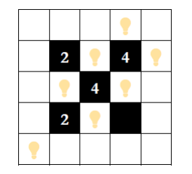

对于所有评测用例，2 ≤ n ≤ 5 ，且棋盘上至少有 15% 的格子是黑色格子。

---

### 2738 · owo（Python组）

> 题号 2738 ｜ 难度 困难 ｜ 时间 1s ｜ 内存 256MB
> 通过率 1.34% ｜ 题面原文 https://www.dotcpp.com/oj/problem2738.html
> 考过的语言/组别：Python 大学C组、Python 大学B组

#### 题目描述

小蓝很喜欢 owo ，他现在有一些字符串，他想将这些字符串拼接起来，使得最终得到的字符串中出现尽可能多的 owo 。

在计算数量时，允许字符重叠，即 owowo 计算为 2 个，owowowo 计算为

3 个。

请算出最优情况下得到的字符串中有多少个 owo。

#### 输入格式

输入的第一行包含一个整数 n ，表示小蓝拥有的字符串的数量。

接下来 n 行，每行包含一个由小写英文字母组成的字符串 s<sub>i </sub>。

#### 输出格式

输出 n 行，每行包含一个整数，表示前 i 个字符串在最优拼接方案中可以得到的 owo 的数量。

#### 样例输入

```
3

owo

w

ow
```

#### 提示

对于 10% 的评测用例，n ≤ 10；

对于 40% 的评测用例，n ≤ 300；

对于 60% 的评测用例，n ≤ 5000；

对于所有评测用例，1 ≤ n ≤ 10<sup>6</sup> ，1 ≤ |s<sub>i</sub> | ，

∑

|s<sub>i</sub> | ≤ 10<sup>6</sup>，其中 |s<sub>i</sub> | 表示字符串 s<sub>i </sub>的长度。

本试题适用于用Python代码来完成，如用c/c++/java代码建议转到：https://www.dotcpp.com/oj/problem2710.html链接

---

### 2739 · 替换字符（Python组）

> 题号 2739 ｜ 难度 困难 ｜ 时间 1s ｜ 内存 256MB
> 通过率 12.08% ｜ 题面原文 https://www.dotcpp.com/oj/problem2739.html
> 考过的语言/组别：Python 大学B组、Python 大学A组

#### 题目描述

给定一个仅含小写英文字母的字符串 s，每次操作选择一个区间 [l<sub>i</sub> ,r<sub>i</sub> ] 将 s

的该区间中的所有字母 x<sub>i</sub> 全部替换成字母 y<sub>i</sub>，问所有操作做完后，得到的字符串是什么。

#### 输入格式

输入的第一行包含一个字符串 s 。

第二行包含一个整数 m 。

接下来 m 行，每行包含 4 个参数 l<sub>i</sub> ,r<sub>i</sub> , x<sub>i</sub> , y<sub>i</sub>，相邻两个参数之间用一个空格分隔，其中 l<sub>i</sub> ,r<sub>i</sub> 为整数，x<sub>i </sub>, y<sub>i</sub> 为小写字母。

#### 输出格式

输出一行包含一个字符串表示答案。

#### 样例输入

```
abcaaea

4

1 7 c e

3 3 e b

3 6 b e

1 4 a c
```

#### 提示

对于 40% 的评测用例，|s|, m ≤ 5000；

对于所有评测用例，1 ≤ |s|, m ≤ 10<sup>5</sup> ，1 ≤ l<sub>i</sub> ≤ r<sub>i</sub> ≤ |s| ， 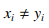 ，其中 |s| 表示字符串 s 的长度。

---

### 2740 · 最少的 1（C/C++/Java组）

> 题号 2740 ｜ 难度 困难 ｜ 时间 1s ｜ 内存 256MB
> 通过率 10.89% ｜ 题面原文 https://www.dotcpp.com/oj/problem2740.html
> 考过的语言/组别：Java 研究生组、C++ 研究生组

#### 题目描述

给定一个正整数 n ，找出所有 n 的倍数的二进制表示中最少有多少个 1。

#### 输入格式

输入一行包含一个整数 n 。

#### 输出格式

输出一行包含一个整数表示答案。

#### 样例输入

```
7
```

#### 提示

14 是 7 的倍数，其二进制表示为 1110，有 3 个 1。7 也是 7 的倍数，二进制表示中也有 3 个 1 。可以证明 7 的其他倍数的二进制表示不会具有更少的 1。

对于 10% 的评测用例，n ≤ 10；

对于 25% 的评测用例，n ≤ 200；

对于 50% 的评测用例，n ≤ 5000；

对于所有评测用例，1 ≤ n ≤ 10<sup>6</sup>。

---

### 2741 · 好等差数列

> 题号 2741 ｜ 难度 困难 ｜ 时间 1s ｜ 内存 256MB
> 通过率 7.45% ｜ 题面原文 https://www.dotcpp.com/oj/problem2741.html
> 考过的语言/组别：Java 研究生组、C++ 研究生组

#### 题目描述

等差数列是指从第二项开始，每一项与它前一项的差为同一个常数的数列，这个常数称为等差数列的公差。公差为整数的等差数列称为“好等差数列”。

一个数列到“好等差数列”的距离定义如下：找到一个最小的非负整数

k，使得将这个数列中的 k 个数修改后（可以修改为任意值），数列可以变为一个“好等差数列”，就称这个数列到“好等差数列”的距离为 k。例如，数列

(1, 2, 3, 5) 到“好等差数列”的距离为 1，因为将最后一个数字修改为 4 之后， (1, 2, 3, 4) 就是一个公差为 1 的“好等差数列”。

小蓝现在有一个长度为 n 的数列 A = (a<sub>0</sub>, a<sub>1</sub>, · · · , a<sub>n−1</sub>) 。小蓝会对这个数列进行 m 次修改操作，每次修改数列中的一个元素，每次修改过后，小蓝都想知道当前的数列到“好等差数列”的距离是多少，请你帮他计算。

#### 输入格式

输入的第一行包含一个整数 n，表示数列的长度。

第二行包含 n 个整数 a<sub>0</sub>, a<sub>1</sub>, · · · , a<sub>n−1</sub>，相邻两个整数之间用一个空格分隔。

第三行包含一个整数 m ，表示修改的次数。

接下来 m 行，每行包含两个整数 p, v，用一个空格分隔，表示将数列 A 中下标为 p 的元素修改为 v。

#### 输出格式

输出一行包含 m 个整数，相邻两个整数之间用一个空格分隔，其中第 i 个整数表示经过前 i 次修改操作之后，数列到“好等差数列”的距离。

#### 样例输入

```
3

0 1 7

2

1 0

2 0
```

#### 提示

第一次修改后，数列 A = (0, 0, 7)，它到“好等差数列”的距离为 1，即至少修改其中一个元素后数列 A 就可以变成“好等差数列”。有多种实现方案：1）将第三个元素更改为 0 变为 (0, 0, 0) 是一个“好等差数列”，公差为 0；2）将第一个元素更改为 −7 变为 (−7, 0, 7) 也是一个“好等差数列”，公差为 7。注意上述两种方案中提到的更改并不是真的对数列 A 进行修改，而是为了表述数列是如何转化到“好等差数列”的。

第二次修改后，数列 A = (0, 0, 0)，他已经是一个“好等差数列”了，所以答案就是 0 。

对于 20% 的评测用例，1 ≤ n, m ≤ 10 ，0 ≤ a<sub>i</sub> , v ≤ 10；

对于 50% 的评测用例，1 ≤ n ≤ 100 ，1 ≤ m ≤ 1000 ，0 ≤ a<sub>i</sub> , v ≤ 10000 ；

对于所有评测用例，1 ≤ n, m ≤ 1000 ，0 ≤ a<sub>i</sub> , v ≤ 10000 ，0 ≤ p ≤ n − 1。注意，以上为输入数据的限制，在判断是否为“好等差数列”时，修改的数可以超过 0 至 10000 的范围。

---

### 2742 · 三角序列（Java组）

> 题号 2742 ｜ 难度 困难 ｜ 时间 1s ｜ 内存 256MB
> 通过率 0.00% ｜ 题面原文 https://www.dotcpp.com/oj/problem2742.html
> 考过的语言/组别：Java 研究生组

#### 题目描述

给定 n 组成对的数 a<sub>i</sub> , b<sub>i</sub>，每组数表示一个 a<sub>i</sub> 行 a<sub>i</sub> 列的如图所示的三角形：

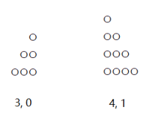

其中 b<sub>i</sub> 为 0 时左边较低，为 1 时右边较低。

将每组数对应的三角按数的顺序从左到右拼接起来。

现给出 m 组询问 l<sub>i</sub> ,r<sub>i</sub> , v<sub>i</sub>，对每组询问求最低高度 h<sub>i</sub> 使得 l<sub>i</sub> 到 r<sub>i</sub> 列之间的高度在 h<sub>i</sub> 以内的 o 的数量大于等于 v<sub>i</sub>。

#### 输入格式

输入的第一行包含两个整数 n, m，用一个空格分隔。

接下来 n 行，每行包含两个整数 a<sub>i </sub>, b<sub>i</sub>，用一个空格分隔。

接下来 m 行，每行包含三个整数 l<sub>i</sub> ,r<sub>i</sub> , vi，相邻两个整数之间用一个空格分隔。

#### 输出格式

输出 m 行，每行包含一个整数 h<sub>i</sub> ，依次表示每次询问对应的答案。如果不存在这样的 h<sub>i</sub>，请输出 −1。

#### 样例输入

```
6 6

3 0

4 0

2 1

3 1

5 0

1 1

3 9 12

3 9 13

3 4 4

14 16 7

9 15 12

1 18 42
```

#### 提示

第一个询问对应的范围如图所示：

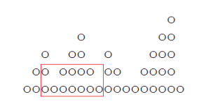

对于 30% 的评测用例，1 ≤ n, m, a<sub>i</sub> ≤ 500；

对于 50% 的评测用例，1 ≤ n, m, a<sub>i</sub> ≤ 5000；

对于所有评测用例，1 ≤ n, m ≤ 200000 ，1 ≤ a<sub>i</sub> ≤ 10<sup>6</sup> ，0 ≤ b<sub>i</sub> ≤ 1 ，

1 ≤ l<sub>i</sub> ≤ r<sub>i</sub> ≤

∑

a<sub>i</sub> ，1 ≤ v<sub>i</sub> ≤ 10<sup>18</sup>。

---

### 2743 · 斐波那契数组（Python组）

> 题号 2743 ｜ 难度 困难 ｜ 时间 1s ｜ 内存 256MB
> 通过率 20.03% ｜ 题面原文 https://www.dotcpp.com/oj/problem2743.html
> 考过的语言/组别：Python 大学C组

#### 题目描述

如果数组 A = (a<sub>0</sub>, a<sub>1</sub>, · · · , a<sub>n−1</sub>) 满足以下条件，就说它是一个斐波那契数组：

1. n ≥ 2；

2. a<sub>0</sub> = a<sub>1</sub>；

3. 对于所有的 i(i ≥ 2)，都满足 a<sub>i</sub> = a<sub>i−1</sub> + a<sub>i−2</sub>。

现在，给出一个数组 A ，你可以执行任意次修改，每次修改将数组中的某个位置的元素修改为一个大于 0 的整数。请问最少修改几个元素之后，数组 A

会变成一个斐波那契数组。

#### 输入格式

输入的第一行包含一个整数 n ，表示数组 A 中的元素个数。

第二行包含 n 个整数 a<sub>0</sub>, a<sub>1</sub>, · · · , a<sub>n−1</sub>，相邻两个整数之间用一个空格分隔。

#### 输出格式

输出一行包含一个整数表示最少需要修改数组 A 中的几个元素之后，数组

A 可以变为一个斐波那契数组。

#### 样例输入

```
5

1 2 2 4 8
```

#### 提示

将原数组修改为 (1, 1, 2, 3, 5)，最少修改三个元素变成了一个斐波那契数组。

对于所有评测用例，2 ≤ n ≤ 10<sup>5</sup> ，1 ≤ a<sub>i</sub> ≤ 10<sup>6</sup>。

---

### 2744 · 最大公约数（Python组）

> 题号 2744 ｜ 难度 困难 ｜ 时间 1s ｜ 内存 256MB
> 通过率 12.55% ｜ 题面原文 https://www.dotcpp.com/oj/problem2744.html
> 考过的语言/组别：Python 大学C组、Python 大学A组

#### 题目描述

给定一个数组，每次操作可以选择数组中任意两个相邻的元素 x, y 并将其中的一个元素替换为 gcd(x, y) ，其中 gcd(x, y) 表示 x 和 y 的最大公约数。

请问最少需要多少次操作才能让整个数组只含 1 。

#### 输入格式

输入的第一行包含一个整数 n ，表示数组长度。

第二行包含 n 个整数 a<sub>1</sub>, a<sub>2</sub>, · · · , a<sub>n</sub>，相邻两个整数之间用一个空格分隔。

#### 输出格式

输出一行包含一个整数，表示最少操作次数。如果无论怎么操作都无法满足要求，输出 −1 。

#### 样例输入

```
3

4 6 9
```

#### 提示

对于 30% 的评测用例，n ≤ 500 ，a<sub>i</sub> ≤ 1000；

对于 50% 的评测用例，n ≤ 5000 ，a<sub>i</sub> ≤ 10<sup>6</sup>；

对于所有评测用例，1 ≤ n ≤ 100000 ，1 ≤ a<sub>i</sub> ≤ 10<sup>9</sup>。

---

### 2745 · 分石头（C/C++组）

> 题号 2745 ｜ 难度 困难 ｜ 时间 1s ｜ 内存 256MB
> 通过率 21.85% ｜ 题面原文 https://www.dotcpp.com/oj/problem2745.html
> 考过的语言/组别：C++ 研究生组

#### 题目描述

小蓝和小乔正在玩一个游戏：对给定的 n 堆石子，每次可以选一堆石子分成相等的质数份或直接消去。双方轮流操作，轮到某玩家操作时如果没有任何石子则这个玩家失败。

小蓝先操作（先手），小乔后操作。

请问小蓝是否存在必胜策略，即是不是存在一种策略，使得不论小乔如何操作，小蓝总有办法获得胜利。

#### 输入格式

输入包含多组独立的询问。

输入的第一行包含一个整数 T 表示询问的组数。

接下来依次描述每一组询问。

每组询问的第一行包含一个整数 n<sub>i</sub> ，表示石子的堆数。

第二行包含 n 个正整数，相邻两个整数之间用一个空格分隔，依次表示每堆石子的个数。

#### 输出格式

输出 T 行，每行包含一个整数 0 或 1，表示对应询问的答案。如果小蓝存在必胜策略，输出 1，否则输出 0 。

#### 样例输入

```
2

2

2 3

5

4 15 1 9 6
```

#### 提示

对于 20% 的评测用例，T = 1 ，n<sub>i</sub> ≤ 10 ，每堆石子数量不超过 1000；

对于 50% 的评测用例，∑

n<sub>i</sub> ≤ 10000；

对于所有评测用例，1 ≤ T ≤ 10<sup>5</sup> ，1 ≤ n<sub>i</sub> ，

∑

n<sub>i</sub> ≤ 10<sup>5</sup> ，每堆石子数量不超过 10<sup>6</sup>。

---

### 2746 · 六六大顺（Python组）

> 题号 2746 ｜ 难度 困难 ｜ 时间 1s ｜ 内存 256MB
> 通过率 3.20% ｜ 题面原文 https://www.dotcpp.com/oj/problem2746.html
> 考过的语言/组别：Python 大学A组

#### 题目描述

六六大顺，本指农历六月初六。多用于祝福中年人士家庭幸福，工作顺利，事业有成，身体健康。源自《左传》“君义，臣行，父慈，子孝，兄爱，弟敬，此数者累谓六顺也。”

6 在我国自古以来是一个吉祥的数字，定义数列 A = (a<sub>1</sub>, a<sub>2</sub>, · · · , a<sub>i</sub> , · · ·) ，其中 a<sub>1</sub> = 6 , a<sub>2</sub> = 66 , · · · , a<sub>i</sub> = 10 · a<sub>i−1</sub> + 6。

定义一个数列 B = (b<sub>1</sub>, b<sub>2</sub>, · · · , b<sub>i</sub> , · · ·)，其中 b<sub>1</sub> = 6 × 6, b<sub>2</sub> = 66 × 66, · · · ,

b<sub>i</sub> = a<sub>i</sub> · a<sub>i</sub>。

现在小蓝想知道数列 B 的前 n 项的和是多少，你能帮帮小蓝吗？

#### 输入格式

输入一行包含一个正整数 n 。

#### 输出格式

输出一行包含一个整数表示数列 B 前 n 项的和。

#### 样例输入

```
3
```

#### 提示

b<sub>1</sub> = 6 × 6 = 36, b<sub>2</sub> = 66 × 66 = 4356, b<sub>3</sub> = 666 × 666 = 443556，所以前三项的和为 36 + 4356 + 443556 = 447948 。

对于 20% 的评测用例，1 ≤ n ≤ 100；

对于 50% 的评测用例，1 ≤ n ≤ 100000；

对于所有评测用例，1 ≤ n ≤ 10000000 。

---

### 2747 · 环境治理（Python组）

> 题号 2747 ｜ 难度 困难 ｜ 时间 1s ｜ 内存 256MB
> 通过率 16.83% ｜ 题面原文 https://www.dotcpp.com/oj/problem2747.html
> 考过的语言/组别：Python 大学A组

#### 题目描述

LQ 国拥有 n 个城市，从 0 到 n − 1 编号，这 n 个城市两两之间都有且仅有一条双向道路连接，这意味着任意两个城市之间都是可达的。每条道路都有一个属性 D ，表示这条道路的灰尘度。当从一个城市 A 前往另一个城市 B 时，可能存在多条路线，每条路线的灰尘度定义为这条路线所经过的所有道路的灰尘度之和，LQ 国的人都很讨厌灰尘，所以他们总会优先选择灰尘度最小的路线。

LQ 国很看重居民的出行环境，他们用一个指标 P 来衡量 LQ 国的出行环境，P 定义为：

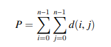

其中 d(i, j) 表示城市 i 到城市 j 之间灰尘度最小的路线对应的灰尘度的值。

为了改善出行环境，每个城市都要有所作为，当某个城市进行道路改善时，会将与这个城市直接相连的所有道路的灰尘度都减少 1，但每条道路都有一个灰尘度的下限值 L，当灰尘度达到道路的下限值时，无论再怎么改善，道路的灰尘度也不会再减小了。

具体的计划是这样的：

第 1 天，0 号城市对与其直接相连的道路环境进行改善；

第 2 天，1 号城市对与其直接相连的道路环境进行改善；

…

第 n 天，n − 1 号城市对与其直接相连的道路环境进行改善；

第 n + 1 天，0 号城市对与其直接相连的道路环境进行改善；

第 n + 2 天，1 号城市对与其直接相连的道路环境进行改善；

…

LQ 国想要使得 P 指标满足 P ≤ Q。请问最少要经过多少天之后，P 指标可以满足 P ≤ Q。如果在初始时就已经满足条件，则输出 0 ；如果永远不可能满足，则输出 −1。

#### 输入格式

输入的第一行包含两个整数 n, Q，用一个空格分隔，分别表示城市个数和期望达到的 P 指标。

接下来 n 行，每行包含 n 个整数，相邻两个整数之间用一个空格分隔，其中第 i 行第 j 列的值 D<sub>ij </sub>(D<sub>ij</sub> = D<sub>ji</sub>, D<sub>ii</sub> = 0) 表示城市 i 与城市 j 之间直接相连的那条道路的灰尘度。

接下来 n 行，每行包含 n 个整数，相邻两个整数之间用一个空格分隔，其中第 i 行第 j 列的值 L<sub>ij</sub> (L<sub>ij</sub> = L<sub>ji</sub>, L<sub>ii</sub> = 0) 表示城市 i 与城市 j 之间直接相连的那条道路的灰尘度的下限值。

#### 输出格式

输出一行包含一个整数表示答案。

#### 样例输入

```
3 10

0 2 4

2 0 1

4 1 0

0 2 2

2 0 0

2 0 0
```

#### 提示

初始时的图如下所示，每条边上的数字表示这条道路的灰尘度：

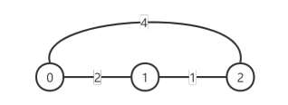

此时每对顶点之间的灰尘度最小的路线对应的灰尘度为：

d(0, 0) = 0, d(0, 1) = 2, d(0, 2) = 3,

d(1, 0) = 2, d(1, 1) = 0, d(1, 2) = 1,

d(2, 0) = 3, d(2, 1) = 1, d(2, 2) = 0.

初始时的 P 指标为 (2 + 3 + 1) × 2 = 12，不满足 P ≤ Q = 10;

第一天，0 号城市进行道路改善，改善后的图示如下：

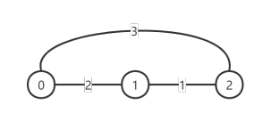

注意到边 (0, 2) 的值减小了 1 ，但 (0, 1) 并没有减小，因为 L<sub>0,1</sub> = 2 ，所以

(0, 1) 的值不可以再减小了。此时每对顶点之间的灰尘度最小的路线对应的灰尘度为：

d(0, 0) = 0, d(0, 1) = 2, d(0, 2) = 3,

d(1, 0) = 2, d(1, 1) = 0, d(1, 2) = 1,

d(2, 0) = 3, d(2, 1) = 1, d(2, 2) = 0.

此时 P 仍为 12 。

第二天，1 号城市进行道路改善，改善后的图示如下：

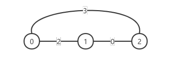

此时每对顶点之间的灰尘度最小的路线对应的灰尘度为：

d(0, 0) = 0, d(0, 1) = 2, d(0, 2) = 2,

d(1, 0) = 2, d(1, 1) = 0, d(1, 2) = 0,

d(2, 0) = 2, d(2, 1) = 0, d(2, 2) = 0.

此时的 P 指标为 (2 + 2) × 2 = 8 < Q ，此时已经满足条件。

所以答案是 2。

对于 30% 的评测用例，1 ≤ n ≤ 10 ，0 ≤ L<sub>ij</sub> ≤ D<sub>ij</sub> ≤ 10；

对于 60% 的评测用例，1 ≤ n ≤ 50 ，0 ≤ L<sub>ij</sub> ≤ D<sub>ij</sub> ≤ 100000；

对于所有评测用例，1 ≤ n ≤ 100 ，0 ≤ L<sub>ij</sub> ≤ D<sub>ij</sub> ≤ 100000 ，0 ≤ Q ≤ 2<sup>31</sup> − 1。

---

### — · 排列字母

> 题号 洛谷 P12363 ｜ 难度 简单（洛谷 入门） ｜ 时间 1.00s ｜ 内存 512MB
> 通过率 64.89%（洛谷站内口径） ｜ 题面原文 https://www.luogu.com.cn/problem/P12363
> 考过的语言/组别：省赛 Python 大学B组（洛谷题单）

#### 题目描述

小蓝要把一个字符串中的字母按其在字母表中的顺序排列。

例如，$\tt{LANQIAO}$ 排列后为 $\tt{AAILNOQ}$。

又如，$\tt{GOODGOODSTUDYDAYDAYUP}$ 排列后为 $\tt{AADDDDDGGOOOOPSTUUYYY}$。

请问对于以下字符串，排列之后字符串是什么？

$$\tt{WHERETHEREISAWILLTHEREISAWAY}$$

#### 输出格式

这是一道结果填空的题，你只需要算出结果后提交即可。本题的结果为一个字符串，在提交答案时只需要**编写一个程序输出这个字符串**，输出多余的内容将无法得分。

---

### — · 寻找整数

> 题号 洛谷 P12364 ｜ 难度 中等（洛谷 普及+/提高−） ｜ 时间 1.00s ｜ 内存 512MB
> 通过率 69.50%（洛谷站内口径） ｜ 题面原文 https://www.luogu.com.cn/problem/P12364
> 考过的语言/组别：省赛 Python 大学B组（洛谷题单）

#### 题目描述

有一个不超过 $10^{17}$ 的正整数 $n$，知道这个数除以 $2$ 至 $49$ 后的余数如下表所示，求这个正整数最小是多少。

| $a$ | $n \bmod a$ | $a$ | $n \bmod a$ | $a$ | $n \bmod a$ | $a$ | $n \bmod a$ |
|:---:|:-----------:|:---:|:-----------:|:---:|:-----------:|:---:|:-----------:|
| $2$ | $1$         | $14$| $11$        | $26$| $23$        | $38$| $37$        |
| $3$ | $2$         | $15$| $14$        | $27$| $20$        | $39$| $23$        |
| $4$ | $1$         | $16$| $9$         | $28$| $25$        | $40$| $9$         |
| $5$ | $4$         | $17$| $0$         | $29$| $16$        | $41$| $1$         |
| $6$ | $5$         | $18$| $11$        | $30$| $29$        | $42$| $11$        |
| $7$ | $4$         | $19$| $18$        | $31$| $27$        | $43$| $11$        |
| $8$ | $1$         | $20$| $9$         | $32$| $25$        | $44$| $33$        |
| $9$ | $2$         | $21$| $11$        | $33$| $11$        | $45$| $29$        |
| $10$| $9$         | $22$| $11$        | $34$| $17$        | $46$| $15$        |
| $11$| $0$         | $23$| $15$        | $35$| $4$         | $47$| $5$         |
| $12$| $5$         | $24$| $17$        | $36$| $29$        | $48$| $41$        |
| $13$| $10$        | $25$| $9$         | $37$| $22$        | $49$| $46$        |

#### 输出格式

这是一道结果填空的题，你只需要算出结果后提交即可。本题的结果为一个整数，在提交答案时只需要**编写一个程序输出这个整数**，输出多余的内容将无法得分。

---

### — · 星期计算

> 题号 洛谷 P13928 ｜ 难度 简单（洛谷 普及−） ｜ 时间 1.00s ｜ 内存 512MB
> 通过率 52.99%（洛谷站内口径） ｜ 题面原文 https://www.luogu.com.cn/problem/P13928
> 考过的语言/组别：省赛 Java 大学B组（洛谷题单）

#### 题目描述

已知今天是星期六，请问 $20^{22}$ 天后是星期几？

注意用数字 1 到 7 表示星期一到星期日。

#### 输出格式

这是一道结果填空的题，你只需要算出结果后提交即可。本题的结果为一个整数，在提交答案时只输出这个整数，填写多余的内容将无法得分。

#### 样例输入

```

```

#### 样例输出

```

```

---

### — · 山

> 题号 洛谷 P13929 ｜ 难度 简单（洛谷 普及−） ｜ 时间 1.00s ｜ 内存 512MB
> 通过率 44.29%（洛谷站内口径） ｜ 题面原文 https://www.luogu.com.cn/problem/P13929
> 考过的语言/组别：省赛 Java 大学B组（洛谷题单）

#### 题目描述

这天小明正在学数数。

他突然发现有些正整数的形状像一座“山”，比如 $123565321$、$145541$，它们左右对称（回文）且数位上的数字先单调不减，后单调不增。

小明数了很久也没有数完，他想让你告诉他在区间 $[2022, 2022222022]$ 中有多少个数的形状像一座“山”。

#### 输出格式

这是一道结果填空的题，你只需要算出结果后提交即可。本题的结果为一个整数，在提交答案时只填写这个整数，填写多余的内容将无法得分。

#### 样例输入

```

```

#### 样例输出

```

```

---
