# 蓝桥杯 2023年第十四届 真题（全部组别合并，按题号排列）

> 来源: Dotcpp 蓝桥杯真题 https://www.dotcpp.com/oj/lanqiao/ ｜ 洛谷蓝桥杯题单补充 65 题 https://www.luogu.com.cn/problem/list?type=luogu&tag=361,363 ｜ 抓取时间: 2026-11-27
> 本年有效试卷 12 套、96 题次，Dotcpp 去重 48 道题，另补洛谷题 65 道。

## 本年试卷构成

| 赛段 | 科目 | 组别 | 题数 | 备注 | 题集页 |
| --- | --- | --- | --- | --- | --- |
| 省赛 | C++ | 大学A组 | 8 |  | [题集](https://www.dotcpp.com/oj/1088/) |
| 省赛 | C++ | 大学B组 | 8 |  | [题集](https://www.dotcpp.com/oj/1089/) |
| 省赛 | C++ | 大学C组 | 8 |  | [题集](https://www.dotcpp.com/oj/1090/) |
| 省赛 | C++ | 研究生组 | 8 |  | [题集](https://www.dotcpp.com/oj/1091/) |
| 省赛 | Java | 大学A组 | 8 |  | [题集](https://www.dotcpp.com/oj/1096/) |
| 省赛 | Java | 大学B组 | 8 |  | [题集](https://www.dotcpp.com/oj/1097/) |
| 省赛 | Java | 大学C组 | 8 |  | [题集](https://www.dotcpp.com/oj/1098/) |
| 省赛 | Java | 研究生组 | 8 |  | [题集](https://www.dotcpp.com/oj/1099/) |
| 省赛 | Python | 大学A组 | 8 |  | [题集](https://www.dotcpp.com/oj/1092/) |
| 省赛 | Python | 大学B组 | 8 |  | [题集](https://www.dotcpp.com/oj/1093/) |
| 省赛 | Python | 大学C组 | 8 |  | [题集](https://www.dotcpp.com/oj/1094/) |
| 省赛 | Python | 研究生组 | 8 |  | [题集](https://www.dotcpp.com/oj/1095/) |

## 题目一览

| 题号 | 标题 | 难度 | 通过率 | 考过的语言/组别 |
| --- | --- | --- | --- | --- |
| 3142 | 平方差 | 中等 | 19.57% | C++大学A组 |
| 3143 | 更小的数 | 困难 | 5.90% | C++大学A组 |
| 3144 | 颜色平衡树 | 困难 | 23.96% | C++大学A组 |
| 3145 | 买瓜 | 困难 | 11.51% | C++大学A组 |
| 3146 | 网络稳定性 | 困难 | 13.66% | C++大学A组 |
| 3147 | 异或和之和 | 困难 | 20.99% | C++大学A组 |
| 3148 | 像素放置 | 中等 | 42.39% | C++大学A组 |
| 3149 | 翻转硬币 | 困难 | 4.90% | C++大学A组 |
| 3150 | 冶炼金属 | 简单 | 38.42% | C++大学B组 |
| 3151 | 飞机降落 | 中等 | 28.19% | C++大学B组 |
| 3152 | 接龙数列 | 中等 | 25.21% | C++大学B组 |
| 3153 | 岛屿个数 | 中等 | 31.55% | C++大学B组 |
| 3154 | 子串简写 | 中等 | 20.39% | C++大学B组 |
| 3155 | 整数删除 | 困难 | 15.78% | C++大学B组 |
| 3156 | 景区导游 | 困难 | 19.98% | C++大学B组 |
| 3157 | 砍树 | 困难 | 21.48% | C++大学B组 |
| 3158 | 三国游戏 | 中等 | 24.32% | C++大学C组、Python大学A组、Python大学C组、Java大学C组 |
| 3159 | 填充 | 中等 | 33.98% | C++大学C组、Python大学C组、Python研究生组、Java大学C组 |
| 3160 | 翻转 | 中等 | 26.63% | C++大学C组、C++研究生组、Python大学A组、Python大学C组 |
| 3161 | 子矩阵 | 困难 | 14.08% | C++大学C组、Python大学A组、Java大学C组、Java研究生组 |
| 3162 | 互质数的个数 | 困难 | 9.68% | C++大学C组、Python研究生组、Java大学A组、Java研究生组 |
| 3163 | 异或和之差 | 困难 | 15.65% | C++大学C组、Python大学C组、Java大学C组 |
| 3164 | 公因数匹配 | 困难 | 19.10% | C++大学C组、C++研究生组、Python研究生组、Java大学C组 |
| 3165 | 子树的大小 | 困难 | 17.58% | C++大学C组、C++研究生组、Python大学A组、Python研究生组 |
| 3166 | 阶乘的和 | 困难 | 19.65% | C++研究生组、Python大学A组、Python研究生组、Java大学A组 |
| 3167 | 奇怪的数 | 困难 | 11.64% | C++研究生组、Python大学A组、Python大学C组、Java研究生组 |
| 3168 | 太阳 | 困难 | 12.65% | C++研究生组、Java大学A组、Java大学C组、Java研究生组 |
| 3169 | 高塔 | 困难 | 24.85% | C++研究生组、Python研究生组、Java大学A组、Java研究生组 |
| 3170 | 反异或 01 串 | 困难 | 16.92% | C++研究生组、Python大学A组、Python研究生组、Java大学A组、Java研究生组 |
| 3171 | 数组分割 | 困难 | 20.89% | Java大学B组 |
| 3172 | 矩形总面积 | 困难 | 20.91% | Java大学B组 |
| 3173 | 蜗牛 | 困难 | 25.04% | Java大学B组 |
| 3174 | 合并区域 | 困难 | 12.42% | Java大学B组 |
| 3175 | 买二赠一 | 困难 | 15.75% | Java大学B组 |
| 3176 | 合并石子 | 入门 | 78.22% | Java大学B组 |
| 3177 | 最大开支 | 困难 | 24.21% | Java大学B组 |
| 3178 | 魔法阵 | 中等 | 39.11% | Java大学B组 |
| 3179 | 平均 | 困难 | 22.97% | Python大学A组、Python大学C组、Java大学A组、Java大学C组 |
| 3180 | 棋盘 | 困难 | 19.56% | Python大学C组、Java大学A组、Java大学C组、Java研究生组 |
| 3181 | 松散子序列 | 中等 | 38.21% | Python大学B组 |
| 3182 | 管道 | 困难 | 19.91% | Python大学B组 |
| 3183 | 保险箱 | 困难 | 0.34% | Python大学B组 |
| 3184 | 树上选点 | 困难 | 19.36% | Python大学B组 |
| 3185 | T字消除 | 困难 | 7.14% | Python大学B组 |
| 3186 | 独一无二 | 困难 | 0.51% | Python大学B组 |
| 3187 | 异或和 | 困难 | 7.89% | Python大学B组 |
| 3188 | 混乱的数组 | 困难 | 13.29% | Python大学B组 |
| 3189 | 小蓝的旅行计划 | 困难 | 11.52% | Python大学C组、Python研究生组、Java大学A组、Java研究生组 |
| — | 子 2023 / 双子数 | 简单 | 35.69% | 国赛 C/C++ 大学B组 |
| — | 班级活动 | 简单 | 27.55% | 国赛 C/C++ 大学B组 |
| — | 合并数列 | 中等 | 52.38% | 国赛 C/C++ 大学B组 |
| — | 数三角 | 中等 | 27.19% | 国赛 C/C++ 大学B组 |
| — | 删边问题 | 困难 | 19.38% | 国赛 C/C++ 大学B组 |
| — | AB 路线 | 中等 | 25.37% | 国赛 C/C++ 大学B组 |
| — | 抓娃娃 | 中等 | 37.87% | 国赛 C/C++ 大学B组 |
| — | 拼数字 | 困难 | 4.40% | 国赛 C/C++ 大学B组 |
| — | 逃跑 | 困难 | 28.53% | 国赛 C/C++ 大学B组 |
| — | 圆上的连线 | 中等 | 63.74% | 国赛 C/C++ 大学A组 |
| — | 2023 次方 | 中等 | 64.54% | 国赛 C/C++ 大学A组 |
| — | 切割 | 简单 | 20.26% | 国赛 C/C++ 大学A组 |
| — | XYZ | 中等 | 32.25% | 国赛 C/C++ 大学A组 |
| — | 第 K 小的和 | 中等 | 26.94% | 国赛 C/C++ 大学A组 |
| — | 相连的边 | 中等 | 32.84% | 国赛 C/C++ 大学A组 |
| — | 01 游戏 | 中等 | 29.30% | 国赛 C/C++ 大学A组 |
| — | 子串 | 困难 | 28.39% | 国赛 C/C++ 大学A组 |
| — | 树上的路径 | 困难 | 24.78% | 国赛 C/C++ 大学A组 |
| — | 迷宫探险 | 困难 | 25.21% | 国赛 C/C++ 大学A组 |
| — | 跑步计划 | 简单 | 53.48% | 国赛 Python 大学A组 |
| — | 残缺的数字 | 简单 | 54.05% | 国赛 Python 大学A组、Java 大学A组 |
| — | 整数变换 | 简单 | 35.96% | 国赛 Python 大学A组、Java 大学A组 |
| — | 2023 | 困难 | 24.56% | 国赛 Python 大学A组 |
| — | 火车运输 | 中等 | 45.69% | 国赛 Python 大学A组 |
| — | 彩色二叉树 | 中等 | 28.37% | 国赛 Python 大学A组 |
| — | 选段排序 | 中等 | 30.97% | 国赛 Python 大学A组 |
| — | 最长同类子串 | 困难 | 22.23% | 国赛 Python 大学A组 |
| — | 弹珠堆放 | 简单 | 54.78% | 国赛 Python 大学B组 |
| — | 划分 | 简单 | 54.73% | 国赛 Python 大学B组 |
| — | 偶串 | 简单 | 51.97% | 国赛 Python 大学B组 |
| — | 交易账本 | 中等 | 27.86% | 国赛 Python 大学B组 |
| — | 背包问题 | 简单 | 27.10% | 国赛 Python 大学B组 |
| — | 最大阶梯 | 中等 | 35.92% | 国赛 Python 大学B组 |
| — | 贸易航线 | 中等 | 44.35% | 国赛 Python 大学B组 |
| — | 困局 | 中等 | 15.41% | 国赛 Python 大学B组 |
| — | 互质 | 中等 | 59.70% | 国赛 Java 大学B组 |
| — | 逆元 | 中等 | 55.15% | 国赛 Java 大学B组 |
| — | 玩具 | 简单 | 36.29% | 国赛 Java 大学B组 |
| — | 不完整的算式 | 中等 | 32.26% | 国赛 Java 大学B组 |
| — | 星球 | 中等 | 44.22% | 国赛 Java 大学B组 |
| — | 序列 | 中等 | 38.50% | 国赛 Java 大学B组 |
| — | 电动车 | 中等 | 45.14% | 国赛 Java 大学B组 |
| — | 非对称二叉树 | 中等 | 57.32% | 国赛 Java 大学B组 |
| — | 数和游戏 | 困难 | 33.04% | 国赛 Java 大学B组 |
| — | 游戏 | 中等 | 46.86% | 国赛 Java 大学B组 |
| — | X 质数 | 中等 | 68.93% | 国赛 Java 大学A组 |
| — | 最大算式 | 中等 | 21.29% | 国赛 Java 大学A组 |
| — | 躲炮弹 | 中等 | 20.47% | 国赛 Java 大学A组 |
| — | 连续数组 | 中等 | 34.08% | 国赛 Java 大学A组 |
| — | 质数排序 | 中等 | 27.56% | 国赛 Java 大学A组 |
| — | 单词分类 | 中等 | 27.27% | 国赛 Java 大学A组 |
| — | 游戏的得分 | 困难 | 14.29% | 国赛 Java 大学A组 |
| — | 定时任务 | 中等 | 37.21% | 国赛 C/C++ 大学C组 |
| — | 最大区间 | 中等 | 43.88% | 国赛 C/C++ 大学C组 |
| — | 钉板上的正方形 | 简单 | 46.64% | 国赛 研究生组 |
| — | 混乘数字 | 简单 | 54.17% | 国赛 研究生组 |
| — | 阶乘求和 | 简单 | 57.11% | 省赛 Java 大学B组 |
| — | 幸运数字 | 简单 | 66.17% | 省赛 Java 大学B组 |
| — | 买二赠一【疑似错题】 | 未评定 | 0.00% | 省赛 Java 大学B组 |
| — | 2023 | 简单 | 39.85% | 省赛 Python 大学B组 |
| — | 硬币兑换 | 简单 | 52.50% | 省赛 Python 大学B组 |
| — | 独一无二【疑似假题】 | 未评定 | 0.00% | 省赛 Python 大学B组 |
| — | 特殊日期 | 简单 | 45.42% | 省赛 Java 组、Python 大学A组 |
| — | 与或异或 | 中等 | 69.61% | 省赛 Java 大学A组 |
| — | 工作时长 | 简单 | 56.56% | 省赛 C/C++ 大学C组 |

## 题目详情

### 3142 · 平方差

> 题号 3142 ｜ 难度 中等 ｜ 时间 1s ｜ 内存 256MB
> 通过率 19.57% ｜ 题面原文 https://www.dotcpp.com/oj/problem3142.html
> 考过的语言/组别：C++ 大学A组

#### 题目描述

给定 L, R，问 L ≤ x ≤ R 中有多少个数 x 满足存在整数 y,z 使得 x = y<sup>2</sup> − z<sup>2</sup>。

#### 输入格式

输入一行包含两个整数 L, R，用一个空格分隔。

#### 输出格式

输出一行包含一个整数满足题目给定条件的 x 的数量。

#### 样例输入

```
1 5
```

#### 提示

1 = 1<sup>2</sup> − 0<sup>2</sup> ；

3 = 2<sup>2</sup> − 1<sup>2</sup> ；

4 = 2<sup>2</sup> − 0<sup>2</sup> ；

5 = 3<sup>2</sup> − 2<sup>2</sup> 。

对于 40% 的评测用例，LR ≤ 5000 ；

对于所有评测用例，1 ≤ L ≤ R ≤ 10<sup>9</sup> 。

---

### 3143 · 更小的数

> 题号 3143 ｜ 难度 困难 ｜ 时间 1s ｜ 内存 256MB
> 通过率 5.90% ｜ 题面原文 https://www.dotcpp.com/oj/problem3143.html
> 考过的语言/组别：C++ 大学A组

#### 题目描述

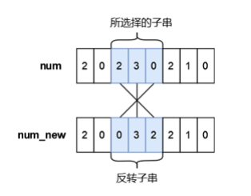

小蓝有一个长度均为 n 且仅由数字字符 0 ∼ 9 组成的字符串，下标从 0 到 n − 1，你可以将其视作是一个具有 n 位的十进制数字 num，小蓝可以从 num 中选出一段连续的子串并将子串进行反转，最多反转一次。小蓝想要将选出的子串进行反转后再放入原位置处得到的新的数字 num<sub>new</sub> 满足条件 num<sub>new</sub> < num，请你帮他计算下一共有多少种不同的子串选择方案，只要两个子串在 num 中的位置不完全相同我们就视作是不同的方案。

注意，我们允许前导零的存在，即数字的最高位可以是 0 ，这是合法的。

#### 输入格式

输入一行包含一个长度为 n 的字符串表示 num（仅包含数字字符 0 ∼ 9），

从左至右下标依次为 0 ∼ n − 1。

#### 输出格式

输出一行包含一个整数表示答案。

#### 样例输入

```
210102
```

#### 提示

一共有 8 种不同的方案：

1）所选择的子串下标为 0 ∼ 1 ，反转后的 num<sub>new</sub> = 120102 < 210102 ；

2）所选择的子串下标为 0 ∼ 2 ，反转后的 num<sub>new</sub> = 012102 < 210102 ；

3）所选择的子串下标为 0 ∼ 3 ，反转后的 num<sub>new</sub> = 101202 < 210102 ；

4）所选择的子串下标为 0 ∼ 4 ，反转后的 num<sub>new</sub> = 010122 < 210102 ；

5）所选择的子串下标为 0 ∼ 5 ，反转后的 num<sub>new</sub> = 201012 < 210102 ；

6）所选择的子串下标为 1 ∼ 2 ，反转后的 num<sub>new</sub> = 201102 < 210102 ；

7）所选择的子串下标为 1 ∼ 4 ，反转后的 num<sub>new</sub> = 201012 < 210102 ；

8）所选择的子串下标为 3 ∼ 4 ，反转后的 num<sub>new</sub> = 210012 < 210102 ；

对于 20% 的评测用例，1 ≤ n ≤ 100 ；

对于 40% 的评测用例，1 ≤ n ≤ 1000 ；

对于所有评测用例，1 ≤ n ≤ 5000 。

---

### 3144 · 颜色平衡树

> 题号 3144 ｜ 难度 困难 ｜ 时间 1s ｜ 内存 256MB
> 通过率 23.96% ｜ 题面原文 https://www.dotcpp.com/oj/problem3144.html
> 考过的语言/组别：C++ 大学A组

#### 题目描述

给定一棵树，结点由 1 至 n 编号，其中结点 1 是树根。树的每个点有一个颜色 C<sub>i</sub>。

如果一棵树中存在的每种颜色的结点个数都相同，则我们称它是一棵颜色平衡树。

求出这棵树中有多少个子树是颜色平衡树。

#### 输入格式

输入的第一行包含一个整数 n ，表示树的结点数。

接下来 n 行，每行包含两个整数 C<sub>i</sub> , F<sub>i</sub>，用一个空格分隔，表示第 i 个结点的颜色和父亲结点编号。

特别地，输入数据保证 F<sub>1</sub> 为 0 ，也即 1 号点没有父亲结点。保证输入数据是一棵树。

#### 输出格式

输出一行包含一个整数表示答案。

#### 样例输入

```
6

2 0

2 1

1 2

3 3

3 4

1 4
```

#### 提示

编号为 1, 3, 5, 6 的 4 个结点对应的子树为颜色平衡树。

对于 30% 的评测用例，n ≤ 200，C<sub>i</sub> ≤ 200 ；

对于 60% 的评测用例，n ≤ 5000，C<sub>i</sub> ≤ 5000 ；

对于所有评测用例，1 ≤ n ≤ 200000，1 ≤ C<sub>i</sub> ≤ 200000，0 ≤ F<sub>i</sub> < i 。

---

### 3145 · 买瓜

> 题号 3145 ｜ 难度 困难 ｜ 时间 1s ｜ 内存 256MB
> 通过率 11.51% ｜ 题面原文 https://www.dotcpp.com/oj/problem3145.html
> 考过的语言/组别：C++ 大学A组

#### 题目描述

小蓝正在一个瓜摊上买瓜。瓜摊上共有 n 个瓜，每个瓜的重量为 A<sub>i</sub> 。

小蓝刀功了得，他可以把任何瓜劈成完全等重的两份，不过每个瓜只能劈一刀。

小蓝希望买到的瓜的重量的和恰好为 m 。

请问小蓝至少要劈多少个瓜才能买到重量恰好为 m 的瓜。如果无论怎样小蓝都无法得到总重恰好为 m 的瓜，请输出 −1 。

#### 输入格式

输入的第一行包含两个整数 n, m，用一个空格分隔，分别表示瓜的个数和小蓝想买到的瓜的总重量。

第二行包含 n 个整数 A<sub>i</sub>，相邻整数之间使用一个空格分隔，分别表示每个瓜的重量。

#### 输出格式

输出一行包含一个整数表示答案。

#### 样例输入

```
3 10

1 3 13
```

#### 提示

对于 20% 的评测用例，∑n≤10；

对于 60% 的评测用例，∑n≤20；

对于所有评测用例，1 ≤n≤30，1≤ A<sub>i</sub> ≤ 10<sup>9</sup> ，1 ≤ m ≤ 10<sup>9</sup>

---

### 3146 · 网络稳定性

> 题号 3146 ｜ 难度 困难 ｜ 时间 1.5s ｜ 内存 256MB
> 通过率 13.66% ｜ 题面原文 https://www.dotcpp.com/oj/problem3146.html
> 考过的语言/组别：C++ 大学A组

#### 题目描述

有一个局域网，由 n 个设备和 m 条物理连接组成，第 i 条连接的稳定性为w<sub>i </sub>。

对于从设备 A 到设备 B 的一条经过了若干个物理连接的路径，我们记这条路径的稳定性为其经过所有连接中稳定性最低的那个。

我们记设备 A 到设备 B 之间通信的稳定性为 A 至 B 的所有可行路径的稳定性中最高的那一条。

给定局域网中的设备的物理连接情况，求出若干组设备 x<sub>i</sub> 和 y<sub>i</sub> 之间的通信稳定性。如果两台设备之间不存在任何路径，请输出 −1 。

#### 输入格式

输入的第一行包含三个整数 n, m, q ，分别表示设备数、物理连接数和询问数。

接下来 m 行，每行包含三个整数 u<sub>i</sub> , v<sub>i </sub>,w<sub>i</sub> ，分别表示 u<sub>i</sub> 和 v<sub>i</sub> 之间有一条稳定性为 w<sub>i</sub> 的物理连接。

接下来 q 行，每行包含两个整数 x<sub>i</sub> , y<sub>i </sub>，表示查询 x<sub>i</sub> 和 y<sub>i</sub> 之间的通信稳定性。

#### 输出格式

输出 q 行，每行包含一个整数依次表示每个询问的答案。

#### 样例输入

```
5 4 3

1 2 5

2 3 6

3 4 1

1 4 3

1 5

2 4

1 3
```

#### 提示

对于 30% 的评测用例，n, q ≤ 500，m ≤ 1000 ；

对于 60% 的评测用例，n, q ≤ 5000，m ≤ 10000 ；

对于所有评测用例，2 ≤ n, q ≤ 10<sup>5</sup>，1 ≤ m ≤ 3 × 10<sup>5</sup>，1 ≤ u<sub>i</sub> , v<sub>i</sub> , x<sub>i</sub> , y<sub>i</sub> ≤ n，

1 ≤ w<sub>i </sub>≤ 10<sup>6</sup>，u<sub>i </sub>≠ v<sub>i</sub>，x<sub>i</sub> ≠ y<sub>i</sub> 。

---

### 3147 · 异或和之和

> 题号 3147 ｜ 难度 困难 ｜ 时间 1s ｜ 内存 256MB
> 通过率 20.99% ｜ 题面原文 https://www.dotcpp.com/oj/problem3147.html
> 考过的语言/组别：C++ 大学A组

#### 题目描述

给定一个数组 A<sub>i</sub>，分别求其每个子段的异或和，并求出它们的和。或者说，对于每组满足 1 ≤ L ≤ R ≤ n 的 L, R ，求出数组中第 L 至第 R 个元素的异或和。然后输出每组 L, R 得到的结果加起来的值。

#### 输入格式

输入的第一行包含一个整数 n 。

第二行包含 n 个整数 A<sub>i</sub> ，相邻整数之间使用一个空格分隔。

#### 输出格式

输出一行包含一个整数表示答案。

#### 样例输入

```
5

1 2 3 4 5
```

#### 提示

对于 30% 的评测用例，n ≤ 300 ；

对于 60% 的评测用例，n ≤ 5000 ；

对于所有评测用例，1 ≤ n ≤ 10<sup>5</sup>，0 ≤ A<sup>i</sup> ≤ 2<sup>20</sup> 。

---

### 3148 · 像素放置

> 题号 3148 ｜ 难度 中等 ｜ 时间 1s ｜ 内存 256MB
> 通过率 42.39% ｜ 题面原文 https://www.dotcpp.com/oj/problem3148.html
> 考过的语言/组别：C++ 大学A组

#### 题目描述

小蓝最近迷上了一款名为《像素放置》的游戏，游戏在一个 n × m 的网格棋盘上进行，棋盘含有 n 行，每行包含 m 个方格。玩家的任务就是需要对这n × m 个方格进行像素填充，填充颜色只有黑色或白色两种。有些方格中会出现一个整数数字 x(0 ≤ x ≤ 9)，这表示当前方格加上周围八个方向上相邻的方格（分别是上方、下方、左方、右方、左上方、右上方、左下方、右下方）共九个方格内有且仅有 x 个方格需要用黑色填充。

玩家需要在满足所有数字约束下对网格进行像素填充，请你帮助小蓝来完成。题目保证所有数据都有解并且解是唯一的。

#### 输入格式

输入的第一行包含两个整数 n, m，用一个空格分隔，表示棋盘大小。

接下来 n 行，每行包含 m 个字符，表示棋盘布局。字符可能是数字 0 ∼ 9，这表示网格上的数字；字符还有可能是下划线（ASCII 码为 95 ），表示一个不带有数字的普通网格。

#### 输出格式

输出 n 行，每行包含 m 个字符，表示答案。如果网格填充白色则用字符 0

表示，如果网格填充黑色则用字符 1 表示。

#### 样例输入

```
6 8

_1__5_1_

1_4__42_

3__6__5_

___56___

_688___4

_____6__
```

#### 提示

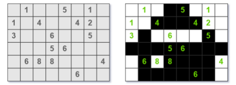

上图左是样例数据对应的棋盘布局，上图右是此局游戏的解。例如第 3 行第 1 列处的方格中有一个数字 3 ，它周围有且仅有 3 个格子被黑色填充，分别是第 3 行第 2 列、第 4 行第 1 列和第 4 行第 2 列的方格。

对于 50% 的评测用例，1 ≤ n, m ≤ 5 ；

对于所有评测用例，1 ≤ n, m ≤ 10 。

---

### 3149 · 翻转硬币

> 题号 3149 ｜ 难度 困难 ｜ 时间 3s ｜ 内存 256MB
> 通过率 4.90% ｜ 题面原文 https://www.dotcpp.com/oj/problem3149.html
> 考过的语言/组别：C++ 大学A组

#### 题目描述

给定 *n* 个按顺序摆好的硬币，一开始只有第 1 个硬币朝下，其他硬币均朝上。你每次操作可以选择任何一个整数 i 并将所有满足 *j* mod *i *= 0 的位置* j* 的硬币翻转。

求最少需要多少次操作可以让所有硬币都朝上。

#### 输入格式

输入一行包含一个整数 n 。

#### 输出格式

输出一行包含一个整数表示最少需要的操作次数。

#### 样例输入

```
7
```

#### 提示

对于 30% 的评测用例，n ≤ 5 × 10<sup>6</sup> ；

对于 70% 的评测用例，n ≤ 10<sup>9</sup> ；

对于所有评测用例，1 ≤ n ≤ 10<sup>18</sup>。

---

### 3150 · 冶炼金属

> 题号 3150 ｜ 难度 简单 ｜ 时间 1s ｜ 内存 256MB
> 通过率 38.42% ｜ 题面原文 https://www.dotcpp.com/oj/problem3150.html
> 考过的语言/组别：C++ 大学B组

#### 题目描述

小蓝有一个神奇的炉子用于将普通金属 O 冶炼成为一种特殊金属 X。这个炉子有一个称作转换率的属性 V，V 是一个正整数，这意味着消耗 V 个普通金

属 O 恰好可以冶炼出一个特殊金属 X，当普通金属 O 的数目不足 V 时，无法继续冶炼。

现在给出了 N 条冶炼记录，每条记录中包含两个整数 A 和 B，这表示本次投入了 A 个普通金属 O，最终冶炼出了 B 个特殊金属 X。每条记录都是独立

的，这意味着上一次没消耗完的普通金属 O 不会累加到下一次的冶炼当中。

根据这 N 条冶炼记录，请你推测出转换率 V 的最小值和最大值分别可能是多少，题目保证评测数据不存在无解的情况。

#### 输入格式

第一行一个整数 N，表示冶炼记录的数目。

接下来输入 N 行，每行两个整数 A、B，含义如题目所述。

#### 输出格式

输出两个整数，分别表示 V 可能的最小值和最大值，中间用空格分开。

#### 样例输入

```
3

75 3

53 2

59 2
```

#### 提示

当 V = 20 时，有：⌊75/20⌋ = 3，⌊

53/20 ⌋ = 2，⌊

59/20 ⌋ = 2，可以看到符合所有冶炼记录。

当 V = 25 时，有：⌊75/25⌋ = 3，⌊

53/25 ⌋ = 2，⌊

59/25 ⌋ = 2，可以看到符合所有冶炼记录。

且再也找不到比 20 更小或者比 25 更大的符合条件的 V 值了。

对于 30% 的评测用例，1 ≤ N ≤ 10<sup>2</sup>。

对于 60% 的评测用例，1 ≤ N ≤ 10<sup>3</sup>。

对于 100% 的评测用例，1 ≤ N ≤ 10<sup>4</sup>，1 ≤ B ≤ A ≤ 10<sup>9</sup>。

---

### 3151 · 飞机降落

> 题号 3151 ｜ 难度 中等 ｜ 时间 2s ｜ 内存 256MB
> 通过率 28.19% ｜ 题面原文 https://www.dotcpp.com/oj/problem3151.html
> 考过的语言/组别：C++ 大学B组

#### 题目描述

N 架飞机准备降落到某个只有一条跑道的机场。其中第 i 架飞机在 T<sub>i </sub>时刻到达机场上空，到达时它的剩余油料还可以继续盘旋 D<sub>i</sub> 个单位时间，即它最早

可以于 T<sub>i</sub> 时刻开始降落，最晚可以于 T<sub>i</sub> + D<sub>i</sub> 时刻开始降落。降落过程需要 L<sub>i</sub>个单位时间。

一架飞机降落完毕时，另一架飞机可以立即在同一时刻开始降落，但是不能在前一架飞机完成降落前开始降落。

请你判断 N 架飞机是否可以全部安全降落。

#### 输入格式

输入包含多组数据。

第一行包含一个整数 T，代表测试数据的组数。

对于每组数据，第一行包含一个整数 N。

以下 N 行，每行包含三个整数：T<sub>i</sub>，D<sub>i</sub> 和 L<sub>i</sub>。

#### 输出格式

对于每组数据，输出 YES 或者 NO，代表是否可以全部安全降落。

#### 样例输入

```
2

3

0 100 10

10 10 10

0 2 20

3

0 10 20

10 10 20

20 10 20
```

#### 提示

对于第一组数据，可以安排第 3 架飞机于 0 时刻开始降落，20 时刻完成降落。安排第 2 架飞机于 20 时刻开始降落，30 时刻完成降落。安排第 1 架飞机于 30 时刻开始降落，40 时刻完成降落。

对于第二组数据，无论如何安排，都会有飞机不能及时降落。

对于 30% 的数据，N ≤ 2。

对于 100% 的数据，1 ≤ T ≤ 10，1 ≤ N ≤ 10，0 ≤ T<sub>i</sub> , D<sub>i</sub> , L<sub>i</sub> ≤ 10<sup>5</sup>。

---

### 3152 · 接龙数列

> 题号 3152 ｜ 难度 中等 ｜ 时间 1s ｜ 内存 256MB
> 通过率 25.21% ｜ 题面原文 https://www.dotcpp.com/oj/problem3152.html
> 考过的语言/组别：C++ 大学B组

#### 题目描述

对于一个长度为 K 的整数数列：A<sub>1</sub>, A<sub>2</sub>, . . . , A<sub>K</sub>，我们称之为接龙数列当且仅当 A<sub>i</sub> 的首位数字恰好等于 A<sub>i−1</sub> 的末位数字 (2 ≤ i ≤ K)。

例如 12, 23, 35, 56, 61, 11 是接龙数列；12, 23, 34, 56 不是接龙数列，因为 56的首位数字不等于 34 的末位数字。所有长度为 1 的整数数列都是接龙数列。

现在给定一个长度为 N 的数列 A<sub>1</sub>, A<sub>2</sub>, . . . , A<sub>N</sub>，请你计算最少从中删除多少个数，可以使剩下的序列是接龙序列？

#### 输入格式

第一行包含一个整数 N。

第二行包含 N 个整数 A<sub>1</sub>, A<sub>2</sub>, . . . , A<sub>N</sub>。

#### 输出格式

一个整数代表答案。

#### 样例输入

```
5

11 121 22 12 2023
```

#### 提示

删除 22，剩余 11, 121, 12, 2023 是接龙数列。

对于 20% 的数据，1 ≤ N ≤ 20。

对于 50% 的数据，1 ≤ N ≤ 10000。

对于 100% 的数据，1 ≤ N ≤ 10<sup>5</sup>，1 ≤ A<sub>i </sub>≤ 10<sup>9</sup>。所有 A<sub>i</sub> 保证不包含前导 0。

---

### 3153 · 岛屿个数

> 题号 3153 ｜ 难度 中等 ｜ 时间 2s ｜ 内存 256MB
> 通过率 31.55% ｜ 题面原文 https://www.dotcpp.com/oj/problem3153.html
> 考过的语言/组别：C++ 大学B组

#### 题目描述

小蓝得到了一副大小为 M × N 的格子地图，可以将其视作一个只包含字符‘0’（代表海水）和 ‘1’（代表陆地）的二维数组，地图之外可以视作全部是海水，每个岛屿由在上/下/左/右四个方向上相邻的 ‘1’ 相连接而形成。

在岛屿 A 所占据的格子中，如果可以从中选出 k 个不同的格子，使得他们的坐标能够组成一个这样的排列：(x<sub>0</sub>, y<sub>0</sub>),(x<sub>1</sub>, y<sub>1</sub>), . . . ,(x<sub>k−1</sub>, y<sub>k−1</sub>)，其中(x<sub>(i+1)%k</sub> , y<sub>(i+1)%k</sub>) 是由 (x<sub>i</sub> , y<sub>i</sub>) 通过上/下/左/右移动一次得来的 (0 ≤ i ≤ k − 1)，

此时这 k 个格子就构成了一个 “环”。如果另一个岛屿 B 所占据的格子全部位于这个 “环” 内部，此时我们将岛屿 B 视作是岛屿 A 的子岛屿。若 B 是 A 的子岛屿，C 又是 B 的子岛屿，那 C 也是 A 的子岛屿。

请问这个地图上共有多少个岛屿？在进行统计时不需要统计子岛屿的数目。

#### 输入格式

第一行一个整数 T，表示有 T 组测试数据。

接下来输入 T 组数据。对于每组数据，第一行包含两个用空格分隔的整数M、N 表示地图大小；接下来输入 M 行，每行包含 N 个字符，字符只可能是‘0’ 或 ‘1’。

#### 输出格式

对于每组数据，输出一行，包含一个整数表示答案。

#### 样例输入

```
2

5 5

01111

11001

10101

10001

11111

5 6

111111

100001

010101

100001

111111
```

#### 提示

对于第一组数据，包含两个岛屿，下面用不同的数字进行了区分：

01111

11001

10201

10001

11111

岛屿 2 在岛屿 1 的 “环” 内部，所以岛屿 2 是岛屿 1 的子岛屿，答案为 1。

对于第二组数据，包含三个岛屿，下面用不同的数字进行了区分：

111111

100001

020301

100001

111111

注意岛屿 3 并不是岛屿 1 或者岛屿 2 的子岛屿，因为岛屿 1 和岛屿 2 中均没有“环”。

对于 30% 的评测用例，1 ≤ M, N ≤ 10。

对于 100% 的评测用例，1 ≤ T ≤ 10，1 ≤ M, N ≤ 50。

---

### 3154 · 子串简写

> 题号 3154 ｜ 难度 中等 ｜ 时间 1s ｜ 内存 256MB
> 通过率 20.39% ｜ 题面原文 https://www.dotcpp.com/oj/problem3154.html
> 考过的语言/组别：C++ 大学B组

#### 题目描述

程序猿圈子里正在流行一种很新的简写方法：对于一个字符串，只保留首尾字符，将首尾字符之间的所有字符用这部分的长度代替。例如 internation-alization 简写成 i18n，Kubernetes （注意连字符不是字符串的一部分）简写成 K8s, Lanqiao 简写成 L5o 等。

在本题中，我们规定长度大于等于 K 的字符串都可以采用这种简写方法（长度小于 K 的字符串不配使用这种简写）。

给定一个字符串 S 和两个字符 c<sub>1</sub> 和 c<sub>2</sub>，请你计算 S 有多少个以 c<sub>1</sub> 开头c<sub>2</sub> 结尾的子串可以采用这种简写？

#### 输入格式

第一行包含一个整数 K。

第二行包含一个字符串 S 和两个字符 c<sub>1</sub> 和 c<sub>2</sub>。

#### 输出格式

一个整数代表答案。

#### 样例输入

```
4

abababdb a b
```

#### 提示

符合条件的子串如下所示，中括号内是该子串：

[abab]abdb

[ababab]db

[abababdb]

ab[abab]db

ab[ababdb]

abab[abdb]

对于 20% 的数据，2 ≤ K ≤ |S | ≤ 10000。

对于 100% 的数据，2 ≤ K ≤ |S | ≤ 5 × 10<sup>5</sup>。S 只包含小写字母。c<sub>1</sub> 和 c<sub>2</sub> 都是小写字母。

|S | 代表字符串 S 的长度。

---

### 3155 · 整数删除

> 题号 3155 ｜ 难度 困难 ｜ 时间 1s ｜ 内存 256MB
> 通过率 15.78% ｜ 题面原文 https://www.dotcpp.com/oj/problem3155.html
> 考过的语言/组别：C++ 大学B组

#### 题目描述

给定一个长度为 N 的整数数列：A<sub>1</sub>, A<sub>2</sub>, . . . , A<sub>N</sub>。你要重复以下操作 K 次：

每次选择数列中最小的整数（如果最小值不止一个，选择最靠前的），将其删除。并把与它相邻的整数加上被删除的数值。输出 K 次操作后的序列。

#### 输入格式

第一行包含两个整数 N 和 K。

第二行包含 N 个整数，A<sub>1</sub>, A<sub>2</sub>, A<sub>3</sub>, . . . , A<sub>N</sub>。

#### 输出格式

输出 N − K 个整数，中间用一个空格隔开，代表 K 次操作后的序列。

#### 样例输入

```
5 3

1 4 2 8 7
```

#### 提示

数列变化如下，中括号里的数是当次操作中被选择的数：

[1] 4 2 8 7

5 [2] 8 7

[7] 10 7

17 7

对于 20% 的数据，1 ≤ K < N ≤ 10000。

对于 100% 的数据，1 ≤ K < N ≤ 5 × 10<sup>5</sup>，0 ≤ A<sub>i</sub> ≤ 10<sup>8</sup>。

---

### 3156 · 景区导游

> 题号 3156 ｜ 难度 困难 ｜ 时间 5s ｜ 内存 256MB
> 通过率 19.98% ｜ 题面原文 https://www.dotcpp.com/oj/problem3156.html
> 考过的语言/组别：C++ 大学B组

#### 题目描述

某景区一共有 N 个景点，编号 1 到 N。景点之间共有 N − 1 条双向的摆渡车线路相连，形成一棵树状结构。在景点之间往返只能通过这些摆渡车进行，需要花费一定的时间。

小明是这个景区的资深导游，他每天都要按固定顺序带客人游览其中 K 个景点：A<sub>1</sub>, A<sub>2</sub>, . . . , A<sub>K</sub>。今天由于时间原因，小明决定跳过其中一个景点，只带游客按顺序游览其中 K − 1 个景点。具体来说，如果小明选择跳过 Ai，那么他会按顺序带游客游览 A<sub>1</sub>, A<sub>2</sub>, . . . , A<sub>i−1</sub>, A<sub>i+1</sub>, . . . , A<sub>K</sub>, (1 ≤ i ≤ K)。

请你对任意一个 A<sub>i</sub>，计算如果跳过这个景点，小明需要花费多少时间在景点之间的摆渡车上？

#### 输入格式

第一行包含 2 个整数 N 和 K。

以下 N − 1 行，每行包含 3 个整数 u, v 和 t，代表景点 u 和 v 之间有摆渡车线路，花费 t 个单位时间。

最后一行包含 K 个整数 A<sub>1</sub>, A<sub>2</sub>, . . . , A<sub>K </sub>代表原定游览线路。

#### 输出格式

输出 K 个整数，其中第 i 个代表跳过 A<sub>i </sub>之后，花费在摆渡车上的时间。

#### 样例输入

```
6 4

1 2 1

1 3 1

3 4 2

3 5 2

4 6 3

2 6 5 1
```

#### 提示

原路线是 2 → 6 → 5 → 1。

当跳过 2 时，路线是 6 → 5 → 1，其中 6 → 5 花费时间 3 + 2 + 2 = 7，5 → 1 花费时间 2 + 1 = 3，总时间花费 10。

当跳过 6 时，路线是 2 → 5 → 1，其中 2 → 5 花费时间 1 + 1 + 2 = 4，5 → 1 花费时间 2 + 1 = 3，总时间花费 7。

当跳过 5 时，路线是 2 → 6 → 1，其中 2 → 6 花费时间 1 + 1 + 2 + 3 = 7，6 → 1 花费时间 3 + 2 + 1 = 6，总时间花费 13。

当跳过 1 时，路线时 2 → 6 → 5，其中 2 → 6 花费时间 1 + 1 + 2 + 3 = 7，6 → 5 花费时间 3 + 2 + 2 = 7，总时间花费 14。

对于 20% 的数据，2 ≤ K ≤ N ≤ 10<sup>2</sup>。

对于 40% 的数据，2 ≤ K ≤ N ≤ 10<sup>4</sup>。

对于 100% 的数据，2 ≤ K ≤ N ≤ 10<sup>5</sup>，1 ≤ u, v, A<sub>i</sub> ≤ N，1 ≤ t ≤ 10<sup>5</sup>。保证A<sub>i </sub>两两不同。

---

### 3157 · 砍树

> 题号 3157 ｜ 难度 困难 ｜ 时间 1s ｜ 内存 256MB
> 通过率 21.48% ｜ 题面原文 https://www.dotcpp.com/oj/problem3157.html
> 考过的语言/组别：C++ 大学B组

#### 题目描述

给定一棵由 n 个结点组成的树以及 m 个不重复的无序数对 (a<sub>1</sub>, b<sub>1</sub>), (a<sub>2</sub>, b<sub>2</sub>),

. . . , (a<sub>m</sub>, b<sub>m</sub>)，其中 a<sub>i</sub> 互不相同，b<sub>i</sub> 互不相同，a<sub>i</sub> ≠ b<sub>j</sub>(1 ≤ i, j ≤ m)。

小明想知道是否能够选择一条树上的边砍断，使得对于每个 (a<sub>i</sub> , b<sub>i</sub>) 满足 a<sub>i</sub>和 b<sub>i</sub> 不连通，如果可以则输出应该断掉的边的编号（编号按输入顺序从 1 开始），否则输出 -1.

#### 输入格式

输入共 n + m 行，第一行为两个正整数 n，m。

后面 n − 1 行，每行两个正整数 x<sub>i</sub>，y<sub>i </sub>表示第 i 条边的两个端点。

后面 m 行，每行两个正整数 a<sub>i</sub>，b<sub>i</sub>。

#### 输出格式

一行一个整数，表示答案，如有多个答案，输出编号最大的一个。

#### 样例输入

```
6 2

1 2

2 3

4 3

2 5

6 5

3 6

4 5

4
```

#### 提示

断开第 2 条边后形成两个连通块：{3, 4}，{1, 2, 5, 6}，满足 3 和 6 不连通，4 和 5 不连通。

断开第 4 条边后形成两个连通块：{1, 2, 3, 4}，{5, 6}，同样满足 3 和 6 不连通，4 和 5 不连通。

4 编号更大，因此答案为 4。

对于 30% 的数据，保证 1 < n ≤ 1000。

对于 100% 的数据，保证 1 < n ≤ 10<sup>5</sup>，1 ≤ m ≤ 2/n。

---

### 3158 · 三国游戏

> 题号 3158 ｜ 难度 中等 ｜ 时间 1s ｜ 内存 256MB
> 通过率 24.32% ｜ 题面原文 https://www.dotcpp.com/oj/problem3158.html
> 考过的语言/组别：C++ 大学C组、Python 大学A组、Python 大学C组、Java 大学C组

#### 题目描述

小蓝正在玩一款游戏。游戏中魏蜀吴三个国家各自拥有一定数量的士兵X, Y, Z (一开始可以认为都为 0 )。游戏有 n 个可能会发生的事件，每个事件之间相互独立且最多只会发生一次，当第 i 个事件发生时会分别让 X, Y, Z 增加A<sub>i</sub> , B<sub>i</sub> ,C<sub>i</sub> 。

当游戏结束时 (所有事件的发生与否已经确定)，如果 X, Y, Z 的其中一个大于另外两个之和，我们认为其获胜。例如，当 X > Y + Z 时，我们认为魏国获胜。小蓝想知道游戏结束时如果有其中一个国家获胜，最多发生了多少个事件?

如果不存在任何能让某国获胜的情况，请输出 −1 。

#### 输入格式

输入的第一行包含一个整数 n 。

第二行包含 n 个整数表示 A<sub>i</sub>，相邻整数之间使用一个空格分隔。

第三行包含 n 个整数表示 B<sub>i</sub>，相邻整数之间使用一个空格分隔。

第四行包含 n 个整数表示 C<sub>i</sub>，相邻整数之间使用一个空格分隔。

#### 输出格式

输出一行包含一个整数表示答案。

#### 样例输入

```
3

1 2 2

2 3 2

1 0 7
```

#### 提示

发生两个事件时，有两种不同的情况会出现获胜方。

发生 1, 2 事件时蜀国获胜。

发生 1, 3 事件时吴国获胜。

对于 40% 的评测用例，n ≤ 500 ；

对于 70% 的评测用例，n ≤ 5000 ；

对于所有评测用例，1 ≤ n ≤ 10<sup>5</sup>，1 ≤ A<sub>i</sub> , B<sub>i</sub> ,C<sub>i</sub> ≤ 10<sup>9</sup> 。

---

### 3159 · 填充

> 题号 3159 ｜ 难度 中等 ｜ 时间 3s ｜ 内存 512MB
> 通过率 33.98% ｜ 题面原文 https://www.dotcpp.com/oj/problem3159.html
> 考过的语言/组别：C++ 大学C组、Python 大学C组、Python 研究生组、Java 大学C组

#### 题目描述

有一个长度为 n 的 01 串，其中有一些位置标记为 ?，这些位置上可以任意填充 0 或者 1，请问如何填充这些位置使得这个 01 串中出现互不重叠的 00 和 11 子串最多，输出子串个数。

#### 输入格式

输入一行包含一个字符串。

#### 输出格式

输出一行包含一个整数表示答案。

#### 样例输入

```
1110?0
```

#### 提示

如果在问号处填 0 ，则最多出现一个 00 和一个 11：111000 。

对于所有评测用例，1 ≤ n ≤ 1000000 。

---

### 3160 · 翻转

> 题号 3160 ｜ 难度 中等 ｜ 时间 1s ｜ 内存 256MB
> 通过率 26.63% ｜ 题面原文 https://www.dotcpp.com/oj/problem3160.html
> 考过的语言/组别：C++ 大学C组、C++ 研究生组、Python 大学A组、Python 大学C组

#### 题目描述

小蓝用黑白棋的 n 个棋子排成了一行，他在脑海里想象出了一个长度为 n 的 01 串 T，他发现如果把黑棋当做 1，白棋当做 0，这一行棋子也是一个长度为 n 的 01 串 S。

小蓝决定，如果在 S 中发现一个棋子和它两边的棋子都不一样，就可以将其翻转变成另一个颜色。也就是说，如果 S 中存在子串 101 或者 010，就可以选择将其分别变为 111 和 000，这样的操作可以无限重复。

小蓝想知道最少翻转多少次可以把 S 变成和 T 一模一样。

#### 输入格式

输入包含多组数据。

输入的第一行包含一个正整数 D 表示数据组数。

后面 2D 行每行包含一个 01 串，每两行为一组数据，第 2i − 1 行为第 i 组

数据的 T<sub>i</sub>，第 2i 行为第 i 组数据的 S<sub>i</sub>，S<sub>i </sub>和 T<sub>i</sub> 长度均为 n<sub>i</sub>。

#### 输出格式

对于每组数据，输出一行包含一个整数，表示答案，如果答案不存在请输出 −1。

#### 样例输入

```
2

1000111

1010101

01000

11000
```

#### 提示

对于 20% 的评测用例，1 ≤∑<sup>D</sup><sub></sub><sub>1</sub> n<sub>i</sub> ≤ 10 ；

对于所有评测用例，保证 1 ≤∑<sup>D</sup><sub>1</sub> n<sub>i</sub> ≤ 10<sup>6 </sup>，n<sub>i</sub> > 0 。

---

### 3161 · 子矩阵

> 题号 3161 ｜ 难度 困难 ｜ 时间 5s ｜ 内存 512MB
> 通过率 14.08% ｜ 题面原文 https://www.dotcpp.com/oj/problem3161.html
> 考过的语言/组别：C++ 大学C组、Python 大学A组、Java 大学C组、Java 研究生组

#### 题目描述

给定一个 n × m （n 行 m 列）的矩阵。

设一个矩阵的价值为其所有数中的最大值和最小值的乘积。求给定矩阵的所有大小为 a × b （a 行 b 列）的子矩阵的价值的和。

答案可能很大，你只需要输出答案对 998244353 取模后的结果。

#### 输入格式

输入的第一行包含四个整数分别表示 n, m, a, b ，相邻整数之间使用一个空格分隔。

接下来 n 行每行包含 m 个整数，相邻整数之间使用一个空格分隔，表示矩阵中的每个数 A<sub>i, j</sub> 。

#### 输出格式

输出一行包含一个整数表示答案。

#### 样例输入

```
2 3 1 2

1 2 3

4 5 6
```

#### 提示

1×2+2×3+4×5+5×6 = 58 。

对于 40% 的评测用例，1 ≤ n, m ≤ 100 ；

对于 70% 的评测用例，1 ≤ n, m ≤ 500 ；

对于所有评测用例，1 ≤ a ≤ n ≤ 1000 1 ≤ b ≤ m ≤ 1000 1 ≤ A<sub>i, j</sub> ≤ 10<sup>9 </sup>。

---

### 3162 · 互质数的个数

> 题号 3162 ｜ 难度 困难 ｜ 时间 1s ｜ 内存 256MB
> 通过率 9.68% ｜ 题面原文 https://www.dotcpp.com/oj/problem3162.html
> 考过的语言/组别：C++ 大学C组、Python 研究生组、Java 大学A组、Java 研究生组

#### 题目描述

给定 a, b，求 1 ≤ x < a<sup>b</sup> 中有多少个 x 与 a<sup>b</sup> 互质。由于答案可能很大，你只需要输出答案对 998244353 取模的结果。

#### 输入格式

输入一行包含两个整数分别表示 a, b，用一个空格分隔。

#### 输出格式

输出一行包含一个整数表示答案。

#### 样例输入

```
2 5
```

#### 提示

对于 30% 的评测用例，a<sup>b</sup> ≤ 10<sup>6</sup> ；

对于 70% 的评测用例，a ≤ 10<sup>6</sup>，b ≤ 10<sup>9</sup> ；

对于所有评测用例，1 ≤ a ≤ 10<sup>9</sup>，1 ≤ b ≤ 10<sup>18</sup> 。

---

### 3163 · 异或和之差

> 题号 3163 ｜ 难度 困难 ｜ 时间 3s ｜ 内存 512MB
> 通过率 15.65% ｜ 题面原文 https://www.dotcpp.com/oj/problem3163.html
> 考过的语言/组别：C++ 大学C组、Python 大学C组、Java 大学C组

#### 题目描述

给定一个含有 n 个元素的数组 A<sub>i</sub>，你可以选择两个不相交的子段。求出这两个子段内的数的异或和的差值的最大值。

#### 输入格式

输入的第一行包含一个整数 n 。

第二行包含 n 个整数 A<sub>i</sub> ，相邻整数之间使用一个空格分隔。

#### 输出格式

输出一行包含一个整数表示答案。

#### 样例输入

```
6

1 2 4 9 2 7
```

#### 提示

两个子段可以分别选 1 和 4，9，2，差值为 15 − 1 = 14 。

对于 40% 的评测用例，n ≤ 5000 ；

对于所有评测用例，2 ≤ n ≤ 2 × 10<sup>5</sup>，0 ≤ A<sub>i</sub> ≤ 2<sup>20</sup> 。

---

### 3164 · 公因数匹配

> 题号 3164 ｜ 难度 困难 ｜ 时间 3s ｜ 内存 512MB
> 通过率 19.10% ｜ 题面原文 https://www.dotcpp.com/oj/problem3164.html
> 考过的语言/组别：C++ 大学C组、C++ 研究生组、Python 研究生组、Java 大学C组

#### 题目描述

给定 n 个正整数 A<sub>i</sub>，请找出两个数 i, j 使得 i < j 且 A<sub>i</sub> 和 A<sub>j</sub> 存在大于 1 的公因数。

如果存在多组 i, j，请输出 i 最小的那组。如果仍然存在多组 i, j，请输出 i 最小的所有方案中 j 最小的那组。

#### 输入格式

输入的第一行包含一个整数 n。

第二行包含 n 个整数分别表示 A<sub>1</sub> A<sub>2</sub> · · · A<sub>n</sub>，相邻整数之间使用一个空格分隔。

#### 输出格式

输出一行包含两个整数分别表示题目要求的 i, j，用一个空格分隔。

#### 样例输入

```
5

5 3 2 6 9
```

#### 提示

对于 40% 的评测用例，n ≤ 5000 ；

对于所有评测用例，1 ≤ n ≤ 10<sup>5</sup>，1 ≤ A<sub>i</sub> ≤ 10<sup>6</sup> 。

---

### 3165 · 子树的大小

> 题号 3165 ｜ 难度 困难 ｜ 时间 2s ｜ 内存 256MB
> 通过率 17.58% ｜ 题面原文 https://www.dotcpp.com/oj/problem3165.html
> 考过的语言/组别：C++ 大学C组、C++ 研究生组、Python 大学A组、Python 研究生组

#### 题目描述

给定一棵包含 n 个结点的完全 m 叉树，结点按从根到叶、从左到右的顺序依次编号。

例如下图是一个拥有 11 个结点的完全 3 叉树。

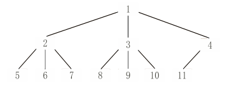

你需要求出第 k 个结点对应的子树拥有的结点数量。

#### 输入格式

输入包含多组询问。

输入的第一行包含一个整数 T ，表示询问次数。

接下来 T 行，每行包含三个整数 n, m, k 表示一组询问。

#### 输出格式

输出 T 行，每行包含一个整数表示对应询问的答案。

#### 样例输入

```
3

1 2 1

11 3 4

74 5 3
```

#### 提示

对于 40% 的评测用例，T ≤ 50，n ≤ 10<sup>6</sup>，m ≤ 16 ；

对于所有评测用例，1 ≤ T ≤ 10<sup>5</sup>，1 ≤ k ≤ n ≤ 10<sup>9</sup>，2 ≤ m ≤ 10<sup>9</sup> 。

---

### 3166 · 阶乘的和

> 题号 3166 ｜ 难度 困难 ｜ 时间 1s ｜ 内存 256MB
> 通过率 19.65% ｜ 题面原文 https://www.dotcpp.com/oj/problem3166.html
> 考过的语言/组别：C++ 研究生组、Python 大学A组、Python 研究生组、Java 大学A组

#### 题目描述

给定 n 个数 A<sub>i</sub>，问能满足 m! 为∑<sup>n</sup><sub>i=1</sub>(A<sub>i</sub>!) 的因数的最大的 m 是多少。其中 m! 表示 m 的阶乘，即 1 × 2 × 3 × · · · × m。

#### 输入格式

输入的第一行包含一个整数 n 。

第二行包含 n 个整数，分别表示 A<sub>i</sub>，相邻整数之间使用一个空格分隔。

#### 输出格式

输出一行包含一个整数表示答案。

#### 样例输入

```
3

2 2 2
```

#### 提示

对于 40% 的评测用例，n ≤ 5000 ；

对于所有评测用例，1 ≤ n ≤ 10<sup>5</sup> 1 ≤ A<sub>i </sub>≤ 10<sup>9</sup> 。

---

### 3167 · 奇怪的数

> 题号 3167 ｜ 难度 困难 ｜ 时间 3s ｜ 内存 512MB
> 通过率 11.64% ｜ 题面原文 https://www.dotcpp.com/oj/problem3167.html
> 考过的语言/组别：C++ 研究生组、Python 大学A组、Python 大学C组、Java 研究生组

#### 题目描述

小蓝最近在找一些奇怪的数，其奇数数位上是奇数，而偶数数位上是偶数。同时，这些数的任意 5 个连续数位的和都不大于 m 。

例如当 m = 9 时，10101 和 12303 就是奇怪的数，而 12345 和 11111 则不是。

小蓝想知道一共有多少个长度为 n 的上述的奇怪的数。你只需要输出答案对 998244353 取模的结果。

#### 输入格式

输入一行包含两个整数 n, m ，用一个空格分隔。

#### 输出格式

输出一行包含一个整数表示答案。

#### 样例输入

```
5 5
```

#### 提示

对于 30% 的评测用例，n ≤ 12 ；

对于 60% 的评测用例，n ≤ 5000 ；

对于所有评测用例，5 ≤ n ≤ 2 × 10<sup>5</sup>，0 ≤ m ≤ 50 。

---

### 3168 · 太阳

> 题号 3168 ｜ 难度 困难 ｜ 时间 3s ｜ 内存 512MB
> 通过率 12.65% ｜ 题面原文 https://www.dotcpp.com/oj/problem3168.html
> 考过的语言/组别：C++ 研究生组、Java 大学A组、Java 大学C组、Java 研究生组

#### 题目描述

这天，小蓝在二维坐标系的点 (X, Y) 上放了一个太阳，看做点光源。

他拿来了 n 条线段，将它们平行于 x 轴放置在了坐标系中，第 i 条线段的左端点在 x<sub>i</sub> , y<sub>i</sub>，长度为 l<sub>i</sub>。线段之间不会有重合或部分重合的情况（但可能出现端点相交）。小蓝想知道有多少条线段能被太阳照亮（一条线段有长度大于 0的部分被照亮就算）

#### 输入格式

输入的第一行包含三个正整数 n, X, Y，相邻整数之间使用一个空格分隔。

接下来 n 行，第 i 行包含三个整数 x<sub>i</sub> , y<sub>i</sub> , l<sub>i</sub>，相邻整数之间使用一个空格分隔。

#### 输出格式

输出一行包含一个正整数表示答案。

#### 样例输入

```
3 10 2000000

5 3 5

6 2 4

0 1 10
```

#### 提示

第一条线段在最上面被照亮，第二条线段被第一条完全挡住，第三条线段左边的一段能被照亮。

对于 30% 的评测用例，n ≤ 1000 ；

对于所有评测用例，1 ≤ n ≤ 100000, 0 ≤ x<sub>i</sub> , X ≤ 10<sup>7</sup> , 0 < y<sub>i</sub> ≤ 10<sup>5</sup> , 0 < l<sub>i</sub> ≤ 100, 10<sup>6</sup> < Y ≤ 10<sup>7</sup> 。

---

### 3169 · 高塔

> 题号 3169 ｜ 难度 困难 ｜ 时间 1s ｜ 内存 256MB
> 通过率 24.85% ｜ 题面原文 https://www.dotcpp.com/oj/problem3169.html
> 考过的语言/组别：C++ 研究生组、Python 研究生组、Java 大学A组、Java 研究生组

#### 题目描述

小蓝正在玩一个攀登高塔的游戏。高塔的层数是无限的，但游戏最多只有 n 回合。

小蓝一开始拥有 m 点能量，在每个回合都有一个值 A<sub>i</sub> 表示小蓝的角色状态。小蓝每回合可以选择消费任意点能量 C<sub>i</sub> (最低消费 1 点，没有上限)，他在这回合将最多可以向上攀爬 A<sub>i</sub> · C<sub>i</sub> 层。实际攀爬的层数取决于小蓝自己在这回合的表现，不过最差也会向上爬一层。

当某回合小蓝的能量点数耗尽，那么在完成这个回合后，游戏结束。n 回合结束后，不管能量还有没有剩余，游戏都会直接结束。

给出小蓝每回合的 A<sub>i</sub> 和自己一开始的能量点数 m。小蓝想知道有多少种不同的可能出现的游玩过程。如果小蓝在两种游玩过程中的任一对应回合花费的能量点数不同或该回合结束时所处层数不同，那么这两种游玩过程就被视为不同。

#### 输入格式

输入的第一行包含两个整数 n, m，用一个空格分隔。

第二行包含 n 个整数 A<sub>i</sub>，相邻整数之间使用一个空格分隔，表示小蓝每回合的状态值。

#### 输出格式

输出一行包含一个整数表示给定条件下不同游玩过程的数量。由于答案可能很大，你只需要输出答案对 998244353 取模的结果。

#### 样例输入

```
9 15

3 2 5 7 1 4 6 8 3
```

#### 提示

对于 40% 的评测用例，n ≤ 300，m ≤ 500 ；

对于所有评测用例，1 ≤ n ≤ 2 × 10<sup>5</sup>，n ≤ m ≤ 10<sup>18</sup>，1 ≤ A<sub>i</sub> ≤ 10<sup>9</sup> 。

---

### 3170 · 反异或 01 串

> 题号 3170 ｜ 难度 困难 ｜ 时间 1s ｜ 内存 256MB
> 通过率 16.92% ｜ 题面原文 https://www.dotcpp.com/oj/problem3170.html
> 考过的语言/组别：C++ 研究生组、Python 大学A组、Python 研究生组、Java 大学A组、Java 研究生组

#### 题目描述

初始有一个空的 01 串，每步操作可以将 0 或 1 添加在左侧或右侧。也可以对整个串进行反异或操作: 取 s

′ = s ⊕ rev(s)，其中 s 是目前的 01 串，⊕ 表示逐位异或，rev(s) 代表将 s 翻转，也就是说取中心位置并交换所有对称的两个位置的字符。例如，rev(0101) = 1010 rev(010) = 010 rev(0011) = 1100。

反异或操作最多使用一次（可以不用，也可以用一次）。

给定一个 01 串 T，问最少需要添加多少个 1 才能从一个空 01 串得到 T。

在本题中 0 可以添加任意个。

#### 输入格式

输入一行包含一个 01 串表示给定的 T 。

#### 输出格式

输出一行包含一个整数，表示需要最少添加多少个 1 。

#### 样例输入

```
00111011
```

#### 提示

对于 20% 的评测用例，|T| ≤ 10 ；

对于 40% 的评测用例，|T| ≤ 500 ；

对于 60% 的评测用例，|T| ≤ 5000 ；

对于 80% 的评测用例，|T| ≤ 10<sup>5</sup> ；

对于所有评测用例，1 ≤ |T| ≤ 10<sup>6</sup>，保证 T 中仅含 0 和 1 。

---

### 3171 · 数组分割

> 题号 3171 ｜ 难度 困难 ｜ 时间 1s ｜ 内存 512MB
> 通过率 20.89% ｜ 题面原文 https://www.dotcpp.com/oj/problem3171.html
> 考过的语言/组别：Java 大学B组

#### 题目描述

小蓝有一个长度为 N 的数组 A = [A<sub>0</sub>, A<sub>1</sub>,..., A<sub>N−1</sub>]。现在小蓝想要从 A 对应的数组下标所构成的集合 I = {0, 1, 2, . . . , N − 1} 中找出一个子集 R<sub>1</sub>，那么 R<sub>1</sub>在 I 中的补集为 R<sub>2</sub>。记 S<sub>1</sub>=∑<sub>r∈R1</sub>A<sub>r</sub>，S<sub>2</sub> =∑<sub>r∈R2</sub>A<sub>r</sub>，我们要求 S<sub>1</sub> 和 S<sub>2</sub> 均为偶数，请问在这种情况下共有多少种不同的 R<sub>1</sub>。当 R<sub>1</sub> 或 R<sub>2</sub> 为空集时我们将 S<sub>1</sub> 或 S<sub>2</sub> 视为 0。

#### 输入格式

第一行一个整数 T，表示有 T 组数据。

接下来输入 T 组数据，每组数据包含两行：第一行一个整数 N，表示数组 A 的长度；第二行输入 N 个整数从左至右依次为 A<sub>0</sub>, A<sub>1</sub>, . . . , A<sub>N−1</sub>，相邻元素之间用空格分隔。

#### 输出格式

对于每组数据，输出一行，包含一个整数表示答案，答案可能会很大，你需要将答案对1000000007 进行取模后输出。

#### 样例输入

```
2

2

6 6

2

1 6
```

#### 提示

对于第一组数据，答案为 4。（注意：大括号内的数字表示元素在数组中的下标。）

R<sub>1</sub> = {0}, R<sub>2</sub> = {1}；此时 S<sub>1</sub> = A<sub>0</sub> = 6 为偶数, S<sub>2</sub> = A<sub>1</sub> = 6 为偶数。

R<sub>1</sub> = {1}, R<sub>2</sub> = {0}；此时 S<sub>1</sub> = A<sub>1</sub> = 6 为偶数, S<sub>2</sub> = A<sub>0</sub> = 6 为偶数。

R<sub>1</sub> = {0, 1}, R<sub>2</sub> = {}；此时 S<sub>1</sub> = A<sub>0</sub> + A<sub>1</sub> = 12 为偶数, S<sub>2</sub> = 0 为偶数。

R<sub>1</sub> = {}, R<sub>2</sub> = {0, 1}；此时 S<sub>1</sub> = 0 为偶数, S<sub>2</sub> = A<sub>0</sub> + A<sub>1</sub> = 12 为偶数。

对于第二组数据，无论怎么选择，都不满足条件，所以答案为 0。

对于 20% 的评测用例，1 ≤ N ≤ 10。

对于 40% 的评测用例，1 ≤ N ≤ 10<sup>2</sup>。

对于 100% 的评测用例，1 ≤ T ≤ 10, 1 ≤ N ≤ 10<sup>3</sup> , 0 ≤ A<sub>i</sub> ≤ 10<sup>9</sup>。

---

### 3172 · 矩形总面积

> 题号 3172 ｜ 难度 困难 ｜ 时间 1s ｜ 内存 512MB
> 通过率 20.91% ｜ 题面原文 https://www.dotcpp.com/oj/problem3172.html
> 考过的语言/组别：Java 大学B组

#### 题目描述

平面上有个两个矩形 R<sub>1 </sub>和 R<sub>2</sub>，它们各边都与坐标轴平行。设 (x<sub>1</sub>, y<sub>1</sub>) 和(x<sub>2</sub>, y<sub>2</sub>) 依次是 R<sub>1</sub> 的左下角和右上角坐标，(x<sub>3</sub>, y<sub>3</sub>) 和 (x<sub>4</sub>, y<sub>4</sub>) 依次是 R<sub>2</sub> 的左下角和右上角坐标，请你计算 R<sub>1</sub> 和 R<sub>2</sub> 的总面积是多少？

注意：如果 R<sub>1</sub> 和 R<sub>2</sub> 有重叠区域，重叠区域的面积只计算一次。

#### 输入格式

输入只有一行，包含 8 个整数，依次是：x<sub>1</sub>，y<sub>1</sub>，x<sub>2</sub>，y<sub>2</sub>，x<sub>3</sub>，y<sub>3</sub>，x<sub>4</sub> 和 y<sub>4</sub>

#### 输出格式

一个整数，代表答案。

#### 样例输入

```
2 1 7 4 5 3 8 6
```

#### 提示

样例中的两个矩形如图所示：

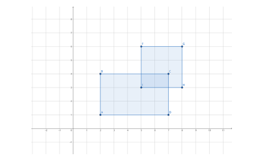

对于 20% 的数据，R<sub>1</sub> 和 R<sub>2</sub> 没有重叠区域。

对于 20% 的数据，其中一个矩形完全在另一个矩形内部。

对于 50% 的数据，所有坐标的取值范围是 [0, 10<sup>3</sup> ]。

对于 100% 的数据，所有坐标的取值范围是 [0, 10<sup>5</sup> ]。

---

### 3173 · 蜗牛

> 题号 3173 ｜ 难度 困难 ｜ 时间 1s ｜ 内存 512MB
> 通过率 25.04% ｜ 题面原文 https://www.dotcpp.com/oj/problem3173.html
> 考过的语言/组别：Java 大学B组

#### 题目描述

这天，一只蜗牛来到了二维坐标系的原点。

在 x 轴上长有 n 根竹竿。它们平行于 y 轴，底部纵坐标为 0，横坐标分别为 x<sub>1</sub>, x<sub>2</sub>, ..., x<sub>n</sub>。竹竿的高度均为无限高，宽度可忽略。蜗牛想要从原点走到第 n 个竹竿的底部也就是坐标 (x<sub>n</sub>, 0)。它只能在 x 轴上或者竹竿上爬行，在 x 轴上爬行速度为 1 单位每秒；由于受到引力影响，蜗牛在竹竿上向上和向下爬行的速度分别为 0.7 单位每秒和 1.3 单位每秒。

为了快速到达目的地，它施展了魔法，在第 i 和 i + 1 根竹竿之间建立了传送门（0 < i < n），如果蜗牛位于第 i 根竹竿的高度为 a<sub>i</sub> 的位置 (x<sub>i</sub> , a<sub>i</sub>)，就可以瞬间到达第 i + 1 根竹竿的高度为 b<sub>i+1</sub> 的位置 (x<sub>i+1</sub>, b<sub>i+1</sub>)，请计算蜗牛最少需要多少秒才能到达目的地。

#### 输入格式

输入共 1 + n 行，第一行为一个正整数 n；

第二行为 n 个正整数 x<sub>1</sub>, x<sub>2</sub>, . . . , x<sub>n</sub>；

后面 n − 1 行，每行两个正整数 a<sub>i</sub> , b<sub>i+1</sub>。

#### 输出格式

输出共一行，一个浮点数表示答案（四舍五入保留两位小数）。

#### 样例输入

```
3

1 10 11

1 1

2 1
```

#### 提示

蜗牛路线：

(0, 0) → (1, 0) → (1, 1) → (10, 1) → (10, 0) → (11, 0)，花费时间为 1+1/0.7+0+1/1.3+1 ≈ 4.20

对于 20% 的数据，保证 n ≤ 15；

对于 100% 的数据，保证 n ≤ 10<sup>5</sup>，a<sub>i</sub> , b<sub>i</sub> ≤ 10<sup>4</sup>，x<sub>i</sub> ≤ 10<sup>9</sup>。

---

### 3174 · 合并区域

> 题号 3174 ｜ 难度 困难 ｜ 时间 2s ｜ 内存 512MB
> 通过率 12.42% ｜ 题面原文 https://www.dotcpp.com/oj/problem3174.html
> 考过的语言/组别：Java 大学B组

#### 题目描述

小蓝在玩一款种地游戏。现在他被分配给了两块大小均为 N × N 的正方形区域。这两块区域都按照 N × N 的规格进行了均等划分，划分成了若干块面积相同的小区域，其中每块小区域要么是岩石，要么就是土壤，在垂直或者水平方向上相邻的土壤可以组成一块土地。现在小蓝想要对这两块区域沿着边缘进行合并，他想知道合并以后可以得到的最大的一块土地的面积是多少（土地的面积就是土地中土壤小区域的块数）？

在进行合并时，小区域之间必须对齐。可以在两块方形区域的任何一条边上进行合并，可以对两块方形区域进行 90 度、180 度、270 度、360 度的旋转，但不可以进行上下或左右翻转，并且两块方形区域不可以发生重叠。

#### 输入格式

第一行一个整数 N 表示区域大小。

接下来 N 行表示第一块区域，每行 N 个值为 0 或 1 的整数，相邻的整数之间用空格进行分隔。值为 0 表示这块小区域是岩石，值为 1 表示这块小区域是土壤。

再接下来 N 行表示第二块区域，每行 N 个值为 0 或 1 的整数，相邻的整数之间用空格进行分隔。值为 0 表示这块小区域是岩石，值为 1 表示这块小区域是土壤。

#### 输出格式

一个整数表示将两块区域合并之后可以产生的最大的土地面积。

#### 样例输入

```
4

0 1 1 0

1 0 1 1

1 0 1 0

1 1 1 0

0 0 1 0

0 1 1 0

1 0 0 0

1 1 1 1
```

#### 提示

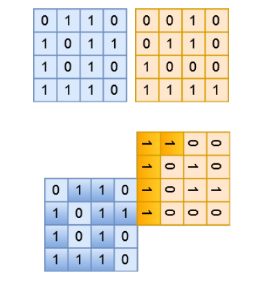

第一张图展示了样例中的两块区域的布局。第二张图展示了其中一种最佳

的合并方式，此时最大的土地面积为 15。

对于 30% 的数据，1 ≤ N ≤ 5。

对于 60% 的数据，1 ≤ N ≤ 15。

对于 100% 的数据，1 ≤ N ≤ 50。

---

### 3175 · 买二赠一

> 题号 3175 ｜ 难度 困难 ｜ 时间 3s ｜ 内存 192MB
> 通过率 15.75% ｜ 题面原文 https://www.dotcpp.com/oj/problem3175.html
> 考过的语言/组别：Java 大学B组

#### 题目描述

某商场有 N 件商品，其中第 i 件的价格是 A<sub>i</sub>。现在该商场正在进行 “买二赠一” 的优惠活动，具体规则是：

每购买 2 件商品，假设其中较便宜的价格是 P（如果两件商品价格一样，则 P 等于其中一件商品的价格），就可以从剩余商品中任选一件价格不超过 P/2的商品，免费获得这一件商品。可以通过反复购买 2 件商品来获得多件免费商品，但是每件商品只能被购买或免费获得一次。

小明想知道如果要拿下所有商品（包含购买和免费获得），至少要花费多少钱？

#### 输入格式

第一行包含一个整数 N。

第二行包含 N 个整数，代表 A<sub>1</sub>, A<sub>2</sub>, A<sub>3</sub>, . . . ，A<sub>N</sub>。

#### 输出格式

输出一个整数，代表答案。

#### 样例输入

```
7

1 4 2 8 5 7 1
```

#### 提示

小明可以先购买价格 4 和 8 的商品，免费获得一件价格为 1 的商品；再后买价格为 5 和 7 的商品，免费获得价格为 2 的商品；最后单独购买剩下的一件价格为 1 的商品。总计花费 4 + 8 + 5 + 7 + 1 = 25。不存在花费更低的方案。

对于 30% 的数据，1 ≤ N ≤ 20。

对于 100% 的数据，1 ≤ N ≤ 5 × 10<sup>5</sup>，1 ≤ A<sub>i</sub> ≤ 10<sup>9</sup>

---

### 3176 · 合并石子

> 题号 3176 ｜ 难度 入门 ｜ 时间 1s ｜ 内存 512MB
> 通过率 78.22% ｜ 题面原文 https://www.dotcpp.com/oj/problem3176.html
> 考过的语言/组别：Java 大学B组

#### 题目描述

在桌面从左至右横向摆放着 N 堆石子。每一堆石子都有着相同的颜色，颜色可能是颜色 0，颜色 1 或者颜色 2 中的其中一种。

现在要对石子进行合并，规定每次只能选择位置相邻并且颜色相同的两堆石子进行合并。合并后新堆的相对位置保持不变，新堆的石子数目为所选择的两堆石子数目之和，并且新堆石子的颜色也会发生循环式的变化。具体来说：两堆颜色 0 的石子合并后的石子堆为颜色 1，两堆颜色 1 的石子合并后的石子堆为颜色 2，两堆颜色 2 的石子合并后的石子堆为颜色 0。本次合并的花费为所选择的两堆石子的数目之和。

给出 N 堆石子以及他们的初始颜色，请问最少可以将它们合并为多少堆石子？如果有多种答案，选择其中合并总花费最小的一种，合并总花费指的是在所有的合并操作中产生的合并花费的总和。

#### 输入格式

第一行一个正整数 N 表示石子堆数。

第二行包含 N 个用空格分隔的正整数，表示从左至右每一堆石子的数目。

第三行包含 N 个值为 0 或 1 或 2 的整数表示每堆石头的颜色。

#### 输出格式

一行包含两个整数，用空格分隔。其中第一个整数表示合并后数目最少的石头堆数，第二个整数表示对应的最小花费。

#### 样例输入

```
5

5 10 1 8 6

1 1 0 2 2
```

#### 提示

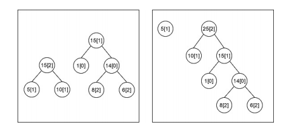

上图显示了两种不同的合并方式。其中节点中标明了每一堆的石子数目，在方括号中标注了当前堆石子的颜色属性。左图的这种合并方式最终剩下了两堆石子，所产生的合并总花费为 15 + 14 + 15 = 44；右图的这种合并方式最终也剩下了两堆石子，但产生的合并总花费为 14 + 15 + 25 = 54。综上所述，我们选择合并花费为 44 的这种方式作为答案。

对于 30% 的评测用例，1 ≤ N ≤ 10。

对于 50% 的评测用例，1 ≤ N ≤ 50。

对于 100% 的评测用例，1 ≤ N ≤ 300, 1 ≤ 每堆石子的数目 ≤ 1000。

---

### 3177 · 最大开支

> 题号 3177 ｜ 难度 困难 ｜ 时间 1s ｜ 内存 512MB
> 通过率 24.21% ｜ 题面原文 https://www.dotcpp.com/oj/problem3177.html
> 考过的语言/组别：Java 大学B组

#### 题目描述

小蓝所在学校周边新开业了一家游乐园，小蓝作为班长，打算组织大家去游乐园玩。已知一共有 N 个人参加这次活动，游乐园有 M 个娱乐项目，每个项目都需要买门票后才可进去游玩。门票的价格并不是固定的，团购的人越多单价越便宜，当团购的人数大于某个阈值时，这些团购的人便可以免费进入项目进行游玩。这 M 个娱乐项目是独立的，所以只有选择了同一个项目的人才可

以参与这个项目的团购。第 i 个项目的门票价格 Hi 与团购的人数 X 的关系可以看作是一个函数：

Hi(X) = max (Ki × X + Bi

, 0)

max 表示取二者之中的最大值。当 Hi = 0 时说明团购人数达到了此项目的免单阈值。

这 N 个人可以根据自己的喜好选择 M 个娱乐项目中的一种，或者有些人对这些娱乐项目都没有兴趣，也可以选择不去任何一个项目。每个人最多只会选择一个娱乐项目，如果多个人选择了同一个娱乐项目，那么他们都将享受对应的团购价格。小蓝想知道他至少需要准备多少钱，使得无论大家如何选择，他都有能力支付得起所有 N 个人购买娱乐项目的门票钱。

#### 输入格式

第一行两个整数 N、M，分别表示参加活动的人数和娱乐项目的个数。

接下来 M 行，每行两个整数，其中第 i 行为 Ki、Bi，表示第 i 个游乐地点的门票函数中的参数。

#### 输出格式

一个整数，表示小蓝至少需要准备多少钱，使得大家无论如何选择项目，自己都支付得起。

#### 样例输入

```
4 2

-4 10

-2 7
```

#### 提示

样例中有 4 个人，2 个娱乐项目，我们用一个二元组 (a, b) 表示 a 个人选择了第一个娱乐项目，b 个人选择了第二个娱乐项目，那么就有 4 − a − b 个人没有选择任何项目，方案 (a, b) 对应的门票花费为 max(−4 × a + 10, 0) × a +max(−2 × b + 7, 0) × b，所有的可能如下所示：

a

|

b

|

花费

|

0

|

0

|

0

|

0

|

1

|

5

|

0

|

2

|

6

|

0

|

3

|

3

|

0

|

4

|

0

|

1

|

0

|

6

|

1

|

1

|

11

|

1

|

2

|

12

|

1

|

3

|

9

|

2

|

0

|

4

|

2

|

1

|

9

|

2

|

2

|

10

|

3

|

0

|

0

|

3

|

1

|

5

|

4

|

0

|

0

|

其中当 a = 1, b = 2 时花费最大，为 12。此时 1 个人去第一个项目，所以第一个项目的单价为 10 − 4 = 6，在这个项目上的花费为 6 × 1 = 6；2 个人去第二个项目，所以第二个项目得单价为 7 − 2 × 2 = 3，在这个项目上的花费为2 × 3 = 6；还有 1 个人没去任何项目，不用统计；总花费为 12，这是花费最大的一种方案，所以答案为 12。

对于 30% 的评测用例，1 ≤ N, M ≤ 10。

对于 50% 的评测用例，1 ≤ N, M ≤ 1000。

对于 100% 的评测用例，1 ≤ N, M, B<sub>i</sub> ≤ 10<sup>5</sup>，−10<sup>5</sup> ≤ K<sub>i</sub> < 0。

---

### 3178 · 魔法阵

> 题号 3178 ｜ 难度 中等 ｜ 时间 1s ｜ 内存 512MB
> 通过率 39.11% ｜ 题面原文 https://www.dotcpp.com/oj/problem3178.html
> 考过的语言/组别：Java 大学B组

#### 题目描述

魔法师小蓝为了营救自己的朋友小 Q，来到了敌人布置的魔法阵。魔法阵可以看作是一幅具有 N 个结点 M 条边的无向图，结点编号为 0, 1, 2, . . . , N−1，图中没有重边和自环。敌人在每条边上都布置了陷阱，每条边都有一个伤害属性 w，每当小蓝经过一条边时就会受到这条边对应的 w 的伤害。小蓝从结点 0出发，沿着边行走，想要到达结点 N−1 营救小 Q。

小蓝有一种特殊的魔法可以使用，假设一条路径按照顺序依次经过了以下L 条边：e<sub>1</sub>, e<sub>2</sub>, . . . , e<sub>L</sub>（可以出现重复的边），那么期间小蓝受到的总伤害就是P =

∑<sup>L</sup><sub>i=1</sub> w(e<sub>i</sub>)，w(e<sub>i</sub>) 表示边 e<sub>i </sub>的伤害属性。如果L≥K，那么小蓝就可以从这 L条边当中选出连续出现的K条边 e<sub>c</sub> , e<sub>c+1</sub>, . . . , e<sub>c+K−1</sub>并免去在这K 条边行走期间所受到的伤害，即使用魔法之后路径总伤害变为 P

′ = P −∑<sup>c+K−1</sup><sub>i=c</sub>w(e<sub>i</sub>)。

注意必须恰好选出连续出现的 K 条边，所以当 L < K 时无法使用魔法。

小蓝最多只可以使用一次上述的魔法，请问从结点 0 出发到结点 N − 1 受到的最小伤害是多少？题目保证至少存在一条从结点 0 到 N − 1 的路径。

#### 输入格式

第一行输入三个整数，N, K, M，用空格分隔。

接下来 M 行，每行包含三个整数 u, v,w，表示结点 u 与结点 v 之间存在一条伤害属性为 w 的无向边。

#### 输出格式

输出一行，包含一个整数，表示小蓝从结点 0 到结点 N − 1 受到的最小伤害。

#### 样例输入

```
4 2 3

0 1 2

1 2 1

2 3 4
```

#### 提示

样例 1，存在路径：0 → 1 → 2 → 3，K = 2，如果在 0 → 1 → 2 上使用魔法，那么答案就是 0 + 0 + 4 = 4；如果在 1 → 2 → 3 上使用魔法，那么答案就是 2 + 0 + 0 = 2。再也找不到比 2 还小的答案了，所以答案就是 2。

样例 2，存在路径：0 → 1 → 0 → 1 → 0 → 1，K = 5，这条路径总计恰好走了 5 条边，所以正好可以用魔法消除所有伤害，答案是 0。

对于 30% 的评测用例，1 ≤ N ≤ 20。

对于 50% 的评测用例，1 ≤ N ≤ 100。

对于 100% 的评测用例，1 ≤ N ≤ 1000, 1 ≤ M ≤

N×(N−1)/2，1 ≤ K ≤ 10，0 ≤ u, v ≤ N − 1，1 ≤ w ≤ 1000

---

### 3179 · 平均

> 题号 3179 ｜ 难度 困难 ｜ 时间 3s ｜ 内存 512MB
> 通过率 22.97% ｜ 题面原文 https://www.dotcpp.com/oj/problem3179.html
> 考过的语言/组别：Python 大学A组、Python 大学C组、Java 大学A组、Java 大学C组

#### 题目描述

有一个长度为 n 的数组（n 是 10 的倍数），每个数 a<sub>i</sub> 都是区间 [0, 9] 中的整数。小明发现数组里每种数出现的次数不太平均，而更改第 i 个数的代价为b<sub>i</sub>，他想更改若干个数的值使得这 10 种数出现的次数相等（都等于n/10），请问代价和最少为多少。

#### 输入格式

输入的第一行包含一个正整数 n 。

接下来 n 行，第 i 行包含两个整数 a<sub>i </sub>, b<sub>i</sub> ，用一个空格分隔。

#### 输出格式

输出一行包含一个正整数表示答案。

#### 样例输入

```
10

1 1

1 2

1 3

2 4

2 5

2 6

3 7

3 8

3 9

4 10
```

#### 提示

只更改第 1, 2, 4, 5, 7, 8 个数，需要花费代价 1 + 2 + 4 + 5 + 7 + 8 = 27 。

对于 20% 的评测用例，n ≤ 1000；

对于所有评测用例，n ≤ 100000, 0 < b<sub>i</sub> ≤ 2 × 10<sup>5</sup> 。

---

### 3180 · 棋盘

> 题号 3180 ｜ 难度 困难 ｜ 时间 3s ｜ 内存 512MB
> 通过率 19.56% ｜ 题面原文 https://www.dotcpp.com/oj/problem3180.html
> 考过的语言/组别：Python 大学C组、Java 大学A组、Java 大学C组、Java 研究生组

#### 题目描述

小蓝拥有 n × n 大小的棋盘，一开始棋盘上全都是白子。小蓝进行了 m 次操作，每次操作会将棋盘上某个范围内的所有棋子的颜色取反 (也就是白色棋子变为黑色，黑色棋子变为白色)。请输出所有操作做完后棋盘上每个棋子的颜色。

#### 输入格式

输入的第一行包含两个整数 n, m，用一个空格分隔，表示棋盘大小与操作数。

接下来 m 行每行包含四个整数 x<sub>1</sub>, y<sub>1</sub>, x<sub>2</sub>, y<sub>2</sub>，相邻整数之间使用一个空格分隔，表示将在 x<sub>1</sub> 至 x<sub>2</sub> 行和 y<sub>1</sub> 至 y<sub>2</sub> 列中的棋子颜色取反。

#### 输出格式

输出 n 行，每行 n 个 0 或 1 表示该位置棋子的颜色。如果是白色则输出 0，否则输出 1 。

#### 样例输入

```
3 3

1 1 2 2

2 2 3 3

1 1 3 3
```

#### 提示

对于 30% 的评测用例，n m ≤ 500 ；

对于所有评测用例，1 ≤ n, m ≤ 2000 ，1 ≤ x<sub>1</sub> ≤ x<sub>2</sub> ≤ n ，1 ≤ y<sub>1</sub> ≤ y<sub>2</sub> ≤ m 。

---

### 3181 · 松散子序列

> 题号 3181 ｜ 难度 中等 ｜ 时间 1s ｜ 内存 128MB
> 通过率 38.21% ｜ 题面原文 https://www.dotcpp.com/oj/problem3181.html
> 考过的语言/组别：Python 大学B组

#### 题目描述

给定一个仅含小写字母的字符串 s ，假设 s 的一个子序列 t 的第 i 个字符

对应了原字符串中的第 p<sub>i</sub> 个字符。我们定义 s 的一个松散子序列为：对于 i > 1

总是有 p<sub>i</sub> − p<sub>i−1</sub> ≥ 2 。设一个子序列的价值为其包含的每个字符的价值之和 (

a ∼ z 分别为 1 ∼ 26 ) 。

求 s 的松散子序列中的最大价值。

#### 输入格式

输入一行包含一个字符串 s 。

#### 输出格式

输出一行包含一个整数表示答案。

#### 样例输入

```
azaazaz
```

#### 提示

对于 20% 的评测用例，|s| ≤ 10 ；

对于 40% 的评测用例，|s| ≤ 300 ；

对于 70% 的评测用例，|s| ≤ 5000 ；

对于所有评测用例，1 ≤ |s| ≤ 10<sup>6</sup>，字符串中仅包含小写字母。

---

### 3182 · 管道

> 题号 3182 ｜ 难度 困难 ｜ 时间 1s ｜ 内存 128MB
> 通过率 19.91% ｜ 题面原文 https://www.dotcpp.com/oj/problem3182.html
> 考过的语言/组别：Python 大学B组

#### 题目描述

有一根长度为 len 的横向的管道，该管道按照单位长度分为 len 段，每一段的中央有一个可开关的阀门和一个检测水流的传感器。

一开始管道是空的，位于 L<sub>i</sub> 的阀门会在 S<sub>i</sub> 时刻打开，并不断让水流入管道。

对于位于 L<sub>i</sub> 的阀门，它流入的水在 T<sub>i</sub> (T<sub>i</sub> ≥ S<sub>i</sub>) 时刻会使得从第 L<sub>i</sub>−(T<sub>i</sub>−S<sub>i</sub>)

段到第 L<sub>i</sub> + (T<sub>i</sub> − S<sub>i</sub>) 段的传感器检测到水流。

求管道中每一段中间的传感器都检测到有水流的最早时间。

#### 输入格式

输入的第一行包含两个整数 n, len，用一个空格分隔，分别表示会打开的阀门数和管道长度。

接下来 n 行每行包含两个整数 L<sub>i</sub> , S<sub>i</sub>，用一个空格分隔，表示位于第 L<sub>i</sub> 段

管道中央的阀门会在 S<sub>i</sub> 时刻打开。

#### 输出格式

输出一行包含一个整数表示答案。

#### 样例输入

```
3 10

1 1

6 5

10 2
```

#### 提示

对于 30% 的评测用例，n ≤ 200，S<sub>i</sub>,len ≤ 3000 ；

对于 70% 的评测用例，n ≤ 5000，S<sub>i</sub>,len ≤ 10<sup>5</sup> ；

对于所有评测用例，1 ≤ n ≤ 10<sup>5</sup>，1 ≤ S<sub>i</sub> , len ≤ 10<sup>9</sup>，1 ≤ L<sub>i</sub> ≤ len，L<sub>i−1</sub> < L<sub>i</sub>

---

### 3183 · 保险箱

> 题号 3183 ｜ 难度 困难 ｜ 时间 1s ｜ 内存 128MB
> 通过率 0.34% ｜ 题面原文 https://www.dotcpp.com/oj/problem3183.html
> 考过的语言/组别：Python 大学B组

#### 题目描述

小蓝有一个保险箱，保险箱上共有 n 位数字。

小蓝可以任意调整保险箱上的每个数字，每一次操作可以将其中一位增加

1 或减少 1 。

当某位原本为 9 或 0 时可能会向前（左边）进位/退位，当最高位（左边第

一位）上的数字变化时向前的进位或退位忽略。

例如：

00000 的第 5 位减 1 变为 99999 ；

99999 的第 5 位减 1 变为 99998 ；

00000 的第 4 位减 1 变为 99990 ；

97993 的第 4 位加 1 变为 98003 ；

99909 的第 3 位加 1 变为 00009 。

保险箱上一开始有一个数字 x，小蓝希望把它变成 y，这样才能打开它，问

小蓝最少需要操作的次数。

#### 输入格式

输入的第一行包含一个整数 n 。

第二行包含一个 n 位整数 x 。

第三行包含一个 n 位整数 y 。

#### 输出格式

输出一行包含一个整数表示答案。

#### 样例输入

```
5

12349

54321
```

#### 提示

对于 30% 的评测用例，1 ≤ n ≤ 300 ；

对于 60% 的评测用例，1 ≤ n ≤ 3000 ；

对于所有评测用例，1 ≤ n ≤ 10<sup>5</sup>，x, y 中仅包含数字 0 至 9，可能有前导零。

---

### 3184 · 树上选点

> 题号 3184 ｜ 难度 困难 ｜ 时间 1s ｜ 内存 512MB
> 通过率 19.36% ｜ 题面原文 https://www.dotcpp.com/oj/problem3184.html
> 考过的语言/组别：Python 大学B组

#### 题目描述

给定一棵树，树根为 1，每个点的点权为 V<sub>i</sub> 。

你需要找出若干个点 P<sub>i</sub>，使得：

1. 每两个点 P<sub>x</sub> P<sub>y</sub> 互不相邻；

2. 每两个点 P<sub>x</sub> P<sub>y</sub> 与树根的距离互不相同；

3. 找出的点的点权之和尽可能大。

请输出找到的这些点的点权和的最大值。

#### 输入格式

输入的第一行包含一个整数 n 。

第二行包含 n − 1 个整数 F<sub>i</sub> ，相邻整数之间使用一个空格分隔，分别表示

第 2 至 n 个结点的父结点编号。

第三行包含 n 个整数 V<sub>i</sub>，相邻整数之间使用一个空格分隔，分别表示每个结点的点权。

#### 输出格式

输出一行包含一个整数表示答案。

#### 样例输入

```
5

1 2 3 2

2 1 9 3 5
```

#### 提示

对于40%的评测用例，n ≤ 5000 ；

对于所有评测用例，1 ≤ n ≤ 2 × 10<sup>5</sup>，1 ≤ F<sub>i</sub> < i，1 ≤ V<sub>i</sub> ≤ 10<sup>4</sup> 。

---

### 3185 · T字消除

> 题号 3185 ｜ 难度 困难 ｜ 时间 1s ｜ 内存 128MB
> 通过率 7.14% ｜ 题面原文 https://www.dotcpp.com/oj/problem3185.html
> 考过的语言/组别：Python 大学B组

#### 题目描述

小蓝正在玩一款游戏，游戏中有一个n × n大小的 01 矩阵 A<sub>i, j</sub> 。

小蓝每次需要选择一个T字型的区域，且这个区域内至少要有一个 1 。选中后，这个区域内所有的元素都会变成 0。

给定游戏目前的矩阵，小蓝想知道他最多可以进行多少次上述操作。

T字型区域是指形如 (x − 1, y) (x, y) (x + 1, y) (x, y + 1) 的四个点所形成的区

域。其旋转 90, 180, 270 度的形式同样也视作 T 字形区域。

#### 输入格式

输入包含多组数据。

输入的第一行包含一个整数 D 表示数据组数。

对于每组数据，第一行包含一个整数n。

接下来n行每行包含n个0或1，表示矩阵A<sub>i, j</sub>的每个位置的值。

#### 输出格式

输出 D 行，每行包含一个整数表示小蓝最多可以对当前询问中的矩阵操作的次数。

#### 样例输入

```
1

3

001

011

111
```

#### 提示

我们用 X 表示某次操作选中的 T 字形，以下给出一种可行方案：

001      XXX       0X0       00X      0X0       X00

011 => 0X1 => XXX => 0XX => XX0 => XX0

111      111       111       11X       1X0       X00

对于 10% 的评测用例，n = 3 ；

对于 40% 的评测用例，n ≤ 30 ；

对于所有评测用例，3 ≤ n ≤ 2000，矩阵中仅含 0 和 1 。

---

### 3186 · 独一无二

> 题号 3186 ｜ 难度 困难 ｜ 时间 1s ｜ 内存 128MB
> 通过率 0.51% ｜ 题面原文 https://www.dotcpp.com/oj/problem3186.html
> 考过的语言/组别：Python 大学B组

#### 题目描述

有一个包含 n 个点，m 条边的无向图，第 i 条边的边权为 c<sub>i</sub>，没有重边和自环。设 s<sub>i</sub> 表示从结点 1 出发到达结点 i 的最短路的不同路径数 ( i ∈ [1, n] )，

显然可以通过删除若干条边使得 s<sub>i</sub> = 1，也就是有且仅有一条从 1 到 i 的最短路，且保持最短路的路径长度不变，对于每个 i ，求出删除边数的最小值。

#### 输入格式

输入的第一行包含两个正整数 n, m。

接下来 m 行，每行包含三个正整数 u<sub>i</sub> , v<sub>i</sub> , c<sub>i</sub> 表示第 i 条边连接的两个点的编号和边权。

#### 输出格式

输出 n 行，第 i 行包含一个正整数表示对于结点 i ，删除边数的最小值，

如果 1 和 i 不连通，输出 −1 。

#### 样例输入

```
4 4

1 2 1

1 3 2

2 4 2

3 4 1
```

#### 提示

在给定的图中，只有 s<sub>4</sub> 一开始为 2，因为有两条最短路：1 → 2 → 4, 1 →

3 → 4，任意删掉一条边后，就可以只剩一条最短路。

对于 30% 的评测用例，n ≤ 1000；

对于所有评测用例，n ≤ 10<sup>5</sup> ，0 ≤ m ≤ min{

n(n−1)/2

, 10<sup>6</sup> } ，1 ≤ u<sub>i</sub> , v<sub>i</sub> ≤ n ，

1 ≤ c<sub>i</sub> ≤ 10 。

---

### 3187 · 异或和

> 题号 3187 ｜ 难度 困难 ｜ 时间 1s ｜ 内存 128MB
> 通过率 7.89% ｜ 题面原文 https://www.dotcpp.com/oj/problem3187.html
> 考过的语言/组别：Python 大学B组

#### 题目描述

给一棵含有 n 个结点的有根树，根结点为 1 ，编号为 i 的点有点权 a<sub>i</sub>（i ∈ [1, n]）。现在有两种操作，格式如下：

• 1 x y 该操作表示将点 x 的点权改为 y 。

• 2 x 该操作表示查询以结点 x 为根的子树内的所有点的点权和。

现有长度为 m 的操作序列，请对于每个第二类操作给出正确的结果。

#### 输入格式

输入的第一行包含两个正整数 n, m ，用一个空格分隔。

第二行包含 n 个整数 a<sub>1</sub>, a<sub>2</sub>, ..., a<sub>n</sub> ，相邻整数之间使用一个空格分隔。

接下来 n − 1 行，每行包含两个正整数 u<sub>i</sub> , v<sub>i</sub> ，表示结点 u<sub>i</sub> 和 v<sub>i</sub> 之间有一条边。

接下来 m 行，每行包含一个操作。

#### 输出格式

输出若干行，每行对应一个查询操作的答案。

#### 样例输入

```
4 5

1 2 3 4

1 2

1 3

2 4

2 1

1 1 0

2 1

2 2
```

#### 提示

对于 30% 的评测用例，n, m ≤ 1000；

对于所有评测用例，1 ≤ n, m ≤ 100000 ，0 ≤ a<sub>i</sub> , y ≤ 100000 ，1 ≤ u<sub>i</sub> , v<sub>i</sub> , x ≤ n。

---

### 3188 · 混乱的数组

> 题号 3188 ｜ 难度 困难 ｜ 时间 1s ｜ 内存 512MB
> 通过率 13.29% ｜ 题面原文 https://www.dotcpp.com/oj/problem3188.html
> 考过的语言/组别：Python 大学B组

#### 题目描述

给定一个正整数 x，请找出一个尽可能短的仅含正整数的数组 A 使得 A 中

恰好有 x 对 i, j 满足 A<sub>i</sub> > A<sub>j</sub> 。

如果存在多个这样的数组，请输出字典序最小的那个。

#### 输入格式

输入一行包含一个整数表示 x 。

#### 输出格式

输出两行。

第一行包含一个整数 n ，表示所求出的数组长度。

第二行包含 n 个整数 A<sub>i</sub>，相邻整数之间使用一个空格分隔，依次表示数组中的每个数。

#### 样例输入

```
3
```

#### 提示

对于 30% 的评测用例，x ≤ 10 ；

对于 60% 的评测用例，x ≤ 100 ；

对于所有评测用例，1 ≤ x ≤ 10<sup>9</sup> 。

---

### 3189 · 小蓝的旅行计划

> 题号 3189 ｜ 难度 困难 ｜ 时间 1s ｜ 内存 128MB
> 通过率 11.52% ｜ 题面原文 https://www.dotcpp.com/oj/problem3189.html
> 考过的语言/组别：Python 大学C组、Python 研究生组、Java 大学A组、Java 研究生组

#### 题目描述

小蓝正计划进行一次漫长的旅行。小蓝计划开车完成这次旅行。显然他在途中需要加油，否则可能无法完成这次旅行。

小蓝要依次经过 n 个地点，其中从第 i − 1 个地点到达第 i 个地点需要消耗

Dis<sub>i</sub> 升油。小蓝经过的每个地点都有一个加油站，但每个加油站的规定也不同。在第 i 个加油站加 1 升油需要 Cost<sub>i</sub> 的费用，且在这个加油站最多只能加 Lim<sub>i</sub> 升油。

小蓝的车的油箱也有容量限制，他的车上最多只能装载 m 升油。

一开始小蓝的油箱是满的，请问小蓝需要准备多少钱才能顺利完成他的旅行计划。如果小蓝按给定条件无论准备多少钱都不能完成他的旅行计划，请输出 −1 。

#### 输入格式

输入的第一行包含两个整数 n m ，用一个空格分隔。

接下来 n 行每行包含 3 个整数 Dis<sub>i</sub> Cost<sub>i </sub>Lim<sub>i</sub>，相邻整数之间使用一个空

格分隔。

#### 输出格式

输出一行包含一个整数表示答案。

#### 样例输入

```
4 5

2 9 2

4 5 6

3 2 2

4 1 3
```

#### 提示

对于 30% 的评测用例，n Dis<sub>i</sub> Cost<sub>i</sub> Lim<sub>i</sub> m ≤ 300 ；

对于 60% 的评测用例，n Dis<sub>i</sub> Cost<sub>i</sub> Lim<sub>i</sub> m ≤ 5000 ；

对于所有评测用例，1 ≤ n ≤ 2 × 10<sup>5</sup>，1 ≤ Dis<sub>i</sub> Lim<sub>i</sub> m ≤ 10<sup>9</sup>，1 ≤ Cost<sub>i</sub> ≤

40000 。

---

### — · 子 2023 / 双子数

> 题号 洛谷 P9420 ｜ 难度 简单（洛谷 普及−） ｜ 时间 1.00s ｜ 内存 256MB
> 通过率 35.69%（洛谷站内口径） ｜ 题面原文 https://www.luogu.com.cn/problem/P9420
> 考过的语言/组别：国赛 C/C++ 大学B组（洛谷题单）

#### 题目描述

## A 子 2023

小蓝在黑板上连续写下从 $1$ 到 $2023$ 之间所有的整数，得到了一个数字序列：

$$S = 12345678910111213\cdots 20222023$$

小蓝想知道 $S$ 中有多少种子序列恰好等于 $2023$？

提示，以下是 $3$ 种满足条件的子序列（用中括号标识出的数字是子序列包含的数字）：

$$1[\textbf2]34567891[\textbf0]111[\textbf2]1[\textbf3]14151617181920212223 \cdots$$

$$1[\textbf2]34567891[\textbf0]111[\textbf2]131415161718192021222[\textbf3] \cdots$$

$$1[\textbf2]34567891[\textbf0]111213141516171819[\textbf2]021222[\textbf3] \cdots$$

注意以下是不满足条件的子序列，虽然包含了 $2$、$0$、$2$、$3$ 四个数字，但是顺序不对：

$$1[\textbf2]345678910111[\textbf2]131415161718192[\textbf0]21222[\textbf3] \cdots$$

## B 双子数

若一个正整数 $x$ 可以被表示为 $p^2 \times q^2$，其中 $p$、$q$ 为质数且 $p \neq q$，则 $x$ 是
一个 “双子数”。请计算区间 $[2333, 23333333333333]$ 内有多少个 “双子数”？

#### 输入格式

输入一个大写字母，表示第几个问题。

#### 输出格式

根据所输入的问题编号，输出对应问题的答案。

#### 提示

答题模板，可供参考。

```cpp
#include<iostream>
using namespace std;
int main() {
    string ans [] = {
        "The answer of task A", // 双引号中替换为 A 题的答案
        "The answer of task B", // 双引号中替换为 B 题的答案
    };
    char T;
    cin >> T;
    cout << ans[T - 'A'] << endl;
    return 0;
}
```

第十四届蓝桥杯大赛软件赛决赛 C/C++ 大学 B 组 A、B 题

---

### — · 班级活动

> 题号 洛谷 P9421 ｜ 难度 简单（洛谷 普及−） ｜ 时间 1.00s ｜ 内存 256MB
> 通过率 27.55%（洛谷站内口径） ｜ 题面原文 https://www.luogu.com.cn/problem/P9421
> 考过的语言/组别：国赛 C/C++ 大学B组（洛谷题单）

#### 题目描述

小明的老师准备组织一次班级活动。班上一共有 $n$ 名（$n$ 为偶数）同学，老师想把所有的同学进行分组，每两名同学一组。为了公平，老师给每名同学随机分配了一个 $n$ 以内的正整数作为 id，第 $i$ 名同学的 id 为 $a_i$。

老师希望通过更改若干名同学的 id 使得对于任意一名同学 $i$，有且仅有另一名同学 $j$ 的 id 与其相同（$a_i = a_j$）。请问老师最少需要更改多少名同学的 id？

#### 输入格式

输入共 $2$ 行。

第一行为一个正整数 $n$。

第二行为 $n$ 个由空格隔开的整数 $a_1, a_2, \cdots, a_n$。

#### 输出格式

输出共 $1$ 行，一个整数。

#### 样例输入

```
4
1 2 2 3
```

#### 样例输出

```
1
```

#### 提示

### 样例说明

仅需要把 $a_1$ 改为 $3$ 或者把 $a_4$ 改为 $1$ 即可。

### 评测用例规模与约定

- 对于 $20\%$ 的数据，保证 $n \le 10^3$。
- 对于 $100\%$ 的数据，保证 $n \le 10^5$。

第十四届蓝桥杯大赛软件赛决赛 C/C++ 大学 B 组 C 题

---

### — · 合并数列

> 题号 洛谷 P9422 ｜ 难度 中等（洛谷 普及） ｜ 时间 1.00s ｜ 内存 512MB
> 通过率 52.38%（洛谷站内口径） ｜ 题面原文 https://www.luogu.com.cn/problem/P9422
> 考过的语言/组别：国赛 C/C++ 大学B组（洛谷题单）

#### 题目描述

小明发现有很多方案可以把一个很大的正整数拆成若干正整数的和。他采取了其中两种方案，分别将他们列为两个数组 $\{a_1, a_2, \cdots a_n\}$ 和 $\{b_1, b_2, \cdots b_m\}$。两个数组的和相同。

定义一次合并操作可以将某数组内相邻的两个数合并为一个新数，新数的值是原来两个数的和。小明想通过若干次合并操作将两个数组变成一模一样，即 $n = m$ 且对于任意下标 $i$ 满足 $a_i = b_i$。请计算至少需要多少次合并操作可以完成小明的目标。

#### 输入格式

输入共 $3$ 行。

第一行为两个正整数 $n, m$。

第二行为 $n$ 个由空格隔开的整数 $a_1, a_2, \cdots, a_n$。

第三行为 $m$ 个由空格隔开的整数 $b_1, b_2, \cdots, b_m$。

#### 输出格式

输出共 $1$ 行，一个整数。

#### 样例输入

```
4 3
1 2 3 4
1 5 4
```

#### 样例输出

```
1
```

#### 提示

### 样例说明

只需要将 $a_2$ 和 $a_3$ 合并，数组 $a$ 变为 $\{1,5,4\}$，即和 $b$ 相同。

### 评测用例规模与约定

- 对于 $20\%$ 的数据，保证 $n,m \le 10^3$。
- 对于 $100\%$ 的数据，保证 $n, m \le 10^5$，$0 < a_i, b_i \le 10^5$。

第十四届蓝桥杯大赛软件赛决赛 C/C++ 大学 B 组 D 题

---

### — · 数三角

> 题号 洛谷 P9423 ｜ 难度 中等（洛谷 普及+/提高−） ｜ 时间 2.00s ｜ 内存 512MB
> 通过率 27.19%（洛谷站内口径） ｜ 题面原文 https://www.luogu.com.cn/problem/P9423
> 考过的语言/组别：国赛 C/C++ 大学B组（洛谷题单）

#### 题目描述

小明在二维坐标系中放置了 $n$ 个点，他想在其中选出一个包含三个点的子集，这三个点能组成三角形。然而这样的方案太多了，他决定只选择那些可以组成等腰三角形的方案。请帮他计算出一共有多少种选法可以组成等腰三角形？

#### 输入格式

输入共 $n + 1$ 行。

第一行为一个正整数 $n$。

后面 $n$ 行，每行两个整数 $x_i, y_i$ 表示第 $i$ 个点的坐标。

#### 输出格式

输出共 $1$ 行，一个整数。

#### 样例输入

```
5
1 4
1 0
2 1
1 2
0 1
```

#### 样例输出

```
5
```

#### 提示

### 样例说明

一共有 $5$ 种选法：$\{2,3,4\}$、$\{3,4,5\}$、$\{4,5,2\}$、$\{5,2,3\}$、$\{1,3,5\}$。

### 评测用例规模与约定

- 对于 $20\%$ 的数据，保证 $n \le 200$。
- 对于 $100\%$ 的数据，保证 $n \le 2000$，$0 \le x_i, y_i \le 10^9$。

第十四届蓝桥杯大赛软件赛决赛 C/C++ 大学 B 组 E 题

---

### — · 删边问题

> 题号 洛谷 P9424 ｜ 难度 困难（洛谷 提高） ｜ 时间 1.00s ｜ 内存 256MB
> 通过率 19.38%（洛谷站内口径） ｜ 题面原文 https://www.luogu.com.cn/problem/P9424
> 考过的语言/组别：国赛 C/C++ 大学B组（洛谷题单）

#### 题目描述

给定一个包含 $N$ 个结点 $M$ 条边的无向图 G，结点编号 $1 \cdots N$。其中每个结点都有一个点权 $W_i$。

你可以从 $M$ 条边中任选恰好一条边删除，如果剩下的图恰好包含 $2$ 个连通分量，就称这是一种合法的删除方案。

对于一种合法的删除方案，我们假设 $2$ 个连通分量包含的点的权值之和分别为 $X$ 和 $Y$，请你找出一种使得 $X$ 与 $Y$ 的差值最小的方案。输出 $X$ 与 $Y$ 的差值。

#### 输入格式

第一行包含两个整数 $N$ 和 $M$。

第二行包含 $N$ 个整数，$W_1, W_2, \cdots, W_N$。

以下 $M$ 行每行包含 $2$ 个整数 $U$ 和 $V$，代表结点 $U$ 和 $V$ 之间有一条边。

#### 输出格式

一个整数代表最小的差值。如果不存在合法的删除方案，输出 $-1$。

#### 样例输入

```
4 4
10 20 30 40
1 2
2 1
2 3
4 3
```

#### 样例输出

```
20
```

#### 提示

### 样例说明

由于 $1$ 和 $2$ 之间实际有 $2$ 条边，所以合法的删除方案有 $2$ 种，分别是删除 $(2, 3)$ 之间的边和删除 $(3, 4)$ 之间的边。

删除 $(2, 3)$ 之间的边，剩下的图包含 $2$ 个连通分量：$\{1,2\}$ 和 $\{3,4\}$，点权和分别是 $30$、$70$，差为 $40$。

删除 $(3, 4)$ 之间的边，剩下的图包含 $2$ 个连通分量：$\{1,2,3\}$ 和 $\{4\}$，点权和分别是 $60$、$40$，差为 $20$。

### 评测用例规模与约定

- 对于 $20\%$ 的数据，$1 \le N, M \le 10000$。
- 对于另外 $20\%$ 的数据，每个结点的度数不超过 $2$。
- 对于 $100\%$ 的数据，$1 \le N, M \le 200000$，$0 \le W_i \le 10^9$，$1 \le U, V \le N$。

第十四届蓝桥杯大赛软件赛决赛 C/C++ 大学 B 组 F 题

---

### — · AB 路线

> 题号 洛谷 P9425 ｜ 难度 中等（洛谷 普及） ｜ 时间 1.00s ｜ 内存 512MB
> 通过率 25.37%（洛谷站内口径） ｜ 题面原文 https://www.luogu.com.cn/problem/P9425
> 考过的语言/组别：国赛 C/C++ 大学B组（洛谷题单）

#### 题目描述

有一个由 $N \times M$ 个方格组成的迷宫，每个方格写有一个字母 `A` 或者 `B`。小蓝站在迷宫左上角的方格，目标是走到右下角的方格。他每一步可以移动到上下左右相邻的方格去。

由于特殊的原因，小蓝的路线必须先走 $K$ 个 `A` 格子、再走 $K$ 个 `B` 格子、再走 $K$ 个 `A` 格子、再走 $K$ 个 `B` 格子……如此反复交替。

请你计算小蓝最少需要走多少步，才能到达右下角方格？

注意路线经过的格子数不必一定是 $K$ 的倍数，即最后一段 `A` 或 `B` 的格子可以不满 $K$ 个。起点保证是 `A` 格子。

例如 $K = 3$ 时，以下 $3$ 种路线是合法的：

```plain
AA
AAAB
AAABBBAAABBB
```

以下 $3$ 种路线不合法：

```plain
ABABAB
ABBBAAABBB
AAABBBBBBAAA
```

#### 输入格式

第一行包含三个整数 $N$、$M$ 和 $K$。

以下 $N$ 行，每行包含 $M$ 个字符（`A` 或 `B`），代表格子类型。

#### 输出格式

一个整数，代表最少步数。如果无法到达右下角，输出 $-1$。

#### 样例输入

```
4 4 2
AAAB
ABAB
BBAB
BAAA
```

#### 样例输出

```
8
```

#### 提示

### 样例说明

每一步方向如下：下右下右上右下下；路线序列： `AABBAABBA`。

### 评测用例规模与约定

- 对于 $20\%$ 的数据，$1 \le N, M \le 4$。
- 对于另 $20\%$ 的数据，$K = 1$。
- 对于 $100\%$ 的数据，$1 \le N, M \le 1000$，$1 \le K \le 10$。

第十四届蓝桥杯大赛软件赛决赛 C/C++ 大学 B 组 G 题

---

### — · 抓娃娃

> 题号 洛谷 P9426 ｜ 难度 中等（洛谷 普及） ｜ 时间 1.00s ｜ 内存 500MB
> 通过率 37.87%（洛谷站内口径） ｜ 题面原文 https://www.luogu.com.cn/problem/P9426
> 考过的语言/组别：国赛 C/C++ 大学B组（洛谷题单）

#### 题目描述

小明拿了 $n$ 条线段练习抓娃娃。他将所有线段铺在数轴上，第 $i$ 条线段的左端点在 $l_i$，右端点在 $r_i$。小明用 $m$ 个区间去框这些线段，第 $i$ 个区间的范围是 $[L_i, R_i]$。如果一个线段有**至少一半**的长度被包含在某个区间内，则将其视为被这个区间框住。请计算出每个区间框住了多少个线段？

#### 输入格式

输入共 $n + m + 1$ 行。

第一行为两个正整数 $n, m$。

后面 $n$ 行，每行两个整数 $l_i, r_i$。

后面 $m$ 行，每行两个整数 $L_i, R_i$。

#### 输出格式

输出共 $m$ 行，每行一个整数。

#### 样例输入

```
3 2
1 2
1 3
3 4
1 4
2 4
```

#### 样例输出

```
3
2
```

#### 提示

### 评测用例规模与约定

- 对于 $20\%$ 的数据，保证 $n, m \le 10^3$。
- 对于 $100\%$ 的数据，保证 $n, m ≤ 10^5$，$l_i < r_i$，$0 < l_i, r_i, L_i, R_i \le 10^6$，$\max \{r_i − l_i\} \le \min \{R_i − L_i\}$。

第十四届蓝桥杯大赛软件赛决赛 C/C++ 大学 B 组 H 题。

---

### — · 拼数字

> 题号 洛谷 P9427 ｜ 难度 困难（洛谷 提高） ｜ 时间 1.00s ｜ 内存 512MB
> 通过率 4.40%（洛谷站内口径） ｜ 题面原文 https://www.luogu.com.cn/problem/P9427
> 考过的语言/组别：国赛 C/C++ 大学B组（洛谷题单）

#### 题目描述

小蓝要用 $N$ 个数字 $2$ 和 $M$ 个数字 $3$ 拼出一个 $N + M$ 位的整数。请你计算小蓝能拼出的最大的 $2023$ 的倍数是多少？

#### 输入格式

两个整数 $N$ 和 $M$。

#### 输出格式

一个 $N + M$ 位的整数，代表答案。如果拼不出 $2023$ 的倍数，输出 $-1$。

#### 样例输入

```
2 8
```

#### 样例输出

```
2233333333
```

#### 提示

### 评测用例规模与约定

- 对于 $20\%$ 的数据，$1 \le N, M \le 12$。
- 对于 $40\%$ 的数据，$1 \le N, M \le 100$。
- 对于 $60\%$ 的数据，$1 \le N, M \le 10000$。
- 对于 $100\%$ 的数据，$1 \le N, M \le 1000000$。

第十四届蓝桥杯大赛软件赛决赛 C/C++ 大学 B 组 I 题

---

### — · 逃跑

> 题号 洛谷 P9428 ｜ 难度 困难（洛谷 省选/NOI−） ｜ 时间 1.00s ｜ 内存 512MB
> 通过率 28.53%（洛谷站内口径） ｜ 题面原文 https://www.luogu.com.cn/problem/P9428
> 考过的语言/组别：国赛 C/C++ 大学B组（洛谷题单）

#### 题目描述

小明所在星系有 $n$ 颗星球，编号为 $1$ 到 $n$。这些星球通过 $n-1$ 条无向边连成一棵树。根结点为编号为 $1$ 的星球。

为了在星际战争到来时逃到其他星系，小明在根结点设置了逃离用的传送门。每个星球的人只需要一直往父结点星球移动就可以抵达根结点。为了方便各个星球的人去往根结点，小明将其中 $m$ 个星球设置为了跳板星球。在从某个星球去往根结点的路径上，当一个人经过任意星球（包括起点星球）时，他可以尝试直接跳跃到 **其前往根结点路径上的除当前星球以外的第一个跳板星球**，其时间花费和走到父结点星球的时间花费相同，都是 $1$ 单位时间。

然而，因为技术问题，向跳板星球的跳跃并不一定成功，每一次跳跃都有 $p$ 的概率失败，并转而跳跃到当前星球的父结点星球（相当于直接走到父结点星球）；同时此跳板星球失效，将 **不再视为跳板星球**。

为了衡量移动效率，小明想知道，如果一个人在这 $n$ 颗星球中随机选择一颗出发前往根结点，其花费的最短时间的期望是多少单位时间？

#### 输入格式

输入共 $n + 1$ 行，第一行为两个正整数 $n$、$m$ 和一个浮点数 $p$。

后面 $n - 1$ 行，每行两个正整数 $x_i,y_i$ 表示第 $i$ 条边的两个端点。

最后一行，共 $m$ 个正整数表示所有跳板星球的编号。

#### 输出格式

一行，一个浮点数，表示答案（请保留两位小数）。

#### 样例输入

```
4 1 0.2
1 2
2 3
3 4
2
```

#### 样例输出

```
1.30
```

#### 提示

### 样例说明

从 $1$ 号星球出发的时间花费为 $0$；
从 $2$ 号星球出发的时间花费为 $1$；
从 $3$ 号星球出发的时间花费为 $2$；
从 $4$ 号星球出发的时间花费为 $0.8 \times 2 + 0.2 \times 3 = 2.2$。

所以期望时间为 $\dfrac{0+1+2+2.2}{4}=1.3$。

### 评测用例规模与约定

- 对于 $30\%$ 的数据，保证 $1 \le n \le 2000$。
- 对于 $100\%$ 的数据，保证 $1 \le n \le 10^6$，$1 \le m \le n$，$0 < p < 1$。

第十四届蓝桥杯大赛软件赛决赛 C/C++ 大学 B 组 J 题

---

### — · 圆上的连线

> 题号 洛谷 P10413 ｜ 难度 中等（洛谷 普及） ｜ 时间 1.00s ｜ 内存 512MB
> 通过率 63.74%（洛谷站内口径） ｜ 题面原文 https://www.luogu.com.cn/problem/P10413
> 考过的语言/组别：国赛 C/C++ 大学A组（洛谷题单）

#### 题目描述

给定一个圆，圆上有 $n=2023$ 个点从 $1$ 到 $n$ 依次编号。

问有多少种不同的连线方式，使得完全没有连线相交。当两个方案连线的数量不同或任何一个点连接的点在另一个方案中编号不同时，两个方案视为不同。

答案可能很大，请将答案对 $2023$ 求余后提交。

#### 输入格式

这是一道结果填空题，你只需要算出结果后提交即可。本题的结果为一个整数，在提交答案时只填写这个整数，填写多余的内容将无法得分。

#### 输出格式

这是一道结果填空题，你只需要算出结果后提交即可。本题的结果为一个整数，在提交答案时只填写这个整数，填写多余的内容将无法得分。

---

### — · 2023 次方

> 题号 洛谷 P10414 ｜ 难度 中等（洛谷 普及+/提高−） ｜ 时间 1.00s ｜ 内存 512MB
> 通过率 64.54%（洛谷站内口径） ｜ 题面原文 https://www.luogu.com.cn/problem/P10414
> 考过的语言/组别：国赛 C/C++ 大学A组（洛谷题单）

#### 题目描述

求 $2^{(3^{(4^{(\ldots ^{2023})})})}$ 的值对 $2023$ 取模的结果。

注: 上式都是指数，可写为 $2** (3**(4**(\ldots 2023\ldots))$ 其中 $**$ 表示指数。

这是一道结果填空的题，你只需要算出结果后提交即可。本题的结果为一个整数，在提交答案时只填写这个整数，填写多余的内容将无法得分。

---

### — · 切割

> 题号 洛谷 P10415 ｜ 难度 简单（洛谷 普及−） ｜ 时间 1.00s ｜ 内存 512MB
> 通过率 20.26%（洛谷站内口径） ｜ 题面原文 https://www.luogu.com.cn/problem/P10415
> 考过的语言/组别：国赛 C/C++ 大学A组（洛谷题单）

#### 题目背景

数据提供：<https://www.luogu.com.cn/discuss/838792>

#### 题目描述

给定一个 $W\times H$ 的长方形，两边长度均为整数。小蓝想把它切割为很多个边长为整数的小正方形。假设切割没有任何损耗，正方形的边长至少为 $2$，不允许出现余料，要求所有正方形的大小相等，请问最多能切割出多少个?

#### 输入格式

输入一行，包含两个整数 $W, H$，用一个空格分隔。

#### 输出格式

输出一行包含一个整数表示答案。如果不存在满足要求的方案，输出 $0$。

#### 样例输入 1

```
10 20
```

#### 样例输出 1

```
50
```

#### 样例输入 2

```
6 9
```

#### 样例输出 2

```
6
```

#### 样例输入 3

```
8 13
```

#### 样例输出 3

```
0
```

#### 提示

**【样例解释 1】**

切割成 $5\times 10=50$ 个边长为 $2$ 的正方形。

**【评测用例规模与约定】**

对于 $30\%$ 的评测用例，$1\le W,H\le 1000$；
对于 $60\%$ 的评测用例，$1\le W,H\le 10^6$；
对于所有评测用例，$1\le W,H\le 10^9$。

---

### — · XYZ

> 题号 洛谷 P10416 ｜ 难度 中等（洛谷 普及） ｜ 时间 1.00s ｜ 内存 256MB
> 通过率 32.25%（洛谷站内口径） ｜ 题面原文 https://www.luogu.com.cn/problem/P10416
> 考过的语言/组别：国赛 C/C++ 大学A组（洛谷题单）

#### 题目描述

给定一个区间 $[L,R]$，请求出有多少组 $X,Y,Z$ 满足 $X+Y=Z$ 且 $L\le X,Y,Z\le R$。

#### 输入格式

本题包含多组询问。

输入的第一行包含一个整数 $T$ 表示询问组数。

接下来 $T$ 行，每行包含两个整数 $L_i,R_i$，用一个空格分隔，表示一组询问。

#### 输出格式

输出 $T$ 行，每行包含一个整数，表示满足条件的 $X,Y,Z$ 的组数。

#### 样例输入

```
2
1 3
1 4
```

#### 样例输出

```
3
6
```

#### 提示

**【样例解释 1】**

$1+1=2$
$1+2=3$
$2+1=3$
$1+3=4$
$2+2=4$
$3+1=4$

**【评测用例规模与约定】**

对于 $30\%$ 的评测用例，$T\le 1000$，$L_i,R_i\le 100$。
对于所有评测用例，$1\le T\le 100000$，$1\le L_i\le R_i\le 10^9$。

---

### — · 第 K 小的和

> 题号 洛谷 P10417 ｜ 难度 中等（洛谷 普及） ｜ 时间 1.00s ｜ 内存 256MB
> 通过率 26.94%（洛谷站内口径） ｜ 题面原文 https://www.luogu.com.cn/problem/P10417
> 考过的语言/组别：国赛 C/C++ 大学A组（洛谷题单）

#### 题目描述

给定两个序列 $A,B$，长度分别为 $n,m$。

设另有一个序列 $C$ 中包含了 $A,B$ 中的数两两相加的结果 ($C$ 中共有 $n\times m$ 个数)。问 $C$ 中第 $K$ 小的数是多少。请注意重复的数需要计算多次。例如 $1,1,2,3$ 中，最小和次小都是 $1$，而 $3$ 是第 $4$ 小。

#### 输入格式

输入的第一行包含三个整数 $n,m,K$，相邻两个整数之间使用一个空格分隔。

第二行包含 $n$ 个整数，分别表示 $A_1,A_2,\ldots,A_n$，相邻两个整数之间使用一个空格分隔。

第三行包含 $m$ 个整数，分别表示 $B_1,B_2,\ldots,B_m$，相邻两个整数之间使用一个空格分隔。

#### 输出格式

输出一行包含一个整数表示答案。

#### 样例输入

```
3 4 5
1 3 4
2 3 5 6
```

#### 样例输出

```
6
```

#### 提示

**【评测用例规模与约定】**

- 对于 $40\%$ 的评测用例，$n,m\le 5000$，$A_i,B_i\le 1000$;
- 对于所有评测用例，$1\le n,m\le 10^5$，$1\le A_i,B_i\le 10^9$，$1\le K\le n\times m$。

---

### — · 相连的边

> 题号 洛谷 P10418 ｜ 难度 中等（洛谷 普及+/提高−） ｜ 时间 1.00s ｜ 内存 512MB
> 通过率 32.84%（洛谷站内口径） ｜ 题面原文 https://www.luogu.com.cn/problem/P10418
> 考过的语言/组别：国赛 C/C++ 大学A组（洛谷题单）

#### 题目描述

给定一棵包含 $n$ 个结点的树，找出 $3$ 条边使得这三条边的端点仅经过这三条边即可互相到达且三条边的长度和尽可能大。

#### 输入格式

输入第一行包含一个整数 $n$ 表示树的结点数。

接下来 $n−1$ 行，每行包含两个整数，用一个空格分隔。其中第 $i$ 行的两个数 $x_i,y_i$，表示编号为 $i+1$ 和 $x_i$ 的结点之间有一条长度为 $y_i$ 的边。

#### 输出格式

输出一行，包含一个整数表示满足要求的三条边的长度之和的最大值。

#### 样例输入

```
5
1 1
2 1
3 7
1 10
```

#### 样例输出

```
12
```

#### 提示

**【样例解释 1】**

结点 $2$ 和结点 $1$ 的边长为 $1$，结点 $3$ 和结点 $2$ 的边长为 $1$，结点 $4$ 和结点 $3$ 的边长为 $7$，结点 $5$ 和结点 $1$ 的边长为 $10$。

**【评测用例规模与约定】**

对于 $20\%$ 的评测用例，$4\le n\le 300$；
对于 $40\%$ 的评测用例，$4\le n\le 5000$；
对于所有评测用例，$4\le n\le 2\times 10^5$，$1\le x_i<i$，$1\le y_i\le 10^9$。

---

### — · 01 游戏

> 题号 洛谷 P10419 ｜ 难度 中等（洛谷 普及+/提高−） ｜ 时间 1.00s ｜ 内存 256MB
> 通过率 29.30%（洛谷站内口径） ｜ 题面原文 https://www.luogu.com.cn/problem/P10419
> 考过的语言/组别：国赛 C/C++ 大学A组（洛谷题单）

#### 题目描述

小蓝最近玩上了 $01$ 游戏，这是一款带有二进制思想的棋子游戏，具体来说游戏在一个大小为 $N\times N$ 的棋盘上进行，棋盘上每个位置都需要放置一位数字 $0$ 或者数字 $1$，初始情况下，棋盘上有一部分位置已经被放置好了固定的数字，玩家不可以再进行更改。玩家需要在其他所有的空白位置放置数字，并使得最终结果满足以下条件：

1. 所有的空白位置都需要放置一个数字 $0/1$；
2. 在水平或者垂直方向上，相同的数字不可以连续出现大于两次；
3. 每一行和每一列上，数字 $0$ 和数字 $1$ 的数量必须是相等的 (例如 $N=4$，则表示每一行/列中都需要有 $2$ 个 $0$ 和 $2$ 个 $1$)；
4. 每一行都是唯一的，因此每一行都不会和另一行完全相同；同理每一列也都是唯一的，每一列都不会和另一列完全相同。

现在请你和小蓝一起解决 $01$ 游戏吧！题目保证所有的测试数据都拥有一个唯一的答案。

#### 输入格式

输入的第一行包含一个整数 $N$ 表示棋盘大小。

接下来 $N$ 行每行包含 $N$ 个字符，字符只可能是 `0`、`1`、`_` 中的其中一个 (ASCII 码分别为 $48$，$49$，$95$)，`0` 表示这个位置数字固定为 $0$，`1` 表示这个位置数字固定为 $1$，`_` 表示这是一个空白位置，由玩家填充。

#### 输出格式

输出 $N$ 行每行包含 $N$ 个字符表示题目的解，其中的字符只能是 `0` 或者 `1`。

#### 样例输入

```
6
_0____
____01
__1__1
__1_0_
______
__1___
```

#### 样例输出

```
100110
010101
001011
101100
110010
011001
```

#### 提示

**【评测用例规模与约定】**

对于 $60\%$ 的评测用例，$2\le N\le 6$;
对于所有评测用例，$2\le N\le 10$，$N$ 为偶数。

感谢 @rui_er 提供测试数据。

---

### — · 子串

> 题号 洛谷 P10420 ｜ 难度 困难（洛谷 省选/NOI−） ｜ 时间 1.00s ｜ 内存 512MB
> 通过率 28.39%（洛谷站内口径） ｜ 题面原文 https://www.luogu.com.cn/problem/P10420
> 考过的语言/组别：国赛 C/C++ 大学A组（洛谷题单）

#### 题目描述

给定一个仅含小写英文字母组成的字符串 $S$，问有多少个不同的字符串在 $S$ 中出现 $1\sim |S|$ 次。当两个字符串的长度或任意位置的字符不同时，我们认为这两个字符串是不同的。

#### 输入格式

输入一行包含一个字符串 $S$，由小写英文字母组成。

#### 输出格式

输出 $|S|$ 行，每行包含一个整数，其中第 $i$ 行的整数表示在 $|S|$ 中正好出现 $i$ 次的字符串的数量。

#### 样例输入

```
abb
```

#### 样例输出

```
4
1
0
```

#### 提示

**【样例解释 1】**

`a`，`ab`，`bb`，`abb` 出现了一次，`b` 出现了两次。

**【评测用例规模与约定】**

对于 $20\%$ 的评测用例，$|S|\le 300$；
对于 $40\%$ 的评测用例，$|S|\le 5000$；
对于所有评测用例，$1\le |S|\le 10^6$。

---

### — · 树上的路径

> 题号 洛谷 P10421 ｜ 难度 困难（洛谷 提高+/省选−） ｜ 时间 6.00s ｜ 内存 1024MB
> 通过率 24.78%（洛谷站内口径） ｜ 题面原文 https://www.luogu.com.cn/problem/P10421
> 考过的语言/组别：国赛 C/C++ 大学A组（洛谷题单）

#### 题目描述

给定一棵包含 $n$ 个结点的树，树的每条边的长度均为 $1$。求这棵树的所有长度在 $L\sim R$ 之间的路径的长度之和。两条路径经过的边集完全相同时视作同一条路径。

也就是求 $\sum\limits_{i=1}^n{\sum\limits_{j=i+1}^{n}{dis(i,j)\cdot[L \le dis(i,j) \le R]}}$，其中 $dis(i,j)$ 表示结点 $i$ 和结点 $j$ 之间的距离，$[C]$ 表示条件 $C$ 满足时取 $1$，不满足时取 $0$。

#### 输入格式

输入的第一行包含三个整数 $n, L, R$，相邻两个整数之间使用一个空格分隔。

接下来 $n−1$ 行，每行包含一个整数，其中第 $i$ 行的整数 $F_i$ 表示第 $i+1$ 个结点在树上的父亲结点。结点 $1$ 是根结点，没有父亲结点。

#### 输出格式

输出一行包含一个整数表示答案。

#### 样例输入

```
4 2 3
1
1
3
```

#### 样例输出

```
7
```

#### 提示

**【评测用例规模与约定】**

对于 $40\%$ 的评测用例，$n\le 2000$；
对于所有评测用例，$1\le L\le R\le n\le 10^6$，$1\le F_i\le i$。

---

### — · 迷宫探险

> 题号 洛谷 P10422 ｜ 难度 困难（洛谷 提高） ｜ 时间 1.00s ｜ 内存 512MB
> 通过率 25.21%（洛谷站内口径） ｜ 题面原文 https://www.luogu.com.cn/problem/P10422
> 考过的语言/组别：国赛 C/C++ 大学A组（洛谷题单）

#### 题目描述

勇士小蓝准备去遥远的 LQ 迷宫探险，拿到迷宫中的宝藏。迷宫可以看做是一个具有 $N$ 个顶点(顶点编号为 $0\sim N-1$) 和 $M$ 条边的无向图，其中每个顶点上都有一只怪物，每只怪物都具有一定的攻击力，每条边都具有一个权重 $w$ 表示小蓝经过边时消耗的时间。

想要拿到迷宫宝藏，小蓝需要从 $0$ 号顶点出发对地图进行探险，在经过顶点时可以对怪物进行击杀，小蓝具有必杀技，能保证一招就击败怪物，但在小蓝对某个怪物进行击杀时，与这个怪物所在结点相邻接的结点上仍存活着的怪物会对小蓝发起一次攻击(注意，不包括小蓝正在击杀的怪物)，小蓝会减少对应攻击力大小的血量。当小蓝击杀完所有怪物并且到达顶点 $N-1$，并且此时小蓝的血量大于 $0$，那么小蓝才可以获得迷宫宝藏。

注意，小蓝的必杀技很快，因此在击杀怪物时可以视为不消耗时间；一个怪物只需要被击杀一次就会消失，只有在小蓝击杀怪物时，与其相邻接的结点上的怪物才会对小蓝发起一次攻击。

如果小蓝可以获得迷宫宝藏，请你输出所需要的最小时间。否则输出 $-1$ 即可。

#### 输入格式

输入的第一行包含三个整数 $N, M, HP$，相邻的整数之间使用一个空格分隔，分别表示顶点数、无向边数以及小蓝初始时侯的血量。

第二行包含 $N$ 个整数，相邻的整数之间使用一个空格分隔，其中第 $i(0\le i\le N-1)$ 个整数表示编号为 $i$ 的顶点上的怪物的攻击力大小;

接下来 $M$ 行，每行包含三个整数 $u, v, w$ 表示在顶点 $u$ 和 $v$ 之间存在一条权重为 $w$ 的无向边。

#### 输出格式

输出一行包含一个整数表示答案，若小蓝无论如何也无法获得迷宫宝藏，则输出 $-1$。

#### 样例输入

```
3 2 10
2 10 5
0 1 1
1 2 2
```

#### 样例输出

```
5
```

#### 提示

**【样例解释 1】**

小蓝初始在 $0$ 号点，下一步移动到 $1$ 号点，耗费时间 $1$。

击杀 $1$ 号点的怪物，将会受到 $0$、$2$ 号怪物的攻击，血量减少 $7$，剩余血量为 $3$。

移动到 $0$ 号点，耗费时间 $1$，接着击杀 $0$ 号怪物，不会受到攻击。

移动到 $1$ 号点，再继续移动到 $2$ 号点，耗费时间 $3$，此时击杀 $2$ 号怪物，不会受到攻击，击杀完毕后小蓝剩余 $3$ 血量，满足题目要求，总计耗费时间为 $5$。

**【评测用例规模与约定】**

对于 $40\%$ 的评测用例，$1\le N\le 10$；
对于所有评测用例，$1\le N\le 15$，$1\le M\le N^2$，$1\le HP\le 100$，$1\le \text{怪物攻击力} \le 10$，$1\le w\le 10$。

---

### — · 跑步计划

> 题号 洛谷 P10983 ｜ 难度 简单（洛谷 普及−） ｜ 时间 1.00s ｜ 内存 512MB
> 通过率 53.48%（洛谷站内口径） ｜ 题面原文 https://www.luogu.com.cn/problem/P10983
> 考过的语言/组别：国赛 Python 大学A组（洛谷题单）

#### 题目描述

小蓝计划在某天的日期中出现 $1$ 时跑 $5$ 千米，否则只跑 $1$ 千米。注意日期中出现 $1$ 不仅指年月日也指星期。

请问按照小蓝的计划，$2023$ 年小蓝总共会跑步锻炼多少千米？

例如，$5$ 月 $1$ 日、$1$ 月 $13$ 日、$11$ 月 $5$ 日、$4$ 月 $3$ 日（星期一）小蓝会跑 $5$ 千米，而 $5$ 月 $23$ 日小蓝会跑 $1$ 千米。

（示例日期均为 $2023$ 年）

#### 输入格式

无。

#### 输出格式

一行一个整数，表示答案。

---

### — · 残缺的数字

> 题号 洛谷 P10984 ｜ 难度 简单（洛谷 入门） ｜ 时间 1.00s ｜ 内存 512MB
> 通过率 54.05%（洛谷站内口径） ｜ 题面原文 https://www.luogu.com.cn/problem/P10984
> 考过的语言/组别：国赛 Python 大学A组、Java 大学A组（洛谷题单）

#### 题目描述

七段码显示器是一种常见的显示数字的电子元件，它有七个发光管组成：

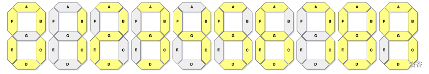

上图依次展示了数字 $0\sim 9$ 用七段码来显示的状态，其中灯管为黄色表示点亮，灰色表示熄灭。根据灯管的亮暗状态，我们可以用一个状态码（状态码是一个 $7$ 位的二进制数字）来表示一个七段码，令灯管点亮时状态为 $1$，灯管熄灭时状态为 $0$，按照灯管 $\rm ABCDEFG$ 的顺序标识一个七段码，则数字 $0 \sim 9$ 的状态码为：

|数字|状态码|数字|状态码|
|:-:|:-:|:-:|:-:|
|$0$|$1111110$|$5$|$1011011$|
|$1$|$0110000$|$6$|$1011111$|
|$2$|$1101101$|$7$|$1110000$|
|$3$|$1111001$|$8$|$1111111$|
|$4$|$0110011$|$9$|$1111011$|

小蓝有一个喜爱的数字，长度为 $18$ 位，每一位用一个七段码显示器来展示
（每位只能是 $0 \sim 9$，可以包含前导零），由于灯管故障，一些本该点亮的灯管
处于了熄灭状态。例如，对于一个长度为 $2$ 的数字来说，当两个七段码对应的
状态码分别为：$1011111$（高位）、$1110011$（低位）时，原本的数字可能会是：
$68$、$69$、$88$、$89$，有 4 种可能的值。

$18$ 个七段码显示器对应的状态码分别为：

$0000011$，$1001011$，$0000001$，$0100001$，$0101011$，$0110110$，
$1111111$，$0010110$，
$0101001$，$0010110$，
$1011100$，$0100110$，
$1010000$，$0010011$，
$0001111$，$0101101$，
$0110101$，$1101010$。

其中每个表示一个七段码对应的的状态码（按照数字的高位到低位给出）。请你
判断下小蓝喜爱的数字有多少种可能的值。

#### 输出格式

一行一个整数表示答案。

---

### — · 整数变换

> 题号 洛谷 P10985 ｜ 难度 简单（洛谷 入门） ｜ 时间 2.00s ｜ 内存 512MB
> 通过率 35.96%（洛谷站内口径） ｜ 题面原文 https://www.luogu.com.cn/problem/P10985
> 考过的语言/组别：国赛 Python 大学A组、Java 大学A组（洛谷题单）

#### 题目背景

Python 选手建议使用 PyPy3 提交本题。

#### 题目描述

小蓝有一个整数 $n$。每分钟，小蓝的数都会发生变化，变为上一分钟的数减去上一分钟的数的各个数位和。

例如，如果小蓝开始时的数为 $23$，则下一分钟变为 $23 - (2 + 3) = 18$，再下一分钟变为 $18 - (1 + 8) = 9$，再下一分钟变为 $9 - 9 = 0$，共经过了 $3$ 分钟变为 $0$。

给定一个正整数，请问这个数多少分钟后变为 $0$。

#### 输入格式

输入一行包含一个整数 $n$。

#### 输出格式

输出一个整数，表示答案。

#### 样例输入

```
23
```

#### 样例输出

```
3
```

#### 提示

对于 $30\%$ 的评测用例，$1 \le n \le 1000$；

对于 $60\%$ 的评测用例，$1 \le n \le 10^6$；

对于所有评测用例，$1 \le n \le 10^9$。

---

### — · 2023

> 题号 洛谷 P10986 ｜ 难度 困难（洛谷 提高） ｜ 时间 1.00s ｜ 内存 512MB
> 通过率 24.56%（洛谷站内口径） ｜ 题面原文 https://www.luogu.com.cn/problem/P10986
> 考过的语言/组别：国赛 Python 大学A组（洛谷题单）

#### 题目背景

建议使用 PyPy3 提交本题。

#### 题目描述

给定 $n, m$，请求出所有 $n$ 位十进制整数中有多少个数中恰好出现了 $m$ 个 $2023$。

例如 $00202312023$ 是一个 $11$ 位的出现了 $2$ 个 $2023$ 的十进制整数。

由于结果可能很大，请输出答案对 $998,244,353$ 取模的结果。

#### 输入格式

输入一行包含两个整数 $n,m$，用一个空格分隔。

#### 输出格式

输出一行包含一个整数表示答案。

#### 样例输入

```
5 1
```

#### 样例输出

```
20
```

#### 提示

对于 $40\%$ 的评测用例，$n \le 10^5,m \le 10$；

对于所有评测用例，$4 \le n \le 10^5,0 \le 4m \le n$。

---

### — · 火车运输

> 题号 洛谷 P10987 ｜ 难度 中等（洛谷 普及） ｜ 时间 10.00s ｜ 内存 512MB
> 通过率 45.69%（洛谷站内口径） ｜ 题面原文 https://www.luogu.com.cn/problem/P10987
> 考过的语言/组别：国赛 Python 大学A组（洛谷题单）

#### 题目背景

为照顾 Python 语言的效率，本题时限较大。建议使用 PyPy3 提交本题。

#### 题目描述

钢厂有一辆用于运送废旧钢材的火车，它具有两节车厢，其中车厢 1 的最大载重量为 $A$，车厢 2 的最大载重量为 $B$。现在一共有 $N$ 件废旧钢材需要被运输，其中第 $i$ 件钢材的重量为 $w_i$，为了最大化运输效率，车长想要一次性运输走重量尽可能多的钢材，请你帮助车长计算出一次运输最多可以带走多大重量的钢材。

每件钢材都是独立的不可分割的，只能被放置在某一节车厢中。在装载钢材时只需要考虑重量条件即可。

#### 输入格式

输入的第一行包含三个整数 $N ,A,B$，用一个空格分隔，分别表示钢材的数目以及两节车厢的最大载重。

第二行包含 $N$ 个整数，分别表示 $w_1,w_2, \cdots,w_n$，相邻两个整数之间使用一个空格分隔。

#### 输出格式

输出一个整数表示答案。

#### 样例输入

```
3 10 8
8 9 1
```

#### 样例输出

```
18
```

#### 提示

对于 $30\%$ 的评测用例，$1 \le N \le 10$；

对于所有评测用例，$1 \le N \le 200,1 \le w_i
,A,B \le 1000$。

#### 样例解释

车厢 1 装入第 $2$ 件和第 $3$ 件钢材，车厢 2 装入第 $1$ 件钢材。

---

### — · 彩色二叉树

> 题号 洛谷 P10990 ｜ 难度 中等（洛谷 普及+/提高−） ｜ 时间 4.00s ｜ 内存 768MB
> 通过率 28.37%（洛谷站内口径） ｜ 题面原文 https://www.luogu.com.cn/problem/P10990
> 考过的语言/组别：国赛 Python 大学A组（洛谷题单）

#### 题目背景

建议使用 PyPy3 提交本题。

#### 题目描述

给定包含 $n$ 个结点的完全二叉树，如下图是一棵包含 $n = 6$ 个结点的完全二叉树。

**树上的所有节点开始时没有被染色，颜色为 $0$。**

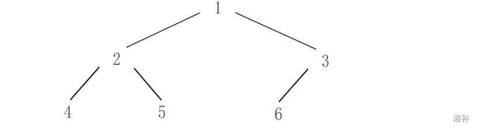

给定 $q$ 次操作，操作可以是：
1. $x_i\ y_i\ z_i$，表示将与结点 $x_i$ 距离小于等于 $y_i$ 的结点的颜色全部染成 $z_i$；
1. $x_i$，表示查询结点 $x_i$ 的颜色。

#### 输入格式

输入的第一行包含两个整数 $n, q$，用一个空格分隔。

接下来 $q$ 行，每行包含 $1$ 个操作，相邻的整数之间使用一个空格分隔。保证每个操作都是合法的。

#### 输出格式

对于每个查询操作，输出一行包含一个整数表示对应的答案。

#### 样例输入

```
6 6
1 1 1 1
2 3
1 5 2 2
2 4
2 1
2 3
```

#### 样例输出

```
1
2
2
1
```

#### 提示

对于 $40\%$ 的评测用例，$n, q \le 5000$；

对于所有评测用例，$1 \le n \le 10^6,1\le q \le 2 \times 10^5,1 \le x_i \le n,1 \le y_i \le 10^6,1 \le z_i\le 10^6$。

---

### — · 选段排序

> 题号 洛谷 P10991 ｜ 难度 中等（洛谷 普及+/提高−） ｜ 时间 1.00s ｜ 内存 512MB
> 通过率 30.97%（洛谷站内口径） ｜ 题面原文 https://www.luogu.com.cn/problem/P10991
> 考过的语言/组别：国赛 Python 大学A组（洛谷题单）

#### 题目描述

给定一个长度为 $n$ 的序列 $A_i$ 以及两个下标 $p, q(p < q)$。你可以选择任意一个区间 $[L, R]$ 并将序列的这个范围内的元素 $A_L \sim A_R$ 从小到大排序。

求选择一个区间排序后 $A_q − A_p$ 的值最大可以是多少。

#### 输入格式

输入的第一行包含三个整数 $n, p, q$，相邻两个整数之间使用一个空格分隔。

第二行包含 $n$ 个整数，分别表示 $A_1, A_2, \cdots, A_n$，相邻两个整数之间使用一个空格分隔。

#### 输出格式

输出一行，包含一个整数表示 $A_q − A_p$ 的最大值。

#### 样例输入

```
5 1 4
4 5 3 3 1
```

#### 样例输出

```
3
```

#### 提示

对于 $20\%$ 的评测用例，$n \le 100 ,A_i \le 200$；

对于 $40\%$ 的评测用例，$n \le 2000 ,A_i \le 3000$；

对于所有评测用例，$1 \le p \le q \le n \le 2 \times 10^5,1 \le A_i \le 10^6$。

---

### — · 最长同类子串

> 题号 洛谷 P10992 ｜ 难度 困难（洛谷 提高+/省选−） ｜ 时间 2.00s ｜ 内存 512MB
> 通过率 22.23%（洛谷站内口径） ｜ 题面原文 https://www.luogu.com.cn/problem/P10992
> 考过的语言/组别：国赛 Python 大学A组（洛谷题单）

#### 题目描述

对于两个等长的字符串 $A, B$，如果对于任意 $i, j$，都有 $A_i = A_j$ 和 $B_i = B_j$
同时满足或同时不满足，那么我们称 $A, B$ 是一对同类串。例如，`aabab` 和 `xxkxk` 是一对同类串，而 `abcde` 和  `abcdd` 则不是。

给定 $S, T$，找出一个尽可能大的 $k$ 使得 $S, T$ 分别含有一个长度为 $k$ 的子
串 $S', T'$，且 $S',T'$ 是同类串。

#### 输入格式

输入两行，每行包含一个字符串，分别表示 $S, T$。

#### 输出格式

输出一行包含一个整数 $k$ 表示答案。

#### 样例输入

```
aaaba
yxyy
```

#### 样例输出

```
3
```

#### 提示

对于 $40\%$ 的评测用例，$|S |, |T| \le 500$；

对于 $50\%$ 的评测用例，$|S |, |T| \le 2000$；

对于所有评测用例，$1 \le |S |, |T| \le 10^5$，$S, T$ 中仅包含小写英文字母。

---

### — · 弹珠堆放

> 题号 洛谷 P12206 ｜ 难度 简单（洛谷 入门） ｜ 时间 1.00s ｜ 内存 512MB
> 通过率 54.78%（洛谷站内口径） ｜ 题面原文 https://www.luogu.com.cn/problem/P12206
> 考过的语言/组别：国赛 Python 大学B组（洛谷题单）

#### 题目描述

小蓝有 $20230610$ 颗磁力弹珠，他对金字塔形状尤其感兴趣，如下图所示：

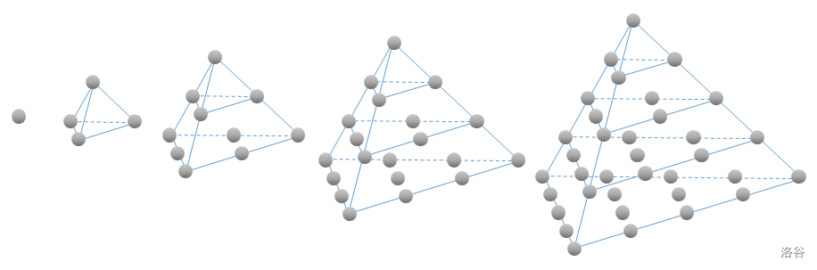

- 高度为 $1$ 的金字塔需要 $1$ 颗弹珠；
- 高度为 $2$ 的金字塔需要 $4$ 颗弹珠；
- 高度为 $3$ 的金字塔需要 $10$ 颗弹珠；
- 高度为 $4$ 的金字塔需要 $20$ 颗弹珠。

小蓝想要知道用他手里的弹珠可以摆出的最高的金字塔的高度是多少？

#### 输出格式

这是一道结果填空的题，你只需要算出结果后提交即可。本题的结果为一个整数，在提交答案时只需要**编写一个程序输出这个整数**，输出多余的内容将无法得分。

---

### — · 划分

> 题号 洛谷 P12207 ｜ 难度 简单（洛谷 普及−） ｜ 时间 5.00s ｜ 内存 512MB
> 通过率 54.73%（洛谷站内口径） ｜ 题面原文 https://www.luogu.com.cn/problem/P12207
> 考过的语言/组别：国赛 Python 大学B组（洛谷题单）

#### 题目描述

给定 $40$ 个数，请将其任意划分成两组，每组至少一个元素。每组的权值为组内所有元素的和。划分的权值为两组权值的乘积。请问对于以下 $40$ 个数，划分的权值最大为多少。

```
5160 9191 6410 4657 7492 1531 8854 1253 4520 9231

1266 4801 3484 4323 5070 1789 2744 5959 9426 4433

4404 5291 2470 8533 7608 2935 8922 5273 8364 8819

7374 8077 5336 8495 5602 6553 3548 5267 9150 3309
```

#### 输出格式

这是一道结果填空的题，你只需要算出结果后提交即可。本题的结果为一个整数，在提交答案时只需要**编写一个程序输出这个整数**，输出多余的内容将无法得分。

---

### — · 偶串

> 题号 洛谷 P12208 ｜ 难度 简单（洛谷 入门） ｜ 时间 3.00s ｜ 内存 512MB
> 通过率 51.97%（洛谷站内口径） ｜ 题面原文 https://www.luogu.com.cn/problem/P12208
> 考过的语言/组别：国赛 Python 大学B组（洛谷题单）

#### 题目描述

小蓝特别喜欢偶数，当他看到字符串时，他总是要检查一下是不是每种字符都是出现偶数次。给定一个字符串，请帮助小蓝检查一下该字符串是否满足要求。

#### 输入格式

输入一行包含一个字符串，由小写英文字母组成。

#### 输出格式

如果字符串中的每种字符都是出现偶数次，输出大写英文单词 $\tt{YES}$，否则输出大写英文单词 $\tt{NO}$。

#### 样例输入 1

```
banana
```

#### 样例输出 1

```
NO
```

#### 样例输入 2

```
bbnana
```

#### 样例输出 2

```
YES
```

#### 提示

### 评测用例规模与约定

- 对于 $50\%$ 的评测用例， $1 \leq$ 字符串长度 $\leq 1000$；
- 对于所有评测用例，$1 \leq$ 字符串长度 $\leq 10^{6}$。

---

### — · 交易账本

> 题号 洛谷 P12209 ｜ 难度 中等（洛谷 普及） ｜ 时间 1.00s ｜ 内存 512MB
> 通过率 27.86%（洛谷站内口径） ｜ 题面原文 https://www.luogu.com.cn/problem/P12209
> 考过的语言/组别：国赛 Python 大学B组（洛谷题单）

#### 题目描述

小蓝最近研发了一种新的记账方式，并邀请了一些用户参加测试。交易账本可以看作是交易记录的集合，每条交易记录都有着一个独一无二的交易编号 $txId$（编号大小反映了交易记录产生的时间顺序，$txId$ 小的交易记录先发生于 $txId$ 大的交易记录），每条交易记录包含一个或多个输入信息以及一个或多个输出信息。

其中输入来自于已经发生过的某笔交易的某个输出，可以理解为这笔钱从某笔交易输出后继续输入到了当前这笔交易中，输入信息主要包含以下数据： $fromTxId$、$fromTxOutNumber$，这表示当前输入来自于交易编号为 $fromTxId$ 的第 $fromTxOutNumber$ （$fromTxOutNumber=0,1,2, \cdots$）个输出；输出信息主要包含以下数据：$account$、$val$，表示将 $val$ 数目的钱转移到了账户编号为 $account$ 的账户上。注意，当 $fromTxId$ 和 $fromTxOutNumber$ 都为 $-1$ 时，表明这是一笔特殊交易，由系统账户直接产生输出，特殊交易只含有一个输入和一个输出，可以认为系统账户拥有无限多数目的钱，特殊交易一定可以成功。

一个合法的账本应满足以下条件：
1) 对于每笔交易记录，所有的输入中涉及到的钱的总数目应和所有输出中钱的总数目相等；
2) 交易中的一个输出要么不使用，要使用的话输出中的钱应该全部分配给下一个输入，而不能分配给多个输入（特殊交易除外）；
3) 交易按照顺序进行，不可以在某笔交易中引用还未发生的交易。

现在已知一共有 $N$ 个不同的账户，初始时所有账户钱数目都为 $0$，账本上总计有 $M$ 条交易记录（按照交易完成的顺序进行记录），请你来判断下账本上的记录是否是合法的。

#### 输入格式

输入的第一行包含一个整数 $T$，表示有 $T$ 组输入数据。

对于每组输入数据：

第一行包含两个整数 $N, M$，用一个空格分隔，分别表示账户的数目和账本的交易记录数目，其中账户编号为 $0,1,2, \cdots, N-1$ ，交易记录编号为 $0,1,2, \cdots, M-1$。

接下来 $M$ 行，每行包含一条交易记录的信息，交易记录编号依次为 $0,1,2, \cdots, M-1$。第一个整数 $inCount$ 表示输入的个数，接下来包含 $inCount$ 个输入信息，每个输入信息包含 $fromTxId$ 和 $fromTxOutNumber$ 两个整数；接下来包含一个整数 $outCount$ 表示输出的个数，然后接着包含 $outCount$ 个输出信息，每个输出信息包含 $account$ 和 $val$ 两个整数。

#### 输出格式

对于每组输入数据输出一行，如果账本记录合法则输出英文单词 $\tt{YES}$，否则输出英文单词 $\tt{NO}$。

#### 样例输入

```
4
3 3
1 -1 -1 1 0 100
1 0 0 2 1 50 2 50
2 1 0 1 1 1 2 100
3 3
1 -1 -1 1 0 100
1 0 0 2 1 50 2 50
2 1 0 1 1 1 2 150
3 3
1 -1 -1 1 0 100
1 0 0 2 1 50 2 50
3 0 0 1 0 1 1 1 2 200
3 3
1 -1 -1 1 0 100
2 0 0 2 0 2 1 100 2 100
1 -1 -1 1 2 100
```

#### 样例输出

```
YES
NO
NO
NO
```

#### 提示

### 样例说明

对于第一个数据：第一条交易 $(txId=0)$ 为特殊交易，给账户 0 转入了 100；第二条交易 $(txId=1)$ 将上一条交易的唯一一个输出作为当前交易的输入，有两个输出，分别给账户 1 和 2 转入了 50；最后一条交易 $(txId=2)$ 将上一条交易的两个输出作为当前交易的输入，给账户 2 转入了 100 。

对于第二个数据，第三条交易中输入与输出总额不相等。

对于第三个数据，第一条交易中的输出被使用了超过一次。

对于第四个数据，第二条交易中引用了还未发生的交易的输出。

### 评测用例规模与约定

对于所有评测用例， $1 \leq T \leq 10$，$1 \leq N \leq 100$，$1 \leq M \leq 1000$，$1 \leq inCount, outCount \leq 100$，$1 \leq$ 交易中涉及到钱的数目 $\leq 10000$，$0 \leq account \leq N-1$。

---

### — · 背包问题

> 题号 洛谷 P12210 ｜ 难度 简单（洛谷 普及−） ｜ 时间 3.00s ｜ 内存 512MB
> 通过率 27.10%（洛谷站内口径） ｜ 题面原文 https://www.luogu.com.cn/problem/P12210
> 考过的语言/组别：国赛 Python 大学B组（洛谷题单）

#### 题目描述

小蓝是一位狂热的积木爱好者，家里堆满了自己用积木组装的建筑模型。最近，有两款新出的积木组件上市，小蓝自然不会错过，他带上了自己的三个背包来到了积木商城，打算将尽可能多的积木组件带回家，每个背包都有一个固定的空间大小。小蓝只会购买这两种新出的积木组件 $A$ 和 $B$，$A$ 和 $B$ 各自会占用背包的一部分空间，但对于同一种类型的积木占用的空间是相同的。小蓝想知道自己最多能带走多少数量的积木组件。

可以认为小蓝有足够的货币，只要背包可以装下的积木他都有能力购买。商场内的积木数量也是有限制的。

#### 输入格式

输入的第一行包含一个整数 $T$，表示有 $T$ 组独立的询问。

每一组询问由三行组成。

每组询问的第一行包含三个整数 $B_{1}, B_{2}, B_{3}$，相邻的整数之间使用一个空格分隔，表示三个背包的空间大小。

每组询问的第二行包含两个整数 $cnt_{A}, cnt_{B}$，用一个空格分隔，分别表示商场内积木组件 $A$ 和 $B$ 的总量。

每组询问的第三行包含两个整数 $V_{A}, V_{B}$，用一个空格分隔，分别表示每个积木组件 $A$ 和 $B$ 所占用的空间大小。

#### 输出格式

输出 $T$ 行，每行包含一个整数表示答案。

#### 样例输入

```
3
2 2 3
1 2
1 2
3 8 3
3 4
4 2
6 8 7
10 10
5 1
```

#### 样例输出

```
3
5
12
```

#### 提示

### 样例说明

对于第一组询问，第一个背包装一个 $B$ 积木，无剩余空间；第二个背包装一个 $B$ 积木，无剩余空间；第三个背包装一个 $A$ 积木，剩余 $2$ 空间，但积木已经没有了；最终答案是 $3$，可以带走所有的积木。

对于第二组询问，第一个背包和第三个背包各自装一个 $B$ 组件，第二个背包装两个 $B$ 组件和一个 $A$ 组件，答案是 $5$。

对于第三组询问，第一个背包： $1 \mathrm{~A}+1 \mathrm{~B}$；第二个背包： $8 \mathrm{~B}$ ；第三个背包： $1 \mathrm{~A}+1 \mathrm{~B}$。答案是 $12$。

### 评测用例规模与约定

- 对于 $30 \%$ 的评测用例， $1 \leq cnt_{A}, cnt_{B} \leq 100$；
- 对于所有评测用例， $1 \leq T \leq 100$，$1 \leq B_{1}, B_{2}, B_{3} \leq 10^{9}$，$1 \leq V_{A}, V_{B} \leq 10^{9}$，$1 \leq cnt_{A}, cnt_{B} \leq 1,000$。

---

### — · 最大阶梯

> 题号 洛谷 P12212 ｜ 难度 中等（洛谷 普及） ｜ 时间 3.00s ｜ 内存 512MB
> 通过率 35.92%（洛谷站内口径） ｜ 题面原文 https://www.luogu.com.cn/problem/P12212
> 考过的语言/组别：国赛 Python 大学B组（洛谷题单）

#### 题目描述

小蓝特别喜爱阶梯图案，阶梯图案可以看做是由若干个大小和颜色都相同的方格组成的，对于大小为 $N$ 的阶梯图案，包含了 $N$ 个连续的列，其中第 $i$ 列恰好有 $i$（ $1 \leq i \leq N$）个方格，将这 $N$ 列的底部对齐后便组成了一个阶梯图案，将其按照 90 度旋转若干次后仍是阶梯图案，下图展示了几个不同大小的阶梯图案：

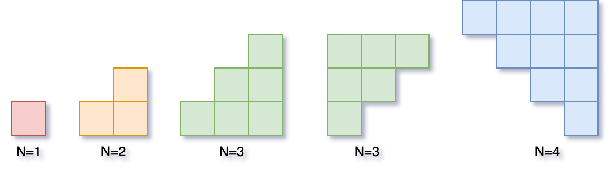

小蓝有一块大小为 $H \times H$ 的布匹，由 $H \times H$ 个大小相同的方格区域组成，每一个方格都有自己的颜色。小蓝可以沿着方格的边缘对布匹进行裁剪，他想要知道自己能得到的最大的同色阶梯图案的大小是多少？

#### 输入格式

输入的第一行包含一个整数 $H$ 表示布匹大小。

接下来输入 $H$ 行，每行包含 $H$ 个整数，相邻的整数之间使用一个空格分隔，表示每个方格的颜色。

#### 输出格式

输出一行包含一个整数表示答案。

#### 样例输入

```
5
0 2 1 1 0
0 0 2 2 0
0 0 1 1 1
0 0 1 1 1
2 1 1 0 2
```

#### 样例输出

```
3
```

#### 提示

### 样例说明

如下图所示，最大的同色阶梯图案用红色边框标出。

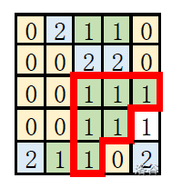

### 评测用例规模与约定

- 对于 $30\%$ 的评测用例，$1 \leq H \leq 10$；
- 对于 $60\%$ 的评测用例，$1 \leq H \leq 100$；
- 对于所有评测用例， $1 \leq H \leq 1000$，$0 \leq$ 方格颜色 $\leq 10$。

---

### — · 贸易航线

> 题号 洛谷 P12214 ｜ 难度 中等（洛谷 普及） ｜ 时间 3.00s ｜ 内存 512MB
> 通过率 44.35%（洛谷站内口径） ｜ 题面原文 https://www.luogu.com.cn/problem/P12214
> 考过的语言/组别：国赛 Python 大学B组（洛谷题单）

#### 题目描述

小蓝要带领一支船队依次经过 $n$ 个地点。小蓝的船上可以携带 $k$ 单位的商品，商品共有 $m$ 种，在每个地点的价格各不相同，部分商品在部分地区无法交易。

一开始小蓝的船是空的，小蓝可以在每个地点任意地买入各种商品，然后在之后经过的地点卖出。小蓝的钱很多，你可以认为小蓝买入商品时只会受到船队的容量的限制。

问小蓝到达终点时的最大收益是多少。

#### 输入格式

输入的第一行包含三个整数 $n, m, k$，相邻的整数之间使用一个空格分隔。

接下来 $n$ 行，每行包含 $m$ 个整数，其中第 $i$ 行的第 $j$ 个数 $P_{i,j}$ 表示在第 $i$ 个地点第 $j$ 种商品的价格。特别地，值为 $-1$ 表示该商品在这个地区无法交易。

#### 输出格式

输出一行包含一个整数表示答案。

#### 样例输入

```
7 4 4
1 2 3 6
-1 2 3 4
-1 2 4 4
3 3 2 2
2 5 3 1
1 3 3 2
1 2 4 2
```

#### 样例输出

```
24
```

#### 提示

### 评测用例规模与约定

- 对于 $20\%$ 的评测用例，$n \leq 300$，$m \leq 3$，$k \leq 10$；
- 对于 $40\%$ 的评测用例，$n \leq 2000$，$m \leq 4$，$k \leq 50$；
- 对于所有评测用例，$1 \leq n \leq 10^5$，$1 \leq m \leq 10$，$1 \leq k \leq 100$，$1 \leq P_{i,j} \leq 10^9$。

---

### — · 困局

> 题号 洛谷 P12215 ｜ 难度 中等（洛谷 普及+/提高−） ｜ 时间 3.00s ｜ 内存 512MB
> 通过率 15.41%（洛谷站内口径） ｜ 题面原文 https://www.luogu.com.cn/problem/P12215
> 考过的语言/组别：国赛 Python 大学B组（洛谷题单）

#### 题目描述

小蓝发现有个小偷在坐标 $0$ 处，正在往 $x$ 轴正方向逃离并保持逃离方向不变。小蓝不想让他快速逃离（即走到坐标 $n + 1$ 处），准备设立 $k$ 道双向传送门拖延其时间，每道传送门可以连接 $x$ 轴上的两个不同的整点坐标 $p \leftrightarrow q$，其中 $p, q \in [1, n]$，同时每个坐标上最多作为一道传送门的端点。

当小偷达到一个整点时，如果其上有传送门，则会触发传送门到达传送门另一端，当然同一个传送门不能连续触发，当无法传送时小偷会保持向 $x$ 轴正方向移动。小蓝想通过设置这些传送门使得小偷被至少传送 $2k$ 次，请问有多少种设置传送门的方式可以完成目标？

#### 输入格式

输入一行包含两个正整数 $n, k$，用一个空格分隔。

#### 输出格式

输出一行，包含一个整数表示答案。答案可能很大，请输出答案对 $998244353$ 取模的结果。

#### 样例输入

```
5 2
```

#### 样例输出

```
5
```

#### 提示

### 样例说明

其中一种连接方式为 $1 \leftrightarrow 4, 2 \leftrightarrow 5$，小偷的行走路线为 $0 \rightarrow 1 \rightarrow 4 \rightarrow 5 \rightarrow 2 \rightarrow 3 \rightarrow 4 \rightarrow 1 \rightarrow 2 \rightarrow 5 \rightarrow 6$，一共被传送了 $4$ 次。

### 评测用例规模与约定

- 对于 $20\%$ 的评测用例，$n \leq 8$；
- 对于所有评测用例，$1 \leq n \leq 10^5$，$0 < k < \min(n, 8)$。

---

### — · 互质

> 题号 洛谷 P12216 ｜ 难度 中等（洛谷 普及+/提高−） ｜ 时间 1.00s ｜ 内存 512MB
> 通过率 59.70%（洛谷站内口径） ｜ 题面原文 https://www.luogu.com.cn/problem/P12216
> 考过的语言/组别：国赛 Java 大学B组（洛谷题单）

#### 题目描述

请计算在 $[1,2023^{2023}]$ 范围内有多少个整数与 $2023$ 互质。由于结果可能很大，你只需要输出对 $10^9+7$ 取模之后的结果。

#### 输出格式

这是一道结果填空的题，你只需要算出结果后提交即可。本题的结果为一个整数，在提交答案时只需要**编写一个程序输出这个整数**，输出多余的内容将无法得分。

---

### — · 逆元

> 题号 洛谷 P12217 ｜ 难度 中等（洛谷 普及） ｜ 时间 1.00s ｜ 内存 512MB
> 通过率 55.15%（洛谷站内口径） ｜ 题面原文 https://www.luogu.com.cn/problem/P12217
> 考过的语言/组别：国赛 Java 大学B组（洛谷题单）

#### 题目描述

数论中的逆元是一个可以把除法转换为乘法的工具。若自然数 $a, I_a$ 满足 $a \times I_a \equiv 1 \pmod{M}$，则称 $a$ 在模 $M$ 的意义下的逆元为 $I_a$，这样在模 $M$ 下计算除法时，可以把除以 $a$ 的运算转化为乘以其逆元 $I_a$。

给定质数模数 $M = 2\,146\,516\,019$，根据费马小定理对于不是 $M$ 倍数的正整数 $a$，有 $a^{(M-1)} \equiv 1 \pmod{M}$，求出 $[1, 233\,333\,333]$ 内所有自然数的逆元。则所有逆元的异或和为多少？

#### 输出格式

这是一道结果填空的题，你只需要算出结果后提交即可。本题的结果为一个整数，在提交答案时只需要**编写一个程序输出这个整数**，输出多余的内容将无法得分。

---

### — · 玩具

> 题号 洛谷 P12218 ｜ 难度 简单（洛谷 普及−） ｜ 时间 2.00s ｜ 内存 512MB
> 通过率 36.29%（洛谷站内口径） ｜ 题面原文 https://www.luogu.com.cn/problem/P12218
> 考过的语言/组别：国赛 Java 大学B组（洛谷题单）

#### 题目描述

小明的妈妈给他买了 $n$ 个玩具，但是为了同时考察他的智力，只给了他 $2 \times n$ 个零件，第 $i$ 个零件的重量为 $w_i$（$1 \leq i \leq 2 \times n$）。

其中任意两个零件都可以拼接成一个玩具，这个玩具的权重就等于拼接所用的 **两个零件的重量的乘积**。小明的妈妈希望小明能够使用这 $2 \times n$ 个零件拼接出 $n$ 个玩具（每个零件必须使用且只能用一次），使得所有玩具的权重的和最小。小明希望你帮帮他计算出最小的权重和。

#### 输入格式

输入共 $2$ 行。

第一行为一个正整数 $n$。

第二行为 $2 \times n$ 个由空格隔开的整数 $w_1, w_2, \ldots, w_{2 \times n}$。

#### 输出格式

输出共 $1$ 行，一个整数。

#### 样例输入

```
2
2 2 3 4
```

#### 样例输出

```
14
```

#### 提示

### 样例说明

由于有两个零件的重量都为 $2$，所以一共有两种结果:
- $(2 \times 2) + (3 \times 4) = 16$;
- $(2 \times 3) + (2 \times 4) = 14$。

### 评测用例规模与约定

- 对于 $20\%$ 的数据，保证 $n \leq 10^3$。
- 对于 $100\%$ 的数据，保证 $n \leq 10^5$，$0 \leq w_i \leq 10^5$。

---

### — · 不完整的算式

> 题号 洛谷 P12219 ｜ 难度 中等（洛谷 普及） ｜ 时间 2.00s ｜ 内存 512MB
> 通过率 32.26%（洛谷站内口径） ｜ 题面原文 https://www.luogu.com.cn/problem/P12219
> 考过的语言/组别：国赛 Java 大学B组（洛谷题单）

#### 题目描述

小蓝在黑板上写了一个形如 $A \quad op \quad B = C$ 的算式，其中 $A$、$B$、$C$ 都是非负整数，$op$ 是 $+$、$-$、$\times$、$/$（整除）四种运算之一。

不过 $A$、$op$、$B$、$C$ 这四部分有一部分被不小心的同学擦掉了。

给出这个不完整的算式，其中被擦掉的部分（被擦掉的部分是被完整的擦掉，不会出现留下若干位数字的情况）用 $\tt{?}$ 代替。请你输出被擦掉的部分。

#### 输入格式

输入只有一行，包含一个字符串代表如上文所述的不完整的算式。

#### 输出格式

如果被擦掉的部分是 $A$、$B$、$C$ 之一，请输出一个整数代表答案。如果被擦掉的部分是 $op$，请输出 $\tt{+}$、$\tt{-}$、$\tt{*}$、$\tt{/}$ 四个字符之一代表答案。

#### 样例输入 1

```
1+?=2
```

#### 样例输出 1

```
1
```

#### 样例输入 2

```
10?3=3
```

#### 样例输出 2

```
/
```

#### 提示

### 评测用例规模与约定

- 对于 $20\%$ 的数据，被擦掉的部分是 $C$。
- 对于 $40\%$ 的数据，被擦掉的部分是 $op$。
- 对于 $100\%$ 的数据，算式长度不超过 $10$，不包含空格。算式中出现的整数不包含多余的前导 $0$。输入保证合法且有唯一解。

---

### — · 星球

> 题号 洛谷 P12220 ｜ 难度 中等（洛谷 普及+/提高−） ｜ 时间 2.00s ｜ 内存 512MB
> 通过率 44.22%（洛谷站内口径） ｜ 题面原文 https://www.luogu.com.cn/problem/P12220
> 考过的语言/组别：国赛 Java 大学B组（洛谷题单）

#### 题目描述

小明驾驶飞船对某星系发起攻击。星系中有 $n$ 颗星球，编号依次是 $1, 2, \ldots, n$。第 $i$ 颗星球的坐标为 $(x_i, y_i, z_i)$，且其防御强度为 $w_i$。

小明需要规划出进攻这 $n$ 颗星球的顺序使得其进攻所需能量最少。

对于一个遍历顺序 $p_1, p_2, \ldots, p_n$ 来说，小明进攻需要的能量为 $E = \displaystyle \sum_{i=2}^{n} d(p_{i-1}, p_i) \times w_{p_i}$，其中 $d(p_{i-1}, p_i)$ 表示 $p_{i-1}, p_i$ 两颗星球之间的直线距离。小明想知道进攻所需最少能量是多少。

#### 输入格式

输入共 $n + 1$ 行。

第一行为一个正整数 $n$。

后面 $n$ 行，每行四个整数 $x_i, y_i, z_i, w_i$。

#### 输出格式

输出共 $1$ 行，一个浮点数（保留两位小数）。

#### 样例输入

```
3
4 3 3 5
2 2 3 5
3 1 1 3
```

#### 样例输出

```
18.53
```

#### 提示

### 样例说明

当进攻顺序为 $\{1, 2, 3\}$ 时，所需能量最小，为 $5\sqrt{5} + 3\sqrt{6}$。

### 评测用例规模与约定

- 对于 $20\%$ 的数据，保证 $n \leq 8$。
- 对于 $100\%$ 的数据，保证 $n \leq 18$，$0 \leq x_i, y_i, z_i, w_i \leq 100$。

---

### — · 序列

> 题号 洛谷 P12221 ｜ 难度 中等（洛谷 普及） ｜ 时间 2.00s ｜ 内存 512MB
> 通过率 38.50%（洛谷站内口径） ｜ 题面原文 https://www.luogu.com.cn/problem/P12221
> 考过的语言/组别：国赛 Java 大学B组（洛谷题单）

#### 题目描述

给定一个长度为 $n$ 的正整数序列 $a_1, a_2, \ldots, a_n$，同时有一个首项为 $d$，公差为 $d$，项数为 $n$ 的等差数列 $\{b_1 = d, b_2 = 2d, \ldots, b_n = nd\}$。

定义 $S_d = \displaystyle \sum_{a_i | b_i} 1$，即 $S_d$ 表示当公差为 $d$ 时有多少对 $(a_i, b_i)$ 满足 $b_i$ 被 $a_i$ 整除，请求出 $\displaystyle \sum_{i=1}^{n} S_i$。

#### 输入格式

输入共 $2$ 行。

第一行为一个正整数 $n$。

第二行为 $n$ 个由空格隔开的正整数 $a_1, a_2, \ldots, a_n$。

#### 输出格式

输出共 $1$ 行，一个整数。

#### 样例输入

```
4
2 2 3 1
```

#### 样例输出

```
14
```

#### 提示

### 样例说明

- 当公差等于 $1$：$b = \{1, 2, 3, 4\}$, 有 3 对 $(a_i, b_i)$ 满足条件，$S_1 = 3$。
- 当公差等于 $2$：$b = \{2, 4, 6, 8\}$, 有 4 对 $(a_i, b_i)$ 满足条件，$S_2 = 4$。
- 当公差等于 $3$：$b = \{3, 6, 9, 12\}$, 有 3 对 $(a_i, b_i)$ 满足条件，$S_3 = 3$。
- 当公差等于 $4$：$b = \{4, 8, 12, 16\}$, 有 4 对 $(a_i, b_i)$ 满足条件，$S_4 = 4$。

所以答案为 $3 + 4 + 3 + 4 = 14$。

### 评测用例规模与约定

- 对于 $20\%$ 的数据, 保证 $n \leq 10^3$。
- 对于 $100\%$ 的数据, 保证 $1\leq n \leq 10^5$，$1\leq a_i \leq n$。

---

### — · 电动车

> 题号 洛谷 P12222 ｜ 难度 中等（洛谷 普及） ｜ 时间 2.00s ｜ 内存 512MB
> 通过率 45.14%（洛谷站内口径） ｜ 题面原文 https://www.luogu.com.cn/problem/P12222
> 考过的语言/组别：国赛 Java 大学B组（洛谷题单）

#### 题目描述

作为一名繁忙的程序员，小蓝经常需要在 $N$ 座城市之间来回穿梭。他准备购买一辆电动车出行，但是担心电动车电量不足。

为了描述方便，我们把 $N$ 座城市编号 $1$ 至 $N$。城市之间一共有 $M$ 条双向高速公路相连。其中第 $i$ 条连接 $u_i$ 号城市和 $v_i$ 号城市，耗费 $w_i$ 个单位的电量。

假设小蓝可以在出发城市，以及任何中途经过的城市充满电。小蓝想知道，如果希望从任意城市开电动车到任意另一个城市，都可以找到一条由若干高速公路组成路径，使得不需要在任何高速公路内补充电量，那么这台电动车至少需要多少电量？

#### 输入格式

第一行包含两个整数 $N$ 和 $M$。

以下 $M$ 行，每行包含 $3$ 个整数 $u_i$、$v_i$ 和 $w_i$。

#### 输出格式

一个整数，代表答案。

如果存在两个城市不能通过高速公路相互到达，输出 $-1$。

#### 样例输入

```
4 5
1 2 3
1 3 5
2 4 2
4 3 2
4 1 4
```

#### 样例输出

```
3
```

#### 提示

### 样例说明

- 从 $1$ 到 $2$ 可以走：$1 \rightarrow 2$，需要电量 3。
- 从 $1$ 到 $3$ 可以走：$1 \rightarrow 2 \rightarrow 4 \rightarrow 3$，其中 $1 \rightarrow 2$ 需要电量 $3$，$2 \rightarrow 4$ 需要电量 $2$，$4 \rightarrow 3$ 需要电量 $2$，全程至少需要电量 $3$。
- 从 $1$ 到 $4$ 可以走：$1 \rightarrow 2 \rightarrow 4$，其中 $1 \rightarrow 2$ 需要电量 $3$，$2 \rightarrow 4$ 需要电量 $2$，全程至少需要电量 $3$。
- 从 $2$ 到 $3$ 可以走：$2 \rightarrow 4 \rightarrow 3$，其中 $2 \rightarrow 4$ 需要电量 $2$，$4 \rightarrow 3$ 需要电量 $2$，全程至少需要电量 $2$。
- 从 $2$ 到 $4$ 可以走：$2 \rightarrow 4$，需要电量 $2$。
- 从 $3$ 到 $4$ 可以走：$3 \rightarrow 4$，需要电量 $2$。

综上所述，电动车至少需要 $3$ 个单位的电量。

### 评测用例规模与约定

- 对于 $20\%$ 的数据，$1 \leq N, M \leq 100$，$0 \leq w_i \leq 100$。
- 对于 $100\%$ 的数据，$1 \leq N, M \leq 200000$，$0 \leq w_i \leq 10^9$。

---

### — · 非对称二叉树

> 题号 洛谷 P12223 ｜ 难度 中等（洛谷 普及+/提高−） ｜ 时间 2.00s ｜ 内存 512MB
> 通过率 57.32%（洛谷站内口径） ｜ 题面原文 https://www.luogu.com.cn/problem/P12223
> 考过的语言/组别：国赛 Java 大学B组（洛谷题单）

#### 题目描述

小明觉得不对称的东西有着独特的美感。

对于一棵含有 $n$ 个结点的二叉树，小明规定如果对于其中任意一个结点 $i$ 都满足条件：$\max \{h_{l_i}, h_{r_i}\} \geq k \times \min \{h_{l_i}, h_{r_i}\}$ 则此二叉树为一棵非对称二叉树。其中 $l_i, r_i$ 分别为 $i$ 的左儿子和右儿子，$h_x$ 表示以 $x$ 为根的子树的高度（如果结点 $x$ 不存在则视为高度等于 $0$）。

给定 $n, k$，计算有多少棵不同的非对称二叉树。

#### 输入格式

输入共 $1$ 行，两个正整数 $n$、$k$。

#### 输出格式

输出共 $1$ 行，一个整数。

#### 样例输入

```
4 2
```

#### 样例输出

```
12
```

#### 提示

### 样例说明

所有 $12$ 种情况如下：

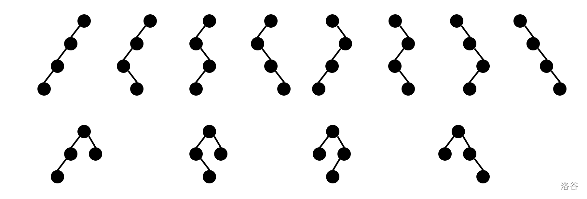

### 评测用例规模与约定

- 对于 $20\%$ 的数据，保证 $n \leq 12$。
- 对于 $100\%$ 的数据，保证 $n \leq 35$，$1 \leq k \leq n$。

---

### — · 数和游戏

> 题号 洛谷 P12224 ｜ 难度 困难（洛谷 提高） ｜ 时间 2.00s ｜ 内存 512MB
> 通过率 33.04%（洛谷站内口径） ｜ 题面原文 https://www.luogu.com.cn/problem/P12224
> 考过的语言/组别：国赛 Java 大学B组（洛谷题单）

#### 题目描述

数和游戏是一种棋盘填数游戏。棋盘上分为白色和灰色两种类型的格子。游戏目标是通过在白色的格子里填入数字 $1 \dots 9$ 来满足游戏要求。

游戏当中有一个称作“条目”的概念，条目指的就是在水平方向或者垂直方向上所有连续出现的白色格子的集合。具体来说从灰色格子右方（下方）相邻的白色格子出发，一直向右方（下方）行走直到走出棋盘边界或遇到灰色格子才停止，途中经过的所有的白色格子组成的集合就称为条目。例如上图中，我们用 $(x, y)$ 表示格子坐标，坐标 $(1, 4)$ 下方的条目就是由坐标 $(2, 4)$ 和 $(3, 4)$ 的白色格子构成的；坐标 $(5, 1)$ 右方的条目是由坐标 $(5, 2)$、$(5, 3)$ 的白色格子构成的。但注意坐标 $(7, 2)$、$(7, 3)$、$(7, 4)$ 处的格子的集合并不是一个条目，在加入坐标 $(7, 5)$ 的格子后才是一个条目。

游戏具体要求如下：游戏在一个 $M \times N$ 大小的格子棋盘上进行，其中格子分为白色和灰色两种类型：
1) 白色格子，此种类型的格子应当填入一个 $1 \dots 9$ 范围内的整数并满足所有灰色格子的要求；
2) 灰色格子，此种类型的格子用一条对角线将格子分为了左下（用 $A$ 表示）和右上（用 $B$ 表示）两部分，若 $A$ 中有数字，则表示 $A$ 所在的格子下方条目中的数字之和应该等于 $A$ 中的数字；若 $B$ 中有数字，则表示 $B$ 所在的格子右方条目中的数字之和应该等于 $B$ 中的数字。除此之外还有一个重要的约束条件：每一个条目中不能出现重复的数字，即在每一个条目之中，$1 \dots 9$ 中的每个数字最多只能出现一次。我们保证游戏一定有一个唯一解。

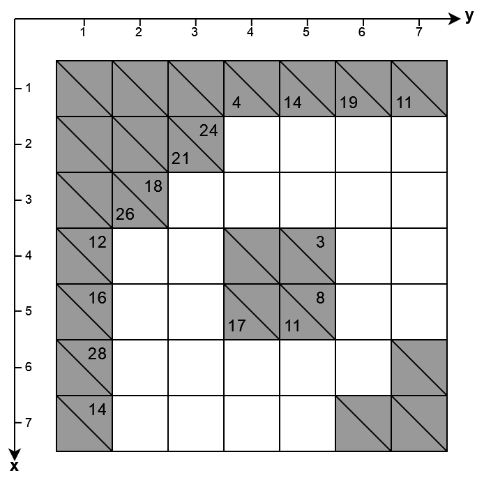

上图是一个数和游戏的例子示意图，坐标 $(1, 4)$ 处是一个灰色格子，它的 $A$ 中的数字为 $4$，这意味它下方的条目（即坐标 $(2, 4)$、$(3, 4)$ 处的白色格子）中的数字之和应该为 $4$；坐标 $(5, 1)$ 处是一个灰色格子，它的 $B$ 中的数字是 $16$，这表示它右方的条目（即坐标 $(5, 2)$、$(5, 3)$ 处的白色格子）中的数字之和应该为 $16$。

#### 输入格式

第一行输入两个正整数 $M$、$N$ 分别用来表示棋盘的高度和宽度。

接下来 $M$ 行，每行输入 $N$ 个格子的信息。对于白色格子，只需要输入一个整数 $1$；对于灰色格子，首先输入一个整数 $2$，接下来再输入两个正整数分别表示灰色格子中 $A$ 中的数字和 $B$ 中的数字，如果是 $-1$ 则表示 $A$ 或 $B$ 中没有数字。其中每一行输入的所有的相邻整数之间均用空格隔开。

#### 输出格式

输出 $M$ 行，每行包含 $N$ 个格子的信息，如果当前位置是一个灰色格子则用一个 `_ `符号来表示；如果是一个白色格子，则用一个 $1 \dots 9$ 之间的整数来表示将要填入当前白色格子内的数字。每一行中，相邻格子之间的输出用一个空格分隔。

#### 样例输入

```
7 7
2 -1 -1 2 -1 -1 2 -1 -1 2 4 -1 2 14 -1 2 19 -1 2 11 -1
2 -1 -1 2 -1 -1 2 21 24 1 1 1 1
2 -1 -1 2 26 18 1 1 1 1 1
2 -1 12 1 1 2 -1 -1 2 -1 3 1 1
2 -1 16 1 1 2 17 -1 2 11 8 1 1
2 -1 28 1 1 1 1 1 2 -1 -1
2 -1 14 1 1 1 1 2 -1 -1 2 -1 -1
```

#### 样例输出

```
_ _ _ _ _ _ _
_ _ _ 3 9 7 5
_ _ 6 1 5 4 2
_ 8 4 _ _ 2 1
_ 9 7 _ _ 5 3
_ 7 3 9 8 1 _
_ 2 1 8 3 _ _
```

#### 提示

### 样例说明

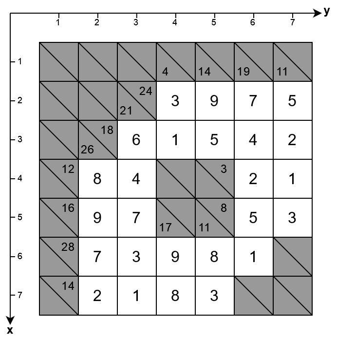

此局游戏的答案如上图所示。

### 评测用例规模与约定

- 对于 $30\%$ 的测试用例，$3 \leq M, N \leq 5$。
- 对于 $60\%$ 的测试用例，$3 \leq M, N \leq 10$。
- 对于 $100\%$ 的测试用例，$3 \leq M, N \leq 15$，$1 \leq$ 灰色格子中的数字 $\leq 50$。

---

### — · 游戏

> 题号 洛谷 P12225 ｜ 难度 中等（洛谷 普及+/提高−） ｜ 时间 1.00s ｜ 内存 512MB
> 通过率 46.86%（洛谷站内口径） ｜ 题面原文 https://www.luogu.com.cn/problem/P12225
> 考过的语言/组别：国赛 Java 大学B组（洛谷题单）

#### 题目描述

熊大和熊二在玩游戏。他们将 $n$ 个正整数 $a_1, a_2, \dots, a_n$ 排成一行，然后各用一个长度为 $k$ 的框在这个数组中各自随机框选出一段长度为 $k$ 的连续子序列（随机框选指在合法的 $n - k + 1$ 个连续子序列中均匀随机）。熊大记录了他框出的 $k$ 个数中的最大值 $P$，熊二记录了他框出的 $k$ 个数的最小值 $Q$，他们突然有个疑问：$P - Q$ 的期望是多少？

#### 输入格式

输入共 $2$ 行。

第一行为两个正整数 $n, k$。

第二行为 $n$ 个由空格隔开的正整数 $a_1, a_2, \dots, a_n$。

#### 输出格式

输出共 $1$ 行，一个浮点数（请保留两位小数）。

#### 样例输入

```
3 2
1 2 3
```

#### 样例输出

```
1.00
```

#### 提示

### 样例说明

一共有四种情况：

- 熊大框出 $[1, 2]$，$P = 2$；熊二框出 $[1, 2]$，$Q = 1$，$P - Q = 1$。
- 熊大框出 $[1, 2]$，$P = 2$；熊二框出 $[2, 3]$，$Q = 2$，$P - Q = 0$。
- 熊大框出 $[2, 3]$，$P = 3$；熊二框出 $[1, 2]$，$Q = 1$，$P - Q = 2$。
- 熊大框出 $[2, 3]$，$P = 3$；熊二框出 $[2, 3]$，$Q = 2$，$P - Q = 1$。

所以 $P - Q$ 的期望为 $(1 + 0 + 2 + 1) / 4 = 1.00$。

### 评测用例规模与约定

- 对于 $20\%$ 的数据，保证 $n \leq 10^2$。
- 对于 $40\%$ 的数据，保证 $n \leq 10^3$。
- 对于 $100\%$ 的数据，保证 $n \leq 10^5$，$0 < a_i \leq 10^9$，$0 < k \leq n$。

---

### — · X 质数

> 题号 洛谷 P12233 ｜ 难度 中等（洛谷 普及） ｜ 时间 2.00s ｜ 内存 512MB
> 通过率 68.93%（洛谷站内口径） ｜ 题面原文 https://www.luogu.com.cn/problem/P12233
> 考过的语言/组别：国赛 Java 大学A组（洛谷题单）

#### 题目描述

对于一个含有 $M$ 个数位的正整数 $N$，任意选中其中 $K$ 个不同的数位（$0 \leq K < M$），将这些选中的数位删除之后，余下的数位按照原来的顺序组成了一个新的数字 $P$。如果至少存在一个 $P$ 是质数，我们就称 $N$ 是一个 X 质数。例如，对于整数 $7869$，我们可以删去 $7$ 和 $6$，得到一个新的数字 $89$，由于 $89$ 是一个质数，因此 $7869$ 是一个 X 质数。又如，对于整数 $77$，可以删去一个 $7$ 后变为质数 $7$，因此 $77$ 也是一个 X 质数。

请问 $1$（含）至 $10^6$（含）中一共有多少个不同的 X 质数。

#### 输出格式

这是一道结果填空的题，你只需要算出结果后提交即可。本题的结果为一个整数，在提交答案时只需要**编写一个程序输出这个整数**，输出多余的内容将无法得分。

---

### — · 最大算式

> 题号 洛谷 P12234 ｜ 难度 中等（洛谷 普及+/提高−） ｜ 时间 2.00s ｜ 内存 512MB
> 通过率 21.29%（洛谷站内口径） ｜ 题面原文 https://www.luogu.com.cn/problem/P12234
> 考过的语言/组别：国赛 Java 大学A组（洛谷题单）

#### 题目描述

给定 $n$ 个非负整数 $A_i$，你可以在不改变这些数顺序的前提下任意在他们之间插入 $\tt{+},\tt{*},\tt{(},\tt{)}$ 四种符号。

请问在得到的算式合法的前提下，算式的结果最大可以是多少？

由于结果很大，你只需要输出答案对 $10^9 + 7$ 取模的结果即可。

#### 输入格式

输入的第一行包含一个整数 $n$。

第二行包含 $n$ 个整数，分别表示 $A_1, A_2, \cdots, A_n$，相邻两个整数之间使用一个空格分隔。

#### 输出格式

输出一行包含一个整数表示答案。

#### 样例输入

```
7
1 2 1 1 1 2 1
```

#### 样例输出

```
27
```

#### 提示

### 样例说明

$(1 + 2) \times (1 + 1 + 1) \times (2 + 1) = 27$。

### 评测用例规模与约定

- 对于 $40\%$ 的评测用例，$n \leq 5000$；
- 对于所有评测用例，$2 \leq n \leq 10^5$，$0 \leq A_i \leq 10^9$。

---

### — · 躲炮弹

> 题号 洛谷 P12235 ｜ 难度 中等（洛谷 普及） ｜ 时间 2.00s ｜ 内存 512MB
> 通过率 20.47%（洛谷站内口径） ｜ 题面原文 https://www.luogu.com.cn/problem/P12235
> 考过的语言/组别：国赛 Java 大学A组（洛谷题单）

#### 题目描述

小蓝正在玩一个躲炮弹的游戏。游戏中有一个人物和一个炮塔，它们的初始距离为 $n$。

炮塔可能选择在区间 $[L, R]$ 上的任意一个整数 $x$，然后发射的炮弹会飞向小蓝操控的人物。但炮弹只会在飞出 $x$ 的倍数的距离（$x, 2x, 3x, \ldots$）时落地，然后弹回到空中。如果小蓝操控的人物恰好站在了炮弹落地的位置，那么游戏就会结束。

小蓝只能在炮弹发射前移动他的人物，每移动一步，可以使得人物和炮塔的距离增加 $1$ 或者减少 $1$。他想知道最少要移动多少步才能保证自己的人物一定能躲过炮弹。

#### 输入格式

输入一行包含三个整数 $n, L, R$，相邻的整数之间使用一个空格分隔。

#### 输出格式

输出一行包含一个整数，表示小蓝操纵的人物最少需要移动的步数。

#### 样例输入

```
10 2 13
```

#### 样例输出

```
7
```

#### 提示

### 评测用例规模与约定

- 对于 $40\%$ 的评测用例，$n, L, R \leq 10^6$；
- 对于所有评测用例，$1 \leq n, L, R \leq 10^9$，$2 \leq L \leq R$。

---

### — · 连续数组

> 题号 洛谷 P12236 ｜ 难度 中等（洛谷 普及+/提高−） ｜ 时间 2.00s ｜ 内存 512MB
> 通过率 34.08%（洛谷站内口径） ｜ 题面原文 https://www.luogu.com.cn/problem/P12236
> 考过的语言/组别：国赛 Java 大学A组（洛谷题单）

#### 题目描述

小蓝对连续数组很感兴趣，对于一个长度为 $N$ 的连续数组 $nums$，$nums$ 中的元素取值范围为 $1 \sim N$，且 $nums$ 中不存在重复元素，每两个相邻的数组元素 $nums[i]$、$nums[i + 1]$ 之间都存在关系($1 \leq i \leq N - 1$)，且只可能是以下两种关系中的一种:

1. 连续，此时 $nums[i + 1]$ 等于 $nums[i] + 1$;
2. 不连续，此时 $nums[i + 1]$ 不等于 $nums[i] + 1$。

现在给出一个长度为 $N$ 的数组中任意相邻的数组元素之间的关系，请问共有多少种满足条件的连续数组？

#### 输入格式

输入的第一行包含一个整数 $N$ 表示数组长度。

第二行包含 $N - 1$ 个整数，相邻的整数之间使用一个空格分隔，表示连续数组中相邻元素之间的关系，取值只能是 $0$ (表示不连续关系)或 $1$ (表示连续关系)。其中第 $i$ ($1 \leq i \leq N - 1$)个整数表示 $nums[i]$ 和 $nums[i + 1]$ 之间的关系。

#### 输出格式

输出一行包含一个整数表示答案。

#### 样例输入

```
5
0 0 1 1
```

#### 样例输出

```
3
```

#### 提示

### 样例说明

符合条件的连续数组有：$[1, 5, 2, 3, 4]$、$[2, 1, 3, 4, 5]$、$[5, 4, 1, 2, 3]$。

### 评测用例规模与约定

对于 $30\%$ 的评测用例，$1 \leq N \leq 10$；

对于所有评测用例，$1 \leq N \leq 15$。

---

### — · 质数排序

> 题号 洛谷 P12237 ｜ 难度 中等（洛谷 普及+/提高−） ｜ 时间 2.00s ｜ 内存 512MB
> 通过率 27.56%（洛谷站内口径） ｜ 题面原文 https://www.luogu.com.cn/problem/P12237
> 考过的语言/组别：国赛 Java 大学A组（洛谷题单）

#### 题目描述

我们定义质数排序为将一个序列中的所有下标为质数的位置进行升序排序，其它位置上的数不变。

例如，对 $8, 7, 6, 5, 4, 3, 2, 1$ 进行质数排序会得到 $8, 2, 4, 5, 6, 3, 7, 1$。给定 $n$，求 $1 \sim n$ 的每个排列进行质数排序后的逆序对的数量的和。由于结果很大，你只需要输出答案对 $998244353$ 取模的结果即可。

#### 输入格式

输入一行包含一个整数 $n$。

#### 输出格式

输出一行包含一个整数表示答案。

#### 样例输入

```
3
```

#### 样例输出

```
6
```

#### 提示

### 评测用例规模与约定

- 对于 $30\%$ 的评测用例，$n \leq 10$；
- 对于所有评测用例，$1 \leq n \leq 10^6$。

---

### — · 单词分类

> 题号 洛谷 P12238 ｜ 难度 中等（洛谷 普及+/提高−） ｜ 时间 2.00s ｜ 内存 512MB
> 通过率 27.27%（洛谷站内口径） ｜ 题面原文 https://www.luogu.com.cn/problem/P12238
> 考过的语言/组别：国赛 Java 大学A组（洛谷题单）

#### 题目描述

在遥远的 LQ 国，只存在三种字符：$\tt{l}$、$\tt{q}$ 和 $\tt{b}$（ASCII 码分别为 $108$、$113$、$98$），所有的单词都由这三种字符组合而来。小蓝为了更加快速的记忆单词，决定将词典上所有的单词按照单词前缀将其分为 $K$ 类，具体的要求是:

1. 选出 $K$ 个不同的单词前缀作为 $K$ 类（空串也是合法的单词前缀）；
2. 对于字典上的每个单词，只能属于 $K$ 类中的某一个类，不能同时属于多个类，也不能不属于任何一类；
3. 对于 $K$ 类中的每个类，至少包含有一个单词。

现在已知字典上一共有 $N$ 个单词，小蓝想要知道将这 $N$ 个单词按照上述要求分为 $K$ 类，一共有多少种不同的方案。两个方案不同指的是两个方案各自选出的 $K$ 个单词前缀不完全相同。答案可能过大，所以你需要将答案对 $1\,000\,000\,007$（即 $10^9 + 7$）取模后输出。

#### 输入格式

输入的第一行包含两个整数 $N$ 和 $K$；

接下来 $N$ 行，每行包含一个单词，由 $\tt{l}$、$\tt{q}$、$\tt{b}$ 三种字符组成。

#### 输出格式

输出一个整数表示答案。答案可能很大，请输出答案对 $1\,000\,000\,007$ 取模的值。

#### 样例输入

```
4 2
lqb
lql
qqq
qql
```

#### 样例输出

```
4
```

#### 提示

### 样例说明

- 方案 1：$\tt{l}=\tt{lqb}, \tt{lql}$、$\tt{q}=\tt{qqq}, \tt{qql}$；
- 方案 2：$\tt{lq}=\tt{lqb}, \tt{lql}$、$\tt{q}=\tt{qqq}, \tt{qql}$；
- 方案 3：$\tt{l}=\tt{lqb}, \tt{lql}$、$\tt{qq}=\tt{qqq}, \tt{qql}$；
- 方案 4：$\tt{lq}=\tt{lqb}, \tt{lql}$、$\tt{qq}=\tt{qqq}, \tt{qql}$。

以方案 $1$ 为例，他表示选出的两类对应的前缀分别是 $\tt l$ 和 $\tt q$，属于前缀 $\tt l$ 的单词有 $\tt {lqb}$、$\tt{lql}$，属于前缀 $\tt q$ 的单词有 $\tt{qqq}$、$\tt{qql}$，方案 $1$ 将四个单词按照前缀分成了两类，且每类至少包含一个单词，每个单词仅属于一类，所以方案 $1$ 满足题意。

### 评测用例规模与约定

- 对于 $30\%$ 的评测用例，$1 \leq N \leq 10$，$1 \leq K \leq 5$；
- 对于 $50\%$ 的评测用例，$1 \leq N \leq 50$，$1 \leq K \leq 10$；
- 对于所有评测用例，$1 \leq N \leq 200$，$1 \leq K \leq 100$，$1 \leq$ 单词长度 $\leq 10$。

---

### — · 游戏的得分

> 题号 洛谷 P12239 ｜ 难度 困难（洛谷 省选/NOI−） ｜ 时间 2.00s ｜ 内存 512MB
> 通过率 14.29%（洛谷站内口径） ｜ 题面原文 https://www.luogu.com.cn/problem/P12239
> 考过的语言/组别：国赛 Java 大学A组（洛谷题单）

#### 题目描述

小蓝和小乔正在玩游戏，一开始双方分数均为 $1$，每局游戏都有多个轮次。游戏的每轮总有一个人获胜/失败，其中获胜者分数变为原来的 $4$ 倍，失败者分数变为原来的 $2$ 倍。小蓝和小乔玩了很多局游戏，它们记下了每局游戏最终的分数对 $998\,244\,353$ 取模的结果，但他们忘记了每局游戏进行的轮次数。

请输出每局游戏中要得到给定的结果所需的最少轮次数。特别地，如果小蓝和小乔记错了游戏的结果，也就是无论如何也得不到输入的分数，请输出 $-1$。

#### 输入格式

输入的第一行包含一个整数 $T$ 表示游戏局数。

接下来 $T$ 行，每行包含两个整数 $a_i$，$b_i$ 分别表示小蓝和小乔在第 $i$ 局游戏的记录。

#### 输出格式

输出 $T$ 行，每行包含一个整数，其中第 $i$ 行的整数表示得到第 $i$ 局游戏给定结果所需的最少轮次数。

#### 样例输入

```
4
4 2
6 3
8 8
1 2
```

#### 样例输出

```
1
-1
2
665496235
```

#### 提示

### 评测用例规模与约定

- 对于 $20\%$ 的评测用例，$T \leq 5$；
- 对于 $40\%$ 的评测用例，$T \leq 2000$；
- 对于所有评测用例，$1 \leq T \leq 10^5$，$1 \leq a_i, b_i < 998244353$。

---

### — · 定时任务

> 题号 洛谷 P12240 ｜ 难度 中等（洛谷 普及） ｜ 时间 2.00s ｜ 内存 512MB
> 通过率 37.21%（洛谷站内口径） ｜ 题面原文 https://www.luogu.com.cn/problem/P12240
> 考过的语言/组别：国赛 C/C++ 大学C组（洛谷题单）

#### 题目描述

Cron 表达式在定时任务中经常被使用，在这里我们用了一种简化后的版本 SimpleCron 表达式：SimpleCron 表达式是一个具有时间含义的字符串，字符串以 $4$ 个空格隔开，分为 $5$ 个域，格式为 $X \ X \ X \ X \ X$，其中 $X$ 是一个域的占位符。$5$ 个域从左至右依次为秒 $(0 - 59)$、分钟 $(0 - 59)$、小时 $(0 - 23)$、日期 $(1 - 31)$、月份 $(1 - 12)$，其中括号内为他们各自的取值范围。同时域内取值也可以使用一些特殊字符（每个域内只能使用一种特殊字符）：

1. 特殊字符 $\tt{*}$（ASCII 码为 $42$）表示所有可能的值。例如：在分钟域内表示每一分钟；在日期域内表示月内的每一天。
2. 特殊字符 $\tt{,}$（ASCII 码为 $44$）表示列出枚举值。例如：在秒域内，$3,20$ 表示分别在 3 秒和 20 秒执行一次任务。
3. 特殊字符 $\tt{-}$（ASCII 码为 $45$）表示范围，可以视为连续的若干个枚举值。例如：$1 - 5$ 等价于 $1,2,3,4,5$。

例如，

$$ 4\ 2\ 1,3,15\ 1 - 31\ * $$

表示的含义是每个月份中的每一天中的 $01:02:04$、$03:02:04$、$15:02:04$ 这三个时刻各执行一次，在 $2023$ 年一共会执行 $1095$ 次。

现在给出你一个合法的 SimpleCron 表达式，其中用到的所有数字均没有前导零。请问在 $2023$ 一整年当中，使用了这个表达式的定时任务总计会执行多少次？

#### 输入格式

输入一行，包含一个 SimpleCron 字符串。

#### 输出格式

输出一行，包含一个整数表示答案。

#### 样例输入

```
4 2 1,3,15 1-31 *
```

#### 样例输出

```
1095
```

#### 提示

### 评测用例规模与约定

对于所有评测用例，$0 \leq$ 秒域的取值 $\leq 59$，$0 \leq$ 分钟域的取值 $\leq$ $59$，$0 \leq$ 小时域的取值 $\leq 23$，$1 \leq$ 日期域的取值 $\leq 31$，$1 \leq$ 月份域的取值 $\leq 12$。

---

### — · 最大区间

> 题号 洛谷 P12241 ｜ 难度 中等（洛谷 普及） ｜ 时间 2.00s ｜ 内存 512MB
> 通过率 43.88%（洛谷站内口径） ｜ 题面原文 https://www.luogu.com.cn/problem/P12241
> 考过的语言/组别：国赛 C/C++ 大学C组（洛谷题单）

#### 题目描述

给定一个长度为 $n$ 的序列 $A_i$，求 $L, R$ 使 $(R - L + 1) \cdot \min(A_L, A_{L+1}, \ldots, A_R)$ 尽可能大，其中 $\min$ 表示最小值。

你只需要输出最大的值即可，不需要输出具体的 $L, R$。

#### 输入格式

输入的第一行包含一个整数 $n$。

第二行包含 $n$ 个整数，分别表示 $A_1, A_2, \ldots, A_n$，相邻两个整数之间使用一个空格分隔。

#### 输出格式

输出一行包含一个整数表示答案。

#### 样例输入

```
5
1 1 3 3 1
```

#### 样例输出

```
6
```

#### 提示

### 评测用例规模与约定

对于 $40\%$ 的评测用例，$1 \leq n \leq 5000$，$1 \leq A_i \leq 5000$；

对于所有评测用例，$1 \leq n \leq 3 \times 10^5$，$1 \leq A_i \leq 10^9$。

---

### — · 钉板上的正方形

> 题号 洛谷 P12242 ｜ 难度 简单（洛谷 普及−） ｜ 时间 1.00s ｜ 内存 512MB
> 通过率 46.64%（洛谷站内口径） ｜ 题面原文 https://www.luogu.com.cn/problem/P12242
> 考过的语言/组别：国赛 研究生组（洛谷题单）

#### 题目描述

小蓝有一个大小为 $10 \times 10$ 钉板，如下图所示，上面等距分布着 $10 \times 10$ 个钉槽（上下/左右相邻的钉槽之间的距离均相同）。其中有一些钉槽上面有钉子，在图中用红色来进行标注，白色则表示此处没有钉子。小蓝喜欢用橡皮筋在钉子上围出正方形图案，即选择钉板上的四个钉子，将其作为正方形的四个顶点，从而把橡皮筋拉伸为一个正方形。

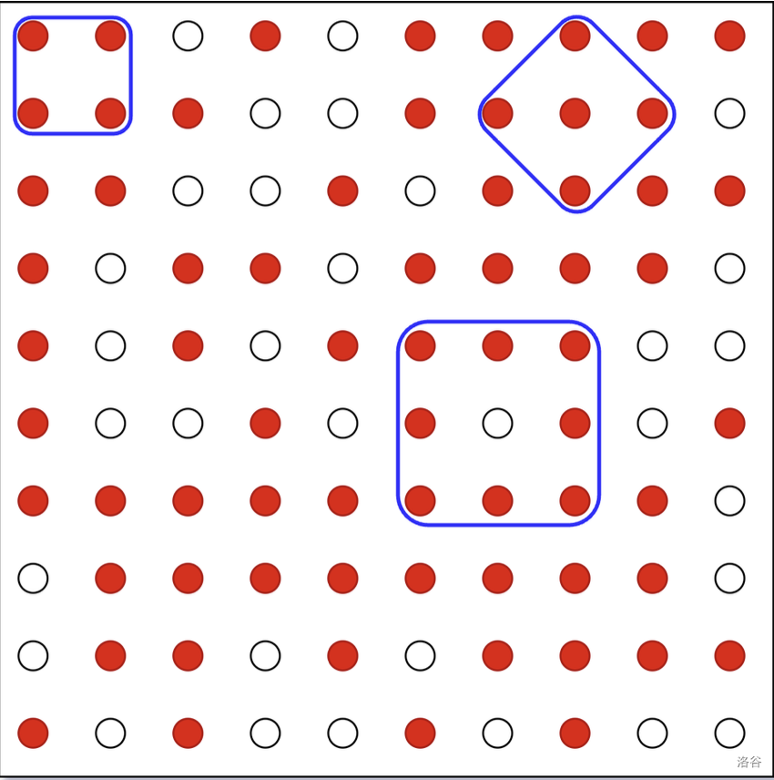

现在，小蓝想要知道在这个钉板上，可以围出多少种边长不同的正方形？（相同边长的正方形均视作是同一种，不用考虑正方形的位置）。图中展示了三种不同边长的正方形，其中蓝色线条表示橡皮筋。

#### 输出格式

这是一道结果填空的题，你只需要算出结果后提交即可。本题的结果为一个整数，在提交答案时只需要**编写一个程序输出这个整数**，输出多余的内容将无法得分。

---

### — · 混乘数字

> 题号 洛谷 P12243 ｜ 难度 简单（洛谷 普及−） ｜ 时间 1.00s ｜ 内存 512MB
> 通过率 54.17%（洛谷站内口径） ｜ 题面原文 https://www.luogu.com.cn/problem/P12243
> 考过的语言/组别：国赛 研究生组（洛谷题单）

#### 题目描述

混乘数字的定义如下: 对于一个正整数 $n$，如果存在正整数 $a, b$，使得 $n = a \times b$，而且 $a$ 和 $b$ 的十进制数位中每个数字出现的次数之和与 $n$ 中对应数字出现次数相同，则称 $n$ 为混乘数字。

例如，对于正整数 $n = 126$，存在 $a = 6, b = 21$ 满足条件，因此 $126$ 是一个混乘数字。

又如，对于正整数 $n = 180225$，存在 $a = 225, b = 801$ 满足条件，因此 $180225$ 是一个混乘数字。

请你帮助计算出，$1 \sim 1000000$ (含)之间一共有多少个数字是混乘数字。

#### 输出格式

这是一道结果填空的题，你只需要算出结果后提交即可。本题的结果为一个整数，在提交答案时只需要**编写一个程序输出这个整数**，输出多余的内容将无法得分。

---

### — · 阶乘求和

> 题号 洛谷 P12323 ｜ 难度 简单（洛谷 普及−） ｜ 时间 1.00s ｜ 内存 512MB
> 通过率 57.11%（洛谷站内口径） ｜ 题面原文 https://www.luogu.com.cn/problem/P12323
> 考过的语言/组别：省赛 Java 大学B组（洛谷题单）

#### 题目描述

令 $S = 1! + 2! + 3! + \cdots + 202320232023!$，求 $S$ 的末尾 $9$ 位数字。

提示：答案首位不为 $0$。

#### 输出格式

这是一道结果填空的题，你只需要算出结果后提交即可。本题的结果为一个整数，在提交答案时只需要**编写一个程序输出这个整数**，输出多余的内容将无法得分。

---

### — · 幸运数字

> 题号 洛谷 P12324 ｜ 难度 简单（洛谷 普及−） ｜ 时间 1.00s ｜ 内存 512MB
> 通过率 66.17%（洛谷站内口径） ｜ 题面原文 https://www.luogu.com.cn/problem/P12324
> 考过的语言/组别：省赛 Java 大学B组（洛谷题单）

#### 题目描述

哈沙德数是指在某个固定的进制当中，可以被各位数字之和整除的正整数。例如 $126$ 是十进制下的一个哈沙德数，因为 $(126)_{10} \bmod (1 + 2 + 6) = 0$；$126$ 也是八进制下的哈沙德数，因为 $(126)_{10} = (176)_8$，$(126)_{10} \bmod (1 + 7 + 6) = 0$；同时 $126$ 也是 $16$ 进制下的哈沙德数，因为 $(126)_{10} = (7E)_{16}$，$(126)_{10} \bmod (7 + E) = 0$。小蓝认为，如果一个整数在二进制、八进制、十进制、十六进制下均为哈沙德数，那么这个数字就是幸运数字，第 $1$ 至第 $10$ 个幸运数字的十进制表示为：$1, 2, 4, 6, 8, 40, 48, 72, 120, 126 \dots$。现在他想知道第 $2023$ 个幸运数字是多少？你只需要告诉小蓝这个整数的十进制表示即可。

#### 输出格式

这是一道结果填空的题，你只需要算出结果后提交即可。本题的结果为一个整数，在提交答案时只需要**编写一个程序输出这个整数**，输出多余的内容将无法得分。

---

### — · 买二赠一【疑似错题】

> 题号 洛谷 P12329 ｜ 难度 未评定（洛谷 暂无评定）
> 通过率 0.00%（洛谷站内口径） ｜ 题面原文 https://www.luogu.com.cn/problem/P12329
> 考过的语言/组别：省赛 Java 大学B组（洛谷题单）

#### 题目背景

本题疑似错题，无法找到时间复杂度合理的能通过本题测试数据范围的做法。蓝桥杯官网普遍的题解做法（从大到小购买）可被样例 2 hack。

#### 题目描述

某商场有 $N$ 件商品，其中第 $i$ 件的价格是 $A_i$。现在该商场正在进行“买二赠一”的优惠活动，具体规则是：每购买 $2$ 件商品，假设其中较便宜的价格是 $P$（如果两件商品价格一样，则 $P$ 等于其中一件商品的价格），就可以从剩余商品中任选一件价格不超过 $\frac{P}{2}$ 的商品，免费获得这一件商品。可以通过反复购买 $2$ 件商品来获得多件免费商品，但是每件商品只能被购买或免费获得一次。

小明想知道如果要拿下所有商品（包含购买和免费获得），至少要花费多少钱？

#### 输入格式

第一行包含一个整数 $N$。

第二行包含 $N$ 个整数，代表 $A_1, A_2, A_3, \ldots, A_N$。

#### 输出格式

输出一个整数，代表答案。

#### 样例输入 1

```
7
1 4 2 8 5 7 1
```

#### 样例输出 1

```
25
```

#### 样例输入 2

```
6
12 23 25 25 50 50
```

#### 样例输出 2

```
150
```

#### 提示

### 样例说明

小明可以先购买价格 $4$ 和 $8$ 的商品，免费获得一件价格为 $1$ 的商品；再后买价格为 $5$ 和 $7$ 的商品，免费获得价格为 $2$ 的商品；最后单独购买剩下的一件价格为 $1$ 的商品。总计花费 $4 + 8 + 5 + 7 + 1 = 25$。不存在花费更低的方案。

### 评测用例规模与约定

- 对于 $30\%$ 的数据，$1 \leq N \leq 20$。
- 对于 $100\%$ 的数据，$1 \leq N \leq 5 \times 10^5$，$1\leq A_i\leq 10^9$。

---

### — · 2023

> 题号 洛谷 P12377 ｜ 难度 简单（洛谷 普及−） ｜ 时间 10.00s ｜ 内存 512MB
> 通过率 39.85%（洛谷站内口径） ｜ 题面原文 https://www.luogu.com.cn/problem/P12377
> 考过的语言/组别：省赛 Python 大学B组（洛谷题单）

#### 题目描述

请求出在 $12345678$ （含）至 $98765432$ （含）中，有多少个数中完全不包含 $2023$。

完全不包含 $2023$ 是指无论将这个数的哪些数位移除都不能得到 $2023$。

例如 $20322175$，$33220022$ 都完全不包含 $2023$，而 $20230415$，$20193213$ 则含有 $2023$（后者取第 $1,2,6,8$ 个数位）。

#### 输出格式

这是一道结果填空的题，你只需要算出结果后提交即可。本题的结果为一个整数，在提交答案时只需要**编写一个程序输出这个整数**，输出多余的内容将无法得分。

---

### — · 硬币兑换

> 题号 洛谷 P12378 ｜ 难度 简单（洛谷 普及−） ｜ 时间 1.00s ｜ 内存 512MB
> 通过率 52.50%（洛谷站内口径） ｜ 题面原文 https://www.luogu.com.cn/problem/P12378
> 考过的语言/组别：省赛 Python 大学B组（洛谷题单）

#### 题目描述

小蓝手中有 $2023$ 种不同面值的硬币，这些硬币全部是新版硬币，其中第 $i(1 \leq i \leq 2023)$ 种硬币的面值为 $i$，数量也为 $i$ 个。硬币兑换机可以进行硬币兑换，兑换规则为：交给硬币兑换机两个新版硬币 $coin_1$ 和 $coin_2$，硬币兑换机会兑换成一个面值为 $coin_1 + coin_2$ 的旧版硬币。

小蓝可以用自己已有的硬币进行任意次数兑换，假设最终小蓝手中有 $K$ 种不同面值的硬币（只看面值，不看新旧）并且第 $i(1 \leq i \leq K)$ 种硬币的个数为 $sum_i$。小蓝想要使得 $\max\{sum_1, sum_2, \cdots, sum_K\}$ 的值达到最大，请你帮他计算这个值最大是多少。

注意硬币兑换机只接受新版硬币进行兑换，并且兑换出的硬币全部是旧版硬币。

#### 输出格式

这是一道结果填空的题，你只需要算出结果后提交即可。本题的结果为一个整数，在提交答案时只需要**编写一个程序输出这个整数**，输出多余的内容将无法得分。

---

### — · 独一无二【疑似假题】

> 题号 洛谷 P12384 ｜ 难度 未评定（洛谷 暂无评定）
> 通过率 0.00%（洛谷站内口径） ｜ 题面原文 https://www.luogu.com.cn/problem/P12384
> 考过的语言/组别：省赛 Python 大学B组（洛谷题单）

#### 题目描述

有一个包含 $n$ 个点，$m$ 条边的无向图，第 $i$ 条边的边权为 $c_i$，没有重边和自环。设 $s_i$ 表示从结点 1 出发到达结点 $i$ 的最短路的不同路径数 $(i \in [1, n])$，显然可以通过删除 $a_i$ 条边使得 $s_i = 1$，也就是有且仅有一条从 1 到 $i$ 的最短路，且保持最短路的路径长度不变，求出 $a_n$ 的最小值。

#### 输入格式

输入的第一行包含两个正整数 $n, m$。

接下来 $m$ 行，每行包含三个正整数 $u_i, v_i, c_i$ 表示第 $i$ 条边连接的两个点的编号和边权。

#### 输出格式

输出一行包含一个正整数表示答案，如果 1 和 $n$ 不连通，输出 -1 。

#### 样例输入

```
4 4
1 2 1
1 3 2
2 4 2
3 4 1
```

#### 样例输出

```
1
```

#### 提示

### 样例说明

在给定的图中，只有 $s_4$ 一开始为 $2$，因为有两条最短路：$1 \rightarrow 2 \rightarrow 4, 1 \rightarrow 3 \rightarrow 4$，任意删掉一条边后，就可以只剩一条最短路，且保持最短路的路径长度不变。

### 评测用例规模与约定

- 对于 $30\%$ 的评测用例，$n \leq 18$；
- 对于所有评测用例，$n \leq 100$，$0 \leq m \leq \min\{\frac{n(n-1)}{2}, 2000\}$，$1 \leq u_i, v_i \leq n$，$1 \leq c_i \leq 2$。

---

### — · 特殊日期

> 题号 洛谷 P13876 ｜ 难度 简单（洛谷 普及−） ｜ 时间 10.00s ｜ 内存 512MB
> 通过率 45.42%（洛谷站内口径） ｜ 题面原文 https://www.luogu.com.cn/problem/P13876
> 考过的语言/组别：省赛 Java 组、Python 大学A组（洛谷题单）

#### 题目描述

记一个日期为 $yy$ 年 $mm$ 月 $dd$ 日，统计从 2000 年 1 月 1 日（含）到 2000000 年 1 月 1 日（含），有多少个日期满足年份 $yy$ 是月份 $mm$ 的倍数，同时也是 $dd$ 的倍数。

当年份是 4 的倍数而不是 100 的倍数或者年份是 400 的倍数时，这一年是闰年，其他的年份都不是闰年。

#### 输出格式

这是一道结果填空的题，你只需要算出结果后提交即可。本题的结果为一个整数，在提交答案时只输出这个整数，填写多余的内容将无法得分。

#### 样例输入

```

```

#### 样例输出

```

```

---

### — · 与或异或

> 题号 洛谷 P13877 ｜ 难度 中等（洛谷 普及） ｜ 时间 3.00s ｜ 内存 512MB
> 通过率 69.61%（洛谷站内口径） ｜ 题面原文 https://www.luogu.com.cn/problem/P13877
> 考过的语言/组别：省赛 Java 大学A组（洛谷题单）

#### 题目描述

小蓝有一张门电路的逻辑图，如下图所示：

:::align{center}
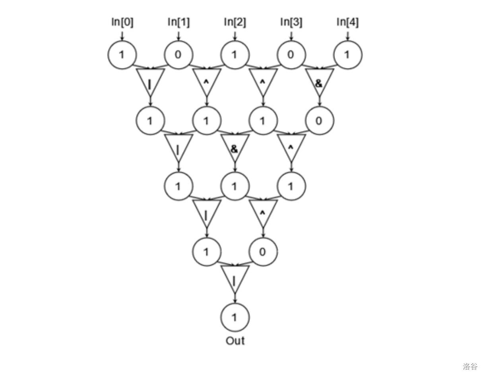
:::

图中每个三角形代表着一种门电路，可能是与门、或门、异或门中的任何一种，它接受上一层中的两个圆形中的数据作为输入，产生一个输出值输出到下一级（如图中箭头所示）。图中圆形表示的是暂存的输出结果，取值只可能是 0 或 1，为了便于表示我们用 $arr[i][j]$ 表示第 $i$（$0 \leq i \leq 4$）行第 $j$（$0 \leq j \leq i$）个圆形的值。其中 $arr[0] = (In[0], In[1], In[2], In[3], In[4])$ 表示的是输入数据，对于某个 $arr[i][j]$（$i \leq 0$），计算方式为 $arr[i][j] = arr[i-1][j] \ op \ arr[i-1][j+1]$，其中 $op$ 表示的是将 $arr[i-1][j]$、$arr[i-1][j+1]$ 作为输入，将 $arr[i][j]$ 作为输出的那个门电路, 与门、或门、异或门分别对应于按位与 $(\&)$、按位或 $(|)$、按位异或 (^) 运算符。

现在已知输入为 $In[0] = 1, In[1] = 0, In[2] = 1, In[3] = 0, In[4] = 1$，小蓝想要使得最终的输出 $Out$ 的值为 1，请问一共有多少种不同的门电路组合方式？其中上图中显示的就是一种合法的方式。

#### 输出格式

这是一道结果填空的题，你只需要算出结果后提交即可。本题的结果为一个整数，在提交答案时只输出这个整数，填写多余的内容将无法得分。

#### 样例输入

```

```

#### 样例输出

```

```

---

### — · 工作时长

> 题号 洛谷 P13893 ｜ 难度 简单（洛谷 普及−） ｜ 时间 1.00s ｜ 内存 512MB
> 通过率 56.56%（洛谷站内口径） ｜ 题面原文 https://www.luogu.com.cn/problem/P13893
> 考过的语言/组别：省赛 C/C++ 大学C组（洛谷题单）

#### 题目描述

小蓝手里有一份 2022 年度自己的上班打卡记录文件，文件包含若干条打卡记录，每条记录的格式均为“yyyy-MM-dd HH:mm:ss”，即按照年-月-日时:分:秒的形式记录着一个时间点（采用 24 小时进制）。由于某些原因，这份文件中的时间记录并不是按照打卡的时间顺序记录的，而是被打乱了。但我们保证小蓝每次上班和下班时都会正常打卡，而且正好打卡一次，其它时候不会打卡。每一对相邻的上-下班打卡之间的时间就是小蓝本次的工作时长，例如文件内容如下的话：

- 2022-01-01 12:00:05
- 2022-01-02 00:20:05
- 2022-01-01 07:58:02
- 2022-01-01 16:01:35

表示文件中共包含了两段上下班记录，1）2022-01-01 07:58:02 ~ 2022-01-01 12:00:05，工作时长为 $14523$ 秒；2）2022-01-01 16:01:35 ~ 2022-01-02 00:20:05，工作时长为 $29910$ 秒；工作时长一共是 $14523 + 29910 = 44433$ 秒。现在小蓝想知道在 2022 年度自己的工作时长一共是多少秒？

#### 输出格式

这是一道结果填空的题，你只需要算出结果后提交即可。本题的结果为一个整数，在提交答案时只输出这个整数，填写多余的内容将无法得分。

#### 样例输入

```

```

#### 样例输出

```

```

---
