# 蓝桥杯 2026年第十七届 真题（全部组别合并，按题号排列）

> 来源: Dotcpp 蓝桥杯真题 https://www.dotcpp.com/oj/lanqiao/ ｜ 洛谷蓝桥杯题单补充 53 题 https://www.luogu.com.cn/problem/list?type=luogu&tag=361,363 ｜ 抓取时间: 2026-11-27
> 本年有效试卷 12 套、72 题次，Dotcpp 去重 52 道题，另补洛谷题 53 道。

## 本年试卷构成

| 赛段 | 科目 | 组别 | 题数 | 备注 | 题集页 |
| --- | --- | --- | --- | --- | --- |
| 省赛 | C++ | 大学A组 | 6 |  | [题集](https://www.dotcpp.com/oj/1181/) |
| 省赛 | C++ | 大学B组 | 6 |  | [题集](https://www.dotcpp.com/oj/1180/) |
| 省赛 | C++ | 大学C组 | 6 |  | [题集](https://www.dotcpp.com/oj/1182/) |
| 省赛 | C++ | 研究生组 | 6 |  | [题集](https://www.dotcpp.com/oj/1191/) |
| 省赛 | Java | 大学A组 | 6 |  | [题集](https://www.dotcpp.com/oj/1188/) |
| 省赛 | Java | 大学B组 | 6 |  | [题集](https://www.dotcpp.com/oj/1184/) |
| 省赛 | Java | 大学C组 | 6 |  | [题集](https://www.dotcpp.com/oj/1186/) |
| 省赛 | Java | 研究生组 | 6 |  | [题集](https://www.dotcpp.com/oj/1189/) |
| 省赛 | Python | 大学A组 | 6 |  | [题集](https://www.dotcpp.com/oj/1190/) |
| 省赛 | Python | 大学B组 | 6 |  | [题集](https://www.dotcpp.com/oj/1183/) |
| 省赛 | Python | 大学C组 | 6 |  | [题集](https://www.dotcpp.com/oj/1187/) |
| 省赛 | Python | 研究生组 | 6 |  | [题集](https://www.dotcpp.com/oj/1185/) |

## 题目一览

| 题号 | 标题 | 难度 | 通过率 | 考过的语言/组别 |
| --- | --- | --- | --- | --- |
| 3351 | 循环右移 | 中等 | 36.21% | C++大学B组 |
| 3352 | 蓝桥竞技 | 困难 | 19.69% | C++大学B组 |
| 3353 | LQ聚合 | 困难 | 0.84% | C++大学B组 |
| 3354 | 应急布线 | 困难 | 2.41% | C++大学B组 |
| 3355 | 理想温度 | 困难 | 1.55% | C++大学B组 |
| 3356 | 足球训练 | 困难 | 6.47% | C++大学B组 |
| 3357 | 拦截程序 | 困难 | 20.12% | C++大学A组 |
| 3358 | 切割木材 | 困难 | 24.29% | C++大学A组 |
| 3359 | 读取指令 | 困难 | 20.66% | C++大学C组、C++大学A组 |
| 3360 | 外卖配送 | 中等 | 30.51% | C++大学A组 |
| 3361 | 综合应变指标 | 困难 | 24.55% | C++研究生组、C++大学A组 |
| 3362 | 基因研究 | 入门 | 35.29% | C++大学A组 |
| 3363 | 二维码存储 | 困难 | 26.06% | C++大学C组 |
| 3364 | 2026的出现次数 | 困难 | 26.51% | C++研究生组、C++大学C组 |
| 3365 | 纯粹魔药 | 中等 | 28.78% | C++大学C组 |
| 3366 | 基态坍缩 | 中等 | 28.32% | C++研究生组、C++大学C组 |
| 3367 | 回收处理 | 入门 | 30.00% | C++大学C组 |
| 3368 | 定制展示盘 | 困难 | 18.61% | Python大学B组 |
| 3369 | 密室逃脱开关谜题 | 困难 | 11.54% | Python大学B组 |
| 3370 | 奇偶博弈 | 中等 | 40.51% | Python大学B组 |
| 3371 | 蓝小圈 | 困难 | 19.74% | Python大学B组 |
| 3372 | 星光共鸣 | 入门 | 2.27% | Python大学B组 |
| 3373 | 位数求和 | 入门 | 46.88% | Python大学B组 |
| 3374 | 游戏指令解析器 | 中等 | 39.36% | Java大学B组 |
| 3375 | 量子态叠加计数器 | 简单 | 61.11% | Java大学B组 |
| 3376 | 共享单车 | 中等 | 25.00% | Java大学B组 |
| 3377 | 擂台赛 | 入门 | 15.56% | Java大学B组 |
| 3378 | 星座导航校准器 | 入门 | 14.29% | Java大学B组 |
| 3379 | 回程 | 入门 | 60.00% | Java大学B组 |
| 3380 | 解题速度对决 | 简单 | 47.95% | Python大学C组、Python研究生组 |
| 3381 | 底层协议 | 中等 | 32.59% | Python大学C组、Python研究生组 |
| 3382 | 抽奖活动 | 中等 | 36.71% | Java大学C组、Python研究生组 |
| 3383 | 抓取卡牌 | 简单 | 60.27% | Java研究生组、Python研究生组 |
| 3384 | 双人成行 | 入门 | 53.85% | Python大学C组、Python研究生组 |
| 3385 | 购电优化 | 困难 | 16.13% | Python大学A组、Python研究生组 |
| 3386 | 幸运约会日 | 简单 | 50.00% | Java大学C组 |
| 3387 | 音乐节拍器 | 入门 | 64.84% | Python大学A组、Java大学C组 |
| 3388 | 小蓝的序列 | 中等 | 24.07% | Java研究生组、Java大学C组 |
| 3389 | 智能产线排程优化 | 入门 | 44.44% | Python大学C组、Java大学C组 |
| 3390 | 奇偶交换 | 入门 | 39.29% | Java研究生组、Java大学C组 |
| 3391 | 可选数 | 困难 | 5.88% | Python大学A组、Python大学C组 |
| 3392 | 电压调度 | 简单 | 54.00% | Python大学A组、Python大学C组 |
| 3393 | 连续打卡 | 中等 | 40.00% | Java研究生组、Java大学A组 |
| 3394 | 两栖作战 | 困难 | 16.67% | Java大学A组 |
| 3395 | 奇怪的地图 | 入门 | 26.09% | Java大学A组 |
| 3396 | 子树染色 | 入门 | 33.33% | Java大学A组 |
| 3397 | 魔法骰子 | 入门 | 28.57% | Python大学A组、Java大学A组 |
| 3398 | 勇闯迷宫 | 入门 | 16.00% | Java研究生组、Java大学A组 |
| 3399 | 单词合并 | 中等 | 32.88% | Python大学A组、Java研究生组 |
| 3400 | 评测漏洞 | 困难 | 25.39% | C++研究生组 |
| 3401 | 人类识别审查 | 中等 | 30.98% | C++研究生组 |
| 3402 | 通信链路 | 入门 | 8.70% | C++研究生组 |
| — | 均衡数 | 简单 | 40.16% | 省赛 C/C++ 大学A组 |
| — | 量子 2048 | 中等 | 55.53% | 省赛 C/C++ 大学A组 |
| — | 青春常数 | 简单 | 53.80% | 省赛 C/C++ 大学B组 |
| — | 双碳战略 | 困难 | 49.25% | 省赛 C/C++ 大学B组 |
| — | 魔法矩阵能量值 | 简单 | 68.04% | 省赛 研究生组 |
| — | 和平干饭日 | 简单 | 52.98% | 省赛 Python 组、Java 大学B 组组 |
| — | 干涉条纹 | 简单 | 40.14% | 省赛 Python 组、Java 大学B 组组 |
| — | 罐头编号 | 简单 | 50.05% | 省赛 Python 组、Java 大学A 组组 |
| — | 平面选点 | 中等 | 56.33% | 省赛 Python 大学A 组组 |
| — | 间歇性发射 | 中等 | 58.11% | 省赛 Java 大学A 组组 |
| — | 小青蛙跳荷叶 | 简单 | 77.60% | 省赛 Python 大学C 组组 |
| — | 调皮的橘猫 | 简单 | 56.72% | 省赛 Python 大学C 组组 |
| — | 读书计划 | 简单 | 62.07% | 省赛 Java 组、Python 大学研究生组组 |
| — | 密钥提取 | 中等 | 66.62% | 国赛 C/C++ 大学A组 |
| — | 圆形灯环 | 困难 | 66.94% | 国赛 C/C++ 大学A组 |
| — | 多项式积分 | 中等 | 47.47% | 国赛 C/C++ 大学A组 |
| — | 安全路径 | 中等 | 48.94% | 国赛 C/C++ 大学A组 |
| — | 生态廊道 | 中等 | 24.76% | 国赛 C/C++ 大学A组 |
| — | 独立三角形 | 中等 | 34.11% | 国赛 C/C++ 大学A组 |
| — | 核心任务调度 | 中等 | 34.55% | 国赛 C/C++ 大学A组 |
| — | 魔法前缀 | 困难 | 40.58% | 国赛 C/C++ 大学A组 |
| — | 神秘排列 | 中等 | 39.87% | 国赛 C/C++ 大学A组 |
| — | 不互质游戏 | 困难 | 21.15% | 国赛 C/C++ 大学A组 |
| — | 玩具青蛙 | 简单 | 77.17% | 国赛 C/C++ 大学B组 |
| — | 生成派生码 | 中等 | 42.38% | 国赛 C/C++ 大学B组 |
| — | 奇偶校验排列 | 简单 | 28.44% | 国赛 C/C++ 大学B组 |
| — | 灯带修补 | 中等 | 33.26% | 国赛 C/C++ 大学B组 |
| — | 密码提取 | 中等 | 18.28% | 国赛 C/C++ 大学B组 |
| — | Token 词元 | 中等 | 32.99% | 国赛 C/C++ 大学B组 |
| — | 实验数据 | 困难 | 29.08% | 国赛 C/C++ 大学B组 |
| — | 方和质数 | 中等 | 18.28% | 国赛 C/C++ 大学B组 |
| — | 货架换签 | 中等 | 20.28% | 国赛 C/C++ 大学B组 |
| — | 运动会【疑似错题】 | 未评定 | 3.03% | 国赛 C/C++ 大学B组 |
| — | 机器人移动 | 中等 | 65.65% | 国赛 Python 大学A组 |
| — | 键盘失灵 | 中等 | 57.75% | 国赛 Python 大学A组 |
| — | 算电协同 | 中等 | 30.18% | 国赛 Python 大学A组 |
| — | 糖分极限 | 中等 | 39.40% | 国赛 Python 大学A组 |
| — | 桌游足球 | 中等 | 39.66% | 国赛 Python 大学A组 |
| — | 连续丢卡 | 中等 | 35.78% | 国赛 Python 大学A组 |
| — | 前缀奇偶 | 中等 | 32.73% | 国赛 Python 大学A组 |
| — | 亮灭反转 | 中等 | 40.00% | 国赛 Python 大学A组 |
| — | 课程值班 | 困难 | 28.90% | 国赛 Python 大学A组 |
| — | 压缩字符串 | 困难 | 20.27% | 国赛 Python 大学A组 |
| — | 平均年龄 | 简单 | 73.75% | 国赛 Python 大学B组 |
| — | 蓝桥大富翁 | 中等 | 53.20% | 国赛 Python 大学B组 |
| — | 糖果转盘 | 简单 | 47.29% | 国赛 Python 大学B组 |
| — | 贴纸册交换 | 简单 | 29.84% | 国赛 Python 大学B组 |
| — | 稳定史莱姆 | 简单 | 40.16% | 国赛 Python 大学B组 |
| — | 仓库管理 | 中等 | 28.06% | 国赛 Python 大学B组 |
| — | 最小耗水定额 | 中等 | 32.27% | 国赛 Python 大学B组 |
| — | 控制机器人 | 中等 | 21.59% | 国赛 Python 大学B组 |
| — | 小球消除 | 中等 | 32.16% | 国赛 Python 大学B组 |
| — | 零段积分 | 困难 | 35.27% | 国赛 Python 大学B组 |

## 题目详情

### 3351 · 循环右移

> 题号 3351 ｜ 难度 中等 ｜ 时间 1s ｜ 内存 128MB
> 通过率 36.21% ｜ 题面原文 https://www.dotcpp.com/oj/problem3351.html
> 考过的语言/组别：C++ 大学B组

#### 题目描述

给定三个整数 N, X, Y。请计算有多少个长度为 N 的整数数组 A 满足以下条件：

1. 数组 A 中的每个元素 Ai 都满足 X ≤ Ai ≤ Y；

2. 对于数组 A 中的任意一个连续子数组，对其进行一次循环右移操作，得到的新子数组与原数组完全一致。

循环右移：对一个长度为 k 的连续子数组 [B1, B2,. . . , Bk] 执行一次循环右移操作，是指将该子数组变换为 [Bk, B1, B2,..., Bk?1]（即把最后一个元素移到最开头，其余元素保持原有顺序依次向后顺延一位）。

#### 输入格式

第一行包含一个整数 T，表示测试数据的组数。

接下来的 T 行，每行包含三个由空格隔开的整数 N, X, Y。

#### 输出格式

对于每组测试数据，输出一行，包含一个整数，表示满足条件的数组 A 的个数。

#### 样例输入

```
3

3 1 2

5 10 10

2 5 3
```

#### 提示

对于 30% 的评测用例，1 ≤ T ≤ 20，1 ≤ N ≤ 100，1 ≤ X, Y ≤ 100；

对于 100% 的评测用例，1 ≤ T ≤ 10<sup>3</sup>，1 ≤ N ≤ 10<sup>18</sup>，1 ≤ X, Y ≤ 10<sup>18</sup>。

---

### 3352 · 蓝桥竞技

> 题号 3352 ｜ 难度 困难 ｜ 时间 1s ｜ 内存 128MB
> 通过率 19.69% ｜ 题面原文 https://www.dotcpp.com/oj/problem3352.html
> 考过的语言/组别：C++ 大学B组

#### 题目描述

小蓝，作为电竞俱乐部 “蓝桥竞技” 的战队经理，正面临着一个巨大的管理危机。俱乐部目前签约了 N 种不同位置的职业选手，其中第 i 种位置的选手共

有 Ai 名。

为了参加即将举办的 “峡谷 5v5”，小蓝必须将俱乐部内的所有选手都编入战队，不能有任何一人坐冷板凳。

根据赛事组委会的严苛规则，一支合法的战队必须满足以下条件：

1. 5 人成团：每支战队有且只能由 5 名选手组成。

2. 职业互斥：同一支战队内的 5 名选手，必须来自 5 种完全不同的位置。

现在，请你帮助小蓝判断：在当前的人员数量下，是否有一种分组方案，能够将所有选手恰好分配完，且每支战队都符合参赛规则？

#### 输入格式

第一行包含一个整数 T，表示测试用例组数。

接下来包含 T 组数据，每组数据的格式如下：

• 第一行包含一个整数 N，表示职业位置的种类数量。

• 第二行包含 N 个整数 A1, A2,. . . , AN，分别表示第 i 种位置的选手人数。

#### 输出格式

对于每组测试用例，如果存在满足条件的分组方案，输出 ‘T’，否则输出‘F’。

#### 样例输入

```
4

5

1 1 1 1 1

6

2 2 2 2 1 1

5

1 1 1 1 2

6

3 1 1 1 2 2
```

#### 提示

【样例说明】

第一组数据：共有 5 名选手，各占 1 个位置，恰好可以组成 1 支战队。

第二组数据：共有 10 名选手，可以分成 2 支战队。一种合法的分配方案是：战队一由位置 1, 2, 3, 4, 5 的选手组成；战队二由位置 1, 2, 3, 4, 6 的选手组

成。

第三、四组数据不存在满足条件的分组方案。

【评测用例规模与约定】

对于 30% 的评测用例：1 ≤ T ≤ 5，1 ≤ N ≤ 20，0 ≤ Ai ≤ 100；

对于 100% 的评测用例：1 ≤ T ≤ 10<sup>3</sup>，1 ≤ N ≤ 10<sup>5</sup>，0 ≤ A<sub>i </sub>≤ 10<sup>9</sup>，且保证所有测试用例中 N 的总和不超过 2 × 10<sup>5</sup>。

---

### 3353 · LQ聚合

> 题号 3353 ｜ 难度 困难 ｜ 时间 1s ｜ 内存 128MB
> 通过率 0.84% ｜ 题面原文 https://www.dotcpp.com/oj/problem3353.html
> 考过的语言/组别：C++ 大学B组

#### 题目描述

2056 年，探险队在月球背面的环形山深处发现了一座信号发射塔，其核心控制台正在不断闪烁着一串长度为 N 的粒子序列。

序列中的每个位置被严格定义为 L 型粒子、Q 型粒子，或者因岁月侵蚀而模糊不清的未知状态 ?。这些粒子将被依次射入反应场，而反应场的稳定性取决于序列的 “LQ 聚合” 数量，该数量被定义为所有满足 1 ≤ i < j ≤ N 且第 i 个节点为 L、第 j 个节点为 Q 的二元组数量。

为了重启这座沉睡的巨塔，探险队需要将序列中所有的 ? 修复为确定的 L或 Q。

现在，请你计算出在所有可能的修复方案中，所能得到的 “LQ 聚合” 数量的最大值是多少

#### 输入格式

第一行输入一个整数 N，表示粒子序列的长度。

第二行输入一个长度为 N 的字符串，仅包含字符 L、Q 和 ?，表示当前探测到的粒子序列状态

#### 输出格式

输出一个整数，表示在将所有 ? 替换为 L 或 Q 后，能获得的最大“LQ 聚合”数量。

#### 样例输入

```
5

??L??
```

#### 提示

【样例说明】

一种最优的策略是将序列修复为 LLLQQ。此时位于前面的 3 个 L 与位于后面的 2 个 Q 共可产生 3 × 2= 6 个聚合。

【评测用例规模与约定】

对于 30% 的评测用例，字符串 ? 的个数不超过 10。

对于所有评测用例，2 ≤ N ≤ 10<sup>5</sup>

---

### 3354 · 应急布线

> 题号 3354 ｜ 难度 困难 ｜ 时间 1s ｜ 内存 128MB
> 通过率 2.41% ｜ 题面原文 https://www.dotcpp.com/oj/problem3354.html
> 考过的语言/组别：C++ 大学B组

#### 题目描述

实验室内，小蓝负责维护一个由 N 台计算机组成的局域网络。这些计算机原本通过高速网线互联，但随着设备老化，目前仅剩 M 条网线还能正常工作。

正因如此，原本统一的网络分裂成了多个互不相连的通信区域。

为了恢复通信，小蓝计划架设一种特殊的 “应急跳线” 来重新连接这些区域。在物理逻辑上，只要任意两台计算机之间可以通过残存的网线或新架设的应急跳线建立直接或间接的通路，即视为它们之间恢复了连通。小蓝的任务是选定最优的布线方案，使得实验室内的所有 N 台计算机重新回到全连通的状态。

由于应急跳线的接口会占用计算机宝贵的硬件资源，小蓝在制定方案时设定了两个优先层级：首先，必须确保使用的应急跳线总数达到理论上的最小值；其次，为了减轻单台计算机的负载压力，他要求尽可能平均地分摊这些跳线。具体而言，他需要寻找一种方案，使得在所有计算机中，接入这种应急跳线数量最多的那一台机器，其接入的跳线数降到最低。

现在，请你根据当前网线的残存连接情况，计算出实现全连通所需的最少应急跳线数量，以及在这一最优前提下，单台计算机接入应急跳线数量最大值的最小可能值。

#### 输入格式

第一行包含两个整数 N 和 M，分别表示计算机的总数和目前完好的网线数

量。

接下来的 M 行，每行包含两个整数 a 和 b，表示计算机 a 和 b 之间目前仍存在一条完好的网线。

#### 输出格式

输出一行，包含两个由单个空格隔开的整数。第一个整数表示最少需要添加的应急跳线数量，第二个整数表示在确保跳线总数最少的前提下，单台计算机接入跳线数量最大值的最小可能值。

#### 样例输入

```
7 2

1 2

2 3
```

#### 提示

【样例说明】

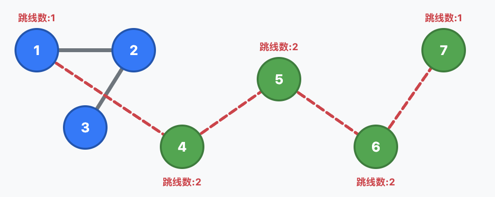

通过连接 1 ? 4，4 ? 5，5 ? 6，6 ? 7（共计 4 条跳线），可以使节点 4, 5, 6 各承担两条跳线，而其他节点仅承担一条或不承担，从而使最大值达到最小值为

2。

【评测用例规模与约定】

对于 30% 的评测用例，1 ≤ N ≤ 100，0 ≤ M ≤ 100；

对于所有评测用例，1 ≤ N ≤ 10<sup>5</sup>，0 ≤ M ≤ 10<sup>5</sup>，1 ≤ a, b ≤ N，a != b。保证输入的连接信息中不包含重边。

---

### 3355 · 理想温度

> 题号 3355 ｜ 难度 困难 ｜ 时间 1s ｜ 内存 256MB
> 通过率 1.55% ｜ 题面原文 https://www.dotcpp.com/oj/problem3355.html
> 考过的语言/组别：C++ 大学B组

#### 题目描述

一条工业流水线上排列着 n 个温度传感器。当前各个传感器测得的温度记录在数组 A 中，而各传感器对应的理想标准温度记录在数组 B 中（即 Ai 为第 i

个传感器的当前温度，Bi 为第 i 个传感器的理想温度）。

为了让尽可能多的传感器达到理想温度，你可以进行一次区域温度补偿操

作：

1. 在流水线上划定一段连续的传感器区间 [l, r]（即第 l 个到第 r 个传感器）。

2. 输入一个温度补偿值 k（k 为任意整数），使得该区间内所有传感器的当前温度都加上 k。

请问在执行完这一次校准操作后，最多能使多少个传感器的温度恰好等于其对应的理想标准温度？

#### 输入格式

第一行包含一个整数 n，表示传感器的数量。

第二行包含 n 个整数 A<sub>1</sub>, A<sub>2</sub>,. . . , A<sub>n</sub>，表示各传感器的当前温度。

第三行包含 n 个整数 B<sub>1</sub>, B<sub>2</sub>,. . . , B<sub>n</sub>，表示各传感器对应的理想标准温度。

#### 输出格式

输出一行，包含一个整数，表示补偿操作后处于理想温度的传感器最大数量。

#### 样例输入

```
5

1 2 3 4 5

2 3 2 3 2
```

#### 提示

【评测用例规模与约定】

对于 30% 的评测用例，保证 1 ≤ n ≤ 2000；

对于所有评测用例，保证 1 ≤ n ≤ 2 × 10<sup>5</sup>，-10<sup>9 </sup>≤ A<sub>i</sub>, B<sub>i</sub> ≤ 10<sup>9</sup>。

---

### 3356 · 足球训练

> 题号 3356 ｜ 难度 困难 ｜ 时间 1s ｜ 内存 256MB
> 通过率 6.47% ｜ 题面原文 https://www.dotcpp.com/oj/problem3356.html
> 考过的语言/组别：C++ 大学B组

#### 题目描述

小蓝是一支足球队的队长，他正在为下一场重要比赛做准备。接下来的 m天中，他每天可以选择一名队员进行训练，并且选择之后当天的训练对象不能更换。

球队中共有 n 名队员。对于第 i 名队员，已知其：

• 初始实力值为 ai；

• 天赋值为 bi。

训练规则如下：

• 如果小蓝在某一天训练了队员 i，则这一天会使该队员的实力值增加 b<sub>i</sub>；

• 如果 一 共 用 k 天来 训 练 队 员 i，那 么 这 名 队 员 的 最 终 实 力 值 将 变 为：a<sub>i</sub> + kb<sub>i</sub>。

一支队伍的整体实力定义为所有队员最终实力值的乘积，即：

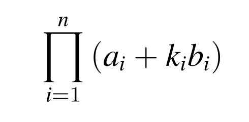

其中 ki 表示分配给第 i 名队员的训练天数，且满足：

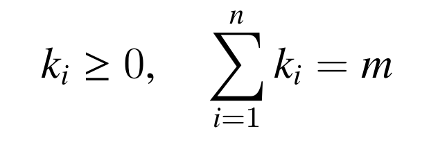

小蓝希望通过合理分配这 m 天的训练计划，使得队伍的整体实力最大。由于结果可能非常大，你只需要输出该最大值对 998244353 取模的结果。

#### 输入格式

输入共 n +1 行。

第一行包含两个正整数 n, m，分别表示队员人数和可用于训练的总天数。

接下来 n 行，第 i 行包含两个正整数 ai, bi，表示第 i 名队员的初始实力值与天赋值。

#### 输出格式

输出一行，包含一个非负整数，表示经过 m 天训练后，队伍实力的最大可能值对 998244353 取模的结果。

#### 样例输入

```
2 3

4 2

5 3
```

#### 提示

【样例说明】

一种最优方案是：

• 第 1 名队员训练 1 天；

• 第 2 名队员训练 2 天。

此时：

• 第 1 名队员的最终实力为 4+ 2 × 1= 6；

• 第 2 名队员的最终实力为 5+ 3 × 2= 11。

队伍的整体实力为：6 × 11 = 66，因此输出 66。

【评测用例规模与约定】

对于 30% 的数据，n, m ≤ 8；

对于 60% 的数据，n, m, a<sub>i</sub>, b<sub>i</sub> ≤ 3000；

对于 100% 的数据，1 ≤ n ≤ 100000，1 ≤ m ≤ 10<sup>9</sup>，1 ≤ a<sub>i</sub>, b<sub>i</sub> ≤ 10<sup>5</sup>。

---

### 3357 · 拦截程序

> 题号 3357 ｜ 难度 困难 ｜ 时间 1s ｜ 内存 128MB
> 通过率 20.12% ｜ 题面原文 https://www.dotcpp.com/oj/problem3357.html
> 考过的语言/组别：C++ 大学A组

#### 题目描述

联邦安全局截获了一起正在进行的黑客攻击：一个携带核心机密的数据包，正沿着一条线性的光纤隧道被秘密传输。

这条光纤隧道的总长度为 L，可将其视为一条从坐标 0（左端）到坐标 L（右端）的线段。情报显示，该数据包在光纤内的移动速度为恒定值 V，且已经

传输了整整 T 秒，即目前在光纤内推进了 V × T 的距离。

黑客的入侵源头尚不明确，因此数据包当前的位置存在两种可能：

1. 情况 A（左端入侵）：数据包位于坐标 PA = V × T 处。

2. 情况 B（右端入侵）：数据包位于坐标 PB = L ? V × T 处。

你需要在光纤上选择一个整数坐标 P（0 ≤ P ≤ L）部署拦截程序。为了使拦截方案尽可能稳妥，你需要衡量每一个坐标 P 的偏差——即 P 到PA 的距离与 P 到 PB 的距离中的较大者。现在，请寻找一个最优的整数坐标 P，使得这个偏差值最小，并输出该最小值。

#### 输入格式

第一行包含一个整数 C，表示测试用例的数量。

接下来的 C 行，每行包含三个整数 L, V, T，分别表示光纤隧道的总长度、数据包的移动速度，以及已经传输的时间。

#### 输出格式

对于每个测试用例，输出一行一个整数，表示最小偏差值。

#### 样例输入

```
3

100 2 10

51 5 2

200 10 10
```

#### 提示

【样例说明】

对于第一组数据 L =100, V =2, T =10：数据包推进了 20。它可能在情况A（坐标 20）处，也可能在情况 B（坐标 80）处。选择整数坐标 P =50，无论

在哪边，距离都是 30。

对于第二组数据 L =51, V =5, T =2：数据包推进了 10。它可能在情况A（坐标 10）处，也可能在情况 B（坐标 41）处。最佳的整数坐标可以选择P =25：到 A 的距离是 15，到 B 的距离是 16，较大值为 16。或者选择 P =26：到 A 的距离是 16，到 B 的距离是 15，较大值同样是 16。因此最小的最坏情况距离为 16。

对于第三组数据 L =200, V =10, T =10：数据包推进了 100。无论从哪边开始，它现在都刚好在中心坐标 100 处。直接将程序部署在 P =100 处，最大距离为 0。

【评测用例规模与约定】

对于 30% 的评测用例，1 ≤ C ≤ 100，1 ≤ L, V, T ≤ 1000。

对于所有评测用例，1 ≤ C ≤ 10<sup>5</sup>，1 ≤ L, V, T ≤ 10<sup>12</sup>，且保证 V × T ≤ L。

---

### 3358 · 切割木材

> 题号 3358 ｜ 难度 困难 ｜ 时间 1s ｜ 内存 128MB
> 通过率 24.29% ｜ 题面原文 https://www.dotcpp.com/oj/problem3358.html
> 考过的语言/组别：C++ 大学A组

#### 题目描述

角落里，一台老旧的自动分装机正发出沉闷的轰鸣声。

小蓝站在流水线旁，准备将一批木材送入分装机。机器的挡板间距 L 是唯一可调参数，任何长度超过 L 的木段都会导致传送带卡死。显然，挡板间距越小，单位时间内的输送密度就越高。因此，小蓝希望将这个挡板间距 L 设定得

尽可能小。

眼前有 N 根原始木材，第 i 根的长度为 Ai。小蓝可以对这些木材进行切割以满足长度要求，但由于锯片磨损，他全程最多只能进行 K 次切割。具体的切割规则如下：

1. 每次切割可以将一根木材切割为两段。

2. 分割后，新产生的两段木材的长度必须为正整数，且长度之和等于原木材的长度。

现在，请你为小蓝找出这个最小可行的挡板间距 L，使得在总切割次数不超过 K 的前提下，切割后所有木段的最大长度不超过 L。

#### 输入格式

第一行包含两个整数 N 和 K，分别表示原始木材的数量和最大切割次数。

第二行包含 N 个整数 A1, A2,. . . , AN，表示每根原始木材的长度。

#### 输出格式

输出一个整数，表示最小可行的挡板间距 L。

#### 样例输入

```
1 1

5
```

#### 提示

【样例输入 2】

23

96

【样例输出 2】

3

【评测用例规模与约定】

对于 10% 的评测用例，1 ≤ N ≤ 100，0 ≤ K ≤ 3，1 ≤ Ai ≤ 10<sup>3</sup>。

对于 50% 的评测用例，1 ≤ N ≤ 10<sup>3</sup>，0 ≤ K ≤ 10<sup>5</sup>，1 ≤ Ai ≤ 10<sup>5</sup>。

对于 100% 的评测用例，1 ≤ N ≤ 10<sup>6</sup>，0 ≤ K ≤ 10<sup>9</sup>，1 ≤ Ai ≤ 10<sup>9</sup>。

---

### 3359 · 读取指令

> 题号 3359 ｜ 难度 困难 ｜ 时间 1s ｜ 内存 128MB
> 通过率 20.66% ｜ 题面原文 https://www.dotcpp.com/oj/problem3359.html
> 考过的语言/组别：C++ 大学C组、C++ 大学A组

#### 题目描述

你正在管理一个老旧的线性机械硬盘，该硬盘被划分为 N 个连续的扇区（编号从 1 到 N）。

由于文件系统的特殊分配机制，第 i 个扇区中存储的数据量为 C × i 字节（其中 C 是系统簇大小的常数）。例如，当 C =2 时，第 1 到 4 个扇区的数据

量分别为 2, 4, 6, 8 字节。

现在，你需要从这块硬盘中恰好读取 W 字节的数据来进行恢复。为了最小

化磁头的寻道损耗，你只能向硬盘发送 “读取指令”。每次指令可以指定一个连续的扇区区间 [l, r]，并读取该区间内的所有数据。

请问，要读取恰好 W 字节的数据，最少需要发送多少次读取指令？**注意：每个扇区最多只能被读取一次**。 如果无论如何也无法凑出恰好 W 字节，请输出 -1。

#### 输入格式

第一行包含一个整数 T，表示测试用例的组数。

接下来 T 行，每行包含三个整数 N, C, W，相邻整数之间用空格隔开。

#### 输出格式

对于每组测试用例，输出一行一个整数，表示最少的读取指令次数。如果

无法完成，输出 -1。

#### 样例输入

```
3

4 2 10

4 2 16

4 2 7
```

#### 提示

【评测用例规模与约定】

对于 30% 的评测用例，1 ≤ N ≤ 1000，T =2。

对于所有的评测用例，1 ≤ N ≤ 10<sup>5</sup>，2 ≤ T ≤ 10，1 ≤ C ≤ 100，0 ≤ W ≤10<sup>9</sup>。

---

### 3360 · 外卖配送

> 题号 3360 ｜ 难度 中等 ｜ 时间 1s ｜ 内存 128MB
> 通过率 30.51% ｜ 题面原文 https://www.dotcpp.com/oj/problem3360.html
> 考过的语言/组别：C++ 大学A组

#### 题目描述

午高峰的外卖站点里，骑手小蓝正紧盯着屏幕上待处理的 N 个订单。这些订单必须严格按照系统列表中的固定顺序依次配送，不可打乱或跳过。为了顺利完成任务，小蓝计划将这 N 个订单分成若干个批次进行配送。

站点内停放着 M 种不同的交通工具，每种工具都具备两个属性：平均路途耗时 Ai 和箱体拥挤系数 Bi。对于每一个批次，小蓝可以根据该批次订单的数量，从 M 种工具中独立选择一种最合适的。

假设某一个批次包含 L 个订单，且小蓝选用第 i 种交通工具，则该批次的总耗时由以下三部分组成：

1. 路途耗时：L × Ai 秒。

2. 取餐耗时：由于箱内挤压，整理 L 个订单需处理 L(L-1)/2 对挤压关系，每对耗时 Bi，共计 L(L-1)/2 × Bi 秒。

3. 折返耗时：分批配送存在额外的折返成本。处理第一个批次时，由于小蓝默认已在站点装车完毕可以直接出发，此项耗时为 0 秒；但从第二个批次开始，每开启一个新的批次，都必须花费固定的 X 秒用于返回站点装载下一批订单。

现在，请你帮助小蓝规划最优的分批方案，并计算出送完 N 个订单所需的最小总耗时

#### 输入格式

第一行包含三个整数 N、M 和 X，分别表示订单总数、交通工具的种类数，以及固定耗时。

接下来的 M 行，每行包含两个整数 Ai 和 Bi，依次表示第 i 种交通工具的平均路途耗时与箱体拥挤系数。

#### 输出格式

输出一个整数，表示完成全部 N 个订单配送任务所需的最小总耗时（单位：秒）。

#### 样例输入

```
5 2 40

10 8

2 20
```

#### 提示

【样例说明】

一种最优的方案是分成 2 批配送：

阶段 | 详情 | 耗时 |

第 1 批（2 单，选工具 2） | 路途 2 × 2= 4；取餐 2×1/2 × 20 = 20 | 24秒 |

折返 | 固定耗时 | 40秒 |

第 2 批（3 单，选工具 1） | 路途 3 × 10 = 30；取餐 3×2/2 × 8= 24 | 54秒 |

合计 |
| 118秒 |

【评测用例规模与约定】

对于 30% 的评测用例，1 ≤ N, M ≤ 100；

对于所有评测用例，1 ≤ N, M ≤ 5000，1 ≤ X, Ai, Bi ≤ 10<sup>9</sup>。

---

### 3361 · 综合应变指标

> 题号 3361 ｜ 难度 困难 ｜ 时间 1s ｜ 内存 128MB
> 通过率 24.55% ｜ 题面原文 https://www.dotcpp.com/oj/problem3361.html
> 考过的语言/组别：C++ 研究生组、C++ 大学A组

#### 题目描述

航空引擎涡轮叶片是确保国家空天安全的核心装备，其制造工艺代表了工业技术的巅峰。

这天，在精密检测实验室的中央，首席结构分析师小蓝正利用高精度传感器，沿涡轮叶片的中轴线进行连续扫描。扫描产生的反馈数据被转化为一条包含 N 个元素的序列 A =(A1, A2,. . . , AN)。

为了评估叶片在极限运行负载下的稳定性，小蓝需要针对这组序列计算出一 个 综 合 应 变 指 标。计 算 该 指 标 的 第 一 步 是 选 定 三 个 分 割 点 i, j, k（满足1 ≤ i < j < k < N），将整条序列划分为以下四个连续且非空的子段：

1. 第一段：A1,. . . , Ai；

2. 第二段：Ai+1,. . . , Aj；

3. 第三段：Aj+1,. . . , Ak；

4. 第四段：Ak+1,. . . , AN。

第二步，需要计算每一个子段内所有数值的总和，并取其绝对值。这四个绝对值的累加总和被定义为该划分方案下的综合应变指标：

|A1 + ·· · + Ai| + |Ai+1 + ·· · + Aj| + |Aj+1 + ·· · + Ak| + |Ak+1 + ·· · + AN|

分割点的选择有多种可能，不同的方案会导致不同的指标结果。

现在，请你帮助小蓝找出一种划分方案，使得得到的综合应变指标的数值最大。

#### 输入格式

第一行包含一个正整数 N，表示扫描序列采集到的反馈节点总数。

第二行包含 N 个整数 A1, A2,. . . , AN，表示序列的元素。

#### 输出格式

输出一行一个整数，表示序列所能达到的最大综合应变指标。

#### 样例输入

```
5

1-1 -2 3 5
```

#### 提示

【评测用例规模与约定】

对于 30% 的评测用例，4 ≤ N ≤ 100；

对于 60% 的评测用例，4 ≤ N ≤ 400；

对于所有评测用例，4 ≤ N ≤ 10<sup>5</sup>，-10<sup>9</sup> ≤ Ai ≤ 10<sup>9</sup>。

---

### 3362 · 基因研究

> 题号 3362 ｜ 难度 入门 ｜ 时间 1s ｜ 内存 128MB
> 通过率 35.29% ｜ 题面原文 https://www.dotcpp.com/oj/problem3362.html
> 考过的语言/组别：C++ 大学A组

#### 题目描述

DNA 分子的四种碱基分别记为 A、T、G、C。每个人的基因序列都可以认为是一个由 A、T、G、C 四种字符组成的长度为 n 的字符串。

小蓝正在研究一种疾病。他观察到，这种疾病存在一个固定的易感序列（也可认为是一个由 A、T、G、C 构成的字符串）。若某人的基因序列中存在一个子串恰好等于这个易感序列，则称此人“易感”；若基因序列的任意子串都不等于这个易感序列，则称此人 “不易感”。

小蓝希望根据这座城市中人们的基因序列情况，估计出城里 “易感” 人群所占的比例。然而，直接获取整座城市中每个人完整的基因序列非常困难。为此，小蓝采用了抽样统计的方法：通过大量采样，他估计出了在这座城市中，每一个位置上碱基为 A、T、G、C 的人数占比。我们可以将其理解为：在所有人的基因序列中，第 i 个位置为 A、T、G、C 的人数占比分别是多少。

为了简化模型，小蓝作出如下假设：对于任意一个人，其基因序列在每个位置上的碱基分布与采样结果完全一致，且不同位置之间的碱基相互独立。也就是说，即使已经确定了若干个位置上的碱基，剩余位置上的碱基仍然按照对应位置的分布独立生成。

现在，小蓝决定将这些概率以模 998244353 的形式算出：如果 “易感” 人群所占比例为 pq ，则小蓝希望得到一个整数 x，满足 x × q ≡ p (mod 998244353)。

请你根据给定的易感序列，以及每个位置上四种碱基的概率分布，帮小蓝计算并输出这个整数 x。

#### 输入格式

第一行包含两个正整数 n, m，分别表示基因序列长度和易感序列长度。

第二行包含一个长度为 m 的字符串 s，仅由 A、T、G、C 构成，表示疾病

对应的易感序列。

接下来 n 行，每行包含四个非负整数 ai, ti, gi, ci。其中：

• ai 表示第 i 个位置碱基为 A 的概率（模 998244353 意义下）；

• ti 表示第 i 个位置碱基为 T 的概率（模 998244353 意义下）；

• gi 表示第 i 个位置碱基为 G 的概率（模 998244353 意义下）；

• ci 表示第 i 个位置碱基为 C 的概率（模 998244353 意义下）。

保证对任意 i，均有 (ai + ti + gi + ci) mod 998244353 = 1。

#### 输出格式

输出一行，包含一个非负整数，表示“基因序列中包含易感序列作为子串”的人群占比在模 998244353 意义下的结果。

#### 样例输入

```
3 2

AA

499122177 499122177 0 0

499122177 0 499122177 0

499122177 0 0 499122177
```

#### 提示

【样例说明】

基因序列共有 3 个位置：

• 第 1 位有 1/2 的概率是 A，有 1/2 的概率是 T；

• 第 2 位有 1/2 的概率是 A，有 1/2 的概率是 G；

• 第 3 位有 1/2 的概率是 A，有 1/2 的概率是 C。

易感序列为 AA。因此，一个人被视为“易感”，当且仅当其基因序列中包含子串 AA。

所有可能产生的基因序列中，满足条件的共有 3 种，分别是 AAC、TAA和 AAA。这 3 种序列出现的概率均为 1/8，因此“易感”人群所占的总比例为1/8 + 1/8 + 1/8 = 3/8，其在模 998244353 意义下的结果为 623902721。

【评测用例规模与约定】

对于 30% 的数据，1 ≤ m ≤ n ≤ 5；

另存在 20% 的数据，ai = ti = gi = ci；

对于 100% 的数据，1 ≤ m ≤ n ≤ 3000, 0 ≤ ai, ti, gi, ci < 998244353。

---

### 3363 · 二维码存储

> 题号 3363 ｜ 难度 困难 ｜ 时间 1s ｜ 内存 128MB
> 通过率 26.06% ｜ 题面原文 https://www.dotcpp.com/oj/problem3363.html
> 考过的语言/组别：C++ 大学C组

#### 题目描述

打印机吐出了一张二维码，小蓝正准备将其数据存入嵌入式设备的内存中。这张二维码是一个 n × m 的矩阵，由 n 行、m 列个黑白相间的模块组成。

数据在内存中以 “行优先” 的方式紧挨着存储：先存第一行，再存第二行，以此类推。每个模块仅需 1 个二进制位（bit）即可记录：0 代表白色，1 代表黑色。

然而，这台嵌入式设备的硬件限制非常严格：

• 内存中每一行数据占用的空间大小，必须是 32 的整数倍（单位：bit）。因此，在写入内存时需要以行为单位进行 32 bit 对齐。具体地，二维码每一行包含 m 个模块，对应 m 个有效数据位：

• 若 m 不是 32 的倍数，则在该行数据进行补位：末尾补若干个 0，使该行在内存中占用的位数变为不小于 m 的 32 的倍数；

• 若 m 恰好是 32 的倍数，则不需要补位。

补上的 0 仅作为本行的填充位，计入本行占用空间。下一行不能使用这些填充位。

现在，小蓝想知道，要想存下这张完整的二维码，他至少需要向系统申请多少个字节（Byte）的内存空间？（注：1 Byte = 8 bit）

#### 输入格式

输入共一行，包含两个整数 n 和 m，分别表示二维码的行数和每行的模块数。

#### 输出格式

输出一个整数，表示存储该二维码所需的最少字节数。

#### 样例输入

```
2 10
```

#### 提示

【样例输入 2】

2 40

【样例输出 2】16

【样例说明】

样例 1：每行有 10 个模块。10 不是 32 的倍数，需要补 22 个 0 凑成 32位。两行共 64 位，即 8 字节。

样例 2：每行有 40 个模块。40 不是 32 的倍数，最近的倍数是 64，需补24 个 0。两行共 128 位，即 16 字节。

【评测用例规模与约定】对于 40% 的评测用例，1 ≤ n, m ≤ 1000；对于所有评测用例，1 ≤ n, m ≤ 10<sup>9</sup>。

---

### 3364 · 2026的出现次数

> 题号 3364 ｜ 难度 困难 ｜ 时间 1s ｜ 内存 128MB
> 通过率 26.51% ｜ 题面原文 https://www.dotcpp.com/oj/problem3364.html
> 考过的语言/组别：C++ 研究生组、C++ 大学C组

#### 题目描述

给定一个字符串 S，其只包含数字 0、2、6。

你可以进行任意次以下操作：在字符串中寻找一个连续子串 202，将其替换为 6。

你的目标是：通过执行若干次操作，使得最终得到的字符串中，连续子串2026 出现的次数最多。

现在，请输出这个最多的出现次数。

#### 输入格式

输入一行，包含一个仅有数字 0、2、6 组成的字符串 S。

#### 输出格式

输出一个整数，表示最终字符串中连续子串 2026 出现的最大次数。

#### 样例输入

```
2022026
```

#### 提示

【样例输入 2】

2026202202

【样例输出 2】

2

【评测用例规模与约定】

对于 40% 的评测用例，字符串 S 的长度 |S | 满足 1 ≤ |S | ≤ 500；

对于所有评测用例，字符串 S 的长度 |S | 满足 1 ≤ |S | ≤ 10<sup>5</sup>，所有输入字符均限定在 {0, 2, 6} 集合内。

---

### 3365 · 纯粹魔药

> 题号 3365 ｜ 难度 中等 ｜ 时间 1s ｜ 内存 128MB
> 通过率 28.78% ｜ 题面原文 https://www.dotcpp.com/oj/problem3365.html
> 考过的语言/组别：C++ 大学C组

#### 题目描述

你是一名见习炼金术士。为了通过毕业考核，你需要熬制一瓶 “纯粹魔药”。

在你面前有 m 种魔法材料，每种材料当前的 “魔力浓度” 为一个正整数，依次记为 v1, v2, . . . , vm。

你可以对这些材料进行一种叫做 “提纯” 的魔法操作。

每次你可以选择任意一种材料，并对其施放提纯魔法：

• 如果该材料当前的魔力浓度为 x，施法后，它的魔力浓度会变成 **x 的正约数的个数 d(x)**。

例如：如果浓度为 6，因为 6 有 1, 2, 3, 6 共四个约数，提纯后浓度变为 4。

你可以对任意材料进行任意次提纯操作（也可以不操作）。

根据炼金术法则，只有当这 m 种材料的魔力浓度之乘积恰好是一个质数（即只能被 1 和它本身整除的大于 1 的整数，如 2, 3, 5 等）时，纯粹魔药才能熬制成功。

现在，请判断你是否有可能通过若干次操作，成功熬制出纯粹魔药。

#### 输入格式

第一行包含一个整数 T，表示测试数据的组数。

对于每组测试数据：

• 第一行包含一个整数 m，表示魔法材料的数量。

• 第二行包含 m 个整数 v1, v2, . . . , vm，表示每种材料的初始魔力浓度。

#### 输出格式

对于每个测试数据，如果能够使最终所有材料的魔力浓度乘积变为质数，输出 ‘YES’；否则输出 ‘NO’。

#### 样例输入

```
2

3

1 6 1

4

1 1 1 1
```

#### 提示

【评测用例规模与约定】

对于 30% 的评测用例，1 ≤ T ≤ 10，1 ≤ m ≤ 10，1 ≤ vi ≤ 100；

对于所有评测用例，1 ≤ T ≤ 1000，1 ≤ m ≤ 10<sup>5</sup>，1 ≤ vi ≤ 10<sup>18</sup>，且保证对于所有的测试数据，m 的总和不超过 2 × 10<sup>5</sup>。

---

### 3366 · 基态坍缩

> 题号 3366 ｜ 难度 中等 ｜ 时间 1s ｜ 内存 128MB
> 通过率 28.32% ｜ 题面原文 https://www.dotcpp.com/oj/problem3366.html
> 考过的语言/组别：C++ 研究生组、C++ 大学C组

#### 题目描述

一条量子链由 N 个节点按顺序连接而成，节点从前端到末端依次编号为1 ∼ N。第 i 个节点的初始能级为正整数 Ai。

有两种控制模型 L 与 Q 在该链路上进行对抗，它们都采用最优策略并交替操作，且 L 先手。

每次轮到某个模型操作时，必须对当前量子链的末端节点（即当前序列的最后一个节点）进行一次降阶干预，规则如下：

• 设末端节点当前能级为 B。

• 必须将其能级重置为一个整数 x，满足 0 ≤ x < B。

• 若重置后该节点能级变为 0，则该节点立即从链路中剥离；此时它前一个节点（若存在）成为新的末端节点。

• 若重置后该节点能级大于 0，则该节点仍留在链路末端，等待后续操作继续被降阶。

对抗会持续进行，直到量子链被完全剥离（即所有节点都被移除）。当某个模型轮到操作时，若链上已无节点，则该模型将因为无法执行操作而被判定为失败，另一方获胜。

请判断在双方均采取最优策略的情况下，最终获胜者是谁。

#### 输入格式

第一行包含一个正整数 T，表示测试数据的组数。

接下来依次给出 T 组测试数据。对于每组测试数据：

• 第一行包含一个正整数 N，表示该次对抗推演中量子链的节点总数。

• 第二行包含 N 个正整数 A1, A2, . . . , AN，依次表示从链路前端到末端各节点的初始能级，相邻数值之间以单个空格分隔。

#### 输出格式

对于每组测试数据，输出一行一个字符串。若控制模型 L 能够取得最终胜利，请输出 L；若模型 Q 获胜，请输出 Q。

#### 样例输入

```
2

2

1 2

2

2 1
```

#### 提示

对于 30% 的评测用例，1 ≤ T ≤ 100，1 ≤ N ≤ 10<sup>3</sup>，1 ≤ Ai ≤ 10<sup>3</sup>，所有测试数据中 N 的总和不超过 5 × 10<sup>3</sup>。

对于所有评测用例，1 ≤ T ≤ 104，1 ≤ N ≤ 10<sup>5</sup>，1 ≤ Ai ≤ 10<sup>9</sup>，所有测试数据中 N 的总和不超过 2 × 10<sup>5</sup>。

---

### 3367 · 回收处理

> 题号 3367 ｜ 难度 入门 ｜ 时间 1s ｜ 内存 128MB
> 通过率 30.00% ｜ 题面原文 https://www.dotcpp.com/oj/problem3367.html
> 考过的语言/组别：C++ 大学C组

#### 题目描述

在自动化工厂的流水线上，依次排列着 3N 个部件。每个部件都标有一个价格 ai：若执行回收，该标价即为收益；若执行处理，该标价则计为成本。

作为厂区负责人，小蓝的任务是从这 3N 个部件中挑选出两批特定组别：

1. 回收组：挑选出恰好 N 个部件进行回收，总收益记为 R。

2. 处理组：挑选出恰好 N 个部件进行处理，总成本记为 C。

由于流水线是不可逆的单向传送，挑选过程必须遵守严格的先后顺序：任何一个被回收的部件，其原始位置都必须早于所有被处理的部件（即若把回收部件的下标记为 p1 < p2 < · · · < pN，处理部件的下标记为 q1 < q2 < · · · < qN，则必须满足 pN < q1）。

在满足上述顺序的前提下，流水线上剩下的 N 个部件将被直接弃置，不产生任何收益或成本。

现在，小蓝希望通过合理的方案，使得回收的总收益减去处理的总成本（R − C）尽可能大。对此，请你计算出这个差值的最大可能结果。

#### 输入格式

第一行包含一个整数 N，表示每组选取的部件数量。

第二行包含 3N 个整数 a1, a2, . . . , a3N，表示流水线上从左到右每个部件的标价。

给定的网络可能包含重边或自环。

#### 输出格式

输出一个整数，表示在满足所有约束的前提下，R − C 的最大可能值。

#### 样例输入

```
2

1 10 5 1 2 1
```

#### 提示

【样例说明】

最优的方案为：回收第 2、3 个部件，处理第 4、6 个部件，此时 R =10 + 5 = 15，C = 1 + 1 = 2，R − C = 13。

【评测用例规模与约定】

对于 40% 的评测用例，1 ≤ N ≤ 1000。对于所有评测用例，1 ≤ N ≤ 10<sup>5</sup>，1 ≤ ai ≤ 10<sup>9</sup>。

---

### 3368 · 定制展示盘

> 题号 3368 ｜ 难度 困难 ｜ 时间 1s ｜ 内存 128MB
> 通过率 18.61% ｜ 题面原文 https://www.dotcpp.com/oj/problem3368.html
> 考过的语言/组别：Python 大学B组

#### 题目描述

小蓝正在设计一款用于存放纪念币的展示盘。

由于加工设备的限制，展示盘的制作必须满足以下条件：

• 展示盘是一个矩形，由若干行、若干列的槽位组成。

• 展示盘的行数和每行的槽位数量都至少为 2。

小蓝手头共有 n 枚纪念币需要安放，他可以根据需要定制不同规格的展示盘，只要展示盘上的总槽位数量（即行数与每行槽位数的乘积）不少于 n 即可。

加工费用是根据展示盘的总面积（即总槽位数量）来计算的，因此，小蓝希望在满足安放需求和设备限制的前提下，使展示盘的总槽位数量尽可能小。

现在，请你帮他计算这个最小值

#### 输入格式

第一行包含一个正整数 T，表示数据的组数。

接下来的 T 行，每行包含一个正整数 n，代表小蓝拥有的纪念币总数。

#### 输出格式

输出共 T 行，每行包含一个整数，表示在符合所有要求的情况下，展示盘最少需要包含的槽位总数。

#### 样例输入

```
2

3

5
```

#### 提示

【样例说明】

当 n =3 时，一种最优方案是定制一个 2 × 2 的展示盘，此时总槽位数为 4；

当 n =5 时，一种最优方案是定制一个 2 × 3 的展示盘，此时总槽位数为 6。

【评测用例规模与约定】

对于 20% 的评测用例：1 ≤ T ≤ 10，1 ≤ n ≤ 10<sup>3</sup>。

对于所有评测用例，1 ≤ T ≤ 100，1 ≤ n ≤ 10<sup>9</sup>。

---

### 3369 · 密室逃脱开关谜题

> 题号 3369 ｜ 难度 困难 ｜ 时间 1s ｜ 内存 128MB
> 通过率 11.54% ｜ 题面原文 https://www.dotcpp.com/oj/problem3369.html
> 考过的语言/组别：Python 大学B组

#### 题目描述

你被困在一个密室中，面前有一个控制面板，上面有 n 个开关，控制着密室中的 m 盏灯。开关编号为 0, 1,. . . , n − 1，灯编号为 0, 1,. . . , m − 1。

开关与灯的作用规则如下：

• 按下第 i 个开关（0 ≤ i < n），会切换第 (i mod m) 盏灯和第 (2 × i mod m)

盏灯的状态。

• 如果这两个编号相同（即 i mod m =2 × i mod m），则只切换这一盏灯的

状态；

• 切换指：如果灯是关闭的则打开，如果是打开的则关闭。

初始时，所有灯都处于关闭状态。你可以按任意次开关，每个开关可以被多次按下（也可以不按）。

你的目标是让所有灯最终都变为打开的状态。现在，请你计算：最少需要按多少次开关才能做到这一点；如果无论如何操作都无法让所有灯同时打开，则输出 −1。

#### 输入格式

第一行包含一个整数 t，表示测试数据组数。

接下来 t 组数据，每组数据占一行，包含两个整数 n 和 m，分别表示开关的数量和灯的数量。

#### 输出格式

对于每组数据，输出一行，包含一个整数，表示最少需要按开关的次数。如果无法让所有灯都打开，输出 −1。

#### 样例输入

```
2

4 4

5 5
```

#### 提示

【样例说明】

第一组数据：有 4 个开关（编号 0- 3）和 4 盏灯（编号 0- 3）。

开关控制关系：

• 开关 0：控制灯 0（同一盏）；

• 开关 1：控制灯 1 和灯 2；

• 开关 2：控制灯 2 和灯 0；

• 开关 3：控制灯 3 和灯 2.

一种最优方案：按开关 1、开关 2、开关 3，共按 3 次。状态变化如下（关=0，开 =1）：

状态 | 控制灯 | 灯0 | 灯1 | 灯2 | 灯3 |

初始状态
|
| 关 | 关 | 关 | 关 |

按开关1 | 灯1，2 | 关 | 开 | 开  | 关 |

按开关2 | 灯2，0 | 开 | 开 | 关 | 关 |

按开关3 | 灯3，2 | 灯 | 开 | 开 | 开 |

第二组数据：有 5 个开关（编号 0- 4）和 5 盏灯（编号 0- 4）。

开关控制关系：

• 开关 0：控制灯 0（同一盏）；

• 开关 1：控制灯 1 和灯 2；

• 开关 2：控制灯 2 和灯 4；

• 开关 3：控制灯 3 和灯 1；

• 开关 4：控制灯 4 和灯 3。

一种最优方案：按开关 0、开关 1、开关 4，共按 3 次。状态变化如下：

状态 | 控制灯 | 灯0 | 灯1 | 灯2 | 灯3 | 灯4 |

初始状态 |
| 关 | 关 | 关 | 关 | 关 |

按开关0 | 灯0 | 开 | 关 | 关 | 关 | 关 |

按开关1 | 灯1，2 | 开 | 开 | 开 | 关 | 关 |

按开关4 | 灯4，3 | 开 | 开 | 开 | 开 | 开 |

【评测用例规模与约定】

对于 20% 的数据：1 ≤ t ≤ 3，1 ≤ n, m ≤ 8；

对于 50% 的数据：1 ≤ t ≤ 3，1 ≤ n, m ≤ 20；

对于 80% 的数据：1 ≤ t ≤ 5，1 ≤ n, m ≤ 100；

对于 100% 的数据：1 ≤ t ≤ 5，1 ≤ n, m ≤ 1000。

---

### 3370 · 奇偶博弈

> 题号 3370 ｜ 难度 中等 ｜ 时间 1s ｜ 内存 128MB
> 通过率 40.51% ｜ 题面原文 https://www.dotcpp.com/oj/problem3370.html
> 考过的语言/组别：Python 大学B组

#### 题目描述

小蓝和小桥正在玩一个基于数列的博弈游戏。

初始时，给定一个长度为 N 的数列 W1, W2,. . . , WN，数列中的每一个元素均为正奇数。

游戏由小蓝先手，两人交替进行操作。在每次操作中，当前操作者需要选择数列中一个严格大于 0 的元素 Wi，并将其替换为一个严格小于它的非负整数

Wi′（即 0 ≤ W′i < Wi）。

该替换操作必须严格满足以下奇偶性限制：1. 若选定的 Wi 为奇数，则必须将其替换为 Wi − 1。2. 若选定的 Wi 为偶数，则替换后的新数 Wi′ 也必须是一

个偶数。

当轮到某一方操作时，若其无法进行任何合法的替换，则该方输掉游戏，另一方获胜。

假设小蓝和小桥都绝顶聪明，均采取最优策略，请问最终谁将赢得这场游戏？

#### 输入格式

输入的第一行包含一个整数 T，表示测试用例的组数。

接下来依次输入 T 组测试用例。

对于每组测试用例：

• 第一行包含一个整数 N，表示数列的长度。

• 第二行包含 N 个正奇数 W1, W2,. . . , WN，相邻两个数字之间用空格隔开。

#### 输出格式

对于每组测试用例，输出一行结果。如果小蓝获胜，输出 L；如果小桥获胜，输出 Q。

#### 样例输入

```
2

2

5 1

2

1 1
```

#### 提示

【评测用例规模与约定】

对于所有的评测用例，1 ≤ T ≤ 10<sup>3</sup>，1 ≤ N ≤ 10<sup>5</sup>，1 ≤ Wi ≤ 10<sup>9</sup>。

保证所有测试用例中 N 的总和不超过 2 × 105，且保证初始输入的所有 Wi均为奇数。

---

### 3371 · 蓝小圈

> 题号 3371 ｜ 难度 困难 ｜ 时间 1s ｜ 内存 128MB
> 通过率 19.74% ｜ 题面原文 https://www.dotcpp.com/oj/problem3371.html
> 考过的语言/组别：Python 大学B组

#### 题目描述

手机屏幕幽幽地亮起，“蓝小圈” 社交平台的图标微微闪动。小蓝作为该平台的后端架构师，正盯着流量监控面板上不断跳动的数据。

为了提升用户粘性，平台产品经理提出了全新的 “圈层互动” 功能。系统中共有 N 个用户结点，初始时，每位用户的 “活跃度” 均为 0，且彼此之间处于陌生人状态，没有任何社交关联。

随着产品功能的上线，后台日志将按顺序记录 Q 条用户行为指令。这些指令如下：

1. 建立好友：用户 X 与用户 Y 相互关注，双方所在的社交圈正式连通。若两者已处于同一社交圈，则忽略此操作。

2. 发布个人动态：用户 X 发布了一条个人动态，其个人活跃度提升 A 个单位。

3. 圈层热议：用户 X 发起了一个热门话题，该话题产生极强的辐射效应，使得所有与 X 处于同一社交圈（即通过好友关系可直接或间接连通）的用户，其活跃度同步追加 A 个单位。

4. 数据查询：运营团队请求获取用户 X 当前的活跃度数，用于分析用户质量。随着用户量激增，高频的社交互动请求让服务器核心计算模块面临巨大压力。作为小蓝的协助者，请你接管日志处理单元，并按顺序输出所有的查询结果

#### 输入格式

第一行包含两个正整数 N 和 Q，分别代表平台用户总数与行为日志的总条数。

随后 Q 行，每行描述一条具体的行为指令，格式遵循以下四种类型之一：

• 1X Y：执行 “建立好友”，连通用户 X 与 Y 的社交圈。

• 2X A：执行 “个人动态”，为用户 X 的活跃度增加 A。

• 3X A：执行 “圈层热议”，为 X 所在社交圈内的所有用户活跃度增加 A。

• 4X：执行 “数据查询”，查询用户 X 的当前活跃度。

#### 输出格式

针对每一条 “数据查询” 指令，输出单独的一行整数，代表目标用户当前的活跃度数值。

#### 样例输入

```
36

1 1 2

1 1 3

2 1 5

3 2 5

4 1

4 2
```

#### 提示

【评测用例规模与约定】

对于 30% 的评测用例，1 ≤ N ≤ 1000，1 ≤ Q ≤ 1000。

对于所有评测用例，1 ≤ N ≤ 2 × 10<sup>5</sup>，1 ≤ Q ≤ 2 × 10<sup>5</sup>，1 ≤ X, Y ≤ N，

1 ≤ A ≤ 10<sup>9</sup>。保证测试数据中至少包含一条类型为 4 的 “数据查询” 指令。

---

### 3372 · 星光共鸣

> 题号 3372 ｜ 难度 入门 ｜ 时间 1s ｜ 内存 128MB
> 通过率 2.27% ｜ 题面原文 https://www.dotcpp.com/oj/problem3372.html
> 考过的语言/组别：Python 大学B组

#### 题目描述

小蓝是一名星际探险家。在一次遗迹探索中，他发现了一块 “星光石板”。

石板上从左到右一共有 N 个凹槽。对于每个凹槽，小蓝都可以选择嵌入一颗 “星之碎片”，记作 1；也可以保持空置，记作 0。这样一来，整块石板的状态就可以用一个长度为 N 的 01 串来表示。

根据遗迹的记载，石板会对 “连续且完整的碎片段” 产生共鸣。具体地，对于任意一个连续子区间 [l, r]（1 ≤ l ≤ r ≤ N），如果这一段对应的凹槽全部都嵌入了碎片，也就是区间内每一位都是 1，那么这个区间就会产生一次 “星光共鸣”。反之，只要其中出现过一个 0，这段区间就不会产生共鸣。

因此，一种填充方案所产生的 “星光共鸣总次数”，就等于它的 01 串中 “全为 1 的连续子区间” 的数量。

例如，当 N =4，石板状态为 1101 时：

• [1, 1]、[2, 2]、[4, 4] 对应 1，各产生 1 次共鸣；

• [1, 2] 对应 11，再产生 1 次共鸣；

• 其他子区间如 [2, 3] 对应 10、[3, 4] 对应 01，这样的区间包含 0，不会产生共鸣。

所以该状态一共产生了 4 次共鸣。

现在，小蓝打算枚举所有可能的填充方案。由于每个凹槽只有放与不放两种选择，总共有 2N 种不同的 01 串。小蓝想知道：在这些方案中，有多少种方案的共鸣总次数至少为 K？

由于答案可能很大，请输出满足条件的方案数对 109 +7 取模后的结果。

#### 输入格式

输入仅一行，包含两个整数 N 和 K，表示石板上的凹槽数量，以及要求达到的最少 “星光共鸣” 次数。

#### 输出格式

输出一个整数，表示满足 “星光共鸣总次数不少于 K” 的状态数量。由于答案可能很大，请输出对 109 +7 取模后的结果。

#### 样例输入

```
4 4
```

#### 提示

【样例说明】

当 N =4、K =4 时，共有 5 种状态满足条件，分别为：

• 1110：共鸣次数为 3+ 2 + 1 = 6 ≥ 4；

• 1101：共鸣次数为 (2 + 1) + 1 = 4 ≥ 4；

• 1011：共鸣次数为 1+ (2 + 1) = 4 ≥ 4；

• 0111：共鸣次数为 6 ≥ 4；

• 1111：共鸣次数为 4+ 3 + 2 + 1 = 10 ≥ 4。

所以答案为 5。

【评测用例规模与约定】

对于 30% 的数据，保证 N ≤ 12；

对于 100% 的数据，保证 1 ≤ N ≤ 1000，0 ≤ K ≤ min( N(N+1)/2 , 100)。

---

### 3373 · 位数求和

> 题号 3373 ｜ 难度 入门 ｜ 时间 1s ｜ 内存 128MB
> 通过率 46.88% ｜ 题面原文 https://www.dotcpp.com/oj/problem3373.html
> 考过的语言/组别：Python 大学B组

#### 题目描述

小蓝最近在研究区间统计问题。

给定一个长度为 n 的序列 a1, a2,. . . , an，如果按照最初的问题，需要计算的是

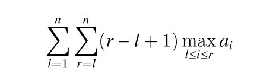

也就是说，对于序列中的每一个区间 [l, r]，取出这个区间的长度 (r − l +1) 与区间最大值 maxl≤i≤r ai，将二者相乘，并对所有区间的结果求和。

不过，小蓝觉得直接使用区间长度有些单调，于是他对这个问题作了一点修改。

他定义函数 f(x) 表示整数 x 在十进制表示下的位数。例如：

f(998244353) = 9 ,

f(799) = 3 。

现在，对于每一个区间 [l, r]，小蓝不再使用区间长度本身，而是使用区间长度的位数 f(r − l +1)。因此，他希望你计算下面这个式子的值：

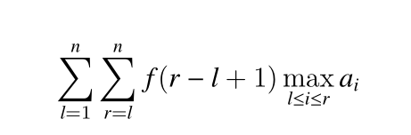

由于答案可能非常大，你只需要输出结果对 998244353 取模后的值。

#### 输入格式

输入共两行。

第一行包含一个正整数 n，表示序列的长度。

第二行包含 n 个正整数 a1, a2,. . . , an，表示给定的序列。

#### 输出格式

输出一行，包含一个整数，表示 ∑<sup>n</sup><sub>l=1</sub> ∑<sup>n</sup><sub>r=l</sub> f(r−l+1) max<sub>l≤i≤r</sub> a<sub>i </sub>对 998244353取模后的结果。

#### 样例输入

```
5

1 2 3 4 5
```

#### 提示

【样例输入 2】

10

12 3 4 5 6 7 8 9 10

【样例输出 2】

395

【评测用例规模与约定】

对于 30% 的评测用例，n ≤ 500；

对于 60% 的评测用例，n ≤ 3000；

对于所有的评测用例，1 ≤ n ≤ 500000，1 ≤ a<sub>i</sub> ≤ 10<sup>9</sup>。

---

### 3374 · 游戏指令解析器

> 题号 3374 ｜ 难度 中等 ｜ 时间 1s ｜ 内存 128MB
> 通过率 39.36% ｜ 题面原文 https://www.dotcpp.com/oj/problem3374.html
> 考过的语言/组别：Java 大学B组

#### 题目描述

某款冒险游戏维护了一个指令库，其中包含 n 条互不相同的完整指令。

玩家会依次输入 m 条字符串作为输入指令。输入指令可以是完整指令本身，也可以是某条完整指令的前缀（从第 1 个字符开始连续匹配）。

对于每条输入指令 s，定义它与指令库的匹配结果如下：

• 若存在且仅存在一条完整指令 c 满足：s 是 c 的前缀，则认为 s 唯一匹配到 c，系统执行该指令，并输出 c。

• 若有两条或以上的完整指令都以 s 作为前缀，则认为 s 多重匹配，输出ambiguous。

• 若指令库中不存在任何以 s 为前缀的完整指令，则认为 s 无法匹配，输出unknown。

现在，请你对玩家输入的每条指令，按上述规则输出其匹配结果。

#### 输入格式

第一行包含两个整数 n, m，分别表示指令库中的完整指令数量，以及玩家输入指令的数量。

接下来 n 行，每行一个字符串，表示一条完整指令。

接下来 m 行，每行一个字符串，表示一条输入指令。

#### 输出格式

输出 m 行。第 i 行对应第 i 条输入指令的匹配结果：

• 唯一匹配：输出对应的完整指令；

• 多重匹配：输出 ambiguous；

• 无法匹配：输出 unknown。

#### 样例输入

```
6 5

attack

defend

move

magic

examine

exit

att

def

mov

ex

e
```

#### 提示

【样例说明 1】

指令库为：attack、defend、move、magic、examine、exit。

• att 是 attack 的前缀，且仅匹配这一条，输出 attack。

• def 仅匹配 defend，输出 defend。

• mov 仅匹配 move，输出 move。

• ex 同时匹配 examine 与 exit，属于多重匹配，输出 ambiguous。

• e 同时匹配 examine 与 exit，输出 ambiguous。

【样例输入 2】

4 4

open

close

operate

unlock

op

clo

un

cast

【样例输出 2】

ambiguous

close

unlock

unknown

【样例说明 2】

• op 同时匹配 open 与 operate，输出 ambiguous。

• clo 仅匹配 close，输出 close。

• un 仅匹配 unlock，输出 unlock。

• cast 无法匹配任何完整指令，输出 unknown。

【评测用例规模与约定】

对于 30% 的评测用例，n ≤ 10，m ≤ 10；

对于 60% 的评测用例，n ≤ 50，m ≤ 50；

对于所有评测用例，1 ≤ n ≤ 100，1 ≤ m ≤ 100；

保证所有指令名称和输入指令的长度均在 [1, 20] 之间，所有字符串仅包含小写英文字母，指令库中的完整指令互不相同。

---

### 3375 · 量子态叠加计数器

> 题号 3375 ｜ 难度 简单 ｜ 时间 1s ｜ 内存 128MB
> 通过率 61.11% ｜ 题面原文 https://www.dotcpp.com/oj/problem3375.html
> 考过的语言/组别：Java 大学B组

#### 题目描述

某量子实验室记录了 N 个量子比特在第 1, 2,. . . , T 个时刻的状态。每个状态值为 0 或 1。

对任意一个量子比特和任意一个时刻区间 [L, R]（1 ≤ L ≤ R ≤ T），若该量子比特在区间内状态为 1 的次数恰好为 K，则称该量子比特在该区间产生了一次有效叠加。

现在，请你统计：在所有量子比特、所有时刻区间中，有效叠加出现的总次数。

#### 输入格式

第一行包含三个整数 N, T, K，分别表示量子比特数量、时刻数量、目标次数。

接下来 N 行，每行包含 T 个整数（0 或 1），其中第 i 行表示第 i 个量子比特在各时刻的状态序列。

#### 输出格式

输出一行，一个整数，表示有效叠加的总次数。

#### 样例输入

```
3 5 2

1 0 1 0 1

0 1 1 0 0

1 1 0 0 1
```

#### 提示

【样例说明 1】

对于第 1 个量子比特 10 1 0 1，满足条件的区间有：[1, 3] 、[1, 4] 、[2, 5]

、[3, 5] 。共 4 个。

对于第 2 个量子比特 01 1 0 0，满足条件的区间有：[1, 3] 、[1, 4] 、[1, 5]

、[2, 3] 、[2, 4] 、[2, 5] 。共 6 个。

对于第 3 个量子比特 11 0 0 1，满足条件的区间有：[1, 2] 、[1, 3] 、[1, 4]

、[2, 5] 。共 4 个。

因此总次数为 4+ 6 + 4 = 14。

【样例输入 2】

2 4 1

1 0 0 1

0 0 0 0

【样例输出 2】

6

【样例说明 2】

对于第 1 个量子比特 10 0 1，恰好包含 1 个状态为 1 的区间有：[1, 1] 、

[1, 2] 、[1, 3] 、[2, 4] 、[3, 4] 、[4, 4] 。共 6 个。

对于第 2 个量子比特 00 0 0，任意区间内都没有状态为 1，因此不存在

恰好包含 1 个状态为 1 的区间。

所以答案为 6+ 0 = 6。

【样例输入 3】

1 6 3

11 0 1 1 0

【样例输出 3】

3

【样例说明 3】

唯一的量子比特为 11 0 1 1 0。

恰好包含 3 个状态为 1 的区间有：[1, 4] 、[2, 5] 、[2, 6] 。共 3 个。

【样例输入 4】

1 3 0

0 0 0

【样例输出 4】

6

【样例说明 4】

唯一的量子比特在所有时刻的状态都为 0。

当 K =0 时，需要统计区间内恰好有 0 个状态为 1 的情况，也就是区间内

所有值都为 0 的区间。

当 T =3 时，一共有 3×24 =6 个区间，且它们全部满足条件，因此答案为

6。

【评测用例规模与约定】

对于 30% 的评测用例，N ≤ 10，T ≤ 100；

对于 60% 的评测用例，N ≤ 50，T ≤ 500；

对于所有评测用例，1 ≤ N ≤ 200，1 ≤ T ≤ 1000，0 ≤ K ≤ T；保证输入中

的所有状态值均为 0 或 1

---

### 3376 · 共享单车

> 题号 3376 ｜ 难度 中等 ｜ 时间 1s ｜ 内存 128MB
> 通过率 25.00% ｜ 题面原文 https://www.dotcpp.com/oj/problem3376.html
> 考过的语言/组别：Java 大学B组

#### 题目描述

小蓝的工作是管理共享单车。现在，他要将 n 辆没有被妥善停放的共享单车，搬运到 m 个停车点。

小蓝的管理区域是一条街道，可以将其视为一条数轴。第 i 辆单车位于位置 ai，第 j 个停车点位于位置 bj。

将一辆位于位置 x 的单车搬运到位置 y 的停车点，需要消耗 |x ? y| 的体力。

每个停车点最多只能停放一辆单车。已知 n ≤ m，因此一定可以为每辆单车分配一个停车点。你需要计算：在合理分配单车与停车点的情况下，小蓝至少需要花费多少体力。

#### 输入格式

输入共 3 行。

第一行包含两个正整数 n, m，分别表示单车的数量和停车点的数量。

第二行包含 n 个正整数 a1, a2,. . . , an，表示每辆单车所在的位置。

第三行包含 m 个正整数 b1, b2,. . . , bm，表示各个停车点所在的位置

#### 输出格式

输出一行一个正整数，表示小蓝至少需要花费的体力。

#### 样例输入

```
3 4

1 3 7

2 4 5 8
```

#### 提示

【样例说明 1】

一种最优分配方案如下：

• 将位置为 1 的单车搬运到位置为 2 的停车点；

• 将位置为 3 的单车搬运到位置为 4 的停车点；

• 将位置为 7 的单车搬运到位置为 8 的停车点。

此时总花费为：

|1 - 2| + |3 - 4| + |7 - 8| =1 + 1 + 1 = 3

因此，最少需要花费的体力为 3。

【样例输入 2】

3 4

3 1 3

5 2 2 8

【样例输出 2】

4

【评测用例规模与约定】

对于 40% 的评测用例，n, m ≤ 8。

另有 20% 的评测用例，n = m。

对于所有的评测用例，1 ≤ n ≤ m ≤ 5000，1 ≤ ai, bi ≤ 10<sup>9</sup>。

---

### 3377 · 擂台赛

> 题号 3377 ｜ 难度 入门 ｜ 时间 1s ｜ 内存 128MB
> 通过率 15.56% ｜ 题面原文 https://www.dotcpp.com/oj/problem3377.html
> 考过的语言/组别：Java 大学B组

#### 题目描述

小蓝想要组织一场擂台赛，比赛共有 n 位选手，编号为 1 至 n。初始时，每位选手 i 都在属于自己的第 i 号擂台上。每位选手 i 都有且仅有一个想要前往挑战的目标擂台 ai。

比赛开始时，小蓝需要制定一个出战顺序。按照该顺序，对于每一位出战选手 i：

• 如果他的目标擂台 ai 目前未被关闭，他将离开自己的 i 号擂台并前往 ai

号擂台发起挑战，同时关闭自己原先所在的擂台 i。

• 如果他的目标擂台 ai 已被关闭，则他无法发起挑战，只能留在原地。

小蓝希望设置一个出战顺序，使得最终被使用过（即作为挑战目标被成功前往）的擂台数量尽可能少。需要注意的是，留在原地的选手并不计入对擂台的使用。

请你帮小蓝计算，在最优的出战顺序下，最少有多少个擂台被使用过？

#### 输入格式

输入共 2 行。

第一行为一个正整数 n，表示选手数量。

第二行为 n 个正整数 a1, a2,. . . , an，表示每位选手的目标擂台编号。

#### 输出格式

输出一个整数，表示最少被使用过的擂台数量。

#### 样例输入

```
5

2 3 4 5 4
```

#### 提示

【样例说明】

其中一种最优的出战顺序为：1, 3, 2, 5, 4。

1. 选手 1 挑战 2：目标擂台 2 未关闭，出战成功，关闭擂台 1，使用擂台2；

2. 选手 3 挑战 4：目标擂台 4 未关闭，出战成功，关闭擂台 3，使用擂台4；

3. 选手 2 挑战 3：目标擂台 3 已被选手 3 出战时关闭，选手 2 只能留在原地；

4. 选手 5 挑战 4：目标擂台 4 未关闭，出战成功，关闭擂台 5，使用擂台4；

5. 选手 4 挑战 5：目标擂台 5 已被选手 5 出战时关闭，选手 4 只能留在原地。

最终被使用过的擂台为 {2, 4}，共 2 个。

【评测用例规模与约定】

对于 30% 的数据，n ≤ 10；

对于 100% 的数据，1 ≤ n ≤ 10<sup>6</sup>，1 ≤ a<sub>i </sub>≤ n 且 a<sub>i </sub>!= i。

---

### 3378 · 星座导航校准器

> 题号 3378 ｜ 难度 入门 ｜ 时间 1s ｜ 内存 128MB
> 通过率 14.29% ｜ 题面原文 https://www.dotcpp.com/oj/problem3378.html
> 考过的语言/组别：Java 大学B组

#### 题目描述

深空探测器在执行任务时需要依靠星座导航系统进行精确定位。该系统由若干颗导航卫星组成，每颗卫星都有固定的轨道位置和信号强度。

为了确保导航精度，需要选择一组卫星构成 “导航星座”，使得：

1. 两颗卫星距离过近会产生干扰，降低导航精度；

2. 星座必须保持连通性（通信半径为 R，任意两颗卫星都能通过直接或间接通信到达）；

3. 在综合考虑以上因素后，使总导航精度最大化。

导航精度计算规则

设选定的导航星座包含卫星集合 S = {s1, s2,. . . , sk}，每颗卫星 si 位于坐标(xi, yi)，信号强度为 pi。

**基础精度**：每颗卫星贡献的基础精度为其信号强度 pi。

**几何加成**：考虑星座的几何分布，计算所有卫星对之间的几何加成：

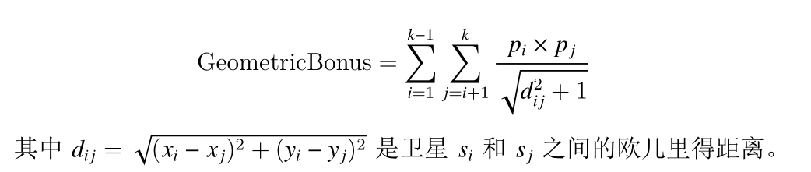

**连通性约束：**

• 如果两颗卫星距离 dij ≤ R，则它们可以直接通信。

• 整个星座必须保持连通（任意两颗卫星都能通过直接或间接通信到达）。

**干扰惩罚**：如果两颗卫星距离过近（dij < T），会产生信号干扰，精度减少：

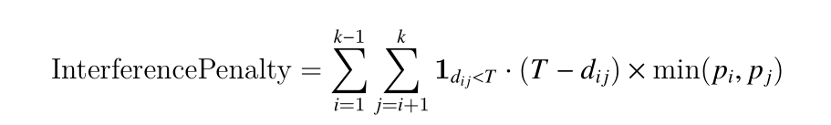

其中 1<sub>dij</sub><T 是指示函数，当条件满足时为 1，否则为 0；对每一对不同的卫星（i < j）各计算一次干扰惩罚。

**总导航精度**计算公式：

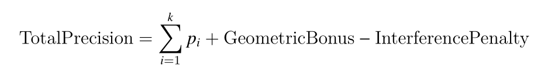

给定 N 颗候选卫星的坐标和信号强度，以及通信半径 R 和干扰阈值 T，从中选择若干颗卫星组成导航星座，使得：

1. 星座保持连通性（通信半径为 R）；

2. 总导航精度最大化；

3. 星座中至少包含 K 颗卫星。

#### 输入格式

第一行包含四个整数 N、K、R、T，分别表示候选卫星数量、最少卫星数量、通信半径和干扰阈值。

接下来 N 行，每行包含三个整数 xi、yi、pi，表示第 i 颗卫星的坐标和信号强度。

#### 输出格式

输出一行，包含一个整数，表示能够达到的最大导航精度（向下取整）。

#### 样例输入

```
3 2 10 3

0 0 5

5 0 8

0 5 6
```

#### 提示

【样例说明 1】

最优解：选择卫星 {1, 2, 3}（编号从 1 开始），即坐标为 (0, 0)、(5, 0)、

(0, 5) 的三颗卫星。

连通性验证：

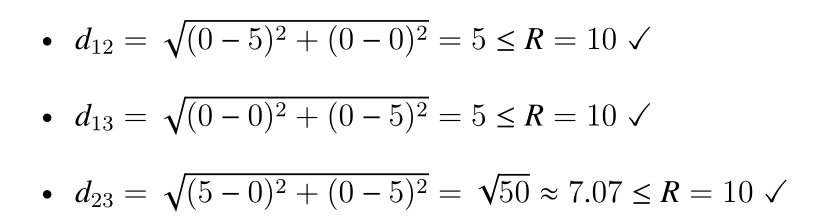

所有卫星对都能直接通信，星座连通。

精度计算：

1. **基础精度**：5+ 8 + 6 = 19 。

2. **几何加成**：

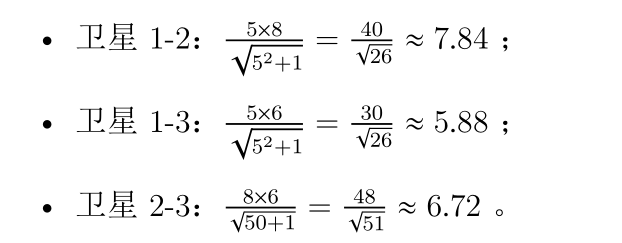

总几何加成：7.84 + 5.88 + 6.72 = 20.44 。

3. **干扰惩罚**：所有距离都 ≥ 5 > T =3，无干扰惩罚。

**总精度**：19 + 20.44 ? 0= 39.44，向下取整为 39。

【样例输入 2】

5 3 5 3

0 0 1 0

2 0 8

4 0 6

10 0 12

1 4 9

【样例输出 2】

139

【样例说明 2】

**最优解：选择卫星 {1, 2, 3, 5}**（编号从 1 开始），即坐标为 (0, 0)、(2, 0)、(4, 0)、(1, 4) 的四颗卫星。

连通性验证：

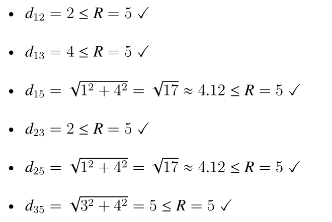

所有选中卫星对都能直接通信，星座连通。

**精度计算：**

**1. 基础精度**：10 + 8 + 6 + 9 = 33

**2. 几何加成**：

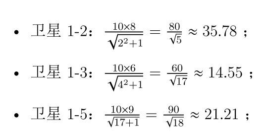

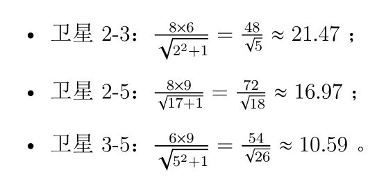

总几何加成：35.78 + 14.55 + 21.21 + 21.47 + 16.97 + 10.59 = 120.57 。

3. 干扰惩罚：

• 卫星 1-2 距离 2< T=3，产生干扰：(3 ? 2) × min(10, 8) = 1 × 8= 8 ；

• 卫星 2-3 距离 2< T=3，产生干扰：(3 ? 2) × min(8, 6) = 1 × 6= 6 ；

• 其他卫星对距离都 ≥ 3，无干扰。

总干扰惩罚：8+ 6 = 14

总精度：33 + 120.57 ? 14 = 139.57，向下取整为 139。

【评测用例规模与约定】

对于 30% 的数据：N ≤ 8，K ≤ 3；

对于 60% 的数据：N ≤ 12，K ≤ 5；

对于所有评测用例：

• N ≤ 15，K ≤ 8，R ≤ 20，T ≤ 10 ；

• 坐标范围：0 ≤ xi, yi ≤ 100 ；

• 信号强度：1 ≤ pi ≤ 20 ；

• 保证存在至少 K 颗卫星、且满足连通性约束的解。

---

### 3379 · 回程

> 题号 3379 ｜ 难度 入门 ｜ 时间 1s ｜ 内存 128MB
> 通过率 60.00% ｜ 题面原文 https://www.dotcpp.com/oj/problem3379.html
> 考过的语言/组别：Java 大学B组

#### 题目描述

给定一张包含 n 个点、m 条无向边的图，点的编号为 1 ∼ n。每条边连接两个不同的点，且可能存在重边。每条无向边由三个整数 u, v, w 描述，表示点 u与点 v 之间有一条无向边，其代价为 w。

你需要从点 n 出发，到达点 1。

图中有一个特殊点 X。当第一次到达点 X 时，可以获得 3 次特殊机会。若X = n，则表示出发时就已经获得这 3 次特殊机会。

在之后的行进过程中，每次经过一条边时，都可以选择是否使用一次特殊

机会：

• 如果不使用，则经过这条边的代价为该边原本的代价 w；

• 如果使用，则这一次经过该边的代价变为 1。

特殊机会可以少用或不用，但总共最多只能使用 3 次，每次只能作用于当前经过的一条边。

现在，请你计算从点 n 到点 1 的最小总代价。若无法到达，则输出 ?1。

#### 输入格式

第一行包含三个整数 n, m, X，分别表示点数、边数和特殊点的位置。

接下来 m 行，每行包含三个整数 u, v, w，表示一条连接点 u 与点 v 的无向边，其代价为 w。

#### 输出格式

输出一个整数，表示从点 n 到点 1 的最小总代价。若无法到达，则输出-1。

#### 样例输入

```
6 6 6

1 2 5

2 4 5

1 3 2

3 4 100

4 5 10

5 6 20
```

#### 提示

【样例说明】

由于 X =6，而出发点也是 6，因此一开始就已经获得了 3 次特殊机会。

一种 最 优 走 法 为： 6 → 5 → 4 → 3 → 1，对 应 边 的 原 代 价 分 别 为20, 10, 100, 2。

在其中 3 条边上使用特殊机会，例如对代价为 20, 10, 100 的三条边使用，则这三次经过的代价都变为 1，最后一条边仍支付原代价 2。

因此总代价为 1+ 1 + 1 + 2 = 5

【评测用例规模与约定】

对于 30% 的评测用例，n, m ≤ 500。

另有额外 30% 的评测用例，所有边的代价 w 相同。

对于所有的评测用例，1 ≤ n ≤ 2 × 10<sup>5</sup>，1 ≤ m ≤ 2 × 10**5**，1 ≤ w ≤ 10**9**，

1 ≤ X, u, v ≤ n。

保证图中不含自环，但可能存在重边。

---

### 3380 · 解题速度对决

> 题号 3380 ｜ 难度 简单 ｜ 时间 1s ｜ 内存 128MB
> 通过率 47.95% ｜ 题面原文 https://www.dotcpp.com/oj/problem3380.html
> 考过的语言/组别：Python 大学C组、Python 研究生组

#### 题目描述

机房的白炽灯下，键盘的敲击声此起彼伏。

小蓝和小红约定进行一场解题速度的对决。比赛共有 n 道题目，两人同时开始，谁先完成所有题目，谁即获胜。

虽然题目是一样的，但两人的解题节奏截然不同：

• 小蓝：解决每道题耗时固定为 t1 分钟。但他有个特殊的习惯，在完成第 i道题后，他需要休息 i × d1 分钟来平复心情，然后才能开始下一题。

• 小红：解决每道题耗时固定为 t2 分钟。同样地，她在完成第 i 道题后，需要休息 i × d2 分钟。

你是这场对决的裁判。已知题目总数以及两人的各项耗时参数，现在，请你计算出最终的获胜者。

如果是小蓝获胜，请输出 BLUE；如果是小红获胜，请输出 RED；如果两人在同一时刻完成，则判定为平局，输出 DRAW。

#### 输入格式

第一行输入一个整数 T ，表示共有 T 组测试数据。

接下来 T 行，每行包含五个整数 n, t1, d1, t2, d2，其含义如题所述。

#### 输出格式

对于每组测试数据，输出一行结果：

• 如果小蓝先完成，输出 BLUE。

• 如果小红先完成，输出 RED。

• 如果两人同时完成，输出 DRAW。

#### 样例输入

```
3

3 5 2 4 3

3 5 3 4 2

3 5 2 4 4
```

#### 提示

【评测用例规模与约定】

对于 30% 的评测用例，1 ≤ T ≤ 100，1 ≤ n, t1, d1, t2, d2 ≤ 10<sup>3</sup>；

对于所有评测用例，1 ≤ T ≤ 10<sup>3</sup>，1 ≤ n, t1, d1, t2, d2 ≤ 10<sup>5</sup>。

---

### 3381 · 底层协议

> 题号 3381 ｜ 难度 中等 ｜ 时间 1s ｜ 内存 128MB
> 通过率 32.59% ｜ 题面原文 https://www.dotcpp.com/oj/problem3381.html
> 考过的语言/组别：Python 大学C组、Python 研究生组

#### 题目描述

在工业元宇宙的数字孪生系统中，真实产线的每一次物理震动都会被捕捉为数据流，并依照时间先后顺序被标记为编号 1, 2, 3,. . . , N，作为虚实同步的索引。

为了抵御高频数据吞吐带来的系统抖动，系统会将这些数据暂存于同步缓冲池中等待处理。然而，底层协议设定了一条严苛的防御性规则：缓冲池内任意两个不同编号的和，绝不能被 2026 整除。一旦违反，数据流就会因频谱重叠而引发逻辑冲突，导致缓冲池内全部数据被系统判定为异常并丢弃。

现在，请你计算在编号 1 到 N 的范围内，满足协议约束的缓冲池理论上最多能容纳多少个编号？

#### 输入格式

输入一行，包含一个正整数 N。

#### 输出格式

输出一行，包含一个整数，表示满足条件的缓冲池最大容量。

#### 样例输入

```
10
```

#### 提示

【样例输入 2】

2025

【样例输出 2】

1013

【评测用例规模与约定】

对于 30% 的评测用例，1 ≤ N ≤ 2026；

对于 50% 的评测用例，1 ≤ N ≤ 10<sup>5</sup>；

对于所有的评测用例，1 ≤ N ≤ 10<sup>18</sup>。

---

### 3382 · 抽奖活动

> 题号 3382 ｜ 难度 中等 ｜ 时间 1s ｜ 内存 128MB
> 通过率 36.71% ｜ 题面原文 https://www.dotcpp.com/oj/problem3382.html
> 考过的语言/组别：Java 大学C组、Python 研究生组

#### 题目描述

小蓝在逛街时遇到了一个抽奖活动。

初始时，有 n 个小球按从左到右的顺序排成一排，第 i 个小球上写有一个整数 ai。

小蓝一共购买了 k 次抽奖机会。在每次抽奖中，他可以从当前剩余的小球里选择一个拿走，但只有满足以下条件的小球才可以被拿走：

设该小球在当前剩余小球中从左到右排在第 i 个，记：

• Li 为该小球左侧剩余的小球个数；

• Ri 为该小球右侧剩余的小球个数。

那么该小球必须同时满足：

• Ri > 0；

• Li 是 Ri 的整数倍（特别地，0 视为任意非零整数的整数倍）。

每次拿走一个小球后，剩余小球会重新按原有相对顺序排成一排。

小蓝最多可以进行 k 次抽奖，也可以少于 k 次。请你计算，他最多能拿走的小球上整数之和是多少。

#### 输入格式

输入共两行。

第一行包含两个正整数 n, k。

第二行包含 n 个正整数 a1, a2,. . . , an，表示每个小球上的整数。

#### 输出格式

输出一行，一个整数，表示最多 k 次抽奖后，小蓝能够获得的最大整数之和。

#### 样例输入

```
7 2

2 8 2 4 2 6 3
```

#### 提示

【样例说明】

一种可行方案是：

• 第一次拿走当前第 4 个小球，得到 4；

• 剩余小球变为 2, 8, 2, 2, 6, 3；

• 第二次拿走当前第 5 个小球，得到 6。

总和为 4+ 6 = 10。

另一种可行方案是：

• 第一次拿走当前第 1 个小球，得到 2；

• 剩余小球变为 8, 2, 4, 2, 6, 3；

• 第二次再拿走当前第 1 个小球，得到 8。

总和同样为 2+ 8 = 10。

【评测用例规模与约定】

对于 100% 的数据，保证 1 ≤ k ≤ n ≤ 20, 1 ≤ ai ≤ 100。

---

### 3383 · 抓取卡牌

> 题号 3383 ｜ 难度 简单 ｜ 时间 1s ｜ 内存 128MB
> 通过率 60.27% ｜ 题面原文 https://www.dotcpp.com/oj/problem3383.html
> 考过的语言/组别：Java 研究生组、Python 研究生组

#### 题目描述

有 n 种不同的卡牌，其中第 i 种卡牌的基础价值为 vi，数量为 ai 张。

你需要从这些卡牌中恰好选出 X 张，组成自己的卡组。

对于同一种卡牌，随着你选取的数量增加，它后续的价值会下降。具体地，若某种基础价值为 v 的卡牌已经被选了 k 张，那么下一张这种卡牌的价值为：

⌊ v/(k +1) ⌋

⌊x⌋ 表示对 x 向下取整，即不超过 x 的最大整数。

也就是说：

• 选第 1 张该种卡牌时，价值为⌊ v/1 ⌋ = v；

• 选第 2 张时，价值为⌊ v/2 ⌋；

• 选第 3 张时，价值为⌊ v/3 ⌋；

• 依此类推。

每种卡牌至多只能选取 a<sub>i</sub> 张。

现在，请你计算：恰好选出 X 张卡牌时，能够得到的最大总价值是多少。

#### 输入格式

输入共三行。

第一行包含两个整数 n, X，分别表示卡牌种类数和需要选取的卡牌总数。

第二行包含 n 个整数 v1, v2,. . . , vn，表示每种卡牌的基础价值。

第三行包含 n 个整数 a1, a2,. . . , an，表示每种卡牌可供选取的数量。

#### 输出格式

输出一行一个整数，表示最大总价值。

#### 样例输入

```
6 6

1 1 2 3 4 5

1 2 1 2 3 4
```

#### 提示

【样例说明】

将所有可能选取的单张卡牌价值展开后，可得：

• 第 1 种卡牌可贡献：1

• 第 2 种卡牌可贡献：1, 0

• 第 3 种卡牌可贡献：2

• 第 4 种卡牌可贡献：3, 1

• 第 5 种卡牌可贡献：4, 2, 1

• 第 6 种卡牌可贡献：5, 2, 1, 1

从中选出最大的 6 个值：5, 4, 3, 2, 2, 2，它们的和为：5+4+3+2+2+2 = 18，因此答案为 18。

【评测用例规模与约定】

对于 50% 的评测用例，1 ≤ n, X ≤ 5000；

对于所有的评测用例，满足：1 ≤ n ≤ 2 × 10<sup>5</sup>, 0 ≤ X, ai ≤ 2 × 10<sup>5</sup>, 0 ≤ vi ≤10<sup>9</sup>。

保证所有卡牌总数不少于 X。

---

### 3384 · 双人成行

> 题号 3384 ｜ 难度 入门 ｜ 时间 1s ｜ 内存 128MB
> 通过率 53.85% ｜ 题面原文 https://www.dotcpp.com/oj/problem3384.html
> 考过的语言/组别：Python 大学C组、Python 研究生组

#### 题目描述

给定一个 N 行 M 列的网格。现有两名玩家，他们需要分别选择一个格子作为初始位置，且两人的初始位置不能相同。另有一个操作序列 S ，其中每个

操作都是以下四种之一：

• U：向上移动一格；

• D：向下移动一格；

• L：向左移动一格；

• R：向右移动一格。

两名玩家会按照该操作序列 S 同时移动。对于序列中的每一个操作，两名玩家都同时尝试沿对应方向移动一格。若某名玩家在该方向上移出网格边界，则这一步他将停留在原位置不动。

现在，你需要计算，有多少种不同的初始位置对，能够使得两人在执行完整个操作序列后，最终位于同一个格子。

特别 地，初 始 位 置 对 视 为 有序 对：若 两 人 的 初 始 位 置 分 别 为 (r1, c1) 和(r2, c2)，那么 ((r1, c1), (r2, c2)) 与 ((r2, c2), (r1, c1)) 视为两种不同的方案。

#### 输入格式

输入共两行。

第一行包含两个整数 N, M。

第二行包含一个字符串 S ，表示操作序列。

#### 输出格式

输出一个整数，表示满足条件的初始位置对数量。

#### 样例输入

```
10 9

UULDURRRDLDLDD
```

#### 提示

【评测用例规模与约定】

对于 30% 的评测用例，N, M ≤ 50，|S |≤ 1000；

对于所有的评测用例，N, M ≤ 5000，1 ≤|S |≤ 10<sup>6</sup>。

---

### 3385 · 购电优化

> 题号 3385 ｜ 难度 困难 ｜ 时间 1s ｜ 内存 128MB
> 通过率 16.13% ｜ 题面原文 https://www.dotcpp.com/oj/problem3385.html
> 考过的语言/组别：Python 大学A组、Python 研究生组

#### 题目描述

数据中心需要在接下来的 n 个时段内完成一系列计算任务，因此必须提前规划购电方案，以尽可能降低总成本。

具体来说，第 i 个时段需要消耗 wi 单位电量，并且这部分电量必须在第 i个时段结束前全部准备好。为此，你可以在任意时段购买电量：如果在第 i 个时段购电，那么每单位电量的价格为 ci 元。

然而，不同时段的电价可能存在明显差异。为了更好地利用这一点，数据中心配备了一块容量为 k 的储能电池。借助这块电池，你可以在电价较低的时段多买一些电先存起来，再在后续电价较高或需要用电的时段从电池中取出使用，从而减少整体支出。

电池的初始电量为 0，充电和放电过程中的损耗可以忽略不计；同时，在任何时刻，电池中的电量都不能超过容量 k，也不能低于 0。

现在请你计算，在保证所有时段用电需求都能够被满足的前提下，最少需要花费多少元购电。

#### 输入格式

输入共 3 行。

第一行包含两个整数 n 和 k，分别表示时段数量和储能电池的容量。

第二行包含 n 个非负整数 w1, w2,. . . , wn，其中 wi 表示第 i 个时段所需的电量。

第三行包含 n 个非负整数 c1, c2,. . . , cn，其中 ci 表示第 i 个时段购买单位电量的价格。

#### 输出格式

输出一行，一个非负整数，表示满足所有时段用电需求所需的最小购电成本。

#### 样例输入

```
3 1

1 2 1

20 25 100
```

#### 提示

【样例说明】

最优方案如下：

• 第 1 个时段购买 2 单位电量，花费 2 × 20 = 40 元；其中 1 单位立即使用，

另外 1 单位存入电池；

• 第 2 个时段购买 2 单位电量，花费 2 × 25 = 50 元；这 2 单位电量全部用

于当前时段的需求；

• 第 3 个时段直接使用电池中剩余的 1 单位电量，无需额外购电。

因此，总花费为 40 + 50 = 90 元。

【评测用例规模与约定】

对于 20% 的数据，n ≤ 10，k ≤ 10；

对于 40% 的数据，n ≤ 500，k ≤ 1000；

对于另 20% 的数据，n ≤ 3000，且 ∑ w<sub>i</sub> ≤ 10<sup>6</sup>；

对于另 10% 的数据，k ≤ 100；

对于 100% 的数据，1 ≤ n ≤ 5 × 10<sup>5</sup>，0 ≤ k ≤ 10<sup>9</sup>，0 ≤ wi, ci ≤ 10<sup>9</sup>。

---

### 3386 · 幸运约会日

> 题号 3386 ｜ 难度 简单 ｜ 时间 1s ｜ 内存 128MB
> 通过率 50.00% ｜ 题面原文 https://www.dotcpp.com/oj/problem3386.html
> 考过的语言/组别：Java 大学C组

#### 题目描述

小明是个浪漫的程序员，他想要在一个特殊的日期向心仪的女孩表白。他认为如果一个日期的年、月、日三个数字的数字和都相等，那这就是一个 “幸运约会日”。

数字和是指一个数字各位数字之和。例如：

• 2026 的数字和为 2+ 0 + 2 + 6 = 10

• 12 的数字和为 1+ 2 = 3

• 25 的数字和为 2+ 5 = 7

给定一个日期，请你帮小明判断这是否是一个幸运约会日。

#### 输入格式

第一行包含一个整数 T，表示测试用例的数量。

接下来 T 行，每行包含三个整数 Y、M、D，分别表示年、月、日。

#### 输出格式

对于每个测试用例，如果是幸运约会日，输出 YES，否则输出 NO。

#### 样例输入

```
3

2026 12 7

2020 4 13

1111 1 3
```

#### 提示

【样例说明】

• 第一个日期：2026 年 12 月 7 日。2026 的数字和：2+ 0 + 2 + 6 = 10，12的数字和：1+ 2 = 3，7 的数字和：7。因为 10 ? 3 ? 7，所以不是幸运约会日。

• 第二个日期：2020 年 4 月 13 日。2020 的数字和：2+ 0 + 2 + 0 = 4，4 的数字和：4，13 的数字和：1+ 3 = 4。因为 4= 4 = 4，所以是幸运约会日。

• 第三个日期：1111 年 1 月 3 日。1111 的数字和：1+ 1 + 1 + 1 = 4，1 的数字和：1，3 的数字和：3。因为 4 ? 1 ? 3，所以不是幸运约会日。

【评测用例规模与约定】

对于所有评测用例，1 ≤ T ≤ 1000 ，1000 ≤ Y ≤ 9999（保证是有效的年份），1 ≤ M ≤ 12（保证是有效的月份），1 ≤ D ≤ 31（保证是有效的日期）。保证给定的日期都是实际存在的有效日期。

---

### 3387 · 音乐节拍器

> 题号 3387 ｜ 难度 入门 ｜ 时间 1s ｜ 内存 128MB
> 通过率 64.84% ｜ 题面原文 https://www.dotcpp.com/oj/problem3387.html
> 考过的语言/组别：Python 大学A组、Java 大学C组

#### 题目描述

小明在学习音乐，他发现不同乐器的演奏需要配合不同的节拍。现在有 N种乐器，每种乐器都有自己的 “节拍周期”（以秒为单位）。

在音乐演奏中，如果某一时刻恰好是某个乐器节拍周期的整数倍，那么这个乐器就会在这一时刻发声。例如，一个节拍周期为 3 秒的乐器会在第 3 秒、第 6 秒、第 9 秒等时刻发声。

小明想知道：在前 T 秒内（即第 1 秒至第 T 秒，包含第 T 秒），恰好有 K种乐器同时发声的时刻有多少个？

#### 输入格式

第一行包含三个整数 N, T, K，分别表示乐器数量、观察的时长、同时发声的乐器数量。

第二 行 包 含 N 个整 数 p1, p2,. . . , pN，表 示 每 种 乐 器 的 节 拍 周 期（单 位：秒）。

#### 输出格式

一行，输出一个整数，表示恰好有 K 种乐器同时发声的时刻数量。

#### 样例输入

```
3 12 2

2 3 4
```

#### 提示

【样例说明 1】

乐器周期分别为 2、3、4 秒。在前 12 秒内，每个时刻发声情况如下表所示：

时刻 | 乐器1（周期2） | 乐器2（周期3） | 乐器3（周期4） | 发声乐器数 |

1 | - | - | - | 0 |

2 | √ | - | - | 1 |

3 | - | √ | - | 1 |

4 | √ | - | √ | 2 |

5 | - | - | - | 0 |

6 | √ | √ | - | 2 |

7 | - | - | - | 0 |

8 | √ | - | √ | 2 |

9 | - | √ | - | 1 |

10 | √ | - | - | 1 |

11
| - | - | - | 0 |

12 | √ | √ | √ | 3 |

表中 “√” 表示该乐器在该时刻发声，“-” 表示不发声。

恰好 2 种乐器同时发声的时刻有：t =4, 6, 8，共 3 个。

【样例输入 2】

420 3

23 5 6

【样例输出 2】

3

【样例说明 2】

乐器周期分别为 2、3、5、6 秒。在前 20 秒内，恰好 3 种乐器同时发声的时刻如下表所示：

时刻 | 乐器1 | 乐器2 | 乐器3 | 乐器4 | 发声乐器数 |

6 | √ | √ | - | √ | 3 |

12 | √ | √ | - | √ | 3 |

18 | √ | √ | - | √ | 3 |

说明：乐器 1、2、4 的最小公倍数为 6，所以在时刻 6、12、18 这三个乐器会同时发声。乐器 3（周期 5）在这些时刻不发声，因此恰好 3 种乐器。

【样例输入 3】

5 100 1

7 11 13 17 19

【样例输出 3】

36

【评测用例规模与约定】

对于 30% 的评测用例，N ≤ 5，T ≤ 100；

对于 60% 的评测用例，N ≤ 10，T ≤ 1000；

对于所有评测用例，1 ≤ N ≤ 20，1 ≤ T ≤ 10000，1 ≤ K ≤ N，1 ≤ pi ≤ 100。

---

### 3388 · 小蓝的序列

> 题号 3388 ｜ 难度 中等 ｜ 时间 1s ｜ 内存 128MB
> 通过率 24.07% ｜ 题面原文 https://www.dotcpp.com/oj/problem3388.html
> 考过的语言/组别：Java 研究生组、Java 大学C组

#### 题目描述

小蓝认为，一个序列是 “好的”，当且仅当它满足以下条件：

1. 序列中恰好只出现两种不同的整数；2. 任意一对相邻元素都不相同；3.对所有合法的下标 i（1 ≤ i ≤ n ? 2），都有 ai = ai+2。

等价地说，一个好的序列一定形如

x, y, x, y, x, y,. . .

或

y, x, y, x, y, x,. . .

其中 x ≠ y，且整个序列中只出现这两个数。

现在，小蓝有一个长度为 n 的序列，他可以进行任意次修改操作。每次操作可以将序列中的一个元素改成任意正整数。

小蓝想知道：至少需要修改多少个元素，才能将当前序列变成一个好的序列？

#### 输入格式

输入共两行。

第一行包含一个正整数 n，表示序列长度。

第二行包含 n 个正整数 a1, a2, ·· · , an，表示小蓝当前的序列。

#### 输出格式

输出一行，包含一个非负整数 c，表示至少需要修改 c 个元素，才能使该序列变成一个好的序列。

#### 样例输入

```
5

1 1 1 1 2
```

#### 提示

【样例说明】

一种最优方案是将第 1 个和第 3 个数改为 2，此时序列变为：

2, 1, 2, 1, 2

这是一个好的序列。可以验证，不存在只修改 1 个元素就能满足条件的方案，因此答案为 2。

【评测用例规模与约定】

对于 30% 的评测用例，n ≤ 8；

另有 20% 的评测用例满足：对所有 1 ≤ i, j ≤ n，都有 a<sub>i</sub> = a<sub>j</sub>；

对于所有评测用例，2 ≤ n ≤ 10<sup>6</sup>，且 1 ≤ a<sub>i</sub> ≤ 10<sup>6</sup>。

---

### 3389 · 智能产线排程优化

> 题号 3389 ｜ 难度 入门 ｜ 时间 1s ｜ 内存 128MB
> 通过率 44.44% ｜ 题面原文 https://www.dotcpp.com/oj/problem3389.html
> 考过的语言/组别：Python 大学C组、Java 大学C组

#### 题目描述

某智能制造工厂拥有两条完全相同且可以并行工作的自动化生产线，分别记为 A 和 B。现在，工厂同时接到了 N 份生产订单。

对于第 i 份订单（1 ≤ i ≤ N），给定以下三个参数：

• 加工时间 pi：该订单在任意一条生产线上加工所需的时间；

• 交付期限 di：该订单必须在第 di 小时之前（含第 di 小时）完成；

• 订单收益 ri：若该订单按时完成，工厂可以获得的收益。

两条生产线都从第 0 小时开始运行，并且彼此独立。对于任意一条生产线：

• 同一时刻最多只能加工一份订单；

• 每份订单一旦开始加工，就必须连续完成，不能中断；

• 相邻订单之间没有切换时间。

工厂可以从这 N 份订单中选择任意若干份进行生产。对于每一份被选择的订单，需要决定：

• 将其分配给生产线 A 或生产线 B；

• 它在对应生产线上的加工顺序。

要求所有被选择的订单都必须在各自的交付期限内完成。对此，请你计算：

工厂最多能够获得多少收益。

#### 输入格式

第一行包含一个正整数 N，表示订单数量。

接下来 N 行，每行包含三个正整数 pi, di, ri，分别表示第 i 份订单的加工时间、交付期限和收益。

#### 输出格式

输出一行，包含一个整数，表示能够获得的最大总收益。

#### 样例输入

```
4

3 4 10

3 5 12

2 3 6

4 7 15
```

#### 提示

【样例说明 1】

四份订单的信息如下：

订单编号 | 1 | 2 | 3 | 4 |

加工时间pi | 3 | 3 | 2 | 4 |

交付期限di | 4 | 5 | 3 | 7 |

收益ri | 10 | 12 | 6 | 16 |

一种最优安排如下：

• 生产线 A：先加工订单 3，再加工订单 2；

• 生产线 B：先加工订单 1，再加工订单 4。

具体完工情况为：

- 生产线 A：

• 订单 3 在第 0 ∼ 2 小时加工，完工时刻为 2，满足 2 ≤ d3 =3；

• 订单 2 在第 2 ∼ 5 小时加工，完工时刻为 5，满足 5 ≤ d2 =5。

- 生产线 B：

• 订单 1 在第 0 ∼ 3 小时加工，完工时刻为 3，满足 3 ≤ d1 =4；

• 订单 4 在第 3 ∼ 7 小时加工，完工时刻为 7，满足 7 ≤ d4 =7。

四份订单均可按时完成，总收益为：

6+ 12 + 10 + 15 = 43

【样例输入 2】

5

3 4 10

2 3 7

4 6 20

3 7 12

5 8 18

【样例输出 2】

60

【样例说明 2】

五份订单的总加工时间为：

3+ 2 + 4 + 3 + 5 = 17

在最晚交付期限为 8 的情况下，两条生产线在时间区间 [0, 8] 内总共最多只能提供 16 个单位的加工时间，因此不可能将全部订单都安排并按时完成。

一种最优方案是放弃订单 2，选择订单 {1, 3, 4, 5}。安排如下：

• 生产线 A：先加工订单 3，再加工订单 4；

• 生产线 B：先加工订单 1，再加工订单 5。

对应的完工时刻分别为：

• 订单 3：完工时刻为 4，满足 4 ≤ d3 =6；

• 订单 4：完工时刻为 7，满足 7 ≤ d4 =7；

• 订单 1：完工时刻为 3，满足 3 ≤ d1 =4；

• 订单 5：完工时刻为 8，满足 8 ≤ d5 =8。

这四份订单均能按时完成，因此总收益为：

20 + 12 + 10 + 18 = 60

可以证明，不存在收益大于 60 的可行方案，因此答案为 60。

【评测用例规模与约定】

对于 30% 的评测用例，满足 N ≤ 15；

对于 60% 的评测用例，满足 N ≤ 50，且 di ≤ 300；

对于 所 有 的 评 测 用 例， 1 ≤ N ≤ 200， 1 ≤ pi ≤ 50， pi ≤ di ≤ 1000，1 ≤ ri ≤ 10000。

---

### 3390 · 奇偶交换

> 题号 3390 ｜ 难度 入门 ｜ 时间 1s ｜ 内存 128MB
> 通过率 39.29% ｜ 题面原文 https://www.dotcpp.com/oj/problem3390.html
> 考过的语言/组别：Java 研究生组、Java 大学C组

#### 题目描述

给定一个长度为 N 的初始序列，序列中的每个数字均在 {0, 1, 2, 3} 范围内。

你可以对该序列进行任意次数的交换操作，每次操作的规则如下：在序列中选择两个相邻的数字，若这两个数字相加的结果为奇数，则可以交换它们的位置。

现在，请你计算通过这些合法的交换操作，总共能得到多少种不同的数字序列？注意：两个序列被视为是不同的，当且仅当它们在至少一个位置上的数字不同。由于最终的结果可能非常大，请将其对 998244353 取模后输出。

#### 输入格式

第一行包含一个正整数 N，表示序列的长度。

第二行包含 N 个整数 P1, P2,. . . , PN，代表初始的数字序列。每个数字均在{0, 1, 2, 3} 范围内。

#### 输出格式

输出 一 行，包 含 一 个 整 数，表 示 可 能 产 生 的 不 同 序 列 的 总 数，结 果 对998244353 取模。

#### 样例输入

```
3

0 1 2
```

#### 提示

【评测用例规模与约定】

对于 20% 的评测用例，1 ≤ N ≤ 1000；

对于所有评测用例，1 ≤ N ≤ 10<sup>5</sup>，所有输入的数字 Pi ∈{0, 1, 2, 3}。

---

### 3391 · 可选数

> 题号 3391 ｜ 难度 困难 ｜ 时间 1s ｜ 内存 128MB
> 通过率 5.88% ｜ 题面原文 https://www.dotcpp.com/oj/problem3391.html
> 考过的语言/组别：Python 大学A组、Python 大学C组

#### 题目描述

给定 N 个正整数 A1, A2,. . . , AN 和一个目标整数 K。

如果一个正整数 X 同时是 A1, A2,. . . , AN 的公倍数，则我们称 X 为一个可选数。

现在，你需要找到一个最小的正整数 P，使得对于任意一个可选数 X，lcm(X, P)（X 和 P 的最小公倍数）都能被 K 整除。

#### 输入格式

第一行包含两个整数 N 和 K。

第二行包含 N 个整数 A1, A2,. . . , AN。

#### 输出格式

输出一个整数，表示满足条件的最小正整数 P。

#### 样例输入

```
3 12

6 4 9
```

#### 提示

【样例输入 2】

2 10

4 6

【样例输出 2】

5

【评测用例规模与约定】

对于 20% 的评测用例，1 ≤ N ≤ 20，1 ≤ K, Ai ≤ 10<sup>6</sup>。

对于所有的评测用例，1 ≤ N ≤ 2 × 10<sup>5</sup>，1 ≤ K, Ai ≤ 10<sup>18</sup>。

---

### 3392 · 电压调度

> 题号 3392 ｜ 难度 简单 ｜ 时间 1s ｜ 内存 128MB
> 通过率 54.00% ｜ 题面原文 https://www.dotcpp.com/oj/problem3392.html
> 考过的语言/组别：Python 大学A组、Python 大学C组

#### 题目描述

某调度中心负责对城市内的 N 条平行输电线缆进行电压调度。这些线缆从左至右依次编号为 1 到 N。初始时，所有线缆的输出电压均为 0 千伏。

为满足不同区域的用电需求，线缆 i 最终需要稳定在电压 vi 千伏。为此，调度中心配备了一套 “区间升压装置”：每天可启动一次，每次工程师可任选一个连续区间 [L, R]（1 ≤ L ≤ R ≤ N），使该区间内所有线缆的输出电压同时提升1 千伏。

现给定目标电压序列 v1, v2, ·· · , vN，请你计算，至少需要多少天，才能使每条线缆的电压恰好达到对应的目标值？

#### 输入格式

第一行一个整数 N，表示输电线缆的数量。

第二行包含 N 个整数 v1, v2, ·· · , vN，其中 vi 表示第 i 条线缆需要达到的目标电压（单位：千伏）。

#### 输出格式

输出一行一个整数，表示使所有线缆电压恰好达到目标值所需的最少天数。

#### 样例输入

```
4

1 2 1 2
```

#### 提示

【评测用例规模与约定】

对于 30% 的评测用例，1 ≤ N ≤ 10<sup>3</sup>；

对于 100% 的评测用例，1 ≤ N ≤ 10<sup>5</sup>，0 ≤ vi ≤ 10<sup>9</sup>。

---

### 3393 · 连续打卡

> 题号 3393 ｜ 难度 中等 ｜ 时间 1s ｜ 内存 128MB
> 通过率 40.00% ｜ 题面原文 https://www.dotcpp.com/oj/problem3393.html
> 考过的语言/组别：Java 研究生组、Java 大学A组

#### 题目描述

小明是一个自律的程序员，他每天都在使用一款学习打卡 APP 记录自己

的学习情况。APP 会记录他每次打卡的日期，现在小明想要统计自己的最长连

续打卡天数。

连续打卡是指在连续的若干天内每天都有打卡记录。例如，如果小明在

2026-01-01、2026-01-02、2026-01-03 都有打卡，那么这就是连续 3 天

打卡。

给定小明的打卡记录（若干个日期），请帮他计算最长连续打卡天数。

注意：若所有打卡日期互不相邻，则最长连续打卡天数为 1；即单独一天

也视为连续 1 天。

注意：打卡记录可能有重复（同一天多次打卡），同一天多次打卡只算一

天。

#### 输入格式

第一行包含一个整数 N，表示打卡记录的数量。

接下来 N 行，每行包含一个日期，格式为 YYYY-MM-DD（年 -月 -日）。

#### 输出格式

输出一个整数，表示最长连续打卡天数。

#### 样例输入

```
7

2026-01-01

2026-01-02

2026-01-03

2026-01-05

2026-01-06

2026-01-10

2026-01-02
```

#### 提示

【样例说明 1】

小明的打卡日期去重后为：2026-01-01、2026-01-02、2026-01-03、2026-01-

05、2026-01-06、2026-01-10。

其中：

• 2026-01-01 至 2026-01-03 是连续的 3 天；

• 2026-01-05 至 2026-01-06 是连续的 2 天；

• 2026-01-10 是单独的 1 天。

因此最长连续打卡天数为 3 天。

【样例输入 2】

5

2025-12-30

2025-12-31

2026-01-01

2026-01-02

2026-01-03

【样例输出 2】

5

【样例说明 2】

这 5 天是跨年的连续日期，从 2025 年 12 月 30 日到 2026 年 1 月 3 日，共

5 天连续打卡。

【评测用例规模与约定】

对于所有评测用例：

• 1 ≤ N ≤ 100000 ；

• 日期范围：2000-01-01 至 2099-12-31 ；

• 保证所有日期都是有效的日期（考虑闰年）；

• 日期可能乱序给出，也可能有重复。

【测试数据范围】

30%的数据，1 ≤ N ≤ 100

60%的数据，1 ≤ N ≤ 10000

100%的数据，1 ≤ N ≤ 100000

---

### 3394 · 两栖作战

> 题号 3394 ｜ 难度 困难 ｜ 时间 1s ｜ 内存 128MB
> 通过率 16.67% ｜ 题面原文 https://www.dotcpp.com/oj/problem3394.html
> 考过的语言/组别：Java 大学A组

#### 题目描述

小蓝设计了一台两栖作战机甲，可以根据地形自动切换形态，以适应陆地

和水域作战。

作战区域是一个 N × N 的网格。每个格子用字符表示其地形：

• ’0’ 表示陆地；

• ’1’ 表示水域。

小蓝初始位于左上角 (1, 1)，目标是到达右下角 (N, N)。

每次行动时，小蓝可以向上、下、左、右四个方向中的一个相邻格子移动，

但不能离开网格范围。

如果移动后的格子与当前格子的地形不同，机甲会自动切换一次形态；如

果两格地形相同，则不需要切换形态。

现在，请你计算：从 (1, 1) 移动到 (N, N)，最少需要切换多少次形态。

#### 输入格式

第一行包含一个正整数 N，表示网格的边长。

接下来 N 行，每行是一个长度为 N 的 01 字符串，表示对应一行的地形。

#### 输出格式

输出一个整数，表示从 (1, 1) 到 (N, N) 的最少形态切换次数。

#### 样例输入

```
5

01100

10110

10001

01111

11010
```

#### 提示

【评测用例规模与约定】

对于 30% 的评测用例，1 ≤ N ≤ 8；

对于所有的评测用例，1 ≤ N ≤ 5000。

---

### 3395 · 奇怪的地图

> 题号 3395 ｜ 难度 入门 ｜ 时间 1s ｜ 内存 128MB
> 通过率 26.09% ｜ 题面原文 https://www.dotcpp.com/oj/problem3395.html
> 考过的语言/组别：Java 大学A组

#### 题目描述

小蓝正在某个国家旅游。这个国家的城市分布在一个六边形网格上，如图

所示。图中的每个六边形表示一座城市。

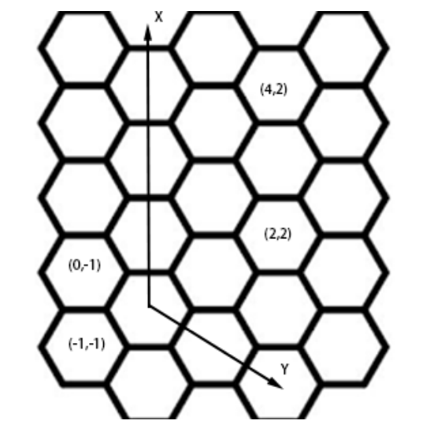

如果两座城市有一条公共边，那么小蓝可以从其中一座城市一步走到另一

座城市。

对于任意两座城市，若从一座城市到另一座城市至少需要走 k 步，则称这

两座城市之间的距离为 k。也就是说，这里的距离定义为两座城市之间的最少

步数。

每座城市都可以用一个唯一的坐标 (x, y) 表示。其含义是：从坐标为 (0, 0)

的城市出发，先沿 X 方向走 x 步，再沿 Y 方向走 y 步，就可以到达该城市。

现在给出 n 座城市的坐标。你需要求出这 n 座城市中，距离最远的两座城

市之间的距离。

#### 输入格式

第一行包含一个正整数 n，表示给出的城市数量。

接下来 n 行，每行包含两个整数 xi

, yi，表示第 i 座城市的坐标。

#### 输出格式

输出一行，包含一个整数，表示给出的 n 座城市中距离最远的两座城市之

间的距离。

#### 样例输入

```
4

0 -1

-1 -1

2 2

4 2
```

#### 提示

【样例说明】

这四座城市就是图中标出的四个城市。

其中，距离最远的一对城市是 (−1, −1) 和 (4, 2)。从 (−1, −1) 出发，可以先

向右上方向走 3 步，到达 (2, 2)；再沿 X 方向的正方向走 2 步，到达 (4, 2)。

这两座城市之间的最短距离为 5，所以答案是 5。

【评测用例规模与约定】

对于 50% 的评测用例，n ≤ 3000。

对于所有的评测用例，2 ≤ n ≤ 3 × 10<sup>5</sup>，|xi

|, |yi

| ≤ 10<sup>9</sup>。

---

### 3396 · 子树染色

> 题号 3396 ｜ 难度 入门 ｜ 时间 1s ｜ 内存 128MB
> 通过率 33.33% ｜ 题面原文 https://www.dotcpp.com/oj/problem3396.html
> 考过的语言/组别：Java 大学A组

#### 题目描述

给定一棵有 n 个结点的树，结点编号为 1 到 n，其中结点 1 是树根。现在

需要在这棵树上选择一些结点进行染色。

树上有 m 个关键结点。对于每个关键结点 x，设其子树大小为 s（子树包

含 x 本身及其所有后代），则以 x 为根的子树中，被染色的结点数必须不少于

⌈

s

2

⌉。

请你求出，在满足所有关键结点要求的前提下，最少需要染色多少个结点。

#### 输入格式

输入共 n + 1 行。

第一行包含两个整数 n, m，分别表示结点总数和关键结点数量；

第二行包含 m 个互不相同的整数，表示所有关键结点的编号；

接下来 n − 1 行，每行包含两个整数 a, b，表示结点 a 和结点 b 之间有一条

边。

#### 输出格式

输出一个整数，表示最少需要染色的结点总数。

#### 样例输入

```
10 5

3 4 5 7 10

1 2

1 3

1 4

3 5

3 6

3 7

5 8

5 9

6 10
```

#### 提示

【样例说明】

一种最优方案是将结点 4, 5, 7, 9, 10 染色，共 5 个结点。

【评测用例规模与约定】

对于 30% 的评测用例，1 ≤ n ≤ 200；

对于所有的评测用例，1 ≤ m ≤ n ≤ 100000，1 ≤ a, b ≤ n。

---

### 3397 · 魔法骰子

> 题号 3397 ｜ 难度 入门 ｜ 时间 1s ｜ 内存 128MB
> 通过率 28.57% ｜ 题面原文 https://www.dotcpp.com/oj/problem3397.html
> 考过的语言/组别：Python 大学A组、Java 大学A组

#### 题目描述

小蓝想用一个 6 面魔法骰子来测试自己的运气。抛掷这个骰子，点数

1, 2, 3, 4, 5, 6 朝上的概率分别为 p1, p2, p3, p4, p5, p6。

小蓝将连续抛掷这个骰子 n 次，并记录下每次抛掷的结果。令 L 为这 n 次

结果中，数字 6 连续出现的最大长度。

现在，请你帮小蓝计算 L 的数学期望是多少。

注意：L 的期望仅与数字 6 出现的概率 p6 有关，其余概率 p1, . . . , p5 仅用

于保证骰子概率分布的完整性。

#### 输入格式

输入共两行：

第一行包含一个正整数 n，表示抛掷次数。

第二行包含 6 个用空格分隔的浮点数 p1, p2, p3, p4, p5, p6，分别表示点数

1, 2, 3, 4, 5, 6 朝上的概率。

#### 输出格式

输出一个浮点数，表示 L 的数学期望。结果四舍五入保留至小数点后两位。

#### 样例输入

```
10

0.1 0.2 0.2 0.1 0.2 0.2
```

#### 提示

【评测用例规模与约定】

对于 30% 的评测用例，1 ≤ n ≤ 8；

对于所有的评测用例，1 ≤ n ≤ 500，

∑<sup>6</sup><sub>i=1</sub> pi = 1，pi ∈ [0, 1]。

---

### 3398 · 勇闯迷宫

> 题号 3398 ｜ 难度 入门 ｜ 时间 2s ｜ 内存 256MB
> 通过率 16.00% ｜ 题面原文 https://www.dotcpp.com/oj/problem3398.html
> 考过的语言/组别：Java 研究生组、Java 大学A组

#### 题目描述

有一个 n × m 的迷宫，迷宫中的每个格子是以下四种类型之一：

• #：墙，不能进入；

• .：空地，可以进入；

• S：起点；

• T：终点。

其中，S 和 T 各恰好出现一次，且都视为可通行格子。

除了格子类型外，每个格子 (x, y) 还对应一个整数 colx,y。对于可通行格子，

这个整数表示该格子的属性，满足 0 ≤ colx,y < P；如果该格子是墙，则对应的

整数没有实际作用，可以忽略。

迷宫中还存在一个会随时间变化的环境属性 p，它的取值范围同样是

0 ∼ (P − 1)。初始时，p = 0。

小蓝一开始位于起点 S。时间按秒进行。每经过 1 秒，小蓝必须执行恰好

一个动作：向上、下、左、右移动一格，或者留在原地不动。移动时不能走出

迷宫，也不能进入墙。

在每一秒中，事件按如下顺序发生：

1. 小蓝先执行这一秒的动作；

2. 接着根据这一秒结束时所在格子的属性，与当前环境属性 p 进行比较：

• 如果两者相同，则这一秒不会受到伤害；

• 如果两者不同，则这一秒会受到 1 点伤害；

3. 最后更新环境属性：

p = (p + 1) mod P

需要注意的是，小蓝刚开始站在起点时，不会立刻进行伤害判定。第一次

判定发生在第一秒动作结束后。若某一秒动作结束后小蓝到达终点 T，则这一

秒的伤害仍需正常结算，结算完成后才算到达终点。

此外，小蓝在整个过程中最多可以使用一次技能，也可以不使用。使用技

能时，会额外产生 1 的代价，并且可以将当前环境属性 p 直接改为任意一个

0 ∼ (P − 1) 之间的值。

整个过程中产生的总代价由两部分组成：

• 每次受到伤害产生的代价；

• 使用技能产生的代价。

现在，请你计算，小蓝从 S 到达 T 的最小总代价。若无法到达终点，输出

−1。

#### 输入格式

第一行包含三个整数 n, m, P。

接下来 n 行，每行一个长度为 m 的字符串，表示迷宫。

再接下来 n 行，每行包含 m 个整数，表示各个格子的 col<sub>x,y</sub>。

#### 输出格式

输出一个整数，表示最小总代价。若无法到达终点，输出 −1。

#### 样例输入

```
3 4 3

S..#

..#.

...T

0 1 2 2

1 2 0 1

2 0 1 2
```

#### 提示

【样例说明】

初始时环境属性 p = 0。

先在起点停留 1 秒。此时小蓝所在格子的属性为 0，与当前环境属性相同，

所以这一秒不会受到伤害。之后环境属性更新为 1。

接下来依次向下、下、右、右、右移动到终点。每一秒结束时，小蓝所在

格子的属性都恰好等于当时参与判定的环境属性，因此整个过程中都不会受到

伤害。

同时不使用技能，所以总代价为 0。

【评测用例规模与约定】

对于 30% 的评测用例，1 ≤ n, m ≤ 30，2 ≤ P ≤ 3。

对于额外 30% 的评测用例，2 ≤ P ≤ 10。

对于所有的评测用例，1 ≤ n, m ≤ 300，2 ≤ P ≤ 100。

---

### 3399 · 单词合并

> 题号 3399 ｜ 难度 中等 ｜ 时间 1s ｜ 内存 128MB
> 通过率 32.88% ｜ 题面原文 https://www.dotcpp.com/oj/problem3399.html
> 考过的语言/组别：Python 大学A组、Java 研究生组

#### 题目描述

小蓝的字典中有 n 个互不相同的单词 s1, s2, . . . , sn。每个单词仅由小写字母

组成，长度不超过 20。

小蓝定义了一种操作：对一个单词进行下面两种变换之一：

• 在任意位置插入一个小写字母；

• 删除其中任意一个字母。

除插入或删除的位置外，原有字母的相对顺序保持不变。

现在请你统计有多少个有序单词对 (s<sub>i</sub>, s<sub>j</sub>)（其中 i , j）满足：可以通过对

si 恰好进行一次上述操作，使其变为 s<sub>j</sub>。

#### 输入格式

第一行一个正整数 n。

接下来 n 行，每行一个仅由小写字母组成的字符串，表示一个单词。

#### 输出格式

输出一行一个整数，表示满足条件的有序单词对数量。

#### 样例输入

```
5

aab

ab

a

bb

b
```

#### 提示

【样例说明】

满足条件的 8 个有序单词对分别为：

• (aab, ab)：从 aab 中删除第 1 个字母 a，得到 ab；

• (ab, aab)：在 ab 的第 1 个位置插入字母 a，得到 aab；

• (ab, a)：从 ab 中删除第 2 个字母 b，得到 a；

• (a, ab)：在 a 的第 2 个位置插入字母 b，得到 ab；

• (ab, b)：从 ab 中删除第 1 个字母 a，得到 b；

• (b, ab)：在 b 的第 1 个位置插入字母 a，得到 ab；

• (bb, b)：从 bb 中删除第 1 个字母 b，得到 b；

• (b, bb)：在 b 的第 1 个位置插入字母 b，得到 bb。

【评测用例规模与约定】

对于 30% 的评测用例，1 ≤ n ≤ 100；

对于所有评测用例，1 ≤ n ≤ 10000。保证所有单词互不相同。

---

### 3400 · 评测漏洞

> 题号 3400 ｜ 难度 困难 ｜ 时间 1s ｜ 内存 128MB
> 通过率 25.39% ｜ 题面原文 https://www.dotcpp.com/oj/problem3400.html
> 考过的语言/组别：C++ 研究生组

#### 题目描述

“判题机又卡住了！”小蓝眉头紧锁，盯着屏幕上的评测错误日志。

经过深入排查，他发现评测系统的校验逻辑存在一个隐蔽的漏洞：当系统

先后读入两个参数x和y时，如果这两个数字的组合满足特定的算术性质，就

会导致内存溢出，进而触发异常中止。

具体来说，若先后出现的两个参数a<sub>i</sub>和a<sub>j</sub>（其中i< j）满足以下等式，系

统就会崩溃：

(a<sub>i</sub> + a<sub>j</sub>)<sup>2 </sup>= a<sub>i</sub> +a<sub>j </sub>

为了修复这个漏洞，小蓝导出了当前崩溃用例中的全部n个测试参数，按读入

顺序排列为a<sub>1</sub>,a<sub>2</sub>,...,a<sub>n</sub>。现在，他需要你帮忙统计，这串参数中究竟存在多少

对下标组合(i, j)，满足 1≤i< j≤n 且会触发上述异常。

#### 输入格式

第一行包含一个整数n，表示测试参数的总数。

第二行包含n个整数a<sub>1</sub>,a<sub>2</sub>,...,a<sub>n</sub>，表示按顺序读入的参数值。

#### 输出格式

输出一个整数，表示能够触发异常的参数对数量。

#### 样例输入

```
4

-1 0 1 2
```

#### 提示

【评测用例规模与约定】

对于40%的评测用例，2≤n≤1000。

对于所有的评测用例，2≤n≤10<sup>5</sup>，−10<sup>9</sup>≤a<sub>i</sub> ≤10<sup>9</sup>。

---

### 3401 · 人类识别审查

> 题号 3401 ｜ 难度 中等 ｜ 时间 1s ｜ 内存 128MB
> 通过率 30.98% ｜ 题面原文 https://www.dotcpp.com/oj/problem3401.html
> 考过的语言/组别：C++ 研究生组

#### 题目描述

2145 年，全球通过《合成人管控法案》，所有疑似伪装的高仿生AI都必须

接受“人类识别审查”。

新港区的审讯室内，小蓝盯着桌面投影出来的名单：房间里一共有N 个

“智能体”，外表与行为几乎与人类无异，其中有些是真正的人类，有些则是伪

装的人形AI。

审查规则如下：

1. 设房间里真正的人类数量为K（K 为整数，满足0≤K≤N）。

2. 第 i 个智能体给出一段证词：“人类数量在区间[a<sub>i</sub>,b<sub>i</sub>] 内。”

3. 若某个智能体是真正的人类，则它的证词必定为真，即a<sub>i</sub>≤K≤b<sub>i</sub>。

4. 若某个智能体是伪装的AI，则它的证词必定为假，即K [a<sub>i</sub>,b<sub>i</sub>]。

作为小蓝的助手，请你分析所有证词，计算出房间里最多可能有多少个人类

（即最大可能的K值）。如果不存在任何逻辑自洽的K，输出−1。

#### 输入格式

第一行输入一个整数N，表示房间里智能体的数量。

接下来N行，每行输入两个整数a<sub>i</sub>,b<sub>i</sub>，表示第i个智能体声称的人类数量

区间。

#### 输出格式

输出一个整数，表示满足条件的最大K；若无解输出−1。

#### 样例输入

```
3

1 2

2 3

3 3
```

#### 提示

【样例输入2】

3

1 1

1 1

1 1

【样例输出2】

0

【样例输入3】

1

0 0

【样例输出3】

-1

【评测用例规模与约定】

对于30%的评测用例，1≤N≤10<sup>3</sup>，0≤a<sub>i</sub>≤b<sub>i</sub>≤N；

对于所有评测用例，1≤N≤10<sup>5</sup>，0≤a<sub>i</sub>≤b<sub>i</sub>≤N。

---

### 3402 · 通信链路

> 题号 3402 ｜ 难度 入门 ｜ 时间 1s ｜ 内存 128MB
> 通过率 8.70% ｜ 题面原文 https://www.dotcpp.com/oj/problem3402.html
> 考过的语言/组别：C++ 研究生组

#### 题目描述

小蓝是一家通信网络公司的工作人员，他正在进行统计工作。

通信网络由n个中继站和m条通信链路构成，信息通过一条链路需要花费

一定的时间，信息从一个中继站经过若干条链路传输到另一个中继站，总延迟

是各条链路的花费时间之和。由于一条链路的容量有限，假设一条链路连接中

继站x和y，如果信息从x传递到y花费时间w，那么信息从y传递到x则需

花费时间20−w。

小蓝只关心总延迟的个位数字是多少。对于一对不同的中继站对(u,v)，如

果信息能够通过若干条链路从u传输到v，且总延迟的个位数字是k，则小蓝称

(u, v) 是 k 和谐的。由于从 u到v的延迟和从v到u的延迟可能不同，(u,v)和

(v, u) 应当认为是不同的中继站对，且像(u,u) 这样的中继站对是不合法的。

现在，小蓝希望你帮他求出，0和谐，1和谐，2和谐，···，9和谐的中继

站对各有多少个。

#### 输入格式

输入包含若干行，第一行两个正整数n,m，分别表示中继站个数和链路条

数。

接下来m行，每行三个正整数 x<sub>i</sub>,y<sub>i</sub>,w<sub>i</sub>，表示中继站 x<sub>i</sub>,y<sub>i </sub>之间有一条链

路，且信息从这条链路上从x<sub>i</sub>传递到y<sub>i</sub> 需要时间w<sub>i</sub>，从y<sub>i </sub>传递到 x<sub>i</sub> 需要时间

20 −w<sub>i</sub>。

给定的网络可能包含重边或自环。

#### 输出格式

输出共10行，每行一个正整数，依次表示0和谐，1和谐，...，9和谐的

中继站对的数量。

#### 样例输入

```
3 3

1 2 1

2 3 2

3 1 2
```

#### 提示

【样例说明】


上表列出了各个x和谐的中继站对，例如存在一种通信方案1→2→3→

1→2的总延迟是6，个位数是6，所以点对(1,2)是6和谐的。

一个中继站对对于不同的x和y，可能既是x和谐的，又是y和谐的。

对

于一个中继站对，可能有多种通信方案的总延迟个位数都为x，但应当只被统计一次，例如1→3→2的总延迟是16，也满足个位数是6，但(1,2)在6和

谐中只被统计一次。

【评测用例规模与约定】

对于30%的数据，w<sub>i</sub>=10；

对于另20%的数据，m=n−1,x<sub>i</sub>=i,y<sub>i</sub> =i+1；

对于另20% 的数据，m=n−1且任意两个中继站之间都一定能通过链路

传输信息；

对于100% 的数据，2≤n≤100000,0 ≤ m ≤ 200000,1 ≤ x<sub>i</sub>,y<sub>i</sub> ≤ n,1 ≤ w<sub>i</sub> <

20。

---

### — · 均衡数

> 题号 洛谷 P16224 ｜ 难度 简单（洛谷 普及−） ｜ 时间 1.00s ｜ 内存 512MB
> 通过率 40.16%（洛谷站内口径） ｜ 题面原文 https://www.luogu.com.cn/problem/P16224
> 考过的语言/组别：省赛 C/C++ 大学A组（洛谷题单）

#### 题目描述

如果一个正整数的二进制表示中（无前导 $0$），$1$ 的数量和 $0$ 的数量相同，则我们称其为一个“均衡数”。

现在，请你找到一个均衡数 $x$，使得 $|2026202620262026 - x|$ 的值最小。若存在多个均衡数使得 $|2026202620262026 - x|$ 的值相同且最小，则取其中最小的一个。

#### 输出格式

这是一道结果填空的题，你只需要算出结果后提交即可。本题的结果为一个整数，在提交答案时只填写这个整数，填写多余的内容将无法得分。

#### 样例输入

```

```

#### 样例输出

```

```

---

### — · 量子 2048

> 题号 洛谷 P16225 ｜ 难度 中等（洛谷 普及+/提高−） ｜ 时间 1.00s ｜ 内存 512MB
> 通过率 55.53%（洛谷站内口径） ｜ 题面原文 https://www.luogu.com.cn/problem/P16225
> 考过的语言/组别：省赛 C/C++ 大学A组（洛谷题单）

#### 题目描述

深蓝色的量子冷冻稀释制冷机正在平稳运行，这里是“国家量子安全实验室”的核心机房。

小蓝作为“量子 2048”战略工程的首席架构师，正盯着屏幕上的一块 $2048 \times 2048$ 的量子比特逻辑阵列。这块阵列是构建超大规模量子计算机的基础单元，每一个比特位点必须被初始化为两种状态之一：$L$（低能级状态）或 $Q$（量子激发态）。

为了通过严苛的“国家量子安全实验室”准入审计，阵列的逻辑分布必须严格遵循以下三项由量子纠缠动力学推导出的校验准则：

1. 行量子奇偶校验：阵列中的每一行，处于 $Q$ 状态的比特数量必须为奇数。
2. 列量子奇偶校验：阵列中的每一列，处于 $Q$ 状态的比特数量必须为奇数。
3. 局部纠缠约束校验：阵列中任意一个 $2 \times 2$ 的子区域（阵列中行列连续、相邻紧贴的 $2$ 行 $2$ 列网格区块），处于 $Q$ 状态的比特数量必须为奇数。

阵列中哪怕只有一个局部区域不符合准则，整个芯片在超导状态下就会发生量子退相干，导致计算失败。小蓝想要计算出，在 $2048 \times 2048$ 的固定规格下，理论上存在多少种不同的初始化填充方案能够通过审计。

现在，作为小蓝的算法顾问，请你帮助他完成计算。由于方案数可能很大，请将结果对 $998244353$ 取模后输出。

#### 输出格式

这是一道结果填空题，你只需要算出结果后提交即可。本题的结果为一个整数，在提交答案时只填写这个整数，填写多余的内容将无法得分。

#### 样例输入

```

```

#### 样例输出

```

```

---

### — · 青春常数

> 题号 洛谷 P16232 ｜ 难度 简单（洛谷 入门） ｜ 时间 1.00s ｜ 内存 512MB
> 通过率 53.80%（洛谷站内口径） ｜ 题面原文 https://www.luogu.com.cn/problem/P16232
> 考过的语言/组别：省赛 C/C++ 大学B组（洛谷题单）

#### 题目背景

本站蓝桥杯 2026 省赛测试数据均为洛谷自造，与官方数据可能存在差异，仅供学习参考。

#### 题目描述

小蓝与蓝桥杯的缘分已经走到了第四个年头。从 2023 年的初出茅庐，到 2024、2025 年的披荆斩棘，而今年的 2026 年，将是他大学生涯最后一次站上这个赛场。

退役前夕，百感交集的小蓝在草稿纸上将这四届参赛的年份倒序写下，拼接成了一个巨大的整数 $N = 2026202520242023$。

在整理四年的竞赛心得时，他决定将这一常数 $N$ 拆分为两个非负整数 $x$ 和 $y$，分别代表他这段旅程的前半段积累与后半段突破。按照拆分规则，这两部分的数值之和必须恰好等于 $N$（即 $x + y = N$）。

同时，由于在后半段赛程中小蓝积累了更深厚的算法功底，因此后半部分的数值 $y$ 必须严格大于前半部分的数值 $x$（即 $0 \le x < y$）。

现在，请你计算满足上述条件的整数对 $(x, y)$ 共有多少个？

#### 输出格式

这是一道结果填空题，你只需要算出结果后提交即可。本题的结果为一个整数，在提交答案时只填写这个整数，填写多余的内容将无法得分。

#### 样例输入

```

```

#### 样例输出

```

```

---

### — · 双碳战略

> 题号 洛谷 P16233 ｜ 难度 困难（洛谷 提高） ｜ 时间 1.00s ｜ 内存 512MB
> 通过率 49.25%（洛谷站内口径） ｜ 题面原文 https://www.luogu.com.cn/problem/P16233
> 考过的语言/组别：省赛 C/C++ 大学B组（洛谷题单）

#### 题目描述

城市照明系统的智能化改造是落实国家“双碳”战略的核心试点。作为示范工程，市能源局在新建的绿色大道上部署了一组由 $2026$ 盏智能路灯组成的线性阵列。

初始状态下，这 $2026$ 盏路灯均处于高能耗的“全亮模式”。为了评估系统在极端工况下的响应能力，该局的主控系统需要针对理论上存在的所有开关组合进行全状态遍历推演。

只是，受限于底层硬件的物理特性，主控系统必须严格按照“双向交替”的规则执行操作：

1. 第奇数次指令（第 $1, 3, 5 \dots$ 次）：系统需选定一盏路灯 $i$（$1 \le i \le 2026$），将该路灯及其右侧（后方）所有路灯的开关状态进行翻转（亮变暗，暗变亮）。
2. 第偶数次指令（第 $2, 4, 6 \dots$ 次）：系统需选定一盏路灯 $i$，将该路灯及其左侧（前方）所有路灯的开关状态进行翻转。

对于 $2026$ 盏路灯，共存在 $2^{2026}$ 种不同的明暗状态组合，每一种状态都必定能被抵达。针对每一种特定的状态，都存在一个从初始“全亮”状态到达该状态所需的最少指令操作次数（无论有多少种不同的操作序列可以到达该状态，仅以步数最少的为准）。

注意：初始的“全亮”状态也包含在这 $2^{2026}$ 种组合中，且到达该状态的最少操作次数记为 $0$ 次。

现在，请你计算出这全部 $2^{2026}$ 种状态对应的最少操作次数的累加总和。由于总和可能很大，请将结果对 $998244353$ 取模后输出。

#### 输出格式

这是一道结果填空题，你只需要算出结果后提交即可。本题的结果为一个整数，在提交答案时只填写这个整数，填写多余的内容将无法得分。

#### 样例输入

```

```

#### 样例输出

```

```

---

### — · 魔法矩阵能量值

> 题号 洛谷 P16247 ｜ 难度 简单（洛谷 入门） ｜ 时间 1.00s ｜ 内存 512MB
> 通过率 68.04%（洛谷站内口径） ｜ 题面原文 https://www.luogu.com.cn/problem/P16247
> 考过的语言/组别：省赛 研究生组（洛谷题单）

#### 题目描述

对于一个 $ n \times n $ 的魔法矩阵 $ M $，我们定义其能量值计算规则如下：

1. **基础能量**：位于位置 $ (i, j) $ 的元素的基础能量为 $ i \times j \times (i + j) $

2. **对角线加成**：位于主对角线（即位于 $ (1,1), (2,2), \ldots, (n,n) $）上的元素能量值翻倍

3. **边界惩罚**：位于矩阵边界（即第 $ 1 $ 行、第 $ n $ 行、第 $ 1 $ 列、第 $ n $ 列）上的元素能量值减半；若一个元素同时位于多条边界，其能量值仅减半一次。

4. **中心奖励**：如果 $ n $ 为奇数，位于中心位置 $ (\frac{n+1}{2}, \frac{n+1}{2}) $ 的元素的能量值额外增加 $ 100 $。

**重要提醒**：当一个位置满足多个条件时，必须严格按照上述顺序依次计算，即先算基础能量，再算对角线加成，再算边界惩罚，最后算中心奖励。
矩阵的总能量值是所有位置能量值的和。

示例 1：一个 $ 2 \times 2 $ 矩阵的完整计算过程如下：

- 位置 $ (1,1) $：基础能量 $ 1 \times 1 \times 2 = 2 $，主对角线翻倍为 $ 4 $，边界惩罚 $ \div 2 = 2 $，$ n $ 为偶数无中心奖励，能量值 $ = 2 $

- 位置 $ (1,2) $：基础能量 $ 1 \times 2 \times 3 = 6 $，非主对角线无加成，边界惩罚 $ \div 2 = 3 $，$ n $ 为偶数无中心奖励，能量值 $ = 3 $

- 位置 $ (2,1) $：基础能量 $ 2 \times 1 \times 3 = 6 $，非主对角线无加成，边界惩罚 $ \div 2 = 3 $，$ n $ 为偶数无中心奖励，能量值 $ = 3 $

- 位置 $ (2,2) $：基础能量 $ 2 \times 2 \times 4 = 16 $，主对角线翻倍为 $ 32 $，边界惩罚 $ \div 2 = 16 $，$ n $ 为偶数无中心奖励，能量值 $ = 16 $

总能量值：$ 2 + 3 + 3 + 16 = 24 $。

示例 2：一个 $ 3 \times 3 $ 矩阵的完整计算过程如下：

- 位置 $ (1,1) $：基础能量 $ 1 \times 1 \times 2 = 2 $，主对角线翻倍为 $ 4 $，边界惩罚 $ \div 2 = 2 $，非中心无奖励，能量值 $ = 2 $

- 位置 $ (1,2) $：基础能量 $ 1 \times 2 \times 3 = 6 $，非主对角线无加成，边界惩罚 $ \div 2 = 3 $，非中心无奖励，能量值 $ = 3 $

- 位置 $ (1,3) $：基础能量 $ 1 \times 3 \times 4 = 12 $，非主对角线无加成，边界惩罚 $ \div 2 = 6 $，非中心无奖励，能量值 $ = 6 $

- 位置 $ (2,1) $：基础能量 $ 2 \times 1 \times 3 = 6 $，非主对角线无加成，边界惩罚 $ \div 2 = 3 $，非中心无奖励，能量值 $ = 3 $

- 位置 $ (2,2) $：基础能量 $ 2 \times 2 \times 4 = 16 $，主对角线翻倍为 $ 32 $，不在边界无惩罚，中心奖励 $ +100 = 132 $，能量值 $ = 132 $

- 位置 $ (2,3) $：基础能量 $ 2 \times 3 \times 5 = 30 $，非主对角线无加成，边界惩罚 $ \div 2 = 15 $，非中心无奖励，能量值 $ = 15 $

- 位置 $ (3,1) $：基础能量 $ 3 \times 1 \times 4 = 12 $，非主对角线无加成，边界惩罚 $ \div 2 = 6 $，非中心无奖励，能量值 $ = 6 $

- 位置 $ (3,2) $：基础能量 $ 3 \times 2 \times 5 = 30 $，非主对角线无加成，边界惩罚 $ \div 2 = 15 $，非中心无奖励，能量值 $ = 15 $

- 位置 $ (3,3) $：基础能量 $ 3 \times 3 \times 6 = 54 $，主对角线翻倍为 $ 108 $，边界惩罚 $ \div 2 = 54 $，非中心无奖励，能量值 $ = 54 $

总能量值：$ 2 + 3 + 6 + 3 + 132 + 15 + 6 + 15 + 54 = 236 $。

现在，请你计算 $ 13 \times 13 $ 的魔法矩阵的总能量值是多少。

#### 输出格式

这是一道结果填空的题，你只需要算出结果后提交即可。本题的结果为一个整数，在提交答案时只填写这个整数，填写多余的内容将无法得分。

#### 样例输入

```

```

#### 样例输出

```

```

---

### — · 和平干饭日

> 题号 洛谷 P16260 ｜ 难度 简单（洛谷 普及−） ｜ 时间 1.00s ｜ 内存 512MB
> 通过率 52.98%（洛谷站内口径） ｜ 题面原文 https://www.luogu.com.cn/problem/P16260
> 考过的语言/组别：省赛 Python 组、Java 大学B 组组（洛谷题单）

#### 题目描述

铲屎官小蓝家里养了 $26$ 只体型巨大的缅因猫。为了给它们增加生活乐趣，小蓝海淘了一台带有人工智能的 “奇葩喂食器”。

这台喂食器的出粮规则极其反人类：它每天吐出的猫粮颗粒总数，是将从 $1$ 开始的自然数依次拼接而成的整数。

具体来说：

- 第 $1$ 天，喂食器吐出 $1$ 颗猫粮；
- 第 $2$ 天，喂食器吐出 $12$ 颗猫粮（将 $1$ 和 $2$ 拼在一起）；
- 第 $3$ 天，喂食器吐出 $123$ 颗猫粮；
- ……

如果某天吐出的猫粮总数，能够被这 $26$ 只猫完全平分（即每只猫分到的颗粒数一模一样），它们就会相安无事，这一天被称为 “和平干饭日”。如果不能被完全平分，它们就会为了抢夺残粮而大打出手。

现在，喂食器的运行计划已经设定了整整 $2026$ 天。请你帮忧心忡忡的小蓝算一算，在这 $2026$ 天里，总共有多少天是 “和平干饭日”？

#### 输出格式

这是一道结果填空题，你只需要算出结果后提交即可。本题的结果为一个整数，在提交答案时只填写这个整数，填写多余的内容将无法得分。

#### 样例输入

```

```

#### 样例输出

```

```

---

### — · 干涉条纹

> 题号 洛谷 P16261 ｜ 难度 简单（洛谷 普及−） ｜ 时间 1.00s ｜ 内存 512MB
> 通过率 40.14%（洛谷站内口径） ｜ 题面原文 https://www.luogu.com.cn/problem/P16261
> 考过的语言/组别：省赛 Python 组、Java 大学B 组组（洛谷题单）

#### 题目描述

在国家精密光学实验室中，研究员正利用两组高功率相干激光器进行 “量子干涉条纹” 锁定实验。

设 $1$ 号激光器的输出功率为 $a$（$0 \leq a \leq 20269876543210$），$2$ 号激光器的输出功率为 $b$（$0 \leq b \leq 20260123456789$），其中 $a, b$ 均为非负整数。

物理规律表明，只有当系统总功率 $S = a + b$ 恰好为一个完全平方数时，干涉条纹方可被成功锁定。

请问，一共有多少种不同的功率配给方案 $(a, b)$ 能够使实验成功锁定？由于方案数可能很大，你只需要给出方案数对 $998244353$ 取模后的结果即可。

注意：两个方案 $(a_1, b_1)$ 和 $(a_2, b_2)$ 被认为是不同的，当且仅当 $a_1 \neq a_2$ 或 $b_1 \neq b_2$。

#### 输出格式

这是一道结果填空题，你只需要算出结果后提交即可。本题的结果为一个整数，在提交答案时只填写这个整数，填写多余的内容将无法得分。

#### 样例输入

```

```

#### 样例输出

```

```

---

### — · 罐头编号

> 题号 洛谷 P16282 ｜ 难度 简单（洛谷 普及−） ｜ 时间 1.00s ｜ 内存 512MB
> 通过率 50.05%（洛谷站内口径） ｜ 题面原文 https://www.luogu.com.cn/problem/P16282
> 考过的语言/组别：省赛 Python 组、Java 大学A 组组（洛谷题单）

#### 题目描述

铲屎官小蓝买了一台标签打印机，准备给小猫的每一罐自制猫饭贴上生产编号。

这些编号原本应该是按自然数 $1, 2, 3, 4, 5 \dots$ 顺延下去的。然而，在小蓝去拿标签纸的时候，调皮的小猫跳上了书桌，一脚精准地踩坏了打印机上的 **0** 键。导致这台机器现在再也无法打出带有数字 **0** 的标签了。

小蓝不想去修打印机，索性改变了编号规则：遇到任何包含数字 **0** 的数，就直接跳过不打。于是，猫饭罐头上的编号序列变成了这样：

- 第 $1$ 罐贴 $1$
- 第 $2$ 罐贴 $2$
- $\dots$
- 第 $9$ 罐贴 $9$
- 第 $10$ 罐（因为无法打出 $10$，跳过）贴 $11$
- 第 $11$ 罐贴 $12$
- $\dots$
- 第 $18$ 罐贴 $19$
- 第 $19$ 罐（因为无法打出 $20$，跳过）贴 $21$

小蓝这个周末在厨房里疯狂忙碌，一共做出了 $1234567890321$ 罐自制猫饭。

现在，请你帮小蓝算一下，按照这个坏掉的打印机的规则，第 $1234567890321$ 罐自制猫饭上贴着的编号是多少？

#### 输出格式

这是一道结果填空题，你只需要算出结果后提交即可。本题的结果为一个整数，在提交答案时只填写这个整数，填写多余的内容将无法得分。

#### 样例输入

```

```

#### 样例输出

```

```

---

### — · 平面选点

> 题号 洛谷 P16283 ｜ 难度 中等（洛谷 普及） ｜ 时间 1.00s ｜ 内存 512MB
> 通过率 56.33%（洛谷站内口径） ｜ 题面原文 https://www.luogu.com.cn/problem/P16283
> 考过的语言/组别：省赛 Python 大学A 组组（洛谷题单）

#### 题目描述

在平面直角坐标系中，固定点 $A$ 为坐标原点 $(0, 0)$。

现在，考虑所有横坐标、纵坐标都在 $0$ 到 $2026$ 之间的整点。请你统计满足下列条件的点对 $\{B, C\}$ 的数量：

- $B$ 与 $C$ 都是上述整点，且都不与 $A$ 重合；
- $B \neq C$；
- 由点 $A, B, C$ 构成的三角形面积为整数。

其中，若 $A, B, C$ 三点共线，则三角形面积记为 $0$，这种情况也计入答案。

点对 $\{B, C\}$ 不区分顺序，即 $\{B, C\}$ 与 $\{C, B\}$ 视为同一点对。

#### 输出格式

这是一道结果填空题，你只需要算出结果后提交即可。本题的结果为一个整数，在提交答案时只填写这个整数，填写多余的内容将无法得分。

#### 样例输入

```

```

#### 样例输出

```

```

---

### — · 间歇性发射

> 题号 洛谷 P16290 ｜ 难度 中等（洛谷 普及） ｜ 时间 1.00s ｜ 内存 512MB
> 通过率 58.11%（洛谷站内口径） ｜ 题面原文 https://www.luogu.com.cn/problem/P16290
> 考过的语言/组别：省赛 Java 大学A 组组（洛谷题单）

#### 题目描述

6G 基站的射频芯片在极高频段下运行时会产生巨大热量。为了保证设备安全，国家通信实验室的工程师小蓝设计了一套“间歇性发射机制”来控制散热。

这套机制的核心逻辑是让发射机在“工作状态”和“休眠状态”之间切换。其具体的切换规律，由小蓝在控制台上设置的三个关键参数所决定：起始时间 $A$、结束时间 $M$，以及一个初始校验值 $S$。

系统时钟 $k$ 将从 $2A$ 运行到 $M$。对于每一个时钟点 $k$，系统会根据以下逻辑判断当前是该“工作”还是“休眠”：

1. 计算当前时钟点 $k$ 对应的运行周期编号 $V$：$V = \lfloor \frac{k}{2} \rfloor - A + 1$（注：$\lfloor x \rfloor$ 表示向下取整）。

2. 判断状态：

- 若周期数 $V$ 为奇数，则芯片处于工作状态。
- 若周期数 $V$ 为偶数，则芯片进入休眠状态。

为了验证芯片是否精确地执行了这套切换逻辑，系统会将所有处于工作状态的时钟点 $k$，与初始校验值 $S$ 进行按位异或（XOR）运算，并将得到的数值，记为校验码。

举个例子，设 $A = 2, M = 7, S = 0$，则时钟 $k$ 的范围为 $4,5,6,7$。

- $k = 4$: $V = \lfloor 4/2 \rfloor - 2 + 1 = 1$（奇数）。状态：工作。
- $k = 5$: $V = \lfloor 5/2 \rfloor - 2 + 1 = 1$（奇数）。状态：工作。
- $k = 6$: $V = \lfloor 6/2 \rfloor - 2 + 1 = 2$（偶数）。状态：休眠（忽略）。
- $k = 7$: $V = \lfloor 7/2 \rfloor - 2 + 1 = 2$（偶数）。状态：休眠（忽略）。

校验码 $= S \oplus 4 \oplus 5 = 0 \oplus 4 \oplus 5 = 1$。

在确认机制无误后，小蓝输入了真实的极限测试参数，现在，请你帮他计算出最终的校验码：

- 起始时间 $A = 12345678901235$
- 结束时间 $M = 98765432109874$
- 初始校验值 $S = 20260411$

#### 输出格式

这是一道结果填空题，你只需要算出结果后提交即可。本题的结果为一个整数，在提交答案时只填写这个整数，填写多余的内容将无法得分。

#### 样例输入

```

```

#### 样例输出

```

```

---

### — · 小青蛙跳荷叶

> 题号 洛谷 P16296 ｜ 难度 简单（洛谷 入门） ｜ 时间 1.00s ｜ 内存 512MB
> 通过率 77.60%（洛谷站内口径） ｜ 题面原文 https://www.luogu.com.cn/problem/P16296
> 考过的语言/组别：省赛 Python 大学C 组组（洛谷题单）

#### 题目描述

池塘里有一排长长的荷叶，每一片荷叶都有一个专属的数字编号。

小青蛙呱呱是一只非常有活力的青蛙，它每次跳跃的力度固定，如果在第 $N$ 片荷叶上，它用力一跳，可以精准地落在第 $N+1$、$N-1$、$N+2$ 或者是 $N-2$ 片荷叶上。

今天，呱呱正趴在第 2026 片荷叶上晒太阳，突然它看到在第 1021 片荷叶上有一只美味的小虫子。为了尽快抓住美食，请你算算呱呱最少需要跳跃几次才能到达小虫子所在的荷叶？

#### 输出格式

这是一道结果填空题，你只需要算出结果后提交即可。本题的结果为一个整数，在提交答案时只填写这个整数，填写多余的内容将无法得分。

#### 样例输入

```

```

#### 样例输出

```

```

---

### — · 调皮的橘猫

> 题号 洛谷 P16297 ｜ 难度 简单（洛谷 普及−） ｜ 时间 1.00s ｜ 内存 512MB
> 通过率 56.72%（洛谷站内口径） ｜ 题面原文 https://www.luogu.com.cn/problem/P16297
> 考过的语言/组别：省赛 Python 大学C 组组（洛谷题单）

#### 题目描述

铲屎官小蓝给家里的猫咪们准备了 $2026041221046202$ 个奖励盲盒，排成一长排，并依次为它们编号为 $1, 2, 3, \dots$。

为了美观，小蓝使用了单字符的数字贴纸（即印着 $0$ 到 $9$ 的小贴纸）来拼凑这些编号。例如：

- 给第 $8$ 号盲盒贴编号，需要消耗 $1$ 张贴纸（一张 $8$）。
- 给第 $12$ 号盲盒贴编号，需要消耗 $2$ 张贴纸（一张 $1$ 和一张 $2$）。
- 给第 $104$ 号盲盒贴编号，需要消耗 $3$ 张贴纸（分别是 $1、0、4$）。

就在铲屎官转身去倒猫粮的功夫，调皮的橘猫把排在最前面的 2026 个盲盒（即编号从 $1$ 到 $2026$ 的盲盒）全部咬坏了，盲盒上面的贴纸也随之被毁。

看着剩下的盲盒，铲屎官叹了口气。

现在，请你帮铲屎官算一算，在剩下完好的盲盒（即编号从 $2027$ 到 $2026041221046202$ 的盲盒）上，总共还保留了多少张单字符的数字贴纸？

#### 输出格式

这是一道结果填空题，你只需要算出结果后提交即可。本题的结果为一个整数，在提交答案时只填写这个整数，填写多余的内容将无法得分。

#### 样例输入

```

```

#### 样例输出

```

```

---

### — · 读书计划

> 题号 洛谷 P16306 ｜ 难度 简单（洛谷 入门） ｜ 时间 1.00s ｜ 内存 512MB
> 通过率 62.07%（洛谷站内口径） ｜ 题面原文 https://www.luogu.com.cn/problem/P16306
> 考过的语言/组别：省赛 Java 组、Python 大学研究生组组（洛谷题单）

#### 题目描述

小蓝买了一本共 $2026$ 页的课外书，并计划从今天（周一）开始连续阅读。由于上学安排：

- 周一至周五（上课日），他每天最多只能读 $5$ 页；
- 周六和周日（休息日），他每天最多可读 $15$ 页。

请问：小蓝最少需要多少天才能完整读完这本书？

#### 输出格式

这是一道结果填空题，你只需要算出结果后提交即可。本题的结果为一个整数，在提交答案时只填写这个整数，填写多余的内容将无法得分。

#### 样例输入

```

```

#### 样例输出

```

```

---

### — · 密钥提取

> 题号 洛谷 P16783 ｜ 难度 中等（洛谷 普及） ｜ 时间 1.00s ｜ 内存 512MB
> 通过率 66.62%（洛谷站内口径） ｜ 题面原文 https://www.luogu.com.cn/problem/P16783
> 考过的语言/组别：国赛 C/C++ 大学A组（洛谷题单）

#### 题目描述

小蓝正对一套基于大数乘法的加密算法进行安全评估。在评估过程中，他利用该算法生成了两个特殊的密钥 $A$ 和 $B$:

- 密钥 $A$ 由 $20260606$ 个数字 $9$ 组成，即 $A = \underbrace{99...9}_{20260606\text{个}}$
- 密钥 $B$ 由 $2026$ 个数字 $9$ 组成，即 $B = \underbrace{99...9}_{2026\text{个}}$

通过计算两者的乘积，小蓝得到了超长的联合密钥 $S = A \times B$。

为了校验该密钥在传输过程中的完整性，小蓝需要提取 $S$ 的十进制表示（从左往右数，不含前导零）中特定数位上的数字。设 $d_1, d_2, d_3$ 分别为 $S$ 的第 $2026$ 位、第 $20260523$ 位和第 $20262632$ 位的数字。

现在，请你求出由这三个提取出的数字按顺序组成的三位整数 $\overline{d_1 d_2 d_3}$ 的值。这里 $d_1$ 为百位数字（保证 $d_1$ 不为 $0$），$d_2$ 为十位数字，$d_3$ 为个位数字。例如，若提取出的三个数字分别为 $d_1=2, d_2=5, d_3=7$，则你应当提交的答案为 $257$。

#### 输出格式

这是一道结果填空题，你只需要算出结果后提交即可。本题的结果为一个整数，在提交答案时只需编写一个程序输出这个整数，填写多余的内容将无法得分。

#### 样例输入

```

```

#### 样例输出

```

```

---

### — · 圆形灯环

> 题号 洛谷 P16784 ｜ 难度 困难（洛谷 提高） ｜ 时间 5.00s ｜ 内存 512MB
> 通过率 66.94%（洛谷站内口径） ｜ 题面原文 https://www.luogu.com.cn/problem/P16784
> 考过的语言/组别：国赛 C/C++ 大学A组（洛谷题单）

#### 题目描述

小蓝买了一款智能圆形灯环，该灯环由 $2026$ 个 LED 灯珠首尾相连组成，按顺时针方向依次排列。

每个灯珠都可以独立调节至 $26$ 种不同的亮度等级，分别记为 $0 \sim 25$ 级。

为了防止电流不稳导致损坏，灯环的整体亮度配置必须保持稳定状态。一个“稳定”的配置需要同时满足以下两个条件：

1. 顺时针方向上，任意连续 $3$ 个灯珠的亮度等级之和不能等于 $26$；
2. 顺时针方向上，相邻灯珠亮度依次为 $2$ 级和 $6$ 级的组合（即前一个为 $2$ 级，后一个为 $6$ 级），在整个灯环中出现的总次数必须为偶数。

此外，基于圆环的闭合特性，最后一个灯珠与首个灯珠同样互为相邻（例如尾部为 $2$ 级、头部为 $6$ 级时，照常计入上述组合的出现次数）。

同时，考虑到灯环可以自由旋转，凡是能通过顺时针旋转（即循环移位）相互重合的配置，均视为本质相同的同一种方案。

现在，请帮小蓝计算出，本质不同的稳定亮度配置方案共有多少种？由于最终的方案数可能很大，你只要给出其对 $998244353$ 取模后的结果即可。

#### 输出格式

这是一道结果填空题，你只需要算出结果后提交即可。本题的结果为一个整数，在提交答案时只需编写一个程序输出这个整数，填写多余的内容将无法得分。

#### 样例输入

```

```

#### 样例输出

```

```

---

### — · 多项式积分

> 题号 洛谷 P16785 ｜ 难度 中等（洛谷 普及） ｜ 时间 2.00s ｜ 内存 512MB
> 通过率 47.47%（洛谷站内口径） ｜ 题面原文 https://www.luogu.com.cn/problem/P16785
> 考过的语言/组别：国赛 C/C++ 大学A组（洛谷题单）

#### 题目描述

小蓝正在学习微积分。今天他的作业是求一个关于 $x$ 的多项式的不定积分，请你帮他完成这个任务。

给定一个关于 $x$ 的多项式，请输出它的一个不定积分结果。积分常数不需要输出。

#### 输入格式

输入一行，包含一个关于 $x$ 的多项式。

该多项式由若干个系数为整数的项构成，每一项的次数为非负整数。其中，次数为 $0$ 的项表示常数项。

输入多项式满足以下规则：

- 各项按照次数从高到低给出；
- 首项若为负数，可以带负号；首项若为正数，前方不带 $+$；
- 除首项外，其余各项以 $+$ 或 $-$ 作为分隔符，正负号归属于对应项；
- 次数为 $0$ 的项直接写作整数常数；
- 次数为 $1$ 的项写作 $\text{cx}$ 或 $\text{x}$，其中系数为 $1$ 或 $-1$ 时可以省略数字 $1$；
- 次数大于 $1$ 的项写作 $\text{cx}^{\wedge}\text{k}$ 或 $\text{x}^{\wedge}\text{k}$，其中 $k > 1$，系数为 $1$ 或 $-1$ 时可以省略数字 $1$；
- 所有项的系数均不为 $0$，不存在系数为 $0$ 的冗余项。

#### 输出格式

输出一行，表示输入多项式的不定积分结果。

输出时不需要写积分常数，结果中的各项应按照次数从高到低排列。

输出多项式时应遵守以下格式规则：

- 若首项系数为正，前方不输出 $+$；
- 对于非首项，若该项系数为正，则前方输出 $+$；若该项系数为负，则前方输出 $-$；
- 次数为 $1$ 时，输出 $\text{x}$，不输出 $\text{x}^{\wedge}1$；
- 单项系数为 $1$ 或 $-1$ 时，省略数字 $1$，只保留符号和字母部分；
- 若某一项的系数为分数 $\frac{p}{q}$，应输出为 $\text{p}/\text{q}$，其中 $p$ 和 $q$ 互质，且 $q > 0$；
- 若分数系数为负数，负号应放在分子位置；
- 若化简后分母为 $1$，直接输出整数形式，不输出分数形式。
- 输出结果中不应包含系数为 $0$ 的冗余项。

#### 样例输入 1

```
4x^5-4x^3+2
```

#### 样例输出 1

```
2/3x^6-x^4+2x
```

#### 样例输入 2

```
-100x^100+105x^2
```

#### 样例输出 2

```
-100/101x^101+35x^3
```

#### 样例输入 3

```
7
```

#### 样例输出 3

```
7x
```

#### 样例输入 4

```
x-1
```

#### 样例输出 4

```
1/2x^2-x
```

#### 提示

### 【样例说明】

对于样例 $1$:

$$\int (4x^5 - 4x^3 + 2) \, dx = \frac{2}{3} x^6 - x^4 + 2x + C.$$

积分常数 $C$ 不需要输出，因此输出 $\text{2/3x}^\wedge\text{6-x}^\wedge\text{4+2x}$。

对于样例 $2$:

$$\int (-100x^{100} + 105x^2) \, dx = -\frac{100}{101} x^{101} + 35x^3 + C.$$

因此输出 $\text{-100/101x}^\wedge\text{101+35x}^\wedge\text{3}$。

对于样例 $3$, 输入多项式为常数 $7$, 积分结果为 $7x + C$, 因此输出 $\text{7x}$。

对于样例 $4$:

$$\int (x - 1) \, dx = \frac{1}{2} x^2 - x + C.$$

因此输出 $\text{1/2x}^\wedge\text{2-x}$。

### 【评测用例规模与约定】

对于 $50\%$ 的数据，保证积分结果中每一项的系数均为正整数。

对于所有数据，保证：

- 输入多项式的项数不超过 $10000$；
- 每一项的次数不超过 $10^8$；
- 每一项系数的绝对值不超过 $10^8$；
- 输入多项式中的项按次数从高到低给出。

---

### — · 安全路径

> 题号 洛谷 P16786 ｜ 难度 中等（洛谷 普及） ｜ 时间 2.00s ｜ 内存 512MB
> 通过率 48.94%（洛谷站内口径） ｜ 题面原文 https://www.luogu.com.cn/problem/P16786
> 考过的语言/组别：国赛 C/C++ 大学A组（洛谷题单）

#### 题目描述

在一个安全网络中，有 $n$ 个通信基站。它们通过 $n-1$ 条双向光纤连接，并形成一棵树。

本题以基站 $1$ 作为整棵树的根。对于任意基站 $x$, 若以 $x$ 为根的子树中包含的基站总数为偶数, 则称基站 $x$ 为一个平稳基站。这里的子树包含基站 $x$ 本身。

对于两个不同的基站 $x$ 和 $y$, 若从 $x$ 到 $y$ 的简单路径上经过的所有基站都是平稳基站, 则称有序路径 $x \to y$ 是一条安全路径。

请你计算整棵树中安全路径的总数。

注意, $x \to y$ 与 $y \to x$ 视为两条不同的安全路径。

#### 输入格式

第一行包含一个正整数 $n$, 表示基站数量。

接下来 $n-1$ 行, 每行包含两个正整数 $u, v$, 表示基站 $u$ 和基站 $v$ 之间有一条双向光纤。

输入保证给定的 $n$ 个基站和 $n-1$ 条光纤构成一棵树。

#### 输出格式

输出一行, 包含一个整数, 表示安全路径的总数。

#### 样例输入

```
6
1 2
1 3
1 6
2 4
3 5
```

#### 样例输出

```
6
```

#### 提示

### 【样例说明】

以基站 $1$ 为根时:

- 基站 $2$ 的子树包含基站 $2,4$, 大小为 $2$;
- 基站 $3$ 的子树包含基站 $3,5$, 大小为 $2$;
- 基站 $1$ 的子树包含全部 $6$ 个基站。

因此平稳基站为 $1,2,3$。

安全路径共有 $6$ 条: $1 \to 2$, $1 \to 3$, $2 \to 1$, $3 \to 1$, $2 \to 3$, $3 \to 2$。

这些路径经过的所有基站均为平稳基站, 因此满足要求。

### 【评测用例规模与约定】

对于 $40\%$ 的数据, 保证 $n \le 500$。

对于所有数据, 保证 $1 \le n \le 500000$。

---

### — · 生态廊道

> 题号 洛谷 P16787 ｜ 难度 中等（洛谷 普及+/提高−） ｜ 时间 2.00s ｜ 内存 512MB
> 通过率 24.76%（洛谷站内口径） ｜ 题面原文 https://www.luogu.com.cn/problem/P16787
> 考过的语言/组别：国赛 C/C++ 大学A组（洛谷题单）

#### 题目描述

某生态保护项目正在对一条生态廊道进行连通性评估。项目希望通过优化局部监测位点的布局，提高不同区域之间的协同交互效果。

该生态廊道由 $n$ 个排成一列的监测位点组成，其中第 $i$ 个位点根据其植被覆盖和水源分布情况，被赋予了一个基因多样性编码 $a_i$。

为了评估廊道的建设质量，专家组定义了“交互强度”这一指标。该强度由所有相邻位点编码的按位异或之和得出：

$$ (a_1 \oplus a_2) + (a_2 \oplus a_3) + \dots + (a_{n-1} \oplus a_n) $$

研究表明，相邻位点间的编码差异（异或值）越大，物种在迁徙过程中的基因交换就越活跃。

在项目的后期优化阶段，工程师可以在全线上选择两个互不重叠、长度为 $3$ 的连续区域（只能选择一次），并对区域内的三个位点进行重新排列（即改变其内部顺序）。重新排列后的顺序可以和原顺序相同。

若选定的两个区域起点下标分别为 $i$ 和 $j$, 则需满足：

- $1 \le i, j \le n - 2$;
- $|i - j| \ge 3$。

现在，请你帮助工程师制定最优的局部调整方案，计算出优化后该生态廊道协同交互强度的最大值。

#### 输入格式

第一行包含一个正整数 $n$, 表示监测位点的数量。

第二行包含 $n$ 个整数 $a_1, a_2, \ldots, a_n$, 表示各监测位点初始的基因多样性编码。

#### 输出格式

输出一个整数，表示优化后协同交互强度的最大值。

#### 样例输入

```
7
1 2 3 4 5 6 7
```

#### 样例输出

```
26
```

#### 提示

### 【样例说明】

可以选择起点为 $2$ 和 $5$ 的两个长度为 $3$ 的区域。

将第 $2$ 到第 $4$ 个数从 $2 \ \ 3 \ \ 4$ 重排为 $2 \ \ 4 \ \ 3$，第 $5$ 到第 $7$ 个数保持为 $5 \ \ 6 \ \ 7$，序列变为：

$1 \ \ 2 \ \ 4 \ \ 3 \ \ 5 \ \ 6 \ \ 7$

此时交互强度为：

$$ (1 \oplus 2) + (2 \oplus 4) + (4 \oplus 3) + (3 \oplus 5) + (5 \oplus 6) + (6 \oplus 7) = 26. $$

可以证明无法得到更大的交互强度，因此答案为 $26$。

### 【评测用例规模与约定】

对于 $40\%$ 的评测用例，$6 \le n \le 500$；

对于所有评测用例，$6 \le n \le 2 \times 10^5$, $0 \le a_i \le 10^9$。

---

### — · 独立三角形

> 题号 洛谷 P16788 ｜ 难度 中等（洛谷 普及+/提高−） ｜ 时间 2.00s ｜ 内存 512MB
> 通过率 34.11%（洛谷站内口径） ｜ 题面原文 https://www.luogu.com.cn/problem/P16788
> 考过的语言/组别：国赛 C/C++ 大学A组（洛谷题单）

#### 题目描述

二维平面上有 $N$ 个互不重合的整数点，每个点的纵坐标都为 $1$ 或 $-1$。小蓝想用这些点连出尽可能多的三角形。每个三角形需要满足以下条件：

- 三个顶点不能共线；
- 不同三角形不能共享顶点。

由于一个点作为某个三角形的顶点时，会连接到另外两个顶点，因此每个点最多作为两条线段的端点。

现在，请你在三角形数量最多的前提下，求所有三角形面积之和的最大值。题目保证该最大面积和为整数。

#### 输入格式

第一行包含一个整数 $N$。

接下来 $N$ 行，每行包含两个整数 $x_i, y_i$, 表示一个点的坐标。保证 $|y_i| = 1$, 且没有两个点重合。

#### 输出格式

输出一行，包含两个整数，分别表示最多能连出的三角形数量，以及在此数量下的最大面积之和。

#### 样例输入 1

```
3
0 1
2 1
1 -1
```

#### 样例输出 1

```
1 2
```

#### 样例输入 2

```
6
0 1
3 1
1 1
1 -1
2 -1
4 -1
```

#### 样例输出 2

```
2 6
```

#### 提示

### 【样例说明 1】

三个点可以构成一个三角形。以上方两个点为底边，底边长度为 $2$，上下两条直线的距离为 $2$，因此面积为 $\frac{1}{2} \times 2 \times 2 = 2$。

### 【样例说明 2】

纵坐标为 $1$ 的点的横坐标为 $0, 1, 3$, 纵坐标为 $-1$ 的点的横坐标为 $1, 2, 4$。最多可以形成 $2$ 个不共享顶点的三角形。

一种最优方案是：用上方横坐标为 $0$ 和 $3$ 的两个点作为一个三角形的底边，面积为 $3$；用下方横坐标为 $1$ 和 $4$ 的两个点作为另一个三角形的底边，面积也为 $3$。总面积为 $6$。

### 【评测用例规模与约定】

对于 $30\%$ 的评测用例，$1 \le N \le 300$。

对于所有评测用例，$1 \le N \le 2 \times 10^5$, $|x_i| \le 10^9$。

---

### — · 核心任务调度

> 题号 洛谷 P16789 ｜ 难度 中等（洛谷 普及+/提高−） ｜ 时间 2.00s ｜ 内存 512MB
> 通过率 34.55%（洛谷站内口径） ｜ 题面原文 https://www.luogu.com.cn/problem/P16789
> 考过的语言/组别：国赛 C/C++ 大学A组（洛谷题单）

#### 题目描述

小蓝是某公司的项目经理，每天都需要处理大量任务。现在公司一共有 $N$ 个任务需要完成，每个任务都需要花费一天时间。

天数从第 $1$ 天开始，按正整数依次编号为第 $1$ 天、第 $2$ 天、第 $3$ 天，依此类推。小蓝每天至多完成一个任务，也可以在某一天不安排任何任务。

每个任务有一个截止时间 $t$ 和一个价值 $w$。如果该任务在第 $t$ 天或更早完成，就可以为公司创造 $w$ 的价值；如果超过截止时间，该任务就会失效，不能再被完成。

这些任务中，有一部分被标记为核心任务。公司要求小蓝制定调度方案时，必须先让完成的核心任务数量尽可能多；在所有满足这一要求的方案中，再让完成任务的总价值尽可能大。

现在，请你帮助小蓝计算：最多能完成多少个核心任务，以及在完成核心任务数量最多的前提下，能够获得的最大总价值。

#### 输入格式

第一行包含一个正整数 $N$, 表示任务总数。

接下来 $N$ 行，每行包含三个整数 $t_i, w_i, \text{is\_key}_i$, 分别表示第 $i$ 个任务的截止时间、价值以及是否为核心任务。

其中，$\text{is\_key}_i = 1$ 表示核心任务，$\text{is\_key}_i = 0$ 表示普通任务。

#### 输出格式

输出一行，包含两个整数，分别表示最多能完成的核心任务数量，以及在此前提下能获得的最大总价值。

#### 样例输入

```
4
3 10 1
1 5 1
2 100 0
1 100 0
```

#### 样例输出

```
2 115
```

#### 提示

### 【样例说明】

为了优先完成尽可能多的核心任务，小蓝可以将任务 $2$ 安排在第 $1$ 天，将任务 $1$ 安排在第 $3$ 天。这样可以完成 $2$ 个核心任务，总价值为 $15$。

在保持完成 $2$ 个核心任务的前提下，还可以将任务 $3$ 安排在第 $2$ 天，使总价值变为 $5 + 100 + 10 = 115$。任务 $4$ 的截止时间为第 $1$ 天，此时已经无法再按时完成。

### 【评测用例规模与约定】

对于 $30\%$ 的评测用例，$1 \le N \le 1000$, $1 \le t_i \le 1000$。

对于所有评测用例，$1 \le N \le 2 \times 10^5$, $1 \le t_i \le 10^9$, $1 \le w_i \le 10^9$。

---

### — · 魔法前缀

> 题号 洛谷 P16790 ｜ 难度 困难（洛谷 省选/NOI−） ｜ 时间 2.00s ｜ 内存 512MB
> 通过率 40.58%（洛谷站内口径） ｜ 题面原文 https://www.luogu.com.cn/problem/P16790
> 考过的语言/组别：国赛 C/C++ 大学A组（洛谷题单）

#### 题目描述

小蓝和小桥共同维护一个大型词库。为了清理存储空间，他们决定通过一个“前缀修剪”的魔法游戏来删除不必要的单词前缀。

词库中包含 $N$ 个由小写英文字母构成的单词。

定义词库的有效前缀集合为：词库中所有单词的全部非空前缀构成的集合。相同前缀只保留一次。例如，如果词库中只有单词 `cat` 和 `car`，那么有效前缀集合为 `c`、`ca`、`cat`、`car`。

游戏规则如下：

1. 小蓝和小桥轮流操作，小蓝先手；
2. 每次操作时，当前玩家必须从当前有效前缀集合中选择一个非空前缀 $P$；
3. 选择 $P$ 后，当前集合中所有以 $P$ 为前缀的字符串都会被删除，包括 $P$ 本身。举个例子：若当前有效前缀集合为 $\{$"a", "ap", "app", "b", "ba"$\}$，如果玩家选择了 "ap"，那么 "ap" 和 "app" 都会被删除，集合将变为 $\{$"a", "b", "ba"$\}$。
4. 当轮到某名玩家时，如果有效前缀集合为空，则该玩家输掉游戏。

两人都会采取最优策略。现在给定初始词库，请你判断最终谁会获胜。

#### 输入格式

第一行包含一个整数 $T$, 表示测试用例组数。

对于每组测试用例：

第一行包含一个整数 $N$, 表示词库中的单词数量。

接下来 $N$ 行，每行包含一个由小写英文字母构成的字符串，表示一个单词。

#### 输出格式

对于每组测试用例，输出一行。若小蓝必胜，输出 XiaoLan；否则输出 XiaoQiao。

#### 样例输入

```
2
2
ab
cd
2
cat
car
```

#### 样例输出

```
XiaoQiao
XiaoLan
```

#### 提示

### 【样例说明】

第一组样例中，有效前缀集合为 `a`、`ab`、`c`、`cd`。两个分支结构完全相同。无论小蓝选择其中一个分支上的哪个前缀，小桥都可以在另一个分支上作对称操作，因此小桥必胜。

第二组样例中，有效前缀集合为 `c`、`ca`、`cat`、`car`。小蓝第一步选择 `c`，即可删除整个集合，使小桥无可操作，因此小蓝必胜。

### 【评测用例规模与约定】

对于 $30\%$ 的评测用例，单组测试用例中所有字符串总长度不超过 $20$。

对于所有评测用例，$1 \le T \le 10$, $1 \le N \le 10^5$。单个测试文件中所有测试用例的字符串总长度之和不超过 $10^6$。所有字符串均仅包含小写英文字母。

---

### — · 神秘排列

> 题号 洛谷 P16791 ｜ 难度 中等（洛谷 普及+/提高−） ｜ 时间 2.00s ｜ 内存 512MB
> 通过率 39.87%（洛谷站内口径） ｜ 题面原文 https://www.luogu.com.cn/problem/P16791
> 考过的语言/组别：国赛 C/C++ 大学A组（洛谷题单）

#### 题目描述

小蓝在研究组合数学时，提出了“平衡位置”的概念。

对于 $1$ 到 $n$ 的一个排列 $a_1, a_2, \ldots, a_n$，如果位置 $i$ 满足以下条件，则称位置 $i$ 是平衡位置：

* “在位置 $i$ 左侧，数值小于 $a_i$ 的元素个数”恰好等于“在位置 $i$ 右侧，数值大于 $a_i$ 的元素个数”。

其中，位置 $i$ 左侧指位置 $1, 2, \ldots, i-1$，位置 $i$ 右侧指位置 $i+1, i+2, \ldots, n$，左侧、右侧均不包含位置 $i$ 本身。

小蓝认为，如果一个排列中至少有 $\lceil n/2 \rceil$ 个平衡位置（$\lceil x \rceil$ 表示向上取整），那么这个排列就被称为一个“好排列”。

现在，给定数字 $n$，请你计算 $1$ 到 $n$ 的所有排列中，好排列的数量。由于答案可能很大，请输出其对 $10^9 + 7$ 取模后的结果。

#### 输入格式

输入一行，包含一个正整数 $n$。

#### 输出格式

输出一行，一个整数，表示好排列数量对 $10^9 + 7$ 取模后的结果。

#### 样例输入

```
4
```

#### 样例输出

```
7
```

#### 提示

### 【样例说明】

当 $n = 4$ 时，一个好排列至少需要 $\lceil 4/2 \rceil = 2$ 个平衡位置。

以排列 $4\ 3\ 2\ 1$ 为例：每个位置左侧都没有比当前位置元素更小的数，右侧也没有比当前位置元素更大的数，因此四个位置都是平衡位置。该排列是一个好排列。

长度为 $4$ 的所有排列中，共有 $7$ 个好排列，因此输出 $7$。

### 【评测用例规模与约定】

对于 $30\%$ 的评测用例，$1 \le n \le 10$。

对于 $60\%$ 的评测用例，$1 \le n \le 5000$。

对于所有评测用例，$1 \le n \le 10^7$。

---

### — · 不互质游戏

> 题号 洛谷 P16792 ｜ 难度 困难（洛谷 省选/NOI−） ｜ 时间 2.00s ｜ 内存 512MB
> 通过率 21.15%（洛谷站内口径） ｜ 题面原文 https://www.luogu.com.cn/problem/P16792
> 考过的语言/组别：国赛 C/C++ 大学A组（洛谷题单）

#### 题目描述

小蓝和朋友小桥正在玩一个关于正整数的游戏。

初始时，桌面上有 $n$ 个正整数 $a_1, a_2, \ldots, a_n$。小蓝先手，两人轮流操作。

一次操作需要选择当前桌面上的一个数 $x$，并将它修改为一个更小的正整数 $y$。这个修改合法当且仅当 $1 \le y < x$，且 $x$ 与 $y$ 不互质。

“不互质”指两个正整数的最大公约数大于 $1$，即 $\gcd(x, y) > 1$。例如，对于数字 $8$，可以将它修改为 $2, 4, 6$；对于数字 $15$，可以将它修改为 $3, 5, 6, 9, 10, 12$。数字 $1$ 和所有质数均无法被修改，因为它们不存在满足条件的更小正整数 $y$。

当轮到某名玩家操作时，如果他无法做出任何合法操作，则该玩家输掉游戏。

已知小蓝和小桥都会采取最优策略，现在请你判断，在给定的初始局面下，小蓝是否必胜。

#### 输入格式

本题包含多组数据。

第一行包含一个正整数 $T$, 表示数据组数。

接下来依次输入 $T$ 组数据。每组数据包含两行：

* 第一行包含一个正整数 $n$，表示初始数字个数；
* 第二行包含 $n$ 个正整数 $a_1, a_2, \ldots, a_n$，表示游戏的初始局面。

#### 输出格式

对于每组数据输出一行。

若小蓝必胜，输出 Yes；否则输出 No。

#### 样例输入

```
2
3
1 3 100
2
100000 100000
```

#### 样例输出

```
Yes
No
```

#### 提示

### 【样例说明】

对于第一组数据，小蓝可以将 $100$ 修改为 $2$。此后 $1, 3, 2$ 都无法继续被合法修改，小桥无合法操作，因此小蓝必胜。

对于第二组数据，两个数相同。无论小蓝如何修改其中一个数，小桥都可以对另一个数进行相同修改，最终由小蓝面对无合法操作的局面，因此小桥必胜。

### 【评测用例规模与约定】

对于 $40\%$ 的评测用例，$1 \le n \le 10$, $1 \le a_i \le 3000$;

对于 $80\%$ 的评测用例，$1 \le n \le 100$, $1 \le a_i \le 20000$;

对于所有评测用例，$1 \le T \le 200$, $1 \le n \le 1000$, $1 \le a_i \le 300000$, 且所有数据的 $n$ 之和不超 $100000$。

---

### — · 玩具青蛙

> 题号 洛谷 P16793 ｜ 难度 简单（洛谷 普及−） ｜ 时间 1.00s ｜ 内存 512MB
> 通过率 77.17%（洛谷站内口径） ｜ 题面原文 https://www.luogu.com.cn/problem/P16793
> 考过的语言/组别：国赛 C/C++ 大学B组（洛谷题单）

#### 题目描述

小蓝买了一只智能玩具青蛙。今天，他将这只玩具青蛙放在一条笔直的轨道上，并启动程序让它向前跳跃。

由于电池电量的消耗，玩具青蛙每次跳跃的距离都会规律性地衰减。已知它第 $i$ 次跳跃的距离 $d_i$（单位：米）恰好为：

$$ d_i = \frac{1}{(2i-1)(2i+1)} $$

在连续完成了 $2026$ 次跳跃后，玩具青蛙因电量耗尽停了下来。它累计前行的总距离 $S$（单位：米）为：

$$ S = \frac{1}{1 \times 3} + \frac{1}{3 \times 5} + \frac{1}{5 \times 7} + \dots + \frac{1}{4051 \times 4053} $$

现将 $S$ 表示为最简分数 $\frac{x}{y}$ 形式（其中 $x$ 和 $y$ 互质），请你帮小蓝求出 $x+y$ 的值（若计算得到的总距离为 $\frac{12}{18}$，化简为最简分数后为 $\frac{2}{3}$，此时 $x=2, y=3$，则应输出的结果为 $2+3=5$）。

#### 输出格式

这是一道结果填空题，你只需要算出结果后提交即可。本题的结果为一个整数，在提交答案时只需编写一个程序输出这个整数，填写多余的内容将无法得分。

#### 样例输入

```

```

#### 样例输出

```

```

---

### — · 生成派生码

> 题号 洛谷 P16794 ｜ 难度 中等（洛谷 普及） ｜ 时间 1.00s ｜ 内存 512MB
> 通过率 42.38%（洛谷站内口径） ｜ 题面原文 https://www.luogu.com.cn/problem/P16794
> 考过的语言/组别：国赛 C/C++ 大学B组（洛谷题单）

#### 题目描述

小蓝是蓝桥云课的安全管理员，目前负责维护一组从 $1$ 到 $20260606$ 的基础校验码。为了构建动态验证库，他需要对这些基础码进行扩展，生成一系列“派生码”。

派生码的生成过程如下：对于每一个基础校验码，在其十进制表示的最左侧、最右侧或任意两个相邻数位之间，插入一个 $0 \sim 9$ 之间的数字，从而构造出一个新的数字。每次生成操作只能插入 $1$ 个数字，这个新生成的数字即为一个派生码。

在生成过程中，需遵守以下规定：

*   **合规性**：生成的派生码必须是合法的正整数，不允许含有前导零。例如，基础码 $1$ 无法通过在最左侧插入 $0$ 构造出 $01$，但可以在最右侧插入 $0$ 构造出 $10$。在数位中间或最右侧插入 $0$ 是允许的。
*   **唯一性**：所有生成方式得到的派生码均按数值去重。无论是不同基础码生成了相同派生码，还是同一个基础码通过不同插入位置或不同插入数字生成了相同派生码，验证库都只记录一次。

例如，假设基础码集合中只有数字 $12$。它能产生的有效派生码包括：

*   在最左侧插入：$112, 212, \dots, 912$（$012$ 视为非法）；
*   在数位间插入：$102, 112, 122, \dots, 192$；
*   在最右侧插入：$120, 121, 122, \dots, 129$。

其中，$112$ 和 $122$ 等数字由于插入位置不同而产生的多次，但在统计总量时仅计入一次。

现在，请你帮助小蓝计算，利用从 $1$ 到 $20260606$ 的基础校验码，总共可以生成出多少个互不相同的派生码？

#### 输出格式

这是一道结果填空题，你只需要算出结果后提交即可。本题的结果为一个整数，在提交答案时只需编写一个程序输出这个整数，填写多余的内容将无法得分。

#### 样例输入

```

```

#### 样例输出

```

```

---

### — · 奇偶校验排列

> 题号 洛谷 P16795 ｜ 难度 简单（洛谷 普及−） ｜ 时间 2.00s ｜ 内存 512MB
> 通过率 28.44%（洛谷站内口径） ｜ 题面原文 https://www.luogu.com.cn/problem/P16795
> 考过的语言/组别：国赛 C/C++ 大学B组（洛谷题单）

#### 题目描述

某个校验系统需要把 $1, 2, \dots, n$ 这 $n$ 个编号各使用一次，排成一个长度为 $n$ 的序列 $p_1, p_2, \dots, p_n$。这样的序列称为一个排列。

系统会根据排列中相邻两个编号的差值奇偶性生成一个长度为 $n-1$ 的校验串。对于每个 $1 \le i < n$，第 $i$ 位校验字符 $c_i$ 按如下规则确定：

*   如果 $|p_i - p_{i+1}|$ 为偶数，则 $c_i$ 为 $0$；
*   如果 $|p_i - p_{i+1}|$ 为奇数，则 $c_i$ 为 $1$。

现在给定一个长度为 $n-1$ 的目标校验串 $S$。你需要构造一个排列，使它生成的校验串 $c_1 c_2 \dots c_{n-1}$ 恰好等于 $S$。

如果存在多个满足要求的排列，请输出字典序最小的一个。对于两个不同排列 $a_1, a_2, \dots, a_n$ 与 $b_1, b_2, \dots, b_n$，若存在位置 $k$，使得前 $k-1$ 个数都相同且 $a_k < b_k$，则称排列 $a$ 的字典序小于排列 $b$。

如果不存在满足要求的排列，请输出 $-1$。

#### 输入格式

第一行包含一个整数 $n$，表示编号数量。

第二行包含一个长度为 $n-1$ 的字符串 $S$，表示目标校验串，字符串仅由字符 $0$ 和 $1$ 组成。

#### 输出格式

如果不存在满足要求的排列，输出一行一个整数 $-1$。

否则输出一行 $n$ 个整数，表示字典序最小的合法排列。相邻两个整数之间用一个空格分隔。

#### 样例输入 1

```
5
1010
```

#### 样例输出 1

```
1 2 4 3 5
```

#### 样例输入 2

```
6
00000
```

#### 样例输出 2

```
-1
```

#### 样例输入 3

```
8
0101101
```

#### 样例输出 3

```
1 3 2 4 5 6 8 7
```

#### 提示

### 【样例说明 1】

该排列对应的相邻差值依次为：

*   $|1-2|=1$，为奇数，对应 $1$；
*   $|2-4|=2$，为偶数，对应 $0$；
*   $|4-3|=1$，为奇数，对应 $1$；
*   $|3-5|=2$，为偶数，对应 $0$。

因此生成的校验串为 $1010$。在所有合法排列中，$1 \ 2 \ 4 \ 3 \ 5$ 的字典序最小。

### 【样例说明 2】

目标校验串的每一位都是 $0$，因此任意相邻两个编号的差值都必须为偶数，也就是它们奇偶性相同。这样所有位置上的编号都必须具有相同奇偶性，但 $1$ 到 $6$ 中既有奇数也有偶数，所以无解。

### 【样例说明 3】

输出排列生成的校验串依次为 $0$、$1$、$0$、$1$、$1$、$0$、$1$，与目标校验串 $0101101$ 相同。

### 【评测用例规模与约定】

对于 $30\%$ 的评测用例，$2 \le n \le 8$。

对于 $60\%$ 的评测用例，$2 \le n \le 5000$。

对于所有评测用例，$2 \le n \le 2 \times 10^5$，且 $S$ 的长度为 $n-1$。

---

### — · 灯带修补

> 题号 洛谷 P16796 ｜ 难度 中等（洛谷 普及） ｜ 时间 2.00s ｜ 内存 512MB
> 通过率 33.26%（洛谷站内口径） ｜ 题面原文 https://www.luogu.com.cn/problem/P16796
> 考过的语言/组别：国赛 C/C++ 大学B组（洛谷题单）

#### 题目描述

小蓝有一条环形灯带。灯带上按顺时针方向依次有 $N$ 颗灯珠，第 $i$ 颗灯珠的亮度为 $A_i$。

若两颗相邻灯珠的亮度差的绝对值大于 $K$，则称这对相邻灯珠是不稳定的。由于灯带是环形的，第 $N$ 颗灯珠和第 $1$ 颗灯珠也相邻。

小蓝可以先在任意两颗相邻灯珠之间选择一个切口，将环形灯带展开成一排。随后，他要在这排中选择一段连续灯珠进行展示。

如果选中的展示段包含 $L$ 颗灯珠，则段内有 $L-1$ 对相邻灯珠需要检查。小蓝最多可以修补其中 $M$ 对不稳定的相邻灯珠。展示段合法当且仅当段内不稳定相邻对的数量不超过 $M$。

请你计算，在可以自由选择切口和展示段的情况下，小蓝最多能展示多少颗连续灯珠。

#### 输入格式

第一行包含三个整数 $N, M, K$，分别表示灯珠数量、最多可修补的不稳定相邻对数量、稳定亮度差阈值。

第二行包含 $N$ 个整数 $A_1, A_2, \dots, A_N$，其中 $A_i$ 表示第 $i$ 颗灯珠的亮度。

#### 输出格式

输出一行，包含一个整数，表示最多可以选出的连续灯珠数量。

#### 样例输入 1

```
6 1 3
4 6 10 13 30 31
```

#### 样例输出 1

```
4
```

#### 样例输入 2

```
5 0 2
1 10 20 30 40
```

#### 样例输出 2

```
1
```

#### 样例输入 3

```
4 3 0
5 100 5 100
```

#### 样例输出 3

```
4
```

#### 提示

### 【样例说明 1】

可以切在第 $6$ 颗和第 $1$ 颗灯珠之间。展开后选择第 $1$ 到第 $4$ 颗灯珠，亮度依次为 $4, 6, 10, 13$。

这段中共有 $3$ 对相邻灯珠：$4$ 与 $6$ 稳定，$6$ 与 $10$ 不稳定，$10$ 与 $13$ 稳定。修补 $6$ 与 $10$ 这一对后，可以展示 $4$ 颗连续灯珠。

任意展示 $5$ 颗连续灯珠时，段内都会包含至少 $2$ 对不稳定相邻灯珠，超过 $M=1$，因此答案为 $4$。

### 【样例说明 2】

只要展示段长度至少为 $2$，段内就会出现不稳定相邻对。由于 $M = 0$，不能修补任何不稳定相邻对，所以最多只能展示一颗灯珠。

### 【样例说明 3】

可以选择合适的切口后展示全部 $4$ 颗灯珠。展开后段内只有 $3$ 对相邻灯珠需要检查，它们都不稳定，但都可以被修补，因此答案为 $4$。

### 【评测用例规模与约定】

对于 $30\%$ 的评测用例，$1 \le N \le 200$。

对于 $60\%$ 的评测用例，$1 \le N \le 5000$。

对于所有评测用例，$1 \le N \le 2 \times 10^5$，$0 \le M \le N-1$，$0 \le K \le 10^9$，$1 \le A_i \le 10^9$。

---

### — · 密码提取

> 题号 洛谷 P16797 ｜ 难度 中等（洛谷 普及） ｜ 时间 2.00s ｜ 内存 512MB
> 通过率 18.28%（洛谷站内口径） ｜ 题面原文 https://www.luogu.com.cn/problem/P16797
> 考过的语言/组别：国赛 C/C++ 大学B组（洛谷题单）

#### 题目描述

小蓝在遗迹中发现了一面数字密码墙。密码墙可以看作一个长度为 $N$ 的字符串 $S$，字符串中只包含数字 $0$ 到 $9$。

小蓝可以从 $S$ 中截取任意一个非空连续子串，并将这个子串视作一个十进制整数。子串允许包含前导零，任意长度的前导零都不影响最终数值；若子串全部由数字 $0$ 构成，则无论子串长度是多少，其数值均为 $0$。例如，$05$ 和 $005$ 的数值都为 $5$，$0$ 和 $00$ 的数值均为 $0$。

如果两个子串的起止位置不同，即使它们对应的数值相同，也视为两种不同的截取方案。

现在小蓝有 $M$ 次尝试。第 $i$ 次尝试给出一个安全阈值区间 $[l_i, r_i]$。对于每次尝试，请你计算有多少种截取方案，使得截取得到的十进制数值落在 $[l_i, r_i]$ 内。

#### 输入格式

第一行包含两个正整数 $N, M$，分别表示数字字符串的长度和询问次数。

第二行包含一个长度为 $N$ 的数字字符串 $S$。

接下来 $M$ 行，每行包含两个整数 $l_i, r_i$，表示一次查询的安全阈值区间。

#### 输出格式

输出 $M$ 行。第 $i$ 行输出一个整数，表示第 $i$ 次查询的合法截取方案数。

#### 样例输入

```
5 3
00510
0 5
1 10
50 510
```

#### 样例输出

```
8
5
6
```

#### 提示

### 【样例说明】

字符串为 $00510$。按数值统计所有非空连续子串，可以得到：

- 数值 $0$：子串为 $0$ 的截取方案共 $3$ 种，子串为 $00$ 的截取方案共 $1$ 种，合计 $4$ 种；
- 数值 $1$：子串为 $1$ 的截取方案共 $1$ 种；
- 数值 $5$：子串分别为 $5$、$05$、$005$ 的截取方案各 $1$ 种，合计 $3$ 种；
- 数值 $10$：子串为 $10$ 的截取方案共 $1$ 种；
- 数值 $51$：子串分别为 $51$、$051$、$0051$ 的截取方案各 $1$ 种，合计 $3$ 种；
- 数值 $510$：子串分别为 $510$、$0510$、$00510$ 的截取方案各 $1$ 种，合计 $3$ 种。

因此，区间 $[0, 5]$ 的答案为 $4+1+3=8$；区间 $[1, 10]$ 的答案为 $1+3+1=5$；区间 $[50, 510]$ 的答案为 $3+3=6$。

### 【评测用例规模与约定】

对于 $30\%$ 的评测用例，$1 \le N, M \le 1000$。

对于 $80\%$ 的评测用例，$1 \le N, M \le 5000$。

对于所有评测用例，$1 \le N, M \le 10^6$，$0 \le l_i \le r_i \le 100000$。

---

### — · Token 词元

> 题号 洛谷 P16798 ｜ 难度 中等（洛谷 普及） ｜ 时间 2.00s ｜ 内存 512MB
> 通过率 32.99%（洛谷站内口径） ｜ 题面原文 https://www.luogu.com.cn/problem/P16798
> 考过的语言/组别：国赛 C/C++ 大学B组（洛谷题单）

#### 题目描述

2026 年 3 月，全国科学技术名词审定委员会发布公告，优先将人工智能领域术语“Token”的中文译名定为“词元”，并面向全社会试用。从那时起，小蓝所在的平台开始以“词元”作为月度统计的正式单位。

平台上共有 $n$ 个接口，按从左到右的顺序编号为 $1$ 到 $n$，其中第 $i$ 个接口本月累计消耗的词元数量为 $p_i$。

月末，平台需要根据词元消耗为每个接口安排下月的巡检等级。每个接口都会被分配一个正整数巡检等级，巡检等级越高，表示该接口需要被更重点地观察。不过，平台并不直接根据词元数量的绝对大小来分配巡检等级，而是参考相邻接口之间的相对关系。

对第 $i$ 个接口，定义 $c_i$ 为与它相邻的接口中，消耗词元数量小于 $p_i$ 的接口个数。这里的相邻接口指编号相差 $1$ 的接口，即接口 $i$ 只可能与接口 $i-1$ 和接口 $i+1$ 相邻；编号为 $1$ 的接口仅存在右侧相邻接口，编号为 $n$ 的接口仅存在左侧相邻接口，其余接口均有左右两个相邻接口。因此 $c_i \in \{0, 1, 2\}$。

设第 $i$ 个接口的巡检等级为 $a_i$。平台要求任意相邻接口 $i$ 与 $i+1$ 满足：

- 若 $c_i < c_{i+1}$，则 $a_i < a_{i+1}$；
- 若 $c_i > c_{i+1}$，则 $a_i > a_{i+1}$；
- 若 $c_i = c_{i+1}$，则 $a_i$ 与 $a_{i+1}$ 的大小关系不作要求。

满足规则的巡检等级分配方案可能有多种。由于巡检资源有限，平台希望巡检等级总和最小（即最小化 $\sum_{i=1}^{n} a_i$）。

现在，请你帮助平台求出这个最小值。

#### 输入格式

输入共两行。

第一行包含一个正整数 $n$，表示接口的数量。

第二行包含 $n$ 个整数 $p_1, p_2, \ldots, p_n$，其中 $p_i$ 表示第 $i$ 个接口本月消耗的词元数量。

#### 输出格式

输出一行，包含一个正整数，表示在满足所有相邻接口巡检等级要求的前提下，所有接口巡检等级之和的最小值。

#### 样例输入

```
3
1 2 3
```

#### 样例输出

```
4
```

#### 提示

### 【评测用例规模与约定】

对于 $30\%$ 的评测用例，$2 \le n \le 2 \times 10^3$，$1 \le p_i \le 10^5$；

对于所有评测用例，$2 \le n \le 2 \times 10^5$，$1 \le p_i \le 10^9$。

---

### — · 实验数据

> 题号 洛谷 P16799 ｜ 难度 困难（洛谷 提高） ｜ 时间 2.00s ｜ 内存 512MB
> 通过率 29.08%（洛谷站内口径） ｜ 题面原文 https://www.luogu.com.cn/problem/P16799
> 考过的语言/组别：国赛 C/C++ 大学B组（洛谷题单）

#### 题目描述

小蓝正在帮助老师统计实验数据。

一共有 $n$ 次实验，第 $i$ 次实验的参数为 $i$，对应的实验数据为 $a_i$。为了分析实验参数与实验数据之间的关系，小蓝需要多次查询某个连续区间内实验数据的平均值。为了衡量实验结果的稳定性，他还需要查询该区间内实验数据的方差。

此外，小蓝可能会重新进行某一次实验。若重新进行了第 $k$ 次实验，则原来的 $a_k$ 会被替换为新的实验数据。

对于一次区间查询 $[l, r]$，记区间长度为 $\textit{len} = r - l + 1$，区间平均值为

$$\bar{a} = \frac{\sum_{i=l}^r a_i}{\textit{len}}.$$

本题中，区间方差定义为

$$\mathrm{Var} = \sum_{i=l}^r (a_i - \bar{a})^2.$$

你需要支持两类操作：

- 查询区间 $[l, r]$ 的平均值与方差；
- 将某个位置 $k$ 的实验数据修改为 $x$。

由于答案可能是有理数，为避免精度误差，所有查询结果均在模 $998244353$ 的意义下输出。

具体地，设某个答案为有理数 $x$。将 $x$ 表示为最简分数

$$x = \frac{p}{q},$$

其中 $p$ 和 $q$ 为整数，$q > 0$，且 $\gcd(p, q) = 1$。本题保证 $q$ 与 $998244353$ 互质。

请输出一个整数 $y$，满足

$$
\begin{aligned}
0 \le y < 998244353, y \equiv p \cdot q^{-1} \pmod{998244353},
\end{aligned}
$$

这里的 $q^{-1}$ 表示 $q$ 在模 $998244353$ 意义下的乘法逆元。

#### 输入格式

第一行包含两个正整数 $n, m$，分别表示实验次数和操作次数。

第二行包含 $n$ 个整数 $a_1, a_2, \ldots, a_n$，表示初始实验数据。

接下来 $m$ 行，每行描述一个操作，格式为以下两种之一：

- `1 l r`：查询区间 $[l, r]$ 内实验数据的平均值和方差；
- `2 k x`：将 $a_k$ 修改为 $x$。

#### 输出格式

对于每个 `1 l r` 操作，输出一行两个整数，分别表示区间平均值和区间方差在模 $998244353$ 意义下的结果。两个结果均按照上述有理数取模规则输出。

#### 样例输入

```
4 5
1 3 2 4
1 1 3
1 2 4
2 3 5
1 1 3
1 2 4
```

#### 样例输出

```
2 2
3 2
3 8
4 2
```

#### 提示

### 【样例说明】

第一次查询区间 $[1, 3]$，数据为 $1, 3, 2$，平均值为 $2$，方差为

$$ (1 - 2)^2 + (3 - 2)^2 + (2 - 2)^2 = 2. $$

第二次查询区间 $[2, 4]$，数据为 $3, 2, 4$，平均值为 $3$，方差为 $2$。随后将 $a_3$ 修改为 $5$，序列变为 $1, 3, 5, 4$。

第三次查询区间 $[1, 3]$，平均值为 $3$，方差为 $8$。

第四次查询区间 $[2, 4]$，平均值为 $4$，方差为 $2$。

### 【评测用例规模与约定】

对于 $50\%$ 的数据，保证 $n, m \le 3000$。

另有 $20\%$ 的数据，不存在操作 `2 k x`。

对于所有数据，保证：

- $1 \le n, m \le 3 \times 10^5$；
- $0 \le a_i, x \le 998244353$；
- 对于所有查询操作，$1 \le l \le r \le n$；
- 对于所有修改操作，$1 \le k \le n$。

---

### — · 方和质数

> 题号 洛谷 P16800 ｜ 难度 中等（洛谷 普及） ｜ 时间 2.00s ｜ 内存 512MB
> 通过率 18.28%（洛谷站内口径） ｜ 题面原文 https://www.luogu.com.cn/problem/P16800
> 考过的语言/组别：国赛 C/C++ 大学B组（洛谷题单）

#### 题目描述

小蓝在研究一种特殊的质数。

对于一个正整数，将它十进制表示中所有数位上的数字相加，即可得到它的数位和。如果这个正整数同时满足以下两个条件，小蓝就称它为“方和质数”：

- 这个数是质数；
- 这个数的数位和是完全平方数。

例如，$13$ 的数位和为 $1 + 3 = 4 = 2^2$，且 $13$ 是质数，因此 $13$ 是方和质数。

现在，给定区间 $[L, R]$ 和正整数 $K$，请你找出区间 $[L, R]$ 内从小到大排列的第 $K$ 个方和质数。若区间内的方和质数不足 $K$ 个，则输出 $-1$。

#### 输入格式

输入一行，包含三个整数 $L, R, K$。

#### 输出格式

输出一行，一个整数，表示区间 $[L, R]$ 内第 $K$ 个方和质数；若不存在，则输出 $-1$。

#### 样例输入 1

```
2 100 3
```

#### 样例输出 1

```
79
```

#### 样例输入 2

```
2 10 1
```

#### 样例输出 2

```
-1
```

#### 提示

### 【样例说明 1】

区间 $[2, 100]$ 内的方和质数依次为 $13, 31, 79, 97$，因此第 $3$ 个为 $79$。

### 【样例说明 2】

区间 $[2, 10]$ 内的质数为 $2, 3, 5, 7$，它们的数位和分别为 $2, 3, 5, 7$，均不是完全平方数，因此输出 $-1$。

### 【评测用例规模与约定】

对于 $30\%$ 的评测用例，$1 \le L \le R \le 10^6$，$1 \le K \le 10^4$。

对于所有评测用例，$1 \le L \le R \le 10^{12}$，$R - L + 1 \le 10^6$，$1 \le K \le 10^6$。

---

### — · 货架换签

> 题号 洛谷 P16801 ｜ 难度 中等（洛谷 普及+/提高−） ｜ 时间 2.00s ｜ 内存 512MB
> 通过率 20.28%（洛谷站内口径） ｜ 题面原文 https://www.luogu.com.cn/problem/P16801
> 考过的语言/组别：国赛 C/C++ 大学B组（洛谷题单）

#### 题目描述

小蓝管理着一排货架，每个货架前都挂着一张标签。每张标签上写着字符 $0$ 或 $1$，从左到右组成一个长度为 $N$ 的字符串 $S$。

小蓝可以进行若干次换签操作，也可以不进行操作。一次换签操作按如下方式进行：

- 在当前标签序列中选择两个互不重叠的连续片段；
- 两个连续片段包含的标签数量必须相同；
- 两个连续片段中写着 $1$ 的标签数量必须相同；
- 将两个连续片段在原位置互换内容，其余标签保持不变，片段内部标签的相对顺序不变。

例如，在字符串 $101001$ 中，可以选择连续片段 $10$ 和连续片段 $01$。它们长度均为 $2$，且都包含一个字符 $1$，因此可以交换。

对于两个长度相同的字符串，按照通常字典序比较大小，并约定 $0$ 小于 $1$。

现在，请你求出经过任意多次合法换签操作后，小蓝能够得到的字典序最小的字符串。

#### 输入格式

第一行包含一个整数 $N$，表示字符串长度。

第二行包含一个长度为 $N$ 的字符串 $S$，仅由字符 $0$ 和 $1$ 组成。

#### 输出格式

输出一行，包含一个长度为 $N$ 的字符串，表示能够得到的字典序最小字符串。

#### 样例输入 1

```
6
101001
```

#### 样例输出 1

```
011010
```

#### 样例输入 2

```
5
00000
```

#### 样例输出 2

```
00000
```

#### 样例输入 3

```
8
11110000
```

#### 样例输出 3

```
11110000
```

#### 提示

### 【样例说明 1】

可以选择原字符串第 $1$ 到第 $2$ 个字符组成的片段 $10$，以及第 $5$ 到第 $6$ 个字符组成的片段 $01$。这两个片段长度相同，且都包含一个字符 $1$，将这两个片段交换后，得到 $011010$。

可以证明，在所有可达字符串中，$011010$ 的字典序最小。

### 【样例说明 2】

字符串中没有字符 $1$，任意合法操作都不会改变字符串。

### 【样例说明 3】

原字符串的每个字符 $0$ 左侧都有 $4$ 个字符 $1$。在合法操作保持约束的前提下，无法得到字典序更小的字符串。

### 【评测用例规模与约定】

对于 $30\%$ 的评测用例，$1 \le N \le 10$。

对于 $60\%$ 的评测用例，$1 \le N \le 5000$。

对于所有评测用例，$1 \le N \le 2 \times 10^5$，且 $S$ 仅由字符 $0$ 和 $1$ 组成。

---

### — · 运动会【疑似错题】

> 题号 洛谷 P16802 ｜ 难度 未评定（洛谷 暂无评定） ｜ 时间 2.00s ｜ 内存 512MB
> 通过率 3.03%（洛谷站内口径） ｜ 题面原文 https://www.luogu.com.cn/problem/P16802
> 考过的语言/组别：国赛 C/C++ 大学B组（洛谷题单）

#### 题目背景

本题疑似错题，在目前的数据范围约束下，已知不存在时间复杂度低于 $O(N^2\log N)$ 的做法，更不用谈通过本题的做法。如果蓝桥杯赛后增加了额外的数据范围约束，本题将另做调整。

#### 题目描述

小蓝的学校正在组织一年一度的运动会。本次运动会共有 $N$ 个班级参赛，其中第 $i$ 个班级报名了 $a_i$ 名学生。

为了保证比赛的公平性与观赏性，组委会决定从所有报名的学生中，选拔出 $M$ 名学生正式参加比赛。同时，为了避免某个班级人数过多，组委会规定：来自同一个班级的参赛人数不能超过 $K$ 个人。

现在，请你帮小蓝计算一下，一共有多少种选拔参赛学生的方案？两种选拔方案被视为不同，当且仅当至少有一名被选中的学生不同。由于方案数可能很大，请将结果对 $998244353$ 取模后输出。

#### 输入格式

第一行包含三个正整数 $N, M, K$，分别表示班级数、需要选拔的总人数，以及每个班级最多入选人数。

第二行包含 $N$ 个正整数 $a_1, a_2, \dots, a_N$，表示每个班级的报名人数。

#### 输出格式

输出一行，一个整数，表示合法选拔方案数对 $998244353$ 取模后的结果。

#### 样例输入

```
3 4 2
2 3 2
```

#### 样例输出

```
31
```

#### 提示

### 【样例说明】

三个班级分别报名 $2, 3, 2$ 人，共有 $7$ 名学生。若没有每班最多 $2$ 人的限制，从 $7$ 人中选 $4$ 人共有 $\binom{7}{4} = 35$ 种方案。

唯一不合法的情况是第 $2$ 个班级的 $3$ 人全部被选中。此时还需要从第 $1$ 个和第 $3$ 个班级的共 $4$ 名学生中选出 $1$ 人，共 $4$ 种不合法方案。

因此合法方案数为 $35 - 4 = 31$。

### 【评测用例规模与约定】

对于 $30\%$ 的评测用例，$1 \le N, M, K, a_i \le 20$。

对于 $80\%$ 的评测用例，$1 \le N, M, K, a_i \le 500$。

对于所有评测用例，$1 \le N, M, K, a_i \le 50000$，且 $M \le \sum_{i=1}^N a_i$。

---

### — · 机器人移动

> 题号 洛谷 P16803 ｜ 难度 中等（洛谷 普及） ｜ 时间 1.00s ｜ 内存 512MB
> 通过率 65.65%（洛谷站内口径） ｜ 题面原文 https://www.luogu.com.cn/problem/P16803
> 考过的语言/组别：国赛 Python 大学A组（洛谷题单）

#### 题目描述

小蓝在一条长度为 $20260606$ 的笔直轨道上放置了 $2026$ 个巡检机器人。这条轨道可以看作一条数轴线段，左端点的位置为 $0$，右端点的位置为 $20260606$，第 $i$ 个机器人初始位于位置 $10000i$，并贴有编号为 $i$ 的标签。

为了测试这些机器人的巡检调度机制，小蓝启动了所有机器人。所有机器人同时开始移动，速度均为每秒 $1$ 个单位长度。编号为奇数的机器人向左移动，编号为偶数的机器人向右移动。

在移动过程中，若两个机器人迎面碰到一起，它们会立即各自掉头，并以原来的速度继续移动。当某个机器人移动到位置 $0$ 或位置 $20260606$ 时，它会立即离开轨道，并不再参与后续移动。小蓝会按照机器人离开轨道的先后顺序，依次记录它们身上的标签编号。

现在请你计算，小蓝记录下的第 $777$ 个标签编号是多少。

#### 输出格式

这是一道结果填空题，你只需要算出结果后提交即可。本题的结果为一个整数，在提交答案时只需编写一个程序输出这个整数，填写多余的内容将无法得分。

#### 样例输入

```

```

#### 样例输出

```

```

---

### — · 键盘失灵

> 题号 洛谷 P16804 ｜ 难度 中等（洛谷 普及） ｜ 时间 1.00s ｜ 内存 512MB
> 通过率 57.75%（洛谷站内口径） ｜ 题面原文 https://www.luogu.com.cn/problem/P16804
> 考过的语言/组别：国赛 Python 大学A组（洛谷题单）

#### 题目描述

小蓝在一场促销活动中成功“薅羊毛”，以极低的价格淘到了一款配置极高的机械键盘。本以为自己捡了个大便宜，却没没想到在一次写代码时，键盘突然失灵，完全没有了响应。

在经过排查并咨询客服后，小蓝才知道这把键盘存在一个严重的缺陷：一旦输入的按键序列中包含至少连续 $2026$ 个完全相同的字母，就会触发冲突导致键盘瞬间卡死。

为了测算这个缺陷对日常使用的影响，小蓝想知道：在所有由 $26$ 个小写字母（$a \sim z$）组成、长度为 $20260606$ 的可能输入序列中，有多少种序列会触发这种卡死冲突？

对此，请你帮助小蓝计算出结果。由于最终的方案数可能很大，你只要给出方案数对 $998244353$ 取模后的结果即可。

#### 输出格式

这是一道结果填空题，你只需要算出结果后提交即可。本题的结果为一个整数，在提交答案时只需编写一个程序输出这个整数，填写多余的内容将无法得分。

#### 样例输入

```

```

#### 样例输出

```

```

---

### — · 算电协同

> 题号 洛谷 P16805 ｜ 难度 中等（洛谷 普及） ｜ 时间 3.00s ｜ 内存 512MB
> 通过率 30.18%（洛谷站内口径） ｜ 题面原文 https://www.luogu.com.cn/problem/P16805
> 考过的语言/组别：国赛 Python 大学A组（洛谷题单）

#### 题目描述

$2026$ 年，“算电协同”首次写入政$ $府工作报告，与超大规模智算集群一同被列为国家级新基建工程，支撑全国一体化算力调度体系建设。在工程实施中，国家算力枢纽节点需要实时管理大量算力单元。

每个算力单元都有一个非负整数形式的能效值 $v$。为了优化能源调度，调度系统需要统计满足“协同条件”的单元对数量。定义两个算力单元 $(i, j)$ 为一组协同单元对，当且仅当：

*   $i < j$;
*   $\text{Fib}(v_i + v_j) = \text{Fib}(v_i) + \text{Fib}(v_j)$。

其中 $\text{Fib}(x)$ 表示第 $x$ 个斐波那契数。斐波那契数列的计算规则如下：

*   $\text{Fib}(0) = 0$;
*   $\text{Fib}(1) = 1$;
*   对于 $x \ge 2$, $\text{Fib}(x) = \text{Fib}(x-1) + \text{Fib}(x-2)$。

现在，你需要维护一个初始为空的算力单元池，并处理 $q$ 次操作：

*   $1\ k\ v$: 增加 $k$ 个能效值为 $v$ 的算力单元。
*   $2\ k\ v$: 减少最多 $k$ 个能效值为 $v$ 的算力单元。如果当前能效值为 $v$ 的单元不足 $k$ 个，则全部移除。
*   $3$: 查询当前共有多少组协同单元对。

对此，请你编写程序模拟该调度系统的运行，并针对每次查询给出对应结果。

#### 输入格式

第一行包含一个正整数 $q$，表示操作次数。
接下来的 $q$ 行，每行描述一个操作：

*   $1\ k\ v$: 增加 $k$ 个能效值为 $v$ 的单元。
*   $2\ k\ v$: 减少最多 $k$ 个能效值为 $v$ 的单元。
*   $3$: 查询当前协同单元对总数。

#### 输出格式

对于每个 $3$ 操作，输出一行一个整数，表示当前的协同单元对总数。

#### 样例输入

```
5
1 2 0
1 3 1
3
2 4 0
3
```

#### 样例输出

```
7
0
```

#### 提示

### 【评测用例规模与约定】

对于 $30\%$ 的评测用例，$1 \le q \le 10^3$，$1 \le k \le 10$。

对于所有评测用例，$1 \le q \le 2 \times 10^5$，$0 \le v \le 10^9$，$1 \le k \le 10^3$。

---

### — · 糖分极限

> 题号 洛谷 P16806 ｜ 难度 中等（洛谷 普及） ｜ 时间 3.00s ｜ 内存 512MB
> 通过率 39.40%（洛谷站内口径） ｜ 题面原文 https://www.luogu.com.cn/problem/P16806
> 考过的语言/组别：国赛 Python 大学A组（洛谷题单）

#### 题目描述

程序员小蓝要在今晚重构一个复杂的项目。由于工作强度极高，他需要通过摄入糖分来补充能量，以维持大脑的高速运转。

然而，根据年初体检的报告，小蓝身体的糖分耐受极限为 $N$ 克。一旦体内的糖分超过这个界限，他就会因为血糖过高瞬间昏睡。

起初，小蓝体内的糖分为 $0$ 克。

公司有两种无限供应的甜品：

1. 甜甜圈：每吃一个，体内的糖分增加 $a$ 克。
2. 冰可乐：每喝一罐，体内的糖分增加 $b$ 克。

为了能够安全地摄入更多能量，小蓝在整个重构过程中，可以进行一次开合跳来消耗糖分（最多进行一次），这会立即使他当前体内的糖分减少一半。如果减半后的值不是整数，则直接舍弃小数部分（即向下取整，例如 $5$ 克减半后变为 $2$ 克）。

整个操作过程中，任意时刻小蓝体内的糖分都不得超过耐受极限 $N$ 克。

现在请你帮小蓝计算，在满足上述安全限制的前提下，他最多能让自己体内的糖分达到多少克？

#### 输入格式

输入一行，包含三个用空格隔开的正整数 $N$、$a$ 和 $b$，分别表示小蓝身体的糖分耐受极限、食用一个甜甜圈所增加的糖分以及饮用一罐冰可乐所增加的糖分（单位：克）。

#### 输出格式

输出一个整数，表示小蓝在安全范围内能够达到的最大糖分含量（单位：克）。

#### 样例输入

```
8 5 6
```

#### 样例输出

```
8
```

#### 提示

### 【样例说明】

小蓝可以进行如下操作：
1. 吃一个甜甜圈，体内糖分达到 $5$ 克。
2. 做一次开合跳，体内糖分瞬间减半，变为 $2$ 克。
3. 喝一罐冰可乐，体内糖分增加 $6$ 克，达到 $8$ 克。

此时正好达到耐受极限 $8$，无法再进一步提高，因此输出 $8$。

### 【评测用例规模与约定】

对于 $30\%$ 的评测用例，$1 \le N \le 500$；

对于所有评测用例，$1 \le N \le 10^6$, $1 \le a, b \le N$。

---

### — · 桌游足球

> 题号 洛谷 P16807 ｜ 难度 中等（洛谷 普及+/提高−） ｜ 时间 3.00s ｜ 内存 512MB
> 通过率 39.66%（洛谷站内口径） ｜ 题面原文 https://www.luogu.com.cn/problem/P16807
> 考过的语言/组别：国赛 Python 大学A组（洛谷题单）

#### 题目描述

小蓝和小桥进行了一场桌游足球比赛。整场比赛共进了 $N + M$ 个球，其中小蓝进了 $N$ 个球，小桥进了 $M$ 个球。

作为桌游足球的忠实选手，小蓝在赛前曾给自己制定了一项“挑战”：在比赛过程中的任意时刻，他的累计进球数都必须领先或者与小桥打平。如果在任何一个进球瞬间小桥反超了比分，这项挑战就宣告失败。

例如，若全场共进 $4$ 个球，小蓝进 $2$ 个球（$N = 2$）小桥进 $2$ 个球（$M = 2$），那么在所有可能的进球顺序中，只有（蓝-蓝-桥-桥）和（蓝-桥-蓝-桥）这 $2$ 种顺序能让小蓝成功完成挑战；而像（蓝-桥-桥-蓝）这样的顺序，在第三个球进完时，小蓝仅进 $1$ 个球，小桥进了 $2$ 个球，小桥实现反超，挑战提前宣告失败。

遗憾的是，比赛太过激烈，小蓝在赛后竟忘记了具体的进球顺序。对此，他希望通过数学方法来推导：在所有能够达成该最终比分的进球顺序中，一共有多少种不同的顺序能够让他成功完成这项挑战？

现在，请你编写程序，帮小蓝计算出满足条件的进球顺序总数。由于最终的方案数可能极其庞大，请输出结果对 $998244353$ 取模后的结果。

#### 输入格式

输入共一行，包含两个正整数 $N$ 和 $M$，分别代表小蓝和小桥的最终进球数。

#### 输出格式

输出共一行，包含一个整数，代表满足条件的进球顺序总数对 $998244353$ 取模后的结果。

#### 样例输入

```
2 2
```

#### 样例输出

```
2
```

#### 提示

### 【评测用例规模与约定】

对于 $30\%$ 的评测数据，$1 \le M \le N \le 10$。

对于所有评测数据，$1 \le M \le N \le 10^5$。

---

### — · 连续丢卡

> 题号 洛谷 P16808 ｜ 难度 中等（洛谷 普及+/提高−） ｜ 时间 3.00s ｜ 内存 512MB
> 通过率 35.78%（洛谷站内口径） ｜ 题面原文 https://www.luogu.com.cn/problem/P16808
> 考过的语言/组别：国赛 Python 大学A组（洛谷题单）

#### 题目描述

小蓝原本拥有一套卡片，卡片上写的数字分别为 $1, 2, \ldots, n$，每个数字恰好一张。

后来，小蓝发现这套卡片中丢失了连续的 $L$ 张。也就是说，存在一个正整数 $a$，使得写有数字 $a, a+1, \ldots, a+L-1$ 的卡片全部丢失，其中 $a+L-1 \le n$。

丢失发生后，小蓝将剩下所有卡片上的数字相加，得到的总和为 $S$。

现在，给定剩下卡片的数字之和 $S$ 以及丢失的卡片张数 $L$，请你计算所有可能的原卡片总数 $n$ 的总和。如果不存在任何符合条件的 $n$，则答案为 $0$。同一个合法的 $n$ 即使对应多种丢失情况，也只统计一次。

由于答案可能很大，你只需要给出满足条件的 $n$ 的总和对 $998244353$ 取模后的结果即可。

#### 输入格式

第一行包含一个正整数 $T$，表示询问的组数。

接下来 $T$ 行，每行包含两个正整数 $S$ 和 $L$，中间用一个空格隔开。

#### 输出格式

输出共 $T$ 行，每行包含一个整数，表示对应询问中所有可能 $n$ 的总和对 $998244353$ 取模后的结果。

#### 样例输入

```
4
10 2
15670 27
20 3
35 1
```

#### 样例输出

```
11
579
0
8
```

#### 提示

### 【样例说明】

对于第一组询问，$S = 10, L = 2$。

- 当 $n = 5$ 时，可以丢失编号为 $2, 3$ 的两张卡片，剩余卡片编号之和为 $10$；
- 当 $n = 6$ 时，可以丢失编号为 $5, 6$ 的两张卡片，剩余卡片编号之和为 $10$。

因此可能的 $n$ 为 $5$ 和 $6$，答案为 $5 + 6 = 11$。

### 【评测用例规模与约定】

对于 $30\%$ 的评测用例，$1 \le T \le 5$, $1 \le S \le 10^6$, $1 \le L \le 20$；

对于所有评测用例，$1 \le T \le 10^5$, $1 \le S \le 10^{18}$, $1 \le L \le 100$。

---

### — · 前缀奇偶

> 题号 洛谷 P16809 ｜ 难度 中等（洛谷 普及+/提高−） ｜ 时间 3.00s ｜ 内存 512MB
> 通过率 32.73%（洛谷站内口径） ｜ 题面原文 https://www.luogu.com.cn/problem/P16809
> 考过的语言/组别：国赛 Python 大学A组（洛谷题单）

#### 题目描述

小蓝手中有 $n$ 个任务，各个任务的耗时互不相同，分别为 $1$ 分钟、$2$ 分钟、$\cdots$、$n$ 分钟。

小蓝需要选择一个顺序依次完成这些任务。每当完成一个任务时，他都会记录下从开始到当前累计消耗的总时间。

假设某种执行顺序中，各任务的耗时依次为 $a_1, a_2, \ldots, a_n$，那么在完成第 $i$ 个任务时，记录的累计总时间为：

$$\begin{aligned} S_i = a_1 + a_2 + \dots + a_i \end{aligned}$$

如果记录的 $n$ 个时间 $S_1, S_2, \ldots, S_n$ 中，恰好有 $k$ 个为偶数，则称这种执行顺序是符合要求的。

现在请你帮助小蓝计算，一共有多少种不同的执行顺序符合要求。由于答案可能很大，你只需要输出答案对 $998244353$ 取模后的结果。

#### 输入格式

输入一行，包含两个整数 $n, k$。

#### 输出格式

输出一个整数，表示答案。

#### 样例输入

```
3 1
```

#### 样例输出

```
2
```

#### 提示

### 【样例说明】

当 $n = 3, k = 1$ 时，满足要求的执行顺序有：

$$\begin{aligned} 1, 2, 3 \end{aligned}$$

和

$$\begin{aligned} 3, 2, 1 \end{aligned}$$

以执行顺序 $1, 2, 3$ 为例，三个完成时刻分别为 $1, 3, 6$，其中只有 $6$ 是偶数。

### 【评测用例规模与约定】

对于 $30\%$ 的评测用例，$1 \le n \le 10$;

对于 $60\%$ 的评测用例，$1 \le n \le 5000$;

对于所有评测用例，$1 \le n \le 10^6$, $0 \le k \le n$。

---

### — · 亮灭反转

> 题号 洛谷 P16810 ｜ 难度 中等（洛谷 普及+/提高−） ｜ 时间 3.00s ｜ 内存 512MB
> 通过率 40.00%（洛谷站内口径） ｜ 题面原文 https://www.luogu.com.cn/problem/P16810
> 考过的语言/组别：国赛 Python 大学A组（洛谷题单）

#### 题目描述

小蓝面前排列着 $n$ 盏灯，每盏灯起初要么是亮的，要么是灭的。因此，一共有 $2^n$ 种不同的初始状态。

对于某种初始状态，小蓝会进行 $n + 1$ 次独立的观察，每次观察均直接从该初始状态出发（各次观察之间互不影响）：

- 第 $0$ 次观察：不改变任何灯的状态，记录此时整排灯中亮灯的数量。
- 第 $k$ 次观察（$1 \le k \le n$）：在初始状态的基础上，先将前 $k$ 盏灯的状态进行反转（亮变灭、灭变亮），然后记录此时整排灯中亮灯的数量。

记这 $n + 1$ 次观察得到的亮灯数量依次为 $b_0, b_1, \ldots, b_n$。如果在序列 $b_0, b_1, \ldots, b_n$ 中，不同元素的个数恰好为 $m$，则称这个初始状态是美好的。

现在，请你帮助小蓝计算，一共有多少种美好的初始状态。由于答案可能很大，你只需要给出答案对 $998244353$ 取模后的结果即可。

#### 输入格式

输入一行，包含两个整数 $n$ 和 $m$，中间用一个空格隔开。

#### 输出格式

输出一个整数，表示合法初始状态的数量对 $998244353$ 取模后的结果。

#### 样例输入

```
3 2
```

#### 样例输出

```
2
```

#### 提示

### 【样例说明】

当 $n = 3, m = 2$ 时，符合要求的合法初始状态共有 $2$ 种，分别为“灭、亮、灭”和“亮、灭、亮”：

若初始状态为“灭、亮、灭”时，执行各次观察得到的亮灯数量序列 $b$ 为 $[1, 2, 1, 2]$。其中不同元素有 $1$ 和 $2$，共 $2$ 种。

若初始状态为“亮、灭、亮”时，执行各次观察得到的亮灯数量序列 $b$ 为 $[2, 1, 2, 1]$。其中不同元素有 $2$ 和 $1$，共 $2$ 种。

可以验证，只有这 $2$ 种初始状态满足不同元素个数恰好为 $2$ 的条件。

### 【评测用例规模与约定】

对于 $30\%$ 的评测用例，$1 \le n \le 20$；

对于 $60\%$ 的评测用例，$1 \le n \le 3000$, $1 \le m \le 45$；

对于所有评测用例，$1 \le n \le 2 \times 10^5$, $1 \le m \le 45$。

---

### — · 课程值班

> 题号 洛谷 P16811 ｜ 难度 困难（洛谷 提高） ｜ 时间 3.00s ｜ 内存 512MB
> 通过率 28.90%（洛谷站内口径） ｜ 题面原文 https://www.luogu.com.cn/problem/P16811
> 考过的语言/组别：国赛 Python 大学A组（洛谷题单）

#### 题目描述

小蓝要为一门课程安排助教值班表。值班表持续 $n$ 天，共有 $m$ 名助教，编号为 $1$ 到 $m$。

每一天可以安排若干名助教值班。整份值班表需要满足以下要求：

- 每名助教至少值班一次；
- 为了方便交接，若某名助教在第 $i$ 天值班，则他也必须在第 $i - 1$ 天或第 $i + 1$ 天值班；
- 为了避免过于疲劳，同一名助教不能连续值班 $3$ 天。

一份值班表的总工作量定义为所有助教的值班天数之和。也就是说，若第 $i$ 名助教一共值班 $c_i$ 天，则总工作量为：

$$\begin{aligned} c_1 + c_2 + \dots + c_m \end{aligned}$$

现在要求总工作量恰好为 $K$。请你计算有多少种值班表满足要求。由于答案可能很大，你只需要输出答案对 $998244353$ 取模后的结果即可。

#### 输入格式

第一行包含一个正整数 $T$，表示询问组数。

接下来 $T$ 行，每行包含三个整数 $n, m, K$，分别表示值班表持续的天数、助教人数以及要求的总工作量。

#### 输出格式

输出 $T$ 行，每行包含一个整数，表示对应询问的答案。

#### 样例输入

```
4
4 2 4
5 2 6
6 1 4
7 2 8
```

#### 样例输出

```
9
8
3
36
```

#### 提示

### 【样例说明】

对于第一组询问，$n = 4, m = 2, K = 4$。

用 $(A, B)$ 表示一种值班表，其中 $A$ 是 $1$ 号助教的值班日期，$B$ 是 $2$ 号助教的值班日期。所有满足要求的值班表为：

$$\begin{aligned} & ((1, 2), (1, 2)), ((1, 2), (2, 3)), ((1, 2), (3, 4)), \\ & ((2, 3), (1, 2)), ((2, 3), (2, 3)), ((2, 3), (3, 4)), \\ & ((3, 4), (1, 2)), ((3, 4), (2, 3)), ((3, 4), (3, 4)). \end{aligned}$$

因此答案为 $9$。

### 【评测用例规模与约定】

对于 $30\%$ 的评测用例，$1 \le T \le 3$, $1 \le n \le 12$, $1 \le m \le 6$, $1 \le K \le 24$;

对于 $60\%$ 的评测用例，$1 \le T \le 5$, $1 \le n \le 10^5$, $1 \le m \le 50$, $1 \le K \le 200$;

对于所有评测用例，$1 \le T \le 5$, $1 \le n \le 10^{18}$, $1 \le m \le 200$, $1 \le K \le 800$。

---

### — · 压缩字符串

> 题号 洛谷 P16812 ｜ 难度 困难（洛谷 提高） ｜ 时间 3.00s ｜ 内存 512MB
> 通过率 20.27%（洛谷站内口径） ｜ 题面原文 https://www.luogu.com.cn/problem/P16812
> 考过的语言/组别：国赛 Python 大学A组（洛谷题单）

#### 题目描述

给定一个长度为 $N$ 的字符串 $S$，字符串仅由字符 $0$、$1$ 和 $\#$ 组成。

你可以对字符串 $S$ 进行任意次（包括 $0$ 次）“压缩”操作。一次压缩操作的定义如下：选择字符串中两个相邻且均不为 $\#$ 的字符，删除其中的任意一个。剩余部分的字符将自动拼接在一起。

现给定一个目标长度 $K$。请计算：在进行若干次操作后，最终能够得到多少种不同的、长度恰好为 $K$ 的字符串。由于答案可能很大，请输出方案数对 $998244353$ 取模后的结果。

#### 输入格式

第一行包含两个整数 $N$ 和 $K$，分别表示初始字符串的长度和目标长度。

第二行包含一个长度为 $N$ 且仅由字符 $0$、$1$、$\#$ 组成的字符串 $S$。

#### 输出格式

输出一个整数，表示能够得到的不同字符串的数量对 $998244353$ 取模后的值。

#### 样例输入

```
6 4
010#11
```

#### 样例输出

```
5
```

#### 提示

### 【样例说明】

能够得到的不同字符串为：
- 00#1
- 01#1
- 10#1
- 0#11
- 1#11

共 $5$ 种。

### 【评测用例规模与约定】

对于 $20\%$ 的评测用例，$1 \le N \le 200$，字符串 $S$ 中字符 $\#$ 的数量不超过 $1$；

对于所有评测用例，$1 \le N \le 10^5$，$1 \le K \le 2026$，且 $K \le N$，字符串 $S$ 中字符 $\#$ 的数量不超过 $100$。

---

### — · 平均年龄

> 题号 洛谷 P16813 ｜ 难度 简单（洛谷 入门） ｜ 时间 1.00s ｜ 内存 512MB
> 通过率 73.75%（洛谷站内口径） ｜ 题面原文 https://www.luogu.com.cn/problem/P16813
> 考过的语言/组别：国赛 Python 大学B组（洛谷题单）

#### 题目描述

$2026$ 年，小蓝创立的公司已经步入稳步发展的成熟期。目前，该公司共有 $300$ 名员工，员工的平均年龄为 $37$ 岁。

回顾 $21$ 年前（即 $2005$ 年），公司创立之初，全公司的员工仅有 $50$ 人，当时的平均年龄为 $26$ 岁。在此后的 $21$ 年里，这 $50$ 名创始成员始终坚守岗位，无一人离职，同时公司陆续吸纳了 $250$ 名新成员。

现在，为了更好地进行人才梯队规划，小蓝需要计算出这 $250$ 名新员工当前的平均年龄是多少岁。请你帮他完成计算。

#### 输出格式

这是一道结果填空题，你只需要算出结果后提交即可。本题的结果为一个整数，在提交答案时只需编写一个程序输出这个整数，填写多余的内容将无法得分。

#### 样例输入

```

```

#### 样例输出

```

```

---

### — · 蓝桥大富翁

> 题号 洛谷 P16814 ｜ 难度 中等（洛谷 普及） ｜ 时间 1.00s ｜ 内存 512MB
> 通过率 53.20%（洛谷站内口径） ｜ 题面原文 https://www.luogu.com.cn/problem/P16814
> 考过的语言/组别：国赛 Python 大学B组（洛谷题单）

#### 题目描述

小蓝开发了一款名为“蓝桥大富翁”的游戏。游戏中共有 $2026$ 名玩家，编号依次为 $1$ 至 $2026$。

游戏开始时，每名玩家都拥有一定的初始积分。其中，编号为 $i$ 的玩家初始积分为 $i$。

游戏会进行多轮积分更替。每轮更替时，所有玩家的积分会同时更新：对于某名玩家，其新积分等于本轮更替前，除自己以外其余所有玩家积分的乘积。以 $3$ 名玩家且初始积分分别为 $1, 2, 3$ 的情况为例。首轮更替时：

*   $1$ 号玩家的新积分为 $2 \times 3 = 6$;
*   $2$ 号玩家的新积分为 $1 \times 3 = 3$;
*   $3$ 号玩家的新积分为 $1 \times 2 = 2$。

因此，首轮更替结束后，三名玩家的积分变为 $6, 3, 2$。

现在，请你计算，在第 $2026$ 轮更替结束后，全场 $2026$ 名玩家积分的总乘积对 $998244353$ 取模后的数值。

#### 输出格式

这是一道结果填空题，你只需要算出结果后提交即可。本题的结果为一个整数，在提交答案时只需编写一个程序输出这个整数，填写多余的内容将无法得分。

#### 样例输入

```

```

#### 样例输出

```

```

---

### — · 糖果转盘

> 题号 洛谷 P16815 ｜ 难度 简单（洛谷 普及−） ｜ 时间 3.00s ｜ 内存 512MB
> 通过率 47.29%（洛谷站内口径） ｜ 题面原文 https://www.luogu.com.cn/problem/P16815
> 考过的语言/组别：国赛 Python 大学B组（洛谷题单）

#### 题目描述

小蓝有一个圆形糖果转盘。转盘上按顺时针方向放着 $N$ 颗糖果，第 $i$ 颗糖果的颜色用一个小写英文字母 $S_i$ 表示。

小蓝要在两颗相邻糖果之间选择一个切口，将圆形转盘切开并展开成一排。展开后，糖果的排列顺序保持原来的顺时针顺序。切口共有 $N$ 个：可以切在第 $i$ 颗和第 $i + 1$ 颗糖果之间，其中 $1 \le i < N$；也可以切在第 $N$ 颗和第 $1$ 颗糖果之间。

如果展开后的一排糖果中，任意两颗相邻糖果的颜色都不同，则称这个切口是漂亮的。

请你计算漂亮切口的数量。

#### 输入格式

第一行包含一个整数 $N$，表示糖果数量。

第二行包含一个长度为 $N$ 的字符串 $S$，其中第 $i$ 个字符 $S_i$ 表示第 $i$ 颗糖果的颜色。

#### 输出格式

输出一行，包含一个整数，表示漂亮切口的数量。

#### 样例输入 1

```
6
ababab
```

#### 样例输出 1

```
6
```

#### 样例输入 2

```
5
aabcd
```

#### 样例输出 2

```
1
```

#### 样例输入 3

```
8
aaabbcde
```

#### 样例输出 3

```
0
```

#### 提示

### 【样例说明 1】

圆环上每一对相邻糖果颜色都不同。无论从哪个切口切开，展开后的一排糖果中相邻颜色仍然都不同，因此 6 个切口都是漂亮的。

### 【样例说明 2】

圆环上只有第 1 颗和第 2 颗糖果颜色相同。只有切在这两颗糖果之间，展开后才不会保留这对相邻同色糖果，因此漂亮切口数量为 1。

### 【样例说明 3】

圆环上至少有两对相邻糖果颜色相同。一次切开只能断开其中一对相邻关系，因此展开后一定仍存在相邻同色糖果，没有漂亮切口。

### 【评测用例规模与约定】

对于 $30\%$ 的评测用例，$2 \le N \le 200$。

对于 $60\%$ 的评测用例，$2 \le N \le 5000$。

对于所有评测用例，$2 \le N \le 2 \times 10^5$，且 $S$ 仅由小写英文字母组成。

---

### — · 贴纸册交换

> 题号 洛谷 P16816 ｜ 难度 简单（洛谷 普及−） ｜ 时间 3.00s ｜ 内存 512MB
> 通过率 29.84%（洛谷站内口径） ｜ 题面原文 https://www.luogu.com.cn/problem/P16816
> 考过的语言/组别：国赛 Python 大学B组（洛谷题单）

#### 题目描述

小蓝正在收集一本贴纸册。贴纸共有 $N$ 种，编号为 $1, 2, \dots, N$。他会按顺序得到 $M$ 张贴纸，第 $i$ 张贴纸的编号为 $A_i$。

处理一张贴纸时：

*   如果小蓝还没有收集过编号为 $A_i$ 的贴纸，就把这张贴纸贴进贴纸册；
*   如果小蓝已经收集过编号为 $A_i$ 的贴纸，这张重复贴纸会变成 $1$ 张交换券。

每当交换券数量达到 $K$ 张时，小蓝必须立刻消耗 $K$ 张交换券，换得当前编号最小且尚未收集的贴纸，并把它贴进贴纸册。

如果小蓝已经收集齐全部 $N$ 种贴纸，之后得到的贴纸不会再改变已收集的贴纸种类数。

请你计算处理完全部 $M$ 张贴纸后，小蓝一共收集到了多少种贴纸。

#### 输入格式

第一行包含三个整数 $N, M, K$，分别表示贴纸种类数、得到的贴纸张数和每次兑换需要的交换券数量。

第二行包含 $M$ 个整数 $A_1, A_2, \dots, A_M$，表示小蓝按顺序得到的贴纸编号。

#### 输出格式

输出一行，包含一个整数，表示处理完全部贴纸后小蓝收集到的贴纸种类数。

#### 样例输入 1

```
6 10 3
2 4 2 2 5 4 1 3 3 6
```

#### 样例输出 1

```
6
```

#### 样例输入 2

```
5 7 2
4 4 2 4 2 5 5
```

#### 样例输出 2

```
5
```

#### 提示

### 【样例说明 1】

前两张贴纸编号为 $2, 4$，都可以直接贴进贴纸册。第 $3$ 张和第 $4$ 张贴纸编号都是 $2$，属于重复贴纸，因此得到 $2$ 张交换券。

第 $5$ 张贴纸编号为 $5$，直接贴进贴纸册。第 $6$ 张贴纸编号为 $4$，又得到 $1$ 张交换券，此时共有 $3$ 张交换券，必须立刻兑换。当前尚未收集的最小编号为 $1$，因此换得编号为 $1$ 的贴纸。

之后继续处理剩余贴纸，最终可以收集齐编号 $1$ 到 $6$ 的全部贴纸，答案为 $6$。

### 【样例说明 2】

第 $2$ 张和第 $4$ 张贴纸都与已经收集的编号 $4$ 重复。在处理第 $4$ 张贴纸后共有 $2$ 张交换券，必须兑换当前最小缺失贴纸 $1$。

后面编号 $2$ 和编号 $5$ 的重复贴纸又产生 $2$ 张交换券，最终兑换得到编号 $3$ 的贴纸。处理完后，$1,2,3,4,5$ 均已收集，答案为 $5$。

### 【评测用例规模与约定】

对于 $30\%$ 的评测用例，$N, M \le 200$。

对于 $60\%$ 的评测用例，$N, M \le 5000$。

对于所有评测用例，$1 \le N, M, K \le 2 \times 10^5$，$1 \le A_i \le N$。

---

### — · 稳定史莱姆

> 题号 洛谷 P16817 ｜ 难度 简单（洛谷 普及−） ｜ 时间 3.00s ｜ 内存 512MB
> 通过率 40.16%（洛谷站内口径） ｜ 题面原文 https://www.luogu.com.cn/problem/P16817
> 考过的语言/组别：国赛 Python 大学B组（洛谷题单）

#### 题目描述

小蓝养了 $N$ 只史莱姆，其中第 $i$ 只史莱姆的初始体重为 $a_i$。

已知体重不为 $3$ 的倍数的史莱姆处于稳定状态，体重为 $3$ 的倍数的史莱姆则处于不稳定状态。为了让所有的史莱姆都达到稳定状态，小蓝可以施放分裂魔法。

每次施法时，小蓝可以指定一个能被 $3$ 整除的数值 $W$。随着魔法生效，当前所有体重恰好为 $W$ 的史莱姆会同时发生分裂，每只史莱姆都会变成三只体重为 $W/3$ 的史莱姆。

现在，请你计算小蓝最少需要施放多少次魔法，才能使所有的史莱姆都达到稳定状态。

#### 输入格式

第一行包含一个整数 $N$，表示史莱姆的初始数量。

第二行包含 $N$ 个正整数 $a_1, a_2, \dots, a_N$，依次表示每只史莱姆的初始体重。

#### 输出格式

输出一个整数，代表使所有史莱姆都达到稳定状态所需的最少魔法施放次数。

#### 样例输入

```
5
18 7 9 6 3
```

#### 样例输出

```
4
```

#### 提示

### 【样例说明】

初始体重序列为：$[18, 7, 9, 6, 3]$。

1. 指定数值 $W = 18$：序列中唯一的 $18$ 发生分裂，序列变为 $[6, 6, 6, 7, 9, 6, 3]$；
2. 指定数值 $W = 9$：序列中唯一的 $9$ 发生分裂，序列变为 $[6, 6, 6, 7, 3, 3, 3, 6, 3]$；
3. 指定数值 $W = 6$：此时序列中共有四个 $6$，它们同时分裂为 $2$（达到稳定状态），序列变为 $[2, 2, 2, 2, 2, 2, 2, 2, 7, 3, 3, 3, 2, 2, 2, 3]$；
4. 指定数值 $W = 3$：此时序列中所有的 $3$ 同时分裂为 $1$（达到稳定状态）。

经过 $4$ 次施法后，所有史莱姆的体重均不能被 $3$ 整除，全部达到了稳定状态。

### 【评测用例规模与约定】

对于 $30\%$ 的评测用例：$1 \le N \le 1000$，$1 \le a_i \le 10^5$；

对于所有评测用例：$1 \le N \le 10^6$，$1 \le a_i \le 10^9$。

---

### — · 仓库管理

> 题号 洛谷 P16818 ｜ 难度 中等（洛谷 普及） ｜ 时间 3.00s ｜ 内存 512MB
> 通过率 28.06%（洛谷站内口径） ｜ 题面原文 https://www.luogu.com.cn/problem/P16818
> 考过的语言/组别：国赛 Python 大学B组（洛谷题单）

#### 题目描述

小蓝是某大型物流中心的仓储管理员。今天，系统下达了一项紧急任务：需要将 $N$ 个标准集装箱全部入库，并分配到 $M$ 个货架上。

货架从左到右编号为 $1, 2, \dots, M$。由于自动化机械臂将集装箱运送到不同货架的距离不同，将 $1$ 个集装箱放入第 $i$ 个货架需要消耗 $i$ 单位电力。

公司要求本次入库任务的总耗电量必须在闭区间 $[L, R]$ 内。同时，为了避免单个货架承重过高，小蓝希望让放置集装箱数量最多的货架尽可能少放一些集装箱。

形式化地说，你需要构造一个非负整数序列 $a_1, a_2, \dots, a_M$，其中 $a_i$ 表示第 $i$ 个货架放置的集装箱数量。该序列需要满足：

*   所有集装箱都被分配到货架上，即 $\sum_{i=1}^{M} a_i = N$；
*   总耗电量满足 $L \le \sum_{i=1}^{M} i \times a_i \le R$。

在所有满足条件的分配方案中，请求出 $\max(a_1, a_2, \dots, a_M)$ 的最小可能值。如果不存在满足条件的分配方案，输出 $-1$。

#### 输入格式

输入共一行，包含四个整数 $N, M, L, R$，分别表示集装箱数量、货架数量、总耗电量下界和总耗电量的上界。

#### 输出格式

输出一行，包含一个整数，表示 $\max(a_i)$ 的最小可能值。

如果不存在满足条件的分配方案，输出 $-1$。

#### 样例输入

```
5 3 13 14
```

#### 样例输出

```
3
```

#### 提示

### 【样例说明】

下面两种方案都满足总耗电量限制：

*   $a_1 = 0, a_2 = 2, a_3 = 3$，总耗电量为 $0 \times 1 + 2 \times 2 + 3 \times 3 = 13$，此时 $\max(a_i) = 3$；
*   $a_1 = 0, a_2 = 1, a_3 = 4$，总耗电量为 $0 \times 1 + 1 \times 2 + 4 \times 3 = 14$，此时 $\max(a_i) = 4$。

第一种方案的最大货架放置数量更小。可以证明不存在使 $\max(a_i)$ 小于 $3$ 的合法方案，因此答案为 $3$。

### 【评测用例规模与约定】

对于 $40\%$ 的数据，保证 $N, M \le 40$。

对于所有数据，保证 $1 \le N, M \le 20000$，$1 \le L \le R \le NM$。

---

### — · 最小耗水定额

> 题号 洛谷 P16819 ｜ 难度 中等（洛谷 普及） ｜ 时间 3.00s ｜ 内存 512MB
> 通过率 32.27%（洛谷站内口径） ｜ 题面原文 https://www.luogu.com.cn/problem/P16819
> 考过的语言/组别：国赛 Python 大学B组（洛谷题单）

#### 题目描述

国家储备林建设纳入国家规划。在工程实施过程中，某地区计划建设 $n$ 个生态林区，每个林区的预计耗水定额为 $p_i$。

为了优化资源配置，水利部门提供了两种水资源补偿方案。企业可以将这 $n$ 个林区划分为若干个批次进行建设（每个林区必须且只能属于一个批次，分组不要求保持原有顺序）：

1.  **分步建设模式**：如果一个批次中包含的林区数量少于 $k$ 个，则该批次内的每个林区均可获得 $d$ 单位的资源补贴（即该林区的实际耗水定额为 $\max(0, p_i - d)$）。
2.  **集约建设模式**：如果一个批次中恰好包含 $k$ 个林区，则该批次中耗水定额最低的一个林区完全免费（实际耗水为 $0$），而该批次内的其余 $k-1$ 个林区必须按原定额 $p_i$ 消耗，不再享受 $d$ 单位的定额补贴。

根据规定，每个批次最多只能包含 $k$ 个林区。

作为工程负责人，请你制定最优的分批建设方案，使得完成所有 $n$ 个林区建设所需的总耗水定额最小。

#### 输入格式

第一行包含三个整数 $n, k, d$，分别表示林区的数量、集约模式的门槛数量、以及分步建设模式的定额补贴。

第二行包含 $n$ 个整数 $p_1, p_2, \dots, p_n$，表示每个林区的原始耗水定额。

#### 输出格式

输出一个整数，表示完成建设所需的最小总耗水定额。

#### 样例输入

```
5 3 20
10 20 30 40 50
```

#### 样例输出

```
60
```

#### 提示

### 【评测用例规模与约定】

对于 $30\%$ 的评测用例，$1 \le n \le 1000$，$2 \le k \le 10$。

对于所有的评测用例，$1 \le n \le 2 \times 10^5$，$2 \le k \le n$，$0 \le d \le 10^9$，$1 \le p_i \le 10^9$。

---

### — · 控制机器人

> 题号 洛谷 P16820 ｜ 难度 中等（洛谷 普及+/提高−） ｜ 时间 3.00s ｜ 内存 512MB
> 通过率 21.59%（洛谷站内口径） ｜ 题面原文 https://www.luogu.com.cn/problem/P16820
> 考过的语言/组别：国赛 Python 大学B组（洛谷题单）

#### 题目描述

小蓝要给机器人编写一段指令序列，用来控制它完成任务并管理电量。

机器人一开始完成了 $0$ 个任务，电量为 $0$。执行过程中，电量不能小于 $0$。

机器人每次可以执行以下三种指令之一：

*   A: 完成 $1$ 个普通任务，电量不变；
*   B: 充电 $1$ 格，不完成任务；
*   C: 完成 $1$ 个高耗能任务，并消耗 $1$ 格电量。

小蓝希望指令执行结束后，机器人恰好完成 $X$ 个任务，剩余电量恰好为 $Y$。同时，高耗能任务的执行次数必须恰好为 $K$。

现在，请你帮助小蓝计算，一共有多少种不同的指令序列满足要求。两个指令序列不同，当且仅当它们包含的指令数量不同，或在某个对应位置上的指令不同。由于答案可能很大，你只需要输出答案对 $998244353$ 取模后的结果。

#### 输入格式

输入一行，包含三个整数 $X, Y, K$。

#### 输出格式

输出一个整数，表示答案。

#### 样例输入

```
2 1 1
```

#### 样例输出

```
8
```

#### 提示

### 【评测用例规模与约定】

对于 $30\%$ 的评测用例，$0 \le X, Y, K \le 8$；

对于 $60\%$ 的评测用例，$0 \le X, Y, K \le 5000$；

对于所有评测用例，$0 \le X, Y, K \le 10^6$，$1 \le X + Y + K \le 2 \times 10^6$。

---

### — · 小球消除

> 题号 洛谷 P16821 ｜ 难度 中等（洛谷 普及+/提高−） ｜ 时间 3.00s ｜ 内存 512MB
> 通过率 32.16%（洛谷站内口径） ｜ 题面原文 https://www.luogu.com.cn/problem/P16821
> 考过的语言/组别：国赛 Python 大学B组（洛谷题单）

#### 题目描述

有 $N$ 个小球排成一排，每个小球都有一种颜色。第 $i$ 个小球的颜色用正整数 $c_i$ 表示，颜色编号满足 $1 \le c_i \le C$。

在游戏过程中，你可以在当前序列的任意位置插入若干个小球，插入的小球颜色也必须在 $1$ 到 $C$ 之间。你也可以反复执行如下消除操作：选择当前序列中连续的三个小球，如果第一个小球和第三个小球颜色相同，就可以将这三个小球同时删除。删除后，左右两侧剩余小球会重新相邻。插入操作和消除操作可以按任意顺序交替进行。

例如，对于颜色序列 $1\ 2\ 1\ 3$，可以选择前三个小球 $1\ 2\ 1$ 并将它们删除，剩余序列为 $3$。

请你计算，至少需要插入多少个小球，才能使整个序列最终被全部消除。

#### 输入格式

第一行包含一个整数 $T$，表示测试用例组数。

对于每组测试用例：

*   第一行包含两个整数 $N, C$，分别表示初始小球数量和颜色种类数。
*   第二行包含 $N$ 个整数 $c_1, c_2, \dots, c_N$，表示初始序列中每个小球的颜色。

#### 输出格式

对于每组测试用例，输出一行，一个整数，表示最少需要插入的小球数量。

#### 样例输入

```
3
4 2
1 2 1 2
5 3
1 2 3 2 1
3 3
1 2 3
```

#### 样例输出

```
2
1
3
```

#### 提示

### 【样例说明】

第一组数据中，可以插入两个颜色为 $2$ 的小球，使序列变为 $2\ 1\ 2\ 2\ 1\ 2$。先删除前三个小球 $2\ 1\ 2$，再删除剩余的 $2\ 1\ 2$，即可全部消除。因此答案为 $2$。

第二组数据中，可以先删除中间的 $2\ 3\ 2$，剩下 $1\ 1$。再插入一个颜色为 $2$ 的小球，得到 $1\ 2\ 1$ 并将其删除。因此答案为 $1$。

第三组数据中，至少需要插入 $3$ 个小球。例如，先插入两个颜色为 $1$ 的小球形成 $1\ 1\ 1$ 并删除，剩余 $2\ 3$；再插入一个颜色为 $2$ 的小球形成 $2\ 3\ 2$ 并删除。

### 【评测用例规模与约定】

对于 $30\%$ 的评测用例，$N \le 15$。

对于所有评测用例，$T \le 20$，$1 \le N \le 300$，$1 \le C \le 10$，$1 \le c_i \le C$。

---

### — · 零段积分

> 题号 洛谷 P16822 ｜ 难度 困难（洛谷 提高） ｜ 时间 3.00s ｜ 内存 512MB
> 通过率 35.27%（洛谷站内口径） ｜ 题面原文 https://www.luogu.com.cn/problem/P16822
> 考过的语言/组别：国赛 Python 大学B组（洛谷题单）

#### 题目描述

小蓝在做一种随机字符串实验。她有一个长度为 $N$ 的序列，初始时所有位置均为 $0$。实验开始后，序列中的每个位置独立地以概率 $\frac{P}{Q}$ 变为 $1$，其余位置保持为 $0$。

实验结束后，所有连续的 $0$ 会被 $1$ 分隔成若干段。

设从左到右出现的非空连续零段长度依次为 $l_1, l_2, \dots, l_k$。

小蓝定义该序列的价值为

$$ S = \sum_{i=1}^{k-1} l_i \times l_{i+1} $$

也就是说，价值是所有相邻零段长度乘积之和。若零段数量少于 $2$，则价值为 $0$。

现在，请你计算 $S$ 的期望值，并输出其对 $10^9 + 7$ 取模后的结果。

#### 输入格式

输入一行，包含三个整数 $N, P, Q$，分别表示序列长度，以及每个位置变为 $1$ 的概率的分子和分母。

保证 $0 \le P \le Q$，$Q > 0$，且 $\gcd(P, Q) = 1$。

#### 输出格式

输出一行，一个整数，表示 $S$ 的期望值对 $10^9 + 7$ 取模后的结果。

若期望值为分数 $\frac{a}{b}$，则输出 $a \times b^{-1} \bmod (10^9 + 7)$，其中 $b^{-1}$ 表示 $b$ 在模 $10^9 + 7$ 意义下的乘法逆元。

#### 样例输入

```
4 1 2
```

#### 样例输出

```
937500007
```

#### 提示

### 【样例说明】

当 $N=4$ 且每个位置以概率 $\frac{1}{2}$ 变为 $1$ 时，所有 $2^4$ 种状态等概率出现，但只有以下状态的价值非零：

| 状态 | 零段长度 | 价值 |
|:-:|:-:|:-:|
| $0010$ | $2, 1$ | $2$ |
| $0100$ | $1, 2$ | $2$ |
| $0101$ | $1, 1$ | $1$ |
| $0110$ | $1, 1$ | $1$ |
| $1010$ | $1, 1$ | $1$ |

因此 $E[S] = \frac{2+2+1+1+1}{16} = \frac{7}{16}$。在模 $10^9 + 7$ 意义下，$\frac{7}{16}$ 等于 $937500007$。

### 【评测用例规模与约定】

对于 $30\%$ 的评测用例，$1 \le N \le 20$。

对于所有评测用例，$1 \le N \le 10^6$，$0 \le P \le Q \le 10^9$，$\gcd(P, Q) = 1$。

---
