# 第一章 数据结构入门

## 1.数据结构与算法入门

### 1.序

　　欢迎阅读本教程。

　　本套教程由UDP广播协议叫吃饭 编写，面向对计算机编程有一定基础的同学，如果你对计算机完全属于一种小白的状态，建议前往（[C语言教程](https://www.dotcpp.com/course/c/)）以及（[C++教程](https://www.dotcpp.com/course/cpp/)）进行基础的学习。

本教程IDE采用来自https://sourceforge.net/projects/orwelldevcpp/下载的[DEV-C++](https://www.dotcpp.com/wp/144.html)，这个IDE更多的被算法竞赛中所使用，无论是中学生的NOIP,还是大学生的蓝桥杯，均是多使用此IDE的，这个IDE轻巧且跨平台，深受学生喜爱。

### 2.数据结构介绍

　　“程序（Program）=数据结构（Data Structure）+算法（Algorithm）”

数据结构是计算机专业中一门综合性的基础课程，它是介于数学，计算机硬件和计算机软件的三者之间一门核心课程，同时，数据结构是设计数据库，程序，操作系统，游戏等等设计方面的重要基础，是绝大多数计算机专业考研的指定科目，也是大公司面试时常考科目，同时，也是高中及大学的学课竞赛中必备知识，优秀的数据结构和算法，可见数据结构在计算机课程中的重要性。

计算机的算法与数据结构密切相关，算法无不依赖于数据结构，而数据结构也关系到算法的效率，直接决定了一个程序的好坏。

### 3. 学习前提

　　1.至少掌握一门计算机编程语言。

　　2.有一定的数学基础和逻辑思考能力。

### 4.如何学好数据结构

如同如何学好C语言和C++一样，多读多写代码，多练习就是最好的方法，本人坚持认为，不写代码空读书是完全不足以让你成为一名合格的程序员的，在C语言网中的题目列表有大量的基础数据结构的习题，与习题结合去练习不失为一个好办法。

### 5.对于本教程的一点阅读建议

　　1.复习好C语言以及C++的基础知识，尤其是指针这一块的知识，当然使用别的计算机编程语言也可以，你完全可以把本教程提供的代码当作伪代码来学习。

　　2.阅读时建议顺序阅读，多思考理解，不要轻易去大量的复制粘贴代码（虽说这也是一个技巧），代码结合图示的学习方法是相当重要的，弄懂原理才是编写代码的基础。

　　3.你可以做一些适当的摘抄，虽然有的时候笔记记一次以后不再阅读，但是在写字的时候也是一种加强记忆的过程，笔记的过程就可以加强你的理解。

　　希望你不负此行。

PS:

**IDE**：集成开发环境集成开发环境（IDE，Integrated Development Environment ）是用于提供程序开发环境的应用程序，一般包括代码编辑器、编译器、调试器和图形用户界面等工具。集成了代码编写功能、分析功能、编译功能、调试功能等一体化的开发软件服务套。所有具备这一特性的软件或者软件套（组）都可以叫集成开发环境。如微软的Visual Studio系列，Borland的C++ Builder、Delphi系列等。

## 2.数学基础

在开始我们数据结构的教程之前，你需要具备以下数学基础知识，这些知识可能不会马上体现在计算机编程中，但是随着学习的深入，这些知识愈发愈用的平凡，于其遇到了再的碎片化，不如我们单独开出一节来单独学习这些数学基础知识

注意，我们这里只是简单提及一些公式和原理，具体的内容和深入学习请参考《高等数学》《离散数学》《数论》相关知识。

### 1.  指数

指数是幂运算aⁿ(a≠0)中的一个参数，a为底数，n为指数，指数位于底数的右上角，幂运算表示指数个底数相乘。

如43=4*4*4

一些基本的公式

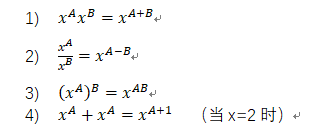

### 2.  对数

在数学中，对数是对求幂的逆运算，正如除法是乘法的倒数，反之亦然。因此，对于公式，有且仅当

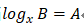

一些基本的公式

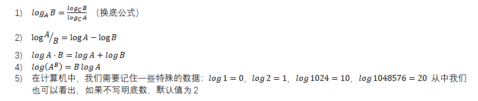

### 3.  级数

级数是指将数列的项依次用加号连接起来的函数。我们使用∑（希腊语：Sigma，汉语：西格玛）符号进行表示，如

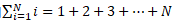

级数理论是分析学的一个分支；它与另一个分支微积分学一起作为基础知识和工具出现在其余各分支中。二者共同以极限为基本工具，分别从离散与连续两个方面，结合起来研究分析学的对象，即变量之间的依赖关系──函数。

这里介绍一写简单而基本的公式：

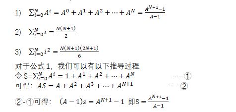

其他公式也都有一些相应得推导过程，这里只简单介绍。

此外，对于级数，还有“几何级数”的概念，其意思为N趋向于无穷，整个函数式会发生怎么样的改变，几何级数的使用，对于计算机计算程序的时空复杂度以及进行一些归纳方法非常有用。

### 4. Π运算

Π（希腊语：pi，汉语：派）运算与∑符号的运算法则类似，由∑的加法变成了乘法，其代表“求乘积”，如

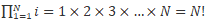

## 3.数据结构与算法

请牢记：程序=数据结构+算法

### 1. 数据结构发展史

### **1) 起源：**

1968年美国唐•欧•克努特教授开创了数据结构的最初体系，他所著的《计算机程序设计技巧》第一卷《基本算法》是第一本较系统地阐述数据的逻辑结构和存储结构语其操作的著作。我们一般认为本书开创了数据结构的系统概念。

70年代初，数据结构作为一门独立的课程开始进入大学课堂。

数据结构的发展经历三个阶段：无结构阶段，结构化阶段和面向对象阶段（和程序发展的三个阶段不谋而合了）

### **2) 无结构阶段**

40~60年代见，计算机的主要应用还没有如此普及，当时计算机主要是正对科学计算，程序设计技术以机器语言和汇编语言为主，程序处理的是存粹的数值，数据之间的关系主要是以来数学公式或者数学模型，此时数据结构概念并没有明确形成。

### **3)结构化阶段**

60~80年代，计算机开始广泛应用于非数值处理领域，数据表示成为程序设计的重要问题，人们认识到程序设计规范化的重要性，提出了程序结构模块化，并开始注意数据表示与操作的结构化。数据结构及抽象数据类型就是在这种情况下形成的，随着数据规模的加大，程序的设计越来越依附于数据结构的设计，此时数据结构开始广泛普及。

此间也有非常多的数据结构相关的文献产出，最为著名的是图灵奖获得者沃斯的一个著名公式：程序=数据结构+算法。

### **4)面向对象阶段**

80年代初期到现在，随着计算机不断普及，计算机性能以及需求不断增加，面向对象的程序设计被逐步提出，在对象的世界中 ，程序设计中大大减少了重复设计的部分，数据结构在这个阶段逐渐变得丰富，大量的封装类出现，减少了程序设计者的负担，数据结构因此变得更加友好。

### 2.何为算法

请你回答一下如何使用计算机C语言编程计算1到100的和（1+2+3+……+100），相信大多数人会直接给出以下答案：

```cpp
#include <stdio.h>

int main() {

    int ans=0,i;

    for(i=1;i<=100;i++){

        ans+=i;

    }

    printf("%d",ans);

    return 0;

}
```

这几乎是计算机中最为简单的程序了，但是，这样去完成这个功能真的好么？早在300年前的小学生高斯在课堂上被老师要求去计算这个结果，在同班同学还在手推写结果的时候，高斯早就已经做完了，他利用等差数列求和的算法，轻易打败了同班同学。

相关代码如下：

```cpp
#include <stdio.h>

int main() {

    int ans=(1+100)*100/2;

    printf("%d",ans);

    return 0;

}
```

相比第一份答案，我们进行了100次的运算，才得出我们想要的结果，而对于第二份答案，我们仅进行了1次运算就得到了想要的结果，而在实际中计算机的计算远远不止这点计算量，以此如果我们去计算1到1000000的和呢？使用了等差数列还是一步算好，而这就是算法的魅力。

## 4.算法基础

### 1. 算法的特性

### **1) 输入输出**

算法具有零个或者多个输入，同时，算法具有至少一个的输出。

对于在屏幕上打印”Hello World”一样，你可以不需要有任何的输入，直接输出得到结果即可，而对于一个没有输出的算法，没有任何意义。

### **2) 确定性**

算法的每一步都具有确定的含义，无二义性。任何条件下，算法只有唯一的一条执行路径，即对于相同的输入只能得到相同的输出。

请注意，如果算法的目的是产生一个随机数字，每一次运行产生了不同的结果，看上去好像违反了算法确定性原则，但计算机产生随机数亦是使用一种（或多种）算法解决，以线性同余产生随机数为例，其利用了CPU时间的不同产生的不同的结果，当CPU的时间完全一样的时候依旧会产生相同结果，只不过人类无法察觉到如此精确的时间区别。

### **3)有穷性**

一个算法总是需要（输入合法的情况下）在有限的步骤结束，即每个算法需要在有穷的时间内完成。

这是算法与程序的最主要的区别，程序可以无限制循环的执行下去。对于此，你可以理解为一个算法必须要有一个”边界“，即使一个算法需要计算机连续运算50年，但依旧是有穷的，只不过这个算法意义已经不是很大了。

### **4)可行性**

一个算法是可以被执行的，即算法中的每个操作都可以通过已经实现的基本运算执行有限的次数完成。

尽管在目前计算机解存在着没有实现成功的极为复杂的算法，但是并不能说的上是无法实现，只不过是受到现在的工具和人类的大脑限制了，这属于理论研究的范围。

### 2. 算法设计要求

### **1) 正确性**

正确性（Correctness）指的是该算法能够满足预先指定的功能与性能的需求，即能够得到正确答案。

其大致可以分为以下四点：

a)该算法中不含任何语法错误。

b)程序对于几组输入数据能够得到满足需求的结果。

c)程序对于非法的输入也能够得到满足需求说明的结果（如抛出异常）。

d)程序对于精心挑选的严苛数据依旧能够产生满足需求的结果。

### **2)健壮性**

健壮性（Robustness）指的是当输入数据不合法时，算法也能做出相关的处理，而不是产生不可预计的效果。

### **3)可读性**

可读性（Readability）指的是算法是可以阅读，理解和交流的。

### **4)耗时低，占用空间少**

运行时间（Running time）与占用空间（Storage space）概念，在设计算法时，我们总是希望能够更少的使用时间和空间达成我们的目标。

我们算法与数据结构的研究的重点就是为了让程序运行块，占用空间低。

## 5.数据结构基础

### 1. 基本概念和术语

### **1)数据**

数据（Data）是信息的载体，是可以被计算机识别，存储并加工处理的描述客观事物的信息符号的总称。数据不仅仅包括了整形，浮点数等数值类型，还包括了字符甚至声音，视频，图像等非数值的类型。

### **2)数据元素**

数据元素（Data Element）是描述数据的基本单位，也被称为记录。一个数据元素有若干个数据项组成。

如禽类，鸡鸭都属于禽类的数据元素。

### **3)数据项**

数据项（Data Item）是描述数据的最小单位，其可以分为组合项和原子项：

a)组合项

如果数据元素可以再度分割，则每一个独立处理单元就是数据项，数据元素就是数据项的集合。

b)原子项

如果数据元素不能再度分割，则每一个独立处理的单元就是原子项。

如日期2019年4月25日就是一个组合项，其表示日期，但如果单独拿25日这个数据出来观测，这就是一个原子项，因为其不可以再分割。

### **4)数据对象**

数据对象（Data Object）是性质相同的一类数据元素的集合，是数据的一个子集。数据对象可以是有限的，也可以是无限的。

### **5)数据结构**

数据结构（Data Structures）主要是指数据和关系的集合，数据指的是计算机中需要处理的数据，而关系指的是这些数据相关的前后逻辑，这些逻辑与计算机储存的位置无关，其主要包含以下四大逻辑结构。

### 2. 四大逻辑结构（Logic Structure）

### **1) 集合结构**

集合结构（Set Structure）中所有数据元素除了同属于一个集合外，并无其他关系。

如图：

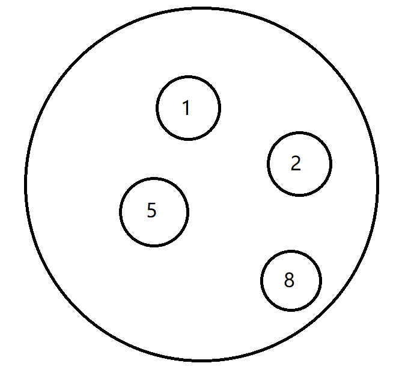

### **2) 线性结构**

线性结构（Linear Structure）指的是数据元素之间存在“一对一的关系”

如图:

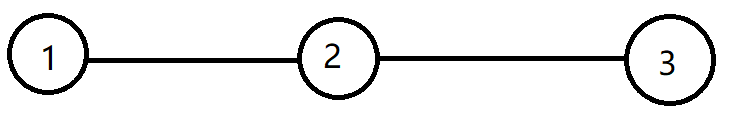

### **3) 树形结构**

树形结构（Tree Structure）指的是数据元素之间存在“一对多”的层次关系。

如图：

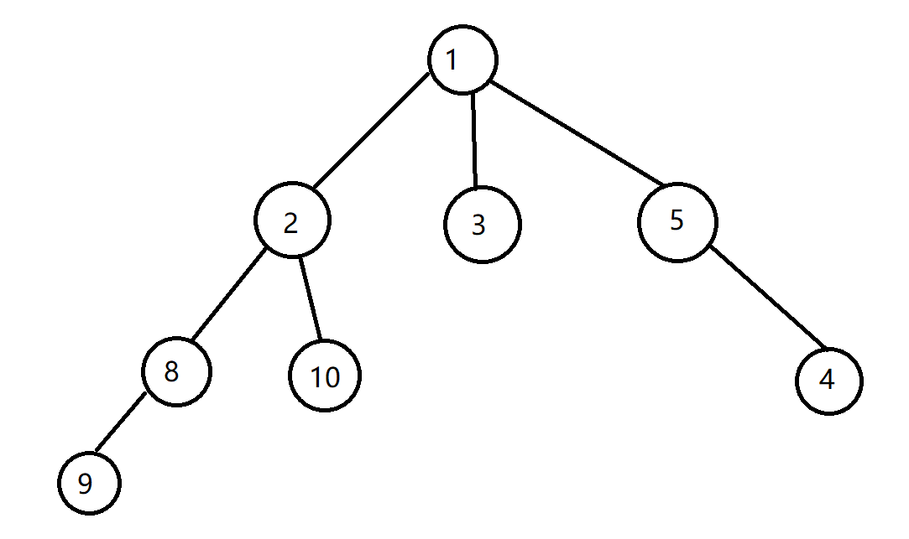

### **4) 图形结构**

图形结构（Graphic Structure，也称：网状结构）指的是数据元素之间存在“多对多的关系”（注：此时的“多对多”中的多表示，至少有一个）

图示：

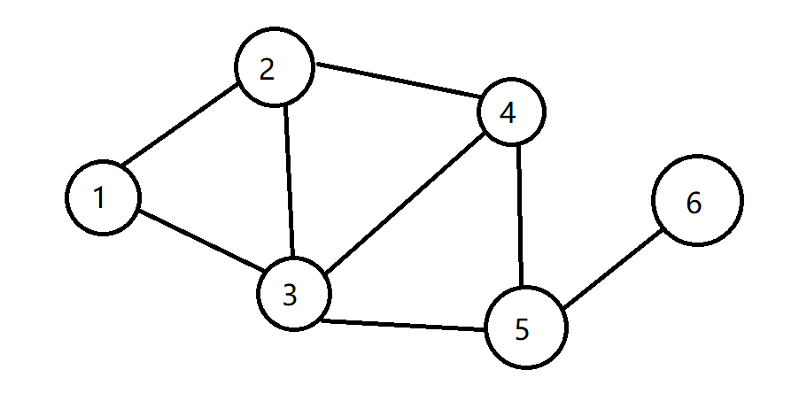

### 3.数据类型

### **1) 数据类型**

数据类型（Data Type）是高级程序设计语言中的概念，是数据的取值范围和对数进行操作的总和。数据类型规定了程序中对象的特性。程序中的每一个变量，常量或者表达式都属于一种数据类型。

### **2) 抽象数据类型**

抽象数据类型（Abstract Data Type，ADT）只是一个数学模型以及定义在模型上的一组操作。通常是对数据的抽象，定义了数据的取值范围以及对数据操作的集合。

抽象数据类型的特征是实现与操作分离，从而实现封装。

我们拿《魂斗罗》做比方：我们给予主角打，跳，移动的基本操作，这些操作就可以看作是抽象数据类型，这一组操作就属于一个模型，这组抽象的数据类型可以在《魂斗罗》这个环境中使用。

## 6.理解复杂度概念

### 1.时间空间复杂度定义

### **1) 时间复杂度**

时间复杂度表示一个程序运行所需要的时间，其具体需要在机器环境中才能得到具体的值，但我们一般并不需要得到详细的值，只是需要比较快慢的区别即可，为此，我们需要引入时间频度（语句频度）的概念。

时间频度中，n称为问题的规模，当n不断变化时,时间频度T(n)也会不断变化。一般情况下，算法中的基本操作重复次数的是问题规模n的某个函数，用T(n)表示，若有某个辅助函数f(n),使得当n趋近于无穷大时，T（n)/f(n)的极限值为不等于零的常数，则称f(n)是T(n)的同数量级函数。记作T(n)=Ｏ(f(n)),称Ｏ(f(n)) 为算法的渐进时间复杂度，简称时间复杂度。

### **2)空间复杂度**

一个程序的空间复杂度是指运行完一个程序所需内存的大小，其包括两个部分。

a)固定部分。这部分空间的大小与输入/输出的数据的个数多少、数值无关。主要包括指令空间（即代码空间）、数据空间（常量、简单变量）等所占的空间。这部分属于静态空间。

b)可变空间，这部分空间的主要包括动态分配的空间，以及递归栈所需的空间等。这部分的空间大小与算法有关。

### 2. 度量时间复杂度的两种方法

### **1)事后统计法**

顾名思义，就是指在程序运行结束之后直接查看运行时间的方式进行时间复杂度的统计，通常采用利用计算机的计时器对不同算法编制的程序进行运行时间的比较，从而确认一个算法的效率。

但这种方法有很多缺陷：

a)特别依赖计算机环境，同一套算法可能在不同的计算机上面有着截然不同的效果，老式的计算机和现代电脑的算力完完全全不是一个级别的处理速度。

b)算法的测试困难，有时一套算法需要海量的数据才能真正比较出效果，而为了设计这样的海量数据以及正确性，则需要花费大量的时间，而对于不同的数据，同一算法又有不一样的效果，故对于数据的使用很难去抉择。

也正是因为有这样的缺陷，

### **2)事先估计法**

与事后统计法不一样，事先统计法采取在计算机编译程序前对该算法进行预估的方式估算。我们可以通过利用时间频度以及函数的思维进行对时间复杂度的解析。

这里就不得不讲**函数符号，**它通常用来描述算法的时间复杂度，其中:

〇表示最坏情况，Ω表示最好情况，θ表示平均情况，我们常用的分析使用O进行表示即可。对于一个算法的时间复杂度而言，n表示其执行问题的规模，O(n)表示执行该问题需要的时间量级，如O(n)表示线性级别，O(n2)表示平方级别，其中n主要的判断方式为算法中循环结构的执行次数。

以下为一些常用的基本公式：

a)O(a）=O(1)      其中a为常数

b)O(an)=O(n)     其中a为常数

c)O(an2++bn+c)=O(n2)      其中a,b,c均为常数，结果只与最大项n有关

## 7.时间复杂度的度量方法

接上文，在理解了时间复杂度的概念后，就可以根据实际的代码进行度量了，以下举例了几个常用的时间复杂度的表示，对于如何度量其最重要的是观察程序中的循环结构，每一个循环结构代表执行循环中的指令n次，而其余指令一般而言一行代码代表执行一次，对于一个程序而言，执行的次数相差较小其实没有什么区别，都是一瞬间执行完毕。

### 1. 度量时间复杂度

a)O(1)  /  O(C)  C代表常数

```cpp
#include<stdio.h>

int main(){

    printf("Hello World");  //执行一次

    return 0;       //执行一次

}
```

对于如上代码，执行了两次，即O(2)=O(1)，我们可以称其时间复杂度为O(1)，或者常数级时间复杂度

b)O(n)

```cpp
#include<stdio.h>

int main(){

    int n=10000,ans=0;  //执行一次

    for(int i=0;i<n;i++){   //执行n次

        ans+=i;     //执行一次

    }

    return 0;       //执行一次

}
```

对于如上代码，我们一共执行了n*1+2次，即O(n*1+2)，由上文我们的公式得到其复杂度为O(n)，或称之为线性阶时间复杂度。

c)O(n^2)

```cpp
#include<stdio.h>

int main(){

    int n=10000,ans=0;  //执行一次

    for(int i=0;i<n;i++){   //执行n次

        for(int j=0;j<n;j++){   //执行n次

            ans+=j;

        }

    }

    return 0;       //执行一次

}
```

对于如上代码，我们一共执行了n*n*1+2次，即O(n*n*1+2)，由上文我们的公式得到其复杂度为O(n^2)，或称之为平方阶时间复杂度，此外还有三层循环结构嵌套组成的O(n^3)级别的时间复杂度，称之为立方阶时间复杂度，随着嵌套的增多，甚至还有O(n!)级，称之为阶层级时间复杂度，但是这种级别复杂度极高，程序运行极其缓慢。

d)O(logn)

```cpp
#include<stdio.h>

int main(){

    int i=1,n=10000;    //执行一次

    while(i<=n){    //执行logn次

        i*=2;

    }

    return 0;       //执行一次

}
```

对于如下代码，与上文的线性增长不同，其i的增长是倍增的形式，也就是说i会随着运行次数的增加变大的趋势变更大，这样会比那些简单的用加法上涨的变量更快到达循环结构的边界，这样的代码时间复杂度一般为log级别，对于本样例，有O(logn+2)=O(logn)，称之为对数阶时间复杂度

e)O(n*logn)

```cpp
#include<stdio.h>

int main(){

    int n=10000,ans=0;  //执行一次

    for(int i=0;i<n;i++){   //执行n次

        int j=0;        //执行1次

        while(j<=n){    //执行log(n)次

            j*=2;

        }

    }

    return 0;       //执行一次

}
```

对于上文的对数级别的时间复杂度，一样可以实用别的循环进行嵌套，比如本样例O(n*(logn+1)+2)=O(n*logn)级别

除此之外还有很多种时间复杂度的组合，比如说O(2^n)这样的指数阶时间复杂度，有时甚至需要引入多个变量乃进行表示，不过最核心的还是要观察循环结构的处理。

### 2.各个复杂度的比较

如图，我们以x轴为n的规模，y轴为整体的计算次数，可以发现其明显的计算区别，立方级别似乎很小的数就变得需要很多得计算了，而相对得logn级别得复杂度似乎无论怎么增加n，其涨幅都不是很明显。

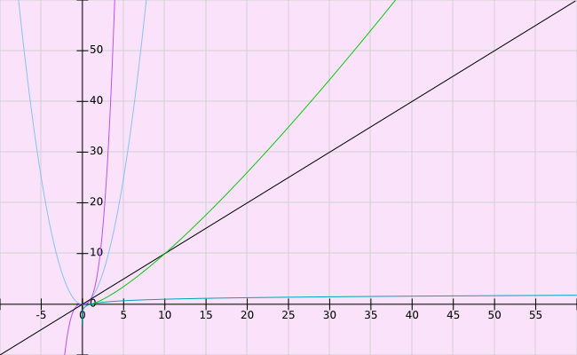

然而事实上，计算机的计算次数何止60次啊，计算机真实的计算速度是论千论万论亿级别的计算，所以我们的n会变得非常之大，让我们把坐标进行变化，以10000为界进行理解。

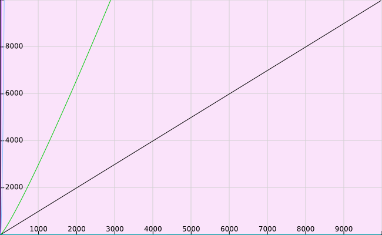

可以见到，平方以及立方级别的复杂度几乎已经是平贴着y轴的一条直线了，而O(n*log(n))与O(n)还保持着一定的速率进行增长，log(n)又是另一个极端，它变成了一个几乎贴着x轴的直线，这样算法的效率就轻易看得出了。

综上可以直观的得出：

O(1) < O(logn) < O(n) < O(nlogn) < O(n^2) < O(n^3) < O(2^n)

在设计程序的时候一定要注意，高计算需求的地方一定不要使用太高的时间复杂度的计算方式！

## 8.程序运行时的内存与地址

### 1. 理解内存

在开始数据结构的正式代码编写之前，我们得先熟悉一个计算机中重要的概念——**内存**，当然这里不是教你如何选购内存条，这里是介绍数据结构学习中必须要掌握的关于内存的基本概念。

首先请看这么一张图：

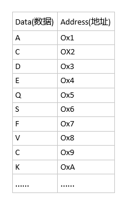

(地址的常用表示为十六进制表示法，即Ox+十六进制数)

由这个图可以清晰的发现对于每一段的内存中的数据，都有一个地址与之相对应，也真是因为有地址的存在，我们计算机中才可以轻易的去访问到其中数据，拿一个数组来说，数组在C语言中是顺序存储的，因此，如上图的数据直接用代码找到其数据以及地址的话可以这样写

```cpp
#include<stdio.h>

int main(){

    int i;

    char array[10]="ACDEQSFVCK";

    for(i=0;i<10;i++){

        printf("The %c Address is %x \n",array[i],&array[i]);

       //%x可以换成%p都是十六进制表示，只不过%p会把所有的位数显示出来

    }

    return 0;

}
```

其数据的输出结果如下（注意，不同的电脑可能地址不一样）：

The A Address is 62fe40

The C Address is 62fe41

The D Address is 62fe42

The E Address is 62fe43

The Q Address is 62fe44

The S Address is 62fe45

The F Address is 62fe46

The V Address is 62fe47

The C Address is 62fe48

The K Address is 62fe49

可以看到这是一段连续的地址，当你把char类型换成int型之后可能又不太一样，因为char是1字节的，而int占4字节，所以int的地址会变成4个一跳的方式往上增长。

不难察觉，指针似乎与内存的联系十分密切，事实上，指针就是为了灵活的操纵内存而设计的， C/C++语言的灵魂就在指针上，指针的存在，使得内存地址可以像数据一样进行赋值修改，极其灵活且方便（同时也具有风险）。

请巩固C语言学习的有关指针方面的知识点，这将对你数据结构的学习十分有帮助。

## 9.编程预备

两个必备的函数知识（其均来自于stdlib.h库中）

### 1. Malloc函数

malloc（）函数在堆中申请分配一个大小为size个字节的连续内存空间，若成功分配，则返回一个指向所分配空间起始地址的指针，否则返回空指针（NULL）。

### 2.Free函数

free（）函数用来释放已分配的内存空间，参数p是待释放的内存空间的首指针

总结来说malloc就是用来申请内存空间，而free是为了释放内存空间，这两个函数在C/C++语言的数据结构中十分重要，也十分常用，请务必牢记，这里总结几个新手易犯的错误：

a)忽略判断是否内存申请失败，如果内存申请失败并没有执行一些中断之类的操作，程序会继续向下运行，直到各种错误把整个程序弄崩溃

b)使用malloc不适用free，这在做题中似乎无关紧要，但是一旦在工作中养成这样的习惯，则会制造出很多无用的内存垃圾，造成程序效率的低下，当然了，后面出现了内存回收机制可以自动帮我们free掉内存垃圾，但是依旧要养成即时释放内存的好习惯。

c)使用指针后胡乱进行移动，产生不知名的指针位移，这样的效果往往是不知道自己的程序究竟出了什么错误，也极其难修改。

一般而言，常规的内存分配，使用再到释放的过程如下：

```cpp
#include<stdio.h>

#include<stdlib.h>

int main(){

    int *p;     //定义一个指向整形的指针变量

    p=(int*)malloc(5*sizeof(int));  //申请5个整形大小的内存空间并返回起始地址给p

    if(p==NULL){    //申请失败

        //执行申请失败的代码，一般print一个报错

        exit(1);    //退出

    }

    p[0]=1000;  //为空间中添加数据

    printf("%d",p[0]);  //打印这个数据

    free(p);    //释放p的内存空间，此时p依旧存在，只不过失去了指向的对象，成了野指针

    p=NULL; //为其赋NULL，此时它不再是一个野指针

    return 0;

}
```

很显然，我们设计一个数据结构程序的过程是先定义所需要的变量与指针变量---->进行内存分配---->判断是否分配成功(分配不成功就报错或者退出程序)---->对指针空间中的数据进行操作(如赋值，修改，查询，删除) ---->完成操作后释放指针

除上文提到的两个函数外，在C++中引入的对象思维，有一个极其类似于malloc函数的方法，就是new方法，但他们还是有一些区别的：

new操作符从自由存储区（free store）上为对象动态分配内存空间，而malloc函数从堆上动态分配内存。自由存储区是C++基于new操作符的一个抽象概念，凡是通过new操作符进行内存申请，该内存即为自由存储区。而堆是操作系统中的术语，是操作系统所维护的一块特殊内存，用于程序的内存动态分配，C语言使用malloc从堆上分配内存，使用free释放已分配的对应内存。
