# 第二章 链表

## 1.顺序存储和链式存储

### 1. 再谈数组—顺序存储

我们在开始计算机课程没多久后就已经知晓了数组的概念，数组作为一个顺序储存方式数据结构为我们的程序设计带来了大量的便利，几乎任何的高级程序设计，算法设计都离不开数组的灵活使用，但是，数组最大的缺点就是我们的插入和删除时需要移动大量的元素，显然这需要消耗大量的时间。

以C语言数组插入一个元素为例，当我们需要在一个数组{1,2,3,4,5,6,7}的第1个元素后（即第2个元素）的位置插入一个’A’时

我们需要做的有，将第1个元素后的整体元素后移，形成新的数组{1,2,2,3,4,5,6,7}，再将第2个元素位置的元素替换为我们所需要的元素’A’,最终形成我们的预期，一个简单的插入操作要进行那么多的步骤，显然不是很核算。

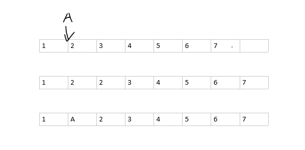

由示意图的操作，我们可以看出这样做的弊端有二

其一：所需要移动的元素很多，浪费算力。

其二：必须为数组开足够多的空间，否则有溢出风险。

### 2. 链表—链式存储

C语言使用中，由于以上出现的这些问题，我们链表的概念就应运而生，链表通过不连续的储存方式，以及指针的灵活使用，巧妙的简化了上诉的内容，同时链表是自适应内存大小的，也就是说无论我们设多大的数据，理论上都可以实现（当然不能超过你的机器承载），注意，有许多较晚的语言通过底层的方式解决了数组插入和删除时的时间浪费，如PYTHON。

链表的基本思维是，利用结构体的设置，额外开辟出一份内存空间去作指针，它总是指向下一个结点，一个个结点通过NEXT指针相互联系，串联，这就形成了我们的链表。


（图为单链表的一个结点结构）

其中DATA为自定义的数据类型，可以是简单的int型，也可以是复杂的struct结构体类型，而NEXT为指向下一个链表结点的指针，通过访问NEXT，可以引导我们去访问链表的下一个结点。

对于一连串的结点而言，就形成了我们的链表：

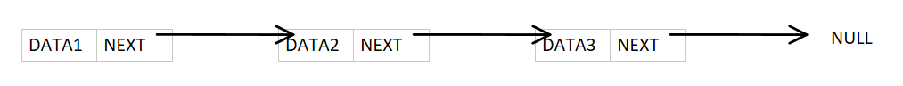

我们要进行上文所说的插入删除操作也就相当简单，只需要修改指针所指向的区域就可以了，不需要进行大量的数据移动操作。

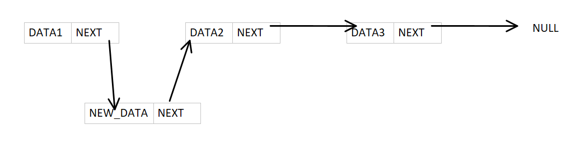

相比起数组，链表解决了数组不方便移动，插入，删除元素的弊端，但相应的，链表付出了更加大的内存牺牲换来的这些功能的实现。

上文介绍的是单链表，接下来的本章节会依次给各位介绍：单链表，双链表，循环单链表，其功能不同但实现方式均大同小异。

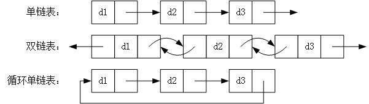

（图示为接下来学习的几种链表的区别）

## 2.单链表的基本设计（C语言代码实现）

### 1. 单链表概念&设计

单链表是一种链式存取的数据结构，，链表中的数据是以结点来表示的，每个结点的构成：元素(数据元素的映象) + 指针(指示后继元素存储位置)，元素就是存储数据的存储单元，指针就是连接每个结点的地址数据。以“结点的序列”表示的线性表称作线性链表（单链表），单链表是链式存取的结构。

对于链表的每一个结点，我们使用结构体（**struct**）进行设计，其主要内容有：


其中，DATA数据元素，可以为你想要储存的任何数据格式，可以是数组，可以是int，甚至可以是结构体（这就是传说中的结构体套结构体）

NEXT为一个指针，其代表了一个可以指向的区域，通常是用来指向下一个结点，链表的尾部NEXT指向NULL（空），因为尾部没有任何可以指向的空间了

故，对于一个单链表的结点定义，可以代码描述成：

```cpp
//定义结点类型

typedef struct Node {

    int data;       //数据类型，你可以把int型的data换成任意数据类型，包括结构体struct等复合类型

    struct Node *next;          //单链表的指针域

} Node,*LinkedList;

//Node表示结点的类型，LinkedList表示指向Node结点类型的指针类型
```

### 2. 单链表的初始化

同任何的结构，类型一样，链表也需要初始化操作，初始化是创建一个单链表的前置节点并向后逐步添加节点，一般来说，我们所谓的初始化单链表一般指的是申请结点的空间，同时对一个结点辅以空值(NULL)，其代码可以表示为：

```cpp
LinkedList listinit(){

    Node *L;

    L=(Node*)malloc(sizeof(Node));      //开辟空间

    if(L==NULL){                     //判断是否开辟空间失败，这一步很有必要

        printf("申请空间失败");

        //exit(0);                  //开辟空间失败可以考虑直接结束程序

    }

    L->next=NULL;       //指针指向空

}
```

在这里我们有一个注意点，就是一定要记住判断是否开辟空间失败，虽然在很多试题中以及常用的环境提供的环境非常安全，几乎没有开辟失败的存在，但是也一定要养成判断是否开辟失败并且判断失败后执行代码，但在生产中由于未知的情况造成一旦空间开辟失败任然在继续执行代码，后果将不堪设想，因此养成这样的判断是很有必要的，在C++中可以使用try-catch这样的语句进行优化。

### 3. 创建单链表（头插入法）

在初始化之后，就可以着手开始创建单链表了，单链表的创建分为头插入法和尾插入法两种，两者并无本质上的不同，都是利用指针指向下一个结点元素的方式进行逐个创建，只不过使用头插入法最终得到的结果是逆序的。

如图，为头插法的创建过程：

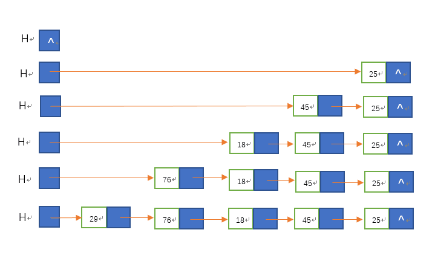

该方法从一个空表开始，生成新结点，并将读取到的数据存放到新结点的数据域中，然后将新结点插入到当前链表的表头，即头结点之后。

```cpp
//单链表的建立1，头插法建立单链表

LinkedList LinkedListCreatH() {

    Node *L;

    L = (Node *)malloc(sizeof(Node));   //申请头结点空间

    L->next = NULL;                      //初始化一个空链表

    int x;                         //x为链表数据域中的数据

    while(scanf("%d",&x) != EOF) {

        Node *p;

        p = (Node *)malloc(sizeof(Node));   //申请新的结点

        p->data = x;                     //结点数据域赋值

        p->next = L->next;     //将结点插入到表头L-->|2|-->|1|-->NULL

        L->next = p;

    }

    return L;
```

**4. 创建单链表（尾插入法）**

如图，为尾插入法的创建过程。

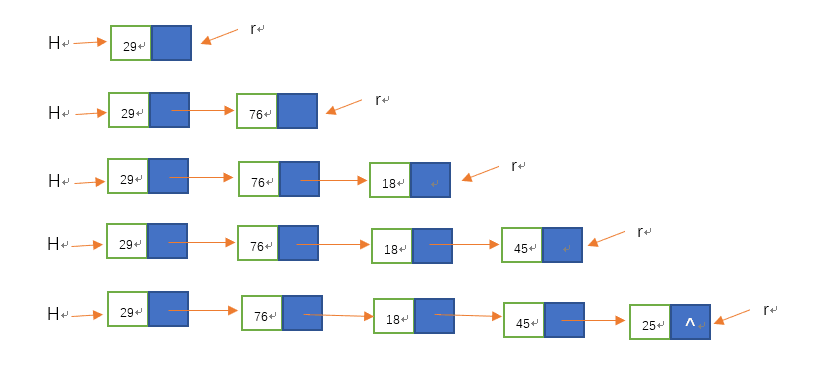

头插法建立单链表的算法虽然简单，但生成的链表中结点的次序和输入数据的顺序不一致。若希望两者次序一致，可采用尾插法。

该方法是将新结点逐个插入到当前链表的表尾上，为此必须增加一个尾指针 r, 使其始终指向当前链表的尾结点，否则就无法正确的表达链表。

```cpp
//单链表的建立2，尾插法建立单链表

LinkedList LinkedListCreatT() {

    Node *L;

    L = (Node *)malloc(sizeof(Node));   //申请头结点空间

    L->next = NULL;                  //初始化一个空链表

    Node *r;

    r = L;                          //r始终指向终端结点，开始时指向头结点

    int x;                         //x为链表数据域中的数据

    while(scanf("%d",&x) != EOF) {

        Node *p;

        p = (Node *)malloc(sizeof(Node));   //申请新的结点

        p->data = x;                     //结点数据域赋值

        r->next = p;            //将结点插入到表头L-->|1|-->|2|-->NULL

        r = p;

    }

    r->next = NULL;

    return L;

}
```

(待续)

## 3.单链表的基本操作及C语言代码实现

（续接前文）

### 1.   遍历单链表（打印，修改）

便利的概念想必大家都不会陌生，即就是从链表的头开始，逐步向后进行每一个元素的访问，这就是遍历，对于遍历操作，我们可以衍生出很多常用的数据操作，比如说查询元素，修改元素，获取元素个数，打印整个链表数据等等。

进行遍历的思路极其简单，只需要建立一个指向链表L的结点，然后沿着链表L逐个向后搜索即可。

对于遍历操作，以下是代码实现：

```cpp
//便利输出单链表

void printList(LinkedList L){

    Node *p=L->next;

    int i=0;

    while(p){

        printf("第%d个元素的值为:%d\n",++i,p->data);

        p=p->next;

    }

}
```

对于元素修改操作，以下是代码实现：

```cpp
//链表内容的修改，再链表中修改值为x的元素变为为k。

LinkedList LinkedListReplace(LinkedList L,int x,int k) {

    Node *p=L->next;

    int i=0;

    while(p){

        if(p->data==x){

            p->data=k;

        }

        p=p->next;

    }

    return L;

}
```

简单的遍历设计的函数只需要void无参即可，而当我们需要进行元素修等涉及到元素操作时，我们可以设计一个LinkedList类型的函数，使其返回一个修改后的新链表。

以上的操作均用到了遍历的思维，针对于遍历还有非常多的用法供自主设计，请参考后文配套的习题进行练习。

### 2.   链表插入操作

链表的增加结点操作主要分为查找到第i个位置，将该位置的next指针修改为指向我们新插入的结点，而新插入的结点next指针指向我们i+1个位置的结点。其操作方式可以设置一个前驱结点，利用循环找到第i个位置，再进行插入。

如图，在DATA1和DATA2数据结点之中插入一个NEW_DATA数据结点：

从原来的链表状态


到新的链表状态：


以下是代码实现：

```cpp
//单链表的插入，在链表的第i个位置插入x的元素

LinkedList LinkedListInsert(LinkedList L,int i,int x) {

    Node *pre;                      //pre为前驱结点

    pre = L;

    int tempi = 0;

    for (tempi = 1; tempi < i; tempi++) {

        pre = pre->next;                 //查找第i个位置的前驱结点

    }

    Node *p;                                //插入的结点为p

    p = (Node *)malloc(sizeof(Node));

    p->data = x;

    p->next = pre->next;

    pre->next = p;

    return L;

}
```

### 3.  链表删除操作

删除元素要建立一个前驱结点和一个当前结点，当找到了我们需要删除的数据时，直接使用前驱结点跳过要删除的结点指向要删除结点的后一个结点，再将原有的结点通过free函数释放掉。

参考如图

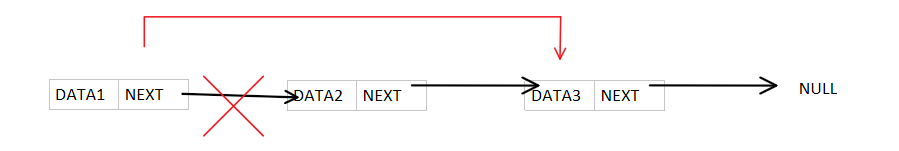

以下是代码实现：

```cpp
//单链表的删除，在链表中删除值为x的元素

LinkedList LinkedListDelete(LinkedList L,int x) {

    Node *p,*pre;                   //pre为前驱结点，p为查找的结点。

    p = L->next;

    while(p->data != x) {              //查找值为x的元素

        pre = p;

        p = p->next;

    }

    pre->next = p->next;          //删除操作，将其前驱next指向其后继。

    free(p);

    return L;

}
```

**4.  完整实现代码**

```cpp
#include <stdio.h>

#include <stdlib.h>

//定义结点类型

typedef struct Node {

	int data;           //数据类型，你可以把int型的data换成任意数据类型，包括结构体struct等复合类型

	struct Node *next;          //单链表的指针域

} Node,*LinkedList;

//单链表的初始化

LinkedList LinkedListInit() {

	Node *L;

	L = (Node *)malloc(sizeof(Node));   //申请结点空间

	if(L==NULL){	//判断申请空间是否失败

		exit(0);	//如果失败则退出程序

	}

	L->next = NULL;          //将next设置为NULL,初始长度为0的单链表

	return L;

}

//单链表的建立1，头插法建立单链表

LinkedList LinkedListCreatH() {

	Node *L;

	L = (Node *)malloc(sizeof(Node));   //申请头结点空间

	L->next = NULL;                      //初始化一个空链表

	int x;                         //x为链表数据域中的数据

	while(scanf("%d",&x) != EOF) {

		Node *p;

		p = (Node *)malloc(sizeof(Node));   //申请新的结点

		p->data = x;                     //结点数据域赋值

		p->next = L->next;                    //将结点插入到表头L-->|2|-->|1|-->NULL

		L->next = p;

	}

	return L;

}

//单链表的建立2，尾插法建立单链表

LinkedList LinkedListCreatT() {

	Node *L;

	L = (Node *)malloc(sizeof(Node));   //申请头结点空间

	L->next = NULL;                  //初始化一个空链表

	Node *r;

	r = L;                          //r始终指向终端结点，开始时指向头结点

	int x;                         //x为链表数据域中的数据

	while(scanf("%d",&x) != EOF) {

		Node *p;

		p = (Node *)malloc(sizeof(Node));   //申请新的结点

		p->data = x;                     //结点数据域赋值

		r->next = p;                 //将结点插入到表头L-->|1|-->|2|-->NULL

		r = p;

	}

	r->next = NULL;

	return L;

}

//单链表的插入，在链表的第i个位置插入x的元素

LinkedList LinkedListInsert(LinkedList L,int i,int x) {

	Node *pre;                      //pre为前驱结点

	pre = L;

	int tempi = 0;

	for (tempi = 1; tempi < i; tempi++) {

		pre = pre->next;                 //查找第i个位置的前驱结点

	}

	Node *p;                                //插入的结点为p

	p = (Node *)malloc(sizeof(Node));

	p->data = x;

	p->next = pre->next;

	pre->next = p;

	return L;

}

//单链表的删除，在链表中删除值为x的元素

LinkedList LinkedListDelete(LinkedList L,int x) {

	Node *p,*pre;                   //pre为前驱结点，p为查找的结点。

	p = L->next;

	while(p->data != x) {              //查找值为x的元素

		pre = p;

		p = p->next;

	}

	pre->next = p->next;          //删除操作，将其前驱next指向其后继。

	free(p);

	return L;

}

//链表内容的修改，再链表中修改值为x的元素变为为k。

LinkedList LinkedListReplace(LinkedList L,int x,int k) {

	Node *p=L->next;

	int i=0;

	while(p){

		if(p->data==x){

			p->data=k;

		}

		p=p->next;

	}

	return L;

}

//便利输出单链表

void printList(LinkedList L){

	Node *p=L->next;

	int i=0;

	while(p){

		printf("第%d个元素的值为:%d\n",++i,p->data);

		p=p->next;

	}

}

int main() {

	//创建

	LinkedList list;

	printf("请输入单链表的数据：以EOF结尾\n");

	list = LinkedListCreatT();

	//list=LinkedListCreatT();

	printList(list);

	//插入

	int i;

	int x;

	printf("请输入插入数据的位置：");

	scanf("%d",&i);

	printf("请输入插入数据的值：");

	scanf("%d",&x);

	LinkedListInsert(list,i,x);

	printList(list);

	//修改

	printf("请输入修改的数据：");

	scanf("%d",&i);

	printf("请输入修改后的值：");

	scanf("%d",&x);

	LinkedListReplace(list,i,x);

	printList(list);

	//删除

	printf("请输入要删除的元素的值：");

	scanf("%d",&x);

	LinkedListDelete(list,x);

	printList(list);

	return 0;

}
```

### 5.  配套练习推荐

[1676题](https://www.dotcpp.com/oj/problem1676.html)、[1052题](https://www.dotcpp.com/oj/problem1052.html)

请独自完成提交并通过

## 4.双向链表的基本设计（C语言代码实现）

### 1.  双向链表的简介&概念

单链表在很多时候已经可以胜任很多优秀的操作了，但是，单链表任然存在不足，所谓‘单链表’，是指结点中只有一个指向其后继的指针，具有单向性，有时需要搜索大量数据的时候，就必须要多次进行从头开始的遍历，这样的搜索不是很便利。

图：单链表示意图


对此在单链表的基础上，产生了双向链表的概念，即： 在单链表的基础上，对于每一个结点设计一个前驱结点，前驱结点与前一个结点相互连接，构成一个链表。

双向链表可以简称为双链表，是链表的一种，它的每个数据结点中都有两个指针，分别指向直接后继和直接前驱。所以，从双向链表中的任意一个结点开始，都可以很方便地访问它的前驱结点和后继结点。

图：双向链表示意图

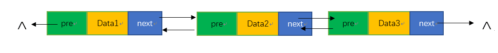

一个完整的双向链表应该是头结点的pre指针指为空，尾结点的next指针指向空，其余结点前后相链。

### 2. 双向链表的结点设计

对于每一个结点而言，有：

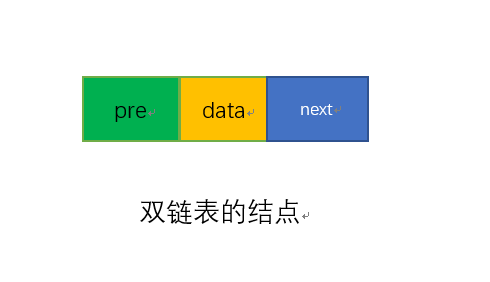

其中，DATA表示数据，其可以是简单的类型（如int,double等等），也可以是复杂的结构体（struct类型）；

pre代表的是前驱指针，它永远指向当前结点的前一个结点，注意，如果当前结点是头结点，则pre指针为空；

next代表的是后继指针，它永远指向当前结点的下一个结点，注意，如果当前结点是尾结点，则next指针为空

其代码设计可以为：

```cpp
typedef struct line{

    int data;           //data

    struct line *pre;   //pre node

    struct line *next;  //next node

}line,*a;

//分别表示该结点的前驱(pre)，后继(next)，以及当前数据(data)
```

### 3. 双链表的创建

对于创建双向链表，我们需要先创建头结点再逐步的进行添加，请注意，双向链表的头结点是有数据元素的，也就是头结点的data域中是存有数据的，这与一般的单链表是不同的。

对于逐步添加数据，我们采取的做法是，开辟一段新的内存空间作为新的结点，为这个结点进行的data进行赋值，然后将已成链表的上一个结点的next指针指向自身，自身的pre指针指向上一个结点。

其代码可以设计为：

```cpp
//创建双链表

line* initLine(line * head){

    int number,pos=1,input_data;

    //三个变量分别代表结点数量，当前位置，输入的数据

    printf("请输入创建结点的大小\n");

    scanf("%d",&number);

    if(number<1){return NULL;} //输入非法直接结束

    //////头结点创建///////

    head=(line*)malloc(sizeof(line));

    head->pre=NULL;

    head->next=NULL;

    printf("输入第%d个数据\n",pos++);

    scanf("%d",&input_data);

    head->data=input_data;

    line * list=head;

    while (pos<=number) {

        line * body=(line*)malloc(sizeof(line));

        body->pre=NULL;

        body->next=NULL;

        printf("输入第%d个数据\n",pos++);

        scanf("%d",&input_data);

        body->data=input_data;

        list->next=body;

        body->pre=list;

        list=list->next;

    }

    return head;

}
```

初步看起来双向链表似乎比单链表的两种创建方法要复杂，其实将过程逐步拆解为 创建头结点----创建一个新的结点----将头结点和新结点相互链接----再度创建新结点……这样的过程去思考，再反过头多看几遍代码会有助于理解。

## 5.双向链表的基本操作及C语言代码实现

### 1.   双向链表的插入操作

如图所示：

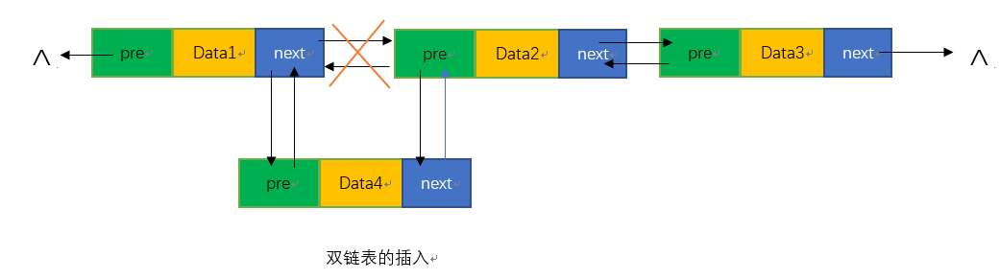

对于每一次的双向链表的插入操作，我们首先需要创建一个独立的结点并通过malloc操作开辟相应的空间，其次我们选中这个新创建的独立节点，将其的pre指针指向所需插入位置的前一个结点，同时，其所需插入的前一个结点的next指针修改指向为该新的结点，同理，该新的结点的next指针将会指向一个原本的下一个结点，而修改下一个结点的pre指针为指向新结点自身，这样的一个操作我们称之为双向链表的插入操作。

其代码可以表示为：

```cpp
//插入数据

line * insertLine(line * head,int data,int add){

    //三个参数分别为：进行此操作的双链表，插入的数据，插入的位置

    //新建数据域为data的结点

    line * temp=(line*)malloc(sizeof(line));

    temp->data=data;

    temp->pre=NULL;

    temp->next=NULL;

    //插入到链表头，要特殊考虑

    if (add==1) {

        temp->next=head;

        head->pre=temp;

        head=temp;

    }else{

        line * body=head;

        //找到要插入位置的前一个结点

        for (int i=1; i<add-1; i++) {

            body=body->next;

        }

        //判断条件为真，说明插入位置为链表尾

        if (body->next==NULL) {

            body->next=temp;

            temp->pre=body;

        }else{

            body->next->pre=temp;

            temp->next=body->next;

            body->next=temp;

            temp->pre=body;

        }

    }

    return head;

}
```

### 2.   双向链表的删除操作

如图：

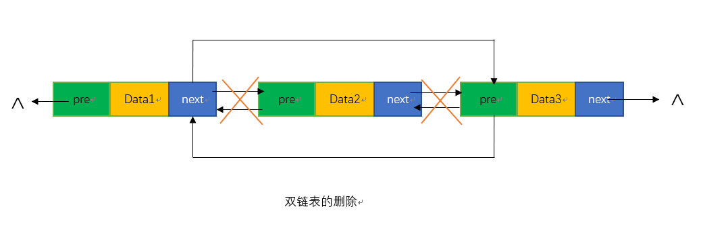

删除操作的过程是：选择需要删除的结点，选中这个结点的前一个结点，将前一个结点的next指针指向自己的下一个结点，同时，选中该节点的下一个结点，将下一个结点的pre指针修改指向为自己的上一个结点，这样产生的效果就是在进行遍历的时候直接将这一个结点给跳过了。

在这样的指针修改操作之后，我们释放删除结点，归还空间给内存，这样的操作我们称之为双链表的删除操作。

其代码可以表示为：

```cpp
//删除元素

line * deleteLine(line * head,int data){

    //输入的参数分别为进行此操作的双链表，需要删除的数据

    line * list=head;

    //遍历链表

    while (list) {

        //判断是否与此元素相等

        //删除该点方法为将该结点前一结点的next指向该节点后一结点

        //同时将该结点的后一结点的pre指向该节点的前一结点

        if (list->data==data) {

            list->pre->next=list->next;

            list->next->pre=list->pre;

            free(list);

            printf("--删除成功--\n");

            return head;

        }

        list=list->next;

    }

    printf("Error:没有找到该元素，没有产生删除\n");

    return head;

}
```

### 3   双向链表的遍历

如同单链表的遍历一样，利用next指针逐步向后进行索引即可，注意判断这里，我们既可以用while(list)的操作直接判断是否链表为空，也可以使用while(list->next)的操作判断该链表是否为空，其下一节点为空和本结点是否为空的判断条件是一样的效果，当然了，善用双向链表的pre指针进行有效的遍历也是值得去尝试的。

其简单的代码可以表示为：

```cpp
//遍历双链表,同时打印元素数据

void printLine(line *head){

    line *list = head;

    int pos=1;

    while(list){

        printf("第%d个数据是:%d\n",pos++,list->data);

        list=list->next;

    }

}
```

### 4.   配套练习题目

双向链表的单独训练数据并不是很多，在网上的资料相比单链表也是偏少，不过我们在熟悉原理之后可以同单链表的题目，可以尝试使用双链表进行做题，如下题：

[1676题](https://www.dotcpp.com/oj/problem1676.html)    [1585题](https://www.dotcpp.com/oj/problem1585.html)

### 5.   本题目案例代码

```cpp
#include<stdio.h>

#include<stdlib.h>

typedef struct line{

    int data;           //data

    struct line *pre;   //pre node

    struct line *next;  //next node

}line;

//分别表示该结点的前驱(pre)，后继(next)，以及当前数据(data)

//遍历双链表,同时打印元素数据

void printLine(line *head){

    line *list = head;

    int pos=1;

    while(list){

        printf("第%d个数据是:%d\n",pos++,list->data);

        list=list->next;

    }

}

//创建双链表

line* initLine(line * head){

    int number,pos=1,input_data;

    printf("请输入创建结点的大小\n");

    scanf("%d",&number);

    if(number<1){return NULL;} //输入非法直接结束

    //////头结点创建///////

    head=(line*)malloc(sizeof(line));

    head->pre=NULL;

    head->next=NULL;

    printf("输入第%d个数据\n",pos++);

    scanf("%d",&input_data);

    head->data=input_data;

    line * list=head;

    while (pos<=number) {

        line * body=(line*)malloc(sizeof(line));

        body->pre=NULL;

        body->next=NULL;

        printf("输入第%d个数据\n",pos++);

        scanf("%d",&input_data);

        body->data=input_data;

        list->next=body;

        body->pre=list;

        list=list->next;

    }

    return head;

}

//插入数据

line * insertLine(line * head,int data,int add){

    //三个参数分别为：进行此操作的双链表，插入的数据，插入的位置

    //新建数据域为data的结点

    line * temp=(line*)malloc(sizeof(line));

    temp->data=data;

    temp->pre=NULL;

    temp->next=NULL;

    //插入到链表头，要特殊考虑

    if (add==1) {

        temp->next=head;

        head->pre=temp;

        head=temp;

    }else{

        line * body=head;

        //找到要插入位置的前一个结点

        for (int i=1; i<add-1; i++) {

            body=body->next;

        }

        //判断条件为真，说明插入位置为链表尾

        if (body->next==NULL) {

            body->next=temp;

            temp->pre=body;

        }else{

            body->next->pre=temp;

            temp->next=body->next;

            body->next=temp;

            temp->pre=body;

        }

    }

    return head;

}

//删除元素

line * deleteLine(line * head,int data){

    //输入的参数分别为进行此操作的双链表，需要删除的数据

    line * list=head;

    //遍历链表

    while (list) {

        //判断是否与此元素相等

        //删除该点方法为将该结点前一结点的next指向该节点后一结点

        //同时将该结点的后一结点的pre指向该节点的前一结点

        if (list->data==data) {

            list->pre->next=list->next;

            list->next->pre=list->pre;

            free(list);

            printf("--删除成功--\n");

            return head;

        }

        list=list->next;

    }

    printf("Error:没有找到该元素，没有产生删除\n");

    return head;

}

int main(){

    line *head=NULL;

    printf("创建双链表操作\n");

    head=initLine(head);

    printLine(head);

//////////create line////////////

	printf("插入操作\n");

    head=insertLine(head,40,2);     //为了简化直接写参数了

    printLine(head);

//////////insert Line////////////

	printf("删除操作\n");

    head=deleteLine(head,2);       //为了简化直接写参数了

    printLine(head);

//////////delete Line////////////

    return 0;

}
```

## 6.循环链表的介绍及创建（C语言代码实现）

### 1. 循环链表概念

对于单链表以及双向链表，其就像一个小巷，无论怎么样最终都能从一端走到另一端，然而循环链表则像一个有传送门的小巷，因为循环链表当你以为你走到结尾的时候，其实你又回到了开头。

循环链表和非循环链表其实创建的过程以及思路几乎完全一样，唯一不同的是，非循环链表的尾结点指向空（NULL），而循环链表的尾指针指向的是链表的开头。通过将单链表的尾结点指向头结点的链表称之为循环单链表（Circular linkedlist）

如图，为一个完整的循环单链表

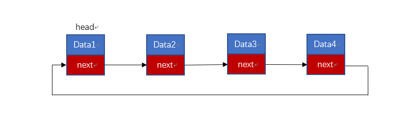

### 2.  循环链表结点设计（以单循环链表为例）

对于循环单链表的结点，可以完全参照于单链表的结点设计，如图：

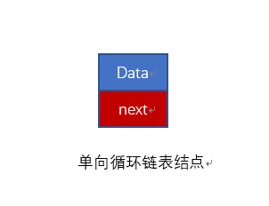

data表示数据，其可以是简单的类型（如int,double等等），也可以是复杂的结构体（struct类型）

next表示指针，它永远指向自身的下一个结点，对于只有一个结点的存在，这个next指针则永远指向自身，对于一个链表的尾部结点，next永远指向开头。

其代码可以表示为：

```cpp
typedef struct list{

    int data;

    struct list *next;

}list;

//data为存储的数据，next指针为指向下一个结点
```

### 3. 循环单链表初始化

如同单链表的创建，我们需要先创建一个头结点并且给其开辟内存空间，但与单链表不同的是，我们需要在开辟内存空间成功之后将头结点的next指向head自身，我们可以创建一个init函数来完成这件事情，为了以后的重复创建和插入，我们可以考虑在init重创建的结点next指向空，而在主函数调用创建之后手动讲head头结点的next指针指向自身。

这样的操作方式可以方便过后的创建单链表，直接利用多次调用的插入函数即可完成整体创建。

其代码可以表示为：

```cpp
//初始结点

list *initlist(){

    list *head=(list*)malloc(sizeof(list));

    if(head==NULL){

        printf("创建失败，退出程序");

        exit(0);

    }else{

        head->next=NULL;

        return head;

    }

}
```

在主函数重调用可以是这样

```cpp
在主函数重调用可以是这样

    //////////初始化头结点//////////////

    list *head=initlist();

    head->next=head;
```

### 4. 循环链表的创建操作

如图所示：

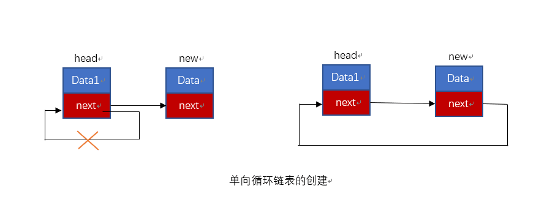

我们可以通过逐步的插入操作，创建一个新的节点，将原有链表尾结点的next指针修改指向到新的结点，新的结点的next指针再重新指向头部结点，然后逐步进行这样的插入操作，最终完成整个单项循环链表的创建。

其代码可以表示为：

```cpp
//创建——插入数据

int insert_list(list *head){

    int data;   //插入的数据类型

    printf("请输入要插入的元素：");

    scanf("%d",&data);

    list *node=initlist();

    node->data=data;

    //初始化一个新的结点，准备进行链接

    if(head!=NULL){

        list *p=head;

        //找到最后一个数据

        while(p->next!=head){

            p=p->next;

        }

        p->next=node;

        node->next=head;

        return 1;

    }else{

        printf("头结点已无元素\n");

        return 0;

    }

}
```

## 7.循环链表的基本操作及C语言代码实现

如图，对于插入数据的操作，基本与单链表的插入操作相同，我们可以创建一个独立的结点，通过将需要插入的结点的上一个结点的next指针指向该节点，再由需要插入的结点的next指针指向下一个结点的方式完成插入操作。

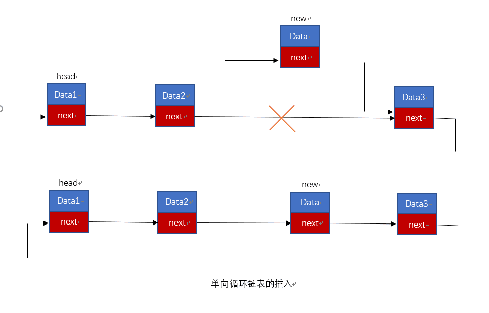

其代码可以表示为：

```cpp
//插入元素

list *insert_list(list *head,int pos,int data){

    //三个参数分别是链表，位置，参数

    list *node=initlist();  //新建结点

    list *p=head;       //p表示新的链表

    list *t;

    t=p;

    node->data=data;

    if(head!=NULL){

        for(int i=1;i<pos;i++){

            t=t->next;  //走到需要插入的位置处

        }

        node->next=t->next;

        t->next=node;

        return p;

    }

    return p;

}
```

### 2.   循环单链表的删除操作

如图所示，循环单链表的删除操作可以参考单链表的删除操作，其都是找到需要删除的结点，将其前一个结点的next指针直接指向删除结点的下一个结点即可，但需要注意的是尾节点和头结点的特判，尤其是尾结点，因为删除尾节点后，尾节点前一个结点就成了新的尾节点，这个新的尾节点需要指向的是头结点而不是空，其重点可以记录为【当前的前一节点.next=自身结点.next】这样的操作可以省去头尾结点的特判：

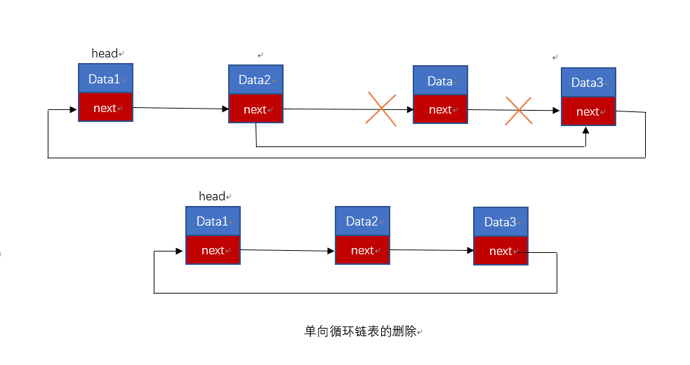

其代码可以表示为：

```cpp
//删除元素

int delete_list(list *head) {

    if(head == NULL) {

        printf("链表为空！\n");

        return 0;

    }

    //建立临时结点存储头结点信息（目的为了找到退出点）

    //如果不这么建立的化需要使用一个数据进行计数标记，计数达到链表长度时自动退出

    //循环链表当找到最后一个元素的时候会自动指向头元素，这是我们不想让他发生的

    list *temp = head;

    list *ptr = head->next;

    int del;

    printf("请输入你要删除的元素：");

    scanf("%d",&del);

    while(ptr != head) {

        if(ptr->data == del) {

            if(ptr->next == head) {

                temp->next = head;

                free(ptr);

                return 1;

            }

            temp->next = ptr->next;    //核心删除操作代码

            free(ptr);

            //printf("元素删除成功！\n");

            return 1;

        }

        temp = temp->next;

        ptr = ptr->next;

    }

    printf("没有找到要删除的元素\n");

    return 0;

}
```

### 3.   循环单链表的遍历

与普通的单链表和双向链表的遍历不同，循环链表需要进行结点的特判，找到尾节点的位置，由于尾节点的next指针是指向头结点的，所以不能使用链表本身是否为空（NULL）的方法进行简单的循环判断，我们需要通过判断结点的next指针是否等于头结点的方式进行是否完成循环的判断。

此外还有一种计数的方法，即建立一个计数器count=0，每一次next指针指向下一个结点时计数器加一，当count数字与链表的节点数相同的时候即完成循环，这样做有一个问题，就是获取到链表的节点数同时也需要完成一次遍历才可以达成目标。

其代码可以表示为：

```cpp
//遍历元素

int display(list *head) {

    if(head != NULL) {

        list *p  = head;

        //遍历头节点到，最后一个数据

        while(p->next != head ) {

            printf("%d   ",p->next->data);

            p = p->next;

        }

        printf("\n");   //习惯性换行 ( o=^•ェ•)o　┏━┓

        //把最后一个节点赋新的节点过去

        return 1;

    } else {

        printf("头结点为空!\n");

        return 0;

    }

}
```

### 4.   进阶概念—双向循环链表

循环链表还有一个进阶的概念练习，同双向链表与单链表的关系一样，循环单链表也有一个孪生兄弟——双向循环链表，其设计思路与单链表和双向链表的设计思路一样，就是在原有的双向链表的基础上，将尾部结点和头部结点进行互相连接，这个链表的设计不难，就交给读者自主进行设计。

### 5.   循环单链表代码

```cpp
 #include<stdio.h>

#include<stdlib.h>

typedef struct list{

    int data;

    struct list *next;

}list;

//data为存储的数据，next指针为指向下一个结点

//初始结点

list *initlist(){

    list *head=(list*)malloc(sizeof(list));

    if(head==NULL){

        printf("创建失败，退出程序");

        exit(0);

    }else{

        head->next=NULL;

        return head;

    }

}

//创建--插入数据

int create_list(list *head){

    int data;   //插入的数据类型

    printf("请输入要插入的元素：");

    scanf("%d",&data);

    list *node=initlist();

    node->data=data;

    //初始化一个新的结点，准备进行链接

    if(head!=NULL){

        list *p=head;

        //找到最后一个数据

        while(p->next!=head){

            p=p->next;

        }

        p->next=node;

        node->next=head;

        return 1;

    }else{

        printf("头结点已无元素\n");

        return 0;

    }

}

//插入元素

list *insert_list(list *head,int pos,int data){

    //三个参数分别是链表，位置，参数

    list *node=initlist();  //新建结点

    list *p=head;       //p表示新的链表

    list *t;

    t=p;

    node->data=data;

    if(head!=NULL){

        for(int i=1;i<=pos;i++){

            t=t->next;

        }

        node->next=t->next;

        t->next=node;

        return p;

    }

    return p;

}

//删除元素

int delete_list(list *head) {

	if(head == NULL) {

		printf("链表为空！\n");

		return 0;

	}

    //建立零时结点存储头结点信息（目的为了找到退出点）

    //如果不这么建立的化需要使用一个数据进行计数标记，计数达到链表长度时自动退出

    //循环链表当找到最后一个元素的时候会自动指向头元素，这是我们不想让他发生的

	list *temp = head;

	list *ptr = head->next;

	int del;

	printf("请输入你要删除的元素：");

	scanf("%d",&del);

	while(ptr != head) {

		if(ptr->data == del) {

			if(ptr->next == head) { //循环结束的条件换成ptr->next == head

				temp->next = head;

				free(ptr);

				return 1;

			}

			temp->next = ptr->next;

			free(ptr);

			//printf("元素删除成功！\n");

			return 1;

		}

		temp = temp->next;

		ptr = ptr->next;

	}

	printf("没有找到要删除的元素\n");

	return 0;

}

//遍历元素

int display(list *head) {

	if(head != NULL) {

		list *p  = head;

		//遍历头节点到，最后一个数据

		while(p->next != head ) {

			printf("%d   ",p->next->data);

			p = p->next;

		}

        printf("\n");   //习惯性换行 ( o=^•ェ•)o　┏━┓

		//把最后一个节点赋新的节点过去

		return 1;

	} else {

		printf("头结点为空!\n");

		return 0;

	}

}

int main(){

    //////////初始化头结点//////////////

    list *head=initlist();

    head->next=head;

    ////////通过插入元素完善链表/////////

    for(int i=0;i<5;i++){   //只是演示使用，不具体提供输入

        create_list(head);

    }

    display(head);

    ////////////插入元素////////////////

    head=insert_list(head,1,10);

    display(head);

    ////////////删除元素////////////////

    delete_list(head);

    display(head);

    return 0;

}
```

### 6.   推荐试题

如同双向链表，循环单链表的单独训练数据并不是很多，在网上的资料相比单链表也是偏少，不过我们在熟悉原理之后可以同单链表的题目，可以尝试使用循环单链表进行做题，如下题：

[1676题](https://www.dotcpp.com/oj/problem1676.html)、[1585题](https://www.dotcpp.com/oj/problem1585.html)
