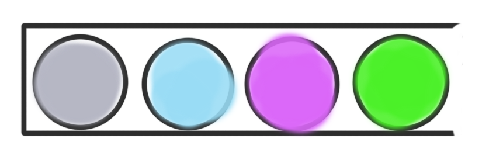
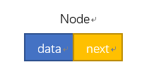
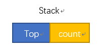
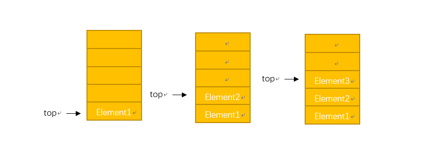
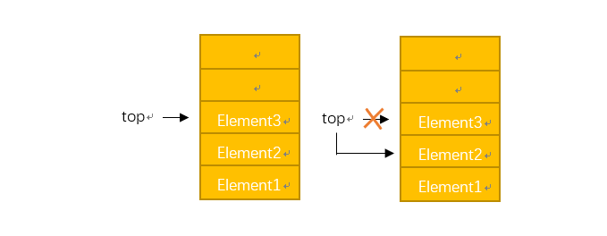

# 第三章 栈

## 1.栈（先进后出的数据结构）的设计与实现

### 1. 栈的概念

在开始前，请牢记这句话：栈是一种先进后出的数据结构。

栈（stack）是限定仅在表的一端进行操作的数据结构，请联系我们前文所学的，设想一个单链表我们只能够对其链表的表尾结点进行操作，而操作也只能够进行插入一个新的结点与删除最末尾的这个结点两个操作，而这样强限制性的‘链表’，就是我们所说的栈。

让我们重新理顺一下定义：栈是一个线性的数据结构，规定这个数据结构只允许在其中一端进行操作，并禁止直接访问除这一端以外的数据。



如图：栈就像一个放球的单管桶，只允许球从桶的开口这一端取出，并且球先放入桶中则后从桶中拿出。

### 2. 栈的结点设计

栈分为数组栈和链表栈，其区别是数组栈使用数组进行功能的模拟，实现较为快速和便利，而链表栈使用链表的思路去设计，实现较为麻烦，但是其稳定不易出错；在链表栈中又分为静态链表栈和动态链表栈，静态链表栈给定栈的空间大小，不允许超过存储超过给定数据大小的元素，而动态栈使用的是自动创建空间的方法进行创建，只要符合机器的硬件要求以及编译器的控制，其理论上是极大的。

说了那么多，我们以链表栈的动态链表栈为例子，进行栈的设计，在后文直接以栈一名字称呼动态链表栈，这也是各类语言标准模板中栈的实现方式。

首先是栈的结点设计，我们可以设计出两个结构体，一个结构体Node表示结点，其中包含有一个data域和next指针。



其中data表示数据，其可以是简单的类型（如int,double等等），也可以是复杂的结构体（**struct**类型）；

next指针表示，下一个的指针，其指向下一个结点，通过next指针将各个结点链接。

目前的设计如同单链表，接下来，为这个进行限制性的设计，我们额外添加一个结构体，其包括了一个永远指向栈头的指针top和一个计数器count记录元素个数，（也可以设计成一个指针top和一个指针bottom分别指向栈头和栈尾）其主要功效就是设定允许操作元素的指针以及确定栈何时为空（count的方法是当count为0时为空，top和bottom方法就是两者指向同一个空间时为栈为空）



这里我采用的是top和count组合的方法。其代码可以表示为：

```cpp
//栈的结点设计

//单个结点设计，数据和下一个指针

typedef struct node

{

    int data;

    struct node *next;

} Node;

//利用上面的结点创建栈，分为指向头结点的top指针和计数用的count

typedef struct stack

{

    Node *top;

    int count;

} Link_Stack;
```

### 3. 栈的基本操作—入栈

如图：



入栈(push)操作时，我们只需要找到top所指向的空间，创建一个新的结点，将新的结点的next指针指向我们的top指针指向的空间，再将top指针转移，指向新的结点，即是入栈操作

其代码可以表示为：

```cpp
//入栈 push

Link_Stack *Push_stack(Link_Stack *p, int elem)

{

    if (p == NULL)

        return NULL;

    Node *temp;

    temp=(Node*)malloc(sizeof(Node));

    //temp = new Node;

    temp->data = elem;

    temp->next = p->top;

    p->top = temp;

    p->count++;

    return p;

}
```

## 2.栈的基本操作及C语言代码实现

### 1. 栈的基本操作—出栈

如图：



出栈（pop）操作，是在栈不为空的情况下（注意一定要进行判空操作），将栈顶的元素删除，同时top指针，next向下进行移动即可的操作。

其代码可以表示为：

```cpp
//出栈 pop

Link_Stack *Pop_stack(Link_Stack *p)

{

    Node *temp;

    temp = p->top;

    if (p->top == NULL)

    {

        printf("错误：栈为空");

        return p;

    }

    else

    {

        p->top = p->top->next;

        free(temp);

        //delete temp;

        p->count--;

        return p;

    }

}
```

### 2. 栈的基本操作—遍历

栈的遍历相对而言比较复杂，由于栈的特殊性质，其只允许在一端进行操作，所以我们的遍历操作永远都是逆序的，其过程为，在栈不为空的情况下，一次从栈顶元素向下访问，直到指针指向空（即到栈尾）为结束。

其代码可以表示为：

```cpp
//遍历栈：输出栈中所有元素

int show_stack(Link_Stack *p)

{

    Node *temp;

    temp = p->top;

    if (p->top == NULL)

    {

        printf("");

        printf("错误：栈为空");

        return 0;

    }

    while (temp != NULL)

    {

        printf("%d\t", temp->data);

        temp = temp->next;

    }

    printf("\n");

    return 0;

}
```

### 3. 快速栈实现--数组栈

数组栈是一种更为快速的模拟实现栈的方法，所谓模拟，就是不采用真实的链表设计，转而采用数组的方式进行“模拟操作”，这是一种仿真类型的操作，其可以快速的帮助我们构建代码，分析过程，相应的实现起来也更加的便捷。

其代码如下（请参考上文进行自主分析）：

```cpp
#include<stdio.h>

#include<stdlib.h>

#include<string.h>

#define maxn 10000

//结点设计

typedef struct stack{

    int data[maxn];

    int top;

}stack;

//创建

stack *init(){

    stack *s=(stack *)malloc(sizeof(stack));

    if(s==NULL){

        printf("分配内存空间失败");

        exit(0);

    }

    memset(s->data,0,sizeof(s->data));

    //memset操作来自于库文件string.h，其表示将整个空间进行初始化

    //不理解可以查阅百度百科https://baike.baidu.com/item/memset/4747579?fr=aladdin

    s->top=0;     //栈的top和bottom均为0（表示为空）

    return s;

}

//入栈push

void push(stack *s,int data){

    s->data[s->top]=data;

    s->top++;

}

//出栈pop

void pop(stack *s){

    if(s->top!=0){

        s->data[s->top]=0;  //让其回归0模拟表示未初始化即可

        s->top--;

    }

}

//模拟打印栈中元素

void print_stack(stack *s){

    for(int n=s->top-1;n>=0;n--){

        printf("%d\t",s->data[n]);

    }

    printf("\n");   //习惯性换行

}

int main(){

    stack *s=init();

    int input[5]={11,22,33,44,55};  //模拟五个输入数据

    for(int i=0;i<5;i++){

        push(s,input[i]);

    }

    print_stack(s);

    /////////////

    pop(s);

    print_stack(s);

    return 0;

}
```

### 4. 配套题目推荐

可以尝试的去利用栈的思维实现一下进制转换的题目

如十进制到八进制：[1055题](https://www.dotcpp.com/oj/problem1055.html)

十进制到二进制：[1192题](https://www.dotcpp.com/oj/problem1192.html)

或者可以尝试一下利用递归栈的方式，将栈去代替函数递归实现一些功能（注意，这将会是DFS搜索算法的理解基础）

如斐波那契数列：[1131题](https://www.dotcpp.com/oj/problem1131.html)

## 3.栈数组与栈链表C语言代码实现

### 栈数组代码实现：

```cpp
#include<stdio.h>

#include<stdlib.h>

#include<string.h>

#define maxn 10000

//结点设计

typedef struct stack{

    int data[maxn];

    int top;

}stack;

//创建

stack *init(){

    stack *s=(stack *)malloc(sizeof(stack));

    if(s==NULL){

        printf("分配内存空间失败");

        exit(0);

    }

    memset(s->data,0,sizeof(s->data));

    //memset操作来自于库文件string.h，其表示将整个空间进行初始化

    //不理解可以查阅百度百科https://baike.baidu.com/item/memset/4747579?fr=aladdin

    s->top=0;     //栈的top和bottom均为0（表示为空）

    return s;

}

//入栈push

void push(stack *s,int data){

    s->data[s->top]=data;

    s->top++;

}

//出栈pop

void pop(stack *s){

    if(s->top!=0){

        s->data[s->top]=0;  //让其回归0模拟表示未初始化即可

        s->top--;

    }

}

//模拟打印栈中元素

void print_stack(stack *s){

    for(int n=s->top-1;n>=0;n--){

        printf("%d\t",s->data[n]);

    }

    printf("\n");   //习惯性换行

}

int main(){

    stack *s=init();

    int input[5]={11,22,33,44,55};  //模拟五个输入数据

    for(int i=0;i<5;i++){

        push(s,input[i]);

    }

    print_stack(s);

    /////////////

    pop(s);

    print_stack(s);

    return 0;

}
```

### 栈链表代码实现：****

```cpp
an#include <stdio.h>

#include <stdlib.h>

//栈的结点设计

//单个结点设计，数据和下一个指针

typedef struct node

{

    int data;

    struct node *next;

} Node;

//利用上面的结点创建栈，分为指向头结点的top指针和计数用的count

typedef struct stack

{

    Node *top;

    int count;

} Link_Stack;

//创建栈

Link_Stack *Creat_stack()

{

    Link_Stack *p;

    //p = new Link_Stack;

    p=(Link_Stack*)malloc(sizeof(Link_Stack));

    if(p==NULL){

        printf("创建失败，即将退出程序");

        exit(0);

    }

    p->count = 0;

    p->top = NULL;

    return p;

}

//入栈 push

Link_Stack *Push_stack(Link_Stack *p, int elem)

{

    if (p == NULL)

        return NULL;

    Node *temp;

    temp=(Node*)malloc(sizeof(Node));

    //temp = new Node;

    temp->data = elem;

    temp->next = p->top;

    p->top = temp;

    p->count++;

    return p;

}

//出栈 pop

Link_Stack *Pop_stack(Link_Stack *p)

{

    Node *temp;

    temp = p->top;

    if (p->top == NULL)

    {

        printf("错误：栈为空");

        return p;

    }

    else

    {

        p->top = p->top->next;

        free(temp);

        //delete temp;

        p->count--;

        return p;

    }

}

//遍历栈：输出栈中所有元素

int show_stack(Link_Stack *p)

{

    Node *temp;

    temp = p->top;

    if (p->top == NULL)

    {

        printf("");

        printf("错误：栈为空");

        return 0;

    }

    while (temp != NULL)

    {

        printf("%d\t", temp->data);

        temp = temp->next;

    }

    printf("\n");

    return 0;

}

int main()

{ //用主函数测试一下功能

    Link_Stack *p;

    p = Creat_stack();

    int n = 5;

    int input[6] = {10,20,30,40,50,60};

    /////////////以依次入栈的方式创建整个栈//////////////

    for(int i=0;i<n;i++){

        Push_stack(p, input[i]);

    }

    show_stack(p);

    ////////////////////出栈///////////////////////

    Pop_stack(p);

    show_stack(p);

    return 0;

}
```

PS：栈的概念被极大量的运用于各种程序设计之中，作为一种数据结构，其先进后出的特殊性质为很多算法的设计埋下伏笔，为之开通快车道。
