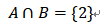
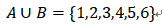
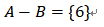

# 第五章 C++STL库教程(附带题库)

## 1.C++的区别

### 1.从C语言到C++

1980年，Bjarne Stroustrup博士着手创建一种新的语言，能够具有面向对象的程序设计特色。在当时，面向对象编程是一个新颖的概念，Stroustrup博士并不是从头开始设计新语言，而是使用C语言进行修改，而这就是C++语言。

C++是C的超集，也就是说C++是可以兼容C语言的，C++在C语言的基础上增加了许多的特性和概念，他通关关键字的方式进行实现，不过本文不重点说明C++和C语言的区别，本文只是从数据结构的角度去观测两语言之间的问题，并且说明C++的改进，从本文开始，将会在C语言的基础上开始用到C++的特性和概念去实现数据结构，这将方便我们的程序设计。

### 2. 代码改变

介绍几个很明显的转变我们以后会很常用，这些可以在C语言网的C++教程中看到，如果你已经学过C++，建议你可以直接跳过本段内容，如果你对于C++还一知半解的，建议你在阅读本文的同时去翻阅C++的学习资料，两者的学习并不冲突，相反他们相辅相成。

a)头文件引用

C语言的引用头文件的方式是include名字.h的方式进行引用，而C++去掉了.h（虽然在绝大多数编译器上任然使用.h的方法也不会报错）而是改成直接引用名字即可，这里需要注意的是C++使用C语言标准时，需要在库前面添加一个c来表明这个库是来自于C语言的。

```cpp
//C语言的方法：带.h的方式进行include

#include<stdio.h>

#include<math.h>

//C++的方法，直接引用即可

#include<cstdio>

#include<cmath>
```

b)输入与输出

C++的输入输出与C语言指定类型的不同，C++采用“流”的思路去进行输入输出设计，这样的做法可以大大简化我们的设计，但是这样的做法确是更慢，本章稍后会介绍输入输出的优化，将会重讲本内容。

```cpp
int n; //定义n为整形

//C语言的输入输出（需要指定类型，如下指定为整形）

scanf("%d",&n);

printf("%d",n);

//C++语言的输入输出（不需要指定类型，会根据n进行自主的判定）

cin>>n;

cout<<n;
```

### 3. 即将开始—STL

STL是Standard Template Library的简称，中文名标准模板库，惠普实验室开发的一系列软件的统称。它是由Alexander Stepanov、Meng Lee和David R Musser在惠普实验室工作时所开发出来的。从根本上说，STL是一些“容器”与“算法”的集合，所谓的这些“容器”无非就是已经实现好了数据结构，能够让程序设计者更为方便的进行调用，“算法”则顾名思义就是已预先实现好了的算法集合。

STL的目的是标准化组件，这样就不用重新开发，可以使用现成的组件。STL现在是C++的一部分，因此不用安装额外的库文件。STL的版本很多，有很多公司或者工作室自定义STL形成各种各样的自定义标准。。

在C++标准中，STL被组织为下面的13个头文件：<algorithm>、<deque>、<functional>、<iterator>、<vector>、<list>、<map>、<memory>、<numeric>、<queue>、<set>、<stack>和<utility>。

     使用STL可以大大辅助简化我们的算法与数据结构的设计，但是我们必须要记住，在我们使用之前，我们必须要了解他的原理，掌握它的技巧，否则就是乱用，切记。

## 2.C++STL教程入门

在上一篇文章我们已经基本的了解了什么是C++的STL（标准模板库），在本章中绝大多数内容都是在介绍常用的STL模板的使用以及其一些参数的介绍，但是请注意，STL由于其设计之初就容纳了大量的程序员思维结晶，经过了无数次的讨论才形成了一个统一的标准，他同时拥有大量的内容和知识点，如果完全讲解内容，展开完完全全可以写出一本500页的书，本篇还是以数据结构为主，因此，这里只是略讲，而且还主要是略讲与数据结构相关的容器，不是深入讲解。

在这里引用本人的一位老师说的话：不学STL的C++是不完整的C++。

以下是STL中包含的几大内容，在学习中重点要学习前三点。

### 1.容器（Container）

是一种数据结构，也是本章节提的重点，如list(链表)，vector(向量数组)，stack(栈)，队列(queue) ，以模板类的方法提供，为了访问容器中的数据，可以使用由容器类输出的迭代器。

### 2. 迭代器（Iterator）

是一种特殊的指针，它提供了访问容器中对象的方法，在程序设计中，它扮演了容器和算法之间的胶合剂，利用迭代器可以快速而安全的对容器内容进行操作，或是进行算法模板的使用。

### 3. 算法（Algorithm）

（部分书籍称为泛型算法，generic algorithms），是一类常用的算法模板，既可以对容器进行操作，同时其开放性也让算法类本身可以针对数组或者是自定义结构体等结构进行直接的操作。

### 4. *仿函数（Function object）（又称为函数对象，function object）

是一种行为类似函数，这样讲可能有些抽象，我们可以理解为一种高级的，重载了()操作符的结构体与类。

### 5.*迭代适配器（Iterator Adaptor）

是一种用来修饰容器或者仿函数的接口，它使得得带适配器使算法能够以逆向模式，安插模式进行工作，甚至还可以与流配合，它对容器起到非常大的辅助作用，同时他还将迭代器进行了更高级别的抽象。

### 6. *空间配制器（allocator）

是负责空间的配置与管理，重点就是对容器的空间申请和空间释放进行管理，你可以理解为C的malloc和free函数，C++的new和delete关键字。

## 3.C++STL之Vector容器

### 1. 概念

Vector可以翻译为向量，或向量数组，至于为什么以向量命名，可以理解为一维空间也是存在向量的。

Vector是最简单的序列是容器，就像数组一样，向量使用连续的存储位置作为元素，这意味着它们的元素也可以使用常量指向其元素的偏移来访问，与数组一样有效。但与数组不同，它们的大小可以动态变化，其存储由容器自动处理。

总结一下**Vector就是一个动态创建空间，且预先加载了常用的数组操作的数组**

### 2. 相关头文件

头文件：#include <vector>

### 3. 初始化

格式为：vector<Data_Types> name;

我们以Int类型作为参数为例，进行创建。

```cpp
vector<int> v1;          //创建一个空的向量v1

vector<int> v2(10);      //创建一个向量v2，其已开辟10个元素的空间，相当于int v[10];

vector<int> v3(10,5);    //创建一个向量v3，其已开辟10个元素的空间并全部赋值为5

vector<int> v4(v3.begin(),v3.end());    //创建一个向量v3,其内容为向量v3的内容

vector<int> v5(v4);      //创建一个向量v5，其包含了v4的全部内容
```

### 4. 迭代器

顾名思义，迭代器是一种安全的访问控制器，它本身是一种指针，用于直接的元素访问。其遍历访问的大致思路是，创建容器的迭代器，让迭代器指向第一个元素，逐步向后移动并最终指向最后一个元素结束。

遍历代码举例：

```cpp
vector<int> v;       //创建一个向量vs

vector<int>::iterator it;   //C98标准

for(it=v.begin();it!=v.end();it++){

    cout<<*it<<' ';

}
```

当然，遍历也可以直接使用下标访问：

```cpp
 for(int i=0;i<v.size();i++){

        cout<<v[i]<<' ';

    }
```

请根据自己的使用习惯进行合理的安排，对于新手而言会更倾向于选择后者。

### 5.常用接口（常用的）

Vector的接口有非常多，不同的C++语言标准也不同，这里只提供一些常用的进行简介，具体的使用可以翻阅官方文档（英文），或是别人的翻译稿。

我们使用 vector<int> v; 预先创建了一个向量。

### **a) 向量尾插入push_back()**

在向量的末尾添加一个新元素val，并自动让容器大小增大一个。

函数原型：

void push_back (const value_type& val);

使用举例：

```cpp
v.push_back(10);  //插入一个数据10
```

### **b) 向量尾删除pop_back()**

移除向量尾的最后一个元素，并且将容器大小减小一个，

函数原型：void pop_back();

使用举例：

```cpp
v.pop_back();
```

### **c) 插入insert()**

插入元素到指定位置，通过在元素之前在指定位置插入新元素来扩展向量，从而有效地增加容器大小所插入的元素数量。

函数原型：

插入单一数据到指定位置：

*iterator insert (iterator position, const value_type& val);*

插入一段数据到指定位置：

*void insert (iterator position, size_type n, const value_type& val);*

插入一段别的容器的数据到指定位置：

*template <class InputIterator>*

*void insert (iterator position, InputIterator first, InputIterator last);*

使用举例：

```cpp
 v.insert(v.begin(),10);     //在向量最前端插入数据10

 v.insert(v.begin(),5,20);   //在向量最前端插入5个数据20

 vector<int> k(2,50);   //创建一个新的向量k,其拥有2个元素内容均为50

 v.insert(v.begin(),k.begin(),k.end());  //在向量v最前端插入向量K的全部内容
```

### **d) 删除erase()**

删除一个元素，或者是一段区间的元素，将会自动缩减空间使用。

函数原型：

*iterator erase (iterator position);*

*iterator erase (iterator first, iterator last);*

使用举例

```cpp
v.erase(v.begin());     //删除第一个元素

v.erase(v.begin(),v.begin()+4); //删除从第一个开始后4个元素（包括第一个）
```

### **e) 清空clear()**

将向量中所有元素清空。

函数原型：

void clear();

使用举例：

```cpp
v.clear();      //清空向量
```

### **f) 数据大小size()**

返回向量中的数据元素个数。

函数原型：

size_type size() const;

使用举例：

```cpp
 cout<<v.size()<<endl;   //输出5
```

### **g)已开辟最大宽度capacity()**

返回向量最大已开辟的空间大小。

函数原型：

size_type capacity() const;

使用举例

```cpp
vector<int> v(3,10);    //创建默认有3个值为10的元素的向量v

v.insert(v.begin(),10,20);   //在向量最前端插入10个值为20的数据

v.erase(v.begin(),v.begin()+4); //删除从第一个开始后4个元素（包括第一个）

cout<<v.capacity()<<endl;   //输出13
```

### **h)*最大支持空间max_size()**

返回计算机支持开辟vector的最大空间值，一般来说和计算机内存和CPU相关，是一个极大的数据，而且不同计算机中可能有不同的值

函数原型：

size_type max_size() const;

使用举例：

```cpp
vector<int> v(5,10);    //创建默认有5个值为10的元素的向量v

cout<<v.max_size()<<endl;   //输出4611686018427387903
```

## 4.C++STL之List容器

### 1.再谈链表

List链表的概念再度出现了，作为线性表的一员，C++的STL提供了快速进行构建的方法，为此，在前文的基础上通过STL进行直接使用，这对于程序设计中快速构建原型是相当有必要的，这里的STL链表是单链表的形式。

### 2.头文件

头文件：#include<list>

### 3.初始化

格式为：explicit list (const allocator_type& alloc = allocator_type());

我们以int类型作为参数为例进行创建，其创建方法与vector无异

```cpp
    list<int> l1;           //创建一个空链表

    list<int> l2(10);       //创建一个链表其有10个空元素

    list<int> l3(5,20);     //创建一个链表其有5个元素内容为20

    list<int> l4(l3.begin(),l3.end());  //创建一个链表其内容为l3的内容

    list<int> l5(l4);               //创建一个链表其内容为l4的内容
```

### 4. 迭代器

遍历代码举例(其方法和vector版本无异只是更加精简)：

```cpp
 list<int> li;

for(list<int>::iterator it=li.begin();it!=li.end();it++){

        cout<<*it<<' ';

    }
```

### 5. 常用接口

我们使用list<int> li;预先创建了一个链表，命名为li，方便举例

### **a)判断是否为空empty()**

返回一个bool类型的值，只存在真和假，当链表为空时为真，不为空时为假

函数原型

bool empty() const;

```cpp
 if(li.empty()){     //当链表为空的时候执行

        cout<<"is empty()"<<endl;

    }else{

        cout<<"not empty()"<<endl;

    }
```

### **b)获取大小size()**

返回链表元素的个数

函数原型

size_type size() const;

```cpp
cout<<li.size()<<endl;
```

### **c) 链表前插入push_front() &&删除 pop_front()**

push_front()表示在链表最前端插入一个数据，pop_front()表示在链表最前端删除一个数据。

函数原型

void push_front (const value_type& val);

void pop_front();

```cpp
    li.push_front(10);

    li.pop_front();
```

### **d) 链表后插入push_back() &&删除 pop_back()**

push_back()表示在链表尾插入一个数据，pop_back()表示将链表尾删除一个数据。

函数原型：

void push_back (const value_type& val);

void pop_back();

```cpp
    li.push_back(10);

    li.pop_back();
```

### **e) 插入insert()**

插入元素到指定位置，通过在元素之前在指定位置插入新元素来扩展向量，从而有效地增加容器大小所插入的元素数量。

函数原型：

插入单一数据到指定位置：

iterator insert (iterator position, const value_type& val);

插入一段数据到指定位置：

void insert (iterator position, size_type n, const value_type& val);

插入一段别的容器的数据到指定位置：

template <class InputIterator>

void insert (iterator position, InputIterator first, InputIterator last);

使用举例：

```cpp
    li.insert(li.begin(),10);     //在链表最前端插入数据10

    li.insert(li.begin(),5,20);   //在链表最前端插入5个数据内容为20

    list<int> k(2,50);   //创建一个新的链表k,其拥有2个元素内容均为50

    li.insert(li.begin(),li.begin(),li.end());  //在链表v最前端插入链表上K的全部内容
```

### **f) 删除erase()**

删除一个元素，或者是一段区间的元素，将会自动缩减空间使用。

函数原型：

iterator erase (iterator position);

iterator erase (iterator first, iterator last);

使用举例

```cpp
li.erase(li.begin());     //删除第一个元素

li.erase(li.begin(),li.begin()+4); //删除前4个元素
```

### **g)排序sort()**

让整个链表变成升序状态，或者变成自定义的排序状态

函数原型：

void sort();

template <class Compare>   void sort (Compare comp);

详细举例：

```cpp
#include<iostream>

#include<list>

using namespace std;s

int cmp(const int &a,const int &b){

    //简单的自定义降序序列

    return a>b;

}

int main(){

    list<int> li;           //创建一个空链表

    for(int i=10;i>=6;i--){

        li.push_back(i);

    }

    li.push_front(3);

    li.push_back(20);

    list<int> li2(li);

    for(list<int>::iterator it=li.begin();it!=li.end();it++){

        cout<<*it<<' ';

    }

    cout<<endl;

//排序前3 10 9 8 7 6 20//

    li.sort();

    for(list<int>::iterator it=li.begin();it!=li.end();it++){

        cout<<*it<<' ';

    }

    cout<<endl;

//默认排序后 3 6 7 8 9 10 20//

    li2.sort(cmp);

    for(list<int>::iterator it=li2.begin();it!=li2.end();it++){

        cout<<*it<<' ';

    }

    cout<<endl;

//自定义排序后 20 10 9 8 7 6 3//

    return 0;

}
```

### **h)逆序reverse()**

相对于自定义的降序方法，STL提供了一个默认的降序方法reverse()，类似于sort一样直接使用即可。

void reverse();

```cpp
li.reverse();
```

## 5.C++STL之stack栈容器

### 1. 再谈栈

回顾一下之前所学的栈，栈是一种先进后出的数据结构，而实现方式需要创建多个结构体，通过链式的方式进行实现，这是标准的栈的思路，而在STL中栈可以以更为简单的方式实现。

### 2. 头文件

头文件 #include<stack>

### 3. 初始化

格式为：explicit stack (const container_type& ctnr = container_type());

我们以int类型作为参数为例进行创建，其创建方法与vector无异

```cpp
stack<int> s;

stack<int> v(s);
```

标准的栈创建方法是直接创建空栈，由于栈的特殊性质，让他拥有其他容器的参数可以这样创建，这种多参数的方式可能有一些复杂，一般也很少这样使用。

```cpp
    vector<int> v(3,100);

    stack<int,vector<int> > s(v);  //注意，> >符号之间需要有一个空格隔开
```

通过标准的方式创建向量数组，然后通过复制构造函数的方式进行创建，其内容就是vector数组的全部内容。

### 4. 迭代器

栈和队列都属于一种特殊的数据结构，只能通过访问顶层数据并不断剔除数据的方法进行全部访问，因此没有直接的迭代器。

### 5. 常用接口

我们使用stack<int> s 预先创建了一个栈，命名为s，方便举例

### **a)大小size()**

返回栈元素的个数

函数原型：size_type size() const;

```cpp
cout<<s.size()<<endl;   //直接返回栈中元素的个数
```

### **b) 返回栈顶元素top()**

返回栈顶元素内容

函数原型：

reference& top();

const_reference& top() const;

```cpp
cout<<s.top()<<endl;     //直接返回输出即可

s.top()+=100;            //也可以直接对栈定元素进行修改操作
```

### **c) 入栈push()**

往栈顶中插入一个元素。

函数原型： void push (const value_type& val);

### **d)出栈pop()**

将栈顶元素释放，注意pop()函数是没有返回值的，如果要想访问后删除需要先top再pop使用。

函数原型：void pop();

```cpp
s.pop();
```

### **e) 判空empty()**

返回一个bool类型的值，只存在真和假，当栈为空时为真，不为空时为假

函数原型

bool empty() const;

可以利用判空的函数进行元素访问的操作，这里建议先使用初始化函数将栈进行复制，否则遍历之后栈s就为空了。

```cpp
while(!s.empty()){

        cout<<s.top()<<endl;

        s.pop();

    }
```

### 6.  推荐配套作业

我们可以把栈相关的题目再度拿出来做一下，看一下使用STL可以怎么样进行简化。

请使用**STL**的方法完成进制转换题目。

[第三章-栈的内容]

可以尝试的去利用栈的思维实现一下进制转换的题目

如十进制到八进制：[1055题](https://www.dotcpp.com/oj/problem1055.html)

十进制到二进制：[1192题](https://www.dotcpp.com/oj/problem1192.html)

或者可以尝试一下利用递归栈的方式，将栈去代替函数递归实现一些功能（注意，这将会是DFS搜索算法的理解基础）

如斐波那契数列：[1131题](https://www.dotcpp.com/oj/problem1131.html)

## 6.C++STL之Queue容器

### 1. 再谈队列

回顾一下之前所学的队列，队列和栈不同，队列是一种先进先出的数据结构，STL的队列内容极其重要，虽然内容较少但是请务必掌握，STL的队列是快速构建搜索算法以及相关的数论图论的状态存储的基础。

### 2.相关头文件

头文件：#include<queue>

### 3.初始化

格式为：

```cpp
explicit queue (const container_type& ctnr = container_type());
```

我们以int类型作为参数为例进行创建。

```cpp
queue<int> q;    //创建一个空的没有数据的队列q

queue<int> qoo(q);    //创建一个队列其元素为q的全部内容
```

标准的队列创建方法是直接创建空队列再进行其他的操作，由于队列的特殊性质，拥有其他容器的参数可以这样创建，这种多参数的方式可能有一些复杂，一般也很少这样使用。

```cpp
vector<int> v(3,100);

    queue<int,vector<int> > s(v);  //注意，> >符号之间需要有一个空格隔开
```

通过标准的方式创建向量数组，然后通过复制构造函数的方式进行创建，其内容就是vector数组的全部内容。

### 4. 迭代器

栈和队列都属于一种特殊的数据结构，只能通过访问顶层数据并不断剔除数据的方法进行全部访问，因此没有直接的迭代器。

### 5. 常用接口

我们预先通过queue<int> q创建了一个队列，命名为q，方便举例。

### **a)大小size()**

返回队列元素的个数

函数原型：size_type size() const;

```cpp
cout<<q.size()<<endl;   //直接返回队列元素的个数
```

### **b) 入队push()**

进行入队操作，在队尾处进行插入

函数原型：void push (const value_type& val);

```cpp
q.push(100);
```

### **c) 出队pop()**

进行出队操作，在对头出进行弹出

函数原型：void pop();

```cpp
q.pop();
```

### **d)访问队头元素front()**

访问对头元素，可以返回其数值，也可以进行相应的操作，这里更加建议多使用front()访问队头数据，因为我们进行出队操作均是从队头进行出队的。

函数原型：

value_type& front();

const value_type& front() const;

```cpp
q.front()+=500;     //对队头元素进行修改

    cout<<q.front()<<endl;   //直接输出内容
```

### **e) 访问队尾元素back()**

访问队尾元素，较为少用。

函数原型：

value_type& back();

const value_type& back() const;

```cpp
q.back()+=500;     //对队尾元素进行修改

    cout<<q.back()<<endl;
```

### **f) 判空empty()**

返回一个bool类型的值，只存在真和假，当队列为空时为真，不为空时为假

函数原型

bool empty() const;

可以利用empty()进行队列的遍历操作，这里建议先使用初始化函数将队列进行复制，否则遍历之后队列就为空了。

```cpp
 while(q.empty()){

        cout<<q.front()<<endl;

        q.pop();

    }
```

### 6. 相关配套习题

我们可以回顾队列的相关题目再度进行联系，熟悉STL 的简化方法，为搜索算法的学习做预备。

[第四章—队列的内容]

试着使用STL完成队列基本操作

作业：[1898题](https://www.dotcpp.com/oj/problem1895.html)

## 7.C++STL之Priority_queue(优先队列)

### 1. 简介

优先队列是一种极其特殊的队列，他与标准的队列使用线性结构进行计算不同，优先队列的底层是以散列的状态（非线性）表现的，他与标准的队列有如下的区别，标准的队列遵从严格的先进先出，优先队列并不遵从标准的先进先出，而是对每一个数据赋予一个权值，根据当前队列权值的状态进行排序，使得权值最大（或最小）的永远排在队列的最前面。

### 2. 相关头文件

由于其属于队列的一种，因此可以直接使用队列的头文件#include<queue>

### 3. 优先队列的初始化

```cpp
priority_queue<T, Container, Compare>

priority_queue<T>        //直接输入元素则使用默认容器和比较函数
```

与往常的初始化不同，优先队列的初始化涉及到一组而外的变量，这里解释一下初始化：

a) T就是Type为数据类型

b) Container是容器类型，（Container必须是用数组实现的容器，比如vector,deque等等，但不能用 list。STL里面默认用的是vector）

c) Compare是比较方法，类似于sort第三个参数那样的比较方式，对于自定义类型，需要我们手动进行比较运算符的重载。与sort直接Bool一个函数来进行比较的简单方法不同，Compare需要使用结构体的运算符重载完成，直接bool cmp(int a,int b){  return a>b; } 这么写是无法通过编译的。

使用的举例有：

```cpp
struct cmp

{ //这个比较要用结构体表示

    bool operator()(int &a, int &b) const

    {

        return a > b;

    }

};

priority_queue<int,vector<int>,cmp> q;    //使用自定义比较方法

priority_queue<int> pq;
```

### 4. 常用接口

我们预先通过priority_queue <int> q创建了一个队列，命名为q，方便举例。

### **a)大小size()**

返回队列元素的个数

函数原型：size_type size() const;

```cpp
cout<<q.size()<<endl;   //直接返回队列中元素的个数
```

### **b) 入队push()**

进行入队操作，在队尾处进行插入

函数原型：void push (const value_type& val);

```cpp
q.push(100);
```

### **c) 出队pop()**

进行出队操作，在对头出进行弹出

函数原型：void pop();

```cpp
q.pop();
```

### **d) 访问队头元素top()**

与标准队列不同，优先队列只允许访问队头元素，不允许访问其余的数据，由于堆的特殊性质，堆顶元素的优先权最高（或者最低），访问其余元素没有意义，因此，优先队列只允许访问队头元素，这和栈的访问类型类似所以使用栈访问栈顶的命名top

函数原型是：

reference& top();

const_reference& top() const;

```cpp
 cout<<q.top()<<endl;
```

### **e) 判空empty()**

返回一个bool类型的值，只存在真和假，当队列为空时为真，不为空时为假

函数原型

bool empty() const;

可以利用empty()进行队列的遍历操作，这里建议先使用初始化函数将队列进行复制，否则遍历之后队列就为空了。

```cpp
  while(q.empty()){

        cout<<q.pop()<<endl;

        q.pop();

    }
```

### 5.实例代码

可以通过这个代码进行参考，可以看的输出的结果是顺序的。

```cpp
#include <queue>

#include <iostream>

using namespace std;

struct cmp

{ //这个比较要用结构体表示

    bool operator()(int &a, int &b) const

    {

        return a > b;

    }

};

int main()

{

    priority_queue<int, vector<int>, cmp> q;

    for (int i = 1; i <= 5; i++)

    {

        q.push(i * 10);

        cout << "push element " << i << endl;

    }

    q.push(15);

    q.push(4);

    int i = 1;

    while (!q.empty())

    {

        int temp = q.top();

        q.pop();

        cout << "No " << i++ << " element is: " << temp << endl;

    }

    return 0;

}
```

输出：

```cpp
push element 1

push element 2

push element 3

push element 4

push element 5

No 1 element is: 4

No 2 element is: 10

No 3 element is: 15

No 4 element is: 20

No 5 element is: 30

No 6 element is: 40

No 7 element is: 50
```

### 6.相关配套习题

优先队列和优化图论的缔结特斯拉算法有很大的联系，优先队列属于一种比较高级的数据结构，可以试着利用优先队列做一些排序题目，等到有基础之后再进行高级算法的训练。

[1169题](https://www.dotcpp.com/oj/problem1169.html)

## 8.C++STL之Set容器

### 1. 简介

**Set**（集合）属于关联式容器，也是**STL**中最实用的容器，关联式容器依据特定的排序准则，自动为其元素排序。Set集合的底层使用一颗红黑树（可能读者对此不太了解，等但学到树论与图论的章节的时候就会明白原因），其属于一种非线性的数据结构，每一次插入数据都会自动进行排序，注意，不是需要排序时再排序，而是每一次插入数据的时候其都会自动进行排序。因此，Set中的元素总是顺序的。

Set的性质有：数据自动进行排序且数据唯一，是一种集合元素，允许进行数学上的集合相关的操作。

### 2. 相关头文件

头文件：#include<set>

### 3. 初始化

初始化格式：

```cpp
template < class T,

           class Compare = less<T>,

           class Alloc = allocator<T>

           > class set;
```

基本上就是三个参数，第一个是值，第二个比较器，用于比较内容，默认为less<Key>即降序，第三个是内存配置器，负责内存的分配和销毁。

在实际使用中，我们仅仅为其分配值就足以满足大部分需求。

```cpp
set<int> s;       //直接指定值的类型创建，其他为默认方法

//其余方法与前文的创建方法类似，不做具体展示……
```

### 4. 迭代器

C98标准下：

```cpp
 for (set<int>::iterator it=s.begin(); it!=s.end(); ++it)

        cout << *it << ' ';
```

这也是前文学过的标准用法，接下来，让我们了解一个更加先进和便捷的方法，auto方法迭代，这需要我们编译器开启C11标准，每个编译器的开启标准不一，请具体情况具体分析。

C11标准下：

```cpp
 for (auto it=s.cbegin(); it!=s.cend(); ++it)

        cout << *it << ' ';
```

可见我们使用了auto进行了迭代器类型的自动识别，省去了我们的声明迭代器的那一部分内容，这使得代码更加简化。

### 5. 常用接口

我们使用set<int> s 预先创建了一个集合，命名为s，方便举例

### **a)大小size()**

返回元素的个数

函数原型：size_type size() const;

```cpp
cout<<s.size()<<endl;   //直接返回元素个数
```

### **b) 插入元素insert()**

插入一个元素，插入元素的类型必须与创建的容器类型一致

函数原型：pair<iterator,bool> insert (const value_type& val);

```cpp
s.insert(i);
```

### **c)删除元素erase()**

删除一个元素，或者是一段区间的元素，将会自动缩减空间使用。

函数原型：

iterator erase (iterator position);

iterator erase (iterator first, iterator last);

使用方法：

```cpp
s.erase(s.begin());  //使用迭代器的方法删除第一个元素

s.erase(s.begin(),s.end());     //删除一段内容，这里是全部删除
```

### **d)清空元素clear()**

将整个set集合中的内容清空，注意，这里只是清空元素，其所占用的最大内存空间还是不会改变的。

```cpp
s.clear();
```

### **e)查找元素find()**

函数原型：iterator find (const value_type& val) const;

函数原型：iterator find (const value_type& val) const;

Find方法返回一个迭代器类型的指针，因此我们直接通过find获取其数据的时候需要使用指针*的方式进行表示，否则将会报错。

```cpp
cout<< *s.find(4) <<endl;
```

或者 实现找到的删除指定元素

```cpp
s.erase(s.find(4));
```

## 9.set theory（集合论）

### 1. 集合论简介

集合论，是数学的一个基本的分支学科，研究对象是一般集合。集合论在数学中占有一个独特的地位，它的基本概念已渗透到数学的所有领域。集合论或集论是研究集合（由一堆抽象物件构成的整体）的数学理论，包含了集合、元素和成员关系等最基本的数学概念。

在我们还在高中教育阶段，可能或多或少会接触到一些诸如集合并交差的运算，而集合论与我们C++的STL运算有很多相似而相同的关系。

### 2. 集合关系

我们假设有两个集合：

A={2,4,6}

B={1,2,3,4,5}

在数学上

交运算可以写为：



并运算可以写为：



差运算可以写为：



我们以该内容为例，进行代码介绍。

### 3. Algorithm头文件

STL的算法头文件，STL中除了我们常用的这些容器文件以外，还有一个极其重要的头文件，Algorithm，他是我们常用的标准算法的集合，为我们预先封装了我们可能会用到的算法，比如说排序，使用Algorithm头文件中的sort函数可以快速帮我们进行数组排序，以下是实例代码：

```cpp
#include<iostream>

#include<algorithm>

using namespace std;

int main(){

    int a[6]={1,5,9,4,6,3};

    sort(a,a+6);        //使用STL的快速排序算法

    for(int i=0;i<6;i++){

        cout<<a[i]<<' ';

    }

}
```

### 4. 集合论与STL集合

在数学上的并运算我们可以使用set_union()函数进行实现，而交运算我们也可以使用set_intersection()函数进行实现，差集则使用set_difference()函数实现，以下是简单的实现代码，这个案例会同时提供一些前面所学的知识，当作一个汇总练习。

```cpp
#include <iostream>

#include <set>

#include <vector>

#include <algorithm>        //使用算法头文件

using namespace std;

int main(){

    set<int> a, b;           //建立两个集合

    vector<int> c;           //建立一个向量，我们用这个向量存储运算结果

    //a = {2,4,6};

    a.insert(2);

    a.insert(4);

    a.insert(6);

    //b = {1,2,3,4,5};

    b.insert(1);

    b.insert(2);

    b.insert(3);

    b.insert(4);

    b.insert(5);

    set_union(a.begin(), a.end(), b.begin(), b.end(), back_inserter(c));//并集

    for(vector<int>::iterator it=c.begin();it!=c.end();it++){

        cout<< *it << ' ';

    }

    cout<<endl;

    c.clear();

    set_intersection(a.begin(), a.end(), b.begin(), b.end(), back_inserter(c));//交集

    for(vector<int>::iterator it=c.begin();it!=c.end();it++){

        cout<< *it << ' ';

    }

    cout<<endl;

    c.clear();

    set_difference(a.begin(), a.end(), b.begin(), b.end(), back_inserter(c)); //差集 从B中减去A包含的元素

    for(vector<int>::iterator it=c.begin();it!=c.end();it++){

        cout<< *it << ' ';

    }

    cout<<endl;

    c.clear();

    return 0;

}
```

可以见的，以上的三个函数，其使用方法均是第一个集合开始到结束，第二个集合开始到结束，然后使用back_inserter插入器将数据插入到某一个向量或者其他容器之中，并交差是我们集合运算中的最基本的运算，有了这几种运算，我们可以构建出非常多的集合论中的各种功能，以达到我们的数学功能。

## 10.C++STL之Map容器

### 1. 简介

**Map**也是一种关联容器，它是 键—值对的集合，即它的存储都是以一对键和值进行存储的，Map通常也可以理解为关联数组（associative array）,就是每一个值都有一个键与值一一对应，因此，map也是不允许重复元素出现的。

同时map也具备set的相关功能，其底层也会将元素进行自动排序，

### 2. 相关文件

头文件：#include<map>

### 3.  初始化

格式为：

```cpp
template < class Key,

           class T,

           class Compare = less<Key>,

           class Alloc = allocator<pair<const Key,T> >

           > class map;
```

一共有4个值，其中第一个是键，第二个是值，这两个元素呈现对应的关系，接着第三个元素是比较器，其默认是降序排序，第四个是内存配置器，负责内存的分配和销毁。我们常用的可以直接省去第三和第四个值的输入，只输入键和值即可。

### 4.迭代器

我们使用map<char,int> s提前建立了一个map

C98代码如下：

```cpp
 for(map<char,int>::iterator it=s.begin();it!=s.end();it++){

        cout<< it->first <<" --- " << it->second<<endl;

    }
```

这里我们需要注意一下，我们不能直接通过*it的输出方式输出值，因为map种含有两个元素，相当于一个struct结构体，是一个复合类型，C/C++中输出复合类型需要我们指定复合类型的值。

因此我们输出就变成了it->first 指定输出键，it-<second指定输出值（刚好就是英文的第一和第二的意思）

### 5.常用接口

我们使用map<char,int> s 预先创建了一个map，命名为s，方便举例

### **a) 大小size()**

返回链表元素的个数

函数原型：size_type size() const;

```cpp
cout<<s.size()<<endl;   //直接返回栈中元素的个数
```

### **b) 插入元素insert()**

插入一个元素，插入元素的类型必须与创建的容器类型一致

函数原型：single element

pair<iterator,bool> insert (const value_type& val);

template <class P> pair<iterator,bool> insert (P&& val);

```cpp
s.insert(pair<char,int>('d',4));

//这里的Pair表示一对的关系，相当于struct pair{char a;int b}的一对数据，我们在接下来会详细学pari的用法

//如果觉得这样的方式比较困难，可以试着使用下标的方式进行数据输入

s['d']=4;        //这与上面的效果是一样的。
```

### **c) 删除元素erase()**

删除一个元素，或者是一段区间的元素，将会自动缩减空间使用。

函数原型：

iterator erase (iterator position);

iterator erase (iterator first, iterator last);

使用方法：

```cpp
s.erase(s.begin());  //使用迭代器的方法删除第一个元素

s.erase(s.begin(),s.end());     //删除一段内容，这里是全部删除
```

清空元素clear()

将整个set集合中的内容清空，注意，这里只是清空元素，其所占用的最大内存空间还是不会改版的。

```cpp
s.clear();
```

### **d) 查找元素find()**

函数原型：iterator find (const value_type& val) const;

```cpp
cout<< s.find('d')->second <<endl;
```

或者 实现找到的删除指定元素

```cpp
s.erase(s.find('d'));
```

## 11.C++STL之Pair类模板

### 1. 简介

**Pair**表示“一对”的意思，pair将两个数据合成一组数据，在如下两种变成情况中，我们更加常见与使用pair，第一是使用STL中的map（在上一节讲过），对于map而言，key和value需要分开来进行使用和声明，使用pair可以合二为一（但是数据输出时依旧要分离），第二则是当我们的函数需要返回两个数据的时候，可以使用pair。

Pair的实现是一个结构体而不是一个类因此可以直接使用pair的成员变量。

总结一下：pair将一对值（可以有不同的数据类型）和为一个值

### 2. 相关头文件

标准头文件 #include<utility>。

但是笔者亲测在编译器可以不声明这个头文件而直接使用，貌似在C++中，pair被放入了std命名空间中了。

### 3. 初始化

格式为：

template <class T1, class T2> struct pair;

在现实情况中我们可以像类似于STL创建新容器一样创建pair也可以直接使用，如下：

```cpp
pair<int,int> p;

pair<int,int> p(10,20);
```

或者是：

```cpp
map<char,int> m;

    m.insert(pair<char,int>('a',10));
```

明白了如何初始化，接下来谈一下如何使用以及方法。

对与pair中的两个元素，我们可以使用first和second来进行访问，顾名思义first返回第一个元素，而second返回第二个元素，如：

```cpp
pair<int,int> p(10,20);

    cout<<p.first<<" "<<p.second<<endl;
```

### 4. make_pair：

函数原型template pair make_pair(T1 a, T2 b) { return pair(a, b); }

我们可以通过make_pair生成我们的所需要的pair，对于一般的pair而言，我们如果需要对其进行赋值，则需要

```cpp
    pair<int,int> p;

    p.first=10,p.second=20;
```

但如果我们使用make_pair方法，则可以变成如下内容：

```cpp
 pair<int,int> p;

    p=make_pair(10,20);
```

可以看见，使用make_pair不仅仅让我们免去了对两个变量进行分开来的访问赋值，同时make_pair也智能的接受变量的类型，不需要再度指定，也就是说，make_pair本身是接受隐式类型转换的，比如定义的是一个int类型，使用make_pair传入一个float类型的参数，make_pair不会报错，而是回自动的进行一个类型转换，将float变为int，这样可以获得更高的灵活度，同时也会有一些小问题。

### 5.相关配套题目

[1096题扫雷](https://www.dotcpp.com/oj/problem1096.html)（注意，该题目为英文题）

与较难的BFS类型题目不同，本题不需要有BFS这样的搜索思路，而且本题目涉及到一个重要的内容，就是坐标，(x,y)在这类型的题目中，二维坐标往往采用一对数据进行表示，而本题目可以给自己增加要求，使用pair进行坐标的存储运算。

### 6. 举例—函数多返回值：

```cpp
#include<iostream>

#include<string>

#include<utility>

using namespace std;

pair<string,int> getClass(int id){

    return make_pair("DOTCPP!",id);

}

int main(int argc,char **argv){

    pair<string,int> a;

    a=getClass(10);

    cout<<a.first<<" "<<a.second<<endl;

    return 0;

}
```

输出内容：

```cpp
DOTCPP! 10
```

## 12.C++STL之multiset与multimap容器

### 1. Multiset

Multiset是set集合容器的一种，其拥有set的全部内容，在此基础之上，multiset还具备了可以重复保存元素的功能，因此会有略微和set的差别。

Multise容器在执行insert()时，只要数据不是非法数据和空数据，insert就总是能够执行，无论时一个数据还是一段数据。

Multiset容器中的find()函数回返回和参数匹配的第一个元素的迭代器，即时存在多个元素也只是返回第一个，如{10,20,20,20}搜索20进行匹配将会返回第二个参数，如果没有符合的参数则结束迭代器。

同理诸如lower_bound()等的需要进行一个位置的返回值，则统统返回第一个发现的值。

以下是一个举例：

```cpp
#include <iostream>

#include <set>

#include <algorithm>

using namespace std;

int main(){

    multiset<int> ms;

    ms.insert(10);

    ms.insert(20);

    ms.insert(10);

    ms.insert(20);

    ms.insert(30);

    ms.insert(50);

    //{10,20,10,20,30,50}  -----> {10,10,20,20,30,50} 插入时即会自动排序

    cout<< "发现20的位置在" << *ms.find(20)<<endl;   //这样是找不出来的哟

    int i=0;

    for(multiset<int>::iterator it=ms.begin();it!=ms.find(20);it++,i++){}

    cout<< "发现20的位置在" << i <<endl;    //由于是从0开始计算的因此答案是2

    return 0;

}
```

举例使用find进行查询了集合元素的位置，我们可以发现，这样使用实则麻烦而且浪费算力，的确，STL中提供的迭代器的思路是：提供一种方法顺序访问一个聚合对象中各个元素，而又不需暴露该对象的内部表示。

也就是说，我们使用迭代器进行访问的时候，迭代器是不会告诉你你需要访问的元素是数据内部的第几个位置，这样匿名的思路对于工程的设计是有帮助的。

### 2. Multimap容器

Multimap时map映射容器的一种，其拥有map的全部内容，并在此基础之上，multimap还具有了可以重复保存元素的功能，与上文的mutliset差不多，任何进行访问单个值得语句访问均只会返回第一个位置，这里不再多说，而是举一个实际中可能用得到得例子。

有没有一种方法，使得一个key值能够对应多个value，产生一种诸如一个学生有多门考试成绩一样的映射

我们都知道map关联容器是使得一个数据与另一个数据发生映射的容器，通过key得到value产生一一对应，那么multimap在此基础上使得map元素可以重复，因此这种情况可以使用multimap

```cpp
#include <iostream>

#include <string>

#include <map>

using namespace std;

int main(){

    multimap<string, int> m_map;

    string name="XiaoMing";

    m_map.insert(make_pair(name, 50));

    m_map.insert(make_pair(name, 55));

    m_map.insert(make_pair(name, 60));

    //方式1

    cout<<"----------方法1-----------"<<endl;

    int k;

    multimap<string, int>::iterator m;

    m = m_map.find(name);

    for (k = 0; k != m_map.count(name); k++, m++)

        cout << m->first << "--" << m->second << endl;

    //方式2

    cout<<"----------方法2-----------"<<endl;

    multimap<string, int>::iterator beg, end;

    beg = m_map.lower_bound(name);

    end = m_map.upper_bound(name);

    for (m = beg; m != end; m++)

        cout << m->first << "--" << m->second << endl;

    //方式3

    cout<<"----------方法3-----------"<<endl;

    beg = m_map.equal_range(name).first;

    end = m_map.equal_range(name).second;

    for (m = beg; m != end; m++)

        cout << m->first << "--" << m->second << endl;

    return 0;

}
```

方法一：标准的iterator的访问方法，通过find函数找到所需要知道的关系”XiaoMing”的位置，再进行”XiaoMing”的计数，输出共”XiaoMing”数量个数的元素内容，以达到需求目的。

方法二：通过lower_bound和upper_bound找到”XiaoMing”的范围进行输出。

方法三：通过equal_range获取全部的”XiaoMing”内容的元素，再通过迭代器进行输出。

这三种方法思想大同小异，请自主取舍进行巩固学习

## 13.C/C++如何设计函数多返回值？

有那么一种情况，函数本身需要返回多个值，如在地图参数中需要返回二维坐标(x,y)，或者是系统设计中需要返回一个学生多门课程的成绩。这里提供了一些做法和思路。

### 1. 全局变量，为什么不用它？

如，这样的方法，当我们需要通过函数对多个值进行返回和传递的时候，可以使用一种弄虚作假的方式，就是使用全局变量，不需要函数返回，只需要在关键时刻进行设置就可以了。

```cpp
int x,y;

void getWay(int a,int b){

    x=a,y=b;

}

int main(){

    getWay(10,20);

    cout<<x<<" "<<y<<endl;

    return 0;

}
```

这是在自欺欺人，对，当我们需要多个值进行返回传递的时候，我们可以使用全局变量避免掉这个设计，但这并不能解决核心问题，使用全局变量当我们需要多次调用或者递归调用函数时则会出现诸如数据紊乱等的错误，而且一旦在工程中使用大量的全局变量，则会造成很多意外的后果，因此这里不过多讨论。

### 2. 双返回值，pair

在我们学习pair一对数据的时候我们就有了解，我们可以通过pair作为数据类型进行多组数据的传递，这往往对于两个数据（较少的数据）而言，是最理想的情况。

```cpp
pair<string,int> getClass(int id){

    return make_pair("DOTCPP!",id);

}

int main(int argc,char **argv){

    pair<string,int> a;

    a=getClass(10);

    cout<<a.first<<" "<<a.second<<endl;

    return 0;

}
```

### 3. 指针返回法

指针返回法（又名数组返回法）顾名思义，我们的数据类型使用的是一个指针类型的数组作为返回类型，其返回的内容在内存空间上是连贯的，这个方法也被用来进行常规的数组作为参数的返回。

```cpp
#include<iostream>

using namespace std;

int *getWay(int n){

    int *p=new int[3];

    p[0]=n+10;

    p[1]=n+20;

    p[2]=n+30;

    return p;

}

int main(){

    int *res = getWay(10);

    for(int i=0;i<3;i++){

        cout<<res[i]<<' ';

    }

    delete []p;//防止内存泄漏

    return 0;

}
```

### 4.结构体返回法

这个是对于超过两个元素的最推荐的写法了，对于指针返回法，其是相当于把多组的数据当成一个共同类型的参数作为处理，可一旦返回的元素同时有整形又有浮点型这样不同的元素，指针返回的方法往往就不太适用了，最理想的方式还是设计结构体，使用结构体返回法。

```cpp
#include<iostream>

using namespace std;

struct ans

{

    int a;

    char b;

    double c;

};

ans getWay(int n){

    struct ans r_ans;

    r_ans.a=n;

    r_ans.b=n;

    r_ans.c=n+0.11;

    return r_ans;

}

int main(){

    ans ans = getWay(97);

    cout<<ans.a<<' '<<ans.b<<' '<<ans.c<<endl;

    return 0;

}

//output:

//97 a 97.11
```

这样有点类似于在第二第三章所学的数据结构定义的内容，事实上的确是相通的，函数多返回值是C/C++设计上所缺失的，也由于时代原因当时的设计不需要考虑如今那么多，而如今的各种新型语言均支持了这个概念，直接使用逗号进行分割即可达到效果。

### 5. 眼馋一下，看看PYTHON的写法

```cpp
def getWay(n):

    a=n

    b=chr(n)

    c=n+0.11

    return a,b,c

x,y,z=getWay(97)

print(x,y,z)
```

没错，这样就完成了本章第五点C++中花大篇幅介绍的功能，C语言网Dotcpp已经上线Python编译器，允许各位使用Python答题，欢迎大家使用。

## 14.C/C++如何加速输入输出效率（上）

### 1. 简介

遇到大数据时，往往读写文件成了程序运行速度的瓶颈，需要更快的读取方式。相信几乎所有的C++学习者都在cin机器缓慢的速度上栽过跟头，有很多案例中提供几个数据，却在后台测评却提供了近千，近万的数据量是常事，而很多人会发现，明明算法正确的问题，却总是在超时，但把自己的输入换成scanf，输出换成printf之后莫名其妙又可以通过了，于是便冷眼相对C++的cin与cout。

在C++中，cin与cout往往不需要我们手动设置格式而变得灵活，因此更趋向于我们便捷式的使用，但这并不是说cin与cout就一定比scanf和printf慢，我们可以通过C++输入输出流解除绑定的方式进行加速，使其提升至C语言scanf和printf般的速度。

### 2.原理：

cin在为了与scanf保持同步，设置了一个缓冲区，为了保证各位混用两者的情况不会出错，利用这个缓冲区进行同步，不至于发生指针错误造成乱码，因此cin会牺牲一点点效率，而这一点点的效率，在大数据读取和运算的时候也会产生极大的影响，我们可以通过sync_with_stdio(false)的方式取消这个缓冲区，让cin变成和scanf一样的效率。

a) sync_with_stdio

这个函数是一个“是否兼容stdio”的开关，C++为了兼容C，保证程序在使用了std::printf和std::cout的时候不发生混乱，将输出流绑到了一起，默认情况为sync_with_stdio(ftrue),即开启。

b)cin.tie(0),cout.tie(0);

cin.tie(NULL);cout.tie(NULL);只解除的是C++运行库层面的对数据传输的绑定,stdin和stdout应该在更底层的操作系统层面有绑定，没有解除，也就是说，cin.tie(0)与cout.tie(0)的方式是继续松绑c++传输的效率。

因此我们可以在自己的代码中建立一个如此的模板：

```cpp
#include<iostream>

using namespace std;

int main(){

    ios::sync_with_stdio(false);

    cin.tie(0);

    cout.tie(0);

    /*

        写上你想写入的代码，并使用cin,cout输入输出

     */

    return 0;

}
```

也可以用宏定义的方式简写这段代码：

```cpp
#define jiasu ios::sync_with_stdio(false),cin.tie(0),cout.tie(0);
```

在主函数进行引用即可。

根据最近的输出速度测试，分别在不同的平台进行存粹的输出测试，使用解除绑定的cout相对而言是最快的输出方式，而输入则因为某些受限的原因并不是最快的，为了使输入数据变快，请看下一章，快速读取。

### 备注：

1.NULL在C/C++语言中对应0，因此可以拿0代替NULL（空指针）

2.相关测试数据:

WINDWOS下[1e5的数据量]：

使用解除绑定的cout ： 30.719000 秒 ， 29.518000 秒 ， 29.446000 秒

不使用解除绑定cout ： 51.749000 秒 , 49.383000 秒 ， 47.605000 秒

C++文件的printf ： 84.962000 秒 ， 76.131000 秒 ， 77.639000 秒

C语言文件的printf ： 29.776000 秒 ， 29.327000 秒 ， 29.862000 秒

LINUX系统下[1e5的数据量]：

使用解除绑定的cout ： 0.199213 秒 ， 0.195920 秒 ， 0.195387 秒

不使用解除绑定cout ： 0.199305 秒 , 0.188013 秒 ， 0.199603 秒

C++文件的printf ： 0.195575 秒 ， 0.197582 秒 ， 0.197400 秒

C语言文件的printf ： 0.195144 秒 ， 0.200245 秒 ， 0.215732 秒

【在WINDOWS上面运行很久的程序在LINUX全部低于一秒钟结束】

LINUX系统下[1e7（一百万）的数据量]：

使用解除绑定的cout ： 18.359119 秒 ， 18.066489 秒 ， 18.309879 秒

不使用解除绑定cout ： 18.655116 秒 , 18.655820 秒 ， 18.657697 秒

C++文件的printf ： 18.354496 秒 ， 18.592422 秒 ， 18.312166 秒

C语言文件的printf ： 18.463724 秒 ， 18.475845 秒 ， 18.495757 秒

数据来源: [https://blog.dotcpp.com/a/60828](https://www.dotcpp.com/addons/cms/go/index?url=https%3A%2F%2Fblog.dotcpp.com%2Fa%2F60828)

## 15.C/C++如何加速输入输出效率（下）

### 1.简介

自上一篇文章，我们了解了解除绑定的输入输出流，这会让我们的代码输出变得迅速，然而，对于输入而言，亦有快速读取这一个更优秀的方案（相对来说也较为麻烦）。

在我们学习C语言的时候，我们曾经学过字符的输入函数getchar()，她从标准输入里面读取下一个字符，相当于gets(stdin)，返回类型为int型，为用户输入的ASCII码，出错则返回-1。

### 2.实现方式

将所读取的数据按位进行分段截取，比如读取入123这个数据，在确定所读取的是数字的情况下，先读取数字1，如果其后还有数据，将第一个读取的数据1先乘以10再读取第二个数据2，接着读取3，将前面的12再乘以10，最后就可以读取成功123，而对于负数而言，我们只需要设置一个flag标记，对第一位的读取进行一个特判即可，在读取完这些数据之后，将获取到的整体数据进行返回，这边就是快读的基本思想。

请记住这个核心：判断是否为数字à按位读取à转换ASCII码为数字à继续读取à进行乘10与相加à读取结束返回存储的值

这里有一个简单版本的快读

```cpp
inline int read()

{

    int X=0; bool flag=1; char ch=getchar();

    while(ch<'0'||ch>'9') {if(ch=='-') flag=0; ch=getchar();}

    while(ch>='0'&&ch<='9') {X=(X<<1)+(X<<3)+ch-'0'; ch=getchar();}

    if(flag) return X;

    return ~(X-1);

}
```

使用inline重载函数和重写read()，也可以去掉inline，只不过这样效率稍微慢一些，输入的使用方法就可以照做一般的函数进行使用即可。

```cpp
 int tmp=read();

    std::cout<<tmp<<std::endl;
```

### 3.扩展，快速输出

通快速读取，亦有快读输出，其思想更为简单，效率也只是略微胜一筹，其思维是，按照每一位进行拆解输出，注意我们需要让在后面的数字后输出，拆解位时就务必要注意，因此，较为简单的方法就是模仿递归进行设计。

```cpp
inline void write(int X)

{

    if(X<0) {X=~(X-1); putchar('-');}

    if(X>9) write(X/10);

    putchar(X%10+'0');

}
```

### 4. 推荐模板

使用C++的万能模板类并创建新的命名空间IO，可以手动指明所需要返回参数的类型，int还是long还是别的，这样的方式更加人性化，可以省去上面那样简单的方式必须手动修改函数类型的缺点，但是这样的模板却更加的复杂和繁长，不易快速上手使用，权且做一个理解。

```cpp
#include<iostream>

namespace IO

{

    inline char nc() {

        static char buf[100000], *p1 = buf, *p2 = buf;

        return p1 == p2 && (p2 = (p1 = buf) + fread(buf, 1, 100000, stdin), p1 == p2) ? EOF : *p1++;

    }

    template<typename T>

    inline T read() {

        char ch = nc();

        T sum = 0;

        while (!(ch >= '0'&&ch <= '9'))

        {

            ch = nc();

            if (ch == EOF)  return EOF;

        }

        while (ch >= '0'&&ch <= '9')

        {

            sum = sum * 10 + ch - 48;

            ch = nc();

            if (ch == EOF)  return EOF;

        }

        return sum;

    }

}

using namespace IO;

int main(){

    long long tmp=read<long long>();    //输入方式

    std::cout<<tmp<<std::endl;

    while(tmp = read<long long>()!=EOF){} //循环判断EOF的方式

    return 0;

}
```

### 5.本篇后语

C++与**STL**篇就此结束了，本篇在模式上更趋向于杂谈，STL内容何其多，足足要近千页的书才能讲完讲彻底，因此本章只是提出一个引子，一个简单的介绍，具体的内容和内涵需要多多自学完成，而对于快读和解绑的操作，更加趋向于应用在算法竞赛中抢的速度，具体如何搭配使用，也请自主根据数据规模进行决断。
