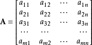
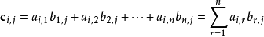
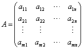
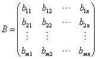
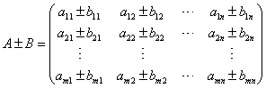
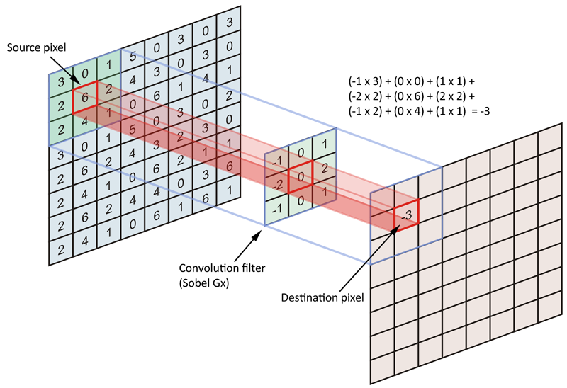
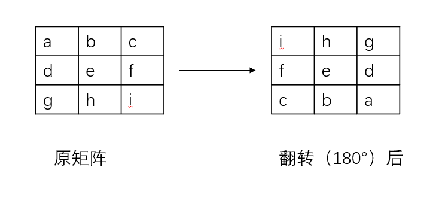
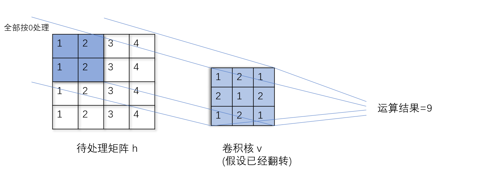
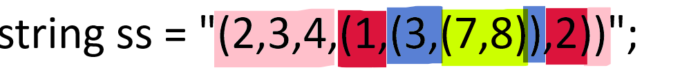
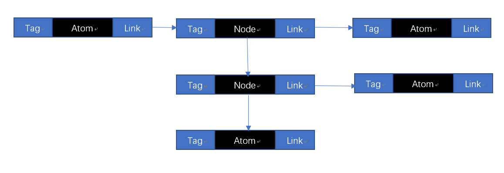

# 第六章 串、数组、矩阵和广义表

## 1.C++字符串常用操作（一）

### 1. 基本介绍

在程序设计中，字符串操作是必不可缺的，无论是工程设计还是算法设计均离不开字符串，字符串是由一个个单独的字符构成的串，其数据结构是线性的，常以ASCII码表示，同时只要设定得当，其展示任何一种编码也都是可以的。

字符串有很多的操作，也有非常多的扩展算法，本文从设计的角度介绍这些基本的字符串操作以及其实现代码，本文实现的大多数代码诸如C和C++中的头文件<string.h>(C++则是<cstring>)已经封装好了相应的函数和方法可以直接使用。

### 2. 获取字符串长度

顾名思义，指获取一个字符串的长度，在C语言中我们可以直接用strlen(str)来表示，其实现思路可以直接使用一个循环，对每一个字符进行计数，当循环遇到字符’\0’即结束符时循环结束，返回这个循环，示例代码如下：

```cpp
#include<stdio.h>

int _strlen(char str[]){

    int i=0;

    for(i=0;str[i]!='\0';i++){}

    return i;

}

int main(){

    char *str = "Hello My DotCpp.com";

    int len = _strlen(str);

    printf("%d",len);

    return 0;

}
```

输出19

### 3. 字符位置获取

给定一个字符，获取这个字符串中首次出现这个字符的位置，如果没有找到则给与一个错误信号，如给定一个hello，要求找出l的位置，那么将会找到位置3 ，C语言中可以使用strchr(str,c)表示，实现示例代码如下：

```cpp
#include<stdio.h>

int _charAt(char str[],char c){

    int i=0;

    for(i=0;str[i]!='\0'&&str[i]!=c;i++){}

    return i;

}

int main(){

    char *str = "Hello My DotCpp.com";

    int way = _charAt(str,'l');

    printf("%d",way);

    return 0;

}
```

输出3

扩展练习：如果需要你创建一个函数，获取这个字符串中所有出现这个字符的位置，又该如何去设计呢？

### 4. 拆分子串操作substr

顾名思义，**substr**对一个字符串进行拆分，也可以称之为对一个字符串的某一段进行截取，如一个字符串的长度有0~n，改操作就是取其中i~j的位置，使其重新生成一个新的字符串，获取的就是这个字符串，在C语言中没有相关的操作，在不同的教程中这样的操作也有不同的命名，本文将此操作命名未substr（在某些别的资料中substr操作则为查找操作），本实现示例代码如下（注意拆分时需要补充结束符’\0’）：

```cpp
#include<stdio.h>

char *_substr(char str[],int i,int j){

    int pos=0;

    char *backup;

    while(i<j){

        backup[pos++] = str[i++];

    }

    backup[pos]='\0';

    return backup;

}

int main(){

    char *str = "Hello My DotCpp.com";

    char *newstr = _substr(str,0,5);

    printf("%s",newstr);

    return 0;

}
```

输出Hello

### 5. 拆分子串操作prefix

如同上文的操作，截取操作变为了只截取字符串的前m个字符，组成一个全新的字符串，本实现示例代码如下（注意拆分时需要补充结束符’\0’）：。

```cpp
#include<stdio.h>

char *_prefix(char str[],int m){

    int pos=0,i;

    char *backup;

    for(i=0 ;i<m ;i++){

        backup[pos++] = str[i];

    }

    backup[pos]='\0';

    return backup;

}

int main(){

    char *str = "Hello My DotCpp.com";

    char *newstr = _prefix(str,5);

    printf("%s",newstr);

    return 0;

}
```

输出Hello

### 6. 拆分子串操作suffix

如同上文的操作，截取操作变为了只截取字符串的后m个字符，组成一个全新的字符串，本实现示例代码如下（注意拆分时需要补充结束符’\0’）：

这里需要稍微注意一下，在创建字符串的时候，由于各种标准的C对语法的支持不太一样，这里采用较为旧的方式实现，即直接分配一个相应的内存空间，这与上面的做法稍微不同，如果采用char *backup的创建方式，将会产生内存错误问题，这个问题原理较为晦涩，有能力的同学可以参考资料自行理解，这里为了避免冲突简化了操作。

```cpp
#include<stdio.h>

char *_suffix(char str[],int m){

    int len=0;

    for(;str[len]!='\0';len++){}

    //获取字符串总长度(避免使用其他封装函数，自行设计时可以使用strlen替代)

    printf("%d\n",len-m);

    int pos=0,i;

    char backup[500];

    for(i=len-m ;i<len ;i++){

        backup[pos++] = str[i];

    }

    backup[pos]='\0';

    return backup;

}

int main(){

    char *str = "Hello My DotCpp.com";

    char *newstr = _suffix(str,3);

    printf("%s",newstr);

    return 0;

}
```

输出com

## 2.C++字符串常用操作（二）

### 1.字符串连接操作

顾名思义，即将一个字符串链接到另一个字符串的尾部，我们可以创建一个函数，同时利用指针，分别先后全部遍历两个字符串，将其中一个字符串的结束符’\0’去除并链接另一个字符串直到遇到结束符’\0’即可，函数实现为：

```cpp
#include<stdio.h>

char *_strcat(char dest[],char src[]){

    char * ret = dest;

    while(*dest!='\0'){dest++;}

    //将src内容复制在dest之后

    while(*src){

        *dest++ = *src++;

    }

    //在dest后面追加\0

    *dest = '\0';

    return ret;

}

int main(){

    char str[] = "Hello My DotCpp.com";

    char fixstr[] = "Welcome ";

    _strcat(fixstr,str);

    printf("%s",fixstr);

    return 0;

}
```

输出Welcome Hello My DotCpp.com

### 2. 字符串比较操作

顾名思义，对两个字符字符字符串进行比较，常用于确认两字符串是否完全相等，部分高级用法可以扩展到利用大小差别进行容器的算法设计等，比较操作的内容就是对两个字符串进行比较，两个字符串完全相等时返回0,第一个字符串大于第二个字符串时返回一个正值,否则返回负值，实现代码为：

注意比较的时候要使用unsigned char而不要直接使用char，那是因为计算机编程语言中扩展了char的字符位，使字符位也拥有了含义，因此建议在核心的比较时使用unsigned char的类型。

```cpp
#include<stdio.h>

int _strcmp (char  *  src, char  *  dst)   {

    int  ret  =  0  ;

    while(  !(ret  =  *(unsigned  char  *)src  -  *(unsigned  char  *)dst)  &&  *dst)   //两个内容相减，完全相等则会得到值 0，取反即为相等

        ++src,  ++dst;

    if  (  ret  <  0  )

        ret  =  -1  ;

    else  if  (  ret  >  0  )

        ret  =  1  ;

    return ret;

}

int main(){

    char str[] = "Hello My DotCpp.com";

    char fixstr[] = "Welcome ";

    int ans = _strcmp(fixstr,str);

    printf("%d",ans);

    return 0;

}
```

输出 1

### 3. 暴力匹配法

这并不是最理想的算法，但却这是字符串匹配算法中最容易理解的算法，算法核心为给定一个主串T和一个模式串P，求问是否P是属于T的一个字串，如：”Hello”中”llo”就是其中的一个字串，对于暴力匹配算法而言，我们可以利用两层循环进行比对，第一层循环中找寻T字符串中的每一个字符，第二层循环找寻的是每一个P字符，进入第二层循环时T字符串也会跟着进行字符前进，如果发生不匹配则产生一个回溯回到第一层循环的进入字符的下一个字符。

代码示例如下：

```cpp
#include<iostream>

#include<cstring>

using namespace std;

bool isBF(char str1[],char str2[]){

    bool flag=false;

    int len1 = strlen(str1);

    int len2 = strlen(str2);

    for(int i=0;i<len1;i++){

        for(int j=0;j<len2;j++){

            int pos=i;

            if( str1[pos++] != str2[j]){

                break;

            }else{

                if(j=len2-1)

                    flag=true;

            }

        }

    }

    return flag;

}

int main(){

    char str1[] = "HI this is my lesson.";

    char str2[] = "is";

    cout<<isBF(str1,str2)<<endl;

    return 0;

}
```

输出1

综上假设字符串T的长度为n，字符串P的长度为m，则整个算法的时间复杂度为O( n * m )，而对于一个复杂的现实情况而言 n >> m >> 2 （即n远远大于m，m远远大于常数），这样的计算计算机的负担很重。

## 3.字符串的KMP算法详解及C/C++代码实现

### 1. 原由

紧接上文，我们知道了暴力匹配的算法在时间运行上的缺陷，假设字符串T的长度为n，字符串P的长度为m，则整个算法的时间复杂度为O( n * m )，而对于一个复杂的现实情况而言 n >> m >> 2 （即n远远大于m，m远远大于常数），这样的计算计算机的负担很重。

请思考一个暴力匹配的情况：

给定一个主字符串

T = “AAAAAAAAAAAAAAAAAAAAAAAAAAAAAAAAAAAAAAAAAAAAAAB”(47位)

同时给定模式串 P = “AAAAAB”（6位）

试问搜索的情况，很显然，暴力搜索对于每一次搜索，都要搜索到最后一个字符才能进行下一轮的搜索，因此进行的计算近似可以理解为：O(47 * 6) ，对于这样很少的数据已经有很高的计算量了。

KMP算法一种改进的模式匹配算法，是D.E.Knuth、V.R.Pratt、J.H.Morris于1977年联合发表，KMP算法又称克努特-莫里斯-普拉特操作， KMP算法与前文的暴力匹配算法，核心的区别就是没有不匹配的回溯，而是根据整个字符串的情况进行一次位移，这样大大减少了回溯产生的缺陷，KMP算法的时间复杂度可以优化到 O( n + m)级别，是二次优化到线性的程度。

### 2.构造next表(以-1开头)

对于模式串P而言，我们需要知道模式串中P的每一位的前一位是否存在相等的完全相等的前后缀，并且求这个最大的完全相等的前后缀，如一个模式串”ABCABDE”对于第倒数第二位字符而言，其符合情况的前后缀就是”AB”，而最后一位则没有完全相等的前后缀。

PS：何为前后缀：如一个字符串”ABCD”,其前缀有可能为”A”“AB”“ABC”(即除去本身的全部字符)，同理，则后缀可能为：”D””CD””BCD”

我们需要求的就是每一个字符其相对应的最大前后缀数，这样与模式串P一一对应的表称之为next表。

因此”ABCABDE”的next表为：-1 0 0 0 1 2 0 （字符用空格隔开）

A

B

C

A

B

D

E

-1

0

0

0

1

2

0

那么我们该如何实现代码呢？

对于每一个当前需要判断的字符而言，在构造next表时，应该向前进行比对，以上一个已经判断的情况为基础（初始值赋-1，部分教程中初始值赋0，两者没有实质区别），后缀如果+1位置的字符与前缀+1位置的字符相等，则next[i]就是next[i-1]+1，而如果不相等，则说明无法匹配，则next[i]=0。

### 3. KMP实现

与暴力匹配极其相似，利用while循环的条件控制， 进行匹配失败时，只需要将失败的模式串P的索引指向next表中对应的数值即可，其余匹配照旧线性执行即可。

### 4. 实现代码（仅作参考）

```cpp
#include<iostream>

#include<cstdio>

#include<cstring>

using namespace std;

int *buildNext(char *P){

    int m = strlen(P) , j=0;

    int * N = new int[m];

    int t = N[0] = -1;

    while( j < m-1 ){

        if( 0 > t || P[j] == P[t] ){

            N[++j] = ++t;

        }

        else{

            t = N[t];

        }

    }

    return N;

}

int KMP(char T[],char P[]){ //T--主串,P--模式串

    int *next = buildNext(P);   //构造NEXT表

    int n = strlen(T) , i=0;

    int m = strlen(P) , j=0;

    while( j<m && i<n ){

        if( j<0 || T[i]==P[j] ){

            i++;

            j++;

        }else{

            j = next[j];

        }

    }

    delete []next;

    return i-j;

}

int main(){

    char org[] = "ABABABABABD";

    char str[] = "ABABD";

    int ans = KMP(org,str);

    cout << ans <<endl;

    return 0;

}
```

输出6，即经过6位，在第七位发生匹配

## 4.C++中string字符串类型介绍

### 1. 简介

C语言中通过字符相连已经基本创造出了字符串的常规操作，然而，字符串在C语言中并不是常规类型，而是一个类似于数组的结构，在C++中，通过模板类的操作创建了**string类**，这样的方法更适合于现代的操作编程。

### 2. 头文件&命名空间

```cpp
#include<string>     //头文件
```

注意不是<string.h>也不是<cstring>，前者为C文件中的头文件，后者为C++中调用的C文件。

```cpp
using namespace std; //命名空间
```

string来自于std命名空间，常用的绝大多数操作均来自这个空间，string也不例外。

### 3. 初始化

与第五章的**STL**内容十分相近，两者的创建方法基本完全相等，这里直接使用代码举例，不多做缀数。

```cpp
#include<iostream>

#include<string>

using namespace std;

int main(){

    string str;       //创建空字符串

    string str1 = "Hello Dotcpp.com";

    cout<<str1<<endl;   //Hello Dotcpp.com

    string str2(str1);

    cout<<str2<<endl;   //Hello Dotcpp.com

    string str3(str1,6);

    cout<<str3<<endl;   //Dotcpp.com

    string str4(str1,6,6);

    cout<<str4<<endl;   //Dotcpp

    string str5(5,'D');

    cout<<str5<<endl;   //DDDDD

    string str6(str1.begin(),str1.end());

    cout<<str6<<endl;   //Hello Dotcpp.com

    return 0;

}
```

### 4. 比较与连接操作操作

对于比较类型的操作，可以使用 ==，>，<，>=，<=与!=进行比较字符串，对于链接操作而言，可以直接使用符号+进行直接的操作符连接

比较：对于C语言的字符串操作而言，我们通过使用strcmp函数进行比较，通过这个函数的返回值判断两字符串的大小情况，这样的比较方式确实已经满足了很多功能，但是还不如我们常规的思路，C++中利用符号重载的思路重构了比较方法，直接通过str1==str2的以及相关的方式进行比较，这比较符合我们大多数情况的人类思维，如：

```cpp
string str1 = "Hello";

string str2 = "Hello";

if(str1==str2)

    cout<<"两者相等"<<endl;

else

    cout<<"两者不相等"<<endl;
```

对于字符串的连接操作，对于C语言而言需要使用字符串连接函数，同理，C++使用符号重载直接让我们通过‘+’号完成操作，这也更符合我们的思维，避免了麻烦。

```cpp
string totalystring = "a";

    cout<<totalystring+ "b"+"c"+"d"<<endl;
```

### 5.  常用操作（节选）

### **a) 获取长度length**

获取当前字符串的长度，这与C中的strlen(str)一致。

```cpp
str.length();
```

### **b)获取大小size**

获取当前字符串的大小，某种意义上由于字符串的每一个字符开辟的空间均完全相等，因此size可以代替length

```cpp
  str.size();
```

### **c) 判断是否为空empty**

返回一个布尔类型，判断字符串是否为空empty。

```cpp
str.empty();
```

### **d) 填充内容resize**

原型为void resize(int len,char chr)把字符串当前大小置为len，多去少补，多出的字符chr填充不足的部分，resize将会修改该字符串的占用空间。

```cpp
 string str = "HEllo";

    str.resize(8,'K');

    cout<<str<<endl;
```

输出

HElloKKK

## 5.用数组实现模拟算法C/C++实现（配例题）

### 1. 概念

数组这个概念并不陌生，然而，数组本身也是一种数据结构。

数组在存储数据时是按顺序存储的，存储数据的内存也是连续的，所以他的特点就是寻址读取数据比较容易，插入和删除比较困难。简单解释一下为什么，在读取数据时，只需要告诉数组要从哪个位置（索引）取数据就可以了，数组会直接把你想要的位置的数据取出来给你。插入和删除比较困难是因为这些存储数据的内存是连续的，要插入和删除就需要变更整个数组中的数据的位置。

所以数组对比链表，数组读取和使用更加灵活，而链表插入和删除更加便捷。

### 2. 回到数组

相比在学习各种计算机编程语言基础的时候基本都会了解数组的概念，熟悉数组的使用很重要，在学习数据结构之后尤其是学习到了向量，线性表，链表等概念之后，会更加趋向于使用这类高级数据结构。但在实际中，编程应该讲究灵活贯通，链表等虽然操作方便，但是其由于指针以及其他结构的设计问题本身占用空间就比较大，因此，灵活掌握合适的数据结构的使用是必须的。

### 3.模拟

既然了解了数组的优点，为什么不加以善用呢？这里介绍一个编程的思维——模拟，所谓模拟，就是通过简单易懂的方式，根据所给出的要求，一一进行实现，通过代码模拟出所需要实现的方法过程，模拟的方法不是一种具体的实现算法，而是一种思维。

如[分糖果](https://www.dotcpp.com/oj/problem1431.html)题目

我们通过模拟的思路，通过创建一个数组，每一个数组元素代表有一个小朋友，利用while循环的判断来筛选出跳出条件的方式来完成，参考代码如下：

```cpp
#include<iostream>

using namespace std;

const int MAX=101;

int kid[MAX],ans=0;

int main() {

    int n;

    cin>>n;

    for(int i=0; i<n; i++) {

        cin>>kid[i];

    }

    while(1) {

        //用于判断是否全体相等，如果全体相等则退出循环，期待有更好的方式解决

        bool flag=true;

        for(int i=1; i<n; i++) {

            if(kid[0]!=kid[i])

                flag=false;

        }

        if(flag)

            break;

        //全体减半（由于是全体偶数，所以不需要考虑进位问题）

        for(int i=0; i<n; i++) {

            kid[i]=kid[i]/2;

        }

        //利用一个临时变量来将全体数组加上前面一位的数

        int temp=kid[n-1];

        for(int i=n-1; i>0; i--) {

            kid[i]+=kid[i-1];

        }

        kid[0]+=temp;

        //判断是否是偶数，不是则+1，同时计数器也+1

        for(int i=0; i<n; i++) {

            if(kid[i]%2!=0) {

                kid[i]++;

                ans++;

            }

        }

    }

    cout<<ans<<endl;

    return 0;

}
```

诸如此类，还有很多类似的题目，多多进行研究对代码书些很有帮助。

### 4 .小试牛刀

请试着使用模拟的思路去写如下练习题目，这对你的学习有很大帮助。

[分糖果](https://www.dotcpp.com/oj/problem1431.html)、[蚂蚁感冒](https://www.dotcpp.com/oj/problem1454.html)、[计算器](https://www.dotcpp.com/oj/problem1560.html)

【以上题目均为蓝桥杯真题，没有一定的基础可能会有些许吃力，请多多练习并参照题解思考】

PS:Dotcpp网站中标签栏直接打开“模拟”可以看见更多的相关题目。

## 6.矩阵的介绍及乘法运算（附C语言实现代码）

### 1. 矩阵概念

在数学中，矩阵（Matrix）是一个按照长方阵列排列的复数或实数集合，最早来自于方程组的系数及常数所构成的方阵。这一概念由19世纪英国数学家凯利首先提出。

矩阵是高等代数学中的常见工具，也常见于统计分析等应用数学学科中。在物理学中，矩阵于电路学、力学、光学和量子物理中都有应用；计算机科学中，三维动画制作也需要用到矩阵，尤其是计算机的图像处理之中，利用矩阵表示图像元素十分常见。 矩阵的运算是数值分析领域的重要问题。将矩阵分解为简单矩阵的组合可以在理论和实际应用上简化矩阵的运算。

由 m × n 个数aij排成的m行n列的数表称为m行n列的矩阵，简称m × n矩阵。记作：



这m×n 个数称为矩阵A的元素，简称为元，数aij位于矩阵A的第i行第j列，称为矩阵A的(i,j)元，以数 aij为(i,j)元的矩阵可记为(aij)或(aij)m × n，m×n矩阵A也记作Amn。

注意：矩阵的概念很多，而且矩阵的运算属于计算机图形学，数学等学科的必备知识，其如果要完全写下来则完全可以写出一本书，本文知识简单介绍，矩阵的基本知识必备要了解加减乘除，其中以乘法在计算机中又使用众多。

### 2. 矩阵乘法

两个矩阵的乘法仅当第一个矩阵A的列数和另一个矩阵B的行数相等时才能定义。如A是m×n矩阵和B是n×p矩阵，它们的乘积C是一个m×p矩阵  ，它的一个元素：



并将此乘积记为: C=AB

例如：


### 3.矩阵乘法实现代码

C语言中实现，核心思路在于利用for循环每一位的相乘，矩阵1的行与矩阵2的列相乘，逐步补全整个矩阵。

```cpp
#include<stdio.h>

#include<stdlib.h>

#include<string.h>

#define M 100

int main(){

    int i,j,k;

    int matrix1[M][M],matrix2[M][M],row1,col1,row2,col2;

    int ans[M][M];      //运算结果，矩阵输出

    printf("输入第一个矩阵的行高和列宽：");

    scanf("%d%d",&row1,&col1);

    printf("输入第一个矩阵：\n");

    for(i=0;i<row1;i++){

        for(j=0;j<col1;j++){

            scanf("%d",&matrix1[i][j]);

        }

    }

    printf("输入第二个矩阵的行高和列宽：");

    scanf("%d%d",&row2,&col2);

    printf("输入第二个矩阵：\n");

    for(i=0;i<row2;i++){

        for(j=0;j<col2;j++){

            scanf("%d",&matrix2[i][j]);

        }

    }

    memset(ans,0,sizeof(ans));

    printf("运算结果为:\n");

    for(i=0;i<row1;i++){

        for(j=0;j<col2;j++){

            for(k=0;k<col1;k++){

                ans[i][j]=ans[i][j]+matrix1[i][k]*matrix2[k][j];

            }

        }

    }

    for(i=0;i<row1;i++){

        for(j=0;j<col2;j++){

            printf("%d ",ans[i][j]);

        }

        printf("\n");

    }

    return 0;

}
```

### 4.推荐习题

[矩阵对角线求和](https://www.dotcpp.com/oj/problem1024.html)

[矩阵乘法](https://www.dotcpp.com/oj/problem1472.html)

## 7.矩阵加减法操作及C语言代码实现

对于矩阵而言，我们首先要学习他的基本概念，其次就如同学习常规数字一样需要掌握基本的加减乘，再者，更具相关的概念学会求诸如秩，点阵，矩阵运算值等，接着学习一些特殊的矩阵操作，如矩阵的翻转，最后这些概念完善之后，请开始学习诸如矩阵的卷积核运算，稀疏矩阵，增广矩阵等这些特殊的矩阵。

### 1. 矩阵加法

运算规则，将两个矩阵的每一行每一列进行对齐，再直接进行元素间的相加，如a11和b11相加，详情参考图，如：

设矩阵，



，



则



简言之，两个矩阵相加，即它们相同位置的元素相加！

注意：只有对于两个行数、列数分别相等的矩阵（即同型矩阵），加减法运算才有意义，即加减运算是可行的．同时，对于加法而言，A+B与B+A是没有什么不同的，他们的结果运算是一样的，详情可以参考代码：

```cpp
#include<iostream>

using namespace std;

const int maxn=505;

int a[maxn][maxn];

int b[maxn][maxn];

int ans[maxn][maxn];

int main(){

    //矩阵加法

    int n,m;

    cin >>n>>m;

    //输入a

    for(int i=0;i<n;i++){

        for(int j=0;j<m;j++){

            cin >>a[i][j];

        }

    }

    //输入b

    for(int i=0;i<n;i++){

        for(int j=0;j<m;j++){

            cin >>b[i][j];

        }

    }

    //相加

    for(int i=0;i<n;i++){

        for(int j=0;j<m;j++){

            ans[i][j]=a[i][j]+b[i][j];

        }

    }

    //输出

    for(int i=0;i<n;i++){

        for(int j=0;j<m;j++){

            cout<<ans[i][j]<<' ';

        }

        cout<<endl;

    }

    return 0;

}
```

### 2. 矩阵减法

通上文，简言之，两个矩阵相减，即它们相同位置的元素相减！

对于上文而言，我们只需要在算法中将符号+替换成符号-进行减法运算即可。

简言之，两个矩阵相加减，即它们相同位置的元素相加减！

```cpp
#include<iostream>

using namespace std;

const int maxn=505;

int a[maxn][maxn];

int b[maxn][maxn];

int ans[maxn][maxn];

int main(){

    //矩阵加法

    int n,m;

    cin >>n>>m;

    //输入a

    for(int i=0;i<n;i++){

        for(int j=0;j<m;j++){

            cin >>a[i][j];

        }

    }

    //输入b

    for(int i=0;i<n;i++){

        for(int j=0;j<m;j++){

            cin >>b[i][j];

        }

    }

    //相减

    for(int i=0;i<n;i++){

        for(int j=0;j<m;j++){

            ans[i][j]=a[i][j]-b[i][j];

        }

    }

    //输出

    for(int i=0;i<n;i++){

        for(int j=0;j<m;j++){

            cout<<ans[i][j]<<' ';

        }

        cout<<endl;

    }

    return 0;

}
```

### 3.练习：将加减乘除写一个简单的类

从C一路学习到C++，我们了解了面向对象的设计思路，那么，就让我们结合上一节学习的乘除法，设计一个简单的矩阵运算类，这样的设计，有助于以后的多次使用。

要求，（一阶段）在自己的电脑上使用C++编程软件，设计一个类，其中要保证可以输入两个矩阵，然后设计类的方法，方法包括实现加减乘等基本运算，可以使用符号重载的方式进行优化实现。

（二阶段）可以扩展一些其余的快速算法，如矩阵的幂运算（多个矩阵相乘）乃至快速幂运算（利用特殊的计算机技巧进行快速多矩阵相乘）。

## 8.矩阵扩展-算卷积算法介绍及C语言代码实现

### 1. 矩阵扩展算法——简单的算卷积

接着上文，矩阵进行更深入的学习就需要学习更多的处理了，矩阵被运用在很多的领域，这里简单以计算机图形处理的重要概念——卷积，为例进行说明：

卷积。用一个模板去和另一个图片对比，进行卷积运算。目的是使目标与目标之间的差距变得更大。卷积在数字图像处理中最常见的应用为锐化和边缘提取，此外，在人工智能中的图像处理也极为常见，这里的运算介绍不提供繁杂的公式（相信短时间内也看不懂）使用Zero padding，unit strides（零填充，单位滑动）的计算方式进行举例。



（图片来自外国的学术论坛datascience）

对于此类计算，有两个矩阵a和b，矩阵a是原矩阵，b是卷积核，他们的运算过程是，首先对b矩阵进行倒置，如：



        接着，再将待处理矩阵的部分与卷积核进行逐个进行相对应的运算，本例子由于按照边缘’零’处理的方式，因此边缘全部按照0进行运算，如图运算的过程为：0*1+0*2+0*3+0*2+1*1+2*2+0*1+1*2+2*1=9，这样的一个值计算完成后，对每一个值再度进行运算即可。



以卷积核为3*3为例，代码样例为：

```cpp
#include <iostream>

using namespace std;

const int maxn = 105;

int n,m;

int org[maxn][maxn]={0};

int ker[3][3]={0};

int ans[maxn][maxn]={0};

int main(){

    cin>>n>>m;

    //待处理的矩阵

    for(int i=1;i<=n;i++){

        for(int j=1;j<=m;j++){

            cin>>org[i][j];

        }

    }

    //直接以倒置的方式进行输入

    for(int i=2;i>=0;i--){

        cin>>ker[i][2]>>ker[i][1]>>ker[i][0];

    }

    //卷积运算

    for(int i=1;i<=n;i++){

        for(int j=1;j<=m;j++){

            int tmp=0;

            for(int a=0;a<3;a++){

                for(int b=0;b<3;b++){

                    tmp += (ker[a][b] * org[i-1+a][j-1+b]);

                }

            }

            ans[i][j]=tmp;

        }

    }

    //结果输出

    for(int i=1;i<=n;i++){

        for(int j=1;j<=m;j++){

            cout<<ans[i][j]<<' ';

        }

        cout<<endl;

    }

    return 0;

}
```

### 2. 杂谈

从前文的代码实现可以看出，矩阵在整个计算机中使用非常广泛，而其实现方式又无不与二维数组这个概念相对应，二维数组是最简单的矩阵表示方式，其便利性可以让我们设计出相当多的矩阵相关的算法，与一维的运算不同，二维的运算无论从理解出发还是计算乃至代码设计出发，都复杂了许多，这就需要充分的数学知识做铺垫，也希望读者能够细细理解代数这一门学科的奥妙。

### 3.配套习题

更多题目在题库中[题库](https://www.dotcpp.com/oj/problemset.html)搜索矩阵即可

## 9.广义表的介绍及设计（C语言实现）

### 1. 简介

数组可以存储不允许再分割的数据元素，如字符’X’，数字11，当然他也可以存储数组，二维数组就是一个例子，你可以理解二维数组的每一行的元素是一列中的对应元素的组合。

广义表是一种线性表，或者说，广义表是一种线性表的推广，它属于多层次的线性表，广义表中可以存储不可以再分割的元素，同时也可以存储一张广义表（子表），因此适用情况相对灵活。

设ai为广义表的第i个元素，广义表是n（n≥0）个元素的一个序列，若n=0时则称为空表。,广义表GL的一般表示与线性表相同，即：

GL=(a1,a2,…,ai,…,an)

其中n表示广义表的长度，即广义表中所含元素的个数，n≥0。如果ai是单个数据元素，则ai是广义表GL的原子；如果ai是一个广义表，则ai是广义表GL的子表。

一般来说，广义表具有如下重要的特性：

（1）广义表中的数据元素有相对次序

（2）广义表的长度定义为最外层包含元素个数

（3）广义表的深度定义为所含括弧的重数。其中原子的深度为0，空表的深度为1

（4）广义表可以共享；一个广义表可以为其他广义表共享；这种共享广义表称为再入表

（5）广义表可以是一个递归的表。一个广义表可以是自已的子表。这种广义表称为递归表。递归表的深度是无穷值,长度是有限值

（6）任何一个非空广义表GL均可分解为表头head(GL) = a1和表尾tail(GL) = ( a2,…,an) 两部分。

### 2. 广义表的结点设计

我们以常规方法来看，广义表是一种不定规模的数据结构，很难为之分配具体的空间，因此创建的方法采用动态的链式方法，动态的创建空间。

如图：


        对于每一个结点而言由如上三大部分组成，其中Tag域为标志字段，其只有两个参数，0或者1（Tag域使用int类型，在某些情况下因为只需要简单判断也可以使用更短的类型，如bool）；Atom/Node域的内容由tag标志决定，当Tag为0时表示该节点是原子结点（即存放原子数据），当Tag为1时表示该节点为指向下一个广义表的指针（即表结点），Link域存放与本元素同一层的下一个元素所在的结点地址，当本元素时所在层的最后一个元素时，Link域为NULL；

        链式法设计：

```cpp
#define AtomType int

typedef enum{ATOM,LIST}ElemTag; //ATOM = 0：原子；LIST = 1:子表

/*结点设计*/

typedef struct GLNode{

    ElemTag tag; //枚举类型的标志域，只能取定义了的枚举值

    union{   //union联合体，下面两部分只能取其一；要么取AtomType;要么取结构体ptr,ptr包括两个指针hp,tp

        AtomType atom;

        struct{

            struct GLNode *hp,*tp;

        }ptr;

    };

}*GList; //定义广义表类型，GList为指针
```

下面是子表法设计：

```cpp
/*线性表存储之扩展线性表 = 子表法*/

typedef struct GLNode{

    ElemTag tag;

    union{

        AtomType atom;

        struct GLNode *hp;    //对于列表，hp指向本列表内部第一个元素，而tp是指向本层次上的下一个元素

    };

    struct GLNode *tp;

} *GList;
```

        首先定义AtomType的数据类型，可以为基本的int型，也可以为一些其他的数据类型，包括简单的char或者是复杂一些的结构体，不过这里不建议创建过于复杂的结构体。

其次，关于tag域的建立，我们可以使用一个枚举建立，分别表示Atom/Node到底取何种值，而关于Atom/Node域，则可以建立一个union（共用体）来表示，共用体公用内存空间，只能取其一赋值，这也符合广义表的基本需求；而关于表达的Link域，我们使用链式的存储方法可以化简，而使用子表的方式则必须表达。

## 10.广义表的创建及C语言代码实现

### 1. 广义表的创建

        如图所示，广义表的每一个结点相互串联，有些结点存储原子数据，有些结点则存储另一份广义表数据，我们创建数据string ss = "(2,3,4, (1, (3, ( 7,8 ) ),2) )";其基本可以分成4层，每一个层中一个括号表示下一层，在数学表示中，我们也常用括号的级数表示广义表。



        因此，广义表的创建就需要进行连接，连接的方法是更具tag进行判断本结点中是Atom（原子）还是Node（结点），再根据其中的选择进行相对应的连接，可以由如下图可知。



        对于代码的书写，我们首先需要对传入的字符串进行切割，将每一组括号”()”进行分割，每一组括号其中就表示的一份新的广义表，我们需要找到括号并且与这个括号相互匹配的括号数进行对应，找到并切割掉，以此分离出表头串，方便我们进行后续的操作。

```cpp
void sever(string &str,string &hstr){

    //将非空串str分割成两部分，hstr是表头

    int n = str.size();

    int i = -1;

    int k = 0; //k记录尚未配对的“(” 数

    char ch;

    do{ //搜索最外层第一个(

        ++i;

        ch = str[i];

        if(ch == '(') ++k;

        else if(ch == ')') --k;

    }while(i<n&&(ch != ','||k!=0));

     if(i<n){

         hstr =str.substr(0,i);

         str = str.substr(i+1,n-i-1);

     }else{

         hstr = str.substr(0,str.size());

         str.clear();

     }

}
```

        我们通过分割以后可以通过上文介绍的方法进行指针的相互指引，核心就是要注意tag的判断，以及Atom/Node域是使用共用体创建的，要注意两者的空间不可以重叠，严格使用if(){}else{}的语法结构不要乱套。

```cpp
void CreateGList(GList &L,string s){

    //采用头尾链表存储结构，创建L

    if(s.compare(emp) == 0) L = NULL;

    else{

        L = (GList)malloc(sizeof(GLNode));

        if(!L) exit(0);

        if(s.size() == 1){ //单个元素，建立原子节点

            L->tag = ATOM;

            L->atom = s[0];

        }else{ //表节点 ,表尾

            L->tag = LIST;

            GList p,q;

            p = L; //p是指向当前子表(表尾节点)的指针

            string sub;

            sub = s.substr(1,s.size()-2); //去掉外层括号

            string hsub;

            do{ //重复建立n个子表

                sever(sub,hsub); //sub中分理出表头串hsub ，同时，sub去除了hsub

                CreateGList(p->ptr.hp,hsub);

                q = p; //记录p，下面sub不为空，要再建立一个表尾节点，q记录上一层的p，用以连接q->ptr.tp = q

                if(!sub.empty()) {

                    p = (GList)malloc(sizeof(GLNode));

                    if(!p)exit(0);

                    p -> tag = LIST;

                    q -> ptr.tp = p;

                }

            }while(!sub.empty());

            q -> ptr.tp = NULL;

        }

    }

}
```

### 2. 广义表的深度

我们只需要根据表的情况进行一个递归调用即可判断，当然需要特判一下空表的情况。

```cpp
int GListDepth(GList L) {

    if(!L) return 1; //空表1

    if(L->tag ==ATOM ) return 0;

    GList pp;

    //遍历同一层，递归下一层，取表尾，取表头，第一步先去一个表头

    int max;

    for(max = 0, pp =L;pp!=NULL;pp = pp->ptr.tp){

        int dep = GListDepth(pp->ptr.hp) ;

        if(dep > max) max = dep; //这一步比较，是比较同一层的depth

    }

    return max+1;

}
```
