# 第七章 树

## 1.树的概念

### 1.什么是树

树是数据结构中的一种，其属于非线性数据结构结构的一种，我们前文所提到的数据结构多数都是线性的，这也是较为简单的数据结构，而接下来的树与图均属于非线性数据结构，也是概念极多的一类。

树是由结点或顶点和边组成的(可能是非线性的)且不存在着任何环的一种数据结构。没有结点的树称为空(null或empty)树。一棵非空的树包括一个根结点，还(很可能)有多个附加结点，所有结点构成一个多级分层结构。

树的定义：n个节点组成的有限集合。n=0，空树；n>0,1个根节点，m个互不相交的有限集，每个子集为根的子树。

如图所示，图为一颗树：

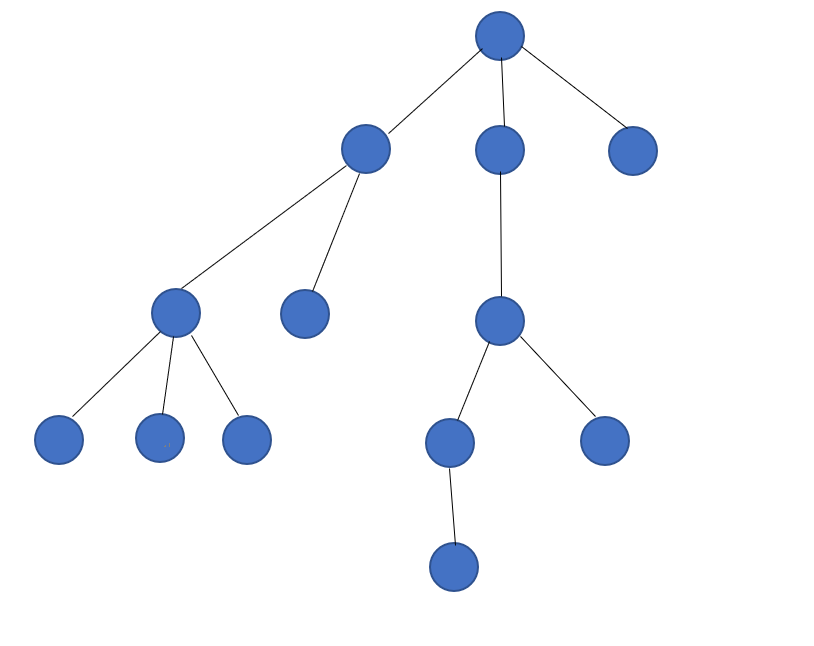

### 2.树的基本术语

l  节点的度：树中某个节点的子树的个数。

l  树的度：树中各节点的度的最大值。

l  分支节点：度不为零的节点。

l  叶子节点：度为零的节点。

l  路径：i->j；路径长度：路径经过节点数目减1。

l  孩子节点：某节点的后继节点；双亲节点：该节点为其孩子节点的双亲节点（父母节点）；兄弟节点：同一双亲的孩子节点；子孙节点：某节点所有子树中的节点；祖先节点：从树节点到该节点的路径上的节点。

l  节点的层次：根节点为第一层（以此类推）；树的高度：树中节点的最大层次。

l  有序树：树中节点子树按次序从左向右安排，次序不能改变；无序树：与之相反

l  森林：互不相交的树的集合。

### 3.树的性值

l  树的节点树为所有节点度数加1（加根节点）。

l  度为m的树中第i层最多有m^(i-1)个节点。

l  高度为h的m次树至多(m^h-1)/(m-1)个节点。

l  具有n个节点的m次树的最小高度为logm( n(m-1) + 1 )  向上取整。

### 4. 课后问题：

请利用树的基本术语求出图示中的参数内容，如这颗树结点的度，树的度等，也请自己额外找一些图片求这些术语表示的内容，这对熟悉树的基本概念十分有帮助。

## 2.二叉树及分类介绍

### 1. 二叉树简介

二叉树是n(n>=0)个结点的有限集合，该集合或者为空集（称为空二叉树），或者由一个根结点和两棵互不相交的、分别称为根结点的左子树和右子树组成。

如图

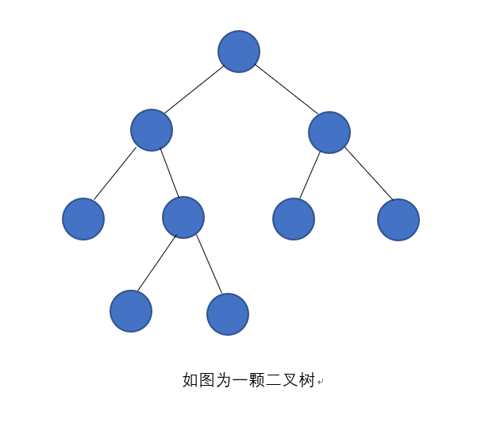

如图，每一个结点中最多拥有一个左结点和一个右结点，并没有多余的结点，这是很明显的二叉树的特征

### 2. 二叉树的特点

由二叉树定义以及图示分析得出二叉树有以下特点：

1）每个结点最多有两颗子树，所以二叉树中不存在度大于2的结点。

2）左子树和右子树是有顺序的，次序不能任意颠倒。

3）即使树中某结点只有一棵子树，也要区分它是左子树还是右子树。

### 3. 二叉树的性质

二叉树具有以下几种特征

性质1：二叉树第i层上的结点数目最多为 2的(i-1)次方个节点(i≥1)。
 性质2：深度为k的二叉树至多有2的k次方-1个结点(k≥1)。
 性质3：包含n个结点的二叉树的高度至少为log2 (n+1)。
 性质4：在任意一棵二叉树中，若终端结点的个数为n0，度为2的结点数为n2，则n0=n2+1。

### 4. 几种特殊的二叉树

### **l  斜树**

斜树：所有的结点都只有左子树的二叉树叫左斜树。所有结点都是只有右子树的二叉树叫右斜树。这两者统称为斜树。

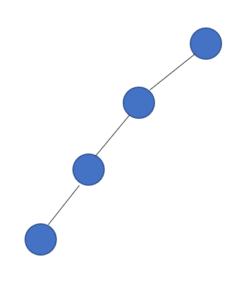

如图为一颗左斜树

### **l  满二叉树**

满二叉树：在一棵二叉树中。如果所有分支结点都存在左子树和右子树，并且所有叶子都在同一层上，这样的二叉树称为满二叉树。

满二叉树的特点有：

1）叶子只能出现在最下一层。出现在其它层就不可能达成平衡。

2）非叶子结点的度一定是2。

3）在同样深度的二叉树中，满二叉树的结点个数最多，叶子数最多。

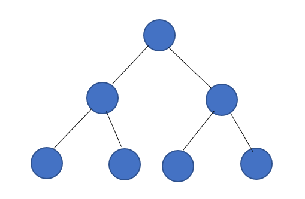

如图为一颗满二叉树

### **l  完全二叉树**

完全二叉树：对一颗具有n个结点的二叉树按层编号，如果编号为i(1<=i<=n)的结点与同样深度的满二叉树中编号为i的结点在二叉树中位置完全相同，则这棵二叉树称为完全二叉树。

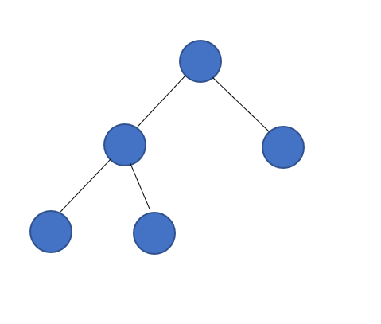

如图为一颗完全二叉树

## 3.二叉树的存储（C语言实现）

二叉树存储

### 1. 简介

根据前文的介绍，我们知道了二叉树的性值，其就是一种每一个结点中只允许拥有左右孩子（或为空）的树，这种数据结构在我们的实际设计中非常常用，如前文提到的STL中的set集合，其底层就是一颗标准的红黑树（二叉树的一种），我们这里以创建一颗二叉树并实现通过特定的插入顺序和读取顺序达成读取为顺序为例子进行简介。

### 2. 结点设计

一颗二叉树的结点设计一定要有如下内容：

a)结点元素，data域，用来存储数据，其可以是int，char等基本的类型，同时也可以是struct等这些复杂的复合数据类型。

b)左孩子结点，left指针，总是用来指向当前结点的下一层的左边结点，其属于一种指针。

c)右孩子结点，right指针，总是用来指向当前结点的下一层的右边结点，其属于一种指针。

d)父结点（可选），parent指针，总是指向当前结点的前一个结点，简称父亲结点，其不属于必须结点设计，省略掉可以打扰节省内存的效果，而使用则可以更方便进行定向搜索，本案例中不使用父节点。

以上就是一颗二叉树的结点设计，除此之外，我们使用一棵树的时候需要建立一颗树根，由这个“根”，来进行逐步的向下构建。

其设计代码可以表示为：

```cpp
//树的结点

typedef struct node{

    int data;

    struct node* left;

    struct node* right;

} Node;

//树根

typedef struct {

    Node* root;

} Tree;
```

### 3.树的创建

如同当时学习链表的创建，首先，我们创建一个空的结点再进行连接，首先将这个空的结点中的date域赋予数据，再判断tree中是否是一个空树，如果为空，只需要将整个根指向这一个结点即可，如果不为空，再进行两个判断，判断输入的数据是否大于或者小于当前比对的结点数据，根据其大小进行相应的排列，这样存储进入的数据总是有一定规律的，在输出的时候根据这个规律进行输出就可以达到想要的效果。

其代码可以显示为：

```cpp
//创建树--插入数据

void insert(Tree* tree, int value){

    //创建一个节点，让左右指针全部指向空，数据为value

    Node* node=(Node*)malloc(sizeof(Node));

    node->data = value;

    node->left = NULL;

    node->right = NULL;

    //判断树是不是空树，如果是，直接让树根指向这一个结点即可

    if (tree->root == NULL){

        tree->root = node;

    } else {//不是空树

        Node* temp = tree->root;//从树根开始

        while (temp != NULL){

            if (value < temp->data){ //小于就进左儿子

                if (temp->left == NULL){

                    temp->left = node;

                    return;

                } else {//继续往下搜寻

                    temp = temp->left;

                }

            } else { //否则进右儿子

                if (temp->right == NULL){

                    temp->right = node;

                    return;

                }

                else {//继续往下搜寻

                    temp = temp->right;

                }

            }

        }

    }

    return;

}
```

### 4. 遍历，显示树

具体的内容将会在后文面的文章细讲，先直接提供一份代码做参考：

```cpp
//树的中序遍历 In-order traversal

void inorder(Node* node){

    if (node != NULL)

    {

        inorder(node->left);

        printf("%d ",node->data);

        inorder(node->right);

    }

}
```

### 5.相关试题

[二叉树的基本创建](https://www.dotcpp.com/oj/problem1731.html)

本文代码

```cpp
#include <cstdlib>

#include <stdio.h>

#include <iostream>

using namespace std;

//树的结点

typedef struct node{

    int data;

    struct node* left;

    struct node* right;

} Node;

//树根

typedef struct {

    Node* root;

} Tree;

//创建树--插入数据

void insert(Tree* tree, int value){

    //创建一个节点，让左右指针全部指向空，数据为value

    Node* node=(Node*)malloc(sizeof(Node));

    node->data = value;

    node->left = NULL;

    node->right = NULL;

    //判断树是不是空树，如果是，直接让树根指向这一个结点即可

    if (tree->root == NULL){

        tree->root = node;

    } else {//不是空树

        Node* temp = tree->root;//从树根开始

        while (temp != NULL){

            if (value < temp->data){ //小于就进左儿子

                if (temp->left == NULL){

                    temp->left = node;

                    return;

                } else {//继续往下搜寻

                    temp = temp->left;

                }

            } else { //否则进右儿子

                if (temp->right == NULL){

                    temp->right = node;

                    return;

                }

                else {//继续往下搜寻

                    temp = temp->right;

                }

            }

        }

    }

    return;

}

//树的中序遍历 In-order traversal

void inorder(Node* node){

    if (node != NULL)

    {

        inorder(node->left);

        printf("%d ",node->data);

        inorder(node->right);

    }

}

int main(){

    Tree tree;

    tree.root = NULL;//创建一个空树

    int n;

    scanf("%d",&n);

    //输入n个数并创建这个树

    for (int i = 0; i < n; i++){

        int temp;

        scanf("%d",&temp);

        insert(&tree, temp);

    }

    inorder(tree.root);//中序遍历

    return 0;

}
```

## 4.树的遍历之先序遍历二叉树

### 1. 遍历简介：

树作为非线性数据结构，在我们取出数据时就需要设计遍历，所谓遍历，就是按照一定的规则性，将数据结构中的所有数据全部依次访问，而二叉树本身并不具有天然的全局次序，故为实现遍历，需通过在各节点与其孩子之间约定某种局部次序，间接地定义某种全局次序，这便是我们常规定的先序，中序，后续遍历。

在开始前，请记住下面的这三句话：

先序遍历：根左右

中序遍历：左根右

后序遍历：左右根

** **

### 2. 先序遍历：

先序遍历就是在访问二叉树的结点的时候采用，先根，再左，再右的方式，对于一个最简单的访问而言如图，先序遍历的访问顺序就是A，B，C

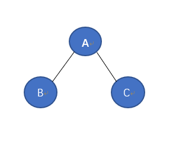

然而实际上的遍历访问并没有那么简单，往往是多个结点相互嵌套构成的二叉树，

如图所示，在访问遍历一开始的时候，先访问根结点A，次访问左节点B，由于左结点中嵌套了一组结点，因此左节点又作为下一个结点的根结点，因此就继续沿着B访问到了D，同样由于D中包含了一组新的结点，D又作为根节点继续访问，就又访问到了E，由于E没有后面的结点了，作为D为根的左结点E访问结束后，访问到F，这一组访问结束之后再回退访问G……

由此如下的访问规律：这一个二叉树的先序遍历访问顺序就是：ABDEFGCH


### 3. 代码实现

续上文的代码，实现先序遍历思路非常简单，只需要巧妙的利用“递归”即可。

```cpp
//树的先序遍历 Preorder traversal

void preorder(Node* node){

    if (node != NULL)

    {

        printf("%d ",node->data);

        inorder(node->left);

        inorder(node->right);

    }

}
```

### 4. 扩展：前缀表达式（波兰式）

波兰式又称为前缀表达式，我们日常的运算表达式通常是如下形式，这种成为中缀表达式，也就是运算符在运算数的中间。这种表达式人类人容易识别，并根据其进行计算，但计算机识别这种表达式非常困难。

如图，为常规表达式：(a+b)*c

其二叉树的表现形式为：

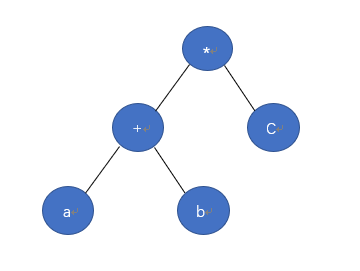

而波兰式的表达方式就是 *+cab ，波兰式的一个特征就是符号迁移，常规的表达式是需要大量的括号表达先后顺序的，而这样的波兰式表达形式不需要，更容易让计算机处理，我们常规的表达式的计算是中序的，而计算机更方便对波兰式这样的方式进行理解，进行这样的转换首先思路要进行转换，在代码中我们实现这样的转换一般可以利用栈，熟练书些这样的转换就需要STL的掌握，这点作为扩展内容自行学习。

### 5****. 相关习题

l  二叉树的遍历习题：[https://www.dotcpp.com/oj/problem1734.html](https://www.dotcpp.com/oj/problem1734.html)

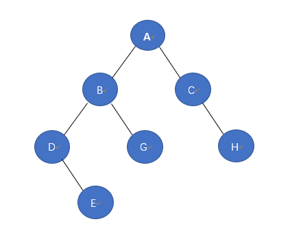

请回答

l  这一颗树的先序遍历是多少？

## 5.树的遍历之中序遍历二叉树

### 1. 简介

依旧是下面的这三句话：

先序遍历：根左右

中序遍历：左根右

后序遍历：左右根

        在上文我们接触到了先序遍历，本文我们开始学习中序遍历，中序遍历采用左根右的遍历方式，如图，就一个最简单的二叉树遍历而言，中序遍历的遍历访问过程是先B再A再C。


        实际上的二叉树并没有这么简单，其应该是由多个结点构成的，如图所示，进行第一次访问的时候，我们在ABC中进行遍历，由左根右的顺序，我们遍历访问到B，这时候先别急，B同时又作为BDG的根结点，因此需要继续向下进行遍历，此时我们遍历到DEF，这时E属于这一组之中的左结点，因此我们根据根左右的先后顺序得到了最先的遍历效果，EDF，这EDF同时作为BDG中的左节点（把EDF看作一个整体）进行回溯，此时的访问的结点顺序为EDFBG同理, EDFBG作为ABC的左结点根据左根右的顺序EDFBGAC，左半部分访问完毕接着访问右半部分，我们将^CH（^表示空）看作一组左中右，而C就是由EDFBGAC组合而成，因此最终的遍历顺序为：EDFBGACH

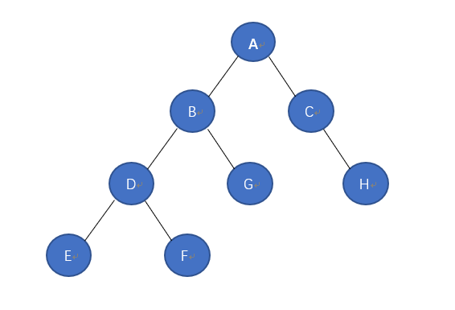

### 2. 代码实现

        续上文的代码，巧妙利用递归，与前文的代码只有一个顺序的区别：

```cpp
//树的中序遍历 In-order traversal

void inorder(Node* node){

    if (node != NULL)

    {

        inorder(node->left);

        printf("%d ",node->data);

        inorder(node->right);

    }

}
```

### 3. 中缀表达式（常规算式）

中缀表达式是一个通用的算术或逻辑公式表示方法。中缀表达式就是我们最常用的表达式形式，也是人最容易理解的表达式形式。

如图，为常规表达式：(a+b)*c

       其二叉树的表现形式为：


        由前文可知波兰式的表达方式就是 *+cab ，我们常规的表达式的计算是中序的，其表达式就是(a+b)*c，我们可以理解为将表达式利用二叉树化，然后通过中序遍历的方式进行提取，如果需要发生组合时，需要我们借助括号的形式表示优先级，这样也有一个弊端，就是当多个嵌套的时候需要的括号较多。

### 4. 相关问题

l  二叉树的遍历习题：[1734题](https://www.dotcpp.com/oj/problem1734.html)


请回答这一颗树的中序遍历是多少？

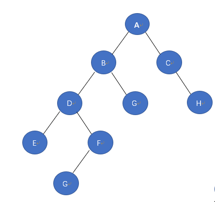

l  请回答这一颗二叉树的中序遍历是多少？

l  请回答（（a+b）+（c+d））*e作为中缀表达式的二叉树如何，做图表示。

## 6.树的遍历之后序遍历二叉树

### 1. 简介

依旧是下面的这三句话：

先序遍历：根左右

中序遍历：左根右

后序遍历：左右根

        后序遍历就是在访问二叉树的结点的时候采用，先左，再右，再根的方式，对于一个最简单的访问而言如图，先访问左节点B，之后访问右结点C，最后访问根节点A，后序遍历的访问顺序就是BCA


     然而实际上的遍历访问并没有那么简单，往往是多个结点相互嵌套构成的二叉树，

    如图所示，在访问遍历一开始的时候，先访问左节点B再访问右结点C最后访问A，但由于B结点其中也包含了新的结点，就犹如之前介绍的那样，在面对处理的结点后还存在有与之相联的结点的时候，需要优先处理其的子结点，这也是“递归”的基本思路，因此，由于B属于DG的根结点，我们相较于B，应该先访问D结点，而又由于D结点属于EF的根结点，我们就又变成先访问E结点，E属于最末端了，根据后序遍历左右根的访问顺序，依次生成EFDGB作为一个整体，接着我们需要访问C，由于C又是^HC之中的根结点，我们先访问这个空结点，又因为其是一个空的结点，我们会跳过，就变成了HC的访问顺序，那么最后在汇总的时候EFDGB作为左节点，HC作为右结点，A作为根结点，完成我们最终的遍历顺序EFDGBHCA。


### 2.代码实现

续上文的代码，巧妙利用递归，与前文的代码只有一个顺序的区别：

```cpp
//树的后序遍历 Post-order traversal

void postorder(Node* node){

    if (node != NULL)

    {

        inorder(node->left);

        inorder(node->right);

        printf("%d ",node->data);

    }

}
```

### 3. 后缀表达式（逆波兰式）

逆波兰式与波兰式不同，波兰式采用先序遍历的方式遍历访问我们的公式顺序，常规式则就是我们熟悉的中序方式，而逆波兰式采用后续遍历的方式进行访问。

如图，为常规表达式：(a+b)*c

       其二叉树的表现形式为：


而逆波兰式的表达方式就是ab+c* ，相较于波兰式，逆波兰式则就是将符号进行后移，其在计算机中的读取运算概念也符合栈的思路，因此没有什么特殊的不同，在考研/软考/算法竞赛中，比较常见的一类提醒就是波兰式，常规表达式，逆波兰式之间的互相转化和基本数学运算。

### 4. 相关问题

l  二叉树的遍历习题：[1734题](https://www.dotcpp.com/oj/problem1734.html)


请回答这一颗树的后序遍历是多少？


请回答这一颗树的后序遍历是多少？

l  请回答（（a+b）+（c+d））*e作为转换成后缀表达式如何，如何表示。

## 7.DFS（深度优先搜索）算法讲解（附模板及习题）

### 1. DFS简介

       ** 深度优先搜索算法**（英语：Depth-First-Search，简称DFS）是一种用于遍历或搜索树或图的算法。 沿着树的深度遍历树的节点，尽可能深的搜索树的分支。当节点v的所在边都己被探寻过或者在搜寻时结点不满足条件，搜索将回溯到发现节点v的那条边的起始节点。整个进程反复进行直到所有节点都被访问为止。属于盲目搜索,最糟糕的情况算法时间复杂度为O(!n)，DFS搜索的过程访问可以称之为DFS序。

如图：

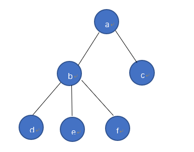

        对于一颗这样的树，我们的DFS序可以为：abdefc（即时对于同一颗的树，其DFS序不一定唯一），即访问a之后访问a的子结点b，再在b的基础上依次访问它的子结点def，最后回退到a处访问c。

        这与前文花大篇幅介绍的先序，中序，后续遍历如出一辙，唯一的不同就是这样的一棵树并不只存在有左右两个结点，它可以是多枝的。

        而即时对于一颗深度为n的二树，在没有任何优化的情况下适用DFS去搜索访问数据，其算法的时间复杂度也高达O（2^n），在数据较大的情况下DFS是无法满足程序的时间要求，这就会涉及到一个思路——剪枝，即通过现有的数据判断接下来的数据无法再满足解，直接将当前结点以后的所有数据舍弃，遍历不再访问，通过精心设计的剪纸可以使得DFS搜索的效果得到很大提升。

### 2. 模板：

对于一个标准的DFS模板而言，其包括了以下的内容：

```cpp
bool check(参数)

{

    if(满足条件)

        return true ;

    return false;

}

void dfs(int step)

{

        判断边界

        {

            相应操作

        }

        尝试每一种可能

        {

               满足check条件

               标记

               继续下一步dfs(step+1)

               恢复初始状态（回溯的时候要用到）

        }

}
```

### 3. 相关配套习题

[三角形](https://www.dotcpp.com/oj/problem1177.html)（注，其还涉及了一点动态规划的思维）：

[程序员爬楼梯](https://www.dotcpp.com/oj/problem1861.html)

[数的划分](https://www.dotcpp.com/oj/problem1531.html)

## 8.树形模拟法的运用（C语言例题讲解）

## 1.** 模拟法简介**

        在前面的文章已经提到过模拟这个思维，模拟的思维无处不在，就树形的DFS算法而言，我们更多的情况并非建立一棵树，这对我们书写和易用性而言太差了，我们通常会适用多个数组进行模拟，树也是可以利用数组进行模拟的。

        如下图：

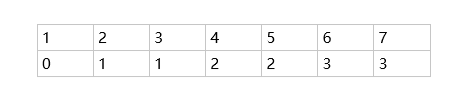

        上面一排表示数组下标，下面一排表示数据，其实通过这样的简单方式，也能够设计出一个模拟的二叉树，其具体的表示为：

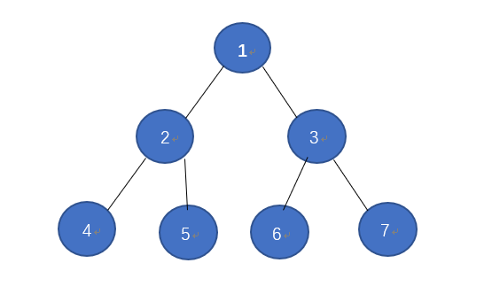

        仔细对比以下数据，可以发现数组中的数据存储的就是与之相联系的数组下标，通过这样的方式可以方便的建立一颗简单的模拟法的树，同时再创建一个数组用来存储具体的值，两个数组保持一一对应的关系就可以简单完成，这就是通过模拟算法来模拟树结构的核心思路，这个思路进行扩展其实会发现与建立树，甚至是后文才会学的图并没有什么核心的区别。

### 2. 例题—全排列

        从n个不同元素中任取m（m≤n）个元素，按照一定的顺序排列起来，叫做从n个不同元素中取出m个元素的一个排列。当m=n时所有的排列情况叫全排列。

        对于常规的思路而言，我们需要对0~9一共十个数字进行全排列，就需要列出10层for循环，每一层分别表示不同的数字，同时还需要利用if语句进行判重，因此写出来的代码就显得非常的累赘，其格式大致如下：

```cpp
for()

    for()

        for()

            …………    省略N层for循环

                for()

                      if()
```

        不要小看这样的代码，对于一个新手而言，能够有这样大胆的思维，其实是很难得的，不过就后面而言，这样的思维显得莫过于臃肿了，而且极其不相似一种成熟的代码，实际上，利用DFS算法，我们将10个数通过数组进行拆分，需要多少就调用多少，同时再建立一个判断的数组，这样也不需要我们写出累赘的if语句了，利用函数的递归实现多层的for功能。

        本例题的代码为：

```cpp
#include<iostream>

#include<cmath>

using namespace std;

int p[10]= {0};

bool vis[10]= {0};

int n;

void dfs(int x) {

    if (x==n+1) {

        for(int i=1; i<=n; i++)

            cout<<p[i]<<" ";

        cout<<endl;

        return ;

    }

    for (int i=1; i<=n; i++) {

        if (vis[i]==false  ) {

            p[x] = i;

            vis[i] = true;

            dfs(x+1);

            vis[i] = false;

        }

    }

}

int main() {

    while (cin>>n) {

        dfs(1);

    }

    return 0;

}
```

PS:这样的全排列C++的STL库已经封装好了，称之为next_permuitation(n,n+a);

### 3. 例题—程序员爬楼梯

[爬楼梯问题](https://www.dotcpp.com/oj/problem1861.html)

        爬楼梯的问题更像我们常规的算法问题，以是否能够走到第4格楼梯为例，我们初始的状态是走0个楼梯，建立二叉树，根结点设置为0，随后对于0这个状态而言，有两种形态，走一步和走三步，这分别对应二叉树的左孩子和右孩子，在走完之后，我们成功的引出了两种状态，共走1步和共走3步 ，我们再分别在这个基础上重新建立左孩子和右孩子引出两个状态，便可以逐渐构建出这颗二叉树，最终，通过数最终的状态我们可以知道一共有3个答案满足条件。

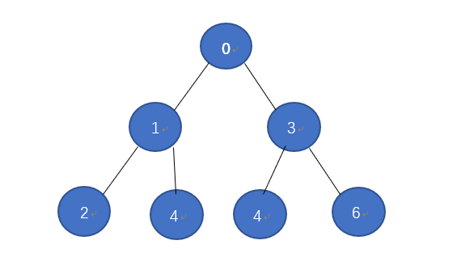

套用DFS的模板可以轻易求解，本例题代码为：

```cpp
#include<iostream>

using namespace std;

typedef long long ll;

ll ans,n;

void dfs(ll k) {

    if(k==n) {

        ans++;

        return;

    } else if(k>n) {

        return;

    }

    dfs(k+1);

    dfs(k+3);

}

int main() {

    while(cin>>n) {

        ans=0;

        dfs(0);

        cout<<ans<<endl;

    }

    return 0;

}
```

## 9.二叉树(树)与森林的相互转换

### 1. 什么是森林

森林，顾名思义，就是由众多的树构成的一组数据结构，这些树本身没有什么联系，用系统的语言描述就是：森林：m（>=0）棵互不相交的树的集合 【注意这里森林是可以有0颗树的，同数学上的空集】

如果把一棵树当作一个独立的点，那么森林就是一个点的集合。

### 2. 树转换成二叉树

操作过程如下：

加线：在兄弟（即同一层之间的孩子）之间加一连线

抹线：对每个结点，除了其第一个孩子外，除去其与其余孩子之间的连线

旋转：以树的根结点为轴心，将整树顺时针转45°

如图：

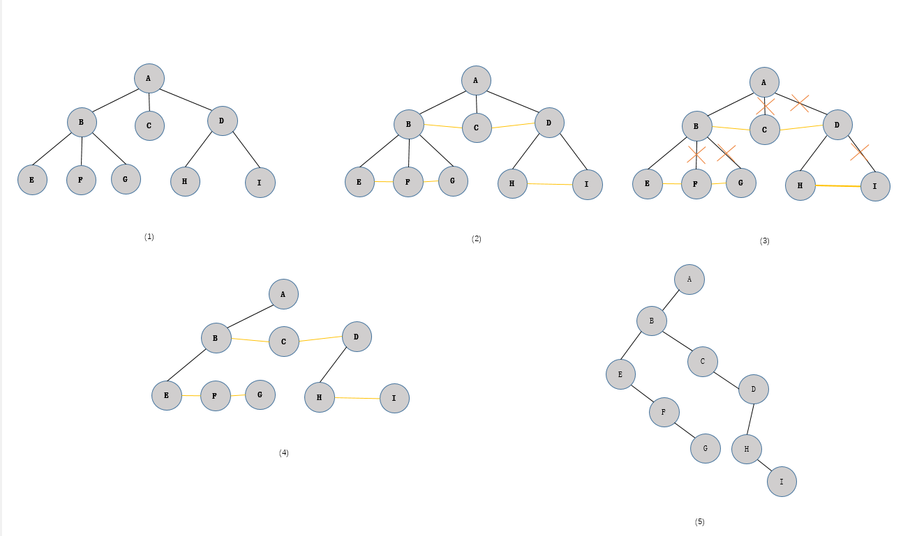

注意：树转换成二叉树其右子树一定为空

### 3. 二叉树转换成树

加线：若p结点是双亲结点的左孩子，则将p的右孩子，右孩子的右孩子，……沿分支找到的所有右孩子，都与p的双亲用线连起来

抹线：抹掉原二叉树中双亲与右孩子之间的连线

调整：将结点按层次排列，形成树结构

如图：

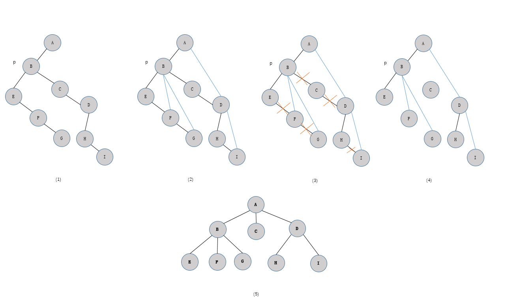

### 4. 森林转换成二叉树

将各棵树分别转换成二叉树

将每棵树的根结点用线相连

以第一棵树根结点为二叉树的根，再以根结点为轴心，顺时针旋转，构成二叉树型结构

如图：

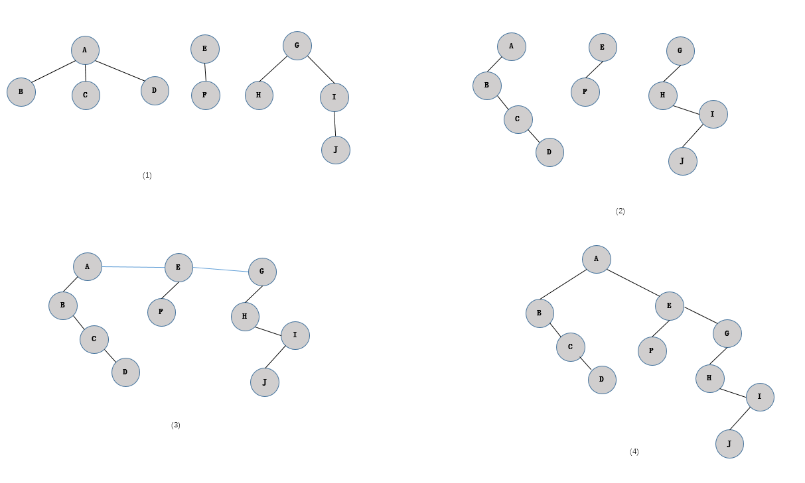

### 5. 二叉树转换成森林

抹线：将二叉树中根结点与其右孩子连线，及沿右分支搜索到的所有右孩子间连线全部抹掉，使之变成孤立的二叉树

还原：将孤立的二叉树还原成树（二叉树→树）

如图：

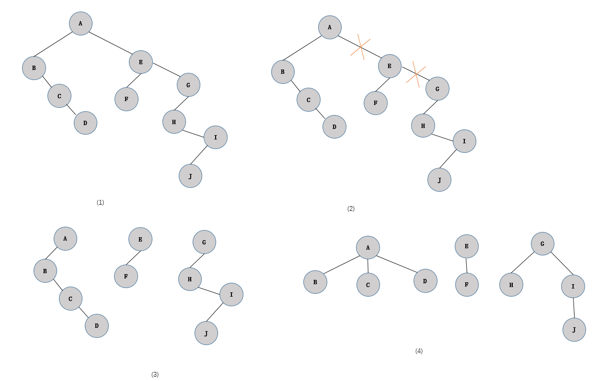

## 10.哈夫曼树的介绍及C语言代码实现

### 1. 简介

**哈夫曼树**（Huffman Tree），又名：最优二叉树，赫夫曼树

其标准含义是：给定N个权值作为N个叶子结点，构造一棵二叉树，若该树的带权路径长度达到最小，称这样的二叉树为最优二叉树，也称为哈夫曼树。哈夫曼树是带权路径长度最短的树，权值较大的结点离根较近。

### 2. 相关名词

由于本篇存在一定的难度，因此在开始相关的学习之前，请让我们来巩固以下本文所涉及的名词知识点。

a) 路径：在一棵树中，一个结点到另一个结点之间的通路，称为路径。

b) 路径长度：在一条路径中，每经过一个结点，路径长度都要加 1 。例如在一棵树中，规定根结点所在层数为1层，那么从根结点到第 i 层结点的路径长度为 i - 1 。

c) 结点的权：给每一个结点赋予一个新的数值，被称为这个结点的权。

d) 结点的带权路径长度：指的是从根结点到该结点之间的路径长度与该结点的权的乘积。

e)  树的带权路径长度为树中所有叶子结点的带权路径长度之和。通常记作 “WPL”。

### 3.构建哈夫曼树

在构建哈夫曼树时，只需要遵循一个原则，那就是权重越大的结点距离树根越近。

因此，在构建过程中，有如下的规律：

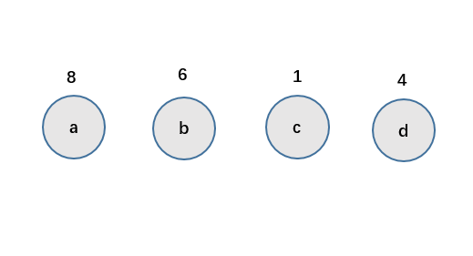

首先，选出我们数据中最小的两个数据，构建成二叉树的左孩子和右孩子，而根的数据为两者之和

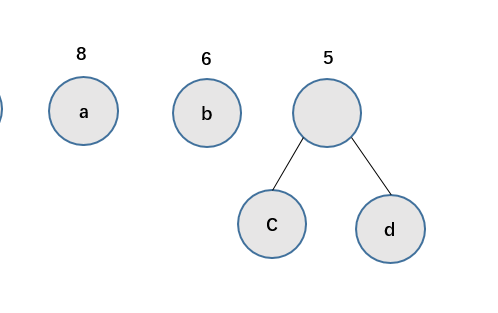

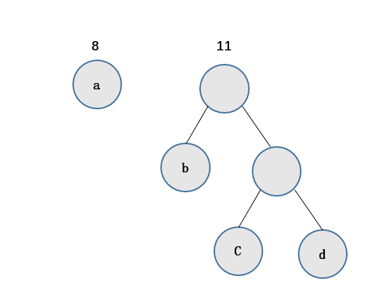

其次，将刚才合成的数据作为右孩子，左孩子从未处理的数据中选出最小的一个，作为左孩子，他们的根同样为左右孩子的权值和

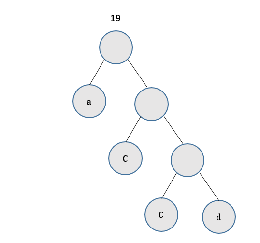

不断重复上述的步骤，直到将所有的数据全部处理完并构建出二叉树，这棵二叉树就是我们的哈夫曼树。

 如图这颗哈夫曼树的WPL值为：WPL= 8*1+ 6*2 + 1*3 + 4*3 = 273

### 4. 哈夫曼树的结点结构

与一般的二叉树并没有什么实质的不同，甚至可以说结构都完全一致，由于性值，因此其需要利用parent进行访问双亲结点

其代码表示为：

```cpp
//哈夫曼树结点结构

typedef struct {

    int weight; //结点权重

    int parent, left, right;    //父结点、左孩子、右孩子在数组中的位置下标

} HTNode, *HuffmanTree;
```

其中weight为结点权重，

### 5.构建哈夫曼树

由上文的分析可知，构建哈夫曼树时，我们需要根据各个结点的权重值，筛选出其中值最小的两个结点，构建二叉树。

其代码为：

```cpp
//HT为地址传递的存储哈夫曼树的数组，w为存储结点权重值的数组，n为结点个数

void CreateHuffmanTree(HuffmanTree *HT, int *w, int n) {

    if(n <= 1)

        return; // 如果只有一个编码就相当于0

    int m = 2*n-1; // 哈夫曼树总节点数，n就是叶子结点

    *HT = (HuffmanTree)malloc((m+1) * sizeof(HTNode)); // 0号位置不用

    HuffmanTree p = *HT;

// 初始化哈夫曼树中的所有结点

    for(int i = 1; i <= n; i++) {

        (p+i)->weight = *(w+i-1);

        (p+i)->parent = 0;

        (p+i)->left = 0;

        (p+i)->right = 0;

    }

//从树组的下标 n+1 开始初始化哈夫曼树中除叶子结点外的结点

    for(int i = n+1; i <= m; i++) {

        (p+i)->weight = 0;

        (p+i)->parent = 0;

        (p+i)->left = 0;

        (p+i)->right = 0;

    }

//构建哈夫曼树

    for(int i = n+1; i <= m; i++) {

        int s1, s2;

        Select(*HT, i-1, &s1, &s2);    //查找内容，需要用到查找算法

        (*HT)[s1].parent = (*HT)[s2].parent = i;

        (*HT)[i].left = s1;

        (*HT)[i].right = s2;

        (*HT)[i].weight = (*HT)[s1].weight + (*HT)[s2].weight;

    }

}
```

## 11.哈夫曼树编码与查找算法（C语言实现）

### 1.哈夫曼树的查找算法

查找算法根据构建哈夫曼树算法衍生而来，我们在构建二叉树时需要查找出哪些数据最小，以符合我们哈夫曼树的最优解情况。

查找权重值最小的两个结点的思想是：从待处理数据的头部位置开始，首先找到两个无父结点的结点（说明还未使用其构建成树），然后和后续无父结点的结点依次做比较，有两种情况需要考虑：

l  如果比两个结点中较小的那个还小，就保留这个结点，删除原来较大的结点；

l  如果介于两个结点权重值之间，替换原来较大的结点；

其代码可以表示为：

```cpp
//HT数组中存放的哈夫曼树，end表示HT数组中存放结点的最终位置，s1和s2传递的是HT数组中权重值最小的两个结点在数组中的位置

void Select(HuffmanTree HT, int end, int *s1, int *s2) {

    int min1, min2;

//遍历数组初始下标为 1

    int i = 1;

//找到还没构建树的结点

    while(HT[i].parent != 0 && i <= end) {

        i++;

    }

    min1 = HT[i].weight;

    *s1 = i;

    i++;

    while(HT[i].parent != 0 && i <= end) {

        i++;

    }

//对找到的两个结点比较大小，min2为大的，min1为小的

    if(HT[i].weight < min1) {

        min2 = min1;

        *s2 = *s1;

        min1 = HT[i].weight;

        *s1 = i;

    } else {

        min2 = HT[i].weight;

        *s2 = i;

    }

//两个结点和后续的所有未构建成树的结点做比较

    for(int j=i+1; j <= end; j++) {

//如果有父结点，直接跳过，进行下一个

        if(HT[j].parent != 0) {

            continue;

        }

//如果比最小的还小，将min2=min1，min1赋值新的结点的下标

        if(HT[j].weight < min1) {

            min2 = min1;

            min1 = HT[j].weight;

            *s2 = *s1;

            *s1 = j;

        }

//如果介于两者之间，min2赋值为新的结点的位置下标

        else if(HT[j].weight >= min1 && HT[j].weight < min2) {

            min2 = HT[j].weight;

            *s2 = j;

        }

    }

}
```

### 2.哈夫曼编码

**哈夫曼编码**(Huffman Coding)，又称霍夫曼编码，是一种编码方式，可变字长编码(VLC)的一种。Huffman于1952年提出一种编码方法，该方法完全依据字符出现概率来构造异字头的平均长度最短的码字，有时称之为最佳编码，一般就叫做Huffman编码（有时也称为霍夫曼编码）。

哈夫曼编码，主要目的是根据使用频率来最大化节省字符（编码）的存储空间。

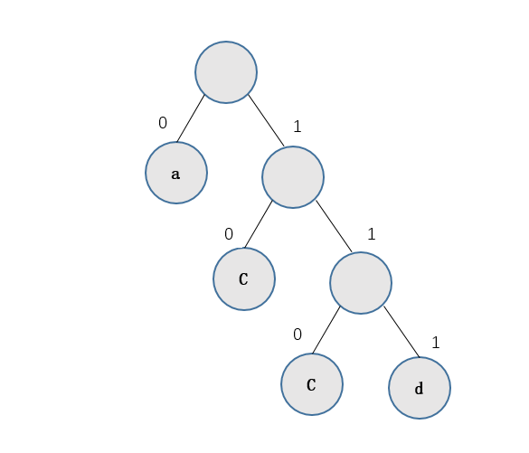

        霍夫曼编码是一种无前缀编码。解码时不会混淆。其主要应用在数据压缩，加密解密等场合，也包括文件传输的场合。

        如果考虑到进一步节省存储空间，就应该将出现概率大（占比多）的字符用尽量少的0-1进行编码，也就是更靠近根（节点少），这也就是最优二叉树-哈夫曼树。
