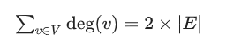
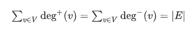
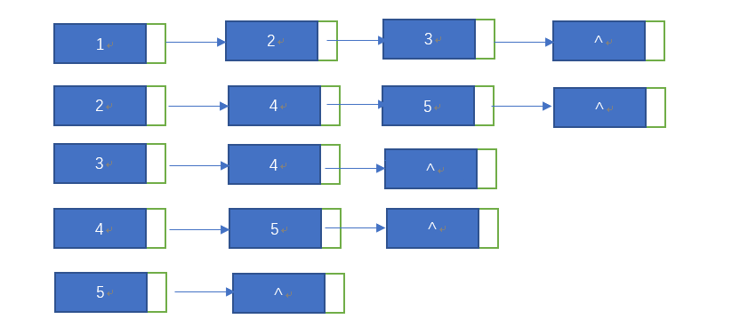
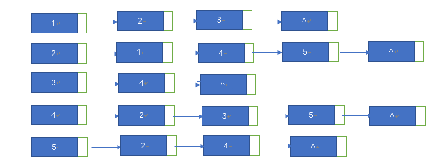
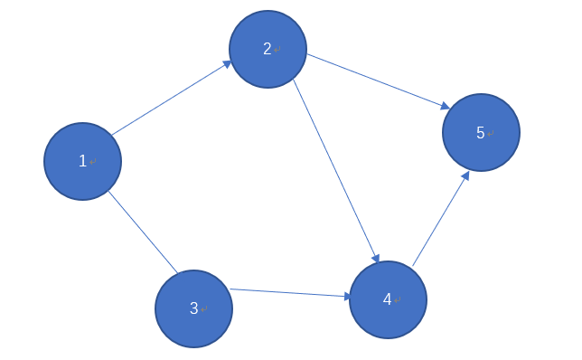
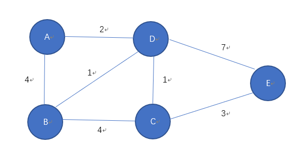

# 第八章 图

## 1.图的存储-邻接矩阵及C/++代码实现

### 1. 什么是图

**图论**（graph theory） 是数学的一个分支，它以 图 为研究的对象。

图论本身是应用数学的一部分，历史上图论曾经被很多数学家各自独立建立过。关于图论的最早文字记载最早出现在欧拉 1736 年的论著中，也就是著名的柯尼斯堡（Konigsberg）问题（七桥问题）。

### 2. 图的定义

一个图G是一个二元组，即序偶<V,E>，或记作G=<V,E> ，其中V是有限非空集合，称为G的顶点集,V中的元素称为顶点或结点；E称为 G的边的集合，所有的边ei都属于E，都有v中的结点与之对应，称ei为 G的边。

### 3. 图的基本概念

l  无向图：每条边都是无向边的图。

l  有向图：每条边都是有向边的图。

l  混合图：在一个图中，有些边是有向边，另一些边是无向边，则该图为混合图。

l  有限图：一个图的点集和边集都是有穷集的图。

l  零图：边集为空集的图。

l  平凡图：仅有一个结点而没有边构成的图。

l  关联：若有ei=(u,v) 且ei属于E ，则称u是和v相关联的。

l  孤立点：无边关联的点。

l  自环：若一条边所关联的两个结点重合，则称此边为自环。

l  邻接：关联于同一条边的两个点  和  称为邻接的；关联于同一个点的两条边  和  是邻接的（或相邻的）。

## 4.两个定理：



l  推论：在任意图中，度数为奇数的点必然有偶数个。



l  推论：即所有点入度之和等于出度之和。

（这个比较好理解，就如同问世界上的上坡多还是下坡多一样，答案是一样多）

由上面的概念可知，树或者是森林，就是一种特殊的图。

### 5. 最简单的存储——邻接矩阵

邻接矩阵的英文名是 adjacency matrix。它的形式是 bool adj[n][n]，这里面n是节点个数，adj[i][j]表示i和j之间是否有边。

如果边有权值，也可以直接用 int adj[n][n] ，直接把边权存进去。

它的优点是可以在O(1)时间内得到一条边是否存在，缺点是需要占用O(n^2)的空间。对于一个稀疏的图（边相对于点数的平方比较少）来说，用邻接矩阵来存储的话，成本偏高。

其代码可以表示为（假设各边长度均为1）：

```cpp
#include<iostream>

using namespace std;

const int maxn=105;

int adj[maxn][maxn]={0};    //定义邻接矩阵

int x,y;    //输入两条边

int n,m;    //供输入n对边 ,m个顶点 (x,y <= m)

int main(){

    cin>>n>>m;

    for(int i=0;i<n;i++){

        cin>>x>>y;

        adj[x-1][y-1]=1;

        adj[y-1][x-1]=1;

    }

    for(int i=0;i<m;i++){

        for(int j=0;j<m;j++){

            cout<<adj[i][j]<<' ';

        }

        cout<<endl;

    }

    return 0;

}
```

## 2.邻接表的定义及C/C++代码实现

### 1. 邻接表概念

**邻接表**（Adjacency List）顾名思义，就是通过链表或者利用数组模拟链表的方式将图的相连接关系表示的一种方法，存储方法跟树的孩子链表示法相类似，是一种顺序分配和链式分配相结合的存储结构。如这个表头结点所对应的顶点存在相邻顶点，则把相邻顶点依次存放于表头结点所指向的单向链表中。

如图：


(如图为一个图关系)

例图展示了一个图状关系，结点1指向2和3，2可以指向4和5，而3指向4……这样的指向表示该图是单向的，意思是只允许1到2而不允许2到1（除非有两个箭头相互指向），那么，依据这个指向关系，可以得到邻接表如下：



（如图为该图所表示的邻接表）

这里必须要特别注意邻接表的结尾以空或者一个特殊的标记，表示到达结尾。在一些需要快速表达概念的场合，可以将空结点的指向忽略不表达。

那么如果是双向图，意思是1与2联通，可以由1走向2，同时也可以由2走向1的情况时，这张表又是如下表示



可以见的，这双向图和单向图的邻接表表达方式是不一样的，双向图还要将联通方式表达，1联通2，在1结点的连接关系中要将2结点加入以表达1能够走向2，此外还需要再2结点中将1结点加入以表达2能够走向1，这可能会稍微显得麻烦但是确是值得的代价。

具体表达就是：n个顶点e条边的无向图的邻接表表示中有n个顶点表结点和2e个边表结点。(换句话说，每条边（i,j）在邻接表 中出现两次：一次在关于i的邻接表中，另一次在关于j的邻接表中)。

观察上面两个图，连接到空结点的那一条边不算，那么双向图的边正好就是单向图的两倍。

### 2. 邻接表的特点

在表达邻接表的适用情况时，我们首先要与邻接矩阵进行相互比较

邻接矩阵存在以下缺点

a) 浪费空间—— 存稀疏图（点很多而边很少）有大量无效元素

b) 浪费时间—— 统计稀疏图中一共有多少条边

恨明显，使用矩阵的方式，仅仅是让我们人类更加直观的观察图的关系而已，对于稀疏图（即结点很多但是边很少的图，或者表达为弱连接图）而言时间和空间的浪费还是很大的，邻接表就相当于是一种改良，对于稀疏图能够很好的适应，使用较少的空间和时间就能表达。

在常规情况下，邻接表是O(n+e)的复杂程度（n表示节点数，e表示边长），临界矩阵则是O(n^2)的复杂程度。

### 3. 代码构成

设计思路并不唯一，甚至你可以利用结构体数组进行模拟，本代码仅提供一份适用指针的单向图C++设计代码，思路是：将节点的adjvex赋值为v，指向下一条边的指针赋值为NULL输入之后判断图中的起始顶点指向的第一条边的指针是否为空假如为空那么将当前顶点的firstarc指针指向这个节点加入不为空那么调用插入到链表中的insertNode方法，遍历链表将节点插入到链表的最后面。

```cpp
#include<stdio.h>

#include<iostream>

#include<malloc.h>

#define maxSize 1000

using namespace std;

typedef struct ArcNode {

    int adjvex;

    struct ArcNode *nextarc;

} ArcNode;

typedef struct {

    int data;

    ArcNode *firstarc;

} Vnode;

//可以利用结构体整体结构，也可以拆分结构体变为单独搜索

typedef struct {

    Vnode adjlist[maxSize];

    int n, e;

} AGraph;

AGraph *graph;

//插入链表末尾

void  insertNode(ArcNode *node, ArcNode *newNode) {

    ArcNode *p = node;

    while(p->nextarc != NULL) {

        p = p->nextarc;

    }

    p->nextarc = newNode;

}

void create() {

    graph = (AGraph*)malloc(sizeof(AGraph));

    cout << "输入顶点的数目: " << endl;

    cin >> graph->n;

    cout << "输入图中边的数目: " << endl;

    cin >> graph->e;

    int u = -1, v = -1;

    for(int i = 0; i < graph->n; i++) {

        graph->adjlist[i].firstarc = NULL;

    }

    ArcNode *node;

    for(int i = 0; i < graph->e; i++) {

        cout<<"请输入联通点A与B"<<endl;

        cin >> u >> v ;

        node = (ArcNode *)malloc(sizeof(ArcNode));

        node->adjvex = v;

        node->nextarc = NULL;

        graph->adjlist[u].data = u;

        if(graph->adjlist[u].firstarc == NULL) {

            //边

            graph->adjlist[u].firstarc = node;

        } else {

            //插入边

            insertNode(graph->adjlist[u].firstarc, node);

        }

    }

}

void  travseTree() {

    for(int i = 0; i < graph->n; i++) {

        if(graph->adjlist[i].firstarc != NULL) {

            cout <<"与"<< i << "连接的点有：";

            ArcNode *p = graph->adjlist[i].firstarc;

            while(p != NULL) {

                cout << p->adjvex <<  " ";

                p = p->nextarc;

            }

            cout << endl;

        }

    }

}

int main(void) {

    create();

    travseTree();

    return 0;

}
```

## 3.图的存储:链式向前星

### 1. 概念

链式向前星代码是基于向前星代码的优化，这是极大多数算法竞赛以及高效率图论算法喜欢适用的创建方法，与邻接表和邻接矩阵比较容易的理解方式，向前星算法并不容易理解。

在理解链式向前星之前我们需要了解什么是向前星，前向星是一种特殊的边集数组，我们把边集数组中的每一条边按照起点从小到大排序，如果起点相同就按照终点从小到大排序，并记录下以某个点为起点的所有边在数组中的起始位置和存储长度,那么前向星就构造好了。

链式向前星的本质是利用链表的特性（一个结点指向另一个结点），以达到不需要像向前星那样排序（排序的平均情况需要O(nlogn)的代价）就可以直接搜索到目标，从而达到减少计算机运算时间使用的情况。

### 2.结构设计

与前文不同，本文我们先展示代码再做具体讲解，链式向前星的结构模板代码如下：

```cpp
struct Edge{    //表示边

    int w;

int to;

    int next;

}edge[10005];

int cnt=0;      //用以控制并统计边的数量

int head[10005];    //表示来源的边序号
```

具体的解释为：

a)Edge表示边，这个结构体数组将逐步记录边信息，其中包含有三个元素

l  w为权重即边之间的权值，下图中为默认的1，不演示

l  to表示为第i条边指向哪一个结点

l  edge[i].next表示第i条边的下一条边的序号

b)Cnt表示边的数量，在输入时利用他逐个+1

c)Head表示第x个结点所需要访问的边

同样的我们以这个结构的图为例，链式向前星中需要存储如下内容：


（例图，并且假设所有边的权值均为1）

上图可以得到一个这样的运算表格（不唯一）

Edge[0].to

2

Edge[0].next

-1

Head[1]

0

Edge[1].to

3

Edge[1].next

0

Head[1]

1

Edge[2].to

4

Edge[2].next

-1

Head[2]

2

Edge[3].to

5

Edge[3].next

2

Head[2]

3

Edge[4].to

4

Edge[4].next

-1

Head[3]

4

Edge[5].to

5

Edge[5].next

-1

Head[4]

5

可以见的，比如我们访问与1相互联通的所有结点，我们首先访问head[1]的内容，head的下标表示1结点，其内容表示我们应该访问边的标号，此时我们得到了数据1，表明我们需要访问边1，此时我们找到edge[1]并获取第一个to的内容，表示1结点与3结点相连通，接下来访问next的内容，在edge[1].next中获得了下一条边的标号0，因此接下来访问edge[0]的内容，得到了新得信息，edge[0].to=2，表示1结点与2结点相互联通，在访问next的内容为-1时表示没有下一条了，结束向下访问，自此，我们获得了与1相互联通的所有结点的信息。

因此可以得到如下的信息表：

结点1

-1

2

3

结点2

1

4

5

结点3

-1

4

结点4

-1

5

结点5

-1

添加边信息时使用以下代码

```cpp
void add_edge(int from, int to, int w) {

    edge[cnt].to = to;

    edge[cnt].w = w;

    edge[cnt].next = head[from];

    head[from] = cnt++;

}
```

注意，我们需要对全体数组进行赋-1的初值，这对于出错和检验错误都是很有帮助的，因为-1正是本算法的判定边界点，当然，这个边界点也可以由自己定位任意一个负数。

### 3. 优势

链式向前星的有点在于高效，访问速度较快，是图论算法的热门构建方法，这点在算法竞赛中体现尤为重要，缺点也很明显，不易理解和构造麻烦。

链式本身就有访问此结点会自动体现下一节点的效果，因此很适合遍历和访问的算法代码构建，这点在后文会提到。

注：建议初学者多次阅读本章内容

## 4.图的遍历DFS深搜优先搜索及C语言代码实现

### 1. 图的遍历

在理解**DFS**算法之前，我们首先需要对什么是遍历进行了解，遍历的概念就是：从某一个点出发（一般是首或尾），依次将数据结构中的每一个数据访问且只访问一遍。

### 2. DFS简介

DFS（Depth-First-Search，深度优先搜索）算法的具体做法是：从某个点一直往深处走，走到不能往下走之后，就回退到上一步，直到找到解或把所有点走完。

在实现这一个依次的访问顺序时，操作动作存储与数据结构（栈）的思想及其相似，同时也由于栈的性质，我们可以通过递归来简化栈的创建，因此DFS算法的两种做法分别时利用栈或者递归实现。

算法步骤（递归或栈实现）

a)访问指定起始地点。

b)若当前访问顶点的邻接顶点有未被访问的顶点，就任选一个访问。如果没有就回退到最近访问的顶点，直到与起始顶点相通的所有点被遍历完。

c)若途中还有顶点未被访问，则再选一个点作为起始顶点，并重复前面的步骤。

### 3. 图的DFS

我们直接以案例进行讲解，就本图而言，其访问顺序可以是（不唯一）：1-2-4-5-3



首先从1开始，1结点处可以访问2，3两个结点，那么按照我们自定义的优先顺序线访问2结点，此时，2结点有4，5两个结点访问，依旧按次序访问呢4结点，4结点可以访问5结点，5结点无法继续向下访问故结束访问，并回退4结点，4结点无法没有其他分支且自己已被访问故又退回2结点，2结点的两个分支4，5结点均已被访问，故再退回1结点，此时只有3结点未被访问，访问3结点，最终得到次序：1-2-4-5-3

### 4.相关代码

DFS算法的相关模板如下：

```cpp
void dfs()//参数用来表示状态

{

    if(到达终点状态)

    {

        ...//根据需求添加

        return;

    }

    if(越界或者是不合法状态)

        return;

    if(特殊状态)//剪枝，去除一些不需要访问的场景，不一定i俺家

        return ;

    for(扩展方式)

    {

        if(扩展方式所达到状态合法)

        {

            修改操作;//根据题意来添加

            标记；

            dfs（）；

            (还原标记)；

            //是否还原标记根据题意

            //如果加上（还原标记）就是 回溯法

        }

    }

}
```

对于图论而言（代码节选，仅做参考，最主要还请记忆上面的模板那代码）：

```cpp
//从pos点开始，深度遍历无向图

//pos表示当前结点，G表示图，visited[]数组用来表示该节点是否已经访问

void DFS(int pos,pGraph G,int visited[30]){

    node p;

    printf("%d ",pos);//打印深度遍历的点

    visited[pos]=1;//标记为以访问过

    p=G->vertice[pos].firstarc;//将当前点的第一个指针赋值给p

    //是否存在邻接点

    while(p!=NULL) {

        //判断该邻接点是否被遍历过

        if(visited[p->adjvex]==0){

            DFS(p->adjvex,G,visited);

        }

        p=p->next;//后移一位，为之后是否有邻接点做准备

    }

}
```

### 5. 实际应用

在最早期的搜索算法，如HTML的搜索，是基于并利用DFS的，现在诸如一些拓扑图，网络等准确且数据量不大的定位运算等依旧应用非常多的DFS算法，同时DFS算法也是算法竞赛入门级别的标准算法，公司的入职考试算法等。

## 5.图的遍历BFS广度优先搜索

### 1. 简介

**BFS**（Breadth First Search，广度优先搜索，又名宽度优先搜索），与深度优先算法在一个结点“死磕到底“的思维不同，广度优先算法关注的重点在于每一层的结点进行的下一层的访问。

### 2. BFS算法介绍

BFS算法和核心思路就是：从某个点一直把其邻接点走完，然后任选一个邻接点把与之邻接的未被遍历的点走完，如此反复走完所有结点。类似于树的层序遍历。

BFS的核心就是要把当前在哪作为一个状态存储，并将这个状态交给队列进行入队操作，故而，

算法步骤（用队列实现）

a) 访问指定起始点。

b) 访问当前顶点的邻接顶点有未被访问的顶点，并将之放入队列中。

c) 删除队列的队首节点。访问当前队列的队首，前面的步骤。直到队列为空。

d) 若若途中还有顶点未被访问，则再选一个点作为起始顶点。重复前面的步骤。（针对非连通图）。

### 3. 案例图示

还是这一份例图，我们直接以案例进行讲解，就本图而言，其访问顺序可以是（不唯一）：1-2-3-4-5


首先从1开始，1结点处可以访问2，3两个结点，我们访问并以此把两个结点的访问顺序放入队列，然后按照入队顺序（如2，3），之后我们出队状态2，依次访问2结点的下两个结点（4，5结点），并入队4，5结点，再之后我们出队3结点，并依次访问后续，此时发现所有的结点已经被访问完毕了，可以结束搜索，最后我们得到次序：1-2-3-4-5

### 4. 相关代码

BFS的模板代码如下：

```cpp
/**

 * 返回合适的检索数据

 */

int BFS(Node root, Node target)

{

    Queue<Node> queue;  //创建队列

    int step = 0;       // 当前队列的步骤点

    // initialize

    add root to queue;

    // BFS

    while (queue is not empty)

    {

        step = step + 1;

        //步数逐渐增加

        int size = queue.size();

        for (int i = 0; i < size; ++i)

        {

            Node cur = the first node in queue;

            if cur is target

                return step - 1;

            for (Node next : the neighbors of cur)

            {//这里常用一个二维方向数组实现

                add next to queue;

            }

            remove the first node from queue;

        }

    }

    return -1;          //出错返回值

}
```

同样提供一份BFS的图论算法节选，代码最核心还是取记忆BFS的模板并根据实际情况的灵活使用，故以下代码仅提供参考

```cpp
void BFSL(int pos,pGraph G,int visited[30])//从pos点开始进行广度优先遍历无向图

{

    int queue[G->Vnum];//队列辅助BFS遍历

    int head=0,tail=0;//队头、队尾指针

    Arcnode* p;

    queue[tail]=pos;

    visited[pos]=1;//标记遍历过

    tail++;

    while(head!=tail)

    {

        pos=queue[head];//出队操作

        head++;

        printf("%d ",pos);

        p=G->vertice[pos].firstarc;

        while(p!=NULL)

        {

            if(visited[p->adjvex]==0)//判断是否遍历过

            {

                queue[tail]=p->adjvex;//入队操作

                visited[p->adjvex]=1;//标记遍历过

                tail++;

            }

            p=p->next;

        }

    }

}
```

### 5.  应用

BFS算法的实际应用场景，最典型的有地图搜索，迷宫寻路等，需要有“状态”以及状态改变场景的搜索算法，同时BFS由于不需要像DFS算法那样回溯，故比DFS效率可能会更高一些。基于BFS算法的该进算法，比如说R星寻路，DBFS(双向广搜)算法等这类改进算法场景被应用在实际游戏设计，GPS导航设计等场景中。

## 6.最小生成树,普利姆(Prim)算法及C/C++代码实现

### 1. 最小生成树（又名：最小权重生成树）

概念：将给出的所有点连接起来（即从一个点可到任意一个点），且连接路径之和最小的图叫最小生成树。最小生成树属于一种树形结构（树形结构是一种特殊的图），或者说是直链型结构，因为当n个点相连，且路径和最短，那么将它们相连的路一定是n-1条。

可以利用参考一个问题理解最小生成树，有n个村庄，每个村庄之间距离不同，要求村庄之间修路，每一个村庄必须与任意一个村庄联通，如何修路最省钱（修的最短）

### 2. 普利姆算法介绍

利姆(**Prim**)算法求最小生成树，也就是在包含n个顶点的连通图中，找出只有(n-1)条边包含所有n个顶点的连通子图，也就是所谓的极小连通子图

具体过程如下：

(1)设G=(V,E)是连通网，T=(U,D)是最小生成树，V,U是顶点集合，E,D是边的集合

(2)若从顶点u开始构造最小生成树，则从集合V中取出顶点u放入集合U中，标记顶点v的visited[u]=1

(3)若集合U中顶点ui与集合V-U中的顶点vj之间存在边，则寻找这些边中权值最小的边，但不能构成回路，将顶点vj加入集合U中，将边（ui,vj）加入集合D中，标记visited[vj]=1

(4)重复步骤②，直到U与V相等，即所有顶点都被标记为访问过，此时D中有n-1条边

### 3. 代码实现

不同的题目有不同的细节实现方式，因此本代码仅供参考

```cpp
#include <stdio.h>

#include <stdlib.h>

#define n 20

#define MaxNum 10000  /*定义一个最大整数*/

/*定义邻接矩阵类型*/

typedef int adjmatrix[n + 1][n + 1];

typedef struct {

    int fromvex, tovex;                 //生成树的起点和终点

    int weight;                         //边的权重

} Edge;

typedef Edge *EdgeNode;                 //定义生成树的别名

int arcnum;     /*边的个数*/

/*建立图的邻接矩阵*/

void CreatMatrix(adjmatrix GA) {

    int i, j, k, e;

    printf("=============================\n");

    printf("图中有%d个顶点\n", n);

    for(i=1; i<=n; i++) {

        for(j=1; j<=n; j++) {

            if(i==j) {

                GA[i][j]=0;         /*对角线的值置为0*/

            } else {

                GA[i][j]=MaxNum;    /*其他位置的值置初始化为一个最大整数*/

            }

        }

    }

    printf("请输入边的个数：\n");

    scanf("%d", &arcnum);

    printf("请输入边的信息，依照起点，终点，权值的形式输入：\n");

    for(k=1; k<=arcnum; k++) {

        scanf("%d,%d,%d",&i,&j,&e);  /*读入边的信息*/

        GA[i][j]=e;

        GA[j][i]=e;

    }

}

/*初始化图的边集数组*/

void InitEdge(EdgeNode GE,int m) {

    int i;

    for(i=1; i<=m; i++) {

        GE[i].weight=0;

    }

}

/*依据图的邻接矩阵生成图的边集数组*/

void GetEdgeSet(adjmatrix GA,EdgeNode GE) {

    int i, j, k = 1;

    for(i=1; i<=n; i++) {

        for(j=i+1; j<=n; j++) {

            if(GA[i][j] !=0 && GA[i][j] != MaxNum) {

                GE[k].fromvex = i;

                GE[k].tovex = j;

                GE[k].weight = GA[i][j];

                k++;

            }

        }

    }

}

/*按升序排列图的边集数组*/

void SortEdge(EdgeNode GE,int m) {

    int i,j,k;

    Edge temp;

    for(i=1; i<m; i++) {

        k=i;

        for(j=i+1; j<=m; j++) {

            if(GE[k].weight > GE[j].weight) {

                k=j;

            }

        }

        if(k!=i) {

            temp = GE[i];

            GE[i]=GE[k];

            GE[k]=temp;

        }

    }

}

/*利用普里姆算法从初始点v出发求邻接矩阵表示的图的最小生成树*/

void Prim(adjmatrix GA,EdgeNode T) {

    int i,j,k,min,u,m,w;

    Edge temp;

    /*给T赋初值。相应为v1依次到其余各顶点的边*/

    k=1;

    for(i=1; i<=n; i++) {

        if(i!=1) {

            T[k].fromvex=1;

            T[k].tovex=i;

            T[k].weight=GA[1][i];

            k++;

        }

    }

    /*进行n-1次循环，每次求出最小生成树中的第k条边*/

    for(k=1; k<n; k++) {

        min=MaxNum;

        m=k;

        for(j=k; j<n; j++) {

            if(T[j].weight<min) {

                min=T[j].weight;

                m=j;

            }

        }

        /*把最短边对调到k-1下标位置*/ 可用swap替换

        temp=T[k];

        T[k]=T[m];

        T[m]=temp;

        /*把新增加最小生成树T中的顶点序号赋给j*/

        j=T[k].tovex;

        /*改动有关边，使T中到T外的每个顶点保持一条到眼下为止最短的边*/

        for(i=k+1; i<n; i++) {

            u=T[i].tovex;

            w=GA[j][u];

            if(w<T[i].weight) {

                T[i].weight=w;

                T[i].fromvex=j;

            }

        }

    }

}

/*输出边集数组的每条边*/

void OutEdge(EdgeNode GE,int e) {

    int i;

    printf("依照起点，终点。权值的形式输出的最小生成树为：\n");

    for(i=1; i<=e; i++) {

        printf("%d,%d,%d\n",GE[i].fromvex,GE[i].tovex,GE[i].weight);

    }

    printf("=============================\n");

}

int main() {

    adjmatrix GA;

    Edge GE[n*(n-1)/2], T[n];

    CreatMatrix(GA);

    InitEdge(GE,arcnum);

    GetEdgeSet(GA,GE);

    SortEdge(GE,arcnum);

    Prim(GA,T);

    printf("\n");

    OutEdge(T,n-1);

    return 0;

}
```

## 7.最小生成树,克鲁斯卡尔(Kruskal)算法及C/C++代码实现

### 1. 克鲁斯卡尔算法简介

**克鲁斯卡尔（Kruskal）**算法是一种用来寻找最小生成树的算法（用来求加权连通图的最小生成树的算法）。在剩下的所有未选取的边中，找最小边，如果和已选取的边构成回路，则放弃，选取次小边。

而具体的操作过程为：

a) 将图的所有连接线去掉，只剩顶点

b) 从图的边集数组中找到权值最小的边，将边的两个顶点连接起来

c)  继续寻找权值最小的边，将两个顶点之间连接起来，如果选择的边使得最小生成树出现了环路，则放弃该边，选择权值次小的边

d) 直到所有的顶点都被连接在一起并且没有环路，最小生成树就生成了。

### 2. 两个核心问题

问题一 对图的所有边按照权值大小进行排序。

问题二 将边添加到最小生成树中时，怎么样判断是否形成了回路。

问题一直接采用排序算法进行排序即可。

问题二的核心思想是记录处理，处理方式是：记录顶点在"最小生成树"中的终点，顶点的终点是"在最小生成树中与它连通的最大顶点"。然后每次需要将一条边添加到最小生存树时，判断该边的两个顶点的终点是否重合，重合的话则会构成回路。

### 3. 代码实现

依旧是仅供参考

```cpp
#include<stdio.h>

#define MAXEDGE 100

#define MAXVERTEX 100

typedef struct Edge {

    int begin;//边的起点

    int end;  //边的终点

    int wight;//边的权值

} Edge;

typedef struct Graph {

    char vertex[MAXVERTEX];//顶点

    Edge edges[MAXEDGE];//边

    int numvertex,numedges;//顶点和边的个数

} MGraph;

void CreateGraph(MGraph* G) {

    printf("请输入顶点和边的个数：\n");

    scanf("%d%d", &G->numvertex, &G->numedges);

    printf("请输入顶点：\n");

    getchar();//利用该函数除去上一系我们在输入结束时按得回车符

    for (int i = 0; i < G->numvertex; i++) {

        scanf("%c", &G->vertex[i]);

    }

    printf("按权值从小到大输入边（vi,vj）对应的起点和终点的下标，begin，end以及权值wight:\n");

    for (int k = 0; k < G->numedges; k++) {

        Edge e;

        scanf("%d%d%d", &e.begin, &e.end, &e.wight);

        G->edges[k] = e;

    }

}

int Find(int *parent, int f) {

    while (parent[f]>0) {

        f = parent[f];

    }

    return f;

}

//最小生成树，克鲁斯卡尔算法

void Kruskal(MGraph *G) {

    int parent[MAXVERTEX];//存放最小生成树的顶点

    for (int i = 0; i < G->numvertex; i++) {

        parent[i] = 0;

    }

    int m, n;

    for (int i = 0; i < G->numedges; i++) {

        n = Find(parent, G->edges[i].begin);

        m = Find(parent, G->edges[i].end);

        if (n != m) { //m=n说明有环

            parent[n] = m;

            printf("(%d,%d) %d\t", G->edges[i].begin, G->edges[i].end, G->edges[i].wight);//打印边和权值

        }

    }

}

int main() {

    MGraph G;

    CreateGraph(&G);

    Kruskal(&G);

    return 0;

}
```

## 8.最短路径,迪杰斯特拉(Dijkstra)算法及C/C++代码实现

### 1. 何为最短路径

**最短路径问题**是图论研究中的一个经典算法问题，旨在寻找图（由结点和路径组成的）中两结点之间的最短路径，大致可以分为如下几种问题，可无论如何分类问题，其本质思想还是不变的，即，求两点间的最短距离。

a) 确定起点的最短路径问题 - 即已知起始结点，求最短路径的问题。

b) 确定终点的最短路径问题 - 与确定起点的问题相反，该问题是已知终结结点，求最短路径的问题。在无向图中该问题与确定起点的问题完全等同，在有向图中该问题等同于把所有路径方向反转的确定起点的问题。

c) 确定起点终点的最短路径问题 - 即已知起点和终点，求两结点之间的最短路径。

d) 全局最短路径问题 - 求图中所有的最短路径。

### 2. 迪杰斯特拉算法介绍


如上图，迪杰斯特拉算法的核心思路是：

1) 指定一个节点，例如我们要计算 'A' 到其他节点的最短路径

2) 引入两个集合（S、U），S集合包含已求出的最短路径的点（以及相应的最短长度），U集合包含未求出最短路径的点（以及A到该点的路径，注意 如上图所示，A->C由于没有直接相连 初始时为∞）

3) 初始化两个集合，S集合初始时 只有当前要计算的节点，A->A = 0，

4) U集合初始时为 A->B = 4, A->C = ∞, A->D = 2, A->E = ∞

5) 从U集合中找出路径最短的点，加入S集合，例如 A->D = 2

6) 更新U集合路径，if ( 'D 到 B,C,E 的距离' + 'AD 距离' < 'A 到 B,C,E 的距离' ) 则更新U

7) 循环执行 4、5 两步骤，直至遍历结束，得到A 到其他节点的最短路径

### 3. 样例代码

代码仅供参考

```cpp
#include <iostream>

#include <iomanip>

#include <string>

using namespace std;

#define INFINITY 65535//无边时的权值

#define MAX_VERTEX_NUM 10//最大顶点数

typedef struct MGraph {

    string vexs[10];//顶点信息

    int arcs[10][10];//邻接矩阵

    int vexnum, arcnum;//顶点数和边数

} MGraph;

int LocateVex(MGraph G, string u) { //返回顶点u在图中的位置

    for(int i=0; i<G.vexnum; i++)

        if(G.vexs[i]==u)

            return i;

    return -1;

}

void CreateDN(MGraph &G) { //构造有向网

    string v1, v2;

    int w;

    int i, j, k;

    cout<<"请输入顶点数和边数：";

    cin>>G.vexnum>>G.arcnum;

    cout<<"请输入顶点：";

    for(i=0; i<G.vexnum; i++)

        cin>>G.vexs[i];

    for(i=0; i<G.vexnum; i++)

        for(j=0; j<G.vexnum; j++)

            G.arcs[i][j]=INFINITY;

    cout<<"请输入边和权值："<<endl;

    for(k=0; k<G.arcnum; k++) {

        cin>>v1>>v2>>w;

        i=LocateVex(G, v1);

        j=LocateVex(G, v2);

        G.arcs[i][j]=w;

    }

}

//迪杰斯特拉算法求有向网G的v0顶点到其余顶点v的最短路径p[v]及带权长度D[v]

//p[][]=-1表示没有路径，p[v][i]存的是从v0到v当前求得的最短路径经过的第i+1个顶点(这是打印最短路径的关键)，则v0到v的最短路径即为p[v][0]到p[v][j]直到p[v][j]=-1,路径打印完毕。

//final[v]为true当且仅当v∈S,即已经求得从v0到v的最短路径。

void ShortestPath_DIJ(MGraph G, int v0, int p[][MAX_VERTEX_NUM], int D[]) {

    int v, w, i, j, min;

    bool final[10];

    for(v=0; v<G.vexnum; v++) {

        final[v]=false;//设初值

        D[v]=G.arcs[v0][v];//D[]存放v0到v得最短距离，初值为v0到v的直接距离

        for(w=0; w<G.vexnum; w++)

            p[v][w]=-1;//设p[][]初值为-1，即没有路径

        if(D[v]<INFINITY) { //v0到v有直接路径

            p[v][0]=v0;//v0到v最短路径经过的第一个顶点

            p[v][1]=v;//v0到v最短路径经过的第二个顶点

        }

    }

    D[v0]=0;//v0到v0距离为0

    final[v0]=true;//v0顶点并入S集

    for(i=1; i<G.vexnum; i++) { //其余G.vexnum-1个顶点

        //开始主循环，每次求得v0到某个顶点v的最短路径，并将v并入S集，然后更新p和D

        min=INFINITY;

        for(w=0; w<G.vexnum; w++)//对所有顶点检查

            if(!final[w] && D[w]<min) { //在S集之外(即final[]=false)的顶点中找离v0最近的顶点，将其赋给v,距离赋给min

                v=w;

                min=D[w];

            }

        final[v]=true;//v并入S集

        for(w=0; w<G.vexnum; w++) { //根据新并入的顶点，更新不在S集的顶点到v0的距离和路径数组

            if(!final[w] && min<INFINITY && G.arcs[v][w]<INFINITY && (min+G.arcs[v][w]<D[w])) {

                //w不属于S集且v0->v->w的距离<目前v0->w的距离

                D[w]=min+G.arcs[v][w];//更新D[w]

                for(j=0; j<G.vexnum; j++) { //修改p[w]，v0到w经过的顶点包括v0到v经过的所有顶点再加上顶点w

                    p[w][j]=p[v][j];

                    if(p[w][j]==-1) { //在p[w][]第一个等于-1的地方加上顶点w

                        p[w][j]=w;

                        break;

                    }

                }

            }

        }

    }

}

int main() {

    int i, j;

    MGraph g;

    CreateDN(g);

    int p[MAX_VERTEX_NUM][MAX_VERTEX_NUM];//最短路径数组p

    int D[MAX_VERTEX_NUM];//最短距离数组D

    ShortestPath_DIJ(g, 0, p, D);

    cout<<"最短路径数组p[i][j]如下："<<endl;

    for(i=0; i<g.vexnum; i++) {

        for(j=0; j<g.vexnum; j++)

            cout<<setw(3)<<p[i][j]<<" ";

        cout<<endl;

    }

    cout<<g.vexs[0]<<"到各顶点的最短路径及长度为："<<endl;

    for(i=0; i<g.vexnum; i++) {

        if(i!=0 && D[i]!=INFINITY) {

            cout<<g.vexs[0]<<"-"<<g.vexs[i]<<"的最短路径长度为:"<<D[i];

            cout<<"  最短路径为：";

            for(j=0; j<g.vexnum; j++) {

                if(p[i][j]>-1)

                    cout<<g.vexs[p[i][j]]<<" ";

            }

            cout<<endl;

        } else if(D[i]==INFINITY)

            cout<<g.vexs[0]<<"-"<<g.vexs[i]<<":"<<"不可达"<<endl;

    }

    return 0;

}
```

## 9.最短路径,弗洛伊德(Floyd)算法及C/C++代码实现

### 1. 算法简介

**弗洛伊德算法**与**迪杰斯特拉算法**是公认的最著名的两种最短路径求解算法，接下来介绍弗洛伊德算法，弗洛伊德算法的思路是：首先初始化距离矩阵，然后从第一个点开始逐渐更新矩阵点值。d[i][j]表示从i点到j点的距离。第k次更新时，判断d[i][k]+d[k][j]与d[i][j]的大小，如果前者小，则更新这个值，否则不变。

这个算法的核心点在于去往每一个点我们所要尽力的每一个点的记录



(参考图，试着拿本图进行一次构建吧)

### 2.算法实现：

通过一个图的权值矩阵求出它的每两点间的最短距离矩阵。

从图的带权邻接矩阵A=[a(i,j)] n×n开始，递归地进行n次更新，即由矩阵D(0)=A，按一个公式，构造出矩阵D(1)；又用同样地公式由D(1)构造出D(2)；……；最后又用同样的公式由D(n-1)构造出矩阵D(n)。矩阵D(n)的i行j列元素便是i号顶点到j号顶点的最短路径长度，称D(n)为图的距离矩阵，同时还可引入一个后继节点矩阵path来记录两点间的最短路径。

采用松弛技术（松弛操作），对在i和j之间的所有其他点进行一次松弛。所以时间复杂度为O(n^3);

状态转移方程

其状态转移方程如下： map[i,j]:=min{map[i,k]+map[k,j],map[i,j]}；

map[i,j]表示i到j的最短距离，K是穷举i,j的断点，map[n,n]初值应该为0或者自定义的特殊意义的点

### 3. 代码实现

参考代码，简化了输入操作直接赋值。

```cpp
#include <stdio.h>

#include <stdlib.h>

#define MAXVEX 9

#define INFINITY 65535

struct MGraph {

    int numVertexes;

    int *vex;

    int arc[MAXVEX][MAXVEX];

};

typedef int PathMatrix[MAXVEX][MAXVEX];

typedef int ShortPathTable[MAXVEX][MAXVEX];

void ShortestPath_Floyd(MGraph *G,PathMatrix *P,ShortPathTable *D) {

    int v,w,k;

    //初始化

    for(v=0; v<G->numVertexes; ++v) {

        for(w=0; w<G->numVertexes; ++w) {

            (*D)[v][w]=G->arc[v][w];

            (*P)[v][w]=w;

        }

    }

    for(k=0; k<G->numVertexes; ++k) {

        for(v=0; v<G->numVertexes; ++v) {

            for(w=0; w<G->numVertexes; ++w) {

                if( (*D)[v][w]>(*D)[v][k]+(*D)[k][w] ) { // (v到w的距离) VS (v到k的距离+k到w的距离)

                    (*D)[v][w]=(*D)[v][k]+(*D)[k][w];

                    (*P)[v][w]=(*P)[v][k]; //若从v出发，要去w，则先要从v去到k，“再作下一步打算(下一步即(*P)[k][w])”

                }

            }

        }

    }

}

void main() {

    MGraph *my_g=(struct MGraph*)malloc(sizeof(struct MGraph));

    int i,j;

    int t=0;

    int v0=0;

    int vv=8;

    my_g->numVertexes=MAXVEX;

    my_g->vex=(int*)malloc(sizeof(char)*my_g->numVertexes);

    if(!my_g->vex) return;

    for(i=0; i<my_g->numVertexes; ++i) //一维数组(图中各结点)初始化{0,1,2,3,4,5,6,7,8}

        my_g->vex[i]=i++;

    for(i=0; i<my_g->numVertexes; ++i)

        for(j=0; j<my_g->numVertexes; ++j)

            my_g->arc[i][j]=INFINITY;

    // 无向图的权值二维数组为对称矩阵

    my_g->arc[0][1]=1;

    my_g->arc[0][2]=5;

    my_g->arc[1][2]=3;

    my_g->arc[1][3]=7;

    my_g->arc[1][4]=5;

    my_g->arc[2][4]=1;

    my_g->arc[2][5]=7;

    my_g->arc[3][4]=2;

    my_g->arc[3][6]=3;

    my_g->arc[4][5]=3;

    my_g->arc[4][6]=6;

    my_g->arc[4][7]=9;

    my_g->arc[5][7]=5;

    my_g->arc[6][7]=2;

    my_g->arc[6][8]=7;

    my_g->arc[7][8]=4;

    for(i=0; i<my_g->numVertexes; ++i)

        for(j=0; j<=i; ++j) {

            if(i==j) {

                my_g->arc[i][j]=0;

                continue;

            }

            my_g->arc[i][j]=my_g->arc[j][i];

        }

    for(i=0; i<my_g->numVertexes; ++i) { //二维数组表示图中各结点间连接边的weight

        for(j=0; j<my_g->numVertexes; ++j)

            printf("%5d  ",my_g->arc[i][j]);

        printf("\n");

    }

    printf("\n\n");

    PathMatrix D;

    ShortPathTable P;

    ShortestPath_Floyd(my_g,&P,&D);

    for(i=0; i<MAXVEX; ++i) { //二维数组表示图中各结点间连接边的weight

        for(j=0; j<MAXVEX; ++j)

            printf("%5d  ",P[i][j]);

        printf("\n");

    }

    printf("\n\n");

    free(my_g->vex);

}
```
