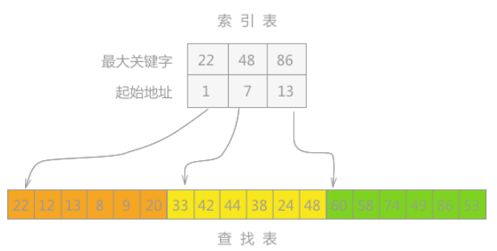
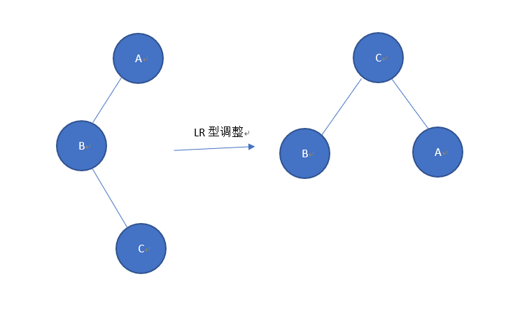

# 第九章 查找算法

## 1.线性（顺序）查找介绍与实现

### 1. 查找算法

**查找算法**是指：从一些数据之中，找到一个特殊的数据的实现方法。查找算法与遍历有极高的相似性，唯一的不同就是查找算法可能并不一定会将每一个数据都进行访问，有些查找算法如二分查找等，并不需要完全访问所有的数据。

查找算法适用于很多场景，最典型的应用场景就是已知次品商品的特征，如何从一堆商品当中查找出这些次品。

### 2. 顺序查找算法简介

顺序查找算法是最简单的查找算法，其意思为：线性的从一个端点开始，将所有的数据依次访问，并求得所需要查找到的数据的位置，此时，线性查找可以称呼为遍历。

### 3. 代码实现

一个最简单的例题：有6个商品，他们每一个商品的重量都是10，但其中有一个商品是次品，他的重量只有9，请设计代码将其找出，为了简化内容，我们直接利用数组Shangping存储内容。

```cpp
#include<iosteam>

using namespace std;

int main(){

    int Shangping[6]={10,10,9,10,10,10}

    for(int i=0;i<6;i++){

        if(Shangping[i]==9){

            printf("找到次品，他的位置在：%d",i+1);

        }

    }

    return 0;

}
```

可以见到，本题中利用一层for循环即可找寻到目标，这相当容易理解，即使映射到链表中进行线性的查找依旧很容易理解，而在接下来的章节内，我们将依次学习折半查找（又名二分查找）以及分块查找等静态查找方法，也会讲解二叉排序树和平衡二叉树这些利用数据结构进行操作的动态查找方式。

## 2.折半查找（二分查找）介绍与实现

### 1. 算法简介

**二分查找**也称**折半查找**（Binary Search），多数的人喜欢叫他二分查找。它是一种效率较高的查找方法。但是，折半查找要求线性表必须采用顺序存储结构，而且表中元素按关键字有序排列，注意必须要是有序排列，但有一种特殊情况可以不必须有序排列，即前一节介绍的商品选取，从一堆标准重量为10的商品中查找出唯一的次品，这种特殊的数据情况也可以使用二分查找。

### 2. 具体计算

二分查找的基本思想是将n个元素分成大致相等的两部分，取a[n/2]与x做比较，如果x=a[n/2],则找到x,算法中止；如果x<a[n/2],则只要在数组a的左半部分继续搜索x,如果x>a[n/2],则只要在数组a的右半部搜索x.

总共有n个元素，

渐渐跟下去就是n,n/2,n/4,....n/2^k（接下来操作元素的剩余个数），其中k就是循环的次数

由于n/2^k取整后>=1即令n/2^k=1可得k=log2n,（是以2为底，n的对数）

所以时间复杂度可以表示O(log2n) 【对数的时间复杂度基本都是由此类似的方式得到，故把时间复杂度计算过程展示】

** **

### 3.实现代码

代码仅供参考

```cpp
#include <stdio.h>

#include <stdlib.h>

//二分查找算法，找不到就返回-1，找到了就返回值

int binary_search(int * list,int len,int target) {

    int low = 0;

    int hight = len-1;

    int middle;

    while(low <= hight) {

        middle = (low + hight)/2;

        if(list[middle] = target) {

            printf("已找到该值，数组下标为:%d\n",middle);

            return list[middle];

        } else if(list[middle] > target) {

            hight = middle -1;

        } else if(list[middle] < target) {

            low = middle + 1;

        }

    }

    printf("未找到该值");

    return -1;

}

int main() {

    int a[] = {2,4,5,8,9,44};

    int b = binary_search(a,sizeof(a)/4,5);

    printf("b=%d\n",b);

    printf("Hello world!\n");

    return 0;

}
```

## 3.分块查找算法介绍与实现

### 1. 算法简介

分块查找是折半查找和顺序查找的一种改进方法，分块查找由于只要求索引表是有序的，对块内节点没有排序要求，因此特别适合于节点动态变化的情况，其核心有二索引表，二是分块处理。

分块查找要求把一个大的线性表分解成若干块，每块中的节点可以任意存放，但块与块之间必须排序。假设是按关键码值非递减的，那么这种块与块之间必须满足已排序要求，实际上就是对于任意的i，第i块中的所有节点的关键码值都必须小于第i+1块中的所有节点的关键码值。此外，还要建立一个索引表，把每块中的最大关键码值作为索引表的关键码值，按块的顺序存放到一个辅助数组中，显然这个辅助数组是按关键码值费递减排序的。查找时，首先在索引表中进行查找，确定要找的节点所在的块。由于索引表是排序的，因此，对索引表的查找可以采用顺序查找或折半查找；然后，在相应的块中采用顺序查找，即可找到对应的节点。

### 2.  算法具体过程

借助一张来自互联网上的图片说明：



假设要查找关键字 38 的具体位置。首先将 38 依次和索引表中各最大关键字进行比较，因为 22 < 38 < 48，所以可以确定 38 如果存在，肯定在第二个子表中。

由于索引表中显示第二子表的起始位置在查找表的第 7 的位置上，所以从该位置开始进行顺序查找，一直查找到该子表最后一个关键字（一般将查找表进行等分，具体子表个数根据实际情况而定）。结果在第 10 的位置上确定该关键字即为所找。

### 3.代码实现

代码仅供参考

```cpp
#include <stdio.h>

#include <stdlib.h>

struct index

{

　　//定义块的结构

　　int key;

　　int start;

} newIndex[3];  //定义结构体数组

int search(int key, int a[]);

int cmp(const void *a,const void* b)

{

　　return (*(struct index*)a).key>(*(struct index*)b).key?1:-1;

}

int main()

{

　　int i, j=-1, k, key;

　　int a[] = {33,42,44,38,24,48, 22,12,13,8,9,20, 60,58,74,49,86,53};

　　//确认模块的起始值和最大值

　　for (i=0; i<3; i++)

　　{

　　　　newIndex[i].start = j+1; //确定每个块范围的起始值

　　　　j += 6;

　　　　for (int k=newIndex[i].start; k<=j; k++)

　　　　{

　　　　　　if (newIndex[i].key<a[k])

　　　　　　{

　　　　　　　　newIndex[i].key = a[k];

　　　　　　}

　　　　}

　　}

　　//对结构体按照 key 值进行排序

　　qsort(newIndex,3, sizeof(newIndex[0]), cmp);

　　//输入要查询的数，并调用函数进行查找

　　printf("请输入您想要查找的数：\n");

　　scanf("%d", &key);

　　k = search(key, a);

　　//输出查找的结果

　　if (k>0)

　　{

　　　　printf("查找成功！您要找的数在数组中的位置是：%d\n",k+1);

　　}

　　else

　　{

　　　　printf("查找失败！您要找的数不在数组中。\n");

　　}

　　return 0;

}

int search(int key, int a[])

{

　　int i, startValue;

　　i = 0;

　　while (i<3 && key>newIndex[i].key)

　　{

　　　　// 确定在哪个块中，遍历每个块，确定key在哪个块中

　　　　i++;

　　}

　　if (i>=3)

　　{

　　　　//大于分得的块数，则返回0

　　　　return -1;

　　}

　　startValue = newIndex[i].start; //startValue等于块范围的起始值

　　while (startValue <= startValue+5 && a[startValue]!=key)

　　{

　　　　startValue++;

　　}

　　if (startValue>startValue+5)

　　{

　　　　//如果大于块范围的结束值，则说明没有要查找的数

　　　　return -1;

　　}

　　return startValue;

}
```

### 4. 生活映射

分块查找在现实生活中也很常用。

例如，一个学校有很多个班级，每个班级有几十个学生。给定一个学生的学号，要求查找这个学生的相关资料。显然，每个班级的学生档案是分开存放的，没有任何两个班级的学生的学号是交叉重叠的，那么最好的查找方法实现确定这个学生所在的班级，然后再在这个学生所在班级的学生档案中查找这个学生的资料。上述查找学生资料的过程，实际上就是一个典型的分块查找。

## 4.动态查找-二叉排序树介绍与实现

### 1. 算法简介

**二叉排序树**（Binary Sort Tree），又称二叉查找树（Binary Search Tree），亦称二叉搜索树。该树属于一种输入数据就默认产生一种顺序的数据结构，这不像本章前面的内容所描述的静态的在某一个数据段内进行查找，动态查找是一种输入时就会自动对其进行排序的数据结构，前文学过的STL中的set集合其底层就是一个类似的树形结构红黑树。

### 2. 定义

二叉排序树有以下性值：

a) 若左子树不空，则左子树上所有结点的值均小于或等于它的根结点的值；

b) 若右子树不空，则右子树上所有结点的值均大于或等于它的根结点的值；

c) 左、右子树也分别为二叉排序树；

即对于每一个根结点，其左孩子永远小于根，右孩子永远大于根。

### 3. 查找

考虑如果树是空的，则查找结束，无匹配。如果被查找的值和根结点的值相等，查找成功。否则就在子树中继续查找。如果被查找的值小于根结点的值就选择左子树，大于根结点的值就选择右子树。

参考代码如下：

```cpp
typedef int Status; /* Status是函数的类型,其值是函数结果状态代码，如OK等 */

/* 二叉树的二叉链表结点结构定义 */

typedef  struct BiTNode /* 结点结构 */

{

    int data;   /* 结点数据 */

    struct BiTNode *lchild, *rchild;    /* 左右孩子指针 */

} BiTNode, *BiTree;

/* 递归查找二叉排序树T中是否存在key, */

/* 指针f指向T的双亲，其初始调用值为NULL */

/* 若查找成功，则指针p指向该数据元素结点，并返回TRUE */

/* 否则指针p指向查找路径上访问的最后一个结点并返回FALSE */

Status SearchBST(BiTree t, int key, BiTree f, BiTree *p)

{

    if (!t) /*  查找不成功 */

    {

        *p = f;

        return FALSE;

    }

    else if (key == t->data) /*  查找成功 */

    {

        *p = t;

        return TRUE;

    }

    else if (key < t->data)

        return SearchBST(t->lchild, key, t, p);  /*  在左子树中继续查找 */

    else

        return SearchBST(t->rchild, key, t, p);  /*  在右子树中继续查找 */

}
```

### 4.插入方法及实现

二叉排序的插入是建立在二叉排序的查找之上的，插入一个结点，就是通过查找发现该结点合适插入位置，把结点直接放进去。 其实在2.2节中一步步构造二叉排序树的过程中就是结点插入过程，并考虑查找的关键字已经有在树中，则指向该数据结点，若查找的关键字没有在树中，则指向查找路径上最后一个结点。

参考代码

```cpp
struct BiTree {

    int data;

    BiTree *lchild;

    BiTree *rchild;

};

//在二叉排序树中插入查找关键字key

BiTree* InsertBST(BiTree *t,int key)

{

    if (t == NULL)

    {

        t = new BiTree();

        t->lchild = t->rchild = NULL;

        t->data = key;

        return t;

    }

    if (key < t->data)

        t->lchild = InsertBST(t->lchild, key);

    else

        t->rchild = InsertBST(t->rchild, key);

    return t;

}

//n个数据在数组d中，tree为二叉排序树根

BiTree* CreateBiTree(BiTree *tree, int d[], int n)

{

    for (int i = 0; i < n; i++)

        tree = InsertBST(tree, d[i]);

}
```

### 5.删除方法与实现

二叉树的删除可不再像二叉树的插入那么容易了，以为删除某个结点以后，会影响到树的其它部分的结构。

删除的时候需要考虑以下几种情况：

a)删除结点为叶子结点；

b)删除的结点只有左子树；

c)删除的结点只有右子树

d)删除的结点既有左子树又有右子树。

参考代码如下：

```cpp
/* 若二叉排序树T中存在关键字等于key的数据元素时，则删除该数据元素结点, */

/* 并返回TRUE；否则返回FALSE。 */

Status DeleteBST(BiTree *T,int key)

{

    if(!*T) /* 不存在关键字等于key的数据元素 */

        return FALSE;

    else

    {

        if (key==(*T)->data) /* 找到关键字等于key的数据元素 */

            return Delete(T);

        else if (key<(*T)->data)

            return DeleteBST(&(*T)->lchild,key);

        else

            return DeleteBST(&(*T)->rchild,key);

    }

}

/* 从二叉排序树中删除结点p，并重接它的左或右子树。 */

Status Delete(BiTree *p)

{

    BiTree q,s;

    if((*p)->rchild==NULL) /* 右子树空则只需重接它的左子树（待删结点是叶子也走此分支) */

    {

        q=*p; *p=(*p)->lchild; free(q);

    }

    else if((*p)->lchild==NULL) /* 只需重接它的右子树 */

    {

        q=*p; *p=(*p)->rchild; free(q);

    }

    else /* 左右子树均不空 */

    {

        q=*p; s=(*p)->lchild;

        while(s->rchild) /* 转左，然后向右到尽头（找待删结点的前驱） */

        {

            q=s;

            s=s->rchild;

        }

        (*p)->data=s->data; /*  s指向被删结点的直接前驱（将被删结点前驱的值取代被删结点的值） */

        if(q!=*p)

            q->rchild=s->lchild; /*  重接q的右子树 */

        else

            q->lchild=s->lchild; /*  重接q的左子树 */

        free(s);

    }

    return TRUE;

}
```

## 5.动态查找-平衡二叉树

### 1. 简介

平衡二叉树（Balanced Binary Tree）具有以下性质：它是一棵空树或它的左右两个子树的高度差的绝对值不超过1，并且左右两个子树都是一棵平衡二叉树。平衡二叉树的常用实现方法有红黑树、AVL、替罪羊树、Treap、伸展树等。 其中最为经典当属AVL树，我们

总计而言就是：平衡二叉树是一种二叉排序树，其中每一个结点的左子树和右子树的高度差至多等于1。

### 2. 性值

AVL树具有下列性质的二叉树（注意，空树也属于一种平衡二叉树）：

l  它必须是一颗二叉查找树

l  它的左子树和右子树都是平衡二叉树，且左子树和右子树的深度之差的绝对值不超过1。

l  若将二叉树节点的平衡因子BF定义为该节点的左子树的深度减去它的右子树的深度，则平衡二叉树上所有节点的平衡因子只可能为-1,0,1.

l  只要二叉树上有一个节点的平衡因子的绝对值大于1，那么这颗平衡二叉树就失去了平衡。

### 3.实现:

AVL树的构建我们需要明白一个核心的操作，整个实现过程是通过在一棵平衡二叉树中依次插入元素(按照二叉排序树的方式)，若出现不平衡，则要根据新插入的结点与最低不平衡结点的位置关系进行相应的调整。各个调整的方法分为LL型、RR型、LR型和RL型4种类型，其余的操作与一般的树进行插入和修改数据无异，这里由于篇幅关系不做过多缀数，以其中一种LR型调整为例说明，其余各种也都是举一反三思考：



由于在A的左孩子(L)的右子树(R)上插入新结点，使原来平衡二叉树变得不平衡，此时A的平衡因子由1变为2。图5是LR型的最简单形式。显然，按照大小关系，结点C应作为新的根结点，其余两个节点分别作为左右孩子节点才能平衡。

①将B的左孩子C提升为新的根结点

②将原来的根结点A降为C的右孩子

③各子树按大小关系连接(BL和AR不变，CL和CR分别调整为B的右子树和A的左子树)。

### 4. 代码演示：

代码仅作参考，具体实现请根据实际情况修改：

```cpp
#include<stdio.h>

#include<stdlib.h>

//结点设计

typedef struct Node {

    int key;

    struct Node *left;

    struct Node *right;

    int height;

} BTNode;

int height(struct Node *N) {

    if (N == NULL)

        return 0;

    return N->height;

}

int max(int a, int b) {

    return (a > b) ? a : b;

}

BTNode* newNode(int key) {

    struct Node* node = (BTNode*)malloc(sizeof(struct Node));

    node->key = key;

    node->left = NULL;

    node->right = NULL;

    node->height = 1;

    return(node);

}

//ll型调整

BTNode* ll_rotate(BTNode* y) {

    BTNode *x = y->left;

    y->left = x->right;

    x->right = y;

    y->height = max(height(y->left), height(y->right)) + 1;

    x->height = max(height(x->left), height(x->right)) + 1;

    return x;

}

//rr型调整

BTNode* rr_rotate(BTNode* y) {

    BTNode *x = y->right;

    y->right = x->left;

    x->left = y;

    y->height = max(height(y->left), height(y->right)) + 1;

    x->height = max(height(x->left), height(x->right)) + 1;

    return x;

}

//判断平衡

int getBalance(BTNode* N) {

    if (N == NULL)

        return 0;

    return height(N->left) - height(N->right);

}

//插入结点&数据

BTNode* insert(BTNode* node, int key) {

    if (node == NULL)

        return newNode(key);

    if (key < node->key)

        node->left = insert(node->left, key);

    else if (key > node->key)

        node->right = insert(node->right, key);

    else

        return node;

    node->height = 1 + max(height(node->left), height(node->right));

    int balance = getBalance(node);

    if (balance > 1 && key < node->left->key) //LL型

        return ll_rotate(node);

    if (balance < -1 && key > node->right->key)     //RR型

        return rr_rotate(node);

    if (balance > 1 && key > node->left->key) {   //LR型

        node->left = rr_rotate(node->left);

        return ll_rotate(node);

    }

    if (balance < -1 && key < node->right->key) {   //RL型

        node->right = ll_rotate(node->right);

        return rr_rotate(node);

    }

    return node;

}

//遍历

void preOrder(struct Node *root) {

    if (root != NULL) {

        printf("%d ", root->key);

        preOrder(root->left);

        preOrder(root->right);

    }

}

int main() {

    BTNode *root = NULL;

    root = insert(root, 2);

    root = insert(root, 1);

    root = insert(root, 0);

    root = insert(root, 3);

    root = insert(root, 4);

    root = insert(root, 4);

    root = insert(root, 5);

    root = insert(root, 6);

    root = insert(root, 9);

    root = insert(root, 8);

    root = insert(root, 7);

    printf("前序遍历：");

    preOrder(root);

    return 0;

}
```
