# 数据结构与算法教程

> 来源：Dotcpp 编程 https://www.dotcpp.com/course/ds/ ｜ 本地离线版，仅供个人学习使用
# 第一章 数据结构入门

## 1.数据结构与算法入门

### 1.序

　　欢迎阅读本教程。

　　本套教程由UDP广播协议叫吃饭 编写，面向对计算机编程有一定基础的同学，如果你对计算机完全属于一种小白的状态，建议前往（[C语言教程](https://www.dotcpp.com/course/c/)）以及（[C++教程](https://www.dotcpp.com/course/cpp/)）进行基础的学习。

本教程IDE采用来自https://sourceforge.net/projects/orwelldevcpp/下载的[DEV-C++](https://www.dotcpp.com/wp/144.html)，这个IDE更多的被算法竞赛中所使用，无论是中学生的NOIP,还是大学生的蓝桥杯，均是多使用此IDE的，这个IDE轻巧且跨平台，深受学生喜爱。

### 2.数据结构介绍

　　“程序（Program）=数据结构（Data Structure）+算法（Algorithm）”

数据结构是计算机专业中一门综合性的基础课程，它是介于数学，计算机硬件和计算机软件的三者之间一门核心课程，同时，数据结构是设计数据库，程序，操作系统，游戏等等设计方面的重要基础，是绝大多数计算机专业考研的指定科目，也是大公司面试时常考科目，同时，也是高中及大学的学课竞赛中必备知识，优秀的数据结构和算法，可见数据结构在计算机课程中的重要性。

计算机的算法与数据结构密切相关，算法无不依赖于数据结构，而数据结构也关系到算法的效率，直接决定了一个程序的好坏。

### 3. 学习前提

　　1.至少掌握一门计算机编程语言。

　　2.有一定的数学基础和逻辑思考能力。

### 4.如何学好数据结构

如同如何学好C语言和C++一样，多读多写代码，多练习就是最好的方法，本人坚持认为，不写代码空读书是完全不足以让你成为一名合格的程序员的，在C语言网中的题目列表有大量的基础数据结构的习题，与习题结合去练习不失为一个好办法。

### 5.对于本教程的一点阅读建议

　　1.复习好C语言以及C++的基础知识，尤其是指针这一块的知识，当然使用别的计算机编程语言也可以，你完全可以把本教程提供的代码当作伪代码来学习。

　　2.阅读时建议顺序阅读，多思考理解，不要轻易去大量的复制粘贴代码（虽说这也是一个技巧），代码结合图示的学习方法是相当重要的，弄懂原理才是编写代码的基础。

　　3.你可以做一些适当的摘抄，虽然有的时候笔记记一次以后不再阅读，但是在写字的时候也是一种加强记忆的过程，笔记的过程就可以加强你的理解。

　　希望你不负此行。

PS:

**IDE**：集成开发环境集成开发环境（IDE，Integrated Development Environment ）是用于提供程序开发环境的应用程序，一般包括代码编辑器、编译器、调试器和图形用户界面等工具。集成了代码编写功能、分析功能、编译功能、调试功能等一体化的开发软件服务套。所有具备这一特性的软件或者软件套（组）都可以叫集成开发环境。如微软的Visual Studio系列，Borland的C++ Builder、Delphi系列等。

## 2.数学基础

在开始我们数据结构的教程之前，你需要具备以下数学基础知识，这些知识可能不会马上体现在计算机编程中，但是随着学习的深入，这些知识愈发愈用的平凡，于其遇到了再的碎片化，不如我们单独开出一节来单独学习这些数学基础知识

注意，我们这里只是简单提及一些公式和原理，具体的内容和深入学习请参考《高等数学》《离散数学》《数论》相关知识。

### 1.  指数

指数是幂运算aⁿ(a≠0)中的一个参数，a为底数，n为指数，指数位于底数的右上角，幂运算表示指数个底数相乘。

如43=4*4*4

一些基本的公式

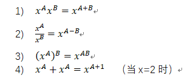

### 2.  对数

在数学中，对数是对求幂的逆运算，正如除法是乘法的倒数，反之亦然。因此，对于公式，有且仅当

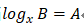

一些基本的公式

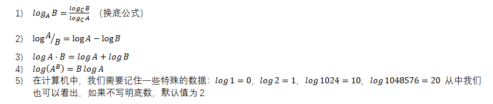

### 3.  级数

级数是指将数列的项依次用加号连接起来的函数。我们使用∑（希腊语：Sigma，汉语：西格玛）符号进行表示，如

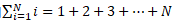

级数理论是分析学的一个分支；它与另一个分支微积分学一起作为基础知识和工具出现在其余各分支中。二者共同以极限为基本工具，分别从离散与连续两个方面，结合起来研究分析学的对象，即变量之间的依赖关系──函数。

这里介绍一写简单而基本的公式：

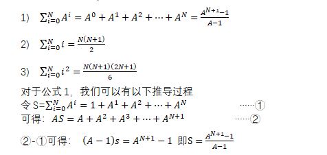

其他公式也都有一些相应得推导过程，这里只简单介绍。

此外，对于级数，还有“几何级数”的概念，其意思为N趋向于无穷，整个函数式会发生怎么样的改变，几何级数的使用，对于计算机计算程序的时空复杂度以及进行一些归纳方法非常有用。

### 4. Π运算

Π（希腊语：pi，汉语：派）运算与∑符号的运算法则类似，由∑的加法变成了乘法，其代表“求乘积”，如

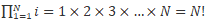

## 3.数据结构与算法

请牢记：程序=数据结构+算法

### 1. 数据结构发展史

### **1) 起源：**

1968年美国唐•欧•克努特教授开创了数据结构的最初体系，他所著的《计算机程序设计技巧》第一卷《基本算法》是第一本较系统地阐述数据的逻辑结构和存储结构语其操作的著作。我们一般认为本书开创了数据结构的系统概念。

70年代初，数据结构作为一门独立的课程开始进入大学课堂。

数据结构的发展经历三个阶段：无结构阶段，结构化阶段和面向对象阶段（和程序发展的三个阶段不谋而合了）

### **2) 无结构阶段**

40~60年代见，计算机的主要应用还没有如此普及，当时计算机主要是正对科学计算，程序设计技术以机器语言和汇编语言为主，程序处理的是存粹的数值，数据之间的关系主要是以来数学公式或者数学模型，此时数据结构概念并没有明确形成。

### **3)结构化阶段**

60~80年代，计算机开始广泛应用于非数值处理领域，数据表示成为程序设计的重要问题，人们认识到程序设计规范化的重要性，提出了程序结构模块化，并开始注意数据表示与操作的结构化。数据结构及抽象数据类型就是在这种情况下形成的，随着数据规模的加大，程序的设计越来越依附于数据结构的设计，此时数据结构开始广泛普及。

此间也有非常多的数据结构相关的文献产出，最为著名的是图灵奖获得者沃斯的一个著名公式：程序=数据结构+算法。

### **4)面向对象阶段**

80年代初期到现在，随着计算机不断普及，计算机性能以及需求不断增加，面向对象的程序设计被逐步提出，在对象的世界中 ，程序设计中大大减少了重复设计的部分，数据结构在这个阶段逐渐变得丰富，大量的封装类出现，减少了程序设计者的负担，数据结构因此变得更加友好。

### 2.何为算法

请你回答一下如何使用计算机C语言编程计算1到100的和（1+2+3+……+100），相信大多数人会直接给出以下答案：

```cpp
#include <stdio.h>

int main() {

    int ans=0,i;

    for(i=1;i<=100;i++){

        ans+=i;

    }

    printf("%d",ans);

    return 0;

}
```

这几乎是计算机中最为简单的程序了，但是，这样去完成这个功能真的好么？早在300年前的小学生高斯在课堂上被老师要求去计算这个结果，在同班同学还在手推写结果的时候，高斯早就已经做完了，他利用等差数列求和的算法，轻易打败了同班同学。

相关代码如下：

```cpp
#include <stdio.h>

int main() {

    int ans=(1+100)*100/2;

    printf("%d",ans);

    return 0;

}
```

相比第一份答案，我们进行了100次的运算，才得出我们想要的结果，而对于第二份答案，我们仅进行了1次运算就得到了想要的结果，而在实际中计算机的计算远远不止这点计算量，以此如果我们去计算1到1000000的和呢？使用了等差数列还是一步算好，而这就是算法的魅力。

## 4.算法基础

### 1. 算法的特性

### **1) 输入输出**

算法具有零个或者多个输入，同时，算法具有至少一个的输出。

对于在屏幕上打印”Hello World”一样，你可以不需要有任何的输入，直接输出得到结果即可，而对于一个没有输出的算法，没有任何意义。

### **2) 确定性**

算法的每一步都具有确定的含义，无二义性。任何条件下，算法只有唯一的一条执行路径，即对于相同的输入只能得到相同的输出。

请注意，如果算法的目的是产生一个随机数字，每一次运行产生了不同的结果，看上去好像违反了算法确定性原则，但计算机产生随机数亦是使用一种（或多种）算法解决，以线性同余产生随机数为例，其利用了CPU时间的不同产生的不同的结果，当CPU的时间完全一样的时候依旧会产生相同结果，只不过人类无法察觉到如此精确的时间区别。

### **3)有穷性**

一个算法总是需要（输入合法的情况下）在有限的步骤结束，即每个算法需要在有穷的时间内完成。

这是算法与程序的最主要的区别，程序可以无限制循环的执行下去。对于此，你可以理解为一个算法必须要有一个”边界“，即使一个算法需要计算机连续运算50年，但依旧是有穷的，只不过这个算法意义已经不是很大了。

### **4)可行性**

一个算法是可以被执行的，即算法中的每个操作都可以通过已经实现的基本运算执行有限的次数完成。

尽管在目前计算机解存在着没有实现成功的极为复杂的算法，但是并不能说的上是无法实现，只不过是受到现在的工具和人类的大脑限制了，这属于理论研究的范围。

### 2. 算法设计要求

### **1) 正确性**

正确性（Correctness）指的是该算法能够满足预先指定的功能与性能的需求，即能够得到正确答案。

其大致可以分为以下四点：

a)该算法中不含任何语法错误。

b)程序对于几组输入数据能够得到满足需求的结果。

c)程序对于非法的输入也能够得到满足需求说明的结果（如抛出异常）。

d)程序对于精心挑选的严苛数据依旧能够产生满足需求的结果。

### **2)健壮性**

健壮性（Robustness）指的是当输入数据不合法时，算法也能做出相关的处理，而不是产生不可预计的效果。

### **3)可读性**

可读性（Readability）指的是算法是可以阅读，理解和交流的。

### **4)耗时低，占用空间少**

运行时间（Running time）与占用空间（Storage space）概念，在设计算法时，我们总是希望能够更少的使用时间和空间达成我们的目标。

我们算法与数据结构的研究的重点就是为了让程序运行块，占用空间低。

## 5.数据结构基础

### 1. 基本概念和术语

### **1)数据**

数据（Data）是信息的载体，是可以被计算机识别，存储并加工处理的描述客观事物的信息符号的总称。数据不仅仅包括了整形，浮点数等数值类型，还包括了字符甚至声音，视频，图像等非数值的类型。

### **2)数据元素**

数据元素（Data Element）是描述数据的基本单位，也被称为记录。一个数据元素有若干个数据项组成。

如禽类，鸡鸭都属于禽类的数据元素。

### **3)数据项**

数据项（Data Item）是描述数据的最小单位，其可以分为组合项和原子项：

a)组合项

如果数据元素可以再度分割，则每一个独立处理单元就是数据项，数据元素就是数据项的集合。

b)原子项

如果数据元素不能再度分割，则每一个独立处理的单元就是原子项。

如日期2019年4月25日就是一个组合项，其表示日期，但如果单独拿25日这个数据出来观测，这就是一个原子项，因为其不可以再分割。

### **4)数据对象**

数据对象（Data Object）是性质相同的一类数据元素的集合，是数据的一个子集。数据对象可以是有限的，也可以是无限的。

### **5)数据结构**

数据结构（Data Structures）主要是指数据和关系的集合，数据指的是计算机中需要处理的数据，而关系指的是这些数据相关的前后逻辑，这些逻辑与计算机储存的位置无关，其主要包含以下四大逻辑结构。

### 2. 四大逻辑结构（Logic Structure）

### **1) 集合结构**

集合结构（Set Structure）中所有数据元素除了同属于一个集合外，并无其他关系。

如图：

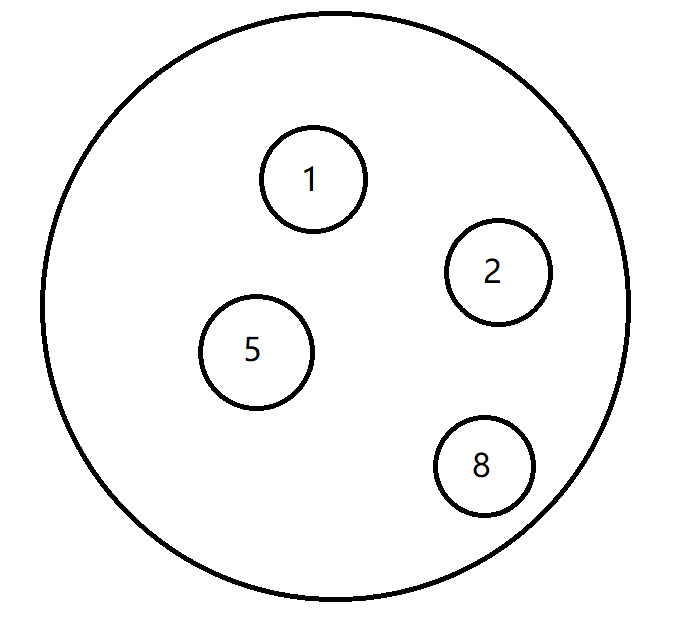

### **2) 线性结构**

线性结构（Linear Structure）指的是数据元素之间存在“一对一的关系”

如图:

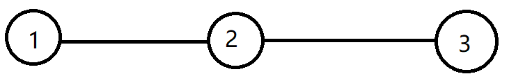

### **3) 树形结构**

树形结构（Tree Structure）指的是数据元素之间存在“一对多”的层次关系。

如图：

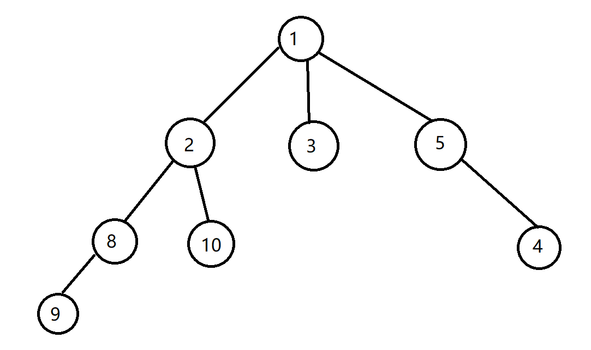

### **4) 图形结构**

图形结构（Graphic Structure，也称：网状结构）指的是数据元素之间存在“多对多的关系”（注：此时的“多对多”中的多表示，至少有一个）

图示：

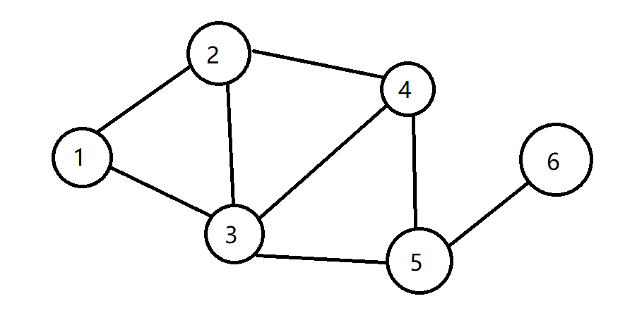

### 3.数据类型

### **1) 数据类型**

数据类型（Data Type）是高级程序设计语言中的概念，是数据的取值范围和对数进行操作的总和。数据类型规定了程序中对象的特性。程序中的每一个变量，常量或者表达式都属于一种数据类型。

### **2) 抽象数据类型**

抽象数据类型（Abstract Data Type，ADT）只是一个数学模型以及定义在模型上的一组操作。通常是对数据的抽象，定义了数据的取值范围以及对数据操作的集合。

抽象数据类型的特征是实现与操作分离，从而实现封装。

我们拿《魂斗罗》做比方：我们给予主角打，跳，移动的基本操作，这些操作就可以看作是抽象数据类型，这一组操作就属于一个模型，这组抽象的数据类型可以在《魂斗罗》这个环境中使用。

## 6.理解复杂度概念

### 1.时间空间复杂度定义

### **1) 时间复杂度**

时间复杂度表示一个程序运行所需要的时间，其具体需要在机器环境中才能得到具体的值，但我们一般并不需要得到详细的值，只是需要比较快慢的区别即可，为此，我们需要引入时间频度（语句频度）的概念。

时间频度中，n称为问题的规模，当n不断变化时,时间频度T(n)也会不断变化。一般情况下，算法中的基本操作重复次数的是问题规模n的某个函数，用T(n)表示，若有某个辅助函数f(n),使得当n趋近于无穷大时，T（n)/f(n)的极限值为不等于零的常数，则称f(n)是T(n)的同数量级函数。记作T(n)=Ｏ(f(n)),称Ｏ(f(n)) 为算法的渐进时间复杂度，简称时间复杂度。

### **2)空间复杂度**

一个程序的空间复杂度是指运行完一个程序所需内存的大小，其包括两个部分。

a)固定部分。这部分空间的大小与输入/输出的数据的个数多少、数值无关。主要包括指令空间（即代码空间）、数据空间（常量、简单变量）等所占的空间。这部分属于静态空间。

b)可变空间，这部分空间的主要包括动态分配的空间，以及递归栈所需的空间等。这部分的空间大小与算法有关。

### 2. 度量时间复杂度的两种方法

### **1)事后统计法**

顾名思义，就是指在程序运行结束之后直接查看运行时间的方式进行时间复杂度的统计，通常采用利用计算机的计时器对不同算法编制的程序进行运行时间的比较，从而确认一个算法的效率。

但这种方法有很多缺陷：

a)特别依赖计算机环境，同一套算法可能在不同的计算机上面有着截然不同的效果，老式的计算机和现代电脑的算力完完全全不是一个级别的处理速度。

b)算法的测试困难，有时一套算法需要海量的数据才能真正比较出效果，而为了设计这样的海量数据以及正确性，则需要花费大量的时间，而对于不同的数据，同一算法又有不一样的效果，故对于数据的使用很难去抉择。

也正是因为有这样的缺陷，

### **2)事先估计法**

与事后统计法不一样，事先统计法采取在计算机编译程序前对该算法进行预估的方式估算。我们可以通过利用时间频度以及函数的思维进行对时间复杂度的解析。

这里就不得不讲**函数符号，**它通常用来描述算法的时间复杂度，其中:

〇表示最坏情况，Ω表示最好情况，θ表示平均情况，我们常用的分析使用O进行表示即可。对于一个算法的时间复杂度而言，n表示其执行问题的规模，O(n)表示执行该问题需要的时间量级，如O(n)表示线性级别，O(n2)表示平方级别，其中n主要的判断方式为算法中循环结构的执行次数。

以下为一些常用的基本公式：

a)O(a）=O(1)      其中a为常数

b)O(an)=O(n)     其中a为常数

c)O(an2++bn+c)=O(n2)      其中a,b,c均为常数，结果只与最大项n有关

## 7.时间复杂度的度量方法

接上文，在理解了时间复杂度的概念后，就可以根据实际的代码进行度量了，以下举例了几个常用的时间复杂度的表示，对于如何度量其最重要的是观察程序中的循环结构，每一个循环结构代表执行循环中的指令n次，而其余指令一般而言一行代码代表执行一次，对于一个程序而言，执行的次数相差较小其实没有什么区别，都是一瞬间执行完毕。

### 1. 度量时间复杂度

a)O(1)  /  O(C)  C代表常数

```cpp
#include<stdio.h>

int main(){

    printf("Hello World");  //执行一次

    return 0;       //执行一次

}
```

对于如上代码，执行了两次，即O(2)=O(1)，我们可以称其时间复杂度为O(1)，或者常数级时间复杂度

b)O(n)

```cpp
#include<stdio.h>

int main(){

    int n=10000,ans=0;  //执行一次

    for(int i=0;i<n;i++){   //执行n次

        ans+=i;     //执行一次

    }

    return 0;       //执行一次

}
```

对于如上代码，我们一共执行了n*1+2次，即O(n*1+2)，由上文我们的公式得到其复杂度为O(n)，或称之为线性阶时间复杂度。

c)O(n^2)

```cpp
#include<stdio.h>

int main(){

    int n=10000,ans=0;  //执行一次

    for(int i=0;i<n;i++){   //执行n次

        for(int j=0;j<n;j++){   //执行n次

            ans+=j;

        }

    }

    return 0;       //执行一次

}
```

对于如上代码，我们一共执行了n*n*1+2次，即O(n*n*1+2)，由上文我们的公式得到其复杂度为O(n^2)，或称之为平方阶时间复杂度，此外还有三层循环结构嵌套组成的O(n^3)级别的时间复杂度，称之为立方阶时间复杂度，随着嵌套的增多，甚至还有O(n!)级，称之为阶层级时间复杂度，但是这种级别复杂度极高，程序运行极其缓慢。

d)O(logn)

```cpp
#include<stdio.h>

int main(){

    int i=1,n=10000;    //执行一次

    while(i<=n){    //执行logn次

        i*=2;

    }

    return 0;       //执行一次

}
```

对于如下代码，与上文的线性增长不同，其i的增长是倍增的形式，也就是说i会随着运行次数的增加变大的趋势变更大，这样会比那些简单的用加法上涨的变量更快到达循环结构的边界，这样的代码时间复杂度一般为log级别，对于本样例，有O(logn+2)=O(logn)，称之为对数阶时间复杂度

e)O(n*logn)

```cpp
#include<stdio.h>

int main(){

    int n=10000,ans=0;  //执行一次

    for(int i=0;i<n;i++){   //执行n次

        int j=0;        //执行1次

        while(j<=n){    //执行log(n)次

            j*=2;

        }

    }

    return 0;       //执行一次

}
```

对于上文的对数级别的时间复杂度，一样可以实用别的循环进行嵌套，比如本样例O(n*(logn+1)+2)=O(n*logn)级别

除此之外还有很多种时间复杂度的组合，比如说O(2^n)这样的指数阶时间复杂度，有时甚至需要引入多个变量乃进行表示，不过最核心的还是要观察循环结构的处理。

### 2.各个复杂度的比较

如图，我们以x轴为n的规模，y轴为整体的计算次数，可以发现其明显的计算区别，立方级别似乎很小的数就变得需要很多得计算了，而相对得logn级别得复杂度似乎无论怎么增加n，其涨幅都不是很明显。

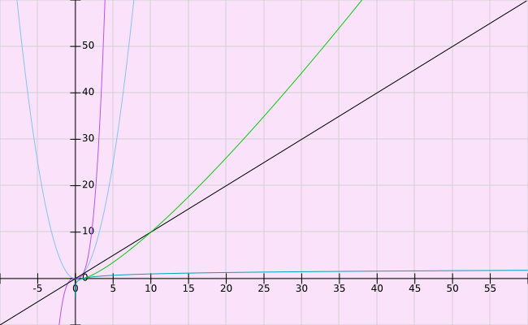

然而事实上，计算机的计算次数何止60次啊，计算机真实的计算速度是论千论万论亿级别的计算，所以我们的n会变得非常之大，让我们把坐标进行变化，以10000为界进行理解。

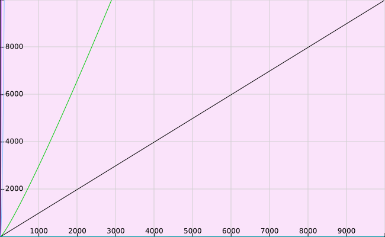

可以见到，平方以及立方级别的复杂度几乎已经是平贴着y轴的一条直线了，而O(n*log(n))与O(n)还保持着一定的速率进行增长，log(n)又是另一个极端，它变成了一个几乎贴着x轴的直线，这样算法的效率就轻易看得出了。

综上可以直观的得出：

O(1) < O(logn) < O(n) < O(nlogn) < O(n^2) < O(n^3) < O(2^n)

在设计程序的时候一定要注意，高计算需求的地方一定不要使用太高的时间复杂度的计算方式！

## 8.程序运行时的内存与地址

### 1. 理解内存

在开始数据结构的正式代码编写之前，我们得先熟悉一个计算机中重要的概念——**内存**，当然这里不是教你如何选购内存条，这里是介绍数据结构学习中必须要掌握的关于内存的基本概念。

首先请看这么一张图：

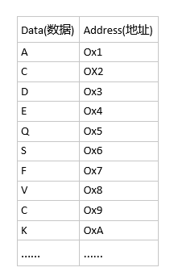

(地址的常用表示为十六进制表示法，即Ox+十六进制数)

由这个图可以清晰的发现对于每一段的内存中的数据，都有一个地址与之相对应，也真是因为有地址的存在，我们计算机中才可以轻易的去访问到其中数据，拿一个数组来说，数组在C语言中是顺序存储的，因此，如上图的数据直接用代码找到其数据以及地址的话可以这样写

```cpp
#include<stdio.h>

int main(){

    int i;

    char array[10]="ACDEQSFVCK";

    for(i=0;i<10;i++){

        printf("The %c Address is %x \n",array[i],&array[i]);

       //%x可以换成%p都是十六进制表示，只不过%p会把所有的位数显示出来

    }

    return 0;

}
```

其数据的输出结果如下（注意，不同的电脑可能地址不一样）：

The A Address is 62fe40

The C Address is 62fe41

The D Address is 62fe42

The E Address is 62fe43

The Q Address is 62fe44

The S Address is 62fe45

The F Address is 62fe46

The V Address is 62fe47

The C Address is 62fe48

The K Address is 62fe49

可以看到这是一段连续的地址，当你把char类型换成int型之后可能又不太一样，因为char是1字节的，而int占4字节，所以int的地址会变成4个一跳的方式往上增长。

不难察觉，指针似乎与内存的联系十分密切，事实上，指针就是为了灵活的操纵内存而设计的， C/C++语言的灵魂就在指针上，指针的存在，使得内存地址可以像数据一样进行赋值修改，极其灵活且方便（同时也具有风险）。

请巩固C语言学习的有关指针方面的知识点，这将对你数据结构的学习十分有帮助。

## 9.编程预备

两个必备的函数知识（其均来自于stdlib.h库中）

### 1. Malloc函数

malloc（）函数在堆中申请分配一个大小为size个字节的连续内存空间，若成功分配，则返回一个指向所分配空间起始地址的指针，否则返回空指针（NULL）。

### 2.Free函数

free（）函数用来释放已分配的内存空间，参数p是待释放的内存空间的首指针

总结来说malloc就是用来申请内存空间，而free是为了释放内存空间，这两个函数在C/C++语言的数据结构中十分重要，也十分常用，请务必牢记，这里总结几个新手易犯的错误：

a)忽略判断是否内存申请失败，如果内存申请失败并没有执行一些中断之类的操作，程序会继续向下运行，直到各种错误把整个程序弄崩溃

b)使用malloc不适用free，这在做题中似乎无关紧要，但是一旦在工作中养成这样的习惯，则会制造出很多无用的内存垃圾，造成程序效率的低下，当然了，后面出现了内存回收机制可以自动帮我们free掉内存垃圾，但是依旧要养成即时释放内存的好习惯。

c)使用指针后胡乱进行移动，产生不知名的指针位移，这样的效果往往是不知道自己的程序究竟出了什么错误，也极其难修改。

一般而言，常规的内存分配，使用再到释放的过程如下：

```cpp
#include<stdio.h>

#include<stdlib.h>

int main(){

    int *p;     //定义一个指向整形的指针变量

    p=(int*)malloc(5*sizeof(int));  //申请5个整形大小的内存空间并返回起始地址给p

    if(p==NULL){    //申请失败

        //执行申请失败的代码，一般print一个报错

        exit(1);    //退出

    }

    p[0]=1000;  //为空间中添加数据

    printf("%d",p[0]);  //打印这个数据

    free(p);    //释放p的内存空间，此时p依旧存在，只不过失去了指向的对象，成了野指针

    p=NULL; //为其赋NULL，此时它不再是一个野指针

    return 0;

}
```

很显然，我们设计一个数据结构程序的过程是先定义所需要的变量与指针变量---->进行内存分配---->判断是否分配成功(分配不成功就报错或者退出程序)---->对指针空间中的数据进行操作(如赋值，修改，查询，删除) ---->完成操作后释放指针

除上文提到的两个函数外，在C++中引入的对象思维，有一个极其类似于malloc函数的方法，就是new方法，但他们还是有一些区别的：

new操作符从自由存储区（free store）上为对象动态分配内存空间，而malloc函数从堆上动态分配内存。自由存储区是C++基于new操作符的一个抽象概念，凡是通过new操作符进行内存申请，该内存即为自由存储区。而堆是操作系统中的术语，是操作系统所维护的一块特殊内存，用于程序的内存动态分配，C语言使用malloc从堆上分配内存，使用free释放已分配的对应内存。

---

# 第二章 链表

## 1.顺序存储和链式存储

### 1. 再谈数组—顺序存储

我们在开始计算机课程没多久后就已经知晓了数组的概念，数组作为一个顺序储存方式数据结构为我们的程序设计带来了大量的便利，几乎任何的高级程序设计，算法设计都离不开数组的灵活使用，但是，数组最大的缺点就是我们的插入和删除时需要移动大量的元素，显然这需要消耗大量的时间。

以C语言数组插入一个元素为例，当我们需要在一个数组{1,2,3,4,5,6,7}的第1个元素后（即第2个元素）的位置插入一个’A’时

我们需要做的有，将第1个元素后的整体元素后移，形成新的数组{1,2,2,3,4,5,6,7}，再将第2个元素位置的元素替换为我们所需要的元素’A’,最终形成我们的预期，一个简单的插入操作要进行那么多的步骤，显然不是很核算。

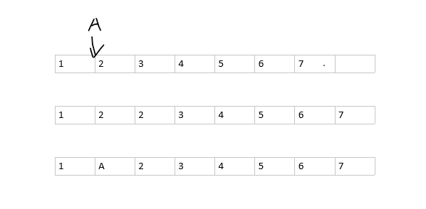

由示意图的操作，我们可以看出这样做的弊端有二

其一：所需要移动的元素很多，浪费算力。

其二：必须为数组开足够多的空间，否则有溢出风险。

### 2. 链表—链式存储

C语言使用中，由于以上出现的这些问题，我们链表的概念就应运而生，链表通过不连续的储存方式，以及指针的灵活使用，巧妙的简化了上诉的内容，同时链表是自适应内存大小的，也就是说无论我们设多大的数据，理论上都可以实现（当然不能超过你的机器承载），注意，有许多较晚的语言通过底层的方式解决了数组插入和删除时的时间浪费，如PYTHON。

链表的基本思维是，利用结构体的设置，额外开辟出一份内存空间去作指针，它总是指向下一个结点，一个个结点通过NEXT指针相互联系，串联，这就形成了我们的链表。

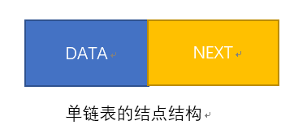

（图为单链表的一个结点结构）

其中DATA为自定义的数据类型，可以是简单的int型，也可以是复杂的struct结构体类型，而NEXT为指向下一个链表结点的指针，通过访问NEXT，可以引导我们去访问链表的下一个结点。

对于一连串的结点而言，就形成了我们的链表：


我们要进行上文所说的插入删除操作也就相当简单，只需要修改指针所指向的区域就可以了，不需要进行大量的数据移动操作。

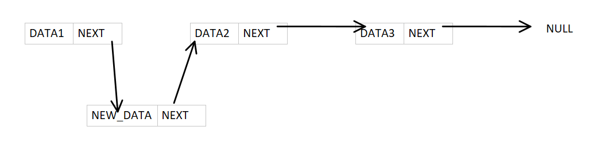

相比起数组，链表解决了数组不方便移动，插入，删除元素的弊端，但相应的，链表付出了更加大的内存牺牲换来的这些功能的实现。

上文介绍的是单链表，接下来的本章节会依次给各位介绍：单链表，双链表，循环单链表，其功能不同但实现方式均大同小异。

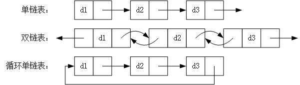

（图示为接下来学习的几种链表的区别）

## 2.单链表的基本设计（C语言代码实现）

### 1. 单链表概念&设计

单链表是一种链式存取的数据结构，，链表中的数据是以结点来表示的，每个结点的构成：元素(数据元素的映象) + 指针(指示后继元素存储位置)，元素就是存储数据的存储单元，指针就是连接每个结点的地址数据。以“结点的序列”表示的线性表称作线性链表（单链表），单链表是链式存取的结构。

对于链表的每一个结点，我们使用结构体（**struct**）进行设计，其主要内容有：


其中，DATA数据元素，可以为你想要储存的任何数据格式，可以是数组，可以是int，甚至可以是结构体（这就是传说中的结构体套结构体）

NEXT为一个指针，其代表了一个可以指向的区域，通常是用来指向下一个结点，链表的尾部NEXT指向NULL（空），因为尾部没有任何可以指向的空间了

故，对于一个单链表的结点定义，可以代码描述成：

```cpp
//定义结点类型

typedef struct Node {

    int data;       //数据类型，你可以把int型的data换成任意数据类型，包括结构体struct等复合类型

    struct Node *next;          //单链表的指针域

} Node,*LinkedList;

//Node表示结点的类型，LinkedList表示指向Node结点类型的指针类型
```

### 2. 单链表的初始化

同任何的结构，类型一样，链表也需要初始化操作，初始化是创建一个单链表的前置节点并向后逐步添加节点，一般来说，我们所谓的初始化单链表一般指的是申请结点的空间，同时对一个结点辅以空值(NULL)，其代码可以表示为：

```cpp
LinkedList listinit(){

    Node *L;

    L=(Node*)malloc(sizeof(Node));      //开辟空间

    if(L==NULL){                     //判断是否开辟空间失败，这一步很有必要

        printf("申请空间失败");

        //exit(0);                  //开辟空间失败可以考虑直接结束程序

    }

    L->next=NULL;       //指针指向空

}
```

在这里我们有一个注意点，就是一定要记住判断是否开辟空间失败，虽然在很多试题中以及常用的环境提供的环境非常安全，几乎没有开辟失败的存在，但是也一定要养成判断是否开辟失败并且判断失败后执行代码，但在生产中由于未知的情况造成一旦空间开辟失败任然在继续执行代码，后果将不堪设想，因此养成这样的判断是很有必要的，在C++中可以使用try-catch这样的语句进行优化。

### 3. 创建单链表（头插入法）

在初始化之后，就可以着手开始创建单链表了，单链表的创建分为头插入法和尾插入法两种，两者并无本质上的不同，都是利用指针指向下一个结点元素的方式进行逐个创建，只不过使用头插入法最终得到的结果是逆序的。

如图，为头插法的创建过程：

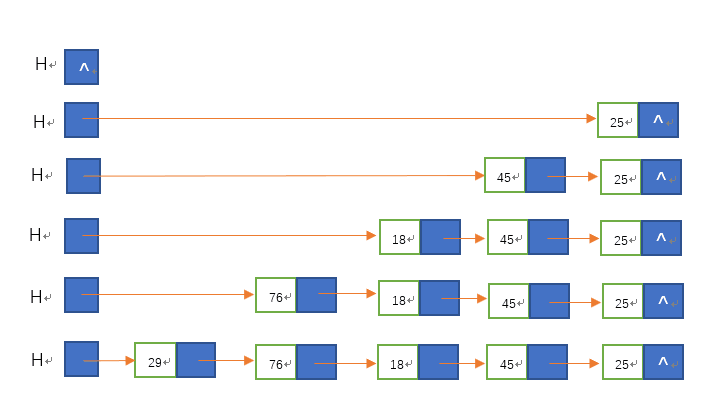

该方法从一个空表开始，生成新结点，并将读取到的数据存放到新结点的数据域中，然后将新结点插入到当前链表的表头，即头结点之后。

```cpp
//单链表的建立1，头插法建立单链表

LinkedList LinkedListCreatH() {

    Node *L;

    L = (Node *)malloc(sizeof(Node));   //申请头结点空间

    L->next = NULL;                      //初始化一个空链表

    int x;                         //x为链表数据域中的数据

    while(scanf("%d",&x) != EOF) {

        Node *p;

        p = (Node *)malloc(sizeof(Node));   //申请新的结点

        p->data = x;                     //结点数据域赋值

        p->next = L->next;     //将结点插入到表头L-->|2|-->|1|-->NULL

        L->next = p;

    }

    return L;
```

**4. 创建单链表（尾插入法）**

如图，为尾插入法的创建过程。

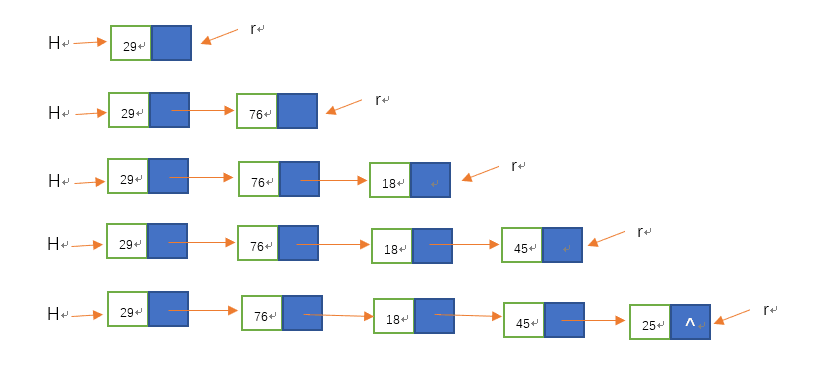

头插法建立单链表的算法虽然简单，但生成的链表中结点的次序和输入数据的顺序不一致。若希望两者次序一致，可采用尾插法。

该方法是将新结点逐个插入到当前链表的表尾上，为此必须增加一个尾指针 r, 使其始终指向当前链表的尾结点，否则就无法正确的表达链表。

```cpp
//单链表的建立2，尾插法建立单链表

LinkedList LinkedListCreatT() {

    Node *L;

    L = (Node *)malloc(sizeof(Node));   //申请头结点空间

    L->next = NULL;                  //初始化一个空链表

    Node *r;

    r = L;                          //r始终指向终端结点，开始时指向头结点

    int x;                         //x为链表数据域中的数据

    while(scanf("%d",&x) != EOF) {

        Node *p;

        p = (Node *)malloc(sizeof(Node));   //申请新的结点

        p->data = x;                     //结点数据域赋值

        r->next = p;            //将结点插入到表头L-->|1|-->|2|-->NULL

        r = p;

    }

    r->next = NULL;

    return L;

}
```

(待续)

## 3.单链表的基本操作及C语言代码实现

（续接前文）

### 1.   遍历单链表（打印，修改）

便利的概念想必大家都不会陌生，即就是从链表的头开始，逐步向后进行每一个元素的访问，这就是遍历，对于遍历操作，我们可以衍生出很多常用的数据操作，比如说查询元素，修改元素，获取元素个数，打印整个链表数据等等。

进行遍历的思路极其简单，只需要建立一个指向链表L的结点，然后沿着链表L逐个向后搜索即可。

对于遍历操作，以下是代码实现：

```cpp
//便利输出单链表

void printList(LinkedList L){

    Node *p=L->next;

    int i=0;

    while(p){

        printf("第%d个元素的值为:%d\n",++i,p->data);

        p=p->next;

    }

}
```

对于元素修改操作，以下是代码实现：

```cpp
//链表内容的修改，再链表中修改值为x的元素变为为k。

LinkedList LinkedListReplace(LinkedList L,int x,int k) {

    Node *p=L->next;

    int i=0;

    while(p){

        if(p->data==x){

            p->data=k;

        }

        p=p->next;

    }

    return L;

}
```

简单的遍历设计的函数只需要void无参即可，而当我们需要进行元素修等涉及到元素操作时，我们可以设计一个LinkedList类型的函数，使其返回一个修改后的新链表。

以上的操作均用到了遍历的思维，针对于遍历还有非常多的用法供自主设计，请参考后文配套的习题进行练习。

### 2.   链表插入操作

链表的增加结点操作主要分为查找到第i个位置，将该位置的next指针修改为指向我们新插入的结点，而新插入的结点next指针指向我们i+1个位置的结点。其操作方式可以设置一个前驱结点，利用循环找到第i个位置，再进行插入。

如图，在DATA1和DATA2数据结点之中插入一个NEW_DATA数据结点：

从原来的链表状态


到新的链表状态：


以下是代码实现：

```cpp
//单链表的插入，在链表的第i个位置插入x的元素

LinkedList LinkedListInsert(LinkedList L,int i,int x) {

    Node *pre;                      //pre为前驱结点

    pre = L;

    int tempi = 0;

    for (tempi = 1; tempi < i; tempi++) {

        pre = pre->next;                 //查找第i个位置的前驱结点

    }

    Node *p;                                //插入的结点为p

    p = (Node *)malloc(sizeof(Node));

    p->data = x;

    p->next = pre->next;

    pre->next = p;

    return L;

}
```

### 3.  链表删除操作

删除元素要建立一个前驱结点和一个当前结点，当找到了我们需要删除的数据时，直接使用前驱结点跳过要删除的结点指向要删除结点的后一个结点，再将原有的结点通过free函数释放掉。

参考如图

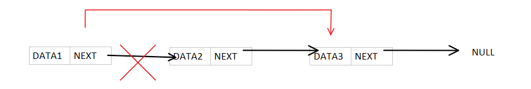

以下是代码实现：

```cpp
//单链表的删除，在链表中删除值为x的元素

LinkedList LinkedListDelete(LinkedList L,int x) {

    Node *p,*pre;                   //pre为前驱结点，p为查找的结点。

    p = L->next;

    while(p->data != x) {              //查找值为x的元素

        pre = p;

        p = p->next;

    }

    pre->next = p->next;          //删除操作，将其前驱next指向其后继。

    free(p);

    return L;

}
```

**4.  完整实现代码**

```cpp
#include <stdio.h>

#include <stdlib.h>

//定义结点类型

typedef struct Node {

	int data;           //数据类型，你可以把int型的data换成任意数据类型，包括结构体struct等复合类型

	struct Node *next;          //单链表的指针域

} Node,*LinkedList;

//单链表的初始化

LinkedList LinkedListInit() {

	Node *L;

	L = (Node *)malloc(sizeof(Node));   //申请结点空间

	if(L==NULL){	//判断申请空间是否失败

		exit(0);	//如果失败则退出程序

	}

	L->next = NULL;          //将next设置为NULL,初始长度为0的单链表

	return L;

}

//单链表的建立1，头插法建立单链表

LinkedList LinkedListCreatH() {

	Node *L;

	L = (Node *)malloc(sizeof(Node));   //申请头结点空间

	L->next = NULL;                      //初始化一个空链表

	int x;                         //x为链表数据域中的数据

	while(scanf("%d",&x) != EOF) {

		Node *p;

		p = (Node *)malloc(sizeof(Node));   //申请新的结点

		p->data = x;                     //结点数据域赋值

		p->next = L->next;                    //将结点插入到表头L-->|2|-->|1|-->NULL

		L->next = p;

	}

	return L;

}

//单链表的建立2，尾插法建立单链表

LinkedList LinkedListCreatT() {

	Node *L;

	L = (Node *)malloc(sizeof(Node));   //申请头结点空间

	L->next = NULL;                  //初始化一个空链表

	Node *r;

	r = L;                          //r始终指向终端结点，开始时指向头结点

	int x;                         //x为链表数据域中的数据

	while(scanf("%d",&x) != EOF) {

		Node *p;

		p = (Node *)malloc(sizeof(Node));   //申请新的结点

		p->data = x;                     //结点数据域赋值

		r->next = p;                 //将结点插入到表头L-->|1|-->|2|-->NULL

		r = p;

	}

	r->next = NULL;

	return L;

}

//单链表的插入，在链表的第i个位置插入x的元素

LinkedList LinkedListInsert(LinkedList L,int i,int x) {

	Node *pre;                      //pre为前驱结点

	pre = L;

	int tempi = 0;

	for (tempi = 1; tempi < i; tempi++) {

		pre = pre->next;                 //查找第i个位置的前驱结点

	}

	Node *p;                                //插入的结点为p

	p = (Node *)malloc(sizeof(Node));

	p->data = x;

	p->next = pre->next;

	pre->next = p;

	return L;

}

//单链表的删除，在链表中删除值为x的元素

LinkedList LinkedListDelete(LinkedList L,int x) {

	Node *p,*pre;                   //pre为前驱结点，p为查找的结点。

	p = L->next;

	while(p->data != x) {              //查找值为x的元素

		pre = p;

		p = p->next;

	}

	pre->next = p->next;          //删除操作，将其前驱next指向其后继。

	free(p);

	return L;

}

//链表内容的修改，再链表中修改值为x的元素变为为k。

LinkedList LinkedListReplace(LinkedList L,int x,int k) {

	Node *p=L->next;

	int i=0;

	while(p){

		if(p->data==x){

			p->data=k;

		}

		p=p->next;

	}

	return L;

}

//便利输出单链表

void printList(LinkedList L){

	Node *p=L->next;

	int i=0;

	while(p){

		printf("第%d个元素的值为:%d\n",++i,p->data);

		p=p->next;

	}

}

int main() {

	//创建

	LinkedList list;

	printf("请输入单链表的数据：以EOF结尾\n");

	list = LinkedListCreatT();

	//list=LinkedListCreatT();

	printList(list);

	//插入

	int i;

	int x;

	printf("请输入插入数据的位置：");

	scanf("%d",&i);

	printf("请输入插入数据的值：");

	scanf("%d",&x);

	LinkedListInsert(list,i,x);

	printList(list);

	//修改

	printf("请输入修改的数据：");

	scanf("%d",&i);

	printf("请输入修改后的值：");

	scanf("%d",&x);

	LinkedListReplace(list,i,x);

	printList(list);

	//删除

	printf("请输入要删除的元素的值：");

	scanf("%d",&x);

	LinkedListDelete(list,x);

	printList(list);

	return 0;

}
```

### 5.  配套练习推荐

[1676题](https://www.dotcpp.com/oj/problem1676.html)、[1052题](https://www.dotcpp.com/oj/problem1052.html)

请独自完成提交并通过

## 4.双向链表的基本设计（C语言代码实现）

### 1.  双向链表的简介&概念

单链表在很多时候已经可以胜任很多优秀的操作了，但是，单链表任然存在不足，所谓‘单链表’，是指结点中只有一个指向其后继的指针，具有单向性，有时需要搜索大量数据的时候，就必须要多次进行从头开始的遍历，这样的搜索不是很便利。

图：单链表示意图

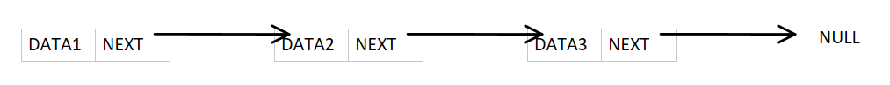

对此在单链表的基础上，产生了双向链表的概念，即： 在单链表的基础上，对于每一个结点设计一个前驱结点，前驱结点与前一个结点相互连接，构成一个链表。

双向链表可以简称为双链表，是链表的一种，它的每个数据结点中都有两个指针，分别指向直接后继和直接前驱。所以，从双向链表中的任意一个结点开始，都可以很方便地访问它的前驱结点和后继结点。

图：双向链表示意图

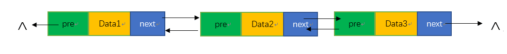

一个完整的双向链表应该是头结点的pre指针指为空，尾结点的next指针指向空，其余结点前后相链。

### 2. 双向链表的结点设计

对于每一个结点而言，有：

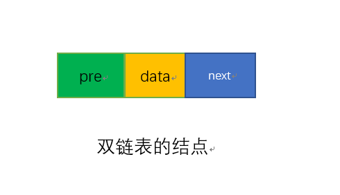

其中，DATA表示数据，其可以是简单的类型（如int,double等等），也可以是复杂的结构体（struct类型）；

pre代表的是前驱指针，它永远指向当前结点的前一个结点，注意，如果当前结点是头结点，则pre指针为空；

next代表的是后继指针，它永远指向当前结点的下一个结点，注意，如果当前结点是尾结点，则next指针为空

其代码设计可以为：

```cpp
typedef struct line{

    int data;           //data

    struct line *pre;   //pre node

    struct line *next;  //next node

}line,*a;

//分别表示该结点的前驱(pre)，后继(next)，以及当前数据(data)
```

### 3. 双链表的创建

对于创建双向链表，我们需要先创建头结点再逐步的进行添加，请注意，双向链表的头结点是有数据元素的，也就是头结点的data域中是存有数据的，这与一般的单链表是不同的。

对于逐步添加数据，我们采取的做法是，开辟一段新的内存空间作为新的结点，为这个结点进行的data进行赋值，然后将已成链表的上一个结点的next指针指向自身，自身的pre指针指向上一个结点。

其代码可以设计为：

```cpp
//创建双链表

line* initLine(line * head){

    int number,pos=1,input_data;

    //三个变量分别代表结点数量，当前位置，输入的数据

    printf("请输入创建结点的大小\n");

    scanf("%d",&number);

    if(number<1){return NULL;} //输入非法直接结束

    //////头结点创建///////

    head=(line*)malloc(sizeof(line));

    head->pre=NULL;

    head->next=NULL;

    printf("输入第%d个数据\n",pos++);

    scanf("%d",&input_data);

    head->data=input_data;

    line * list=head;

    while (pos<=number) {

        line * body=(line*)malloc(sizeof(line));

        body->pre=NULL;

        body->next=NULL;

        printf("输入第%d个数据\n",pos++);

        scanf("%d",&input_data);

        body->data=input_data;

        list->next=body;

        body->pre=list;

        list=list->next;

    }

    return head;

}
```

初步看起来双向链表似乎比单链表的两种创建方法要复杂，其实将过程逐步拆解为 创建头结点----创建一个新的结点----将头结点和新结点相互链接----再度创建新结点……这样的过程去思考，再反过头多看几遍代码会有助于理解。

## 5.双向链表的基本操作及C语言代码实现

### 1.   双向链表的插入操作

如图所示：

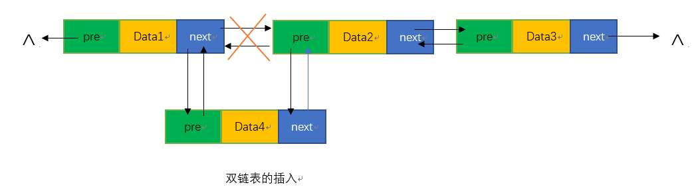

对于每一次的双向链表的插入操作，我们首先需要创建一个独立的结点并通过malloc操作开辟相应的空间，其次我们选中这个新创建的独立节点，将其的pre指针指向所需插入位置的前一个结点，同时，其所需插入的前一个结点的next指针修改指向为该新的结点，同理，该新的结点的next指针将会指向一个原本的下一个结点，而修改下一个结点的pre指针为指向新结点自身，这样的一个操作我们称之为双向链表的插入操作。

其代码可以表示为：

```cpp
//插入数据

line * insertLine(line * head,int data,int add){

    //三个参数分别为：进行此操作的双链表，插入的数据，插入的位置

    //新建数据域为data的结点

    line * temp=(line*)malloc(sizeof(line));

    temp->data=data;

    temp->pre=NULL;

    temp->next=NULL;

    //插入到链表头，要特殊考虑

    if (add==1) {

        temp->next=head;

        head->pre=temp;

        head=temp;

    }else{

        line * body=head;

        //找到要插入位置的前一个结点

        for (int i=1; i<add-1; i++) {

            body=body->next;

        }

        //判断条件为真，说明插入位置为链表尾

        if (body->next==NULL) {

            body->next=temp;

            temp->pre=body;

        }else{

            body->next->pre=temp;

            temp->next=body->next;

            body->next=temp;

            temp->pre=body;

        }

    }

    return head;

}
```

### 2.   双向链表的删除操作

如图：

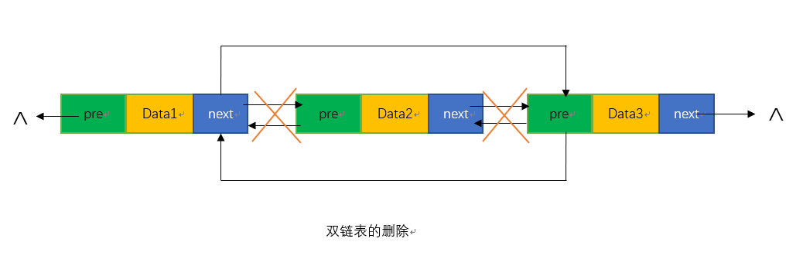

删除操作的过程是：选择需要删除的结点，选中这个结点的前一个结点，将前一个结点的next指针指向自己的下一个结点，同时，选中该节点的下一个结点，将下一个结点的pre指针修改指向为自己的上一个结点，这样产生的效果就是在进行遍历的时候直接将这一个结点给跳过了。

在这样的指针修改操作之后，我们释放删除结点，归还空间给内存，这样的操作我们称之为双链表的删除操作。

其代码可以表示为：

```cpp
//删除元素

line * deleteLine(line * head,int data){

    //输入的参数分别为进行此操作的双链表，需要删除的数据

    line * list=head;

    //遍历链表

    while (list) {

        //判断是否与此元素相等

        //删除该点方法为将该结点前一结点的next指向该节点后一结点

        //同时将该结点的后一结点的pre指向该节点的前一结点

        if (list->data==data) {

            list->pre->next=list->next;

            list->next->pre=list->pre;

            free(list);

            printf("--删除成功--\n");

            return head;

        }

        list=list->next;

    }

    printf("Error:没有找到该元素，没有产生删除\n");

    return head;

}
```

### 3   双向链表的遍历

如同单链表的遍历一样，利用next指针逐步向后进行索引即可，注意判断这里，我们既可以用while(list)的操作直接判断是否链表为空，也可以使用while(list->next)的操作判断该链表是否为空，其下一节点为空和本结点是否为空的判断条件是一样的效果，当然了，善用双向链表的pre指针进行有效的遍历也是值得去尝试的。

其简单的代码可以表示为：

```cpp
//遍历双链表,同时打印元素数据

void printLine(line *head){

    line *list = head;

    int pos=1;

    while(list){

        printf("第%d个数据是:%d\n",pos++,list->data);

        list=list->next;

    }

}
```

### 4.   配套练习题目

双向链表的单独训练数据并不是很多，在网上的资料相比单链表也是偏少，不过我们在熟悉原理之后可以同单链表的题目，可以尝试使用双链表进行做题，如下题：

[1676题](https://www.dotcpp.com/oj/problem1676.html)    [1585题](https://www.dotcpp.com/oj/problem1585.html)

### 5.   本题目案例代码

```cpp
#include<stdio.h>

#include<stdlib.h>

typedef struct line{

    int data;           //data

    struct line *pre;   //pre node

    struct line *next;  //next node

}line;

//分别表示该结点的前驱(pre)，后继(next)，以及当前数据(data)

//遍历双链表,同时打印元素数据

void printLine(line *head){

    line *list = head;

    int pos=1;

    while(list){

        printf("第%d个数据是:%d\n",pos++,list->data);

        list=list->next;

    }

}

//创建双链表

line* initLine(line * head){

    int number,pos=1,input_data;

    printf("请输入创建结点的大小\n");

    scanf("%d",&number);

    if(number<1){return NULL;} //输入非法直接结束

    //////头结点创建///////

    head=(line*)malloc(sizeof(line));

    head->pre=NULL;

    head->next=NULL;

    printf("输入第%d个数据\n",pos++);

    scanf("%d",&input_data);

    head->data=input_data;

    line * list=head;

    while (pos<=number) {

        line * body=(line*)malloc(sizeof(line));

        body->pre=NULL;

        body->next=NULL;

        printf("输入第%d个数据\n",pos++);

        scanf("%d",&input_data);

        body->data=input_data;

        list->next=body;

        body->pre=list;

        list=list->next;

    }

    return head;

}

//插入数据

line * insertLine(line * head,int data,int add){

    //三个参数分别为：进行此操作的双链表，插入的数据，插入的位置

    //新建数据域为data的结点

    line * temp=(line*)malloc(sizeof(line));

    temp->data=data;

    temp->pre=NULL;

    temp->next=NULL;

    //插入到链表头，要特殊考虑

    if (add==1) {

        temp->next=head;

        head->pre=temp;

        head=temp;

    }else{

        line * body=head;

        //找到要插入位置的前一个结点

        for (int i=1; i<add-1; i++) {

            body=body->next;

        }

        //判断条件为真，说明插入位置为链表尾

        if (body->next==NULL) {

            body->next=temp;

            temp->pre=body;

        }else{

            body->next->pre=temp;

            temp->next=body->next;

            body->next=temp;

            temp->pre=body;

        }

    }

    return head;

}

//删除元素

line * deleteLine(line * head,int data){

    //输入的参数分别为进行此操作的双链表，需要删除的数据

    line * list=head;

    //遍历链表

    while (list) {

        //判断是否与此元素相等

        //删除该点方法为将该结点前一结点的next指向该节点后一结点

        //同时将该结点的后一结点的pre指向该节点的前一结点

        if (list->data==data) {

            list->pre->next=list->next;

            list->next->pre=list->pre;

            free(list);

            printf("--删除成功--\n");

            return head;

        }

        list=list->next;

    }

    printf("Error:没有找到该元素，没有产生删除\n");

    return head;

}

int main(){

    line *head=NULL;

    printf("创建双链表操作\n");

    head=initLine(head);

    printLine(head);

//////////create line////////////

	printf("插入操作\n");

    head=insertLine(head,40,2);     //为了简化直接写参数了

    printLine(head);

//////////insert Line////////////

	printf("删除操作\n");

    head=deleteLine(head,2);       //为了简化直接写参数了

    printLine(head);

//////////delete Line////////////

    return 0;

}
```

## 6.循环链表的介绍及创建（C语言代码实现）

### 1. 循环链表概念

对于单链表以及双向链表，其就像一个小巷，无论怎么样最终都能从一端走到另一端，然而循环链表则像一个有传送门的小巷，因为循环链表当你以为你走到结尾的时候，其实你又回到了开头。

循环链表和非循环链表其实创建的过程以及思路几乎完全一样，唯一不同的是，非循环链表的尾结点指向空（NULL），而循环链表的尾指针指向的是链表的开头。通过将单链表的尾结点指向头结点的链表称之为循环单链表（Circular linkedlist）

如图，为一个完整的循环单链表

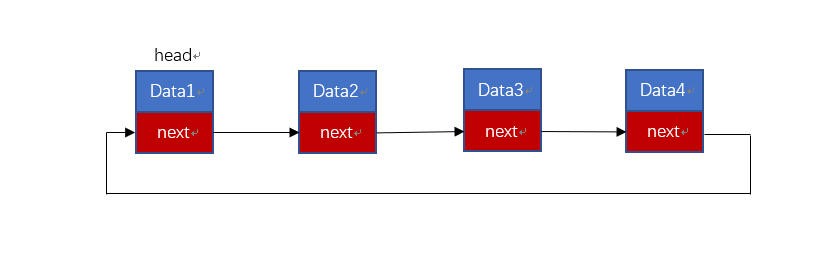

### 2.  循环链表结点设计（以单循环链表为例）

对于循环单链表的结点，可以完全参照于单链表的结点设计，如图：

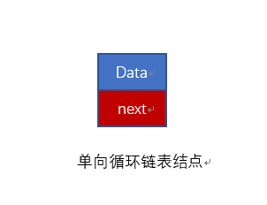

data表示数据，其可以是简单的类型（如int,double等等），也可以是复杂的结构体（struct类型）

next表示指针，它永远指向自身的下一个结点，对于只有一个结点的存在，这个next指针则永远指向自身，对于一个链表的尾部结点，next永远指向开头。

其代码可以表示为：

```cpp
typedef struct list{

    int data;

    struct list *next;

}list;

//data为存储的数据，next指针为指向下一个结点
```

### 3. 循环单链表初始化

如同单链表的创建，我们需要先创建一个头结点并且给其开辟内存空间，但与单链表不同的是，我们需要在开辟内存空间成功之后将头结点的next指向head自身，我们可以创建一个init函数来完成这件事情，为了以后的重复创建和插入，我们可以考虑在init重创建的结点next指向空，而在主函数调用创建之后手动讲head头结点的next指针指向自身。

这样的操作方式可以方便过后的创建单链表，直接利用多次调用的插入函数即可完成整体创建。

其代码可以表示为：

```cpp
//初始结点

list *initlist(){

    list *head=(list*)malloc(sizeof(list));

    if(head==NULL){

        printf("创建失败，退出程序");

        exit(0);

    }else{

        head->next=NULL;

        return head;

    }

}
```

在主函数重调用可以是这样

```cpp
在主函数重调用可以是这样

    //////////初始化头结点//////////////

    list *head=initlist();

    head->next=head;
```

### 4. 循环链表的创建操作

如图所示：

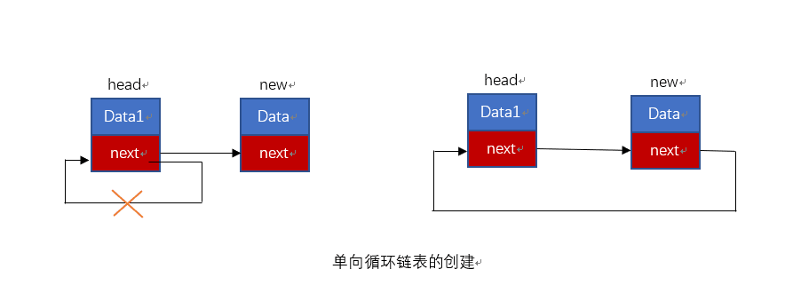

我们可以通过逐步的插入操作，创建一个新的节点，将原有链表尾结点的next指针修改指向到新的结点，新的结点的next指针再重新指向头部结点，然后逐步进行这样的插入操作，最终完成整个单项循环链表的创建。

其代码可以表示为：

```cpp
//创建——插入数据

int insert_list(list *head){

    int data;   //插入的数据类型

    printf("请输入要插入的元素：");

    scanf("%d",&data);

    list *node=initlist();

    node->data=data;

    //初始化一个新的结点，准备进行链接

    if(head!=NULL){

        list *p=head;

        //找到最后一个数据

        while(p->next!=head){

            p=p->next;

        }

        p->next=node;

        node->next=head;

        return 1;

    }else{

        printf("头结点已无元素\n");

        return 0;

    }

}
```

## 7.循环链表的基本操作及C语言代码实现

如图，对于插入数据的操作，基本与单链表的插入操作相同，我们可以创建一个独立的结点，通过将需要插入的结点的上一个结点的next指针指向该节点，再由需要插入的结点的next指针指向下一个结点的方式完成插入操作。

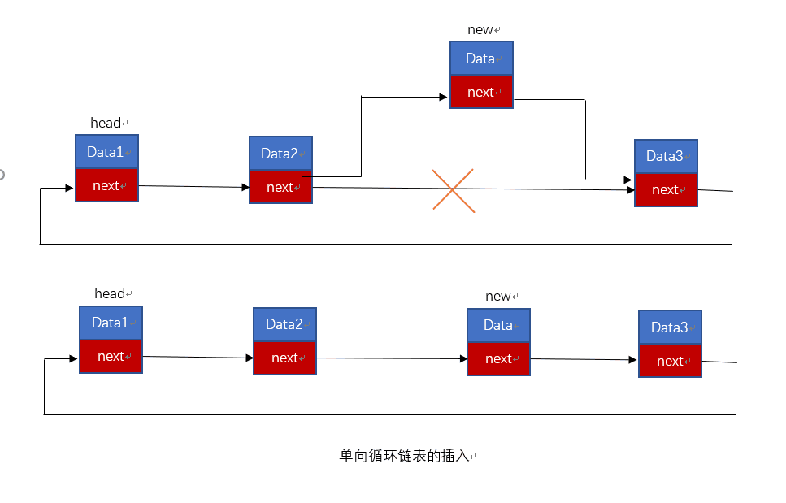

其代码可以表示为：

```cpp
//插入元素

list *insert_list(list *head,int pos,int data){

    //三个参数分别是链表，位置，参数

    list *node=initlist();  //新建结点

    list *p=head;       //p表示新的链表

    list *t;

    t=p;

    node->data=data;

    if(head!=NULL){

        for(int i=1;i<pos;i++){

            t=t->next;  //走到需要插入的位置处

        }

        node->next=t->next;

        t->next=node;

        return p;

    }

    return p;

}
```

### 2.   循环单链表的删除操作

如图所示，循环单链表的删除操作可以参考单链表的删除操作，其都是找到需要删除的结点，将其前一个结点的next指针直接指向删除结点的下一个结点即可，但需要注意的是尾节点和头结点的特判，尤其是尾结点，因为删除尾节点后，尾节点前一个结点就成了新的尾节点，这个新的尾节点需要指向的是头结点而不是空，其重点可以记录为【当前的前一节点.next=自身结点.next】这样的操作可以省去头尾结点的特判：

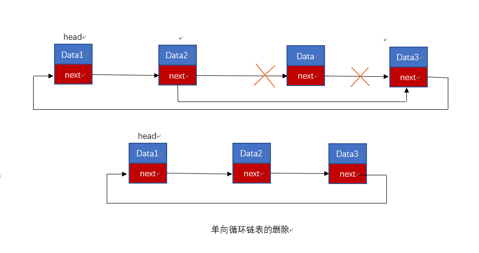

其代码可以表示为：

```cpp
//删除元素

int delete_list(list *head) {

    if(head == NULL) {

        printf("链表为空！\n");

        return 0;

    }

    //建立临时结点存储头结点信息（目的为了找到退出点）

    //如果不这么建立的化需要使用一个数据进行计数标记，计数达到链表长度时自动退出

    //循环链表当找到最后一个元素的时候会自动指向头元素，这是我们不想让他发生的

    list *temp = head;

    list *ptr = head->next;

    int del;

    printf("请输入你要删除的元素：");

    scanf("%d",&del);

    while(ptr != head) {

        if(ptr->data == del) {

            if(ptr->next == head) {

                temp->next = head;

                free(ptr);

                return 1;

            }

            temp->next = ptr->next;    //核心删除操作代码

            free(ptr);

            //printf("元素删除成功！\n");

            return 1;

        }

        temp = temp->next;

        ptr = ptr->next;

    }

    printf("没有找到要删除的元素\n");

    return 0;

}
```

### 3.   循环单链表的遍历

与普通的单链表和双向链表的遍历不同，循环链表需要进行结点的特判，找到尾节点的位置，由于尾节点的next指针是指向头结点的，所以不能使用链表本身是否为空（NULL）的方法进行简单的循环判断，我们需要通过判断结点的next指针是否等于头结点的方式进行是否完成循环的判断。

此外还有一种计数的方法，即建立一个计数器count=0，每一次next指针指向下一个结点时计数器加一，当count数字与链表的节点数相同的时候即完成循环，这样做有一个问题，就是获取到链表的节点数同时也需要完成一次遍历才可以达成目标。

其代码可以表示为：

```cpp
//遍历元素

int display(list *head) {

    if(head != NULL) {

        list *p  = head;

        //遍历头节点到，最后一个数据

        while(p->next != head ) {

            printf("%d   ",p->next->data);

            p = p->next;

        }

        printf("\n");   //习惯性换行 ( o=^•ェ•)o　┏━┓

        //把最后一个节点赋新的节点过去

        return 1;

    } else {

        printf("头结点为空!\n");

        return 0;

    }

}
```

### 4.   进阶概念—双向循环链表

循环链表还有一个进阶的概念练习，同双向链表与单链表的关系一样，循环单链表也有一个孪生兄弟——双向循环链表，其设计思路与单链表和双向链表的设计思路一样，就是在原有的双向链表的基础上，将尾部结点和头部结点进行互相连接，这个链表的设计不难，就交给读者自主进行设计。

### 5.   循环单链表代码

```cpp
 #include<stdio.h>

#include<stdlib.h>

typedef struct list{

    int data;

    struct list *next;

}list;

//data为存储的数据，next指针为指向下一个结点

//初始结点

list *initlist(){

    list *head=(list*)malloc(sizeof(list));

    if(head==NULL){

        printf("创建失败，退出程序");

        exit(0);

    }else{

        head->next=NULL;

        return head;

    }

}

//创建--插入数据

int create_list(list *head){

    int data;   //插入的数据类型

    printf("请输入要插入的元素：");

    scanf("%d",&data);

    list *node=initlist();

    node->data=data;

    //初始化一个新的结点，准备进行链接

    if(head!=NULL){

        list *p=head;

        //找到最后一个数据

        while(p->next!=head){

            p=p->next;

        }

        p->next=node;

        node->next=head;

        return 1;

    }else{

        printf("头结点已无元素\n");

        return 0;

    }

}

//插入元素

list *insert_list(list *head,int pos,int data){

    //三个参数分别是链表，位置，参数

    list *node=initlist();  //新建结点

    list *p=head;       //p表示新的链表

    list *t;

    t=p;

    node->data=data;

    if(head!=NULL){

        for(int i=1;i<=pos;i++){

            t=t->next;

        }

        node->next=t->next;

        t->next=node;

        return p;

    }

    return p;

}

//删除元素

int delete_list(list *head) {

	if(head == NULL) {

		printf("链表为空！\n");

		return 0;

	}

    //建立零时结点存储头结点信息（目的为了找到退出点）

    //如果不这么建立的化需要使用一个数据进行计数标记，计数达到链表长度时自动退出

    //循环链表当找到最后一个元素的时候会自动指向头元素，这是我们不想让他发生的

	list *temp = head;

	list *ptr = head->next;

	int del;

	printf("请输入你要删除的元素：");

	scanf("%d",&del);

	while(ptr != head) {

		if(ptr->data == del) {

			if(ptr->next == head) { //循环结束的条件换成ptr->next == head

				temp->next = head;

				free(ptr);

				return 1;

			}

			temp->next = ptr->next;

			free(ptr);

			//printf("元素删除成功！\n");

			return 1;

		}

		temp = temp->next;

		ptr = ptr->next;

	}

	printf("没有找到要删除的元素\n");

	return 0;

}

//遍历元素

int display(list *head) {

	if(head != NULL) {

		list *p  = head;

		//遍历头节点到，最后一个数据

		while(p->next != head ) {

			printf("%d   ",p->next->data);

			p = p->next;

		}

        printf("\n");   //习惯性换行 ( o=^•ェ•)o　┏━┓

		//把最后一个节点赋新的节点过去

		return 1;

	} else {

		printf("头结点为空!\n");

		return 0;

	}

}

int main(){

    //////////初始化头结点//////////////

    list *head=initlist();

    head->next=head;

    ////////通过插入元素完善链表/////////

    for(int i=0;i<5;i++){   //只是演示使用，不具体提供输入

        create_list(head);

    }

    display(head);

    ////////////插入元素////////////////

    head=insert_list(head,1,10);

    display(head);

    ////////////删除元素////////////////

    delete_list(head);

    display(head);

    return 0;

}
```

### 6.   推荐试题

如同双向链表，循环单链表的单独训练数据并不是很多，在网上的资料相比单链表也是偏少，不过我们在熟悉原理之后可以同单链表的题目，可以尝试使用循环单链表进行做题，如下题：

[1676题](https://www.dotcpp.com/oj/problem1676.html)、[1585题](https://www.dotcpp.com/oj/problem1585.html)

---

# 第三章 栈

## 1.栈（先进后出的数据结构）的设计与实现

### 1. 栈的概念

在开始前，请牢记这句话：栈是一种先进后出的数据结构。

栈（stack）是限定仅在表的一端进行操作的数据结构，请联系我们前文所学的，设想一个单链表我们只能够对其链表的表尾结点进行操作，而操作也只能够进行插入一个新的结点与删除最末尾的这个结点两个操作，而这样强限制性的‘链表’，就是我们所说的栈。

让我们重新理顺一下定义：栈是一个线性的数据结构，规定这个数据结构只允许在其中一端进行操作，并禁止直接访问除这一端以外的数据。

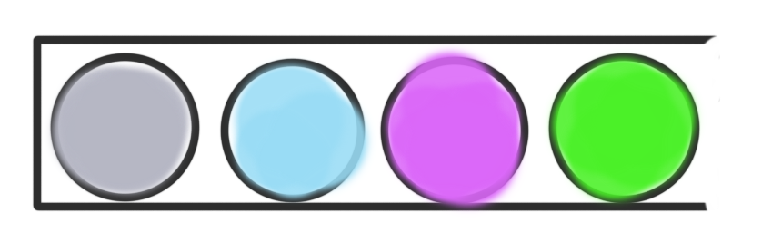

如图：栈就像一个放球的单管桶，只允许球从桶的开口这一端取出，并且球先放入桶中则后从桶中拿出。

### 2. 栈的结点设计

栈分为数组栈和链表栈，其区别是数组栈使用数组进行功能的模拟，实现较为快速和便利，而链表栈使用链表的思路去设计，实现较为麻烦，但是其稳定不易出错；在链表栈中又分为静态链表栈和动态链表栈，静态链表栈给定栈的空间大小，不允许超过存储超过给定数据大小的元素，而动态栈使用的是自动创建空间的方法进行创建，只要符合机器的硬件要求以及编译器的控制，其理论上是极大的。

说了那么多，我们以链表栈的动态链表栈为例子，进行栈的设计，在后文直接以栈一名字称呼动态链表栈，这也是各类语言标准模板中栈的实现方式。

首先是栈的结点设计，我们可以设计出两个结构体，一个结构体Node表示结点，其中包含有一个data域和next指针。


其中data表示数据，其可以是简单的类型（如int,double等等），也可以是复杂的结构体（**struct**类型）；

next指针表示，下一个的指针，其指向下一个结点，通过next指针将各个结点链接。

目前的设计如同单链表，接下来，为这个进行限制性的设计，我们额外添加一个结构体，其包括了一个永远指向栈头的指针top和一个计数器count记录元素个数，（也可以设计成一个指针top和一个指针bottom分别指向栈头和栈尾）其主要功效就是设定允许操作元素的指针以及确定栈何时为空（count的方法是当count为0时为空，top和bottom方法就是两者指向同一个空间时为栈为空）

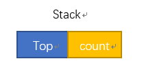

这里我采用的是top和count组合的方法。其代码可以表示为：

```cpp
//栈的结点设计

//单个结点设计，数据和下一个指针

typedef struct node

{

    int data;

    struct node *next;

} Node;

//利用上面的结点创建栈，分为指向头结点的top指针和计数用的count

typedef struct stack

{

    Node *top;

    int count;

} Link_Stack;
```

### 3. 栈的基本操作—入栈

如图：

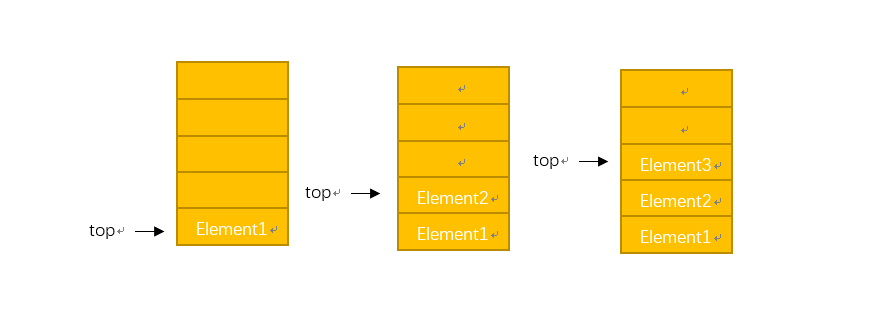

入栈(push)操作时，我们只需要找到top所指向的空间，创建一个新的结点，将新的结点的next指针指向我们的top指针指向的空间，再将top指针转移，指向新的结点，即是入栈操作

其代码可以表示为：

```cpp
//入栈 push

Link_Stack *Push_stack(Link_Stack *p, int elem)

{

    if (p == NULL)

        return NULL;

    Node *temp;

    temp=(Node*)malloc(sizeof(Node));

    //temp = new Node;

    temp->data = elem;

    temp->next = p->top;

    p->top = temp;

    p->count++;

    return p;

}
```

## 2.栈的基本操作及C语言代码实现

### 1. 栈的基本操作—出栈

如图：

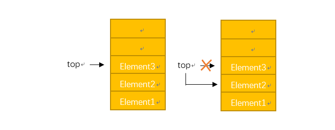

出栈（pop）操作，是在栈不为空的情况下（注意一定要进行判空操作），将栈顶的元素删除，同时top指针，next向下进行移动即可的操作。

其代码可以表示为：

```cpp
//出栈 pop

Link_Stack *Pop_stack(Link_Stack *p)

{

    Node *temp;

    temp = p->top;

    if (p->top == NULL)

    {

        printf("错误：栈为空");

        return p;

    }

    else

    {

        p->top = p->top->next;

        free(temp);

        //delete temp;

        p->count--;

        return p;

    }

}
```

### 2. 栈的基本操作—遍历

栈的遍历相对而言比较复杂，由于栈的特殊性质，其只允许在一端进行操作，所以我们的遍历操作永远都是逆序的，其过程为，在栈不为空的情况下，一次从栈顶元素向下访问，直到指针指向空（即到栈尾）为结束。

其代码可以表示为：

```cpp
//遍历栈：输出栈中所有元素

int show_stack(Link_Stack *p)

{

    Node *temp;

    temp = p->top;

    if (p->top == NULL)

    {

        printf("");

        printf("错误：栈为空");

        return 0;

    }

    while (temp != NULL)

    {

        printf("%d\t", temp->data);

        temp = temp->next;

    }

    printf("\n");

    return 0;

}
```

### 3. 快速栈实现--数组栈

数组栈是一种更为快速的模拟实现栈的方法，所谓模拟，就是不采用真实的链表设计，转而采用数组的方式进行“模拟操作”，这是一种仿真类型的操作，其可以快速的帮助我们构建代码，分析过程，相应的实现起来也更加的便捷。

其代码如下（请参考上文进行自主分析）：

```cpp
#include<stdio.h>

#include<stdlib.h>

#include<string.h>

#define maxn 10000

//结点设计

typedef struct stack{

    int data[maxn];

    int top;

}stack;

//创建

stack *init(){

    stack *s=(stack *)malloc(sizeof(stack));

    if(s==NULL){

        printf("分配内存空间失败");

        exit(0);

    }

    memset(s->data,0,sizeof(s->data));

    //memset操作来自于库文件string.h，其表示将整个空间进行初始化

    //不理解可以查阅百度百科https://baike.baidu.com/item/memset/4747579?fr=aladdin

    s->top=0;     //栈的top和bottom均为0（表示为空）

    return s;

}

//入栈push

void push(stack *s,int data){

    s->data[s->top]=data;

    s->top++;

}

//出栈pop

void pop(stack *s){

    if(s->top!=0){

        s->data[s->top]=0;  //让其回归0模拟表示未初始化即可

        s->top--;

    }

}

//模拟打印栈中元素

void print_stack(stack *s){

    for(int n=s->top-1;n>=0;n--){

        printf("%d\t",s->data[n]);

    }

    printf("\n");   //习惯性换行

}

int main(){

    stack *s=init();

    int input[5]={11,22,33,44,55};  //模拟五个输入数据

    for(int i=0;i<5;i++){

        push(s,input[i]);

    }

    print_stack(s);

    /////////////

    pop(s);

    print_stack(s);

    return 0;

}
```

### 4. 配套题目推荐

可以尝试的去利用栈的思维实现一下进制转换的题目

如十进制到八进制：[1055题](https://www.dotcpp.com/oj/problem1055.html)

十进制到二进制：[1192题](https://www.dotcpp.com/oj/problem1192.html)

或者可以尝试一下利用递归栈的方式，将栈去代替函数递归实现一些功能（注意，这将会是DFS搜索算法的理解基础）

如斐波那契数列：[1131题](https://www.dotcpp.com/oj/problem1131.html)

## 3.栈数组与栈链表C语言代码实现

### 栈数组代码实现：

```cpp
#include<stdio.h>

#include<stdlib.h>

#include<string.h>

#define maxn 10000

//结点设计

typedef struct stack{

    int data[maxn];

    int top;

}stack;

//创建

stack *init(){

    stack *s=(stack *)malloc(sizeof(stack));

    if(s==NULL){

        printf("分配内存空间失败");

        exit(0);

    }

    memset(s->data,0,sizeof(s->data));

    //memset操作来自于库文件string.h，其表示将整个空间进行初始化

    //不理解可以查阅百度百科https://baike.baidu.com/item/memset/4747579?fr=aladdin

    s->top=0;     //栈的top和bottom均为0（表示为空）

    return s;

}

//入栈push

void push(stack *s,int data){

    s->data[s->top]=data;

    s->top++;

}

//出栈pop

void pop(stack *s){

    if(s->top!=0){

        s->data[s->top]=0;  //让其回归0模拟表示未初始化即可

        s->top--;

    }

}

//模拟打印栈中元素

void print_stack(stack *s){

    for(int n=s->top-1;n>=0;n--){

        printf("%d\t",s->data[n]);

    }

    printf("\n");   //习惯性换行

}

int main(){

    stack *s=init();

    int input[5]={11,22,33,44,55};  //模拟五个输入数据

    for(int i=0;i<5;i++){

        push(s,input[i]);

    }

    print_stack(s);

    /////////////

    pop(s);

    print_stack(s);

    return 0;

}
```

### 栈链表代码实现：****

```cpp
an#include <stdio.h>

#include <stdlib.h>

//栈的结点设计

//单个结点设计，数据和下一个指针

typedef struct node

{

    int data;

    struct node *next;

} Node;

//利用上面的结点创建栈，分为指向头结点的top指针和计数用的count

typedef struct stack

{

    Node *top;

    int count;

} Link_Stack;

//创建栈

Link_Stack *Creat_stack()

{

    Link_Stack *p;

    //p = new Link_Stack;

    p=(Link_Stack*)malloc(sizeof(Link_Stack));

    if(p==NULL){

        printf("创建失败，即将退出程序");

        exit(0);

    }

    p->count = 0;

    p->top = NULL;

    return p;

}

//入栈 push

Link_Stack *Push_stack(Link_Stack *p, int elem)

{

    if (p == NULL)

        return NULL;

    Node *temp;

    temp=(Node*)malloc(sizeof(Node));

    //temp = new Node;

    temp->data = elem;

    temp->next = p->top;

    p->top = temp;

    p->count++;

    return p;

}

//出栈 pop

Link_Stack *Pop_stack(Link_Stack *p)

{

    Node *temp;

    temp = p->top;

    if (p->top == NULL)

    {

        printf("错误：栈为空");

        return p;

    }

    else

    {

        p->top = p->top->next;

        free(temp);

        //delete temp;

        p->count--;

        return p;

    }

}

//遍历栈：输出栈中所有元素

int show_stack(Link_Stack *p)

{

    Node *temp;

    temp = p->top;

    if (p->top == NULL)

    {

        printf("");

        printf("错误：栈为空");

        return 0;

    }

    while (temp != NULL)

    {

        printf("%d\t", temp->data);

        temp = temp->next;

    }

    printf("\n");

    return 0;

}

int main()

{ //用主函数测试一下功能

    Link_Stack *p;

    p = Creat_stack();

    int n = 5;

    int input[6] = {10,20,30,40,50,60};

    /////////////以依次入栈的方式创建整个栈//////////////

    for(int i=0;i<n;i++){

        Push_stack(p, input[i]);

    }

    show_stack(p);

    ////////////////////出栈///////////////////////

    Pop_stack(p);

    show_stack(p);

    return 0;

}
```

PS：栈的概念被极大量的运用于各种程序设计之中，作为一种数据结构，其先进后出的特殊性质为很多算法的设计埋下伏笔，为之开通快车道。

---

# 第四章 队列

## 1.顺序队列的介绍及C/C++代码实现

### 1.队列的概念

在开始前，请牢记这句话：队列是一个先进先出的数据结构。

队列（queue）是限定在表的一端进行插入，表的另一端进行删除的数据结构，如同栈的学习，请联系前文所学链表，试想一个单链表，我们只能对他的链表表尾进行插入，而只能对链表的表头进行结点的删除，其余一切的操作均不允许，这样强限制性的“链表“，就是我们所说的队列。

让我们重新理顺一下定义：队列是一个线性的数据结构，规定这个数据结构只允许在一端进行插入，另一端进行删除，禁止直接访问除这两端以外的一切数据。


如图：队列就像一个两端相通的水管，只允许一端插入，另一端取出，先放入管中的球先从管中拿出。

### 2. 队列的结点设计与初始化

队列不如栈那般方便进行模拟，因此队列只有链式的设计方法，但是不同的是，队列本身分为多种队列，如顺序队列（就是此文所讲队列）和循环队列（下一篇文章所讲），以及后文在C++STL章中会提到的优先队列等等，均来自于队列的衍生。

我们以顺序队列的设计为例。

首先是队列的结点设计，我们可以设计出两个结构体，一个结构体Node表示结点，其中包含有一个data域和next指针（可以发现，这样的结点设计我们已经重复出现了很多次了，正是因为这样的结构设计方便理解）。


（图表示结点）

其中data表示数据，其可以是简单的类型（如int,double等等），也可以是复杂的结构体（struct类型）。

next指针表示，下一个的指针，其指向下一个结点，通过next指针将各个结点链接。

如同栈再次设计一个结构体进行限制性设计，接着，我们也额外添加一个结构体，其包括了两个分别永远指向队列的队尾和队头的指针，我们主要的操作只对这两个指针进行操作。

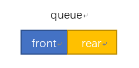

（图表示队列设计）

其结构体设计的代码可以表示为：

```cpp
//结点定义

typedef struct node{

    int data;

    struct node *next;

}node;

//队列定义，队首指针和队尾指针

typedef struct queue{

    node *front;    //头指针

    node *rear;     //尾指针

}queue;
```

有关初始化，稍微复杂一点的是，我们对于初始化需要初始化两个类型，一个是初始化结点，一个是初始化队列，初始化队列稍微有些不同，那就是当初始化队列的时候，需要将头尾两个结点指向的内容统统制空，表示是一个空队列，两个创建的函数代码可以表示为：

```cpp
//初始化结点

node *init_node(){

    node *n=(node*)malloc(sizeof(node));

    if(n==NULL){    //建立失败，退出

        exit(0);

    }

    return n;

}

//初始化队列

queue *init_queue(){

    queue *q=(queue*)malloc(sizeof(queue));

    if(q==NULL){    //建立失败，退出

        exit(0);

    }

    //头尾结点均赋值NULL

    q->front=NULL;

    q->rear=NULL;

    return q;

}
```

### 3. 判断队列是否为空

判断队列是否为空比较简单，直接就是判断队列头指针是否是空值即可（关联如何创建队列可更好理解），判断队列是否为空是比较常用的操作。

其代码可以表示为：

```cpp
//队列判空

int empty(queue *q){

    if(q->front==NULL){

        return 1;   //1--表示真，说明队列非空

    }else{

        return 0;   //0--表示假，说明队列为空

    }

}
```

或者直接利用返回值进行更简单的判断（两者效果完全一样）

```cpp
int empty(queue *q){

    return q->front==NULL;

}
```

## 2.顺序队列的基本操作（入队出队遍历）及C/C++代码实现

### 1.   入队操作

如图，进行入队（push）操作的时候，我们首先需要特判一下队列是否为空，如果队列为空的话，需要将头指针和尾指针一同指向第一个结点，即front=n;rear=n。

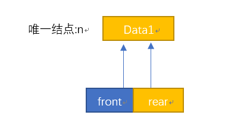

当如果队列不为空的时候，我们只需要将尾结点向后移动，通过不断移动next指针指向新的结点构成队列即可。

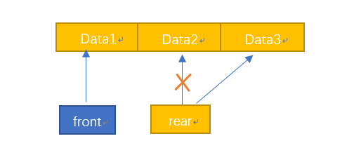

其代码可以表示为：

```cpp
//入队操作

void push(queue *q,int data){

    node *n =init_node();

    n->data=data;

    n->next=NULL;   //采用尾插入法

    //if(q->rear==NULL){     //使用此方法也可以

    if(empty(q)){

        q->front=n;

        q->rear=n;

    }else{

        q->rear->next=n;    //n成为当前尾结点的下一结点

        q->rear=n;  //让尾指针指向n

    }

}
```

### 2.   出队操作

出队（pop）操作，是指在队列不为空的情况下（请注意一定要进行队列判空的操作），进行一个判断，如图，如果队列只有一个元素了（即头尾指针均指向了同一个结点），直接将头尾两指针制空（NULL）并释放这一个结点即可。

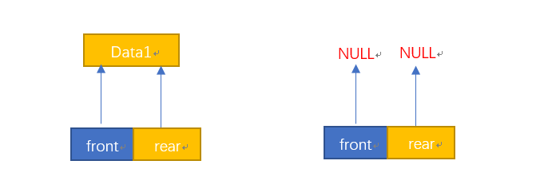

如图，当队列含有二以上个元素时，我们需要将队列的头指针指向头指针当前指向的下一个元素并释放掉当前元素即可。

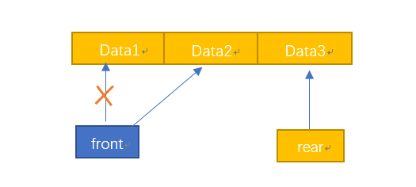

其代码可以表示为：

```cpp
//出队操作

void pop(queue *q){

    node *n=q->front;

    if(empty(q)){

        return ;    //此时队列为空，直接返回函数结束

    }

    if(q->front==q->rear){

        q->front=NULL;  //只有一个元素时直接将两端指向制空即可

        q->rear=NULL;

        free(n);        //记得归还内存空间

    }else{

        q->front=q->front->next;

        free(n);

    }

}
```

### 3.   打印队列元素（遍历）

打印队列的全部元素是在队列不为空的情况下，通过结点的next指向依次遍历并输出元素既可以。

其代码可以表示为

```cpp
//打印队列元素

void print_queue(queue *q){

    node *n = init_node();

    n=q->front;

    if(empty(q)){

        return ;    //此时队列为空，直接返回函数结束

    }

    while (n!=NULL){

        printf("%d\t",n->data);

        n=n->next;

    }

    printf("\n");   //记得换行

}
```

遍历操作还有很多变形，比如说进行计算队列中含有多少元素。

```cpp
int calac(queue *q){

    node *n = init_node();

    n=q->front;

    int cnt=0;    //计数器设计

    if(empty(q)){

        return 0;    //此时队列为空，直接返回函数结束

    }

    while (n!=NULL)

    {

        n=n->next;

        cnt++;

    }

    return cnt;

}
```

### 4.   代码实现

```cpp
#include<stdio.h>

#include<stdlib.h>

//结点定义

typedef struct node{

    int data;

    struct node *next;

}node;

//队列定义，队首指针和队尾指针

typedef struct queue{

    node *front;

    node *rear;

}queue;

//初始化结点

node *init_node(){

    node *n=(node*)malloc(sizeof(node));

    if(n==NULL){    //建立失败，退出

        exit(0);

    }

    return n;

}

//初始化队列

queue *init_queue(){

    queue *q=(queue*)malloc(sizeof(queue));

    if(q==NULL){    //建立失败，退出

        exit(0);

    }

    //头尾结点均赋值NULL

    q->front=NULL;

    q->rear=NULL;

    return q;

}

//队列判空

int empty(queue *q){

    if(q->front==NULL){

        return 1;   //1--表示真，说明队列非空

    }else{

        return 0;   //0--表示假，说明队列为空

    }

}

//入队操作

void push(queue *q,int data){

    node *n =init_node();

    n->data=data;

    n->next=NULL;   //采用尾插入法

    //if(q->rear==NULL){

    if(empty(q)){

        q->front=n;

        q->rear=n;

    }else{

        q->rear->next=n;    //n成为当前尾结点的下一结点

        q->rear=n;  //让尾指针指向n

    }

}

//出队操作

void pop(queue *q){

    node *n=q->front;

    if(empty(q)){

        return ;    //此时队列为空，直接返回函数结束

    }

    if(q->front==q->rear){

        q->front=NULL;  //只有一个元素时直接将两端指向制空即可

        q->rear=NULL;

        free(n);        //记得归还内存空间

    }else{

        q->front=q->front->next;

        free(n);

    }

}

//打印队列元素

void print_queue(queue *q){

    node *n = init_node();

    n=q->front;

    if(empty(q)){

        return ;    //此时队列为空，直接返回函数结束

    }

    while (n!=NULL)

    {

        printf("%d\t",n->data);

        n=n->next;

    }

    printf("\n");   //记得换行

}

//主函数调用，这里只是简单介绍用法

int main(){

    queue *q=init_queue();

    ///////////////入队操作/////////////////

    printf("入队\n");

    for(int i=1;i<=5;i++){

        push(q,i);

        print_queue(q);

    }

    ///////////////出队操作/////////////////

    printf("出队\n");

    for(int i=1;i<=5;i++){

        pop(q);

        print_queue(q);

    }

    return 0;

}
```

### 5.   配套题目推荐

对于基本的操作，可以同链表的题目测试，自定义一些数据集来测试，这里不再提供直接的问题链接，其次可以试着去做一些基本的队列操作的题目，如：

[1895题](https://www.dotcpp.com/oj/problem1895.html)

接着，队列的操作会在很多的算法设计中使用到，尤其是BFS（广度优先搜索）算法的设计和一些图论的算法设计几乎无法离开各种类型的队列的灵活使用。

对于本样例代码，同学们可以试将队列元素数量设计入结构体中，这样每次询问队列中含有多少元素时就不必在进行依次遍历出元素数量而直接出答案了。

## 3.循环队列及假溢出的现象图文详解

### 1. 顺序队列的假溢出&循环队列的概念

我们已经明白了队列这种基本数据结构，对于顺序队列而言，其存在已经足够解决大多时候的设计问题了，但是其依旧存在一些缺陷和不足，因为我们的入队和出队操作均是直接在其后面进行结点的链接和删除，这就造成其使用空间不断向出队的那一边偏移，产生假溢出。

什么是假溢出？打一个比方：

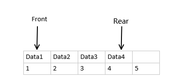

（示例顺序队列）

回顾一下队列的性质，首先我们有一个顺序队列，这个队列的大小为5，其已经包含了四个元素data1,data2,data3,data4,接着，我们对这个队列进行出队操作，出队2个元素，队列就变成了这个样子：

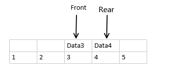

目前看起来没有问题，那么我们接着再进行入队操作，我们入队2个元素，分别是data5和data6，此时我们已经发现问题了，尾指针移动到我们可以进行队列操作的范围之外去了，我们称呼作为队列用的存储区还没有满,但队列却发生了溢出,我们把这种现象称为"假溢出"。

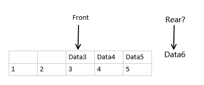

（出队产生假溢出）

可能这个时候会产生一个疑问，我们学习的队列不是使用链表实现的动态队列么？没有空间的时候会开辟空间，这难道还会产生假溢出么？

是的的确，当进行动态创建队列的时候，也只不过是向后继续不断的申请内存空间，即时前面出队操作释放掉了前面的空间，但是指针依旧会向后进行移动，直到达到系统预留给程序的内存上界被强行终止，这对于极为频繁的队列操作和程序而言是致命的，这时候，就需要对我们的队列进行优化，使用更为优秀的结构——循环队列。

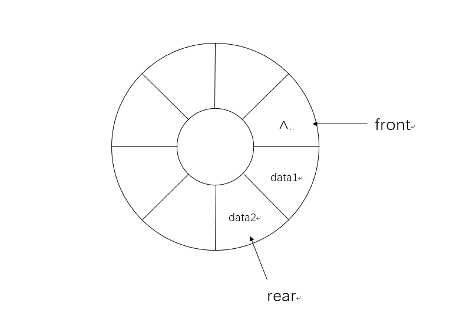

循环队列的思维非常简单，就是给定我们队列的大小范围，在原有队列的基础上，只要队列的后方满了，就从这个队列的前面开始进行插入，以达到重复利用空间的效果，由于循环队列的设计思维更像一个环，因此常使用一个环图来表示，但注意其不是一个真正的环，循环队列依旧是单线性的。

### 2. 循环队列的结构设计

由于循环对列给定了数据范围的大小，则不需要使用链式的动态创建方法了（如果依旧使用链式存储，会无法确定何时再回到队头进行插入操作），因此我们采用模拟的方法，如图所示：

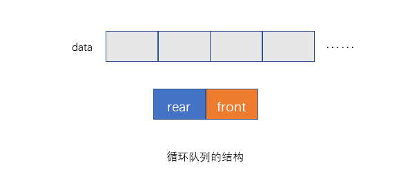

其中，data表示一个数据域，int为类型，其可以修改为任意自定义的类型，比如说简单的char,float类型等等，也可以是复杂的结构体类型，我们使用maxsize表示循环队列的最大容纳量，其表示队列的全部可操作空间。

rear代表尾指针，入队时移动。

front代表头指针，出队时移动。

其代码可以表示为

```cpp
#define maxsize 10      //表示循环队列的最大容量

//循环队列的结构设计

typedef struct cir_queue{

    int data[maxsize];

    int rear;

    int front;

}cir_queue;
```

## 4.循环队列的基本操作及C语言代码实现

### 1. 循环队列的初始化

我们初始化相比链表而言更为简单了，核心就在于申请空间以及将front指针和rear指针内容赋值为0，即指向第0个元素即可（注意第 0个元素内容为空）。

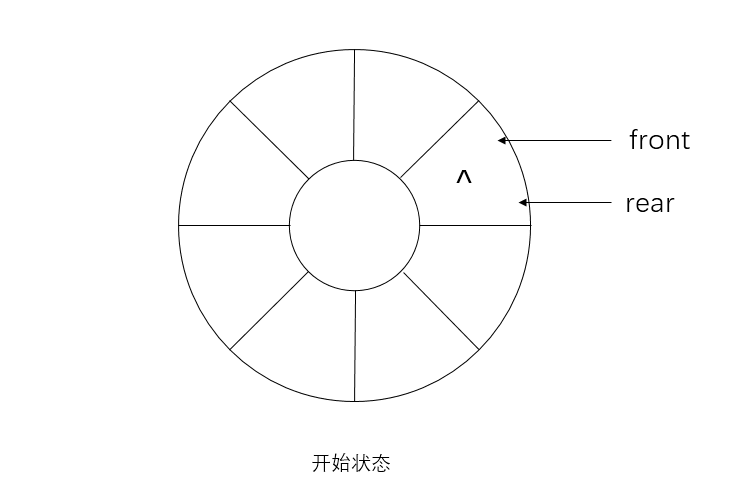

其代码可以表示为：

```cpp
//初始化

cir_queue *init(){

    cir_queue *q = (cir_queue*)malloc(sizeof(cir_queue));

    if(q==NULL){

        exit(0);   //申请内存失败，退出程序

    }

    q->front=0;

    q->rear=0;

    return q;

}
```

### 2.  循环队列入队操作

入队操作同顺序队列的方法，直接将rear向后移动即可，但是要注意判断，如果rear达到了队列的空间上线，将要从头继续开始移动，这里推荐使用余数法，即无论如何求余都是在这片空间内进行操作，防止一次错误执行就直接整体崩溃，而且也相对而言更为简洁，不推荐使用if语句，这样显得比较累赘。

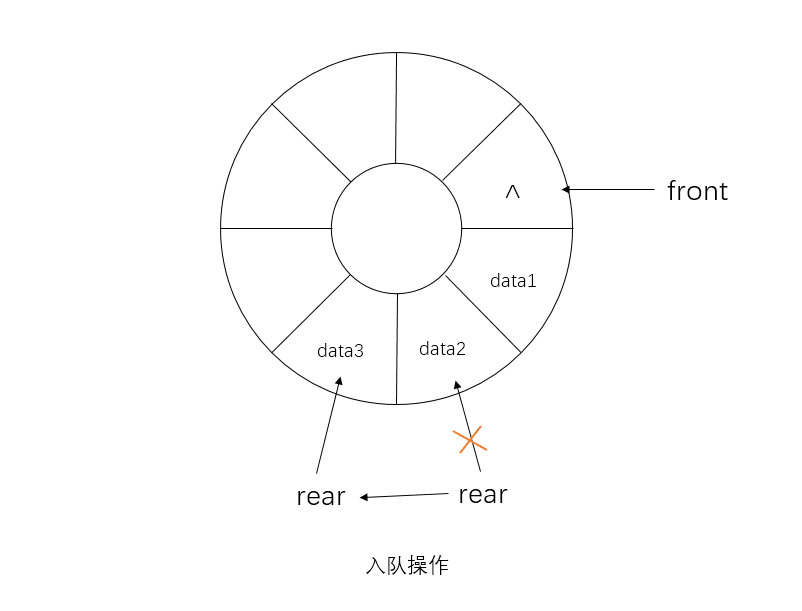

注意进行加一移动位置操作的时候，不能直接q->rear++这样的操作，这样计算机判断优先级会产生让自己意想不到的后果，此外这里还需要进行一次是否队列已满的判断，当我们rear指针的下一个位置就是front的位置的时候，即改循环队列已满。

如图：

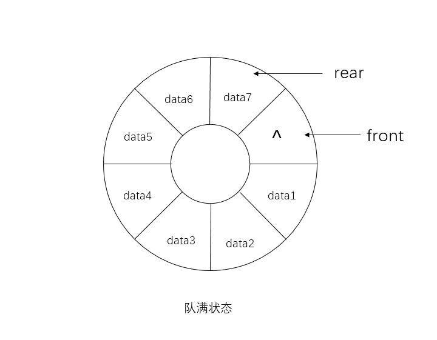

其代码可以表示为：

```cpp
//入队操作push

void push(cir_queue *q,int data){

    if((q->rear+1)%maxsize==q->front){

        printf("溢出，无法入队\n");

        return;

    }else{

        q->rear=(q->rear+1)%maxsize;

        q->data[q->rear]=data;

    }

}
```

### 3. 循环队列出队操作

如果顺序队列的出队操作，直接将front进行后移一位即可，注意这时候有一个需要留意的地方，即队列是否为空，当队列为空的时候是无法进行出队操作的。

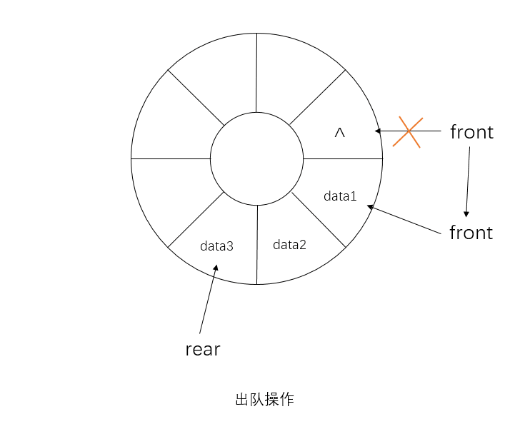

其代码可以表示为：

```cpp
//出队操作pop

void pop(cir_queue *q){

    if(q->rear==q->front){

        printf("队列为空，无法出队\n");

        return;

    }else{

        q->data[q->front]=0;

        q->front=(q->front+1)%maxsize;

    }

}
```

### 4. 循环队列遍历操作

遍历操作需要借助一个临时变量储存位置front的位置信息，利用i逐步向后移动，直到i到达了rear的位置即可宣告遍历的结束。

```cpp
//遍历队列

void print(cir_queue *q){

    int i=q->front;

    while(i!=q->rear){

        i=(i+1)%maxsize;

        printf("%d\t",q->data[i]);

    }

    printf("\n");       //记得换行

}
```

### 5. 本题代码代码

```cpp
#include<stdio.h>

#include<stdlib.h>

#include<cstring>

#define maxsize 10      //表示循环队列的最大容量

//循环队列的结构设计

typedef struct cir_queue{

    int data[maxsize];

    int rear;

    int front;

}cir_queue;

//初始化

cir_queue *init(){

    cir_queue *q = (cir_queue*)malloc(sizeof(cir_queue));

    if(q==NULL){

        exit(0);    //申请内存失败，退出程序

    }

    memset(q->data,0,sizeof(q->data));

    q->front=0;

    q->rear=0;

    return q;

}

//入队操作push

void push(cir_queue *q,int data){

    if((q->rear+1)%maxsize==q->front){

        printf("溢出，无法入队\n");

        return;

    }else{

        q->rear=(q->rear+1)%maxsize;

        q->data[q->rear]=data;

    }

}

//出队操作pop

void pop(cir_queue *q){

    if(q->rear==q->front){

        printf("队列为空，无法出队\n");

        return;

    }else{

        q->data[q->front]=0;

        q->front=(q->front+1)%maxsize;

    }

}

//遍历队列

void print(cir_queue *q){

    int i=q->front;

    while(i!=q->rear){

        i=(i+1)%maxsize;

        printf("%d\t",q->data[i]);

    }

    printf("\n");       //记得换行

}

int main(){

    cir_queue *q = init();

    ////////////入队操作///////////////

    printf("入队操作\n");

    for(int i=1;i<=6;i++){

        push(q,i);

    }

    print(q);

    ////////////出队操作///////////////

    printf("出队操作\n");

    for(int i=1;i<=3;i++){

        pop(q);

        print(q);

    }

    return 0;

}
```

### 6.  配套题目推荐

毕竟循环队列只是队列的基本优化，可以使用普通顺序队列的练习题再度练习：

[1895题](https://www.dotcpp.com/oj/problem1895.html)

---

# 第五章 C++STL库教程(附带题库)

## 1.C++的区别

### 1.从C语言到C++

1980年，Bjarne Stroustrup博士着手创建一种新的语言，能够具有面向对象的程序设计特色。在当时，面向对象编程是一个新颖的概念，Stroustrup博士并不是从头开始设计新语言，而是使用C语言进行修改，而这就是C++语言。

C++是C的超集，也就是说C++是可以兼容C语言的，C++在C语言的基础上增加了许多的特性和概念，他通关关键字的方式进行实现，不过本文不重点说明C++和C语言的区别，本文只是从数据结构的角度去观测两语言之间的问题，并且说明C++的改进，从本文开始，将会在C语言的基础上开始用到C++的特性和概念去实现数据结构，这将方便我们的程序设计。

### 2. 代码改变

介绍几个很明显的转变我们以后会很常用，这些可以在C语言网的C++教程中看到，如果你已经学过C++，建议你可以直接跳过本段内容，如果你对于C++还一知半解的，建议你在阅读本文的同时去翻阅C++的学习资料，两者的学习并不冲突，相反他们相辅相成。

a)头文件引用

C语言的引用头文件的方式是include名字.h的方式进行引用，而C++去掉了.h（虽然在绝大多数编译器上任然使用.h的方法也不会报错）而是改成直接引用名字即可，这里需要注意的是C++使用C语言标准时，需要在库前面添加一个c来表明这个库是来自于C语言的。

```cpp
//C语言的方法：带.h的方式进行include

#include<stdio.h>

#include<math.h>

//C++的方法，直接引用即可

#include<cstdio>

#include<cmath>
```

b)输入与输出

C++的输入输出与C语言指定类型的不同，C++采用“流”的思路去进行输入输出设计，这样的做法可以大大简化我们的设计，但是这样的做法确是更慢，本章稍后会介绍输入输出的优化，将会重讲本内容。

```cpp
int n; //定义n为整形

//C语言的输入输出（需要指定类型，如下指定为整形）

scanf("%d",&n);

printf("%d",n);

//C++语言的输入输出（不需要指定类型，会根据n进行自主的判定）

cin>>n;

cout<<n;
```

### 3. 即将开始—STL

STL是Standard Template Library的简称，中文名标准模板库，惠普实验室开发的一系列软件的统称。它是由Alexander Stepanov、Meng Lee和David R Musser在惠普实验室工作时所开发出来的。从根本上说，STL是一些“容器”与“算法”的集合，所谓的这些“容器”无非就是已经实现好了数据结构，能够让程序设计者更为方便的进行调用，“算法”则顾名思义就是已预先实现好了的算法集合。

STL的目的是标准化组件，这样就不用重新开发，可以使用现成的组件。STL现在是C++的一部分，因此不用安装额外的库文件。STL的版本很多，有很多公司或者工作室自定义STL形成各种各样的自定义标准。。

在C++标准中，STL被组织为下面的13个头文件：<algorithm>、<deque>、<functional>、<iterator>、<vector>、<list>、<map>、<memory>、<numeric>、<queue>、<set>、<stack>和<utility>。

     使用STL可以大大辅助简化我们的算法与数据结构的设计，但是我们必须要记住，在我们使用之前，我们必须要了解他的原理，掌握它的技巧，否则就是乱用，切记。

## 2.C++STL教程入门

在上一篇文章我们已经基本的了解了什么是C++的STL（标准模板库），在本章中绝大多数内容都是在介绍常用的STL模板的使用以及其一些参数的介绍，但是请注意，STL由于其设计之初就容纳了大量的程序员思维结晶，经过了无数次的讨论才形成了一个统一的标准，他同时拥有大量的内容和知识点，如果完全讲解内容，展开完完全全可以写出一本500页的书，本篇还是以数据结构为主，因此，这里只是略讲，而且还主要是略讲与数据结构相关的容器，不是深入讲解。

在这里引用本人的一位老师说的话：不学STL的C++是不完整的C++。

以下是STL中包含的几大内容，在学习中重点要学习前三点。

### 1.容器（Container）

是一种数据结构，也是本章节提的重点，如list(链表)，vector(向量数组)，stack(栈)，队列(queue) ，以模板类的方法提供，为了访问容器中的数据，可以使用由容器类输出的迭代器。

### 2. 迭代器（Iterator）

是一种特殊的指针，它提供了访问容器中对象的方法，在程序设计中，它扮演了容器和算法之间的胶合剂，利用迭代器可以快速而安全的对容器内容进行操作，或是进行算法模板的使用。

### 3. 算法（Algorithm）

（部分书籍称为泛型算法，generic algorithms），是一类常用的算法模板，既可以对容器进行操作，同时其开放性也让算法类本身可以针对数组或者是自定义结构体等结构进行直接的操作。

### 4. *仿函数（Function object）（又称为函数对象，function object）

是一种行为类似函数，这样讲可能有些抽象，我们可以理解为一种高级的，重载了()操作符的结构体与类。

### 5.*迭代适配器（Iterator Adaptor）

是一种用来修饰容器或者仿函数的接口，它使得得带适配器使算法能够以逆向模式，安插模式进行工作，甚至还可以与流配合，它对容器起到非常大的辅助作用，同时他还将迭代器进行了更高级别的抽象。

### 6. *空间配制器（allocator）

是负责空间的配置与管理，重点就是对容器的空间申请和空间释放进行管理，你可以理解为C的malloc和free函数，C++的new和delete关键字。

## 3.C++STL之Vector容器

### 1. 概念

Vector可以翻译为向量，或向量数组，至于为什么以向量命名，可以理解为一维空间也是存在向量的。

Vector是最简单的序列是容器，就像数组一样，向量使用连续的存储位置作为元素，这意味着它们的元素也可以使用常量指向其元素的偏移来访问，与数组一样有效。但与数组不同，它们的大小可以动态变化，其存储由容器自动处理。

总结一下**Vector就是一个动态创建空间，且预先加载了常用的数组操作的数组**

### 2. 相关头文件

头文件：#include <vector>

### 3. 初始化

格式为：vector<Data_Types> name;

我们以Int类型作为参数为例，进行创建。

```cpp
vector<int> v1;          //创建一个空的向量v1

vector<int> v2(10);      //创建一个向量v2，其已开辟10个元素的空间，相当于int v[10];

vector<int> v3(10,5);    //创建一个向量v3，其已开辟10个元素的空间并全部赋值为5

vector<int> v4(v3.begin(),v3.end());    //创建一个向量v3,其内容为向量v3的内容

vector<int> v5(v4);      //创建一个向量v5，其包含了v4的全部内容
```

### 4. 迭代器

顾名思义，迭代器是一种安全的访问控制器，它本身是一种指针，用于直接的元素访问。其遍历访问的大致思路是，创建容器的迭代器，让迭代器指向第一个元素，逐步向后移动并最终指向最后一个元素结束。

遍历代码举例：

```cpp
vector<int> v;       //创建一个向量vs

vector<int>::iterator it;   //C98标准

for(it=v.begin();it!=v.end();it++){

    cout<<*it<<' ';

}
```

当然，遍历也可以直接使用下标访问：

```cpp
 for(int i=0;i<v.size();i++){

        cout<<v[i]<<' ';

    }
```

请根据自己的使用习惯进行合理的安排，对于新手而言会更倾向于选择后者。

### 5.常用接口（常用的）

Vector的接口有非常多，不同的C++语言标准也不同，这里只提供一些常用的进行简介，具体的使用可以翻阅官方文档（英文），或是别人的翻译稿。

我们使用 vector<int> v; 预先创建了一个向量。

### **a) 向量尾插入push_back()**

在向量的末尾添加一个新元素val，并自动让容器大小增大一个。

函数原型：

void push_back (const value_type& val);

使用举例：

```cpp
v.push_back(10);  //插入一个数据10
```

### **b) 向量尾删除pop_back()**

移除向量尾的最后一个元素，并且将容器大小减小一个，

函数原型：void pop_back();

使用举例：

```cpp
v.pop_back();
```

### **c) 插入insert()**

插入元素到指定位置，通过在元素之前在指定位置插入新元素来扩展向量，从而有效地增加容器大小所插入的元素数量。

函数原型：

插入单一数据到指定位置：

*iterator insert (iterator position, const value_type& val);*

插入一段数据到指定位置：

*void insert (iterator position, size_type n, const value_type& val);*

插入一段别的容器的数据到指定位置：

*template <class InputIterator>*

*void insert (iterator position, InputIterator first, InputIterator last);*

使用举例：

```cpp
 v.insert(v.begin(),10);     //在向量最前端插入数据10

 v.insert(v.begin(),5,20);   //在向量最前端插入5个数据20

 vector<int> k(2,50);   //创建一个新的向量k,其拥有2个元素内容均为50

 v.insert(v.begin(),k.begin(),k.end());  //在向量v最前端插入向量K的全部内容
```

### **d) 删除erase()**

删除一个元素，或者是一段区间的元素，将会自动缩减空间使用。

函数原型：

*iterator erase (iterator position);*

*iterator erase (iterator first, iterator last);*

使用举例

```cpp
v.erase(v.begin());     //删除第一个元素

v.erase(v.begin(),v.begin()+4); //删除从第一个开始后4个元素（包括第一个）
```

### **e) 清空clear()**

将向量中所有元素清空。

函数原型：

void clear();

使用举例：

```cpp
v.clear();      //清空向量
```

### **f) 数据大小size()**

返回向量中的数据元素个数。

函数原型：

size_type size() const;

使用举例：

```cpp
 cout<<v.size()<<endl;   //输出5
```

### **g)已开辟最大宽度capacity()**

返回向量最大已开辟的空间大小。

函数原型：

size_type capacity() const;

使用举例

```cpp
vector<int> v(3,10);    //创建默认有3个值为10的元素的向量v

v.insert(v.begin(),10,20);   //在向量最前端插入10个值为20的数据

v.erase(v.begin(),v.begin()+4); //删除从第一个开始后4个元素（包括第一个）

cout<<v.capacity()<<endl;   //输出13
```

### **h)*最大支持空间max_size()**

返回计算机支持开辟vector的最大空间值，一般来说和计算机内存和CPU相关，是一个极大的数据，而且不同计算机中可能有不同的值

函数原型：

size_type max_size() const;

使用举例：

```cpp
vector<int> v(5,10);    //创建默认有5个值为10的元素的向量v

cout<<v.max_size()<<endl;   //输出4611686018427387903
```

## 4.C++STL之List容器

### 1.再谈链表

List链表的概念再度出现了，作为线性表的一员，C++的STL提供了快速进行构建的方法，为此，在前文的基础上通过STL进行直接使用，这对于程序设计中快速构建原型是相当有必要的，这里的STL链表是单链表的形式。

### 2.头文件

头文件：#include<list>

### 3.初始化

格式为：explicit list (const allocator_type& alloc = allocator_type());

我们以int类型作为参数为例进行创建，其创建方法与vector无异

```cpp
    list<int> l1;           //创建一个空链表

    list<int> l2(10);       //创建一个链表其有10个空元素

    list<int> l3(5,20);     //创建一个链表其有5个元素内容为20

    list<int> l4(l3.begin(),l3.end());  //创建一个链表其内容为l3的内容

    list<int> l5(l4);               //创建一个链表其内容为l4的内容
```

### 4. 迭代器

遍历代码举例(其方法和vector版本无异只是更加精简)：

```cpp
 list<int> li;

for(list<int>::iterator it=li.begin();it!=li.end();it++){

        cout<<*it<<' ';

    }
```

### 5. 常用接口

我们使用list<int> li;预先创建了一个链表，命名为li，方便举例

### **a)判断是否为空empty()**

返回一个bool类型的值，只存在真和假，当链表为空时为真，不为空时为假

函数原型

bool empty() const;

```cpp
 if(li.empty()){     //当链表为空的时候执行

        cout<<"is empty()"<<endl;

    }else{

        cout<<"not empty()"<<endl;

    }
```

### **b)获取大小size()**

返回链表元素的个数

函数原型

size_type size() const;

```cpp
cout<<li.size()<<endl;
```

### **c) 链表前插入push_front() &&删除 pop_front()**

push_front()表示在链表最前端插入一个数据，pop_front()表示在链表最前端删除一个数据。

函数原型

void push_front (const value_type& val);

void pop_front();

```cpp
    li.push_front(10);

    li.pop_front();
```

### **d) 链表后插入push_back() &&删除 pop_back()**

push_back()表示在链表尾插入一个数据，pop_back()表示将链表尾删除一个数据。

函数原型：

void push_back (const value_type& val);

void pop_back();

```cpp
    li.push_back(10);

    li.pop_back();
```

### **e) 插入insert()**

插入元素到指定位置，通过在元素之前在指定位置插入新元素来扩展向量，从而有效地增加容器大小所插入的元素数量。

函数原型：

插入单一数据到指定位置：

iterator insert (iterator position, const value_type& val);

插入一段数据到指定位置：

void insert (iterator position, size_type n, const value_type& val);

插入一段别的容器的数据到指定位置：

template <class InputIterator>

void insert (iterator position, InputIterator first, InputIterator last);

使用举例：

```cpp
    li.insert(li.begin(),10);     //在链表最前端插入数据10

    li.insert(li.begin(),5,20);   //在链表最前端插入5个数据内容为20

    list<int> k(2,50);   //创建一个新的链表k,其拥有2个元素内容均为50

    li.insert(li.begin(),li.begin(),li.end());  //在链表v最前端插入链表上K的全部内容
```

### **f) 删除erase()**

删除一个元素，或者是一段区间的元素，将会自动缩减空间使用。

函数原型：

iterator erase (iterator position);

iterator erase (iterator first, iterator last);

使用举例

```cpp
li.erase(li.begin());     //删除第一个元素

li.erase(li.begin(),li.begin()+4); //删除前4个元素
```

### **g)排序sort()**

让整个链表变成升序状态，或者变成自定义的排序状态

函数原型：

void sort();

template <class Compare>   void sort (Compare comp);

详细举例：

```cpp
#include<iostream>

#include<list>

using namespace std;s

int cmp(const int &a,const int &b){

    //简单的自定义降序序列

    return a>b;

}

int main(){

    list<int> li;           //创建一个空链表

    for(int i=10;i>=6;i--){

        li.push_back(i);

    }

    li.push_front(3);

    li.push_back(20);

    list<int> li2(li);

    for(list<int>::iterator it=li.begin();it!=li.end();it++){

        cout<<*it<<' ';

    }

    cout<<endl;

//排序前3 10 9 8 7 6 20//

    li.sort();

    for(list<int>::iterator it=li.begin();it!=li.end();it++){

        cout<<*it<<' ';

    }

    cout<<endl;

//默认排序后 3 6 7 8 9 10 20//

    li2.sort(cmp);

    for(list<int>::iterator it=li2.begin();it!=li2.end();it++){

        cout<<*it<<' ';

    }

    cout<<endl;

//自定义排序后 20 10 9 8 7 6 3//

    return 0;

}
```

### **h)逆序reverse()**

相对于自定义的降序方法，STL提供了一个默认的降序方法reverse()，类似于sort一样直接使用即可。

void reverse();

```cpp
li.reverse();
```

## 5.C++STL之stack栈容器

### 1. 再谈栈

回顾一下之前所学的栈，栈是一种先进后出的数据结构，而实现方式需要创建多个结构体，通过链式的方式进行实现，这是标准的栈的思路，而在STL中栈可以以更为简单的方式实现。

### 2. 头文件

头文件 #include<stack>

### 3. 初始化

格式为：explicit stack (const container_type& ctnr = container_type());

我们以int类型作为参数为例进行创建，其创建方法与vector无异

```cpp
stack<int> s;

stack<int> v(s);
```

标准的栈创建方法是直接创建空栈，由于栈的特殊性质，让他拥有其他容器的参数可以这样创建，这种多参数的方式可能有一些复杂，一般也很少这样使用。

```cpp
    vector<int> v(3,100);

    stack<int,vector<int> > s(v);  //注意，> >符号之间需要有一个空格隔开
```

通过标准的方式创建向量数组，然后通过复制构造函数的方式进行创建，其内容就是vector数组的全部内容。

### 4. 迭代器

栈和队列都属于一种特殊的数据结构，只能通过访问顶层数据并不断剔除数据的方法进行全部访问，因此没有直接的迭代器。

### 5. 常用接口

我们使用stack<int> s 预先创建了一个栈，命名为s，方便举例

### **a)大小size()**

返回栈元素的个数

函数原型：size_type size() const;

```cpp
cout<<s.size()<<endl;   //直接返回栈中元素的个数
```

### **b) 返回栈顶元素top()**

返回栈顶元素内容

函数原型：

reference& top();

const_reference& top() const;

```cpp
cout<<s.top()<<endl;     //直接返回输出即可

s.top()+=100;            //也可以直接对栈定元素进行修改操作
```

### **c) 入栈push()**

往栈顶中插入一个元素。

函数原型： void push (const value_type& val);

### **d)出栈pop()**

将栈顶元素释放，注意pop()函数是没有返回值的，如果要想访问后删除需要先top再pop使用。

函数原型：void pop();

```cpp
s.pop();
```

### **e) 判空empty()**

返回一个bool类型的值，只存在真和假，当栈为空时为真，不为空时为假

函数原型

bool empty() const;

可以利用判空的函数进行元素访问的操作，这里建议先使用初始化函数将栈进行复制，否则遍历之后栈s就为空了。

```cpp
while(!s.empty()){

        cout<<s.top()<<endl;

        s.pop();

    }
```

### 6.  推荐配套作业

我们可以把栈相关的题目再度拿出来做一下，看一下使用STL可以怎么样进行简化。

请使用**STL**的方法完成进制转换题目。

[第三章-栈的内容]

可以尝试的去利用栈的思维实现一下进制转换的题目

如十进制到八进制：[1055题](https://www.dotcpp.com/oj/problem1055.html)

十进制到二进制：[1192题](https://www.dotcpp.com/oj/problem1192.html)

或者可以尝试一下利用递归栈的方式，将栈去代替函数递归实现一些功能（注意，这将会是DFS搜索算法的理解基础）

如斐波那契数列：[1131题](https://www.dotcpp.com/oj/problem1131.html)

## 6.C++STL之Queue容器

### 1. 再谈队列

回顾一下之前所学的队列，队列和栈不同，队列是一种先进先出的数据结构，STL的队列内容极其重要，虽然内容较少但是请务必掌握，STL的队列是快速构建搜索算法以及相关的数论图论的状态存储的基础。

### 2.相关头文件

头文件：#include<queue>

### 3.初始化

格式为：

```cpp
explicit queue (const container_type& ctnr = container_type());
```

我们以int类型作为参数为例进行创建。

```cpp
queue<int> q;    //创建一个空的没有数据的队列q

queue<int> qoo(q);    //创建一个队列其元素为q的全部内容
```

标准的队列创建方法是直接创建空队列再进行其他的操作，由于队列的特殊性质，拥有其他容器的参数可以这样创建，这种多参数的方式可能有一些复杂，一般也很少这样使用。

```cpp
vector<int> v(3,100);

    queue<int,vector<int> > s(v);  //注意，> >符号之间需要有一个空格隔开
```

通过标准的方式创建向量数组，然后通过复制构造函数的方式进行创建，其内容就是vector数组的全部内容。

### 4. 迭代器

栈和队列都属于一种特殊的数据结构，只能通过访问顶层数据并不断剔除数据的方法进行全部访问，因此没有直接的迭代器。

### 5. 常用接口

我们预先通过queue<int> q创建了一个队列，命名为q，方便举例。

### **a)大小size()**

返回队列元素的个数

函数原型：size_type size() const;

```cpp
cout<<q.size()<<endl;   //直接返回队列元素的个数
```

### **b) 入队push()**

进行入队操作，在队尾处进行插入

函数原型：void push (const value_type& val);

```cpp
q.push(100);
```

### **c) 出队pop()**

进行出队操作，在对头出进行弹出

函数原型：void pop();

```cpp
q.pop();
```

### **d)访问队头元素front()**

访问对头元素，可以返回其数值，也可以进行相应的操作，这里更加建议多使用front()访问队头数据，因为我们进行出队操作均是从队头进行出队的。

函数原型：

value_type& front();

const value_type& front() const;

```cpp
q.front()+=500;     //对队头元素进行修改

    cout<<q.front()<<endl;   //直接输出内容
```

### **e) 访问队尾元素back()**

访问队尾元素，较为少用。

函数原型：

value_type& back();

const value_type& back() const;

```cpp
q.back()+=500;     //对队尾元素进行修改

    cout<<q.back()<<endl;
```

### **f) 判空empty()**

返回一个bool类型的值，只存在真和假，当队列为空时为真，不为空时为假

函数原型

bool empty() const;

可以利用empty()进行队列的遍历操作，这里建议先使用初始化函数将队列进行复制，否则遍历之后队列就为空了。

```cpp
 while(q.empty()){

        cout<<q.front()<<endl;

        q.pop();

    }
```

### 6. 相关配套习题

我们可以回顾队列的相关题目再度进行联系，熟悉STL 的简化方法，为搜索算法的学习做预备。

[第四章—队列的内容]

试着使用STL完成队列基本操作

作业：[1898题](https://www.dotcpp.com/oj/problem1895.html)

## 7.C++STL之Priority_queue(优先队列)

### 1. 简介

优先队列是一种极其特殊的队列，他与标准的队列使用线性结构进行计算不同，优先队列的底层是以散列的状态（非线性）表现的，他与标准的队列有如下的区别，标准的队列遵从严格的先进先出，优先队列并不遵从标准的先进先出，而是对每一个数据赋予一个权值，根据当前队列权值的状态进行排序，使得权值最大（或最小）的永远排在队列的最前面。

### 2. 相关头文件

由于其属于队列的一种，因此可以直接使用队列的头文件#include<queue>

### 3. 优先队列的初始化

```cpp
priority_queue<T, Container, Compare>

priority_queue<T>        //直接输入元素则使用默认容器和比较函数
```

与往常的初始化不同，优先队列的初始化涉及到一组而外的变量，这里解释一下初始化：

a) T就是Type为数据类型

b) Container是容器类型，（Container必须是用数组实现的容器，比如vector,deque等等，但不能用 list。STL里面默认用的是vector）

c) Compare是比较方法，类似于sort第三个参数那样的比较方式，对于自定义类型，需要我们手动进行比较运算符的重载。与sort直接Bool一个函数来进行比较的简单方法不同，Compare需要使用结构体的运算符重载完成，直接bool cmp(int a,int b){  return a>b; } 这么写是无法通过编译的。

使用的举例有：

```cpp
struct cmp

{ //这个比较要用结构体表示

    bool operator()(int &a, int &b) const

    {

        return a > b;

    }

};

priority_queue<int,vector<int>,cmp> q;    //使用自定义比较方法

priority_queue<int> pq;
```

### 4. 常用接口

我们预先通过priority_queue <int> q创建了一个队列，命名为q，方便举例。

### **a)大小size()**

返回队列元素的个数

函数原型：size_type size() const;

```cpp
cout<<q.size()<<endl;   //直接返回队列中元素的个数
```

### **b) 入队push()**

进行入队操作，在队尾处进行插入

函数原型：void push (const value_type& val);

```cpp
q.push(100);
```

### **c) 出队pop()**

进行出队操作，在对头出进行弹出

函数原型：void pop();

```cpp
q.pop();
```

### **d) 访问队头元素top()**

与标准队列不同，优先队列只允许访问队头元素，不允许访问其余的数据，由于堆的特殊性质，堆顶元素的优先权最高（或者最低），访问其余元素没有意义，因此，优先队列只允许访问队头元素，这和栈的访问类型类似所以使用栈访问栈顶的命名top

函数原型是：

reference& top();

const_reference& top() const;

```cpp
 cout<<q.top()<<endl;
```

### **e) 判空empty()**

返回一个bool类型的值，只存在真和假，当队列为空时为真，不为空时为假

函数原型

bool empty() const;

可以利用empty()进行队列的遍历操作，这里建议先使用初始化函数将队列进行复制，否则遍历之后队列就为空了。

```cpp
  while(q.empty()){

        cout<<q.pop()<<endl;

        q.pop();

    }
```

### 5.实例代码

可以通过这个代码进行参考，可以看的输出的结果是顺序的。

```cpp
#include <queue>

#include <iostream>

using namespace std;

struct cmp

{ //这个比较要用结构体表示

    bool operator()(int &a, int &b) const

    {

        return a > b;

    }

};

int main()

{

    priority_queue<int, vector<int>, cmp> q;

    for (int i = 1; i <= 5; i++)

    {

        q.push(i * 10);

        cout << "push element " << i << endl;

    }

    q.push(15);

    q.push(4);

    int i = 1;

    while (!q.empty())

    {

        int temp = q.top();

        q.pop();

        cout << "No " << i++ << " element is: " << temp << endl;

    }

    return 0;

}
```

输出：

```cpp
push element 1

push element 2

push element 3

push element 4

push element 5

No 1 element is: 4

No 2 element is: 10

No 3 element is: 15

No 4 element is: 20

No 5 element is: 30

No 6 element is: 40

No 7 element is: 50
```

### 6.相关配套习题

优先队列和优化图论的缔结特斯拉算法有很大的联系，优先队列属于一种比较高级的数据结构，可以试着利用优先队列做一些排序题目，等到有基础之后再进行高级算法的训练。

[1169题](https://www.dotcpp.com/oj/problem1169.html)

## 8.C++STL之Set容器

### 1. 简介

**Set**（集合）属于关联式容器，也是**STL**中最实用的容器，关联式容器依据特定的排序准则，自动为其元素排序。Set集合的底层使用一颗红黑树（可能读者对此不太了解，等但学到树论与图论的章节的时候就会明白原因），其属于一种非线性的数据结构，每一次插入数据都会自动进行排序，注意，不是需要排序时再排序，而是每一次插入数据的时候其都会自动进行排序。因此，Set中的元素总是顺序的。

Set的性质有：数据自动进行排序且数据唯一，是一种集合元素，允许进行数学上的集合相关的操作。

### 2. 相关头文件

头文件：#include<set>

### 3. 初始化

初始化格式：

```cpp
template < class T,

           class Compare = less<T>,

           class Alloc = allocator<T>

           > class set;
```

基本上就是三个参数，第一个是值，第二个比较器，用于比较内容，默认为less<Key>即降序，第三个是内存配置器，负责内存的分配和销毁。

在实际使用中，我们仅仅为其分配值就足以满足大部分需求。

```cpp
set<int> s;       //直接指定值的类型创建，其他为默认方法

//其余方法与前文的创建方法类似，不做具体展示……
```

### 4. 迭代器

C98标准下：

```cpp
 for (set<int>::iterator it=s.begin(); it!=s.end(); ++it)

        cout << *it << ' ';
```

这也是前文学过的标准用法，接下来，让我们了解一个更加先进和便捷的方法，auto方法迭代，这需要我们编译器开启C11标准，每个编译器的开启标准不一，请具体情况具体分析。

C11标准下：

```cpp
 for (auto it=s.cbegin(); it!=s.cend(); ++it)

        cout << *it << ' ';
```

可见我们使用了auto进行了迭代器类型的自动识别，省去了我们的声明迭代器的那一部分内容，这使得代码更加简化。

### 5. 常用接口

我们使用set<int> s 预先创建了一个集合，命名为s，方便举例

### **a)大小size()**

返回元素的个数

函数原型：size_type size() const;

```cpp
cout<<s.size()<<endl;   //直接返回元素个数
```

### **b) 插入元素insert()**

插入一个元素，插入元素的类型必须与创建的容器类型一致

函数原型：pair<iterator,bool> insert (const value_type& val);

```cpp
s.insert(i);
```

### **c)删除元素erase()**

删除一个元素，或者是一段区间的元素，将会自动缩减空间使用。

函数原型：

iterator erase (iterator position);

iterator erase (iterator first, iterator last);

使用方法：

```cpp
s.erase(s.begin());  //使用迭代器的方法删除第一个元素

s.erase(s.begin(),s.end());     //删除一段内容，这里是全部删除
```

### **d)清空元素clear()**

将整个set集合中的内容清空，注意，这里只是清空元素，其所占用的最大内存空间还是不会改变的。

```cpp
s.clear();
```

### **e)查找元素find()**

函数原型：iterator find (const value_type& val) const;

函数原型：iterator find (const value_type& val) const;

Find方法返回一个迭代器类型的指针，因此我们直接通过find获取其数据的时候需要使用指针*的方式进行表示，否则将会报错。

```cpp
cout<< *s.find(4) <<endl;
```

或者 实现找到的删除指定元素

```cpp
s.erase(s.find(4));
```

## 9.set theory（集合论）

### 1. 集合论简介

集合论，是数学的一个基本的分支学科，研究对象是一般集合。集合论在数学中占有一个独特的地位，它的基本概念已渗透到数学的所有领域。集合论或集论是研究集合（由一堆抽象物件构成的整体）的数学理论，包含了集合、元素和成员关系等最基本的数学概念。

在我们还在高中教育阶段，可能或多或少会接触到一些诸如集合并交差的运算，而集合论与我们C++的STL运算有很多相似而相同的关系。

### 2. 集合关系

我们假设有两个集合：

A={2,4,6}

B={1,2,3,4,5}

在数学上

交运算可以写为：

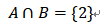

并运算可以写为：

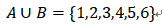

差运算可以写为：


我们以该内容为例，进行代码介绍。

### 3. Algorithm头文件

STL的算法头文件，STL中除了我们常用的这些容器文件以外，还有一个极其重要的头文件，Algorithm，他是我们常用的标准算法的集合，为我们预先封装了我们可能会用到的算法，比如说排序，使用Algorithm头文件中的sort函数可以快速帮我们进行数组排序，以下是实例代码：

```cpp
#include<iostream>

#include<algorithm>

using namespace std;

int main(){

    int a[6]={1,5,9,4,6,3};

    sort(a,a+6);        //使用STL的快速排序算法

    for(int i=0;i<6;i++){

        cout<<a[i]<<' ';

    }

}
```

### 4. 集合论与STL集合

在数学上的并运算我们可以使用set_union()函数进行实现，而交运算我们也可以使用set_intersection()函数进行实现，差集则使用set_difference()函数实现，以下是简单的实现代码，这个案例会同时提供一些前面所学的知识，当作一个汇总练习。

```cpp
#include <iostream>

#include <set>

#include <vector>

#include <algorithm>        //使用算法头文件

using namespace std;

int main(){

    set<int> a, b;           //建立两个集合

    vector<int> c;           //建立一个向量，我们用这个向量存储运算结果

    //a = {2,4,6};

    a.insert(2);

    a.insert(4);

    a.insert(6);

    //b = {1,2,3,4,5};

    b.insert(1);

    b.insert(2);

    b.insert(3);

    b.insert(4);

    b.insert(5);

    set_union(a.begin(), a.end(), b.begin(), b.end(), back_inserter(c));//并集

    for(vector<int>::iterator it=c.begin();it!=c.end();it++){

        cout<< *it << ' ';

    }

    cout<<endl;

    c.clear();

    set_intersection(a.begin(), a.end(), b.begin(), b.end(), back_inserter(c));//交集

    for(vector<int>::iterator it=c.begin();it!=c.end();it++){

        cout<< *it << ' ';

    }

    cout<<endl;

    c.clear();

    set_difference(a.begin(), a.end(), b.begin(), b.end(), back_inserter(c)); //差集 从B中减去A包含的元素

    for(vector<int>::iterator it=c.begin();it!=c.end();it++){

        cout<< *it << ' ';

    }

    cout<<endl;

    c.clear();

    return 0;

}
```

可以见的，以上的三个函数，其使用方法均是第一个集合开始到结束，第二个集合开始到结束，然后使用back_inserter插入器将数据插入到某一个向量或者其他容器之中，并交差是我们集合运算中的最基本的运算，有了这几种运算，我们可以构建出非常多的集合论中的各种功能，以达到我们的数学功能。

## 10.C++STL之Map容器

### 1. 简介

**Map**也是一种关联容器，它是 键—值对的集合，即它的存储都是以一对键和值进行存储的，Map通常也可以理解为关联数组（associative array）,就是每一个值都有一个键与值一一对应，因此，map也是不允许重复元素出现的。

同时map也具备set的相关功能，其底层也会将元素进行自动排序，

### 2. 相关文件

头文件：#include<map>

### 3.  初始化

格式为：

```cpp
template < class Key,

           class T,

           class Compare = less<Key>,

           class Alloc = allocator<pair<const Key,T> >

           > class map;
```

一共有4个值，其中第一个是键，第二个是值，这两个元素呈现对应的关系，接着第三个元素是比较器，其默认是降序排序，第四个是内存配置器，负责内存的分配和销毁。我们常用的可以直接省去第三和第四个值的输入，只输入键和值即可。

### 4.迭代器

我们使用map<char,int> s提前建立了一个map

C98代码如下：

```cpp
 for(map<char,int>::iterator it=s.begin();it!=s.end();it++){

        cout<< it->first <<" --- " << it->second<<endl;

    }
```

这里我们需要注意一下，我们不能直接通过*it的输出方式输出值，因为map种含有两个元素，相当于一个struct结构体，是一个复合类型，C/C++中输出复合类型需要我们指定复合类型的值。

因此我们输出就变成了it->first 指定输出键，it-<second指定输出值（刚好就是英文的第一和第二的意思）

### 5.常用接口

我们使用map<char,int> s 预先创建了一个map，命名为s，方便举例

### **a) 大小size()**

返回链表元素的个数

函数原型：size_type size() const;

```cpp
cout<<s.size()<<endl;   //直接返回栈中元素的个数
```

### **b) 插入元素insert()**

插入一个元素，插入元素的类型必须与创建的容器类型一致

函数原型：single element

pair<iterator,bool> insert (const value_type& val);

template <class P> pair<iterator,bool> insert (P&& val);

```cpp
s.insert(pair<char,int>('d',4));

//这里的Pair表示一对的关系，相当于struct pair{char a;int b}的一对数据，我们在接下来会详细学pari的用法

//如果觉得这样的方式比较困难，可以试着使用下标的方式进行数据输入

s['d']=4;        //这与上面的效果是一样的。
```

### **c) 删除元素erase()**

删除一个元素，或者是一段区间的元素，将会自动缩减空间使用。

函数原型：

iterator erase (iterator position);

iterator erase (iterator first, iterator last);

使用方法：

```cpp
s.erase(s.begin());  //使用迭代器的方法删除第一个元素

s.erase(s.begin(),s.end());     //删除一段内容，这里是全部删除
```

清空元素clear()

将整个set集合中的内容清空，注意，这里只是清空元素，其所占用的最大内存空间还是不会改版的。

```cpp
s.clear();
```

### **d) 查找元素find()**

函数原型：iterator find (const value_type& val) const;

```cpp
cout<< s.find('d')->second <<endl;
```

或者 实现找到的删除指定元素

```cpp
s.erase(s.find('d'));
```

## 11.C++STL之Pair类模板

### 1. 简介

**Pair**表示“一对”的意思，pair将两个数据合成一组数据，在如下两种变成情况中，我们更加常见与使用pair，第一是使用STL中的map（在上一节讲过），对于map而言，key和value需要分开来进行使用和声明，使用pair可以合二为一（但是数据输出时依旧要分离），第二则是当我们的函数需要返回两个数据的时候，可以使用pair。

Pair的实现是一个结构体而不是一个类因此可以直接使用pair的成员变量。

总结一下：pair将一对值（可以有不同的数据类型）和为一个值

### 2. 相关头文件

标准头文件 #include<utility>。

但是笔者亲测在编译器可以不声明这个头文件而直接使用，貌似在C++中，pair被放入了std命名空间中了。

### 3. 初始化

格式为：

template <class T1, class T2> struct pair;

在现实情况中我们可以像类似于STL创建新容器一样创建pair也可以直接使用，如下：

```cpp
pair<int,int> p;

pair<int,int> p(10,20);
```

或者是：

```cpp
map<char,int> m;

    m.insert(pair<char,int>('a',10));
```

明白了如何初始化，接下来谈一下如何使用以及方法。

对与pair中的两个元素，我们可以使用first和second来进行访问，顾名思义first返回第一个元素，而second返回第二个元素，如：

```cpp
pair<int,int> p(10,20);

    cout<<p.first<<" "<<p.second<<endl;
```

### 4. make_pair：

函数原型template pair make_pair(T1 a, T2 b) { return pair(a, b); }

我们可以通过make_pair生成我们的所需要的pair，对于一般的pair而言，我们如果需要对其进行赋值，则需要

```cpp
    pair<int,int> p;

    p.first=10,p.second=20;
```

但如果我们使用make_pair方法，则可以变成如下内容：

```cpp
 pair<int,int> p;

    p=make_pair(10,20);
```

可以看见，使用make_pair不仅仅让我们免去了对两个变量进行分开来的访问赋值，同时make_pair也智能的接受变量的类型，不需要再度指定，也就是说，make_pair本身是接受隐式类型转换的，比如定义的是一个int类型，使用make_pair传入一个float类型的参数，make_pair不会报错，而是回自动的进行一个类型转换，将float变为int，这样可以获得更高的灵活度，同时也会有一些小问题。

### 5.相关配套题目

[1096题扫雷](https://www.dotcpp.com/oj/problem1096.html)（注意，该题目为英文题）

与较难的BFS类型题目不同，本题不需要有BFS这样的搜索思路，而且本题目涉及到一个重要的内容，就是坐标，(x,y)在这类型的题目中，二维坐标往往采用一对数据进行表示，而本题目可以给自己增加要求，使用pair进行坐标的存储运算。

### 6. 举例—函数多返回值：

```cpp
#include<iostream>

#include<string>

#include<utility>

using namespace std;

pair<string,int> getClass(int id){

    return make_pair("DOTCPP!",id);

}

int main(int argc,char **argv){

    pair<string,int> a;

    a=getClass(10);

    cout<<a.first<<" "<<a.second<<endl;

    return 0;

}
```

输出内容：

```cpp
DOTCPP! 10
```

## 12.C++STL之multiset与multimap容器

### 1. Multiset

Multiset是set集合容器的一种，其拥有set的全部内容，在此基础之上，multiset还具备了可以重复保存元素的功能，因此会有略微和set的差别。

Multise容器在执行insert()时，只要数据不是非法数据和空数据，insert就总是能够执行，无论时一个数据还是一段数据。

Multiset容器中的find()函数回返回和参数匹配的第一个元素的迭代器，即时存在多个元素也只是返回第一个，如{10,20,20,20}搜索20进行匹配将会返回第二个参数，如果没有符合的参数则结束迭代器。

同理诸如lower_bound()等的需要进行一个位置的返回值，则统统返回第一个发现的值。

以下是一个举例：

```cpp
#include <iostream>

#include <set>

#include <algorithm>

using namespace std;

int main(){

    multiset<int> ms;

    ms.insert(10);

    ms.insert(20);

    ms.insert(10);

    ms.insert(20);

    ms.insert(30);

    ms.insert(50);

    //{10,20,10,20,30,50}  -----> {10,10,20,20,30,50} 插入时即会自动排序

    cout<< "发现20的位置在" << *ms.find(20)<<endl;   //这样是找不出来的哟

    int i=0;

    for(multiset<int>::iterator it=ms.begin();it!=ms.find(20);it++,i++){}

    cout<< "发现20的位置在" << i <<endl;    //由于是从0开始计算的因此答案是2

    return 0;

}
```

举例使用find进行查询了集合元素的位置，我们可以发现，这样使用实则麻烦而且浪费算力，的确，STL中提供的迭代器的思路是：提供一种方法顺序访问一个聚合对象中各个元素，而又不需暴露该对象的内部表示。

也就是说，我们使用迭代器进行访问的时候，迭代器是不会告诉你你需要访问的元素是数据内部的第几个位置，这样匿名的思路对于工程的设计是有帮助的。

### 2. Multimap容器

Multimap时map映射容器的一种，其拥有map的全部内容，并在此基础之上，multimap还具有了可以重复保存元素的功能，与上文的mutliset差不多，任何进行访问单个值得语句访问均只会返回第一个位置，这里不再多说，而是举一个实际中可能用得到得例子。

有没有一种方法，使得一个key值能够对应多个value，产生一种诸如一个学生有多门考试成绩一样的映射

我们都知道map关联容器是使得一个数据与另一个数据发生映射的容器，通过key得到value产生一一对应，那么multimap在此基础上使得map元素可以重复，因此这种情况可以使用multimap

```cpp
#include <iostream>

#include <string>

#include <map>

using namespace std;

int main(){

    multimap<string, int> m_map;

    string name="XiaoMing";

    m_map.insert(make_pair(name, 50));

    m_map.insert(make_pair(name, 55));

    m_map.insert(make_pair(name, 60));

    //方式1

    cout<<"----------方法1-----------"<<endl;

    int k;

    multimap<string, int>::iterator m;

    m = m_map.find(name);

    for (k = 0; k != m_map.count(name); k++, m++)

        cout << m->first << "--" << m->second << endl;

    //方式2

    cout<<"----------方法2-----------"<<endl;

    multimap<string, int>::iterator beg, end;

    beg = m_map.lower_bound(name);

    end = m_map.upper_bound(name);

    for (m = beg; m != end; m++)

        cout << m->first << "--" << m->second << endl;

    //方式3

    cout<<"----------方法3-----------"<<endl;

    beg = m_map.equal_range(name).first;

    end = m_map.equal_range(name).second;

    for (m = beg; m != end; m++)

        cout << m->first << "--" << m->second << endl;

    return 0;

}
```

方法一：标准的iterator的访问方法，通过find函数找到所需要知道的关系”XiaoMing”的位置，再进行”XiaoMing”的计数，输出共”XiaoMing”数量个数的元素内容，以达到需求目的。

方法二：通过lower_bound和upper_bound找到”XiaoMing”的范围进行输出。

方法三：通过equal_range获取全部的”XiaoMing”内容的元素，再通过迭代器进行输出。

这三种方法思想大同小异，请自主取舍进行巩固学习

## 13.C/C++如何设计函数多返回值？

有那么一种情况，函数本身需要返回多个值，如在地图参数中需要返回二维坐标(x,y)，或者是系统设计中需要返回一个学生多门课程的成绩。这里提供了一些做法和思路。

### 1. 全局变量，为什么不用它？

如，这样的方法，当我们需要通过函数对多个值进行返回和传递的时候，可以使用一种弄虚作假的方式，就是使用全局变量，不需要函数返回，只需要在关键时刻进行设置就可以了。

```cpp
int x,y;

void getWay(int a,int b){

    x=a,y=b;

}

int main(){

    getWay(10,20);

    cout<<x<<" "<<y<<endl;

    return 0;

}
```

这是在自欺欺人，对，当我们需要多个值进行返回传递的时候，我们可以使用全局变量避免掉这个设计，但这并不能解决核心问题，使用全局变量当我们需要多次调用或者递归调用函数时则会出现诸如数据紊乱等的错误，而且一旦在工程中使用大量的全局变量，则会造成很多意外的后果，因此这里不过多讨论。

### 2. 双返回值，pair

在我们学习pair一对数据的时候我们就有了解，我们可以通过pair作为数据类型进行多组数据的传递，这往往对于两个数据（较少的数据）而言，是最理想的情况。

```cpp
pair<string,int> getClass(int id){

    return make_pair("DOTCPP!",id);

}

int main(int argc,char **argv){

    pair<string,int> a;

    a=getClass(10);

    cout<<a.first<<" "<<a.second<<endl;

    return 0;

}
```

### 3. 指针返回法

指针返回法（又名数组返回法）顾名思义，我们的数据类型使用的是一个指针类型的数组作为返回类型，其返回的内容在内存空间上是连贯的，这个方法也被用来进行常规的数组作为参数的返回。

```cpp
#include<iostream>

using namespace std;

int *getWay(int n){

    int *p=new int[3];

    p[0]=n+10;

    p[1]=n+20;

    p[2]=n+30;

    return p;

}

int main(){

    int *res = getWay(10);

    for(int i=0;i<3;i++){

        cout<<res[i]<<' ';

    }

    delete []p;//防止内存泄漏

    return 0;

}
```

### 4.结构体返回法

这个是对于超过两个元素的最推荐的写法了，对于指针返回法，其是相当于把多组的数据当成一个共同类型的参数作为处理，可一旦返回的元素同时有整形又有浮点型这样不同的元素，指针返回的方法往往就不太适用了，最理想的方式还是设计结构体，使用结构体返回法。

```cpp
#include<iostream>

using namespace std;

struct ans

{

    int a;

    char b;

    double c;

};

ans getWay(int n){

    struct ans r_ans;

    r_ans.a=n;

    r_ans.b=n;

    r_ans.c=n+0.11;

    return r_ans;

}

int main(){

    ans ans = getWay(97);

    cout<<ans.a<<' '<<ans.b<<' '<<ans.c<<endl;

    return 0;

}

//output:

//97 a 97.11
```

这样有点类似于在第二第三章所学的数据结构定义的内容，事实上的确是相通的，函数多返回值是C/C++设计上所缺失的，也由于时代原因当时的设计不需要考虑如今那么多，而如今的各种新型语言均支持了这个概念，直接使用逗号进行分割即可达到效果。

### 5. 眼馋一下，看看PYTHON的写法

```cpp
def getWay(n):

    a=n

    b=chr(n)

    c=n+0.11

    return a,b,c

x,y,z=getWay(97)

print(x,y,z)
```

没错，这样就完成了本章第五点C++中花大篇幅介绍的功能，C语言网Dotcpp已经上线Python编译器，允许各位使用Python答题，欢迎大家使用。

## 14.C/C++如何加速输入输出效率（上）

### 1. 简介

遇到大数据时，往往读写文件成了程序运行速度的瓶颈，需要更快的读取方式。相信几乎所有的C++学习者都在cin机器缓慢的速度上栽过跟头，有很多案例中提供几个数据，却在后台测评却提供了近千，近万的数据量是常事，而很多人会发现，明明算法正确的问题，却总是在超时，但把自己的输入换成scanf，输出换成printf之后莫名其妙又可以通过了，于是便冷眼相对C++的cin与cout。

在C++中，cin与cout往往不需要我们手动设置格式而变得灵活，因此更趋向于我们便捷式的使用，但这并不是说cin与cout就一定比scanf和printf慢，我们可以通过C++输入输出流解除绑定的方式进行加速，使其提升至C语言scanf和printf般的速度。

### 2.原理：

cin在为了与scanf保持同步，设置了一个缓冲区，为了保证各位混用两者的情况不会出错，利用这个缓冲区进行同步，不至于发生指针错误造成乱码，因此cin会牺牲一点点效率，而这一点点的效率，在大数据读取和运算的时候也会产生极大的影响，我们可以通过sync_with_stdio(false)的方式取消这个缓冲区，让cin变成和scanf一样的效率。

a) sync_with_stdio

这个函数是一个“是否兼容stdio”的开关，C++为了兼容C，保证程序在使用了std::printf和std::cout的时候不发生混乱，将输出流绑到了一起，默认情况为sync_with_stdio(ftrue),即开启。

b)cin.tie(0),cout.tie(0);

cin.tie(NULL);cout.tie(NULL);只解除的是C++运行库层面的对数据传输的绑定,stdin和stdout应该在更底层的操作系统层面有绑定，没有解除，也就是说，cin.tie(0)与cout.tie(0)的方式是继续松绑c++传输的效率。

因此我们可以在自己的代码中建立一个如此的模板：

```cpp
#include<iostream>

using namespace std;

int main(){

    ios::sync_with_stdio(false);

    cin.tie(0);

    cout.tie(0);

    /*

        写上你想写入的代码，并使用cin,cout输入输出

     */

    return 0;

}
```

也可以用宏定义的方式简写这段代码：

```cpp
#define jiasu ios::sync_with_stdio(false),cin.tie(0),cout.tie(0);
```

在主函数进行引用即可。

根据最近的输出速度测试，分别在不同的平台进行存粹的输出测试，使用解除绑定的cout相对而言是最快的输出方式，而输入则因为某些受限的原因并不是最快的，为了使输入数据变快，请看下一章，快速读取。

### 备注：

1.NULL在C/C++语言中对应0，因此可以拿0代替NULL（空指针）

2.相关测试数据:

WINDWOS下[1e5的数据量]：

使用解除绑定的cout ： 30.719000 秒 ， 29.518000 秒 ， 29.446000 秒

不使用解除绑定cout ： 51.749000 秒 , 49.383000 秒 ， 47.605000 秒

C++文件的printf ： 84.962000 秒 ， 76.131000 秒 ， 77.639000 秒

C语言文件的printf ： 29.776000 秒 ， 29.327000 秒 ， 29.862000 秒

LINUX系统下[1e5的数据量]：

使用解除绑定的cout ： 0.199213 秒 ， 0.195920 秒 ， 0.195387 秒

不使用解除绑定cout ： 0.199305 秒 , 0.188013 秒 ， 0.199603 秒

C++文件的printf ： 0.195575 秒 ， 0.197582 秒 ， 0.197400 秒

C语言文件的printf ： 0.195144 秒 ， 0.200245 秒 ， 0.215732 秒

【在WINDOWS上面运行很久的程序在LINUX全部低于一秒钟结束】

LINUX系统下[1e7（一百万）的数据量]：

使用解除绑定的cout ： 18.359119 秒 ， 18.066489 秒 ， 18.309879 秒

不使用解除绑定cout ： 18.655116 秒 , 18.655820 秒 ， 18.657697 秒

C++文件的printf ： 18.354496 秒 ， 18.592422 秒 ， 18.312166 秒

C语言文件的printf ： 18.463724 秒 ， 18.475845 秒 ， 18.495757 秒

数据来源: [https://blog.dotcpp.com/a/60828](https://www.dotcpp.com/addons/cms/go/index?url=https%3A%2F%2Fblog.dotcpp.com%2Fa%2F60828)

## 15.C/C++如何加速输入输出效率（下）

### 1.简介

自上一篇文章，我们了解了解除绑定的输入输出流，这会让我们的代码输出变得迅速，然而，对于输入而言，亦有快速读取这一个更优秀的方案（相对来说也较为麻烦）。

在我们学习C语言的时候，我们曾经学过字符的输入函数getchar()，她从标准输入里面读取下一个字符，相当于gets(stdin)，返回类型为int型，为用户输入的ASCII码，出错则返回-1。

### 2.实现方式

将所读取的数据按位进行分段截取，比如读取入123这个数据，在确定所读取的是数字的情况下，先读取数字1，如果其后还有数据，将第一个读取的数据1先乘以10再读取第二个数据2，接着读取3，将前面的12再乘以10，最后就可以读取成功123，而对于负数而言，我们只需要设置一个flag标记，对第一位的读取进行一个特判即可，在读取完这些数据之后，将获取到的整体数据进行返回，这边就是快读的基本思想。

请记住这个核心：判断是否为数字à按位读取à转换ASCII码为数字à继续读取à进行乘10与相加à读取结束返回存储的值

这里有一个简单版本的快读

```cpp
inline int read()

{

    int X=0; bool flag=1; char ch=getchar();

    while(ch<'0'||ch>'9') {if(ch=='-') flag=0; ch=getchar();}

    while(ch>='0'&&ch<='9') {X=(X<<1)+(X<<3)+ch-'0'; ch=getchar();}

    if(flag) return X;

    return ~(X-1);

}
```

使用inline重载函数和重写read()，也可以去掉inline，只不过这样效率稍微慢一些，输入的使用方法就可以照做一般的函数进行使用即可。

```cpp
 int tmp=read();

    std::cout<<tmp<<std::endl;
```

### 3.扩展，快速输出

通快速读取，亦有快读输出，其思想更为简单，效率也只是略微胜一筹，其思维是，按照每一位进行拆解输出，注意我们需要让在后面的数字后输出，拆解位时就务必要注意，因此，较为简单的方法就是模仿递归进行设计。

```cpp
inline void write(int X)

{

    if(X<0) {X=~(X-1); putchar('-');}

    if(X>9) write(X/10);

    putchar(X%10+'0');

}
```

### 4. 推荐模板

使用C++的万能模板类并创建新的命名空间IO，可以手动指明所需要返回参数的类型，int还是long还是别的，这样的方式更加人性化，可以省去上面那样简单的方式必须手动修改函数类型的缺点，但是这样的模板却更加的复杂和繁长，不易快速上手使用，权且做一个理解。

```cpp
#include<iostream>

namespace IO

{

    inline char nc() {

        static char buf[100000], *p1 = buf, *p2 = buf;

        return p1 == p2 && (p2 = (p1 = buf) + fread(buf, 1, 100000, stdin), p1 == p2) ? EOF : *p1++;

    }

    template<typename T>

    inline T read() {

        char ch = nc();

        T sum = 0;

        while (!(ch >= '0'&&ch <= '9'))

        {

            ch = nc();

            if (ch == EOF)  return EOF;

        }

        while (ch >= '0'&&ch <= '9')

        {

            sum = sum * 10 + ch - 48;

            ch = nc();

            if (ch == EOF)  return EOF;

        }

        return sum;

    }

}

using namespace IO;

int main(){

    long long tmp=read<long long>();    //输入方式

    std::cout<<tmp<<std::endl;

    while(tmp = read<long long>()!=EOF){} //循环判断EOF的方式

    return 0;

}
```

### 5.本篇后语

C++与**STL**篇就此结束了，本篇在模式上更趋向于杂谈，STL内容何其多，足足要近千页的书才能讲完讲彻底，因此本章只是提出一个引子，一个简单的介绍，具体的内容和内涵需要多多自学完成，而对于快读和解绑的操作，更加趋向于应用在算法竞赛中抢的速度，具体如何搭配使用，也请自主根据数据规模进行决断。

---

# 第六章 串、数组、矩阵和广义表

## 1.C++字符串常用操作（一）

### 1. 基本介绍

在程序设计中，字符串操作是必不可缺的，无论是工程设计还是算法设计均离不开字符串，字符串是由一个个单独的字符构成的串，其数据结构是线性的，常以ASCII码表示，同时只要设定得当，其展示任何一种编码也都是可以的。

字符串有很多的操作，也有非常多的扩展算法，本文从设计的角度介绍这些基本的字符串操作以及其实现代码，本文实现的大多数代码诸如C和C++中的头文件<string.h>(C++则是<cstring>)已经封装好了相应的函数和方法可以直接使用。

### 2. 获取字符串长度

顾名思义，指获取一个字符串的长度，在C语言中我们可以直接用strlen(str)来表示，其实现思路可以直接使用一个循环，对每一个字符进行计数，当循环遇到字符’\0’即结束符时循环结束，返回这个循环，示例代码如下：

```cpp
#include<stdio.h>

int _strlen(char str[]){

    int i=0;

    for(i=0;str[i]!='\0';i++){}

    return i;

}

int main(){

    char *str = "Hello My DotCpp.com";

    int len = _strlen(str);

    printf("%d",len);

    return 0;

}
```

输出19

### 3. 字符位置获取

给定一个字符，获取这个字符串中首次出现这个字符的位置，如果没有找到则给与一个错误信号，如给定一个hello，要求找出l的位置，那么将会找到位置3 ，C语言中可以使用strchr(str,c)表示，实现示例代码如下：

```cpp
#include<stdio.h>

int _charAt(char str[],char c){

    int i=0;

    for(i=0;str[i]!='\0'&&str[i]!=c;i++){}

    return i;

}

int main(){

    char *str = "Hello My DotCpp.com";

    int way = _charAt(str,'l');

    printf("%d",way);

    return 0;

}
```

输出3

扩展练习：如果需要你创建一个函数，获取这个字符串中所有出现这个字符的位置，又该如何去设计呢？

### 4. 拆分子串操作substr

顾名思义，**substr**对一个字符串进行拆分，也可以称之为对一个字符串的某一段进行截取，如一个字符串的长度有0~n，改操作就是取其中i~j的位置，使其重新生成一个新的字符串，获取的就是这个字符串，在C语言中没有相关的操作，在不同的教程中这样的操作也有不同的命名，本文将此操作命名未substr（在某些别的资料中substr操作则为查找操作），本实现示例代码如下（注意拆分时需要补充结束符’\0’）：

```cpp
#include<stdio.h>

char *_substr(char str[],int i,int j){

    int pos=0;

    char *backup;

    while(i<j){

        backup[pos++] = str[i++];

    }

    backup[pos]='\0';

    return backup;

}

int main(){

    char *str = "Hello My DotCpp.com";

    char *newstr = _substr(str,0,5);

    printf("%s",newstr);

    return 0;

}
```

输出Hello

### 5. 拆分子串操作prefix

如同上文的操作，截取操作变为了只截取字符串的前m个字符，组成一个全新的字符串，本实现示例代码如下（注意拆分时需要补充结束符’\0’）：。

```cpp
#include<stdio.h>

char *_prefix(char str[],int m){

    int pos=0,i;

    char *backup;

    for(i=0 ;i<m ;i++){

        backup[pos++] = str[i];

    }

    backup[pos]='\0';

    return backup;

}

int main(){

    char *str = "Hello My DotCpp.com";

    char *newstr = _prefix(str,5);

    printf("%s",newstr);

    return 0;

}
```

输出Hello

### 6. 拆分子串操作suffix

如同上文的操作，截取操作变为了只截取字符串的后m个字符，组成一个全新的字符串，本实现示例代码如下（注意拆分时需要补充结束符’\0’）：

这里需要稍微注意一下，在创建字符串的时候，由于各种标准的C对语法的支持不太一样，这里采用较为旧的方式实现，即直接分配一个相应的内存空间，这与上面的做法稍微不同，如果采用char *backup的创建方式，将会产生内存错误问题，这个问题原理较为晦涩，有能力的同学可以参考资料自行理解，这里为了避免冲突简化了操作。

```cpp
#include<stdio.h>

char *_suffix(char str[],int m){

    int len=0;

    for(;str[len]!='\0';len++){}

    //获取字符串总长度(避免使用其他封装函数，自行设计时可以使用strlen替代)

    printf("%d\n",len-m);

    int pos=0,i;

    char backup[500];

    for(i=len-m ;i<len ;i++){

        backup[pos++] = str[i];

    }

    backup[pos]='\0';

    return backup;

}

int main(){

    char *str = "Hello My DotCpp.com";

    char *newstr = _suffix(str,3);

    printf("%s",newstr);

    return 0;

}
```

输出com

## 2.C++字符串常用操作（二）

### 1.字符串连接操作

顾名思义，即将一个字符串链接到另一个字符串的尾部，我们可以创建一个函数，同时利用指针，分别先后全部遍历两个字符串，将其中一个字符串的结束符’\0’去除并链接另一个字符串直到遇到结束符’\0’即可，函数实现为：

```cpp
#include<stdio.h>

char *_strcat(char dest[],char src[]){

    char * ret = dest;

    while(*dest!='\0'){dest++;}

    //将src内容复制在dest之后

    while(*src){

        *dest++ = *src++;

    }

    //在dest后面追加\0

    *dest = '\0';

    return ret;

}

int main(){

    char str[] = "Hello My DotCpp.com";

    char fixstr[] = "Welcome ";

    _strcat(fixstr,str);

    printf("%s",fixstr);

    return 0;

}
```

输出Welcome Hello My DotCpp.com

### 2. 字符串比较操作

顾名思义，对两个字符字符字符串进行比较，常用于确认两字符串是否完全相等，部分高级用法可以扩展到利用大小差别进行容器的算法设计等，比较操作的内容就是对两个字符串进行比较，两个字符串完全相等时返回0,第一个字符串大于第二个字符串时返回一个正值,否则返回负值，实现代码为：

注意比较的时候要使用unsigned char而不要直接使用char，那是因为计算机编程语言中扩展了char的字符位，使字符位也拥有了含义，因此建议在核心的比较时使用unsigned char的类型。

```cpp
#include<stdio.h>

int _strcmp (char  *  src, char  *  dst)   {

    int  ret  =  0  ;

    while(  !(ret  =  *(unsigned  char  *)src  -  *(unsigned  char  *)dst)  &&  *dst)   //两个内容相减，完全相等则会得到值 0，取反即为相等

        ++src,  ++dst;

    if  (  ret  <  0  )

        ret  =  -1  ;

    else  if  (  ret  >  0  )

        ret  =  1  ;

    return ret;

}

int main(){

    char str[] = "Hello My DotCpp.com";

    char fixstr[] = "Welcome ";

    int ans = _strcmp(fixstr,str);

    printf("%d",ans);

    return 0;

}
```

输出 1

### 3. 暴力匹配法

这并不是最理想的算法，但却这是字符串匹配算法中最容易理解的算法，算法核心为给定一个主串T和一个模式串P，求问是否P是属于T的一个字串，如：”Hello”中”llo”就是其中的一个字串，对于暴力匹配算法而言，我们可以利用两层循环进行比对，第一层循环中找寻T字符串中的每一个字符，第二层循环找寻的是每一个P字符，进入第二层循环时T字符串也会跟着进行字符前进，如果发生不匹配则产生一个回溯回到第一层循环的进入字符的下一个字符。

代码示例如下：

```cpp
#include<iostream>

#include<cstring>

using namespace std;

bool isBF(char str1[],char str2[]){

    bool flag=false;

    int len1 = strlen(str1);

    int len2 = strlen(str2);

    for(int i=0;i<len1;i++){

        for(int j=0;j<len2;j++){

            int pos=i;

            if( str1[pos++] != str2[j]){

                break;

            }else{

                if(j=len2-1)

                    flag=true;

            }

        }

    }

    return flag;

}

int main(){

    char str1[] = "HI this is my lesson.";

    char str2[] = "is";

    cout<<isBF(str1,str2)<<endl;

    return 0;

}
```

输出1

综上假设字符串T的长度为n，字符串P的长度为m，则整个算法的时间复杂度为O( n * m )，而对于一个复杂的现实情况而言 n >> m >> 2 （即n远远大于m，m远远大于常数），这样的计算计算机的负担很重。

## 3.字符串的KMP算法详解及C/C++代码实现

### 1. 原由

紧接上文，我们知道了暴力匹配的算法在时间运行上的缺陷，假设字符串T的长度为n，字符串P的长度为m，则整个算法的时间复杂度为O( n * m )，而对于一个复杂的现实情况而言 n >> m >> 2 （即n远远大于m，m远远大于常数），这样的计算计算机的负担很重。

请思考一个暴力匹配的情况：

给定一个主字符串

T = “AAAAAAAAAAAAAAAAAAAAAAAAAAAAAAAAAAAAAAAAAAAAAAB”(47位)

同时给定模式串 P = “AAAAAB”（6位）

试问搜索的情况，很显然，暴力搜索对于每一次搜索，都要搜索到最后一个字符才能进行下一轮的搜索，因此进行的计算近似可以理解为：O(47 * 6) ，对于这样很少的数据已经有很高的计算量了。

KMP算法一种改进的模式匹配算法，是D.E.Knuth、V.R.Pratt、J.H.Morris于1977年联合发表，KMP算法又称克努特-莫里斯-普拉特操作， KMP算法与前文的暴力匹配算法，核心的区别就是没有不匹配的回溯，而是根据整个字符串的情况进行一次位移，这样大大减少了回溯产生的缺陷，KMP算法的时间复杂度可以优化到 O( n + m)级别，是二次优化到线性的程度。

### 2.构造next表(以-1开头)

对于模式串P而言，我们需要知道模式串中P的每一位的前一位是否存在相等的完全相等的前后缀，并且求这个最大的完全相等的前后缀，如一个模式串”ABCABDE”对于第倒数第二位字符而言，其符合情况的前后缀就是”AB”，而最后一位则没有完全相等的前后缀。

PS：何为前后缀：如一个字符串”ABCD”,其前缀有可能为”A”“AB”“ABC”(即除去本身的全部字符)，同理，则后缀可能为：”D””CD””BCD”

我们需要求的就是每一个字符其相对应的最大前后缀数，这样与模式串P一一对应的表称之为next表。

因此”ABCABDE”的next表为：-1 0 0 0 1 2 0 （字符用空格隔开）

A

B

C

A

B

D

E

-1

0

0

0

1

2

0

那么我们该如何实现代码呢？

对于每一个当前需要判断的字符而言，在构造next表时，应该向前进行比对，以上一个已经判断的情况为基础（初始值赋-1，部分教程中初始值赋0，两者没有实质区别），后缀如果+1位置的字符与前缀+1位置的字符相等，则next[i]就是next[i-1]+1，而如果不相等，则说明无法匹配，则next[i]=0。

### 3. KMP实现

与暴力匹配极其相似，利用while循环的条件控制， 进行匹配失败时，只需要将失败的模式串P的索引指向next表中对应的数值即可，其余匹配照旧线性执行即可。

### 4. 实现代码（仅作参考）

```cpp
#include<iostream>

#include<cstdio>

#include<cstring>

using namespace std;

int *buildNext(char *P){

    int m = strlen(P) , j=0;

    int * N = new int[m];

    int t = N[0] = -1;

    while( j < m-1 ){

        if( 0 > t || P[j] == P[t] ){

            N[++j] = ++t;

        }

        else{

            t = N[t];

        }

    }

    return N;

}

int KMP(char T[],char P[]){ //T--主串,P--模式串

    int *next = buildNext(P);   //构造NEXT表

    int n = strlen(T) , i=0;

    int m = strlen(P) , j=0;

    while( j<m && i<n ){

        if( j<0 || T[i]==P[j] ){

            i++;

            j++;

        }else{

            j = next[j];

        }

    }

    delete []next;

    return i-j;

}

int main(){

    char org[] = "ABABABABABD";

    char str[] = "ABABD";

    int ans = KMP(org,str);

    cout << ans <<endl;

    return 0;

}
```

输出6，即经过6位，在第七位发生匹配

## 4.C++中string字符串类型介绍

### 1. 简介

C语言中通过字符相连已经基本创造出了字符串的常规操作，然而，字符串在C语言中并不是常规类型，而是一个类似于数组的结构，在C++中，通过模板类的操作创建了**string类**，这样的方法更适合于现代的操作编程。

### 2. 头文件&命名空间

```cpp
#include<string>     //头文件
```

注意不是<string.h>也不是<cstring>，前者为C文件中的头文件，后者为C++中调用的C文件。

```cpp
using namespace std; //命名空间
```

string来自于std命名空间，常用的绝大多数操作均来自这个空间，string也不例外。

### 3. 初始化

与第五章的**STL**内容十分相近，两者的创建方法基本完全相等，这里直接使用代码举例，不多做缀数。

```cpp
#include<iostream>

#include<string>

using namespace std;

int main(){

    string str;       //创建空字符串

    string str1 = "Hello Dotcpp.com";

    cout<<str1<<endl;   //Hello Dotcpp.com

    string str2(str1);

    cout<<str2<<endl;   //Hello Dotcpp.com

    string str3(str1,6);

    cout<<str3<<endl;   //Dotcpp.com

    string str4(str1,6,6);

    cout<<str4<<endl;   //Dotcpp

    string str5(5,'D');

    cout<<str5<<endl;   //DDDDD

    string str6(str1.begin(),str1.end());

    cout<<str6<<endl;   //Hello Dotcpp.com

    return 0;

}
```

### 4. 比较与连接操作操作

对于比较类型的操作，可以使用 ==，>，<，>=，<=与!=进行比较字符串，对于链接操作而言，可以直接使用符号+进行直接的操作符连接

比较：对于C语言的字符串操作而言，我们通过使用strcmp函数进行比较，通过这个函数的返回值判断两字符串的大小情况，这样的比较方式确实已经满足了很多功能，但是还不如我们常规的思路，C++中利用符号重载的思路重构了比较方法，直接通过str1==str2的以及相关的方式进行比较，这比较符合我们大多数情况的人类思维，如：

```cpp
string str1 = "Hello";

string str2 = "Hello";

if(str1==str2)

    cout<<"两者相等"<<endl;

else

    cout<<"两者不相等"<<endl;
```

对于字符串的连接操作，对于C语言而言需要使用字符串连接函数，同理，C++使用符号重载直接让我们通过‘+’号完成操作，这也更符合我们的思维，避免了麻烦。

```cpp
string totalystring = "a";

    cout<<totalystring+ "b"+"c"+"d"<<endl;
```

### 5.  常用操作（节选）

### **a) 获取长度length**

获取当前字符串的长度，这与C中的strlen(str)一致。

```cpp
str.length();
```

### **b)获取大小size**

获取当前字符串的大小，某种意义上由于字符串的每一个字符开辟的空间均完全相等，因此size可以代替length

```cpp
  str.size();
```

### **c) 判断是否为空empty**

返回一个布尔类型，判断字符串是否为空empty。

```cpp
str.empty();
```

### **d) 填充内容resize**

原型为void resize(int len,char chr)把字符串当前大小置为len，多去少补，多出的字符chr填充不足的部分，resize将会修改该字符串的占用空间。

```cpp
 string str = "HEllo";

    str.resize(8,'K');

    cout<<str<<endl;
```

输出

HElloKKK

## 5.用数组实现模拟算法C/C++实现（配例题）

### 1. 概念

数组这个概念并不陌生，然而，数组本身也是一种数据结构。

数组在存储数据时是按顺序存储的，存储数据的内存也是连续的，所以他的特点就是寻址读取数据比较容易，插入和删除比较困难。简单解释一下为什么，在读取数据时，只需要告诉数组要从哪个位置（索引）取数据就可以了，数组会直接把你想要的位置的数据取出来给你。插入和删除比较困难是因为这些存储数据的内存是连续的，要插入和删除就需要变更整个数组中的数据的位置。

所以数组对比链表，数组读取和使用更加灵活，而链表插入和删除更加便捷。

### 2. 回到数组

相比在学习各种计算机编程语言基础的时候基本都会了解数组的概念，熟悉数组的使用很重要，在学习数据结构之后尤其是学习到了向量，线性表，链表等概念之后，会更加趋向于使用这类高级数据结构。但在实际中，编程应该讲究灵活贯通，链表等虽然操作方便，但是其由于指针以及其他结构的设计问题本身占用空间就比较大，因此，灵活掌握合适的数据结构的使用是必须的。

### 3.模拟

既然了解了数组的优点，为什么不加以善用呢？这里介绍一个编程的思维——模拟，所谓模拟，就是通过简单易懂的方式，根据所给出的要求，一一进行实现，通过代码模拟出所需要实现的方法过程，模拟的方法不是一种具体的实现算法，而是一种思维。

如[分糖果](https://www.dotcpp.com/oj/problem1431.html)题目

我们通过模拟的思路，通过创建一个数组，每一个数组元素代表有一个小朋友，利用while循环的判断来筛选出跳出条件的方式来完成，参考代码如下：

```cpp
#include<iostream>

using namespace std;

const int MAX=101;

int kid[MAX],ans=0;

int main() {

    int n;

    cin>>n;

    for(int i=0; i<n; i++) {

        cin>>kid[i];

    }

    while(1) {

        //用于判断是否全体相等，如果全体相等则退出循环，期待有更好的方式解决

        bool flag=true;

        for(int i=1; i<n; i++) {

            if(kid[0]!=kid[i])

                flag=false;

        }

        if(flag)

            break;

        //全体减半（由于是全体偶数，所以不需要考虑进位问题）

        for(int i=0; i<n; i++) {

            kid[i]=kid[i]/2;

        }

        //利用一个临时变量来将全体数组加上前面一位的数

        int temp=kid[n-1];

        for(int i=n-1; i>0; i--) {

            kid[i]+=kid[i-1];

        }

        kid[0]+=temp;

        //判断是否是偶数，不是则+1，同时计数器也+1

        for(int i=0; i<n; i++) {

            if(kid[i]%2!=0) {

                kid[i]++;

                ans++;

            }

        }

    }

    cout<<ans<<endl;

    return 0;

}
```

诸如此类，还有很多类似的题目，多多进行研究对代码书些很有帮助。

### 4 .小试牛刀

请试着使用模拟的思路去写如下练习题目，这对你的学习有很大帮助。

[分糖果](https://www.dotcpp.com/oj/problem1431.html)、[蚂蚁感冒](https://www.dotcpp.com/oj/problem1454.html)、[计算器](https://www.dotcpp.com/oj/problem1560.html)

【以上题目均为蓝桥杯真题，没有一定的基础可能会有些许吃力，请多多练习并参照题解思考】

PS:Dotcpp网站中标签栏直接打开“模拟”可以看见更多的相关题目。

## 6.矩阵的介绍及乘法运算（附C语言实现代码）

### 1. 矩阵概念

在数学中，矩阵（Matrix）是一个按照长方阵列排列的复数或实数集合，最早来自于方程组的系数及常数所构成的方阵。这一概念由19世纪英国数学家凯利首先提出。

矩阵是高等代数学中的常见工具，也常见于统计分析等应用数学学科中。在物理学中，矩阵于电路学、力学、光学和量子物理中都有应用；计算机科学中，三维动画制作也需要用到矩阵，尤其是计算机的图像处理之中，利用矩阵表示图像元素十分常见。 矩阵的运算是数值分析领域的重要问题。将矩阵分解为简单矩阵的组合可以在理论和实际应用上简化矩阵的运算。

由 m × n 个数aij排成的m行n列的数表称为m行n列的矩阵，简称m × n矩阵。记作：


这m×n 个数称为矩阵A的元素，简称为元，数aij位于矩阵A的第i行第j列，称为矩阵A的(i,j)元，以数 aij为(i,j)元的矩阵可记为(aij)或(aij)m × n，m×n矩阵A也记作Amn。

注意：矩阵的概念很多，而且矩阵的运算属于计算机图形学，数学等学科的必备知识，其如果要完全写下来则完全可以写出一本书，本文知识简单介绍，矩阵的基本知识必备要了解加减乘除，其中以乘法在计算机中又使用众多。

### 2. 矩阵乘法

两个矩阵的乘法仅当第一个矩阵A的列数和另一个矩阵B的行数相等时才能定义。如A是m×n矩阵和B是n×p矩阵，它们的乘积C是一个m×p矩阵  ，它的一个元素：


并将此乘积记为: C=AB

例如：


### 3.矩阵乘法实现代码

C语言中实现，核心思路在于利用for循环每一位的相乘，矩阵1的行与矩阵2的列相乘，逐步补全整个矩阵。

```cpp
#include<stdio.h>

#include<stdlib.h>

#include<string.h>

#define M 100

int main(){

    int i,j,k;

    int matrix1[M][M],matrix2[M][M],row1,col1,row2,col2;

    int ans[M][M];      //运算结果，矩阵输出

    printf("输入第一个矩阵的行高和列宽：");

    scanf("%d%d",&row1,&col1);

    printf("输入第一个矩阵：\n");

    for(i=0;i<row1;i++){

        for(j=0;j<col1;j++){

            scanf("%d",&matrix1[i][j]);

        }

    }

    printf("输入第二个矩阵的行高和列宽：");

    scanf("%d%d",&row2,&col2);

    printf("输入第二个矩阵：\n");

    for(i=0;i<row2;i++){

        for(j=0;j<col2;j++){

            scanf("%d",&matrix2[i][j]);

        }

    }

    memset(ans,0,sizeof(ans));

    printf("运算结果为:\n");

    for(i=0;i<row1;i++){

        for(j=0;j<col2;j++){

            for(k=0;k<col1;k++){

                ans[i][j]=ans[i][j]+matrix1[i][k]*matrix2[k][j];

            }

        }

    }

    for(i=0;i<row1;i++){

        for(j=0;j<col2;j++){

            printf("%d ",ans[i][j]);

        }

        printf("\n");

    }

    return 0;

}
```

### 4.推荐习题

[矩阵对角线求和](https://www.dotcpp.com/oj/problem1024.html)

[矩阵乘法](https://www.dotcpp.com/oj/problem1472.html)

## 7.矩阵加减法操作及C语言代码实现

对于矩阵而言，我们首先要学习他的基本概念，其次就如同学习常规数字一样需要掌握基本的加减乘，再者，更具相关的概念学会求诸如秩，点阵，矩阵运算值等，接着学习一些特殊的矩阵操作，如矩阵的翻转，最后这些概念完善之后，请开始学习诸如矩阵的卷积核运算，稀疏矩阵，增广矩阵等这些特殊的矩阵。

### 1. 矩阵加法

运算规则，将两个矩阵的每一行每一列进行对齐，再直接进行元素间的相加，如a11和b11相加，详情参考图，如：

设矩阵，


，


则


简言之，两个矩阵相加，即它们相同位置的元素相加！

注意：只有对于两个行数、列数分别相等的矩阵（即同型矩阵），加减法运算才有意义，即加减运算是可行的．同时，对于加法而言，A+B与B+A是没有什么不同的，他们的结果运算是一样的，详情可以参考代码：

```cpp
#include<iostream>

using namespace std;

const int maxn=505;

int a[maxn][maxn];

int b[maxn][maxn];

int ans[maxn][maxn];

int main(){

    //矩阵加法

    int n,m;

    cin >>n>>m;

    //输入a

    for(int i=0;i<n;i++){

        for(int j=0;j<m;j++){

            cin >>a[i][j];

        }

    }

    //输入b

    for(int i=0;i<n;i++){

        for(int j=0;j<m;j++){

            cin >>b[i][j];

        }

    }

    //相加

    for(int i=0;i<n;i++){

        for(int j=0;j<m;j++){

            ans[i][j]=a[i][j]+b[i][j];

        }

    }

    //输出

    for(int i=0;i<n;i++){

        for(int j=0;j<m;j++){

            cout<<ans[i][j]<<' ';

        }

        cout<<endl;

    }

    return 0;

}
```

### 2. 矩阵减法

通上文，简言之，两个矩阵相减，即它们相同位置的元素相减！

对于上文而言，我们只需要在算法中将符号+替换成符号-进行减法运算即可。

简言之，两个矩阵相加减，即它们相同位置的元素相加减！

```cpp
#include<iostream>

using namespace std;

const int maxn=505;

int a[maxn][maxn];

int b[maxn][maxn];

int ans[maxn][maxn];

int main(){

    //矩阵加法

    int n,m;

    cin >>n>>m;

    //输入a

    for(int i=0;i<n;i++){

        for(int j=0;j<m;j++){

            cin >>a[i][j];

        }

    }

    //输入b

    for(int i=0;i<n;i++){

        for(int j=0;j<m;j++){

            cin >>b[i][j];

        }

    }

    //相减

    for(int i=0;i<n;i++){

        for(int j=0;j<m;j++){

            ans[i][j]=a[i][j]-b[i][j];

        }

    }

    //输出

    for(int i=0;i<n;i++){

        for(int j=0;j<m;j++){

            cout<<ans[i][j]<<' ';

        }

        cout<<endl;

    }

    return 0;

}
```

### 3.练习：将加减乘除写一个简单的类

从C一路学习到C++，我们了解了面向对象的设计思路，那么，就让我们结合上一节学习的乘除法，设计一个简单的矩阵运算类，这样的设计，有助于以后的多次使用。

要求，（一阶段）在自己的电脑上使用C++编程软件，设计一个类，其中要保证可以输入两个矩阵，然后设计类的方法，方法包括实现加减乘等基本运算，可以使用符号重载的方式进行优化实现。

（二阶段）可以扩展一些其余的快速算法，如矩阵的幂运算（多个矩阵相乘）乃至快速幂运算（利用特殊的计算机技巧进行快速多矩阵相乘）。

## 8.矩阵扩展-算卷积算法介绍及C语言代码实现

### 1. 矩阵扩展算法——简单的算卷积

接着上文，矩阵进行更深入的学习就需要学习更多的处理了，矩阵被运用在很多的领域，这里简单以计算机图形处理的重要概念——卷积，为例进行说明：

卷积。用一个模板去和另一个图片对比，进行卷积运算。目的是使目标与目标之间的差距变得更大。卷积在数字图像处理中最常见的应用为锐化和边缘提取，此外，在人工智能中的图像处理也极为常见，这里的运算介绍不提供繁杂的公式（相信短时间内也看不懂）使用Zero padding，unit strides（零填充，单位滑动）的计算方式进行举例。


（图片来自外国的学术论坛datascience）

对于此类计算，有两个矩阵a和b，矩阵a是原矩阵，b是卷积核，他们的运算过程是，首先对b矩阵进行倒置，如：


        接着，再将待处理矩阵的部分与卷积核进行逐个进行相对应的运算，本例子由于按照边缘’零’处理的方式，因此边缘全部按照0进行运算，如图运算的过程为：0*1+0*2+0*3+0*2+1*1+2*2+0*1+1*2+2*1=9，这样的一个值计算完成后，对每一个值再度进行运算即可。


以卷积核为3*3为例，代码样例为：

```cpp
#include <iostream>

using namespace std;

const int maxn = 105;

int n,m;

int org[maxn][maxn]={0};

int ker[3][3]={0};

int ans[maxn][maxn]={0};

int main(){

    cin>>n>>m;

    //待处理的矩阵

    for(int i=1;i<=n;i++){

        for(int j=1;j<=m;j++){

            cin>>org[i][j];

        }

    }

    //直接以倒置的方式进行输入

    for(int i=2;i>=0;i--){

        cin>>ker[i][2]>>ker[i][1]>>ker[i][0];

    }

    //卷积运算

    for(int i=1;i<=n;i++){

        for(int j=1;j<=m;j++){

            int tmp=0;

            for(int a=0;a<3;a++){

                for(int b=0;b<3;b++){

                    tmp += (ker[a][b] * org[i-1+a][j-1+b]);

                }

            }

            ans[i][j]=tmp;

        }

    }

    //结果输出

    for(int i=1;i<=n;i++){

        for(int j=1;j<=m;j++){

            cout<<ans[i][j]<<' ';

        }

        cout<<endl;

    }

    return 0;

}
```

### 2. 杂谈

从前文的代码实现可以看出，矩阵在整个计算机中使用非常广泛，而其实现方式又无不与二维数组这个概念相对应，二维数组是最简单的矩阵表示方式，其便利性可以让我们设计出相当多的矩阵相关的算法，与一维的运算不同，二维的运算无论从理解出发还是计算乃至代码设计出发，都复杂了许多，这就需要充分的数学知识做铺垫，也希望读者能够细细理解代数这一门学科的奥妙。

### 3.配套习题

更多题目在题库中[题库](https://www.dotcpp.com/oj/problemset.html)搜索矩阵即可

## 9.广义表的介绍及设计（C语言实现）

### 1. 简介

数组可以存储不允许再分割的数据元素，如字符’X’，数字11，当然他也可以存储数组，二维数组就是一个例子，你可以理解二维数组的每一行的元素是一列中的对应元素的组合。

广义表是一种线性表，或者说，广义表是一种线性表的推广，它属于多层次的线性表，广义表中可以存储不可以再分割的元素，同时也可以存储一张广义表（子表），因此适用情况相对灵活。

设ai为广义表的第i个元素，广义表是n（n≥0）个元素的一个序列，若n=0时则称为空表。,广义表GL的一般表示与线性表相同，即：

GL=(a1,a2,…,ai,…,an)

其中n表示广义表的长度，即广义表中所含元素的个数，n≥0。如果ai是单个数据元素，则ai是广义表GL的原子；如果ai是一个广义表，则ai是广义表GL的子表。

一般来说，广义表具有如下重要的特性：

（1）广义表中的数据元素有相对次序

（2）广义表的长度定义为最外层包含元素个数

（3）广义表的深度定义为所含括弧的重数。其中原子的深度为0，空表的深度为1

（4）广义表可以共享；一个广义表可以为其他广义表共享；这种共享广义表称为再入表

（5）广义表可以是一个递归的表。一个广义表可以是自已的子表。这种广义表称为递归表。递归表的深度是无穷值,长度是有限值

（6）任何一个非空广义表GL均可分解为表头head(GL) = a1和表尾tail(GL) = ( a2,…,an) 两部分。

### 2. 广义表的结点设计

我们以常规方法来看，广义表是一种不定规模的数据结构，很难为之分配具体的空间，因此创建的方法采用动态的链式方法，动态的创建空间。

如图：


        对于每一个结点而言由如上三大部分组成，其中Tag域为标志字段，其只有两个参数，0或者1（Tag域使用int类型，在某些情况下因为只需要简单判断也可以使用更短的类型，如bool）；Atom/Node域的内容由tag标志决定，当Tag为0时表示该节点是原子结点（即存放原子数据），当Tag为1时表示该节点为指向下一个广义表的指针（即表结点），Link域存放与本元素同一层的下一个元素所在的结点地址，当本元素时所在层的最后一个元素时，Link域为NULL；

        链式法设计：

```cpp
#define AtomType int

typedef enum{ATOM,LIST}ElemTag; //ATOM = 0：原子；LIST = 1:子表

/*结点设计*/

typedef struct GLNode{

    ElemTag tag; //枚举类型的标志域，只能取定义了的枚举值

    union{   //union联合体，下面两部分只能取其一；要么取AtomType;要么取结构体ptr,ptr包括两个指针hp,tp

        AtomType atom;

        struct{

            struct GLNode *hp,*tp;

        }ptr;

    };

}*GList; //定义广义表类型，GList为指针
```

下面是子表法设计：

```cpp
/*线性表存储之扩展线性表 = 子表法*/

typedef struct GLNode{

    ElemTag tag;

    union{

        AtomType atom;

        struct GLNode *hp;    //对于列表，hp指向本列表内部第一个元素，而tp是指向本层次上的下一个元素

    };

    struct GLNode *tp;

} *GList;
```

        首先定义AtomType的数据类型，可以为基本的int型，也可以为一些其他的数据类型，包括简单的char或者是复杂一些的结构体，不过这里不建议创建过于复杂的结构体。

其次，关于tag域的建立，我们可以使用一个枚举建立，分别表示Atom/Node到底取何种值，而关于Atom/Node域，则可以建立一个union（共用体）来表示，共用体公用内存空间，只能取其一赋值，这也符合广义表的基本需求；而关于表达的Link域，我们使用链式的存储方法可以化简，而使用子表的方式则必须表达。

## 10.广义表的创建及C语言代码实现

### 1. 广义表的创建

        如图所示，广义表的每一个结点相互串联，有些结点存储原子数据，有些结点则存储另一份广义表数据，我们创建数据string ss = "(2,3,4, (1, (3, ( 7,8 ) ),2) )";其基本可以分成4层，每一个层中一个括号表示下一层，在数学表示中，我们也常用括号的级数表示广义表。


        因此，广义表的创建就需要进行连接，连接的方法是更具tag进行判断本结点中是Atom（原子）还是Node（结点），再根据其中的选择进行相对应的连接，可以由如下图可知。


        对于代码的书写，我们首先需要对传入的字符串进行切割，将每一组括号”()”进行分割，每一组括号其中就表示的一份新的广义表，我们需要找到括号并且与这个括号相互匹配的括号数进行对应，找到并切割掉，以此分离出表头串，方便我们进行后续的操作。

```cpp
void sever(string &str,string &hstr){

    //将非空串str分割成两部分，hstr是表头

    int n = str.size();

    int i = -1;

    int k = 0; //k记录尚未配对的“(” 数

    char ch;

    do{ //搜索最外层第一个(

        ++i;

        ch = str[i];

        if(ch == '(') ++k;

        else if(ch == ')') --k;

    }while(i<n&&(ch != ','||k!=0));

     if(i<n){

         hstr =str.substr(0,i);

         str = str.substr(i+1,n-i-1);

     }else{

         hstr = str.substr(0,str.size());

         str.clear();

     }

}
```

        我们通过分割以后可以通过上文介绍的方法进行指针的相互指引，核心就是要注意tag的判断，以及Atom/Node域是使用共用体创建的，要注意两者的空间不可以重叠，严格使用if(){}else{}的语法结构不要乱套。

```cpp
void CreateGList(GList &L,string s){

    //采用头尾链表存储结构，创建L

    if(s.compare(emp) == 0) L = NULL;

    else{

        L = (GList)malloc(sizeof(GLNode));

        if(!L) exit(0);

        if(s.size() == 1){ //单个元素，建立原子节点

            L->tag = ATOM;

            L->atom = s[0];

        }else{ //表节点 ,表尾

            L->tag = LIST;

            GList p,q;

            p = L; //p是指向当前子表(表尾节点)的指针

            string sub;

            sub = s.substr(1,s.size()-2); //去掉外层括号

            string hsub;

            do{ //重复建立n个子表

                sever(sub,hsub); //sub中分理出表头串hsub ，同时，sub去除了hsub

                CreateGList(p->ptr.hp,hsub);

                q = p; //记录p，下面sub不为空，要再建立一个表尾节点，q记录上一层的p，用以连接q->ptr.tp = q

                if(!sub.empty()) {

                    p = (GList)malloc(sizeof(GLNode));

                    if(!p)exit(0);

                    p -> tag = LIST;

                    q -> ptr.tp = p;

                }

            }while(!sub.empty());

            q -> ptr.tp = NULL;

        }

    }

}
```

### 2. 广义表的深度

我们只需要根据表的情况进行一个递归调用即可判断，当然需要特判一下空表的情况。

```cpp
int GListDepth(GList L) {

    if(!L) return 1; //空表1

    if(L->tag ==ATOM ) return 0;

    GList pp;

    //遍历同一层，递归下一层，取表尾，取表头，第一步先去一个表头

    int max;

    for(max = 0, pp =L;pp!=NULL;pp = pp->ptr.tp){

        int dep = GListDepth(pp->ptr.hp) ;

        if(dep > max) max = dep; //这一步比较，是比较同一层的depth

    }

    return max+1;

}
```

---

# 第七章 树

## 1.树的概念

### 1.什么是树

树是数据结构中的一种，其属于非线性数据结构结构的一种，我们前文所提到的数据结构多数都是线性的，这也是较为简单的数据结构，而接下来的树与图均属于非线性数据结构，也是概念极多的一类。

树是由结点或顶点和边组成的(可能是非线性的)且不存在着任何环的一种数据结构。没有结点的树称为空(null或empty)树。一棵非空的树包括一个根结点，还(很可能)有多个附加结点，所有结点构成一个多级分层结构。

树的定义：n个节点组成的有限集合。n=0，空树；n>0,1个根节点，m个互不相交的有限集，每个子集为根的子树。

如图所示，图为一颗树：


### 2.树的基本术语

l  节点的度：树中某个节点的子树的个数。

l  树的度：树中各节点的度的最大值。

l  分支节点：度不为零的节点。

l  叶子节点：度为零的节点。

l  路径：i->j；路径长度：路径经过节点数目减1。

l  孩子节点：某节点的后继节点；双亲节点：该节点为其孩子节点的双亲节点（父母节点）；兄弟节点：同一双亲的孩子节点；子孙节点：某节点所有子树中的节点；祖先节点：从树节点到该节点的路径上的节点。

l  节点的层次：根节点为第一层（以此类推）；树的高度：树中节点的最大层次。

l  有序树：树中节点子树按次序从左向右安排，次序不能改变；无序树：与之相反

l  森林：互不相交的树的集合。

### 3.树的性值

l  树的节点树为所有节点度数加1（加根节点）。

l  度为m的树中第i层最多有m^(i-1)个节点。

l  高度为h的m次树至多(m^h-1)/(m-1)个节点。

l  具有n个节点的m次树的最小高度为logm( n(m-1) + 1 )  向上取整。

### 4. 课后问题：

请利用树的基本术语求出图示中的参数内容，如这颗树结点的度，树的度等，也请自己额外找一些图片求这些术语表示的内容，这对熟悉树的基本概念十分有帮助。

## 2.二叉树及分类介绍

### 1. 二叉树简介

二叉树是n(n>=0)个结点的有限集合，该集合或者为空集（称为空二叉树），或者由一个根结点和两棵互不相交的、分别称为根结点的左子树和右子树组成。

如图


如图，每一个结点中最多拥有一个左结点和一个右结点，并没有多余的结点，这是很明显的二叉树的特征

### 2. 二叉树的特点

由二叉树定义以及图示分析得出二叉树有以下特点：

1）每个结点最多有两颗子树，所以二叉树中不存在度大于2的结点。

2）左子树和右子树是有顺序的，次序不能任意颠倒。

3）即使树中某结点只有一棵子树，也要区分它是左子树还是右子树。

### 3. 二叉树的性质

二叉树具有以下几种特征

性质1：二叉树第i层上的结点数目最多为 2的(i-1)次方个节点(i≥1)。
 性质2：深度为k的二叉树至多有2的k次方-1个结点(k≥1)。
 性质3：包含n个结点的二叉树的高度至少为log2 (n+1)。
 性质4：在任意一棵二叉树中，若终端结点的个数为n0，度为2的结点数为n2，则n0=n2+1。

### 4. 几种特殊的二叉树

### **l  斜树**

斜树：所有的结点都只有左子树的二叉树叫左斜树。所有结点都是只有右子树的二叉树叫右斜树。这两者统称为斜树。


如图为一颗左斜树

### **l  满二叉树**

满二叉树：在一棵二叉树中。如果所有分支结点都存在左子树和右子树，并且所有叶子都在同一层上，这样的二叉树称为满二叉树。

满二叉树的特点有：

1）叶子只能出现在最下一层。出现在其它层就不可能达成平衡。

2）非叶子结点的度一定是2。

3）在同样深度的二叉树中，满二叉树的结点个数最多，叶子数最多。


如图为一颗满二叉树

### **l  完全二叉树**

完全二叉树：对一颗具有n个结点的二叉树按层编号，如果编号为i(1<=i<=n)的结点与同样深度的满二叉树中编号为i的结点在二叉树中位置完全相同，则这棵二叉树称为完全二叉树。


如图为一颗完全二叉树

## 3.二叉树的存储（C语言实现）

二叉树存储

### 1. 简介

根据前文的介绍，我们知道了二叉树的性值，其就是一种每一个结点中只允许拥有左右孩子（或为空）的树，这种数据结构在我们的实际设计中非常常用，如前文提到的STL中的set集合，其底层就是一颗标准的红黑树（二叉树的一种），我们这里以创建一颗二叉树并实现通过特定的插入顺序和读取顺序达成读取为顺序为例子进行简介。

### 2. 结点设计

一颗二叉树的结点设计一定要有如下内容：

a)结点元素，data域，用来存储数据，其可以是int，char等基本的类型，同时也可以是struct等这些复杂的复合数据类型。

b)左孩子结点，left指针，总是用来指向当前结点的下一层的左边结点，其属于一种指针。

c)右孩子结点，right指针，总是用来指向当前结点的下一层的右边结点，其属于一种指针。

d)父结点（可选），parent指针，总是指向当前结点的前一个结点，简称父亲结点，其不属于必须结点设计，省略掉可以打扰节省内存的效果，而使用则可以更方便进行定向搜索，本案例中不使用父节点。

以上就是一颗二叉树的结点设计，除此之外，我们使用一棵树的时候需要建立一颗树根，由这个“根”，来进行逐步的向下构建。

其设计代码可以表示为：

```cpp
//树的结点

typedef struct node{

    int data;

    struct node* left;

    struct node* right;

} Node;

//树根

typedef struct {

    Node* root;

} Tree;
```

### 3.树的创建

如同当时学习链表的创建，首先，我们创建一个空的结点再进行连接，首先将这个空的结点中的date域赋予数据，再判断tree中是否是一个空树，如果为空，只需要将整个根指向这一个结点即可，如果不为空，再进行两个判断，判断输入的数据是否大于或者小于当前比对的结点数据，根据其大小进行相应的排列，这样存储进入的数据总是有一定规律的，在输出的时候根据这个规律进行输出就可以达到想要的效果。

其代码可以显示为：

```cpp
//创建树--插入数据

void insert(Tree* tree, int value){

    //创建一个节点，让左右指针全部指向空，数据为value

    Node* node=(Node*)malloc(sizeof(Node));

    node->data = value;

    node->left = NULL;

    node->right = NULL;

    //判断树是不是空树，如果是，直接让树根指向这一个结点即可

    if (tree->root == NULL){

        tree->root = node;

    } else {//不是空树

        Node* temp = tree->root;//从树根开始

        while (temp != NULL){

            if (value < temp->data){ //小于就进左儿子

                if (temp->left == NULL){

                    temp->left = node;

                    return;

                } else {//继续往下搜寻

                    temp = temp->left;

                }

            } else { //否则进右儿子

                if (temp->right == NULL){

                    temp->right = node;

                    return;

                }

                else {//继续往下搜寻

                    temp = temp->right;

                }

            }

        }

    }

    return;

}
```

### 4. 遍历，显示树

具体的内容将会在后文面的文章细讲，先直接提供一份代码做参考：

```cpp
//树的中序遍历 In-order traversal

void inorder(Node* node){

    if (node != NULL)

    {

        inorder(node->left);

        printf("%d ",node->data);

        inorder(node->right);

    }

}
```

### 5.相关试题

[二叉树的基本创建](https://www.dotcpp.com/oj/problem1731.html)

本文代码

```cpp
#include <cstdlib>

#include <stdio.h>

#include <iostream>

using namespace std;

//树的结点

typedef struct node{

    int data;

    struct node* left;

    struct node* right;

} Node;

//树根

typedef struct {

    Node* root;

} Tree;

//创建树--插入数据

void insert(Tree* tree, int value){

    //创建一个节点，让左右指针全部指向空，数据为value

    Node* node=(Node*)malloc(sizeof(Node));

    node->data = value;

    node->left = NULL;

    node->right = NULL;

    //判断树是不是空树，如果是，直接让树根指向这一个结点即可

    if (tree->root == NULL){

        tree->root = node;

    } else {//不是空树

        Node* temp = tree->root;//从树根开始

        while (temp != NULL){

            if (value < temp->data){ //小于就进左儿子

                if (temp->left == NULL){

                    temp->left = node;

                    return;

                } else {//继续往下搜寻

                    temp = temp->left;

                }

            } else { //否则进右儿子

                if (temp->right == NULL){

                    temp->right = node;

                    return;

                }

                else {//继续往下搜寻

                    temp = temp->right;

                }

            }

        }

    }

    return;

}

//树的中序遍历 In-order traversal

void inorder(Node* node){

    if (node != NULL)

    {

        inorder(node->left);

        printf("%d ",node->data);

        inorder(node->right);

    }

}

int main(){

    Tree tree;

    tree.root = NULL;//创建一个空树

    int n;

    scanf("%d",&n);

    //输入n个数并创建这个树

    for (int i = 0; i < n; i++){

        int temp;

        scanf("%d",&temp);

        insert(&tree, temp);

    }

    inorder(tree.root);//中序遍历

    return 0;

}
```

## 4.树的遍历之先序遍历二叉树

### 1. 遍历简介：

树作为非线性数据结构，在我们取出数据时就需要设计遍历，所谓遍历，就是按照一定的规则性，将数据结构中的所有数据全部依次访问，而二叉树本身并不具有天然的全局次序，故为实现遍历，需通过在各节点与其孩子之间约定某种局部次序，间接地定义某种全局次序，这便是我们常规定的先序，中序，后续遍历。

在开始前，请记住下面的这三句话：

先序遍历：根左右

中序遍历：左根右

后序遍历：左右根

** **

### 2. 先序遍历：

先序遍历就是在访问二叉树的结点的时候采用，先根，再左，再右的方式，对于一个最简单的访问而言如图，先序遍历的访问顺序就是A，B，C


然而实际上的遍历访问并没有那么简单，往往是多个结点相互嵌套构成的二叉树，

如图所示，在访问遍历一开始的时候，先访问根结点A，次访问左节点B，由于左结点中嵌套了一组结点，因此左节点又作为下一个结点的根结点，因此就继续沿着B访问到了D，同样由于D中包含了一组新的结点，D又作为根节点继续访问，就又访问到了E，由于E没有后面的结点了，作为D为根的左结点E访问结束后，访问到F，这一组访问结束之后再回退访问G……

由此如下的访问规律：这一个二叉树的先序遍历访问顺序就是：ABDEFGCH


### 3. 代码实现

续上文的代码，实现先序遍历思路非常简单，只需要巧妙的利用“递归”即可。

```cpp
//树的先序遍历 Preorder traversal

void preorder(Node* node){

    if (node != NULL)

    {

        printf("%d ",node->data);

        inorder(node->left);

        inorder(node->right);

    }

}
```

### 4. 扩展：前缀表达式（波兰式）

波兰式又称为前缀表达式，我们日常的运算表达式通常是如下形式，这种成为中缀表达式，也就是运算符在运算数的中间。这种表达式人类人容易识别，并根据其进行计算，但计算机识别这种表达式非常困难。

如图，为常规表达式：(a+b)*c

其二叉树的表现形式为：


而波兰式的表达方式就是 *+cab ，波兰式的一个特征就是符号迁移，常规的表达式是需要大量的括号表达先后顺序的，而这样的波兰式表达形式不需要，更容易让计算机处理，我们常规的表达式的计算是中序的，而计算机更方便对波兰式这样的方式进行理解，进行这样的转换首先思路要进行转换，在代码中我们实现这样的转换一般可以利用栈，熟练书些这样的转换就需要STL的掌握，这点作为扩展内容自行学习。

### 5****. 相关习题

l  二叉树的遍历习题：[https://www.dotcpp.com/oj/problem1734.html](https://www.dotcpp.com/oj/problem1734.html)


请回答

l  这一颗树的先序遍历是多少？

## 5.树的遍历之中序遍历二叉树

### 1. 简介

依旧是下面的这三句话：

先序遍历：根左右

中序遍历：左根右

后序遍历：左右根

        在上文我们接触到了先序遍历，本文我们开始学习中序遍历，中序遍历采用左根右的遍历方式，如图，就一个最简单的二叉树遍历而言，中序遍历的遍历访问过程是先B再A再C。


        实际上的二叉树并没有这么简单，其应该是由多个结点构成的，如图所示，进行第一次访问的时候，我们在ABC中进行遍历，由左根右的顺序，我们遍历访问到B，这时候先别急，B同时又作为BDG的根结点，因此需要继续向下进行遍历，此时我们遍历到DEF，这时E属于这一组之中的左结点，因此我们根据根左右的先后顺序得到了最先的遍历效果，EDF，这EDF同时作为BDG中的左节点（把EDF看作一个整体）进行回溯，此时的访问的结点顺序为EDFBG同理, EDFBG作为ABC的左结点根据左根右的顺序EDFBGAC，左半部分访问完毕接着访问右半部分，我们将^CH（^表示空）看作一组左中右，而C就是由EDFBGAC组合而成，因此最终的遍历顺序为：EDFBGACH


### 2. 代码实现

        续上文的代码，巧妙利用递归，与前文的代码只有一个顺序的区别：

```cpp
//树的中序遍历 In-order traversal

void inorder(Node* node){

    if (node != NULL)

    {

        inorder(node->left);

        printf("%d ",node->data);

        inorder(node->right);

    }

}
```

### 3. 中缀表达式（常规算式）

中缀表达式是一个通用的算术或逻辑公式表示方法。中缀表达式就是我们最常用的表达式形式，也是人最容易理解的表达式形式。

如图，为常规表达式：(a+b)*c

       其二叉树的表现形式为：


        由前文可知波兰式的表达方式就是 *+cab ，我们常规的表达式的计算是中序的，其表达式就是(a+b)*c，我们可以理解为将表达式利用二叉树化，然后通过中序遍历的方式进行提取，如果需要发生组合时，需要我们借助括号的形式表示优先级，这样也有一个弊端，就是当多个嵌套的时候需要的括号较多。

### 4. 相关问题

l  二叉树的遍历习题：[1734题](https://www.dotcpp.com/oj/problem1734.html)


请回答这一颗树的中序遍历是多少？


l  请回答这一颗二叉树的中序遍历是多少？

l  请回答（（a+b）+（c+d））*e作为中缀表达式的二叉树如何，做图表示。

## 6.树的遍历之后序遍历二叉树

### 1. 简介

依旧是下面的这三句话：

先序遍历：根左右

中序遍历：左根右

后序遍历：左右根

        后序遍历就是在访问二叉树的结点的时候采用，先左，再右，再根的方式，对于一个最简单的访问而言如图，先访问左节点B，之后访问右结点C，最后访问根节点A，后序遍历的访问顺序就是BCA


     然而实际上的遍历访问并没有那么简单，往往是多个结点相互嵌套构成的二叉树，

    如图所示，在访问遍历一开始的时候，先访问左节点B再访问右结点C最后访问A，但由于B结点其中也包含了新的结点，就犹如之前介绍的那样，在面对处理的结点后还存在有与之相联的结点的时候，需要优先处理其的子结点，这也是“递归”的基本思路，因此，由于B属于DG的根结点，我们相较于B，应该先访问D结点，而又由于D结点属于EF的根结点，我们就又变成先访问E结点，E属于最末端了，根据后序遍历左右根的访问顺序，依次生成EFDGB作为一个整体，接着我们需要访问C，由于C又是^HC之中的根结点，我们先访问这个空结点，又因为其是一个空的结点，我们会跳过，就变成了HC的访问顺序，那么最后在汇总的时候EFDGB作为左节点，HC作为右结点，A作为根结点，完成我们最终的遍历顺序EFDGBHCA。


### 2.代码实现

续上文的代码，巧妙利用递归，与前文的代码只有一个顺序的区别：

```cpp
//树的后序遍历 Post-order traversal

void postorder(Node* node){

    if (node != NULL)

    {

        inorder(node->left);

        inorder(node->right);

        printf("%d ",node->data);

    }

}
```

### 3. 后缀表达式（逆波兰式）

逆波兰式与波兰式不同，波兰式采用先序遍历的方式遍历访问我们的公式顺序，常规式则就是我们熟悉的中序方式，而逆波兰式采用后续遍历的方式进行访问。

如图，为常规表达式：(a+b)*c

       其二叉树的表现形式为：


而逆波兰式的表达方式就是ab+c* ，相较于波兰式，逆波兰式则就是将符号进行后移，其在计算机中的读取运算概念也符合栈的思路，因此没有什么特殊的不同，在考研/软考/算法竞赛中，比较常见的一类提醒就是波兰式，常规表达式，逆波兰式之间的互相转化和基本数学运算。

### 4. 相关问题

l  二叉树的遍历习题：[1734题](https://www.dotcpp.com/oj/problem1734.html)


请回答这一颗树的后序遍历是多少？


请回答这一颗树的后序遍历是多少？

l  请回答（（a+b）+（c+d））*e作为转换成后缀表达式如何，如何表示。

## 7.DFS（深度优先搜索）算法讲解（附模板及习题）

### 1. DFS简介

       ** 深度优先搜索算法**（英语：Depth-First-Search，简称DFS）是一种用于遍历或搜索树或图的算法。 沿着树的深度遍历树的节点，尽可能深的搜索树的分支。当节点v的所在边都己被探寻过或者在搜寻时结点不满足条件，搜索将回溯到发现节点v的那条边的起始节点。整个进程反复进行直到所有节点都被访问为止。属于盲目搜索,最糟糕的情况算法时间复杂度为O(!n)，DFS搜索的过程访问可以称之为DFS序。

如图：


        对于一颗这样的树，我们的DFS序可以为：abdefc（即时对于同一颗的树，其DFS序不一定唯一），即访问a之后访问a的子结点b，再在b的基础上依次访问它的子结点def，最后回退到a处访问c。

        这与前文花大篇幅介绍的先序，中序，后续遍历如出一辙，唯一的不同就是这样的一棵树并不只存在有左右两个结点，它可以是多枝的。

        而即时对于一颗深度为n的二树，在没有任何优化的情况下适用DFS去搜索访问数据，其算法的时间复杂度也高达O（2^n），在数据较大的情况下DFS是无法满足程序的时间要求，这就会涉及到一个思路——剪枝，即通过现有的数据判断接下来的数据无法再满足解，直接将当前结点以后的所有数据舍弃，遍历不再访问，通过精心设计的剪纸可以使得DFS搜索的效果得到很大提升。

### 2. 模板：

对于一个标准的DFS模板而言，其包括了以下的内容：

```cpp
bool check(参数)

{

    if(满足条件)

        return true ;

    return false;

}

void dfs(int step)

{

        判断边界

        {

            相应操作

        }

        尝试每一种可能

        {

               满足check条件

               标记

               继续下一步dfs(step+1)

               恢复初始状态（回溯的时候要用到）

        }

}
```

### 3. 相关配套习题

[三角形](https://www.dotcpp.com/oj/problem1177.html)（注，其还涉及了一点动态规划的思维）：

[程序员爬楼梯](https://www.dotcpp.com/oj/problem1861.html)

[数的划分](https://www.dotcpp.com/oj/problem1531.html)

## 8.树形模拟法的运用（C语言例题讲解）

## 1.** 模拟法简介**

        在前面的文章已经提到过模拟这个思维，模拟的思维无处不在，就树形的DFS算法而言，我们更多的情况并非建立一棵树，这对我们书写和易用性而言太差了，我们通常会适用多个数组进行模拟，树也是可以利用数组进行模拟的。

        如下图：


        上面一排表示数组下标，下面一排表示数据，其实通过这样的简单方式，也能够设计出一个模拟的二叉树，其具体的表示为：


        仔细对比以下数据，可以发现数组中的数据存储的就是与之相联系的数组下标，通过这样的方式可以方便的建立一颗简单的模拟法的树，同时再创建一个数组用来存储具体的值，两个数组保持一一对应的关系就可以简单完成，这就是通过模拟算法来模拟树结构的核心思路，这个思路进行扩展其实会发现与建立树，甚至是后文才会学的图并没有什么核心的区别。

### 2. 例题—全排列

        从n个不同元素中任取m（m≤n）个元素，按照一定的顺序排列起来，叫做从n个不同元素中取出m个元素的一个排列。当m=n时所有的排列情况叫全排列。

        对于常规的思路而言，我们需要对0~9一共十个数字进行全排列，就需要列出10层for循环，每一层分别表示不同的数字，同时还需要利用if语句进行判重，因此写出来的代码就显得非常的累赘，其格式大致如下：

```cpp
for()

    for()

        for()

            …………    省略N层for循环

                for()

                      if()
```

        不要小看这样的代码，对于一个新手而言，能够有这样大胆的思维，其实是很难得的，不过就后面而言，这样的思维显得莫过于臃肿了，而且极其不相似一种成熟的代码，实际上，利用DFS算法，我们将10个数通过数组进行拆分，需要多少就调用多少，同时再建立一个判断的数组，这样也不需要我们写出累赘的if语句了，利用函数的递归实现多层的for功能。

        本例题的代码为：

```cpp
#include<iostream>

#include<cmath>

using namespace std;

int p[10]= {0};

bool vis[10]= {0};

int n;

void dfs(int x) {

    if (x==n+1) {

        for(int i=1; i<=n; i++)

            cout<<p[i]<<" ";

        cout<<endl;

        return ;

    }

    for (int i=1; i<=n; i++) {

        if (vis[i]==false  ) {

            p[x] = i;

            vis[i] = true;

            dfs(x+1);

            vis[i] = false;

        }

    }

}

int main() {

    while (cin>>n) {

        dfs(1);

    }

    return 0;

}
```

PS:这样的全排列C++的STL库已经封装好了，称之为next_permuitation(n,n+a);

### 3. 例题—程序员爬楼梯

[爬楼梯问题](https://www.dotcpp.com/oj/problem1861.html)

        爬楼梯的问题更像我们常规的算法问题，以是否能够走到第4格楼梯为例，我们初始的状态是走0个楼梯，建立二叉树，根结点设置为0，随后对于0这个状态而言，有两种形态，走一步和走三步，这分别对应二叉树的左孩子和右孩子，在走完之后，我们成功的引出了两种状态，共走1步和共走3步 ，我们再分别在这个基础上重新建立左孩子和右孩子引出两个状态，便可以逐渐构建出这颗二叉树，最终，通过数最终的状态我们可以知道一共有3个答案满足条件。


套用DFS的模板可以轻易求解，本例题代码为：

```cpp
#include<iostream>

using namespace std;

typedef long long ll;

ll ans,n;

void dfs(ll k) {

    if(k==n) {

        ans++;

        return;

    } else if(k>n) {

        return;

    }

    dfs(k+1);

    dfs(k+3);

}

int main() {

    while(cin>>n) {

        ans=0;

        dfs(0);

        cout<<ans<<endl;

    }

    return 0;

}
```

## 9.二叉树(树)与森林的相互转换

### 1. 什么是森林

森林，顾名思义，就是由众多的树构成的一组数据结构，这些树本身没有什么联系，用系统的语言描述就是：森林：m（>=0）棵互不相交的树的集合 【注意这里森林是可以有0颗树的，同数学上的空集】

如果把一棵树当作一个独立的点，那么森林就是一个点的集合。

### 2. 树转换成二叉树

操作过程如下：

加线：在兄弟（即同一层之间的孩子）之间加一连线

抹线：对每个结点，除了其第一个孩子外，除去其与其余孩子之间的连线

旋转：以树的根结点为轴心，将整树顺时针转45°

如图：


注意：树转换成二叉树其右子树一定为空

### 3. 二叉树转换成树

加线：若p结点是双亲结点的左孩子，则将p的右孩子，右孩子的右孩子，……沿分支找到的所有右孩子，都与p的双亲用线连起来

抹线：抹掉原二叉树中双亲与右孩子之间的连线

调整：将结点按层次排列，形成树结构

如图：


### 4. 森林转换成二叉树

将各棵树分别转换成二叉树

将每棵树的根结点用线相连

以第一棵树根结点为二叉树的根，再以根结点为轴心，顺时针旋转，构成二叉树型结构

如图：


### 5. 二叉树转换成森林

抹线：将二叉树中根结点与其右孩子连线，及沿右分支搜索到的所有右孩子间连线全部抹掉，使之变成孤立的二叉树

还原：将孤立的二叉树还原成树（二叉树→树）

如图：


## 10.哈夫曼树的介绍及C语言代码实现

### 1. 简介

**哈夫曼树**（Huffman Tree），又名：最优二叉树，赫夫曼树

其标准含义是：给定N个权值作为N个叶子结点，构造一棵二叉树，若该树的带权路径长度达到最小，称这样的二叉树为最优二叉树，也称为哈夫曼树。哈夫曼树是带权路径长度最短的树，权值较大的结点离根较近。

### 2. 相关名词

由于本篇存在一定的难度，因此在开始相关的学习之前，请让我们来巩固以下本文所涉及的名词知识点。

a) 路径：在一棵树中，一个结点到另一个结点之间的通路，称为路径。

b) 路径长度：在一条路径中，每经过一个结点，路径长度都要加 1 。例如在一棵树中，规定根结点所在层数为1层，那么从根结点到第 i 层结点的路径长度为 i - 1 。

c) 结点的权：给每一个结点赋予一个新的数值，被称为这个结点的权。

d) 结点的带权路径长度：指的是从根结点到该结点之间的路径长度与该结点的权的乘积。

e)  树的带权路径长度为树中所有叶子结点的带权路径长度之和。通常记作 “WPL”。

### 3.构建哈夫曼树

在构建哈夫曼树时，只需要遵循一个原则，那就是权重越大的结点距离树根越近。

因此，在构建过程中，有如下的规律：


首先，选出我们数据中最小的两个数据，构建成二叉树的左孩子和右孩子，而根的数据为两者之和


其次，将刚才合成的数据作为右孩子，左孩子从未处理的数据中选出最小的一个，作为左孩子，他们的根同样为左右孩子的权值和


不断重复上述的步骤，直到将所有的数据全部处理完并构建出二叉树，这棵二叉树就是我们的哈夫曼树。

 如图这颗哈夫曼树的WPL值为：WPL= 8*1+ 6*2 + 1*3 + 4*3 = 273

### 4. 哈夫曼树的结点结构

与一般的二叉树并没有什么实质的不同，甚至可以说结构都完全一致，由于性值，因此其需要利用parent进行访问双亲结点

其代码表示为：

```cpp
//哈夫曼树结点结构

typedef struct {

    int weight; //结点权重

    int parent, left, right;    //父结点、左孩子、右孩子在数组中的位置下标

} HTNode, *HuffmanTree;
```

其中weight为结点权重，

### 5.构建哈夫曼树

由上文的分析可知，构建哈夫曼树时，我们需要根据各个结点的权重值，筛选出其中值最小的两个结点，构建二叉树。

其代码为：

```cpp
//HT为地址传递的存储哈夫曼树的数组，w为存储结点权重值的数组，n为结点个数

void CreateHuffmanTree(HuffmanTree *HT, int *w, int n) {

    if(n <= 1)

        return; // 如果只有一个编码就相当于0

    int m = 2*n-1; // 哈夫曼树总节点数，n就是叶子结点

    *HT = (HuffmanTree)malloc((m+1) * sizeof(HTNode)); // 0号位置不用

    HuffmanTree p = *HT;

// 初始化哈夫曼树中的所有结点

    for(int i = 1; i <= n; i++) {

        (p+i)->weight = *(w+i-1);

        (p+i)->parent = 0;

        (p+i)->left = 0;

        (p+i)->right = 0;

    }

//从树组的下标 n+1 开始初始化哈夫曼树中除叶子结点外的结点

    for(int i = n+1; i <= m; i++) {

        (p+i)->weight = 0;

        (p+i)->parent = 0;

        (p+i)->left = 0;

        (p+i)->right = 0;

    }

//构建哈夫曼树

    for(int i = n+1; i <= m; i++) {

        int s1, s2;

        Select(*HT, i-1, &s1, &s2);    //查找内容，需要用到查找算法

        (*HT)[s1].parent = (*HT)[s2].parent = i;

        (*HT)[i].left = s1;

        (*HT)[i].right = s2;

        (*HT)[i].weight = (*HT)[s1].weight + (*HT)[s2].weight;

    }

}
```

## 11.哈夫曼树编码与查找算法（C语言实现）

### 1.哈夫曼树的查找算法

查找算法根据构建哈夫曼树算法衍生而来，我们在构建二叉树时需要查找出哪些数据最小，以符合我们哈夫曼树的最优解情况。

查找权重值最小的两个结点的思想是：从待处理数据的头部位置开始，首先找到两个无父结点的结点（说明还未使用其构建成树），然后和后续无父结点的结点依次做比较，有两种情况需要考虑：

l  如果比两个结点中较小的那个还小，就保留这个结点，删除原来较大的结点；

l  如果介于两个结点权重值之间，替换原来较大的结点；

其代码可以表示为：

```cpp
//HT数组中存放的哈夫曼树，end表示HT数组中存放结点的最终位置，s1和s2传递的是HT数组中权重值最小的两个结点在数组中的位置

void Select(HuffmanTree HT, int end, int *s1, int *s2) {

    int min1, min2;

//遍历数组初始下标为 1

    int i = 1;

//找到还没构建树的结点

    while(HT[i].parent != 0 && i <= end) {

        i++;

    }

    min1 = HT[i].weight;

    *s1 = i;

    i++;

    while(HT[i].parent != 0 && i <= end) {

        i++;

    }

//对找到的两个结点比较大小，min2为大的，min1为小的

    if(HT[i].weight < min1) {

        min2 = min1;

        *s2 = *s1;

        min1 = HT[i].weight;

        *s1 = i;

    } else {

        min2 = HT[i].weight;

        *s2 = i;

    }

//两个结点和后续的所有未构建成树的结点做比较

    for(int j=i+1; j <= end; j++) {

//如果有父结点，直接跳过，进行下一个

        if(HT[j].parent != 0) {

            continue;

        }

//如果比最小的还小，将min2=min1，min1赋值新的结点的下标

        if(HT[j].weight < min1) {

            min2 = min1;

            min1 = HT[j].weight;

            *s2 = *s1;

            *s1 = j;

        }

//如果介于两者之间，min2赋值为新的结点的位置下标

        else if(HT[j].weight >= min1 && HT[j].weight < min2) {

            min2 = HT[j].weight;

            *s2 = j;

        }

    }

}
```

### 2.哈夫曼编码

**哈夫曼编码**(Huffman Coding)，又称霍夫曼编码，是一种编码方式，可变字长编码(VLC)的一种。Huffman于1952年提出一种编码方法，该方法完全依据字符出现概率来构造异字头的平均长度最短的码字，有时称之为最佳编码，一般就叫做Huffman编码（有时也称为霍夫曼编码）。

哈夫曼编码，主要目的是根据使用频率来最大化节省字符（编码）的存储空间。


        霍夫曼编码是一种无前缀编码。解码时不会混淆。其主要应用在数据压缩，加密解密等场合，也包括文件传输的场合。

        如果考虑到进一步节省存储空间，就应该将出现概率大（占比多）的字符用尽量少的0-1进行编码，也就是更靠近根（节点少），这也就是最优二叉树-哈夫曼树。

---

# 第八章 图

## 1.图的存储-邻接矩阵及C/++代码实现

### 1. 什么是图

**图论**（graph theory） 是数学的一个分支，它以 图 为研究的对象。

图论本身是应用数学的一部分，历史上图论曾经被很多数学家各自独立建立过。关于图论的最早文字记载最早出现在欧拉 1736 年的论著中，也就是著名的柯尼斯堡（Konigsberg）问题（七桥问题）。

### 2. 图的定义

一个图G是一个二元组，即序偶<V,E>，或记作G=<V,E> ，其中V是有限非空集合，称为G的顶点集,V中的元素称为顶点或结点；E称为 G的边的集合，所有的边ei都属于E，都有v中的结点与之对应，称ei为 G的边。

### 3. 图的基本概念

l  无向图：每条边都是无向边的图。

l  有向图：每条边都是有向边的图。

l  混合图：在一个图中，有些边是有向边，另一些边是无向边，则该图为混合图。

l  有限图：一个图的点集和边集都是有穷集的图。

l  零图：边集为空集的图。

l  平凡图：仅有一个结点而没有边构成的图。

l  关联：若有ei=(u,v) 且ei属于E ，则称u是和v相关联的。

l  孤立点：无边关联的点。

l  自环：若一条边所关联的两个结点重合，则称此边为自环。

l  邻接：关联于同一条边的两个点  和  称为邻接的；关联于同一个点的两条边  和  是邻接的（或相邻的）。

## 4.两个定理：


l  推论：在任意图中，度数为奇数的点必然有偶数个。


l  推论：即所有点入度之和等于出度之和。

（这个比较好理解，就如同问世界上的上坡多还是下坡多一样，答案是一样多）

由上面的概念可知，树或者是森林，就是一种特殊的图。

### 5. 最简单的存储——邻接矩阵

邻接矩阵的英文名是 adjacency matrix。它的形式是 bool adj[n][n]，这里面n是节点个数，adj[i][j]表示i和j之间是否有边。

如果边有权值，也可以直接用 int adj[n][n] ，直接把边权存进去。

它的优点是可以在O(1)时间内得到一条边是否存在，缺点是需要占用O(n^2)的空间。对于一个稀疏的图（边相对于点数的平方比较少）来说，用邻接矩阵来存储的话，成本偏高。

其代码可以表示为（假设各边长度均为1）：

```cpp
#include<iostream>

using namespace std;

const int maxn=105;

int adj[maxn][maxn]={0};    //定义邻接矩阵

int x,y;    //输入两条边

int n,m;    //供输入n对边 ,m个顶点 (x,y <= m)

int main(){

    cin>>n>>m;

    for(int i=0;i<n;i++){

        cin>>x>>y;

        adj[x-1][y-1]=1;

        adj[y-1][x-1]=1;

    }

    for(int i=0;i<m;i++){

        for(int j=0;j<m;j++){

            cout<<adj[i][j]<<' ';

        }

        cout<<endl;

    }

    return 0;

}
```

## 2.邻接表的定义及C/C++代码实现

### 1. 邻接表概念

**邻接表**（Adjacency List）顾名思义，就是通过链表或者利用数组模拟链表的方式将图的相连接关系表示的一种方法，存储方法跟树的孩子链表示法相类似，是一种顺序分配和链式分配相结合的存储结构。如这个表头结点所对应的顶点存在相邻顶点，则把相邻顶点依次存放于表头结点所指向的单向链表中。

如图：


(如图为一个图关系)

例图展示了一个图状关系，结点1指向2和3，2可以指向4和5，而3指向4……这样的指向表示该图是单向的，意思是只允许1到2而不允许2到1（除非有两个箭头相互指向），那么，依据这个指向关系，可以得到邻接表如下：


（如图为该图所表示的邻接表）

这里必须要特别注意邻接表的结尾以空或者一个特殊的标记，表示到达结尾。在一些需要快速表达概念的场合，可以将空结点的指向忽略不表达。

那么如果是双向图，意思是1与2联通，可以由1走向2，同时也可以由2走向1的情况时，这张表又是如下表示


可以见的，这双向图和单向图的邻接表表达方式是不一样的，双向图还要将联通方式表达，1联通2，在1结点的连接关系中要将2结点加入以表达1能够走向2，此外还需要再2结点中将1结点加入以表达2能够走向1，这可能会稍微显得麻烦但是确是值得的代价。

具体表达就是：n个顶点e条边的无向图的邻接表表示中有n个顶点表结点和2e个边表结点。(换句话说，每条边（i,j）在邻接表 中出现两次：一次在关于i的邻接表中，另一次在关于j的邻接表中)。

观察上面两个图，连接到空结点的那一条边不算，那么双向图的边正好就是单向图的两倍。

### 2. 邻接表的特点

在表达邻接表的适用情况时，我们首先要与邻接矩阵进行相互比较

邻接矩阵存在以下缺点

a) 浪费空间—— 存稀疏图（点很多而边很少）有大量无效元素

b) 浪费时间—— 统计稀疏图中一共有多少条边

恨明显，使用矩阵的方式，仅仅是让我们人类更加直观的观察图的关系而已，对于稀疏图（即结点很多但是边很少的图，或者表达为弱连接图）而言时间和空间的浪费还是很大的，邻接表就相当于是一种改良，对于稀疏图能够很好的适应，使用较少的空间和时间就能表达。

在常规情况下，邻接表是O(n+e)的复杂程度（n表示节点数，e表示边长），临界矩阵则是O(n^2)的复杂程度。

### 3. 代码构成

设计思路并不唯一，甚至你可以利用结构体数组进行模拟，本代码仅提供一份适用指针的单向图C++设计代码，思路是：将节点的adjvex赋值为v，指向下一条边的指针赋值为NULL输入之后判断图中的起始顶点指向的第一条边的指针是否为空假如为空那么将当前顶点的firstarc指针指向这个节点加入不为空那么调用插入到链表中的insertNode方法，遍历链表将节点插入到链表的最后面。

```cpp
#include<stdio.h>

#include<iostream>

#include<malloc.h>

#define maxSize 1000

using namespace std;

typedef struct ArcNode {

    int adjvex;

    struct ArcNode *nextarc;

} ArcNode;

typedef struct {

    int data;

    ArcNode *firstarc;

} Vnode;

//可以利用结构体整体结构，也可以拆分结构体变为单独搜索

typedef struct {

    Vnode adjlist[maxSize];

    int n, e;

} AGraph;

AGraph *graph;

//插入链表末尾

void  insertNode(ArcNode *node, ArcNode *newNode) {

    ArcNode *p = node;

    while(p->nextarc != NULL) {

        p = p->nextarc;

    }

    p->nextarc = newNode;

}

void create() {

    graph = (AGraph*)malloc(sizeof(AGraph));

    cout << "输入顶点的数目: " << endl;

    cin >> graph->n;

    cout << "输入图中边的数目: " << endl;

    cin >> graph->e;

    int u = -1, v = -1;

    for(int i = 0; i < graph->n; i++) {

        graph->adjlist[i].firstarc = NULL;

    }

    ArcNode *node;

    for(int i = 0; i < graph->e; i++) {

        cout<<"请输入联通点A与B"<<endl;

        cin >> u >> v ;

        node = (ArcNode *)malloc(sizeof(ArcNode));

        node->adjvex = v;

        node->nextarc = NULL;

        graph->adjlist[u].data = u;

        if(graph->adjlist[u].firstarc == NULL) {

            //边

            graph->adjlist[u].firstarc = node;

        } else {

            //插入边

            insertNode(graph->adjlist[u].firstarc, node);

        }

    }

}

void  travseTree() {

    for(int i = 0; i < graph->n; i++) {

        if(graph->adjlist[i].firstarc != NULL) {

            cout <<"与"<< i << "连接的点有：";

            ArcNode *p = graph->adjlist[i].firstarc;

            while(p != NULL) {

                cout << p->adjvex <<  " ";

                p = p->nextarc;

            }

            cout << endl;

        }

    }

}

int main(void) {

    create();

    travseTree();

    return 0;

}
```

## 3.图的存储:链式向前星

### 1. 概念

链式向前星代码是基于向前星代码的优化，这是极大多数算法竞赛以及高效率图论算法喜欢适用的创建方法，与邻接表和邻接矩阵比较容易的理解方式，向前星算法并不容易理解。

在理解链式向前星之前我们需要了解什么是向前星，前向星是一种特殊的边集数组，我们把边集数组中的每一条边按照起点从小到大排序，如果起点相同就按照终点从小到大排序，并记录下以某个点为起点的所有边在数组中的起始位置和存储长度,那么前向星就构造好了。

链式向前星的本质是利用链表的特性（一个结点指向另一个结点），以达到不需要像向前星那样排序（排序的平均情况需要O(nlogn)的代价）就可以直接搜索到目标，从而达到减少计算机运算时间使用的情况。

### 2.结构设计

与前文不同，本文我们先展示代码再做具体讲解，链式向前星的结构模板代码如下：

```cpp
struct Edge{    //表示边

    int w;

int to;

    int next;

}edge[10005];

int cnt=0;      //用以控制并统计边的数量

int head[10005];    //表示来源的边序号
```

具体的解释为：

a)Edge表示边，这个结构体数组将逐步记录边信息，其中包含有三个元素

l  w为权重即边之间的权值，下图中为默认的1，不演示

l  to表示为第i条边指向哪一个结点

l  edge[i].next表示第i条边的下一条边的序号

b)Cnt表示边的数量，在输入时利用他逐个+1

c)Head表示第x个结点所需要访问的边

同样的我们以这个结构的图为例，链式向前星中需要存储如下内容：


（例图，并且假设所有边的权值均为1）

上图可以得到一个这样的运算表格（不唯一）

Edge[0].to

2

Edge[0].next

-1

Head[1]

0

Edge[1].to

3

Edge[1].next

0

Head[1]

1

Edge[2].to

4

Edge[2].next

-1

Head[2]

2

Edge[3].to

5

Edge[3].next

2

Head[2]

3

Edge[4].to

4

Edge[4].next

-1

Head[3]

4

Edge[5].to

5

Edge[5].next

-1

Head[4]

5

可以见的，比如我们访问与1相互联通的所有结点，我们首先访问head[1]的内容，head的下标表示1结点，其内容表示我们应该访问边的标号，此时我们得到了数据1，表明我们需要访问边1，此时我们找到edge[1]并获取第一个to的内容，表示1结点与3结点相连通，接下来访问next的内容，在edge[1].next中获得了下一条边的标号0，因此接下来访问edge[0]的内容，得到了新得信息，edge[0].to=2，表示1结点与2结点相互联通，在访问next的内容为-1时表示没有下一条了，结束向下访问，自此，我们获得了与1相互联通的所有结点的信息。

因此可以得到如下的信息表：

结点1

-1

2

3

结点2

1

4

5

结点3

-1

4

结点4

-1

5

结点5

-1

添加边信息时使用以下代码

```cpp
void add_edge(int from, int to, int w) {

    edge[cnt].to = to;

    edge[cnt].w = w;

    edge[cnt].next = head[from];

    head[from] = cnt++;

}
```

注意，我们需要对全体数组进行赋-1的初值，这对于出错和检验错误都是很有帮助的，因为-1正是本算法的判定边界点，当然，这个边界点也可以由自己定位任意一个负数。

### 3. 优势

链式向前星的有点在于高效，访问速度较快，是图论算法的热门构建方法，这点在算法竞赛中体现尤为重要，缺点也很明显，不易理解和构造麻烦。

链式本身就有访问此结点会自动体现下一节点的效果，因此很适合遍历和访问的算法代码构建，这点在后文会提到。

注：建议初学者多次阅读本章内容

## 4.图的遍历DFS深搜优先搜索及C语言代码实现

### 1. 图的遍历

在理解**DFS**算法之前，我们首先需要对什么是遍历进行了解，遍历的概念就是：从某一个点出发（一般是首或尾），依次将数据结构中的每一个数据访问且只访问一遍。

### 2. DFS简介

DFS（Depth-First-Search，深度优先搜索）算法的具体做法是：从某个点一直往深处走，走到不能往下走之后，就回退到上一步，直到找到解或把所有点走完。

在实现这一个依次的访问顺序时，操作动作存储与数据结构（栈）的思想及其相似，同时也由于栈的性质，我们可以通过递归来简化栈的创建，因此DFS算法的两种做法分别时利用栈或者递归实现。

算法步骤（递归或栈实现）

a)访问指定起始地点。

b)若当前访问顶点的邻接顶点有未被访问的顶点，就任选一个访问。如果没有就回退到最近访问的顶点，直到与起始顶点相通的所有点被遍历完。

c)若途中还有顶点未被访问，则再选一个点作为起始顶点，并重复前面的步骤。

### 3. 图的DFS

我们直接以案例进行讲解，就本图而言，其访问顺序可以是（不唯一）：1-2-4-5-3


首先从1开始，1结点处可以访问2，3两个结点，那么按照我们自定义的优先顺序线访问2结点，此时，2结点有4，5两个结点访问，依旧按次序访问呢4结点，4结点可以访问5结点，5结点无法继续向下访问故结束访问，并回退4结点，4结点无法没有其他分支且自己已被访问故又退回2结点，2结点的两个分支4，5结点均已被访问，故再退回1结点，此时只有3结点未被访问，访问3结点，最终得到次序：1-2-4-5-3

### 4.相关代码

DFS算法的相关模板如下：

```cpp
void dfs()//参数用来表示状态

{

    if(到达终点状态)

    {

        ...//根据需求添加

        return;

    }

    if(越界或者是不合法状态)

        return;

    if(特殊状态)//剪枝，去除一些不需要访问的场景，不一定i俺家

        return ;

    for(扩展方式)

    {

        if(扩展方式所达到状态合法)

        {

            修改操作;//根据题意来添加

            标记；

            dfs（）；

            (还原标记)；

            //是否还原标记根据题意

            //如果加上（还原标记）就是 回溯法

        }

    }

}
```

对于图论而言（代码节选，仅做参考，最主要还请记忆上面的模板那代码）：

```cpp
//从pos点开始，深度遍历无向图

//pos表示当前结点，G表示图，visited[]数组用来表示该节点是否已经访问

void DFS(int pos,pGraph G,int visited[30]){

    node p;

    printf("%d ",pos);//打印深度遍历的点

    visited[pos]=1;//标记为以访问过

    p=G->vertice[pos].firstarc;//将当前点的第一个指针赋值给p

    //是否存在邻接点

    while(p!=NULL) {

        //判断该邻接点是否被遍历过

        if(visited[p->adjvex]==0){

            DFS(p->adjvex,G,visited);

        }

        p=p->next;//后移一位，为之后是否有邻接点做准备

    }

}
```

### 5. 实际应用

在最早期的搜索算法，如HTML的搜索，是基于并利用DFS的，现在诸如一些拓扑图，网络等准确且数据量不大的定位运算等依旧应用非常多的DFS算法，同时DFS算法也是算法竞赛入门级别的标准算法，公司的入职考试算法等。

## 5.图的遍历BFS广度优先搜索

### 1. 简介

**BFS**（Breadth First Search，广度优先搜索，又名宽度优先搜索），与深度优先算法在一个结点“死磕到底“的思维不同，广度优先算法关注的重点在于每一层的结点进行的下一层的访问。

### 2. BFS算法介绍

BFS算法和核心思路就是：从某个点一直把其邻接点走完，然后任选一个邻接点把与之邻接的未被遍历的点走完，如此反复走完所有结点。类似于树的层序遍历。

BFS的核心就是要把当前在哪作为一个状态存储，并将这个状态交给队列进行入队操作，故而，

算法步骤（用队列实现）

a) 访问指定起始点。

b) 访问当前顶点的邻接顶点有未被访问的顶点，并将之放入队列中。

c) 删除队列的队首节点。访问当前队列的队首，前面的步骤。直到队列为空。

d) 若若途中还有顶点未被访问，则再选一个点作为起始顶点。重复前面的步骤。（针对非连通图）。

### 3. 案例图示

还是这一份例图，我们直接以案例进行讲解，就本图而言，其访问顺序可以是（不唯一）：1-2-3-4-5


首先从1开始，1结点处可以访问2，3两个结点，我们访问并以此把两个结点的访问顺序放入队列，然后按照入队顺序（如2，3），之后我们出队状态2，依次访问2结点的下两个结点（4，5结点），并入队4，5结点，再之后我们出队3结点，并依次访问后续，此时发现所有的结点已经被访问完毕了，可以结束搜索，最后我们得到次序：1-2-3-4-5

### 4. 相关代码

BFS的模板代码如下：

```cpp
/**

 * 返回合适的检索数据

 */

int BFS(Node root, Node target)

{

    Queue<Node> queue;  //创建队列

    int step = 0;       // 当前队列的步骤点

    // initialize

    add root to queue;

    // BFS

    while (queue is not empty)

    {

        step = step + 1;

        //步数逐渐增加

        int size = queue.size();

        for (int i = 0; i < size; ++i)

        {

            Node cur = the first node in queue;

            if cur is target

                return step - 1;

            for (Node next : the neighbors of cur)

            {//这里常用一个二维方向数组实现

                add next to queue;

            }

            remove the first node from queue;

        }

    }

    return -1;          //出错返回值

}
```

同样提供一份BFS的图论算法节选，代码最核心还是取记忆BFS的模板并根据实际情况的灵活使用，故以下代码仅提供参考

```cpp
void BFSL(int pos,pGraph G,int visited[30])//从pos点开始进行广度优先遍历无向图

{

    int queue[G->Vnum];//队列辅助BFS遍历

    int head=0,tail=0;//队头、队尾指针

    Arcnode* p;

    queue[tail]=pos;

    visited[pos]=1;//标记遍历过

    tail++;

    while(head!=tail)

    {

        pos=queue[head];//出队操作

        head++;

        printf("%d ",pos);

        p=G->vertice[pos].firstarc;

        while(p!=NULL)

        {

            if(visited[p->adjvex]==0)//判断是否遍历过

            {

                queue[tail]=p->adjvex;//入队操作

                visited[p->adjvex]=1;//标记遍历过

                tail++;

            }

            p=p->next;

        }

    }

}
```

### 5.  应用

BFS算法的实际应用场景，最典型的有地图搜索，迷宫寻路等，需要有“状态”以及状态改变场景的搜索算法，同时BFS由于不需要像DFS算法那样回溯，故比DFS效率可能会更高一些。基于BFS算法的该进算法，比如说R星寻路，DBFS(双向广搜)算法等这类改进算法场景被应用在实际游戏设计，GPS导航设计等场景中。

## 6.最小生成树,普利姆(Prim)算法及C/C++代码实现

### 1. 最小生成树（又名：最小权重生成树）

概念：将给出的所有点连接起来（即从一个点可到任意一个点），且连接路径之和最小的图叫最小生成树。最小生成树属于一种树形结构（树形结构是一种特殊的图），或者说是直链型结构，因为当n个点相连，且路径和最短，那么将它们相连的路一定是n-1条。

可以利用参考一个问题理解最小生成树，有n个村庄，每个村庄之间距离不同，要求村庄之间修路，每一个村庄必须与任意一个村庄联通，如何修路最省钱（修的最短）

### 2. 普利姆算法介绍

利姆(**Prim**)算法求最小生成树，也就是在包含n个顶点的连通图中，找出只有(n-1)条边包含所有n个顶点的连通子图，也就是所谓的极小连通子图

具体过程如下：

(1)设G=(V,E)是连通网，T=(U,D)是最小生成树，V,U是顶点集合，E,D是边的集合

(2)若从顶点u开始构造最小生成树，则从集合V中取出顶点u放入集合U中，标记顶点v的visited[u]=1

(3)若集合U中顶点ui与集合V-U中的顶点vj之间存在边，则寻找这些边中权值最小的边，但不能构成回路，将顶点vj加入集合U中，将边（ui,vj）加入集合D中，标记visited[vj]=1

(4)重复步骤②，直到U与V相等，即所有顶点都被标记为访问过，此时D中有n-1条边

### 3. 代码实现

不同的题目有不同的细节实现方式，因此本代码仅供参考

```cpp
#include <stdio.h>

#include <stdlib.h>

#define n 20

#define MaxNum 10000  /*定义一个最大整数*/

/*定义邻接矩阵类型*/

typedef int adjmatrix[n + 1][n + 1];

typedef struct {

    int fromvex, tovex;                 //生成树的起点和终点

    int weight;                         //边的权重

} Edge;

typedef Edge *EdgeNode;                 //定义生成树的别名

int arcnum;     /*边的个数*/

/*建立图的邻接矩阵*/

void CreatMatrix(adjmatrix GA) {

    int i, j, k, e;

    printf("=============================\n");

    printf("图中有%d个顶点\n", n);

    for(i=1; i<=n; i++) {

        for(j=1; j<=n; j++) {

            if(i==j) {

                GA[i][j]=0;         /*对角线的值置为0*/

            } else {

                GA[i][j]=MaxNum;    /*其他位置的值置初始化为一个最大整数*/

            }

        }

    }

    printf("请输入边的个数：\n");

    scanf("%d", &arcnum);

    printf("请输入边的信息，依照起点，终点，权值的形式输入：\n");

    for(k=1; k<=arcnum; k++) {

        scanf("%d,%d,%d",&i,&j,&e);  /*读入边的信息*/

        GA[i][j]=e;

        GA[j][i]=e;

    }

}

/*初始化图的边集数组*/

void InitEdge(EdgeNode GE,int m) {

    int i;

    for(i=1; i<=m; i++) {

        GE[i].weight=0;

    }

}

/*依据图的邻接矩阵生成图的边集数组*/

void GetEdgeSet(adjmatrix GA,EdgeNode GE) {

    int i, j, k = 1;

    for(i=1; i<=n; i++) {

        for(j=i+1; j<=n; j++) {

            if(GA[i][j] !=0 && GA[i][j] != MaxNum) {

                GE[k].fromvex = i;

                GE[k].tovex = j;

                GE[k].weight = GA[i][j];

                k++;

            }

        }

    }

}

/*按升序排列图的边集数组*/

void SortEdge(EdgeNode GE,int m) {

    int i,j,k;

    Edge temp;

    for(i=1; i<m; i++) {

        k=i;

        for(j=i+1; j<=m; j++) {

            if(GE[k].weight > GE[j].weight) {

                k=j;

            }

        }

        if(k!=i) {

            temp = GE[i];

            GE[i]=GE[k];

            GE[k]=temp;

        }

    }

}

/*利用普里姆算法从初始点v出发求邻接矩阵表示的图的最小生成树*/

void Prim(adjmatrix GA,EdgeNode T) {

    int i,j,k,min,u,m,w;

    Edge temp;

    /*给T赋初值。相应为v1依次到其余各顶点的边*/

    k=1;

    for(i=1; i<=n; i++) {

        if(i!=1) {

            T[k].fromvex=1;

            T[k].tovex=i;

            T[k].weight=GA[1][i];

            k++;

        }

    }

    /*进行n-1次循环，每次求出最小生成树中的第k条边*/

    for(k=1; k<n; k++) {

        min=MaxNum;

        m=k;

        for(j=k; j<n; j++) {

            if(T[j].weight<min) {

                min=T[j].weight;

                m=j;

            }

        }

        /*把最短边对调到k-1下标位置*/ 可用swap替换

        temp=T[k];

        T[k]=T[m];

        T[m]=temp;

        /*把新增加最小生成树T中的顶点序号赋给j*/

        j=T[k].tovex;

        /*改动有关边，使T中到T外的每个顶点保持一条到眼下为止最短的边*/

        for(i=k+1; i<n; i++) {

            u=T[i].tovex;

            w=GA[j][u];

            if(w<T[i].weight) {

                T[i].weight=w;

                T[i].fromvex=j;

            }

        }

    }

}

/*输出边集数组的每条边*/

void OutEdge(EdgeNode GE,int e) {

    int i;

    printf("依照起点，终点。权值的形式输出的最小生成树为：\n");

    for(i=1; i<=e; i++) {

        printf("%d,%d,%d\n",GE[i].fromvex,GE[i].tovex,GE[i].weight);

    }

    printf("=============================\n");

}

int main() {

    adjmatrix GA;

    Edge GE[n*(n-1)/2], T[n];

    CreatMatrix(GA);

    InitEdge(GE,arcnum);

    GetEdgeSet(GA,GE);

    SortEdge(GE,arcnum);

    Prim(GA,T);

    printf("\n");

    OutEdge(T,n-1);

    return 0;

}
```

## 7.最小生成树,克鲁斯卡尔(Kruskal)算法及C/C++代码实现

### 1. 克鲁斯卡尔算法简介

**克鲁斯卡尔（Kruskal）**算法是一种用来寻找最小生成树的算法（用来求加权连通图的最小生成树的算法）。在剩下的所有未选取的边中，找最小边，如果和已选取的边构成回路，则放弃，选取次小边。

而具体的操作过程为：

a) 将图的所有连接线去掉，只剩顶点

b) 从图的边集数组中找到权值最小的边，将边的两个顶点连接起来

c)  继续寻找权值最小的边，将两个顶点之间连接起来，如果选择的边使得最小生成树出现了环路，则放弃该边，选择权值次小的边

d) 直到所有的顶点都被连接在一起并且没有环路，最小生成树就生成了。

### 2. 两个核心问题

问题一 对图的所有边按照权值大小进行排序。

问题二 将边添加到最小生成树中时，怎么样判断是否形成了回路。

问题一直接采用排序算法进行排序即可。

问题二的核心思想是记录处理，处理方式是：记录顶点在"最小生成树"中的终点，顶点的终点是"在最小生成树中与它连通的最大顶点"。然后每次需要将一条边添加到最小生存树时，判断该边的两个顶点的终点是否重合，重合的话则会构成回路。

### 3. 代码实现

依旧是仅供参考

```cpp
#include<stdio.h>

#define MAXEDGE 100

#define MAXVERTEX 100

typedef struct Edge {

    int begin;//边的起点

    int end;  //边的终点

    int wight;//边的权值

} Edge;

typedef struct Graph {

    char vertex[MAXVERTEX];//顶点

    Edge edges[MAXEDGE];//边

    int numvertex,numedges;//顶点和边的个数

} MGraph;

void CreateGraph(MGraph* G) {

    printf("请输入顶点和边的个数：\n");

    scanf("%d%d", &G->numvertex, &G->numedges);

    printf("请输入顶点：\n");

    getchar();//利用该函数除去上一系我们在输入结束时按得回车符

    for (int i = 0; i < G->numvertex; i++) {

        scanf("%c", &G->vertex[i]);

    }

    printf("按权值从小到大输入边（vi,vj）对应的起点和终点的下标，begin，end以及权值wight:\n");

    for (int k = 0; k < G->numedges; k++) {

        Edge e;

        scanf("%d%d%d", &e.begin, &e.end, &e.wight);

        G->edges[k] = e;

    }

}

int Find(int *parent, int f) {

    while (parent[f]>0) {

        f = parent[f];

    }

    return f;

}

//最小生成树，克鲁斯卡尔算法

void Kruskal(MGraph *G) {

    int parent[MAXVERTEX];//存放最小生成树的顶点

    for (int i = 0; i < G->numvertex; i++) {

        parent[i] = 0;

    }

    int m, n;

    for (int i = 0; i < G->numedges; i++) {

        n = Find(parent, G->edges[i].begin);

        m = Find(parent, G->edges[i].end);

        if (n != m) { //m=n说明有环

            parent[n] = m;

            printf("(%d,%d) %d\t", G->edges[i].begin, G->edges[i].end, G->edges[i].wight);//打印边和权值

        }

    }

}

int main() {

    MGraph G;

    CreateGraph(&G);

    Kruskal(&G);

    return 0;

}
```

## 8.最短路径,迪杰斯特拉(Dijkstra)算法及C/C++代码实现

### 1. 何为最短路径

**最短路径问题**是图论研究中的一个经典算法问题，旨在寻找图（由结点和路径组成的）中两结点之间的最短路径，大致可以分为如下几种问题，可无论如何分类问题，其本质思想还是不变的，即，求两点间的最短距离。

a) 确定起点的最短路径问题 - 即已知起始结点，求最短路径的问题。

b) 确定终点的最短路径问题 - 与确定起点的问题相反，该问题是已知终结结点，求最短路径的问题。在无向图中该问题与确定起点的问题完全等同，在有向图中该问题等同于把所有路径方向反转的确定起点的问题。

c) 确定起点终点的最短路径问题 - 即已知起点和终点，求两结点之间的最短路径。

d) 全局最短路径问题 - 求图中所有的最短路径。

### 2. 迪杰斯特拉算法介绍


如上图，迪杰斯特拉算法的核心思路是：

1) 指定一个节点，例如我们要计算 'A' 到其他节点的最短路径

2) 引入两个集合（S、U），S集合包含已求出的最短路径的点（以及相应的最短长度），U集合包含未求出最短路径的点（以及A到该点的路径，注意 如上图所示，A->C由于没有直接相连 初始时为∞）

3) 初始化两个集合，S集合初始时 只有当前要计算的节点，A->A = 0，

4) U集合初始时为 A->B = 4, A->C = ∞, A->D = 2, A->E = ∞

5) 从U集合中找出路径最短的点，加入S集合，例如 A->D = 2

6) 更新U集合路径，if ( 'D 到 B,C,E 的距离' + 'AD 距离' < 'A 到 B,C,E 的距离' ) 则更新U

7) 循环执行 4、5 两步骤，直至遍历结束，得到A 到其他节点的最短路径

### 3. 样例代码

代码仅供参考

```cpp
#include <iostream>

#include <iomanip>

#include <string>

using namespace std;

#define INFINITY 65535//无边时的权值

#define MAX_VERTEX_NUM 10//最大顶点数

typedef struct MGraph {

    string vexs[10];//顶点信息

    int arcs[10][10];//邻接矩阵

    int vexnum, arcnum;//顶点数和边数

} MGraph;

int LocateVex(MGraph G, string u) { //返回顶点u在图中的位置

    for(int i=0; i<G.vexnum; i++)

        if(G.vexs[i]==u)

            return i;

    return -1;

}

void CreateDN(MGraph &G) { //构造有向网

    string v1, v2;

    int w;

    int i, j, k;

    cout<<"请输入顶点数和边数：";

    cin>>G.vexnum>>G.arcnum;

    cout<<"请输入顶点：";

    for(i=0; i<G.vexnum; i++)

        cin>>G.vexs[i];

    for(i=0; i<G.vexnum; i++)

        for(j=0; j<G.vexnum; j++)

            G.arcs[i][j]=INFINITY;

    cout<<"请输入边和权值："<<endl;

    for(k=0; k<G.arcnum; k++) {

        cin>>v1>>v2>>w;

        i=LocateVex(G, v1);

        j=LocateVex(G, v2);

        G.arcs[i][j]=w;

    }

}

//迪杰斯特拉算法求有向网G的v0顶点到其余顶点v的最短路径p[v]及带权长度D[v]

//p[][]=-1表示没有路径，p[v][i]存的是从v0到v当前求得的最短路径经过的第i+1个顶点(这是打印最短路径的关键)，则v0到v的最短路径即为p[v][0]到p[v][j]直到p[v][j]=-1,路径打印完毕。

//final[v]为true当且仅当v∈S,即已经求得从v0到v的最短路径。

void ShortestPath_DIJ(MGraph G, int v0, int p[][MAX_VERTEX_NUM], int D[]) {

    int v, w, i, j, min;

    bool final[10];

    for(v=0; v<G.vexnum; v++) {

        final[v]=false;//设初值

        D[v]=G.arcs[v0][v];//D[]存放v0到v得最短距离，初值为v0到v的直接距离

        for(w=0; w<G.vexnum; w++)

            p[v][w]=-1;//设p[][]初值为-1，即没有路径

        if(D[v]<INFINITY) { //v0到v有直接路径

            p[v][0]=v0;//v0到v最短路径经过的第一个顶点

            p[v][1]=v;//v0到v最短路径经过的第二个顶点

        }

    }

    D[v0]=0;//v0到v0距离为0

    final[v0]=true;//v0顶点并入S集

    for(i=1; i<G.vexnum; i++) { //其余G.vexnum-1个顶点

        //开始主循环，每次求得v0到某个顶点v的最短路径，并将v并入S集，然后更新p和D

        min=INFINITY;

        for(w=0; w<G.vexnum; w++)//对所有顶点检查

            if(!final[w] && D[w]<min) { //在S集之外(即final[]=false)的顶点中找离v0最近的顶点，将其赋给v,距离赋给min

                v=w;

                min=D[w];

            }

        final[v]=true;//v并入S集

        for(w=0; w<G.vexnum; w++) { //根据新并入的顶点，更新不在S集的顶点到v0的距离和路径数组

            if(!final[w] && min<INFINITY && G.arcs[v][w]<INFINITY && (min+G.arcs[v][w]<D[w])) {

                //w不属于S集且v0->v->w的距离<目前v0->w的距离

                D[w]=min+G.arcs[v][w];//更新D[w]

                for(j=0; j<G.vexnum; j++) { //修改p[w]，v0到w经过的顶点包括v0到v经过的所有顶点再加上顶点w

                    p[w][j]=p[v][j];

                    if(p[w][j]==-1) { //在p[w][]第一个等于-1的地方加上顶点w

                        p[w][j]=w;

                        break;

                    }

                }

            }

        }

    }

}

int main() {

    int i, j;

    MGraph g;

    CreateDN(g);

    int p[MAX_VERTEX_NUM][MAX_VERTEX_NUM];//最短路径数组p

    int D[MAX_VERTEX_NUM];//最短距离数组D

    ShortestPath_DIJ(g, 0, p, D);

    cout<<"最短路径数组p[i][j]如下："<<endl;

    for(i=0; i<g.vexnum; i++) {

        for(j=0; j<g.vexnum; j++)

            cout<<setw(3)<<p[i][j]<<" ";

        cout<<endl;

    }

    cout<<g.vexs[0]<<"到各顶点的最短路径及长度为："<<endl;

    for(i=0; i<g.vexnum; i++) {

        if(i!=0 && D[i]!=INFINITY) {

            cout<<g.vexs[0]<<"-"<<g.vexs[i]<<"的最短路径长度为:"<<D[i];

            cout<<"  最短路径为：";

            for(j=0; j<g.vexnum; j++) {

                if(p[i][j]>-1)

                    cout<<g.vexs[p[i][j]]<<" ";

            }

            cout<<endl;

        } else if(D[i]==INFINITY)

            cout<<g.vexs[0]<<"-"<<g.vexs[i]<<":"<<"不可达"<<endl;

    }

    return 0;

}
```

## 9.最短路径,弗洛伊德(Floyd)算法及C/C++代码实现

### 1. 算法简介

**弗洛伊德算法**与**迪杰斯特拉算法**是公认的最著名的两种最短路径求解算法，接下来介绍弗洛伊德算法，弗洛伊德算法的思路是：首先初始化距离矩阵，然后从第一个点开始逐渐更新矩阵点值。d[i][j]表示从i点到j点的距离。第k次更新时，判断d[i][k]+d[k][j]与d[i][j]的大小，如果前者小，则更新这个值，否则不变。

这个算法的核心点在于去往每一个点我们所要尽力的每一个点的记录


(参考图，试着拿本图进行一次构建吧)

### 2.算法实现：

通过一个图的权值矩阵求出它的每两点间的最短距离矩阵。

从图的带权邻接矩阵A=[a(i,j)] n×n开始，递归地进行n次更新，即由矩阵D(0)=A，按一个公式，构造出矩阵D(1)；又用同样地公式由D(1)构造出D(2)；……；最后又用同样的公式由D(n-1)构造出矩阵D(n)。矩阵D(n)的i行j列元素便是i号顶点到j号顶点的最短路径长度，称D(n)为图的距离矩阵，同时还可引入一个后继节点矩阵path来记录两点间的最短路径。

采用松弛技术（松弛操作），对在i和j之间的所有其他点进行一次松弛。所以时间复杂度为O(n^3);

状态转移方程

其状态转移方程如下： map[i,j]:=min{map[i,k]+map[k,j],map[i,j]}；

map[i,j]表示i到j的最短距离，K是穷举i,j的断点，map[n,n]初值应该为0或者自定义的特殊意义的点

### 3. 代码实现

参考代码，简化了输入操作直接赋值。

```cpp
#include <stdio.h>

#include <stdlib.h>

#define MAXVEX 9

#define INFINITY 65535

struct MGraph {

    int numVertexes;

    int *vex;

    int arc[MAXVEX][MAXVEX];

};

typedef int PathMatrix[MAXVEX][MAXVEX];

typedef int ShortPathTable[MAXVEX][MAXVEX];

void ShortestPath_Floyd(MGraph *G,PathMatrix *P,ShortPathTable *D) {

    int v,w,k;

    //初始化

    for(v=0; v<G->numVertexes; ++v) {

        for(w=0; w<G->numVertexes; ++w) {

            (*D)[v][w]=G->arc[v][w];

            (*P)[v][w]=w;

        }

    }

    for(k=0; k<G->numVertexes; ++k) {

        for(v=0; v<G->numVertexes; ++v) {

            for(w=0; w<G->numVertexes; ++w) {

                if( (*D)[v][w]>(*D)[v][k]+(*D)[k][w] ) { // (v到w的距离) VS (v到k的距离+k到w的距离)

                    (*D)[v][w]=(*D)[v][k]+(*D)[k][w];

                    (*P)[v][w]=(*P)[v][k]; //若从v出发，要去w，则先要从v去到k，“再作下一步打算(下一步即(*P)[k][w])”

                }

            }

        }

    }

}

void main() {

    MGraph *my_g=(struct MGraph*)malloc(sizeof(struct MGraph));

    int i,j;

    int t=0;

    int v0=0;

    int vv=8;

    my_g->numVertexes=MAXVEX;

    my_g->vex=(int*)malloc(sizeof(char)*my_g->numVertexes);

    if(!my_g->vex) return;

    for(i=0; i<my_g->numVertexes; ++i) //一维数组(图中各结点)初始化{0,1,2,3,4,5,6,7,8}

        my_g->vex[i]=i++;

    for(i=0; i<my_g->numVertexes; ++i)

        for(j=0; j<my_g->numVertexes; ++j)

            my_g->arc[i][j]=INFINITY;

    // 无向图的权值二维数组为对称矩阵

    my_g->arc[0][1]=1;

    my_g->arc[0][2]=5;

    my_g->arc[1][2]=3;

    my_g->arc[1][3]=7;

    my_g->arc[1][4]=5;

    my_g->arc[2][4]=1;

    my_g->arc[2][5]=7;

    my_g->arc[3][4]=2;

    my_g->arc[3][6]=3;

    my_g->arc[4][5]=3;

    my_g->arc[4][6]=6;

    my_g->arc[4][7]=9;

    my_g->arc[5][7]=5;

    my_g->arc[6][7]=2;

    my_g->arc[6][8]=7;

    my_g->arc[7][8]=4;

    for(i=0; i<my_g->numVertexes; ++i)

        for(j=0; j<=i; ++j) {

            if(i==j) {

                my_g->arc[i][j]=0;

                continue;

            }

            my_g->arc[i][j]=my_g->arc[j][i];

        }

    for(i=0; i<my_g->numVertexes; ++i) { //二维数组表示图中各结点间连接边的weight

        for(j=0; j<my_g->numVertexes; ++j)

            printf("%5d  ",my_g->arc[i][j]);

        printf("\n");

    }

    printf("\n\n");

    PathMatrix D;

    ShortPathTable P;

    ShortestPath_Floyd(my_g,&P,&D);

    for(i=0; i<MAXVEX; ++i) { //二维数组表示图中各结点间连接边的weight

        for(j=0; j<MAXVEX; ++j)

            printf("%5d  ",P[i][j]);

        printf("\n");

    }

    printf("\n\n");

    free(my_g->vex);

}
```

---

# 第九章 查找算法

## 1.线性（顺序）查找介绍与实现

### 1. 查找算法

**查找算法**是指：从一些数据之中，找到一个特殊的数据的实现方法。查找算法与遍历有极高的相似性，唯一的不同就是查找算法可能并不一定会将每一个数据都进行访问，有些查找算法如二分查找等，并不需要完全访问所有的数据。

查找算法适用于很多场景，最典型的应用场景就是已知次品商品的特征，如何从一堆商品当中查找出这些次品。

### 2. 顺序查找算法简介

顺序查找算法是最简单的查找算法，其意思为：线性的从一个端点开始，将所有的数据依次访问，并求得所需要查找到的数据的位置，此时，线性查找可以称呼为遍历。

### 3. 代码实现

一个最简单的例题：有6个商品，他们每一个商品的重量都是10，但其中有一个商品是次品，他的重量只有9，请设计代码将其找出，为了简化内容，我们直接利用数组Shangping存储内容。

```cpp
#include<iosteam>

using namespace std;

int main(){

    int Shangping[6]={10,10,9,10,10,10}

    for(int i=0;i<6;i++){

        if(Shangping[i]==9){

            printf("找到次品，他的位置在：%d",i+1);

        }

    }

    return 0;

}
```

可以见到，本题中利用一层for循环即可找寻到目标，这相当容易理解，即使映射到链表中进行线性的查找依旧很容易理解，而在接下来的章节内，我们将依次学习折半查找（又名二分查找）以及分块查找等静态查找方法，也会讲解二叉排序树和平衡二叉树这些利用数据结构进行操作的动态查找方式。

## 2.折半查找（二分查找）介绍与实现

### 1. 算法简介

**二分查找**也称**折半查找**（Binary Search），多数的人喜欢叫他二分查找。它是一种效率较高的查找方法。但是，折半查找要求线性表必须采用顺序存储结构，而且表中元素按关键字有序排列，注意必须要是有序排列，但有一种特殊情况可以不必须有序排列，即前一节介绍的商品选取，从一堆标准重量为10的商品中查找出唯一的次品，这种特殊的数据情况也可以使用二分查找。

### 2. 具体计算

二分查找的基本思想是将n个元素分成大致相等的两部分，取a[n/2]与x做比较，如果x=a[n/2],则找到x,算法中止；如果x<a[n/2],则只要在数组a的左半部分继续搜索x,如果x>a[n/2],则只要在数组a的右半部搜索x.

总共有n个元素，

渐渐跟下去就是n,n/2,n/4,....n/2^k（接下来操作元素的剩余个数），其中k就是循环的次数

由于n/2^k取整后>=1即令n/2^k=1可得k=log2n,（是以2为底，n的对数）

所以时间复杂度可以表示O(log2n) 【对数的时间复杂度基本都是由此类似的方式得到，故把时间复杂度计算过程展示】

** **

### 3.实现代码

代码仅供参考

```cpp
#include <stdio.h>

#include <stdlib.h>

//二分查找算法，找不到就返回-1，找到了就返回值

int binary_search(int * list,int len,int target) {

    int low = 0;

    int hight = len-1;

    int middle;

    while(low <= hight) {

        middle = (low + hight)/2;

        if(list[middle] = target) {

            printf("已找到该值，数组下标为:%d\n",middle);

            return list[middle];

        } else if(list[middle] > target) {

            hight = middle -1;

        } else if(list[middle] < target) {

            low = middle + 1;

        }

    }

    printf("未找到该值");

    return -1;

}

int main() {

    int a[] = {2,4,5,8,9,44};

    int b = binary_search(a,sizeof(a)/4,5);

    printf("b=%d\n",b);

    printf("Hello world!\n");

    return 0;

}
```

## 3.分块查找算法介绍与实现

### 1. 算法简介

分块查找是折半查找和顺序查找的一种改进方法，分块查找由于只要求索引表是有序的，对块内节点没有排序要求，因此特别适合于节点动态变化的情况，其核心有二索引表，二是分块处理。

分块查找要求把一个大的线性表分解成若干块，每块中的节点可以任意存放，但块与块之间必须排序。假设是按关键码值非递减的，那么这种块与块之间必须满足已排序要求，实际上就是对于任意的i，第i块中的所有节点的关键码值都必须小于第i+1块中的所有节点的关键码值。此外，还要建立一个索引表，把每块中的最大关键码值作为索引表的关键码值，按块的顺序存放到一个辅助数组中，显然这个辅助数组是按关键码值费递减排序的。查找时，首先在索引表中进行查找，确定要找的节点所在的块。由于索引表是排序的，因此，对索引表的查找可以采用顺序查找或折半查找；然后，在相应的块中采用顺序查找，即可找到对应的节点。

### 2.  算法具体过程

借助一张来自互联网上的图片说明：


假设要查找关键字 38 的具体位置。首先将 38 依次和索引表中各最大关键字进行比较，因为 22 < 38 < 48，所以可以确定 38 如果存在，肯定在第二个子表中。

由于索引表中显示第二子表的起始位置在查找表的第 7 的位置上，所以从该位置开始进行顺序查找，一直查找到该子表最后一个关键字（一般将查找表进行等分，具体子表个数根据实际情况而定）。结果在第 10 的位置上确定该关键字即为所找。

### 3.代码实现

代码仅供参考

```cpp
#include <stdio.h>

#include <stdlib.h>

struct index

{

　　//定义块的结构

　　int key;

　　int start;

} newIndex[3];  //定义结构体数组

int search(int key, int a[]);

int cmp(const void *a,const void* b)

{

　　return (*(struct index*)a).key>(*(struct index*)b).key?1:-1;

}

int main()

{

　　int i, j=-1, k, key;

　　int a[] = {33,42,44,38,24,48, 22,12,13,8,9,20, 60,58,74,49,86,53};

　　//确认模块的起始值和最大值

　　for (i=0; i<3; i++)

　　{

　　　　newIndex[i].start = j+1; //确定每个块范围的起始值

　　　　j += 6;

　　　　for (int k=newIndex[i].start; k<=j; k++)

　　　　{

　　　　　　if (newIndex[i].key<a[k])

　　　　　　{

　　　　　　　　newIndex[i].key = a[k];

　　　　　　}

　　　　}

　　}

　　//对结构体按照 key 值进行排序

　　qsort(newIndex,3, sizeof(newIndex[0]), cmp);

　　//输入要查询的数，并调用函数进行查找

　　printf("请输入您想要查找的数：\n");

　　scanf("%d", &key);

　　k = search(key, a);

　　//输出查找的结果

　　if (k>0)

　　{

　　　　printf("查找成功！您要找的数在数组中的位置是：%d\n",k+1);

　　}

　　else

　　{

　　　　printf("查找失败！您要找的数不在数组中。\n");

　　}

　　return 0;

}

int search(int key, int a[])

{

　　int i, startValue;

　　i = 0;

　　while (i<3 && key>newIndex[i].key)

　　{

　　　　// 确定在哪个块中，遍历每个块，确定key在哪个块中

　　　　i++;

　　}

　　if (i>=3)

　　{

　　　　//大于分得的块数，则返回0

　　　　return -1;

　　}

　　startValue = newIndex[i].start; //startValue等于块范围的起始值

　　while (startValue <= startValue+5 && a[startValue]!=key)

　　{

　　　　startValue++;

　　}

　　if (startValue>startValue+5)

　　{

　　　　//如果大于块范围的结束值，则说明没有要查找的数

　　　　return -1;

　　}

　　return startValue;

}
```

### 4. 生活映射

分块查找在现实生活中也很常用。

例如，一个学校有很多个班级，每个班级有几十个学生。给定一个学生的学号，要求查找这个学生的相关资料。显然，每个班级的学生档案是分开存放的，没有任何两个班级的学生的学号是交叉重叠的，那么最好的查找方法实现确定这个学生所在的班级，然后再在这个学生所在班级的学生档案中查找这个学生的资料。上述查找学生资料的过程，实际上就是一个典型的分块查找。

## 4.动态查找-二叉排序树介绍与实现

### 1. 算法简介

**二叉排序树**（Binary Sort Tree），又称二叉查找树（Binary Search Tree），亦称二叉搜索树。该树属于一种输入数据就默认产生一种顺序的数据结构，这不像本章前面的内容所描述的静态的在某一个数据段内进行查找，动态查找是一种输入时就会自动对其进行排序的数据结构，前文学过的STL中的set集合其底层就是一个类似的树形结构红黑树。

### 2. 定义

二叉排序树有以下性值：

a) 若左子树不空，则左子树上所有结点的值均小于或等于它的根结点的值；

b) 若右子树不空，则右子树上所有结点的值均大于或等于它的根结点的值；

c) 左、右子树也分别为二叉排序树；

即对于每一个根结点，其左孩子永远小于根，右孩子永远大于根。

### 3. 查找

考虑如果树是空的，则查找结束，无匹配。如果被查找的值和根结点的值相等，查找成功。否则就在子树中继续查找。如果被查找的值小于根结点的值就选择左子树，大于根结点的值就选择右子树。

参考代码如下：

```cpp
typedef int Status; /* Status是函数的类型,其值是函数结果状态代码，如OK等 */

/* 二叉树的二叉链表结点结构定义 */

typedef  struct BiTNode /* 结点结构 */

{

    int data;   /* 结点数据 */

    struct BiTNode *lchild, *rchild;    /* 左右孩子指针 */

} BiTNode, *BiTree;

/* 递归查找二叉排序树T中是否存在key, */

/* 指针f指向T的双亲，其初始调用值为NULL */

/* 若查找成功，则指针p指向该数据元素结点，并返回TRUE */

/* 否则指针p指向查找路径上访问的最后一个结点并返回FALSE */

Status SearchBST(BiTree t, int key, BiTree f, BiTree *p)

{

    if (!t) /*  查找不成功 */

    {

        *p = f;

        return FALSE;

    }

    else if (key == t->data) /*  查找成功 */

    {

        *p = t;

        return TRUE;

    }

    else if (key < t->data)

        return SearchBST(t->lchild, key, t, p);  /*  在左子树中继续查找 */

    else

        return SearchBST(t->rchild, key, t, p);  /*  在右子树中继续查找 */

}
```

### 4.插入方法及实现

二叉排序的插入是建立在二叉排序的查找之上的，插入一个结点，就是通过查找发现该结点合适插入位置，把结点直接放进去。 其实在2.2节中一步步构造二叉排序树的过程中就是结点插入过程，并考虑查找的关键字已经有在树中，则指向该数据结点，若查找的关键字没有在树中，则指向查找路径上最后一个结点。

参考代码

```cpp
struct BiTree {

    int data;

    BiTree *lchild;

    BiTree *rchild;

};

//在二叉排序树中插入查找关键字key

BiTree* InsertBST(BiTree *t,int key)

{

    if (t == NULL)

    {

        t = new BiTree();

        t->lchild = t->rchild = NULL;

        t->data = key;

        return t;

    }

    if (key < t->data)

        t->lchild = InsertBST(t->lchild, key);

    else

        t->rchild = InsertBST(t->rchild, key);

    return t;

}

//n个数据在数组d中，tree为二叉排序树根

BiTree* CreateBiTree(BiTree *tree, int d[], int n)

{

    for (int i = 0; i < n; i++)

        tree = InsertBST(tree, d[i]);

}
```

### 5.删除方法与实现

二叉树的删除可不再像二叉树的插入那么容易了，以为删除某个结点以后，会影响到树的其它部分的结构。

删除的时候需要考虑以下几种情况：

a)删除结点为叶子结点；

b)删除的结点只有左子树；

c)删除的结点只有右子树

d)删除的结点既有左子树又有右子树。

参考代码如下：

```cpp
/* 若二叉排序树T中存在关键字等于key的数据元素时，则删除该数据元素结点, */

/* 并返回TRUE；否则返回FALSE。 */

Status DeleteBST(BiTree *T,int key)

{

    if(!*T) /* 不存在关键字等于key的数据元素 */

        return FALSE;

    else

    {

        if (key==(*T)->data) /* 找到关键字等于key的数据元素 */

            return Delete(T);

        else if (key<(*T)->data)

            return DeleteBST(&(*T)->lchild,key);

        else

            return DeleteBST(&(*T)->rchild,key);

    }

}

/* 从二叉排序树中删除结点p，并重接它的左或右子树。 */

Status Delete(BiTree *p)

{

    BiTree q,s;

    if((*p)->rchild==NULL) /* 右子树空则只需重接它的左子树（待删结点是叶子也走此分支) */

    {

        q=*p; *p=(*p)->lchild; free(q);

    }

    else if((*p)->lchild==NULL) /* 只需重接它的右子树 */

    {

        q=*p; *p=(*p)->rchild; free(q);

    }

    else /* 左右子树均不空 */

    {

        q=*p; s=(*p)->lchild;

        while(s->rchild) /* 转左，然后向右到尽头（找待删结点的前驱） */

        {

            q=s;

            s=s->rchild;

        }

        (*p)->data=s->data; /*  s指向被删结点的直接前驱（将被删结点前驱的值取代被删结点的值） */

        if(q!=*p)

            q->rchild=s->lchild; /*  重接q的右子树 */

        else

            q->lchild=s->lchild; /*  重接q的左子树 */

        free(s);

    }

    return TRUE;

}
```

## 5.动态查找-平衡二叉树

### 1. 简介

平衡二叉树（Balanced Binary Tree）具有以下性质：它是一棵空树或它的左右两个子树的高度差的绝对值不超过1，并且左右两个子树都是一棵平衡二叉树。平衡二叉树的常用实现方法有红黑树、AVL、替罪羊树、Treap、伸展树等。 其中最为经典当属AVL树，我们

总计而言就是：平衡二叉树是一种二叉排序树，其中每一个结点的左子树和右子树的高度差至多等于1。

### 2. 性值

AVL树具有下列性质的二叉树（注意，空树也属于一种平衡二叉树）：

l  它必须是一颗二叉查找树

l  它的左子树和右子树都是平衡二叉树，且左子树和右子树的深度之差的绝对值不超过1。

l  若将二叉树节点的平衡因子BF定义为该节点的左子树的深度减去它的右子树的深度，则平衡二叉树上所有节点的平衡因子只可能为-1,0,1.

l  只要二叉树上有一个节点的平衡因子的绝对值大于1，那么这颗平衡二叉树就失去了平衡。

### 3.实现:

AVL树的构建我们需要明白一个核心的操作，整个实现过程是通过在一棵平衡二叉树中依次插入元素(按照二叉排序树的方式)，若出现不平衡，则要根据新插入的结点与最低不平衡结点的位置关系进行相应的调整。各个调整的方法分为LL型、RR型、LR型和RL型4种类型，其余的操作与一般的树进行插入和修改数据无异，这里由于篇幅关系不做过多缀数，以其中一种LR型调整为例说明，其余各种也都是举一反三思考：


由于在A的左孩子(L)的右子树(R)上插入新结点，使原来平衡二叉树变得不平衡，此时A的平衡因子由1变为2。图5是LR型的最简单形式。显然，按照大小关系，结点C应作为新的根结点，其余两个节点分别作为左右孩子节点才能平衡。

①将B的左孩子C提升为新的根结点

②将原来的根结点A降为C的右孩子

③各子树按大小关系连接(BL和AR不变，CL和CR分别调整为B的右子树和A的左子树)。

### 4. 代码演示：

代码仅作参考，具体实现请根据实际情况修改：

```cpp
#include<stdio.h>

#include<stdlib.h>

//结点设计

typedef struct Node {

    int key;

    struct Node *left;

    struct Node *right;

    int height;

} BTNode;

int height(struct Node *N) {

    if (N == NULL)

        return 0;

    return N->height;

}

int max(int a, int b) {

    return (a > b) ? a : b;

}

BTNode* newNode(int key) {

    struct Node* node = (BTNode*)malloc(sizeof(struct Node));

    node->key = key;

    node->left = NULL;

    node->right = NULL;

    node->height = 1;

    return(node);

}

//ll型调整

BTNode* ll_rotate(BTNode* y) {

    BTNode *x = y->left;

    y->left = x->right;

    x->right = y;

    y->height = max(height(y->left), height(y->right)) + 1;

    x->height = max(height(x->left), height(x->right)) + 1;

    return x;

}

//rr型调整

BTNode* rr_rotate(BTNode* y) {

    BTNode *x = y->right;

    y->right = x->left;

    x->left = y;

    y->height = max(height(y->left), height(y->right)) + 1;

    x->height = max(height(x->left), height(x->right)) + 1;

    return x;

}

//判断平衡

int getBalance(BTNode* N) {

    if (N == NULL)

        return 0;

    return height(N->left) - height(N->right);

}

//插入结点&数据

BTNode* insert(BTNode* node, int key) {

    if (node == NULL)

        return newNode(key);

    if (key < node->key)

        node->left = insert(node->left, key);

    else if (key > node->key)

        node->right = insert(node->right, key);

    else

        return node;

    node->height = 1 + max(height(node->left), height(node->right));

    int balance = getBalance(node);

    if (balance > 1 && key < node->left->key) //LL型

        return ll_rotate(node);

    if (balance < -1 && key > node->right->key)     //RR型

        return rr_rotate(node);

    if (balance > 1 && key > node->left->key) {   //LR型

        node->left = rr_rotate(node->left);

        return ll_rotate(node);

    }

    if (balance < -1 && key < node->right->key) {   //RL型

        node->right = ll_rotate(node->right);

        return rr_rotate(node);

    }

    return node;

}

//遍历

void preOrder(struct Node *root) {

    if (root != NULL) {

        printf("%d ", root->key);

        preOrder(root->left);

        preOrder(root->right);

    }

}

int main() {

    BTNode *root = NULL;

    root = insert(root, 2);

    root = insert(root, 1);

    root = insert(root, 0);

    root = insert(root, 3);

    root = insert(root, 4);

    root = insert(root, 4);

    root = insert(root, 5);

    root = insert(root, 6);

    root = insert(root, 9);

    root = insert(root, 8);

    root = insert(root, 7);

    printf("前序遍历：");

    preOrder(root);

    return 0;

}
```

---

# 第十章 排序算法

## 1.冒泡排序算法实例详解

### 1.复杂度与稳定性

算法时间复杂度

最坏情况：O(n^2)

最好情况：O(n)

平均情况：O(n^2)

空间复杂度：S(n)=O(1)

稳定性：稳定排序

### 2.过程介绍（以顺序为例）

1.从第一个元素开始逐个比较相邻的元素。如果第一个比第二个大（a[1]>a[2]），就交换他们两个。

2.对每一对相邻元素做同样的工作，从开始第一对到结尾的最后一对。此时在这一点，最后的元素应该会是最大的数，我们也称呼一遍这样的操作为：一趟冒泡排序。

3.针对所有的元素重复以上的步骤，每一趟冒泡排序的最大值已放在最后，下一次操作则不需要将此最大值纳入计算计算。

4.持续对每次对越来越少的元素，重复上面的步骤，直到没有任何一对数字需要比较，即完成冒泡排序。

### 3.图示过程

以数组数据{ 70,50,30,20,10,70,40,60}为例：

开始数据

70

50

30

20

10

70

40

60

第一趟

50

30

20

10

70

40

60

70

第二趟

30

20

10

50

40

60

70

70

第三趟

20

10

30

40

50

60

70

70

第四趟

10

20

30

40

50

60

70

70

第五趟

10

20

30

40

50

60

70

70

第六趟

10

20

30

40

50

60

70

70

第七趟

10

20

30

40

50

60

70

70

如此图，每一次排序结尾，总有一个最大的数被放在了最后，然后这个趋势逐渐往前，但是，到了第四趟的时候，其实我们整个数据已经排序结束了，但是此时我们的程序还在进行，直到第5，6，7趟结束程序才算真正的结束，这其实是一种浪费算力的表现。

### 4.相关的代码

```cpp
#include<iostream>

using namespace std;

void bubble_sort(int a[],int n) {

    for(int i=0; i<n; i++) {

        for(int j=0; j<n-i; j++) {

            if(a[j]>a[j+1]) {

                swap(a[j],a[j+1]);  //交换数据

            }

        }

    }

}

int main() {

    int a[8]= {70,50,30,20,10,70,40,60};

    int n=7;

    bubble_sort(a,n);

    for(int i=0; i<=n; i++) {

        cout<<a[i]<<' ';

    }

    return 0;

}
```

在这里提示一下，由于C++的namespace std命名空间的使用，std自带了交换函数swap(a,b)，我们可以直接使用，其功能是交换a与b的两个值，在教程后面的排序中会经常用到，当然你可以自定义swap函数，其模板代码为：

```cpp
template<class T>        //模板类，可以让参数为任意类型

void swap(T &a,T &b) {

    T c(a);

    a=b;

    b=c;

}
```

或者指定类型修改为整形，如：

```cpp
void swap(int &a, int &b) { //指定类型

    int temp = a;

    a = b;

    b = temp;

}
```

那么我们的冒泡排序就算学完了，其实冒泡排序是八大排序中最简单及基础的排序，这个算法的名字由来是因为越大的元素会经由交换慢慢“浮”到数列的顶端（升序或降序排列），就如同碳酸饮料中二氧化碳的气泡最终会上浮到顶端一样，故名“**冒泡排序**”。

## 2.简单选择排序算法实例详解

### 1.复杂度与稳定性

算法时间复杂度

最坏情况：O(n^2)

最好情况：O(1)           //即不需要排序，本身已是正序

平均情况：O(n^2)

空间复杂度：S(n)=O(1)

稳定性：不稳定排序

** **

### 2.过程介绍（以顺序为例）

1.我们设置两个记录i和j，i自数组第一个元素开始，j自i+1个元素开始。

2.接着j遍历整个数组，选出整个数组最小的值，并让这个最小的值和i的位置交换（如果i选择的元素是最小的则不需要交换），我们称这个过程为一趟选择排序。

3.i选中下一个元素(i++)，重复进行每一趟选择排序。

4.持续上述步骤，使得i到达n-1处，即完成排序 。

### 3.图示过程：

以数据{2,10,9,4,8,1,6,5}为例

开始数据

2

10

9

4

8

1

6

5

第一趟

1

10

9

4

8

2

6

5

第二趟

1

2

9

4

8

10

6

5

第三趟

1

2

4

9

8

10

6

5

第四趟

1

2

4

5

8

10

6

9

第五趟

1

2

4

5

6

10

8

9

第六趟

1

2

4

5

6

8

10

9

第七趟

1

2

4

5

6

8

9

10

如图所使，每次交换的数据使用红颜色标记出，已经排好序的数据使用蓝底标注，

每一趟从待排序的数据元素中选出最小的一个元素，顺序放在已排好序的数列的最后，直到全部待排序的数据元素排完，我们只需要进行n-1趟排序即可，因为最后剩下的一个数据一定是整体数据中最大的数据。

### 4.代码实现：

```cpp
#include<iostream>

using namespace std;

void select_sort(int a[],int n){

    int temp;

    for(int i=0;i<n-1;i++){

        temp=i;      //利用一个中间变量temp来记录需要交换元素的位置

        for(int j=i+1;j<n;j++){

            if(a[temp]>a[j]){   //选出待排数据中的最小值

                temp=j;

            }

        }

        swap(a[i],a[temp]); //交换函数

    }

}

int main(){

    int a[8]={2,10,9,4,8,1,6,5};

    int n=8;

    select_sort(a,n);

    for(int i=0;i<n;i++){

        cout<<a[i]<<' ';

    }

    return 0;

}
```

相比冒泡排序的不断交换，简单**选择排序**（simple selection sort）是等到合适的关键字出现后再进行交换，并且移动（交换）一次就可以达到一次冒泡的效果。

## 3.直接插入排序算法实例详解

### 1. 复杂度与稳定性

最坏情况：O(N^2)

最好情况：O(N^2)

平均情况：O(N^2)

稳定性：稳定排序

### 2. 过程介绍

**直接插入排序**是把新的数据插入以及排序好的数列中，排序的基本方法是：每一步将一个待排序的元素，按其排序码的大小，插入到前面已经排好序的一组元素的适当位置上去，直到元素全部插入为止。

可以选择不同的方法在已经排好序数据表中寻找插入位置。根据查找方法不同，有多种插入排序方法，下面要介绍的是直接插入排序。

1.         每次从无序表中取出第一个元素，把它插入到有序表的合适位置，使有序表仍然有序。

2.         第一趟比较前两个数，然后把第二个数按大小插入到有序表中；

3.         第二趟把第三个数据与前两个数从后向前扫描，把第三个数按大小插入到有序表中；

4.         依次进行下去，进行了(n-1)趟扫描以后就完成了整个排序过程。

直接插入排序是由两层嵌套循环组成的。外层循环标识并决定待比较的数值。内层循环为待比较数值确定其最终位置。直接插入排序将待比较的数值与它的前一个数值进行比较，所以外层循环是从第二个数值开始的。当前一数值比待比较数值大的情况下继续循环比较，直到找到比待比较数值小的并将待比较数值置入其后一位置，结束该次循环。

### 3.图示过程

以数组数据{ 70,50,30,20,10,70,40,60}为例：

第一趟

50

70

30

20

10

70

40

60

第二趟

30

50

70

20

10

70

40

60

第三趟

20

30

50

70

10

70

40

60

第四趟

10

20

30

50

70

70

40

60

第五趟

10

20

30

50

70

70

40

60

第六趟

10

20

30

40

50

70

70

60

第七趟

10

20

30

40

50

60

70

70

第八趟

10

20

30

40

50

60

70

70

将红色的数据依次插入组成一个逐渐有序的数组

### 4.  相关的代码

```cpp
#include<iostream>

using namespace std;

void insert_sort(int a[],int n) {

    int i,j;

    for(i=1; i<n; i++) { //循环从第2个元素开始

        if(a[i]<a[i-1]) {

            int temp=a[i];

            for(j=i-1; j>=0 && a[j]>temp; j--) {

                a[j+1]=a[j];

            }

            a[j+1]=temp;//此处就是a[j+1]=temp;

        }

    }

}

int main() {

    int a[8]= {70,50,30,20,10,70,40,60};

    int n=7;

    insert_sort(a,n);

    for(int i=0; i<=n; i++) {

        cout<<a[i]<<' ';

    }

    return 0;

}
```

## 4.希尔排序算法实例详解

### 1. 复杂度与稳定性

算法时间复杂度

最坏情况：O(n^2)

最好情况：O(n)

平均情况：O(n^2)

稳定性：不稳定排序

### 2.过程介绍

**希尔排序**，又名递减增量排序算法，是一种非稳定的更高效的插入排序，在对几乎已经排好序的数据操作时，效率极高，即可以达到线性排序的效率，直接插入排序整体来说是低效的，因为插入排序每次只能将数据移动一位；

希尔排序的基本思想是：先将整个待排序的记录序列分割成为若干子序列分别进行直接插入排序，待整个序列中的记录“基本有序”时，再对全体记录进行依次直接插入排序。

过程如下：

1. 选择一个增量序列 t1，t2，……，tk，其中 ti > tj, tk = 1；

2. 按增量序列个数 k，对序列进行 k 趟排序；

3. 每趟排序，根据对应的增量 ti，将待排序列分割成若干长度为 m 的子序列，分别对各子表进行直接插入排序。仅增量因子为 1 时，整个序列作为一个表来处理，表长度即为整个序列的长度。

### 3. 图示过程

第一趟

10

50

30

20

70

70

40

60

第二趟

10

20

30

50

40

60

70

70

第三趟

10

20

30

40

50

60

70

70

第四趟

10

20

30

40

50

60

70

70

可以见的，相比直接插入排序由于可以每趟进行分段操作，故整体效率体现较高。

## 4. 相关的代码

```cpp
#include<iostream>

using namespace std;

void shellSort(int arr[], int n) {

    int i, j, gap;

    for (gap = n / 2; gap > 0; gap /= 2) {

        for (i = 0; i < gap; i++) {

            for (j = i + gap; j < n; j += gap) {

                for (int k = j; k > i && arr[k] < arr[k-gap]; k -= gap) {

                    swap(arr[k-gap], arr[k]);

                }

            }

        }

    }

}

int main() {

    int a[8]= {70,50,30,20,10,70,40,60};

    int n=8;

    shellSort(a,n);

    for(int i=0; i<n; i++) {

        cout<<a[i]<<' ';

    }

    return 0;

}
```

## 5.堆排序算法实例详解

### 1.复杂度与稳定性

算法时间复杂度

最坏情况：O(n^2)

最好情况：O(n)

平均情况：O(nlogn)

稳定性：不稳定排序

### 2. 什么是堆？

**堆排序**是一个比较特殊的排序方式，在学习之前我们必须要了解什么是堆

堆是一种非线性的数据结构，可以把堆看作一个数组，也可以被看作一个完全二叉树，通俗来讲堆其实就是利用完全二叉树的结构来维护的一维数组

按照堆的特点可以把堆分为大顶堆和小顶堆

a)大顶堆：每个结点的值都大于或等于其左右孩子结点的值

b)小顶堆：每个结点的值都小于或等于其左右孩子结点的值

这种特性与我们在前面学习查找方法时学过的二叉排序树很相似，这种特殊的数据结构可以让我们快速访问到我们需要的值，如优先队列就使用堆进行处理。

PS:我们这里提到的堆这个概念与编译器概念堆栈需要区分。

### 3.过程介绍

基本思想：把待排序的元素按照大小在二叉树位置上排列（使用数组模拟，没必要一定使用二叉树），排序好的元素要满足：父节点的元素要大于等于其子节点；这个过程叫做堆化过程，如果根节点存放的是最大的数，则叫做大根堆；如果是最小的数，自然就叫做小根堆了。根据这个特性（大根堆根最大，小根堆根最小），就可以把根节点拿出来，然后再堆化下，再把根节点拿出来，一直循环到最后一个节点，就排序好了。

基本步骤：

其实整个排序主要核心就是堆化过程，堆化过程一般是用父节点和他的孩子节点进行比较，取最大的孩子节点和其进行交换；但是要注意这应该是个逆序的，先排序好子树的顺序，然后再一步步往上，到排序根节点上。然后又相反（因为根节点也可能是很小的）的，从根节点往子树上排序。最后才能把所有元素排序好

###  

### 4. 相关的代码

请慢慢理解堆排序这一特殊的排序算法，在排序循环中逐步运算出数据。

```cpp
#include <stdio.h>

/* Function: 交换交换根节点和数组末尾元素的值*/

void Swap(int *heap, int len) {

    int temp;

    temp = heap[0];

    heap[0] = heap[len-1];

    heap[len-1] = temp;

}

/* Function: 构建大顶堆 */

void BuildMaxHeap(int *heap, int len) {

    int i,temp;

    for (i = len/2-1; i >= 0; i--) {

        if ((2*i+1) < len && heap[i] < heap[2*i+1]) {  /* 根节点大于左子树 */

            temp = heap[i];

            heap[i] = heap[2*i+1];

            heap[2*i+1] = temp;

            /* 检查交换后的左子树是否满足大顶堆性质 如果不满足 则重新调整子树结构 */

            if ((2*(2*i+1)+1 < len && heap[2*i+1] < heap[2*(2*i+1)+1]) || (2*(2*i+1)+2 < len && heap[2*i+1] < heap[2*(2*i+1)+2])) {

                BuildMaxHeap(heap, len);

            }

        }

        if ((2*i+2) < len && heap[i] < heap[2*i+2]) {  /* 根节点大于右子树 */

            temp = heap[i];

            heap[i] = heap[2*i+2];

            heap[2*i+2] = temp;

            /* 检查交换后的右子树是否满足大顶堆性质 如果不满足 则重新调整子树结构 */

            if ((2*(2*i+2)+1 < len && heap[2*i+2] < heap[2*(2*i+2)+1]) || (2*(2*i+2)+2 < len && heap[2*i+2] < heap[2*(2*i+2)+2])) {

                BuildMaxHeap(heap, len);

            }

        }

    }

}

int main() {

    int a[8]= {70,50,30,20,10,70,40,60};

    int n=8;

    int i;

    for (i = n; i > 0; i--) {

        BuildMaxHeap(a, i);

        Swap(a, i);

    }

    for (i = 0; i < n; i++) {

        printf("%d ", a[i]);

    }

    return 0;

}
```

## 6.归并排序算法实例详解

### 1.复杂度与稳定性

算法时间复杂度

最坏情况O(NlogN)

最好情况O(NlogN)

平均情况O(NlogN)

空间复杂度O(N)   注：归并排序需要创建一个与原数组相同长度的数组来辅助排序

稳定性：稳定排序

### 2.过程介绍

**归并排序**的核心思想是将两个有序的数列合并成一个大的有序的序列。通过递归，层层合并，即为归并，归并排序的算法效率仅次于快速排序，是一种稳定的算法，需要建立两倍的数组空间，一般用于对总体而言无序，但是各子项又相对有序【并不是完全乱序】的情况比较适用。

a)申请空间，使其大小为两个已经排序序列之和，该空间用来存放合并后的序列

b)设定两个指针，最初位置分别为两个已经排序序列的起始位置

c)比较两个指针所指向的元素，选择相对小的元素放入到合并空间，并移动指针到下一位置

重复步骤c直到某一指针超出序列尾

将另一序列剩下的所有元素直接复制到合并序列尾

### 3.图示过程

第一次排序将数据分为“两个”一组，组内顺序，其次再逐个的将各组进行整合，最终完成归并排序

第一趟

50

70

20

30

10

70

40

60

第二趟

20

30

50

70

10

40

60

70

第三趟

10

20

30

40

50

60

70

70

第四趟

10

20

30

40

50

60

70

70

## 4. 相关的代码

```cpp
#include <iostream>

#include <math.h>

using namespace std;

void merge(int arr[],int l,int mid,int r) {

    int aux[r-l+1];//开辟一个新的数组，将原数组映射进去

    for(int m=l; m<=r; m++) {

        aux[m-l]=arr[m];

    }

    int i=l,j=mid+1;//i和j分别指向两个子数组开头部分

    for(int k=l; k<=r; k++) {

        if(i>mid) {

            arr[k]=aux[j-l];

            j++;

        } else if(j>r) {

            arr[k]=aux[i-l];

            i++;

        } else if(aux[i-l]<aux[j-l]) {

            arr[k]=aux[i-l];

            i++;

        } else {

            arr[k]=aux[j-l];

            j++;

        }

    }

}

void merge_sort(int arr[],int n) {

    for(int sz=1; sz<=n; sz+=sz) {

        for(int i=0; i+sz<n; i+=sz+sz) { //i+sz防止越界

            //对局部：arr[i...sz-1]和arr[i+sz.....i+2*sz-1]进行排序

            merge(arr,i,i+sz-1,min(i+sz+sz-1,n-1));    //min函数防止越界

        }

    }

}

int main() {

    int a[8]= {70,50,30,20,10,70,40,60};

    int n=8;

    merge_sort(a,n);

    for(int i=0; i<n; i++) {

        cout<<a[i]<<" ";

    }

    return 0;

}
```

## 7.快速排序算法实例详解

### 1. 复杂度与稳定性

算法时间复杂度

最坏情况：O(n^2)

最好情况：O(nlogn)

平均情况：O(nlogn)

稳定性：不稳定排序

### 2. 过程介绍

**快速排序**是考察次数最多的排序，无论是在大学专业课的期末考试，还是在公司的面试测试题目中，快速排序都极大的被使用，在实际中快速排序也极大的被使用，如STL中的sort底层就是一个快速排序。

首先在数组中选择一个基准点，然后分别从数组的两端扫描数组，设两个指示标志（low指向起始位置，high指向末尾)，首先从后半部分开始，如果发现有元素比该基准点的值小，就交换low和high位置的值，然后从前半部分开始扫描，发现有元素大于基准点的值，就交换low和high位置的值，如此往复循环，直到low>=high,然后把基准点的值放到high这个位置。一次排序就完成了。

以后采用递归的方式分别对前半部分和后半部分排序，当前半部分和后半部分均有序时该数组就自然有序了。

### 3.图示过程

可以看出，在第四躺时已经达到顺序，但是任还是会继续计算几趟直到完成全部运算

第一趟

70

50

30

20

10

70

40

60

第二趟

60

50

30

20

10

40

70

70

第三趟

40

50

30

20

10

60

70

70

第四趟

10

20

30

40

50

60

70

70

第五趟

10

20

30

40

50

60

70

70

### 4. 相关的代码

```cpp
#include<iostream>

using namespace std;

void qucik_sort(int a[],int low,int high) {

    int i,j,temp;

    i=low;

    j=high;

    if(low<high) {

        temp=a[low];    //设置枢轴

        while(i!=j) {

            while(j>i&&a[j]>=temp) {

                --j;

            }

            if(i<j) {

                a[i]=a[j];

                ++i;

            }

            while(i<j&&a[i]<temp) {

                ++i;

            }

            if(i<j) {

                a[j]=a[i];

                --j;

            }

        }

        a[i]=temp;

        qucik_sort(a,low,i-1);

        qucik_sort(a,i+1,high);

    }

}

int main() {

    int a[8]= {70,50,30,20,10,70,40,60};

    int n=8;

    qucik_sort(a,0,n-1);

    for(int i=0; i<n; i++) {

        cout<<a[i]<<' ';

    }

    return 0;

}
```

## 8.各种排序算法总结

### 1. 排序汇总

类别

排序方法

时间复杂度

空间复杂度

稳定性

平均情况

最好情况

最坏情况

插入排序

直接插入

O(n^2)

O(n)

O(n^2)

O(1)

稳定

希尔排序

O(n^2)

O(n)

O(n^2)

O(1)

不稳定

选择排序

直接选择

O(n^2)

O(n^2)

O(n^2)

O(1)

不稳定

堆排序

O(nlogn)

O(nlogn)

O(nlogn)

O(1)

不稳定

交换排序

冒泡排序

O(n^2)

O(n)

O(n^2)

O(1)

稳定

快速排序

O(nlogn)

O(nlogn)

O(n^2)

O(nlogn)

不稳定

归并排序

O(nlogn)

O(nlogn)

O(nlogn)

O(1)

稳定

### 2.各个排序面对数据的适用情况与小技巧

选取几个比较有特点有代表性质的排序算法

快速排序算法的效率体现在序列越乱的时候，效率越高，当数据趋于一个有序状态时（无论是顺序还是逆序），将会退化为冒泡排序，当数据完全处于逆序状态时，快速排序将会消耗极大的时间，因此有些OJ的快速排序模板测试题并不能直接写快排通过【毒瘤数据，超大完全逆序数据】，可以尝试适用rand()产生随机数的方法将整体数据打乱再使用快速排序，可以极大的减少运行时间。

直接插入排序有着稳定和速度快的优点，缺点是比较次数越少，插入点后的数据移动就越多，特别是数据庞大的时候就需要大量的移动数据。

堆排序作为一个相对比较复杂的排序，我们可以更加深入的去借鉴思想，比如有问题要求在n个数据中选出或者排序出前k个数据，利用堆排序的思维可以不将全部的n进行排序而只操作出前k个数据的情况，这个思维是很重要的。

希尔排序最主要的操作是比较而不是交换，因此在小数组的情况下是比快速排序和堆排序要快的，但是涉及大量数据时依旧不如快排。

对于绝大多数排序在数据达到顺序的情况下并没有办法直接结束，在前置处理数据不是很大的情况下，可以设置一个flag标记，当数据完全处于顺序的情况下直接强制退出排序，以达到减少运行时间的效果，当然前置处理数据在总执行步骤中占比不易过大，如总执行100次，在执行95次的时候已经达到顺序，有5次循环浪费，这样的情况浪费时间不如你而外增添的标记判断时间，就不需要这个flag标记。

### 3. 发散性思维

上面我们对比切了解到了各种排序的应用情况及优缺点，任何一种排序都不是十全十美的，因此我们最好的方式就是扬长避短，那么请你设计一个算法，能够主动的通过一次遍历去发现数据的情况，究竟最适合何种排序为妙呢？

更多训练见：[排序算法专题训练](https://www.dotcpp.com/oj/train/1009/)

---

# 第十一章 算法和竞赛

## 1.哈希算法实例详解

### 1. 什么是哈希

**Hash**，一般翻译做散列、杂凑，或音译为哈希，是一个典型的利用空间换取时间的算法，把任意长度的输入（又叫做预映射pre-image）通过散列算法变换成固定长度的输出，该输出就是散列值。

如有一个学生信息表：学生的学号为：年纪+学院号+班级号+顺序排序号【如：19(年纪)+002(2号学院)+01(一班)+17(17号)---à190020117】类似于一个这样的信息，当我们需要找到这个学号为【190020117】的学生，在不适用哈希的时候，我们通常是使用一个顺序遍历的方式在数据中进行查询大类，再查询子类得到，这样的作法很明显不够快 ，需要O(n)左右的时间花费，对于大型的数据规模而言这显然不行，而哈希的做法是，根据一定的规律(比如说年纪不存在过老和过小的情况，以此将【190020117】进行压缩成一个简短的数据如：【192117】)并且将这个数据直接作用于内存的地址，届时我们查询【190020117】只需要进行一次压缩并访问【192117】这个地址即可，而这个压缩的方法（函数），就可以称之为哈希函数。

一般的对于哈希函数需要考虑如下内容:

a) 计算散列地址所需要的时间（即hash函数本身不要太复杂）

b) 关键字的长度

c) 表长(不宜过长或过短，避免内存浪费和算力消耗)

d) 关键字分布是否均匀，是否有规律可循

e) 设计的hash函数在满足以上条件的情况下尽量减少冲突

### 2.哈希与哈希表

在理解了哈希的思维之后，我们要了解什么是哈希表，哈希表顾名思义就是经过哈希函数进行转换后的一张表，通过访问哈希表，我们可以快速查询哈希表，从而得出所需要得到的数据，构建哈希表的核心就是要考虑哈希函数的冲突处理（即经过数据压缩之后可能存在多数据同一个地址，需要利用算法将冲突的数据分别存储）。

冲突处理的方法有很多，最简单的有+1法，即地址数直接+1，当两个数据都需要存储进【2019】时，可以考虑将其中的一个存进【2020】

此外还有，开放定址法，链式地址发，公共溢出法，再散列法，质数法等等，各方法面对不同的数据特征有不同的效果。

### 3.哈希的思维

Hash算法是一个广义的算法，也可以认为是一种思想，使用Hash算法可以提高存储空间的利用率，可以提高数据的查询效率，也可以做数字签名来保障数据传递的安全性。所以Hash算法被广泛地应用在互联网应用中。

比如，利用哈希的思维在O(1)的复杂度情况下任意查询1000以内所有的质数（在创建是否是质数的时候并不是O(1)的复杂度），注意本样例只是演示思维，面对本需求可以有更好的空间利用方式（本写法比较浪费空间，仅供了解）。

```cpp
#include<iostream>

using namespace std;

const int maxn=1002;

int arr[maxn]={0};

//判断是否是质数

bool is_pri(int n){

    for(int i=n-1;i>=2;i--){

        if(n%i==0)  return false;

    }

    return true;

}

void create(){

    for(int i=3;i<=maxn;i++){

        if(is_pri(i)){

            arr[i]=1;

        }

    }

}

int main(){

    create();

    int input;

    while(cin>>input){

        if(arr[input]){

            cout<<input<<" 是质数"<<endl;

        }else{

            cout<<input<<" 不是质数"<<endl;

        }

    }

    return 0;

}
```

## 2.动态规划DP算法详解

### 1.简介

动态规划(dynamic programming)是运筹学的一个分支，是求解决策过程(decision process)最优化的数学方法。20世纪50年代初美国数学家R.E.Bellman等人在研究多阶段决策过程(multistep decision process)的优化问题时，提出了著名的最优化原理(principle of optimality)，把多阶段过程转化为一系列单阶段问题，利用各阶段之间的关系，逐个求解，创立了解决这类过程优化问题的新方法——动态规划。

动态规划也是学习算法的同学最为头疼的一个重要算法，其类型宽泛让人无从下手，又极其的烧脑很难理解，事实上，动态规划是算法学习者的一个重要的门槛，也是一个瓶颈，掌握方法很重要，本节虽然不提供任何的具体代码，但希望简介以及介绍曲线的方式让读者能够更好的掌握。

### 2.思想

动态规划的基本思想是：问题的最优解如果可以由子问题的最优解推导得到，则可以先求解子问题的最优解，在构造原问题的最优解；若子问题有较多的重复出现，则可以自底向上从最终子问题向原问题逐步求解。

比如说著名的斐波那契定理a[i]=a[i-1]+a[i-2]，就是一个特别好的理解方式，为什么直接写公式的算法（自底向上，从1开始递增）效率就是比递归（自顶向下，从n开始向下）的要好？

让我们来熟悉一下动态规划的特点：

a) 把原始问题划分成一系列子问题；

b) 求解每个子问题仅一次，并将其结果保存在一个表中，以后用到时直接存取，不重复计算，节省计算时间

c) 自底向上地计算。

d) 整体问题最优解取决于子问题的最优解（状态转移方程）（将子问题称为状态，最终状态的求解归结为其他状态的求解）

很简单，因为递归的方式return f(n-1)+f(n-2)会产生一些重复计算，当计算f(5)+f(4)中，f(5)其实又包含了一次f(4)，而动态规划的出现，就是为了减少这样的重复计算，通过确认一个个的状态以及到达下一个状态的【状态转移方程】，来表现，一般而言，我们使用数学语言直接表示【状态转移方程】。

### 3. 分类

动态规划可以分为如下四大类，可以依次进行学习：

线性动规，区域动规，树形动规，背包动规。

### 4. 学习方法

一切的开始，都必须要勤记笔记，在最初的学习中，比如最大不下降子序列这题目，我们可以更具题意将题目要求，总结题目意思，发现是否选取这个序列数是一个状态，这个状态分为两种情况：选取，不选取，我们可以在草稿纸上面讲每一个状态利用一个二叉树画出来，然后推到出正确的方案，这是第一步，接着我们讲二叉树中的每一个数据提出，尝试着利用动态规划的思维，将这课树的状态转移方程提出，最后根据这个状态转移方程，写出最终的答案。

在熟悉相关类型的题目达到一定的程度的时候，自然得心应手。

### 5. 相关例题

可以直接从dotcpp网站标签中搜索动态规划即可，动态规划拥有海量的题目，非常适合深入理解和练习。

## 3.贪心算法实例详解

### 1.简介

**贪心算法**（又称贪婪算法）是指，在对问题求解时，总是做出在当前看来是最好的选择。也就是说，不从整体最优上加以考虑，他所做出的是在某种意义上的局部最优解。

贪心算法不是对所有问题都能得到整体最优解，关键是贪心策略的选择，选择的贪心策略必须具备无后效性，即某个状态以前的过程不会影响以后的状态，只与当前状态有关。

### 2.思想

贪心算法的基本思路是从问题的某一个初始解出发一步一步地进行，根据某个优化测度，每一步都要确保能获得局部最优解。每一步只考虑一个数据，他的选取应该满足局部优化的条件，直到把所有数据枚举完。

贪心算法的思想如下：

a)建立数学模型来描述问题；

b)把求解的问题分成若干个子问题；

c)对每一子问题求解，得到子问题的局部最优解；

d)把子问题的解局部最优解合成原来解问题的一个解。

与动态规划不同的是，贪心算法得到的是一个局部最优解（即有可能不是最理想的），而动态规划算法得到的是一个全局最优解（即必须是整体而言最理想的），一个有趣的事情是，动态规划中的01背包问题就是一个典型的贪心算法问题。

### 3.学习方法

由浅入深，不妨先将动态规划中的01背包问题弄熟悉，再来学习贪心算法的基础思维，其实在很多时候自己并未发觉自己已经是在使用贪心了，当你基本掌握了一些贪心的概念的时候，可以做一些诸如装箱问题，切割问题，区域分配问题的题目，巩固自己的知识。

### 4.相关例题

有很多经典的应用，比如霍夫曼编码（Huffman Coding）、Prim 和 Kruskal 最小生成树算法、还有 Dijkstra 单源最短路径算法，最小生成树算法和最短路径算法，甚至是一些暴力求解题目，都是使用了贪心的这种思维。

可以直接从dotcpp网站标签中搜索贪心即可，贪心算法在很多题目中均或多或少有一些思维的应用，因此题目涵盖非常广阔，非常适合逐步练习。

## 4.博弈算法实例详解

### 1.简介博弈

**博弈/博弈论**，又称为对策论（Game Theory）、赛局理论等，既是现代数学的一个新分支，也是运筹学的一个重要学科。博弈论主要研究公式化了的激励结构间的相互作用，是研究具有斗争或竞争性质现象的数学理论和方法，博弈论考虑游戏中的个体的预测行为和实际行为，并研究它们的优化策略。

总而言之，博弈，就是两方（或者多方）在为了某一种目标进行的竞争。

在生活中，博弈无处不在，国与国之间的交锋就是一种博弈，在游戏中你与对手的有来有回也是一种博弈，面对老板提出加工资的需求又也是一种博弈，在博弈中，选择去做什么非常重要，这也是十分有研究价值的，一个有趣的题外话：从1994年诺贝尔经济学奖授予3位博弈论专家开始，共有7届的诺贝尔经济学奖与博弈论的研究有关。

### 2.思想

博弈问题的特点

a) 博弈模型为两人轮流决策的非合作博弈。即两人轮流进行决策，并且两人都使用最优策略来获取胜利

b) 博弈是有限的。即无论两人怎样决策，都会在有限步后决出胜负

c) 公平博弈。即两人进行决策所遵循的规则相同

### 3. 学习方法

关于博弈论，最理想的学习方式还当属熟悉模型，几种常用的博弈论模型有：巴什博弈，威佐夫博弈，斐波那契博弈，尼姆博弈，通过理解模型以及他们模型可能产生的变种，面对各种题目也只是“换汤不换药”的思维。

在基本了解各类模型之后，我们可以开始学习“博弈树”和“决策树”这类算法，以及其他一些启发式算法，这与人工智能的思维很接近，此时算法难度已经直线上升，在经过这个瓶颈之后，等待你的是一片星辰大海。

### 4.经典例题

直接搜索题目标签“博弈论”即可找到题目，目前的题目属于比较入门的题，大家可以扩展去思考和处理。

---

# 第十二章 后记

## 1.后记

自6月提笔写这个教程，到现在已是年末了，时光如梭，读者跟着连载应该再配合一些基本的习题和搜索应该已经基本掌握数据结构了，然而，学完这些基本的数据结构还只是计算机学习海洋的一个开始，正如我开篇所说，数据结构是计算机编程，硬件，数学的三者结合体，也是所有计算机的学习者乃至是数学的学习者必须通过的一个基本门槛，那么现在，恭喜你，你已经跨入了这个门槛，而我也将会在这个《后记》中，想以聊天的方式略微说一二计算机方向的学习。

首先是C语言网首推的【算法竞赛方向】，大学生而言算法竞赛有最大的有**ACM**和**蓝桥杯**，其含金量ACM更高也更难，出了需要具备良好的编程能力，还需要有非常强的算法逻辑思维和数学，英语功底（题目都是英文），其次是相对简单的蓝桥杯，需要你非常熟练的掌握数据结构以及基本计算机算法的能力，与错一个点就0分的ACM而言，蓝桥杯允许分点得分甚至是暴力得分，读者可以根据自己的实力以及选择方向进行训练，在平时至于，有非常多的企业，甚至是高校会展开培训式的训练或者是竞赛。

算法训练生是非常苦的，与开发不同的线性知识增长，算法方向的增长可能是你耗尽心血却颗粒无收，但一旦有所突破也会欣喜若狂，实所为必须付出十二分的努力才能深读下去的科目，其前景也是非常辽阔的。

接着是【机械学习/深度学习】方向，这同样是一个标准的算法方向，也是各类计算机学科大学研究的方向，AI是社会上更多称呼的名词，这个方向非常吃学历以及名校出身，学习需要极其良好的数学功底和思辨能力，有诸如Kaggle等数据处理的比赛可以用以提升，当然，这个方向最好还是多发研究型论文。

然后是【前/后端开发】方向，这个方向相对而言需要记忆性的内容更多，后端也要求有一定的思维辨析能力，该方向需要思维广阔，逻辑清楚。开发一款软件就如同盖一座大楼，每一个程序员都是一名建设者，他们分工协作，逐步完成工作，当然，也没有人希望会出现盖完了一个超高的大楼却没有装电梯的情况。这个方向需要你有逐步丰富自己的项目经验，在校期间，可以从简单的音乐播放器，视屏播放器，小游戏到一个Web商城，微信小程序，安卓程序等等各个方面的小工具入手去制作，逐步丰富自己的经历，这个宝贵的经历就是自己的价值。

此外诸如【运维】，【测试】，【架构】等等方向，这一切的一切，也都还是需要你拥有计算机的基础的，而数据结构的学习，就是为你的打下的重要基础。

想到一次JAVA岗位面试，问道:HashMap的底层是如何实现的？在实际开发中，面对这类型的数据结构，我们往往是直接拿着使用，而事实上，现在无论是开发还是研发，一切的一切都越来越偏向于计算机的底层，可能事实上的开发可能并不会用到算法，但是作为面试，基础知识的一环，数据结构是格外的重要。

可能本片与正片不同，让读者感受到了一名理科男怎么可能有如此之多的废话，但恰恰是，本篇文章经过近3周的时间拿捏，或无数次删除再写，或只字未写的对着键盘发呆，大脑里装的是感慨万千却也难以言表。

阅读完本篇之后，我会提供一份目录，里面有我在写这一系列的稿子时所参考的书与推荐给各位的一些习题，最后，我想说：无论在结束时是收获颇丰，还是一无所获，我都衷心的感谢读者能够拿出宝贵的时间阅读。

最后的最后，祝各位学业进步，事业有成。

                                                                             UDP广播协议叫吃饭（又名：木十）

## 2.参考及相关链接

参考目录：

《大话数据结构》       程杰 著

《数据结构与算法》 小黑书，C语言版本

《算法与数据结构》 小黑书，JAVA版本

互联网搜索引擎    如百度和谷歌

CSDN

Stack论坛

在基本完成数据结构的学习，你应该可以做到：

1.       完全自由的写出链表，以及基本的操作方法和进阶，如排序等操作

2.       熟练使用栈和队列，并将其应用在各类算法的设计中

3.       熟练的使用树的创建，面对陌生的树形结构可以阅读并慢慢理解

4.       具有某些功能的二叉树的一些设计思路

5.       基本掌握图论的经典算法

6.       学会分析情况创建图的各种搜索方式

7.       学习基本竞赛算法，DFS,BFS等一些搜索算法

8.       基本了解经典例题，如八皇后等，这类经典题目

推荐过关习题

有一定挑战性，请耐心完成

**题号**

**名字**

**简介**

**c****语言网：1438**

**大臣的旅费**

**DFS,****树的直径**

**c****语言网: 1437**

**城市建设**

**并查集，最小生成树**

**c****语言网: 1642**

**暗恋**

**简单dp，或者暴力，bfs也可**

**c****语言网: 1548**

**盾神与砝码称重**

**dfs****或dp**

**c****语言网: 1732**

**连通图**

**并查集**

**c****语言网: 1436**

**地宫取宝**

**记忆化搜索**

**c****语言网: 1627**

**拦截导弹**

**最长子序列**

**c****语言网: 1672**

**迷宫问题**

**bfs**

**c****语言网: 1426**

**九宫重排**

**bfs****，hash**

**c****语言网: 1427**

**买不到的数目**

**数论，规律**

**c****语言网: 1445**

**最大子阵**

**dp****或前缀和+最大子序列**

**c****语言网: 1743**

**大数排序**

**排序，高精度**

**c****语言网: 1108**

**守望者的逃离**

**dp**
