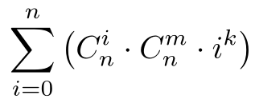
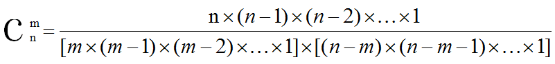
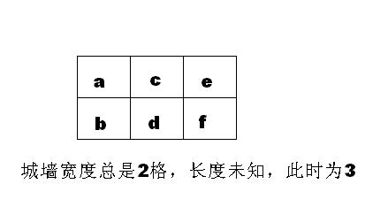

# 蓝桥杯 2013年第四届 真题（全部组别合并，按题号排列）

> 来源: Dotcpp 蓝桥杯真题 https://www.dotcpp.com/oj/lanqiao/ ｜ 抓取时间: 2026-11-27
> 本年有效试卷 1 套、14 题次，去重后 14 道题。

## 本年试卷构成

| 赛段 | 科目 | 组别 | 题数 | 备注 | 题集页 |
| --- | --- | --- | --- | --- | --- |
| 省赛及国赛 | 未分类 | 综合 | 14 |  | [题集](https://www.dotcpp.com/oj/1013/) |

## 题目一览

| 题号 | 标题 | 难度 | 通过率 | 考过的语言/组别 |
| --- | --- | --- | --- | --- |
| 1427 | 买不到的数目 | 入门 | 50.37% | 未区分科目 |
| 1428 | 公式求值 | 困难 | 3.98% | 未区分科目 |
| 1430 | 农场阳光 | 困难 | 6.25% | 未区分科目 |
| 1432 | 剪格子 | 中等 | 33.54% | 未区分科目 |
| 1433 | 危险系数 | 中等 | 37.44% | 未区分科目 |
| 1438 | 大臣的旅费 | 中等 | 28.73% | 未区分科目 |
| 1440 | 带分数 | 简单 | 53.09% | 未区分科目 |
| 1441 | 幸运数 | 简单 | 45.60% | 未区分科目 |
| 1442 | 打印十字图 | 入门 | 61.28% | 未区分科目 |
| 1446 | 核桃的数量 | 入门 | 68.20% | 未区分科目 |
| 1447 | 格子刷油漆 | 困难 | 28.89% | 未区分科目 |
| 1448 | 横向打印二叉树 | 中等 | 29.51% | 未区分科目 |
| 1458 | 错误票据 | 中等 | 34.52% | 未区分科目 |
| 1459 | 高僧斗法 | 困难 | 27.27% | 未区分科目 |

## 题目详情

### 1427 · 买不到的数目

> 题号 1427 ｜ 难度 入门 ｜ 时间 1s ｜ 内存 128MB
> 通过率 50.37% ｜ 题面原文 https://www.dotcpp.com/oj/problem1427.html
> 考过的语言/组别：未区分科目（省赛及国赛合订卷）

#### 题目描述

小明开了一家糖果店。他别出心裁：把水果糖包成4颗一包和7颗一包的两种。糖果不能拆包卖。

小朋友来买糖的时候，他就用这两种包装来组合。当然有些糖果数目是无法组合出来的，比如要买  10  颗糖。

你可以用计算机测试一下，在这种包装情况下，最大不能买到的数量是17。大于17的任何数字都可以用4和7组合出来。

本题的要求就是在已知两个包装的数量时，求最大不能组合出的数字。

#### 输入格式

两个正整数，表示每种包装中糖的颗数(都不多于1000)

#### 输出格式

一个正整数，表示最大不能买到的糖数

#### 样例输入

```
4 7 
```

#### 提示

零基础同学可以先学习视频课程，包含C/C++、Python、百练、蓝桥杯辅导、算法数据结构等课程，提供视频讲解以及配套习题，还有老师答疑，点击这里了解课程详情

---

### 1428 · 公式求值

> 题号 1428 ｜ 难度 困难 ｜ 时间 1s ｜ 内存 128MB
> 通过率 3.98% ｜ 题面原文 https://www.dotcpp.com/oj/problem1428.html
> 考过的语言/组别：未区分科目（省赛及国赛合订卷）

#### 题目描述

输入n,  m,  k，输出下面公式的值。


其中C_n^m是组合数，表示在n个人的集合中选出m个人组成一个集合的方案数。组合数的计算公式如下：



#### 输入格式

输入的第一行包含一个整数n；第二行包含一个整数m，第三行包含一个整数k。

数据规模和约定
对于100%的数据，n在十进制下不超过1000位，即1≤n< 10^1000，1≤k≤1000，同时0≤m≤n，k≤n。
提示
999101是一个质数；
当n位数比较多时，绝大多数情况下答案都是0，但评测的时候会选取一些答案不是0的数据；

#### 输出格式

计算上面公式的值，由于答案非常大，请输出这个值除以999101的余数。

#### 样例输入

```
3 

1 

3 
```

#### 提示

零基础同学可以先学习视频课程，包含C/C++、Python、百练、蓝桥杯辅导、算法数据结构等课程，提供视频讲解以及配套习题，还有老师答疑，点击这里了解课程详情

---

### 1430 · 农场阳光

> 题号 1430 ｜ 难度 困难 ｜ 时间 1s ｜ 内存 128MB
> 通过率 6.25% ｜ 题面原文 https://www.dotcpp.com/oj/problem1430.html
> 考过的语言/组别：未区分科目（省赛及国赛合订卷）

#### 题目描述

X星球十分特殊，它的自转速度与公转速度相同，所以阳光总是以固定的角度照射。

最近，X星球为发展星际旅游业，把空间位置出租给Y国游客来晒太阳。每个租位是漂浮在空中的圆盘形彩云（圆盘与地面平行）。当然，这会遮挡住部分阳光，被遮挡的土地植物无法生长。

本题的任务是计算某个农场宜于作物生长的土地面积有多大。

#### 输入格式

输入数据的第一行包含两个整数a,  b，表示某农场的长和宽分别是a和b，此时，该农场的范围是由坐标(0,  0,  0),  (a,  0,  0),  (a,  b,  0),  (0,  b,  0)围成的矩形区域。

第二行包含一个实数g，表示阳光照射的角度。简单起见，我们假设阳光光线是垂直于农场的宽的，此时正好和农场的长的夹角是g度，此时，空间中的一点  (x,  y,  z)在地面的投影点应该是(x  +  z  *  ctg(g度),  y,  0)，其中ctg(g度)表示g度对应的余切值。

第三行包含一个非负整数n，表示空中租位个数。

接下来  n  行，描述每个租位。其中第i行包含4个整数xi,  yi,  zi,  ri，表示第i个租位彩云的圆心在(xi,  yi,  zi)位置，圆半径为ri。

#### 输出格式

要求输出一个实数，四舍五入保留两位有效数字，表示农场里能长庄稼的土地的面积。

#### 样例输入

```
10 10 

90.0 

1 

5 5 10 5
```

#### 提示

零基础同学可以先学习视频课程，包含C/C++、Python、百练、蓝桥杯辅导、算法数据结构等课程，提供视频讲解以及配套习题，还有老师答疑，点击这里了解课程详情

---

### 1432 · 剪格子

> 题号 1432 ｜ 难度 中等 ｜ 时间 1s ｜ 内存 128MB
> 通过率 33.54% ｜ 题面原文 https://www.dotcpp.com/oj/problem1432.html
> 考过的语言/组别：未区分科目（省赛及国赛合订卷）

#### 题目描述

历届试题  剪格子

时间限制：1.0s     内存限制：256.0MB

问题描述

如下图所示，3  x  3  的格子中填写了一些整数。

+--*--+--+

|10*  1|52|

+--****--+

|20|30*  1|

*******--+

|  1|  2|  3|

+--+--+--+

我们沿着图中的星号线剪开，得到两个部分，每个部分的数字和都是60。

本题的要求就是请你编程判定：对给定的m  x  n  的格子中的整数，是否可以分割为两个部分，使得这两个区域的数字和相等。

如果存在多种解答，请输出包含左上角格子的那个区域包含的格子的最小数目。

如果无法分割，则输出  0。

#### 输入格式

程序先读入两个整数  m  n  用空格分割  (m,n< 10)。

表示表格的宽度和高度。

接下来是n行，每行m个正整数，用空格分开。每个整数不大于10000。

#### 输出格式

输出一个整数，表示在所有解中，包含左上角的分割区可能包含的最小的格子数目。

#### 样例输入

```
3 3

10 1 52

20 30 1

1 2 3
```

#### 提示

零基础同学可以先学习视频课程，包含C/C++、Python、百练、蓝桥杯辅导、算法数据结构等课程，提供视频讲解以及配套习题，还有老师答疑，点击这里了解课程详情

---

### 1433 · 危险系数

> 题号 1433 ｜ 难度 中等 ｜ 时间 1s ｜ 内存 128MB
> 通过率 37.44% ｜ 题面原文 https://www.dotcpp.com/oj/problem1433.html
> 考过的语言/组别：未区分科目（省赛及国赛合订卷）

#### 题目描述

问题描述

抗日战争时期，冀中平原的地道战曾发挥重要作用。

地道的多个站点间有通道连接，形成了庞大的网络。但也有隐患，当敌人发现了某个站点后，其它站点间可能因此会失去联系。

我们来定义一个危险系数DF(x,y)：

对于两个站点x和y  (x  !=  y),  如果能找到一个站点z，当z被敌人破坏后，x和y不连通，那么我们称z为关于x,y的关键点。相应的，对于任意一对站点x和y，危险系数DF(x,y)就表示为这两点之间的关键点个数。

本题的任务是：已知网络结构，求两站点之间的危险系数。

#### 输入格式

输入数据第一行包含2个整数n(2  < =  n  < =  1000),  m(0  < =  m  < =  2000),分别代表站点数，通道数；

接下来m行，每行两个整数  u,v  (1  < =  u,  v  < =  n;  u  !=  v)代表一条通道；

最后1行，两个数u,v，代表询问两点之间的危险系数DF(u,  v)。

#### 输出格式

一个整数，如果询问的两点不连通则输出-1.

#### 样例输入

```
7 6

1 3

2 3

3 4

3 5

4 5

5 6

1 6
```

#### 提示

零基础同学可以先学习视频课程，包含C/C++、Python、百练、蓝桥杯辅导、算法数据结构等课程，提供视频讲解以及配套习题，还有老师答疑，点击这里了解课程详情

---

### 1438 · 大臣的旅费

> 题号 1438 ｜ 难度 中等 ｜ 时间 1s ｜ 内存 128MB
> 通过率 28.73% ｜ 题面原文 https://www.dotcpp.com/oj/problem1438.html
> 考过的语言/组别：未区分科目（省赛及国赛合订卷）

#### 题目描述

很久以前，T王国空前繁荣。为了更好地管理国家，王国修建了大量的快速路，用于连接首都和王国内的各大城市。

为节省经费，T国的大臣们经过思考，制定了一套优秀的修建方案，使得任何一个大城市都能从首都直接或者通过其他大城市间接到达。同时，如果不重复经过大城市，从首都到达每个大城市的方案都是唯一的。

J是T国重要大臣，他巡查于各大城市之间，体察民情。所以，从一个城市马不停蹄地到另一个城市成了J最常做的事情。他有一个钱袋，用于存放往来城市间的路费。

聪明的J发现，如果不在某个城市停下来修整，在连续行进过程中，他所花的路费与他已走过的距离有关，在走第x千米到第x+1千米这一千米中（x是整数），他花费的路费是x+10这么多。也就是说走1千米花费11，走2千米要花费23。

J大臣想知道：他从某一个城市出发，中间不休息，到达另一个城市，所有可能花费的路费中最多是多少呢？

#### 输入格式

输入的第一行包含一个整数n，表示包括首都在内的T王国的城市数

城市从1开始依次编号，1号城市为首都。

接下来n-1行，描述T国的高速路（T国的高速路一定是n-1条）

每行三个整数Pi,  Qi,  Di，表示城市Pi和城市Qi之间有一条高速路，长度为Di千米。

#### 输出格式

输出一个整数，表示大臣J最多花费的路费是多少。

#### 样例输入

```
5

1 2 2

1 3 1

2 4 5

2 5 4
```

#### 提示

零基础同学可以先学习视频课程，包含C/C++、Python、百练、蓝桥杯辅导、算法数据结构等课程，提供视频讲解以及配套习题，还有老师答疑，点击这里了解课程详情

---

### 1440 · 带分数

> 题号 1440 ｜ 难度 简单 ｜ 时间 1s ｜ 内存 128MB
> 通过率 53.09% ｜ 题面原文 https://www.dotcpp.com/oj/problem1440.html
> 考过的语言/组别：未区分科目（省赛及国赛合订卷）

#### 题目描述

100  可以表示为带分数的形式：100  =  3  +  69258  /  714。

还可以表示为：100  =  82  +  3546  /  197。

注意特征：带分数中，数字1~9分别出现且只出现一次（不包含0）。

类似这样的带分数，100  有  11  种表示法。

#### 输入格式

从标准输入读入一个正整数N  (N< 1000*1000)

#### 输出格式

程序输出该数字用数码1~9不重复不遗漏地组成带分数表示的全部种数。

注意：不要求输出每个表示，只统计有多少表示法！

#### 样例输入

```
100  
```

#### 提示

零基础同学可以先学习视频课程，包含C/C++、Python、百练、蓝桥杯辅导、算法数据结构等课程，提供视频讲解以及配套习题，还有老师答疑，点击这里了解课程详情

---

### 1441 · 幸运数

> 题号 1441 ｜ 难度 简单 ｜ 时间 1s ｜ 内存 128MB
> 通过率 45.60% ｜ 题面原文 https://www.dotcpp.com/oj/problem1441.html
> 考过的语言/组别：未区分科目（省赛及国赛合订卷）

#### 题目描述

幸运数是波兰数学家乌拉姆命名的。它采用与生成素数类似的“筛法”生成

。

首先从1开始写出自然数1,2,3,4,5,6,....

1  就是第一个幸运数。

我们从2这个数开始。把所有序号能被2整除的项删除，变为：

1  _  3  _  5  _  7  _  9  ....

把它们缩紧，重新记序，为：

1  3  5  7  9  ....  。这时，3为第2个幸运数，然后把所有能被3整除的序号位置的数删去。注意，是序号位置，不是那个数本身能否被3整除!!  删除的应该是5，11,  17,  ...

此时7为第3个幸运数，然后再删去序号位置能被7整除的(19,39,...)

最后剩下的序列类似：

1,  3,  7,  9,  13,  15,  21,  25,  31,  33,  37,  43,  49,  51,  63,  67,  69,  73,  75,  79,  ...

#### 输入格式

输入两个正整数m  n,  用空格分开  (m  <   n  <   1000*1000)

#### 输出格式

程序输出  位于m和n之间的幸运数的个数（不包含m和n）。

#### 样例输入

```
30 69  
```

#### 提示

零基础同学可以先学习视频课程，包含C/C++、Python、百练、蓝桥杯辅导、算法数据结构等课程，提供视频讲解以及配套习题，还有老师答疑，点击这里了解课程详情

---

### 1442 · 打印十字图

> 题号 1442 ｜ 难度 入门 ｜ 时间 1s ｜ 内存 256MB
> 通过率 61.28% ｜ 题面原文 https://www.dotcpp.com/oj/problem1442.html
> 考过的语言/组别：未区分科目（省赛及国赛合订卷）

#### 题目描述

小明为某机构设计了一个十字型的徽标（并非红十字会啊），如下所示：

```
..$$$$$$$$$$$$$..

..$...........$..

$$$.$$$$$$$$$.$$$

$...$.......$...$

$.$$$.$$$$$.$$$.$

$.$...$...$...$.$

$.$.$$$.$.$$$.$.$

$.$.$...$...$.$.$

$.$.$.$$$$$.$.$.$

$.$.$...$...$.$.$

$.$.$$$.$.$$$.$.$

$.$...$...$...$.$

$.$$$.$$$$$.$$$.$

$...$.......$...$

$$$.$$$$$$$$$.$$$

..$...........$..

..$$$$$$$$$$$$$..
```

对方同时也需要在电脑dos窗口中以字符的形式输出该标志，并能任意控制层数。

提示

请仔细观察样例，尤其要注意句点的数量和输出位置。

#### 输入格式

一个正整数  n  (n< 30)  表示要求打印图形的层数。

#### 输出格式

对应包围层数的该标志。

#### 样例输入

```
3  
```

#### 提示

零基础同学可以先学习视频课程，包含C/C++、Python、百练、蓝桥杯辅导、算法数据结构等课程，提供视频讲解以及配套习题，还有老师答疑，点击这里了解课程详情

---

### 1446 · 核桃的数量

> 题号 1446 ｜ 难度 入门 ｜ 时间 1s ｜ 内存 128MB
> 通过率 68.20% ｜ 题面原文 https://www.dotcpp.com/oj/problem1446.html
> 考过的语言/组别：未区分科目（省赛及国赛合订卷）

#### 题目描述

小张是软件项目经理，他带领3个开发组。工期紧，今天都在加班呢。为鼓舞士气，小张打算给每个组发一袋核桃（据传言能补脑）。他的要求是：

1.  各组的核桃数量必须相同

2.  各组内必须能平分核桃（当然是不能打碎的）

3.  尽量提供满足1,2条件的最小数量（节约闹革命嘛）

#### 输入格式

输入包含三个正整数a,  b,  c，表示每个组正在加班的人数，用空格分开（a,b,c< 30）

#### 输出格式

输出一个正整数，表示每袋核桃的数量。

#### 样例输入

```
2 4 5
```

#### 提示

零基础同学可以先学习视频课程，包含C/C++、Python、百练、蓝桥杯辅导、算法数据结构等课程，提供视频讲解以及配套习题，还有老师答疑，点击这里了解课程详情

---

### 1447 · 格子刷油漆

> 题号 1447 ｜ 难度 困难 ｜ 时间 1s ｜ 内存 128MB
> 通过率 28.89% ｜ 题面原文 https://www.dotcpp.com/oj/problem1447.html
> 考过的语言/组别：未区分科目（省赛及国赛合订卷）

#### 题目描述

X国的一段古城墙的顶端可以看成  2*N个格子组成的矩形（如下图所示），现需要把这些格子刷上保护漆。



你可以从任意一个格子刷起，刷完一格，可以移动到和它相邻的格子（对角相邻也算数），但不能移动到较远的格子（因为油漆未干不能踩！）

比如：a  d  b  c  e  f  就是合格的刷漆顺序。

c  e  f  d  a  b  是另一种合适的方案。

当已知  N  时，求总的方案数。当N较大时，结果会迅速增大，请把结果对  1000000007  (十亿零七)  取模。

#### 输入格式

输入数据为一个正整数（不大于1000）

#### 输出格式

输出数据为一个正整数。

#### 样例输入

```
3 
```

#### 提示

零基础同学可以先学习视频课程，包含C/C++、Python、百练、蓝桥杯辅导、算法数据结构等课程，提供视频讲解以及配套习题，还有老师答疑，点击这里了解课程详情

---

### 1448 · 横向打印二叉树

> 题号 1448 ｜ 难度 中等 ｜ 时间 1s ｜ 内存 128MB
> 通过率 29.51% ｜ 题面原文 https://www.dotcpp.com/oj/problem1448.html
> 考过的语言/组别：未区分科目（省赛及国赛合订卷）

#### 题目描述

二叉树可以用于排序。其原理很简单：对于一个排序二叉树添加新节点时，先与根节点比较，若小则交给左子树继续处理，否则交给右子树。

当遇到空子树时，则把该节点放入那个位置。

比如，10  8  5  7  12  4  的输入顺序，应该建成二叉树如下图所示，其中.表示空白。

...|-12

10-|

...|-8-|

.......|...|-7

.......|-5-|

...........|-4

本题目要求：根据已知的数字，建立排序二叉树，并在标准输出中横向打印该二叉树。

#### 输入格式

输入数据为一行空格分开的N个整数。  N< 100，每个数字不超过10000。

输入数据中没有重复的数字。

#### 输出格式

输出该排序二叉树的横向表示。为了便于评卷程序比对空格的数目，请把空格用句点代替。

#### 样例输入

```
10 5 20
```

#### 提示

零基础同学可以先学习视频课程，包含C/C++、Python、百练、蓝桥杯辅导、算法数据结构等课程，提供视频讲解以及配套习题，还有老师答疑，点击这里了解课程详情

---

### 1458 · 错误票据

> 题号 1458 ｜ 难度 中等 ｜ 时间 1s ｜ 内存 128MB
> 通过率 34.52% ｜ 题面原文 https://www.dotcpp.com/oj/problem1458.html
> 考过的语言/组别：未区分科目（省赛及国赛合订卷）

#### 题目描述

某涉密单位下发了某种票据，并要在年终全部收回。

每张票据有唯一的ID号。全年所有票据的ID号是连续的，但ID的开始数码是随机选定的。

因为工作人员疏忽，在录入ID号的时候发生了一处错误，造成了某个ID断号，另外一个ID重号。

你的任务是通过编程，找出断号的ID和重号的ID。

假设断号不可能发生在最大和最小号。

#### 输入格式

要求程序首先输入一个整数N(N< 100)表示后面数据行数。

接着读入N行数据。

每行数据长度不等，是用空格分开的若干个（不大于100个）正整数（不大于100000），请注意行内和行末可能有多余的空格，你的程序需要能处理这些空格。

每个整数代表一个ID号。

#### 输出格式

要求程序输出1行，含两个整数m  n，用空格分隔。

其中，m表示断号ID，n表示重号ID

#### 样例输入

```
2

5 6 8 11 9

10 12 9
```

#### 提示

零基础同学可以先学习视频课程，包含C/C++、Python、百练、蓝桥杯辅导、算法数据结构等课程，提供视频讲解以及配套习题，还有老师答疑，点击这里了解课程详情

---

### 1459 · 高僧斗法

> 题号 1459 ｜ 难度 困难 ｜ 时间 1s ｜ 内存 128MB
> 通过率 27.27% ｜ 题面原文 https://www.dotcpp.com/oj/problem1459.html
> 考过的语言/组别：未区分科目（省赛及国赛合订卷）

#### 题目描述

古时丧葬活动中经常请高僧做法事。仪式结束后，有时会有“高僧斗法”的趣味节目，以舒缓压抑的气氛。

节目大略步骤为：先用粮食（一般是稻米）在地上“画”出若干级台阶（表示N级浮屠）。又有若干小和尚随机地“站”在某个台阶上。最高一级台阶必须站人，其它任意。(如图1所示)

两位参加游戏的法师分别指挥某个小和尚向上走任意多级的台阶，但会被站在高级台阶上的小和尚阻挡，不能越过。两个小和尚也不能站在同一台阶，也不能向低级台阶移动。

两法师轮流发出指令，最后所有小和尚必然会都挤在高段台阶，再也不能向上移动。轮到哪个法师指挥时无法继续移动，则游戏结束，该法师认输。

对于已知的台阶数和小和尚的分布位置，请你计算先发指令的法师该如何决策才能保证胜出。

#### 输入格式

输入数据为一行用空格分开的N个整数，表示小和尚的位置。台阶序号从1算起，所以最后一个小和尚的位置即是台阶的总数。（N< 100,  台阶总数< 1000）

#### 输出格式

输出为一行用空格分开的两个整数:  A  B,  表示把A位置的小和尚移动到B位置。若有多个解，输出A值较小的解，若无解则输出-1。

#### 样例输入

```
1 5 9
```

#### 提示

零基础同学可以先学习视频课程，包含C/C++、Python、百练、蓝桥杯辅导、算法数据结构等课程，提供视频讲解以及配套习题，还有老师答疑，点击这里了解课程详情

---
