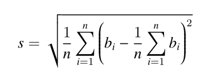
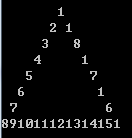
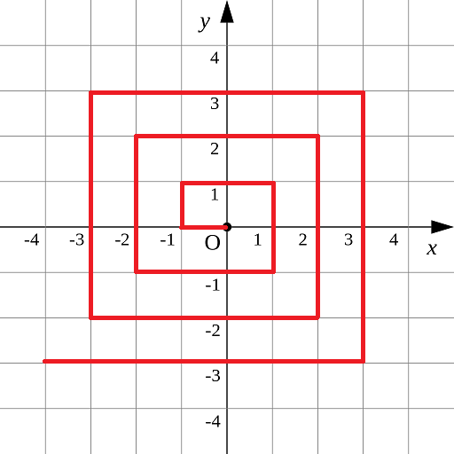

# 蓝桥杯 2018年第九届 真题（全部组别合并，按题号排列）

> 来源: Dotcpp 蓝桥杯真题 https://www.dotcpp.com/oj/lanqiao/ ｜ 洛谷蓝桥杯题单补充 3 题 https://www.luogu.com.cn/problem/list?type=luogu&tag=361,363 ｜ 抓取时间: 2026-11-27
> 本年有效试卷 1 套、20 题次，Dotcpp 去重 20 道题，另补洛谷题 3 道。

## 本年试卷构成

| 赛段 | 科目 | 组别 | 题数 | 备注 | 题集页 |
| --- | --- | --- | --- | --- | --- |
| 省赛及国赛 | 未分类 | 综合 | 20 |  | [题集](https://www.dotcpp.com/oj/1019/) |

## 题目一览

| 题号 | 标题 | 难度 | 通过率 | 考过的语言/组别 |
| --- | --- | --- | --- | --- |
| 2194 | 递增三元组 | 中等 | 34.54% | 未区分科目 |
| 2274 | 航班时间 | 简单 | 51.75% | 未区分科目 |
| 2275 | 三体攻击 | 困难 | 2.20% | 未区分科目 |
| 2276 | 全球变暖 | 中等 | 25.86% | 未区分科目 |
| 2277 | 倍数问题 | 困难 | 14.81% | 未区分科目 |
| 2278 | 付账问题 | 困难 | 21.57% | 未区分科目 |
| 2279 | 日志统计 | 困难 | 23.16% | 未区分科目 |
| 2280 | 乘积最大 | 困难 | 17.85% | 未区分科目 |
| 2281 | 次数差 | 简单 | 56.61% | 未区分科目 |
| 2282 | 等腰三角形 | 简单 | 56.30% | 未区分科目 |
| 2283 | 小朋友崇拜圈 | 简单 | 49.96% | 未区分科目 |
| 2284 | 耐摔指数 | 中等 | 29.72% | 未区分科目 |
| 2285 | 螺旋折线 | 困难 | 25.23% | 未区分科目 |
| 2286 | 堆的计数 | 中等 | 32.64% | 未区分科目 |
| 2287 | 缩位求和 | 中等 | 41.55% | 未区分科目 |
| 2288 | 约瑟夫环 | 中等 | 32.10% | 未区分科目 |
| 2289 | 自描述序列 | 困难 | 13.47% | 未区分科目 |
| 2290 | 采油 | 中等 | 39.47% | 未区分科目 |
| 2291 | 调手表 | 困难 | 29.65% | 未区分科目 |
| 2292 | 搭积木 | 困难 | 24.74% | 未区分科目 |
| — | 矩阵求和 | 困难 | 34.08% | 国赛 C/C++ 大学B组 |
| — | 交换次数 | 中等 | 44.38% | 国赛 C/C++ 大学C组 |
| — | 迷宫与陷阱 | 中等 | 30.28% | 国赛 C/C++ 大学C组 |

## 题目详情

### 2194 · 递增三元组

> 题号 2194 ｜ 难度 中等 ｜ 时间 1s ｜ 内存 128MB
> 通过率 34.54% ｜ 题面原文 https://www.dotcpp.com/oj/problem2194.html
> 考过的语言/组别：未区分科目（省赛及国赛合订卷）

#### 题目描述

给定三个整数数组

A = [A1, A2, … AN],

B = [B1, B2, … BN],

C = [C1, C2, … CN]，

请你统计有多少个三元组(i, j, k) 满足：

1. 1 <= i, j, k <= N

2. Ai < Bj < Ck

#### 输入格式

第一行包含一个整数N。

第二行包含N个整数A1, A2, ... AN。

第三行包含N个整数B1, B2, ... BN。

第四行包含N个整数C1, C2, ... CN。

#### 输出格式

一个整数表示答案

#### 样例输入

```
3

1 1 1

2 2 2

3 3 3
```

#### 提示

零基础同学可以先学习视频课程，包含C/C++、Python、百练、蓝桥杯辅导、算法数据结构等课程，提供视频讲解以及配套习题，还有老师答疑，点击这里了解课程详情

---

### 2274 · 航班时间

> 题号 2274 ｜ 难度 简单 ｜ 时间 1s ｜ 内存 128MB
> 通过率 51.75% ｜ 题面原文 https://www.dotcpp.com/oj/problem2274.html
> 考过的语言/组别：未区分科目（省赛及国赛合订卷）

#### 题目描述

小h前往美国参加了蓝桥杯国际赛。小h的女朋友发现小h上午十点出发，上午十二点到达美国，于是感叹到“现在飞机飞得真快，两小时就能到美国了”。

小h对超音速飞行感到十分恐惧。仔细观察后发现飞机的起降时间都是当地时间。由于北京和美国东部有12小时时差，故飞机总共需要14小时的飞行时间。

不久后小h的女朋友去中东交换。小h并不知道中东与北京的时差。但是小h得到了女朋友来回航班的起降时间。小h想知道女朋友的航班飞行时间是多少。

对于一个可能跨时区的航班，给定来回程的起降时间。假设飞机来回飞行时间相同，求飞机的飞行时间。

#### 输入格式

从标准输入读入数据。

一个输入包含多组数据。

输入第一行为一个正整数T，表示输入数据组数。

每组数据包含两行，第一行为去程的 起降 时间，第二行为回程的 起降 时间。

起降时间的格式如下

h1:m1:s1 h2:m2:s2

或

h1:m1:s1 h3:m3:s3 (+1)

或

h1:m1:s1 h4:m4:s4 (+2)

表示该航班在当地时间h1时m1分s1秒起飞，

第一种格式表示在当地时间 当日 h2时m2分s2秒降落

第二种格式表示在当地时间 次日 h3时m3分s3秒降落。

第三种格式表示在当地时间 第三天 h4时m4分s4秒降落。

对于此题目中的所有以 h:m:s 形式给出的时间, 保证 ( 0<=h<=23, 0<=m,s<=59 ).

#### 输出格式

输出到标准输出。

对于每一组数据输出一行一个时间hh:mm:ss，表示飞行时间为hh小时mm分ss秒。

注意，当时间为一位数时，要补齐前导零。如三小时四分五秒应写为03:04:05。

#### 样例输入

```
3

17:48:19 21:57:24

11:05:18 15:14:23

17:21:07 00:31:46 (+1)

23:02:41 16:13:20 (+1)

10:19:19 20:41:24

22:19:04 16:41:09 (+1)
```

#### 提示

零基础同学可以先学习视频课程，包含C/C++、Python、百练、蓝桥杯辅导、算法数据结构等课程，提供视频讲解以及配套习题，还有老师答疑，点击这里了解课程详情

---

### 2275 · 三体攻击

> 题号 2275 ｜ 难度 困难 ｜ 时间 1s ｜ 内存 128MB
> 通过率 2.20% ｜ 题面原文 https://www.dotcpp.com/oj/problem2275.html
> 考过的语言/组别：未区分科目（省赛及国赛合订卷）

#### 题目描述

三体人将对地球发起攻击。为了抵御攻击，地球人派出了 A × B × C 艘战舰，在太空中排成一个 A 层 B 行 C 列的立方体。其中，第 i 层第 j 行第 k 列的战舰（记为战舰 (i, j, k)）的生命值为 d(i, j, k)。

三体人将会对地球发起 m 轮“立方体攻击”，每次攻击会对一个小立方体中的所有战舰都造成相同的伤害。具体地，第 t 轮攻击用 7 个参数 lat, rat, lbt, rbt, lct, rct, ht 描述；

所有满足 i ∈ [lat, rat],j ∈ [lbt, rbt],k ∈ [lct, rct] 的战舰 (i, j, k) 会受到 ht 的伤害。如果一个战舰累计受到的总伤害超过其防御力，那么这个战舰会爆炸。

地球指挥官希望你能告诉他，第一艘爆炸的战舰是在哪一轮攻击后爆炸的。

#### 输入格式

从标准输入读入数据。

第一行包括 4 个正整数 A, B, C, m；

第二行包含 A × B × C 个整数，其中第 ((i − 1)×B + (j − 1)) × C + (k − 1)+1 个数为 d(i, j, k)；

第 3 到第 m + 2 行中，第 (t − 2) 行包含 7 个正整数 lat, rat, lbt, rbt, lct, rct, ht。

对于 10% 的数据，B = C = 1；

对于 20% 的数据，C = 1；

对于 40% 的数据，A × B × C, m ≤ 10, 000；

对于 70% 的数据，A, B, C ≤ 200；

对于所有数据，A × B × C ≤ 10^6, m ≤ 10^6, 0 ≤ d(i, j, k), ht ≤ 10^9。

#### 输出格式

输出到标准输出。

输出第一个爆炸的战舰是在哪一轮攻击后爆炸的。保证一定存在这样的战舰。

#### 样例输入

```
2 2 2 3

1 1 1 1 1 1 1 1

1 2 1 2 1 1 1

1 1 1 2 1 2 1

1 1 1 1 1 1 2
```

#### 提示

零基础同学可以先学习视频课程，包含C/C++、Python、百练、蓝桥杯辅导、算法数据结构等课程，提供视频讲解以及配套习题，还有老师答疑，点击这里了解课程详情

---

### 2276 · 全球变暖

> 题号 2276 ｜ 难度 中等 ｜ 时间 1s ｜ 内存 128MB
> 通过率 25.86% ｜ 题面原文 https://www.dotcpp.com/oj/problem2276.html
> 考过的语言/组别：未区分科目（省赛及国赛合订卷）

#### 题目描述

你有一张某海域NxN像素的照片，"."表示海洋、"#"表示陆地，如下所示：

.......

.##....

.##....

....##.

..####.

...###.

.......

其中"上下左右"四个方向上连在一起的一片陆地组成一座岛屿。例如上图就有2座岛屿。

由于全球变暖导致了海面上升，科学家预测未来几十年，岛屿边缘一个像素的范围会被海水淹没。具体来说如果一块陆地像素与海洋相邻(上下左右四个相邻像素中有海洋)，它就会被淹没。

例如上图中的海域未来会变成如下样子：

.......

.......

.......

.......

....#..

.......

.......

请你计算：依照科学家的预测，照片中有多少岛屿会被完全淹没。

#### 输入格式

第一行包含一个整数N。  (1 <= N <= 1000)

以下N行N列代表一张海域照片。

照片保证第1行、第1列、第N行、第N列的像素都是海洋。

#### 输出格式

一个整数表示答案。

#### 样例输入

```
7 

.......

.##....

.##....

....##.

..####.

...###.

.......  
```

#### 提示

零基础同学可以先学习视频课程，包含C/C++、Python、百练、蓝桥杯辅导、算法数据结构等课程，提供视频讲解以及配套习题，还有老师答疑，点击这里了解课程详情

---

### 2277 · 倍数问题

> 题号 2277 ｜ 难度 困难 ｜ 时间 1s ｜ 内存 128MB
> 通过率 14.81% ｜ 题面原文 https://www.dotcpp.com/oj/problem2277.html
> 考过的语言/组别：未区分科目（省赛及国赛合订卷）

#### 题目描述

众所周知，小葱同学擅长计算，尤其擅长计算一个数是否是另外一个数的倍数。但小葱只擅长两个数的情况，当有很多个数之后就会比较苦恼。现在小葱给了你 n 个数，希望你从这 n 个数中找到三个数，使得这三个数的和是 K 的倍数，且这个和最大。数据保证一定有解。

#### 输入格式

从标准输入读入数据。

第一行包括 2 个正整数 n, K。

第二行 n 个正整数，代表给定的 n 个数。

对于 30% 的数据，n <= 100。

对于 60% 的数据，n <= 1000。

对于另外 20% 的数据，K <= 10。

对于 100% 的数据，1 <= n <= 10^5, 1 <= K <= 10^3，给定的 n 个数均不超过 10^8。

#### 输出格式

输出到标准输出。

输出一行一个整数代表所求的和。

#### 样例输入

```
4 3

1 2 3 4
```

#### 提示

零基础同学可以先学习视频课程，包含C/C++、Python、百练、蓝桥杯辅导、算法数据结构等课程，提供视频讲解以及配套习题，还有老师答疑，点击这里了解课程详情

---

### 2278 · 付账问题

> 题号 2278 ｜ 难度 困难 ｜ 时间 1s ｜ 内存 128MB
> 通过率 21.57% ｜ 题面原文 https://www.dotcpp.com/oj/problem2278.html
> 考过的语言/组别：未区分科目（省赛及国赛合订卷）

#### 题目描述

几个人一起出去吃饭是常有的事。但在结帐的时候，常常会出现一些争执。

现在有 n 个人出去吃饭，他们总共消费了 S 元。其中第 i 个人带了 ai 元。幸运的是，所有人带的钱的总数是足够付账的，但现在问题来了：每个人分别要出多少钱呢？

为了公平起见，我们希望在总付钱量恰好为 S 的前提下，最后每个人付的钱的标准差最小。这里我们约定，每个人支付的钱数可以是任意非负实数，即可以不是1分钱的整数倍。你需要输出最小的标准差是多少。

标准差的介绍：标准差是多个数与它们平均数差值的平方平均数，一般用于刻画这些数之间的“偏差有多大”。形式化地说，设第 i 个人付的钱为 bi 元，那么标准差为



#### 输入格式

从标准输入读入数据。

第一行包含两个整数 n、S；

第二行包含 n 个非负整数 a1, ..., an。

1≤n≤5×10<sup>5</sup>

0≤ai,S≤10<sup>9</sup>

#### 输出格式

输出到标准输出。

输出最小的标准差，四舍五入保留 4 位小数。

保证正确答案在加上或减去 10^−9 后不会导致四舍五入的结果发生变化。

#### 样例输入

```
5 2333

666 666 666 666 666
```

#### 提示

零基础同学可以先学习视频课程，包含C/C++、Python、百练、蓝桥杯辅导、算法数据结构等课程，提供视频讲解以及配套习题，还有老师答疑，点击这里了解课程详情

---

### 2279 · 日志统计

> 题号 2279 ｜ 难度 困难 ｜ 时间 1s ｜ 内存 128MB
> 通过率 23.16% ｜ 题面原文 https://www.dotcpp.com/oj/problem2279.html
> 考过的语言/组别：未区分科目（省赛及国赛合订卷）

#### 题目描述

小明维护着一个程序员论坛。现在他收集了一份"点赞"日志，日志共有N行。其中每一行的格式是：

ts id

表示在ts时刻编号id的帖子收到一个"赞"。

现在小明想统计有哪些帖子曾经是"热帖"。如果一个帖子曾在任意一个长度为D的时间段内收到不少于K个赞，小明就认为这个帖子曾是"热帖"。

具体来说，如果存在某个时刻T满足该帖在[T, T+D)这段时间内(注意是左闭右开区间)收到不少于K个赞，该帖就曾是"热帖"。

给定日志，请你帮助小明统计出所有曾是"热帖"的帖子编号。

#### 输入格式

第一行包含三个整数N、D和K。

以下N行每行一条日志，包含两个整数ts和id。

对于50%的数据，1 <= K <= N <= 1000

对于100%的数据，1 <= K <= N <= 100000 0 <= ts <= 100000 0 <= id <= 100000

#### 输出格式

按从小到大的顺序输出热帖id。每个id一行。

#### 样例输入

```
7 10 2  

0 1  

0 10    

10 10  

10 1  

9 1

100 3  

100 3 
```

#### 提示

零基础同学可以先学习视频课程，包含C/C++、Python、百练、蓝桥杯辅导、算法数据结构等课程，提供视频讲解以及配套习题，还有老师答疑，点击这里了解课程详情

---

### 2280 · 乘积最大

> 题号 2280 ｜ 难度 困难 ｜ 时间 1s ｜ 内存 128MB
> 通过率 17.85% ｜ 题面原文 https://www.dotcpp.com/oj/problem2280.html
> 考过的语言/组别：未区分科目（省赛及国赛合订卷）

#### 题目描述

给定N个整数A1, A2, ... AN。请你从中选出K个数，使其乘积最大。

请你求出最大的乘积，由于乘积可能超出整型范围，你只需输出乘积除以1000000009的余数。

注意，如果X<0， 我们定义X除以1000000009的余数是负(-X)除以1000000009的余数。

即：0-((0-x) % 1000000009)

#### 输入格式

第一行包含两个整数N和K。

以下N行每行一个整数Ai。

对于40%的数据，1 <= K <= N <= 100

对于60%的数据，1 <= K <= 1000

对于100%的数据，1 <= K <= N <= 100000 -100000 <= Ai <= 100000

#### 输出格式

一个整数，表示答案。

#### 样例输入

```
5 3 

-100000   

-10000   

2   

100000  

10000 
```

#### 提示

零基础同学可以先学习视频课程，包含C/C++、Python、百练、蓝桥杯辅导、算法数据结构等课程，提供视频讲解以及配套习题，还有老师答疑，点击这里了解课程详情

---

### 2281 · 次数差

> 题号 2281 ｜ 难度 简单 ｜ 时间 1s ｜ 内存 128MB
> 通过率 56.61% ｜ 题面原文 https://www.dotcpp.com/oj/problem2281.html
> 考过的语言/组别：未区分科目（省赛及国赛合订卷）

#### 题目描述

x星球有26只球队，分别用a~z的26个字母代表。他们总是不停地比赛。

在某一赛段，哪个球队获胜了，就记录下代表它的字母，这样就形成一个长长的串。

国王总是询问：获胜次数最多的和获胜次数最少的有多大差距？（当然，他不关心那些一次也没获胜的，认为他们在怠工罢了）

#### 输入格式

一个串，表示球队获胜情况（保证串的长度<1000）

#### 输出格式

一个数字，表示出现次数最多的字母比出现次数最少的字母多了多少次。

#### 样例输入

```
abaabcaa
```

#### 提示

零基础同学可以先学习视频课程，包含C/C++、Python、百练、蓝桥杯辅导、算法数据结构等课程，提供视频讲解以及配套习题，还有老师答疑，点击这里了解课程详情

---

### 2282 · 等腰三角形

> 题号 2282 ｜ 难度 简单 ｜ 时间 1s ｜ 内存 128MB
> 通过率 56.30% ｜ 题面原文 https://www.dotcpp.com/oj/problem2282.html
> 考过的语言/组别：未区分科目（省赛及国赛合订卷）

#### 题目描述

本题目要求你在控制台输出一个由数字组成的等腰三角形。

具体的步骤是：

1. 先用1,2,3，...的自然数拼一个足够长的串

2. 用这个串填充三角形的三条边。从上方顶点开始，逆时针填充。

比如，当三角形高度是8时：

1

2 1

3   8

4     1

5       7

6         1

7           6

891011121314151

显示不正确时



#### 输入格式

一个正整数n(3<n<300),表示三角形的高度

#### 输出格式

用数字填充的等腰三角形。

为了便于测评，我们要求空格一律用"."代替。

#### 样例输入

```
5
```

#### 提示

零基础同学可以先学习视频课程，包含C/C++、Python、百练、蓝桥杯辅导、算法数据结构等课程，提供视频讲解以及配套习题，还有老师答疑，点击这里了解课程详情

---

### 2283 · 小朋友崇拜圈

> 题号 2283 ｜ 难度 简单 ｜ 时间 1s ｜ 内存 128MB
> 通过率 49.96% ｜ 题面原文 https://www.dotcpp.com/oj/problem2283.html
> 考过的语言/组别：未区分科目（省赛及国赛合订卷）

#### 题目描述

班里N个小朋友，每个人都有自己最崇拜的一个小朋友（也可以是自己）。

在一个游戏中，需要小朋友坐一个圈，

每个小朋友都有自己最崇拜的小朋友在他的右手边。

求满足条件的圈最大多少人？

小朋友编号为1,2,3,...N

#### 输入格式

输入第一行，一个整数N（3<N<100000）

接下来一行N个整数，由空格分开。

#### 输出格式

要求输出一个整数，表示满足条件的最大圈的人数。

#### 样例输入

```
9

3 4 2 5 3 8 4 6 9
```

#### 提示

零基础同学可以先学习视频课程，包含C/C++、Python、百练、蓝桥杯辅导、算法数据结构等课程，提供视频讲解以及配套习题，还有老师答疑，点击这里了解课程详情

---

### 2284 · 耐摔指数

> 题号 2284 ｜ 难度 中等 ｜ 时间 1s ｜ 内存 128MB
> 通过率 29.72% ｜ 题面原文 https://www.dotcpp.com/oj/problem2284.html
> 考过的语言/组别：未区分科目（省赛及国赛合订卷）

#### 题目描述

x星球的居民脾气不太好，但好在他们生气的时候唯一的异常举动是：摔手机。

各大厂商也就纷纷推出各种耐摔型手机。x星球的质监局规定了手机必须经过耐摔测试，并且评定出一个耐摔指数来，之后才允许上市流通。

x星球有很多高耸入云的高塔，刚好可以用来做耐摔测试。塔的每一层高度都是一样的，与地球上稍有不同的是，他们的第一层不是地面，而是相当于我们的2楼。

如果手机从第7层扔下去没摔坏，但第8层摔坏了，则手机耐摔指数=7。

特别地，如果手机从第1层扔下去就坏了，则耐摔指数=0。

如果到了塔的最高层第n层扔没摔坏，则耐摔指数=n

为了减少测试次数，从每个厂家抽样3部手机参加测试。

如果已知了测试塔的高度，并且采用最佳策略，在最坏的运气下最多需要测试多少次才能确定手机的耐摔指数呢？

#### 输入格式

一个整数n（3<n<10000）,表示测试塔的高度。

#### 输出格式

输出一个整数，表示最多测试多少次。

#### 样例输入

```
3
```

#### 提示

零基础同学可以先学习视频课程，包含C/C++、Python、百练、蓝桥杯辅导、算法数据结构等课程，提供视频讲解以及配套习题，还有老师答疑，点击这里了解课程详情

---

### 2285 · 螺旋折线

> 题号 2285 ｜ 难度 困难 ｜ 时间 1s ｜ 内存 128MB
> 通过率 25.23% ｜ 题面原文 https://www.dotcpp.com/oj/problem2285.html
> 考过的语言/组别：未区分科目（省赛及国赛合订卷）

#### 题目描述

如图所示的螺旋折线经过平面上所有整点恰好一次。

对于整点(X, Y)，我们定义它到原点的距离dis(X, Y)是从原点到(X, Y)的螺旋折线段的长度。

例如dis(0, 1)=3, dis(-2, -1)=9

给出整点坐标(X, Y)，你能计算出dis(X, Y)吗？



#### 输入格式

X和Y

#### 输出格式

输出dis(X, Y)

#### 样例输入

```
0 1
```

#### 提示

零基础同学可以先学习视频课程，包含C/C++、Python、百练、蓝桥杯辅导、算法数据结构等课程，提供视频讲解以及配套习题，还有老师答疑，点击这里了解课程详情

---

### 2286 · 堆的计数

> 题号 2286 ｜ 难度 中等 ｜ 时间 1s ｜ 内存 128MB
> 通过率 32.64% ｜ 题面原文 https://www.dotcpp.com/oj/problem2286.html
> 考过的语言/组别：未区分科目（省赛及国赛合订卷）

#### 题目描述

我们知道包含N个元素的堆可以看成是一棵包含N个节点的完全二叉树。

每个节点有一个权值。对于小根堆来说，父节点的权值一定小于其子节点的权值。

假设N个节点的权值分别是1~N，你能求出一共有多少种不同的小根堆吗？

例如对于N=4有如下3种：

1

/ \

2   3

/

4

1

/ \

3   2

/

4

1

/ \

2   4

/

3

由于数量可能超过整型范围，你只需要输出结果除以1000000009的余数。

#### 输入格式

一个整数N。

对于40%的数据，1<=N<=1000

对于70%的数据，1<=N<=10000

对于100%的数据，1<=N<=100000

#### 输出格式

一个整数表示答案。

#### 样例输入

```
4
```

#### 提示

零基础同学可以先学习视频课程，包含C/C++、Python、百练、蓝桥杯辅导、算法数据结构等课程，提供视频讲解以及配套习题，还有老师答疑，点击这里了解课程详情

---

### 2287 · 缩位求和

> 题号 2287 ｜ 难度 中等 ｜ 时间 1s ｜ 内存 128MB
> 通过率 41.55% ｜ 题面原文 https://www.dotcpp.com/oj/problem2287.html
> 考过的语言/组别：未区分科目（省赛及国赛合订卷）

#### 题目描述

在电子计算机普及以前，人们经常用一个粗略的方法来验算四则运算是否正确。

比如：248 * 15 = 3720

把乘数和被乘数分别逐位求和，如果是多位数再逐位求和，直到是1位数，得

2 + 4 + 8 = 14 ==> 1 + 4 = 5;

1 + 5 = 6

5 * 6

而结果逐位求和为 3

5 * 6 的结果逐位求和与3符合，说明正确的可能性很大！！（不能排除错误）

请你写一个计算机程序，对给定的字符串逐位求和：

#### 输入格式

输入为一个由数字组成的串，表示n位数(n<1000);

#### 输出格式

输出为一位数，表示反复逐位求和的结果。

#### 样例输入

```
35379
```

#### 提示

零基础同学可以先学习视频课程，包含C/C++、Python、百练、蓝桥杯辅导、算法数据结构等课程，提供视频讲解以及配套习题，还有老师答疑，点击这里了解课程详情

---

### 2288 · 约瑟夫环

> 题号 2288 ｜ 难度 中等 ｜ 时间 1s ｜ 内存 128MB
> 通过率 32.10% ｜ 题面原文 https://www.dotcpp.com/oj/problem2288.html
> 考过的语言/组别：未区分科目（省赛及国赛合订卷）

#### 题目描述

n 个人的编号是 1~n，如果他们依编号按顺时针排成一个圆圈，从编号是1的人开始顺时针报数。

（报数是从1报起）当报到 k 的时候，这个人就退出游戏圈。下一个人重新从1开始报数。

求最后剩下的人的编号。这就是著名的约瑟夫环问题。

本题目就是已知 n，k 的情况下，求最后剩下的人的编号。

#### 输入格式

题目的输入是一行，2个空格分开的整数n, k

约定：0 < n,k < 1百万

#### 输出格式

要求输出一个整数，表示最后剩下的人的编号。

#### 样例输入

```
10 3
```

#### 提示

零基础同学可以先学习视频课程，包含C/C++、Python、百练、蓝桥杯辅导、算法数据结构等课程，提供视频讲解以及配套习题，还有老师答疑，点击这里了解课程详情

---

### 2289 · 自描述序列

> 题号 2289 ｜ 难度 困难 ｜ 时间 1s ｜ 内存 128MB
> 通过率 13.47% ｜ 题面原文 https://www.dotcpp.com/oj/problem2289.html
> 考过的语言/组别：未区分科目（省赛及国赛合订卷）

#### 题目描述

小明在研究一个序列，叫Golomb自描述序列，不妨将其记作{G(n)}。这个序列有2个很有趣的性质:

1. 对于任意正整数n，n在整个序列中恰好出现G(n)次。

2. 这个序列是不下降的。

以下是{G(n)}的前几项：

n 1 2 3 4 5 6 7 8 9 10 11 12 13

G(n) 1 2 2 3 3 4 4 4 5 5 5 6 6

给定一个整数n，你能帮小明算出G(n)的值吗？

#### 输入格式

一个整数n。

#### 输出格式

一个整数G(n)

#### 样例输入

```
13
```

#### 提示

零基础同学可以先学习视频课程，包含C/C++、Python、百练、蓝桥杯辅导、算法数据结构等课程，提供视频讲解以及配套习题，还有老师答疑，点击这里了解课程详情

---

### 2290 · 采油

> 题号 2290 ｜ 难度 中等 ｜ 时间 1s ｜ 内存 128MB
> 通过率 39.47% ｜ 题面原文 https://www.dotcpp.com/oj/problem2290.html
> 考过的语言/组别：未区分科目（省赛及国赛合订卷）

#### 题目描述

LQ公司是世界著名的石油公司，为世界供应优质石油。

最近，LQ公司又在森林里发现了一大片区域的油田，可以在这个油田中开采n个油井。

LQ公司在这n个油井之间修建了n-1条道路，每条道路连接两个油井，路径中间不会路过任何油井，而且这些道路将所有油井连通。

建立油井的时候需要使用一台大型设备，运输起来非常麻烦，LQ公司准备在其中的一个油井位置建立一个空运站，先将设备空运到空运站，之后每次经过他们建立的道路来运输这个大型设备以建立不同的油井，当油井建立完毕后再从空运站将大型设备运走。

为了减少运输的麻烦，公司要求大型设备在道路上运输的总路程是最短的。

在建立油井和采油的过程中需要花费一些人力，第i个油井需要花费Bi个人，而一旦油井建成，就需要Si个人一直坚守在油井上进行维护。

当然，如果一个人参与了油井的建设，他可以直接留下来维护油井，或者参与下一个油井的建设，但是在维护油井的人不能再参加后续油井的建设了。

现在LQ公司想知道，大型设备运输的总路径长度最短是多少？在保证总路径长度最短的情况下，LQ公司至少需要花费多少人力才能完成所有油井的建立与维护。

#### 输入格式

输入的第一行包含一个整数n，表示油井的数量。油井由1到n依次标号。

第二行包含n个整数，依次表示B1, B2, ⋯, Bn，相邻的整数之间用一个空格分隔。

第三行包含n个整数，依次表示S1, S2, ⋯, Sn，相邻的整数之间用一个空格分隔。

接下来n-1行描述油井之间的道路，其中的第i行包含两个整数a，b，用一个空格分隔，表示一条道路的起点为i+1、终点为a，长度为b，道路是双向的，设备可以从任意一端运送到另一端，每条道路都可以经过任意多次。数据保证任意两个油井之间都可以通过道路连接。

#### 输出格式

输出包含两个整数，用一个空格分隔，表示最优情况下大型设备需要运输的总路程，以及在总路程最短的情况下最少需要花费的人力数量。

#### 样例输入

```
2

10 20

15 15

1 8
```

#### 提示

零基础同学可以先学习视频课程，包含C/C++、Python、百练、蓝桥杯辅导、算法数据结构等课程，提供视频讲解以及配套习题，还有老师答疑，点击这里了解课程详情

---

### 2291 · 调手表

> 题号 2291 ｜ 难度 困难 ｜ 时间 1s ｜ 内存 128MB
> 通过率 29.65% ｜ 题面原文 https://www.dotcpp.com/oj/problem2291.html
> 考过的语言/组别：未区分科目（省赛及国赛合订卷）

#### 题目描述

小明买了块高端大气上档次的电子手表，他正准备调时间呢。

在 M78 星云，时间的计量单位和地球上不同，M78 星云的一个小时有 n 分钟。

大家都知道，手表只有一个按钮可以把当前的数加一。在调分钟的时候，如果当前显示的数是 0 ，那么按一下按钮就会变成 1，再按一次变成 2 。如果当前的数是 n - 1，按一次后会变成 0 。

作为强迫症患者，小明一定要把手表的时间调对。如果手表上的时间比当前时间多1，则要按 n - 1 次加一按钮才能调回正确时间。

小明想，如果手表可以再添加一个按钮，表示把当前的数加 k 该多好啊⋯⋯

他想知道，如果有了这个 +k 按钮，按照最优策略按键，从任意一个分钟数调到另外任意一个分钟数最多要按多少次。

注意，按 +k 按钮时，如果加k后数字超过n-1,则会对n取模。

比如，n=10, k=6 的时候，假设当前时间是0，连按2次 +k 按钮，则调为2。

#### 输入格式

一行两个整数 n, k ，意义如题。

对于 30% 的数据 0 < k < n <= 5

对于 60% 的数据 0 < k < n <= 100

对于 100% 的数据 0 < k < n <= 100000

#### 输出格式

一行一个整数

表示：按照最优策略按键，从一个时间调到另一个时间最多要按多少次。

#### 样例输入

```
5 3
```

#### 提示

零基础同学可以先学习视频课程，包含C/C++、Python、百练、蓝桥杯辅导、算法数据结构等课程，提供视频讲解以及配套习题，还有老师答疑，点击这里了解课程详情

---

### 2292 · 搭积木

> 题号 2292 ｜ 难度 困难 ｜ 时间 1s ｜ 内存 128MB
> 通过率 24.74% ｜ 题面原文 https://www.dotcpp.com/oj/problem2292.html
> 考过的语言/组别：未区分科目（省赛及国赛合订卷）

#### 题目描述

小明对搭积木非常感兴趣。他的积木都是同样大小的正立方体。

在搭积木时，小明选取 m 块积木作为地基，将他们在桌子上一字排开，中间不留空隙，并称其为第0层。

随后，小明可以在上面摆放第1层，第2层，⋯⋯，最多摆放至第n层。摆放积木必须遵循三条规则：

规则1：每块积木必须紧挨着放置在某一块积木的正上方，与其下一层的积木对齐；

规则2：同一层中的积木必须连续摆放，中间不能留有空隙；

规则3：小明不喜欢的位置不能放置积木。

其中，小明不喜欢的位置都被标在了图纸上。图纸共有n行，从下至上的每一行分别对应积木的第1层至第n层。每一行都有m个字符，字符可能是‘.’或‘X’，其中‘X’表示这个位置是小明不喜欢的。

现在，小明想要知道，共有多少种放置积木的方案。他找到了参加蓝桥杯的你来帮他计算这个答案。

由于这个答案可能很大，你只需要回答这个答案对1000000007(十亿零七)取模后的结果。

注意：地基上什么都不放，也算作是方案之一种。

#### 输入格式

输入数据的第一行有两个正整数n和m，表示图纸的大小。

随后n行，每行有m个字符，用来描述图纸 。每个字符只可能是‘.’或‘X’。

对于10%的数据，n=1，m<=30；

对于40%的数据，n<=10，m<=30；

对于100%的数据，n<=100，m<=100。

#### 输出格式

输出一个整数，表示答案对1000000007取模后的结果

#### 样例输入

```
2 3

..X

.X.
```

#### 提示

零基础同学可以先学习视频课程，包含C/C++、Python、百练、蓝桥杯辅导、算法数据结构等课程，提供视频讲解以及配套习题，还有老师答疑，点击这里了解课程详情

---

### — · 矩阵求和

> 题号 洛谷 P8670 ｜ 难度 困难（洛谷 提高） ｜ 时间 2.00s ｜ 内存 256MB
> 通过率 34.08%（洛谷站内口径） ｜ 题面原文 https://www.luogu.com.cn/problem/P8670
> 考过的语言/组别：国赛 C/C++ 大学B组（洛谷题单）

#### 题目描述

经过重重笔试面试的考验，小明成功进入 Macrohard 公司工作。

今天小明的任务是填满这么一张表：

表有 $n$ 行 $n$ 列，行和列的编号都从 $1$ 算起。

其中第 $i$ 行第 $j$ 个元素的值是 $\gcd(i, j)$ 的平方，$\gcd$ 表示最大公约数，以下是这个表的前四行的前四列：

```
1  1  1  1
1  4  1  4
1  1  9  1
1  4  1 16
```

小明突然冒出一个奇怪的想法，他想知道这张表中所有元素的和。
由于表过于庞大，他希望借助计算机的力量。

#### 输入格式

一行一个正整数 $n$ 意义见题。

#### 输出格式

一行一个数，表示所有元素的和。由于答案比较大，请输出模 $1000000007$（即$10^9+7$）后的结果。

#### 样例输入

```
4
```

#### 样例输出

```
48
```

#### 提示

对于 $30\%$ 的数据，$n\le 1000$。

存在 $10\%$ 的数据，$n = 10^5$。

对于 $60\%$ 的数据，$n\le 10^6$。

对于 $100\%$ 的数据，$n\le 10^7$。

---

### — · 交换次数

> 题号 洛谷 P8672 ｜ 难度 中等（洛谷 普及） ｜ 时间 1.00s ｜ 内存 256MB
> 通过率 44.38%（洛谷站内口径） ｜ 题面原文 https://www.luogu.com.cn/problem/P8672
> 考过的语言/组别：国赛 C/C++ 大学C组（洛谷题单）

#### 题目描述

IT 产业人才需求节节攀升。业内巨头百度、阿里巴巴、腾讯（简称 BAT）在某海滩进行招聘活动。

招聘部门一字排开。由于是自由抢占席位，三大公司的席位随机交错在一起，形如：

`ABABTATT`，这使得应聘者十分别扭。

于是，管理部门要求招聘方进行必要的交换位置，使得每个集团的席位都挨在一起。即最后形如：

`BBAAATTT` 这样的形状，当然，也可能是：

`AAABBTTT` 等。

现在，假设每次只能交换 $2$ 个席位，并且知道现在的席位分布，

你的任务是计算：要使每个集团的招聘席位都挨在一起需要至少进行多少次交换动作。

#### 输入格式

输入是一行 $n$ 个字符（只含有字母 `B`、`A` 或 `T`），表示现在的席位分布。

#### 输出格式

输出是一个整数，表示至少交换次数。

#### 样例输入 1

```
TABTABBTTTT
```

#### 样例输出 1

```
3
```

#### 样例输入 2

```
TTAAABB
```

#### 样例输出 2

```
0
```

#### 提示

输入字符串的长度 $n$ 不大于 $10^5$。

时限 1 秒, 256M。蓝桥杯 2018 年第九届国赛

---

### — · 迷宫与陷阱

> 题号 洛谷 P8673 ｜ 难度 中等（洛谷 普及） ｜ 时间 3.00s ｜ 内存 256MB
> 通过率 30.28%（洛谷站内口径） ｜ 题面原文 https://www.luogu.com.cn/problem/P8673
> 考过的语言/组别：国赛 C/C++ 大学C组（洛谷题单）

#### 题目描述

小明在玩一款迷宫游戏，在游戏中他要控制自己的角色离开一间由 $N \times N$ 个格子组成的二维迷宫。

小明的起始位置在左上角，他需要到达右下角的格子才能离开迷宫。

每一步，他可以移动到上下左右相邻的格子中（前提是目标格子可以经过）。

迷宫中有些格子小明可以经过，我们用 `.` 表示；

有些格子是墙壁，小明不能经过，我们用 `#` 表示。

此外，有些格子上有陷阱，我们用 `X` 表示。除非小明处于无敌状态，否则不能经过。

有些格子上有无敌道具，我们用 `%` 表示。

当小明第一次到达该格子时，自动获得无敌状态，无敌状态会持续 $K$ 步。

之后如果再次到达该格子不会获得无敌状态了。

处于无敌状态时，可以经过有陷阱的格子，但是不会拆除 / 毁坏陷阱，即陷阱仍会阻止没有无敌状态的角色经过。

给定迷宫，请你计算小明最少经过几步可以离开迷宫。

#### 输入格式

第一行包含两个整数 $N$ 和 $K$。$(1 \le N \le 1000，1 \le K \le 10)$。

以下 $N$ 行包含一个 $N\times N$ 的矩阵。

矩阵保证左上角和右下角是 `.`。

#### 输出格式

一个整数表示答案。如果小明不能离开迷宫，输出 $-1$。

#### 样例输入 1

```
5 3
...XX
##%#.
...#.
.###.
.....
```

#### 样例输出 1

```
10
```

#### 样例输入 2

```
5 1
...XX
##%#.
...#.
.###.
.....
```

#### 样例输出 2

```
12
```

#### 提示

时限 3 秒, 256M。蓝桥杯 2018 年第九届国赛

---
