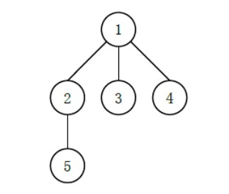
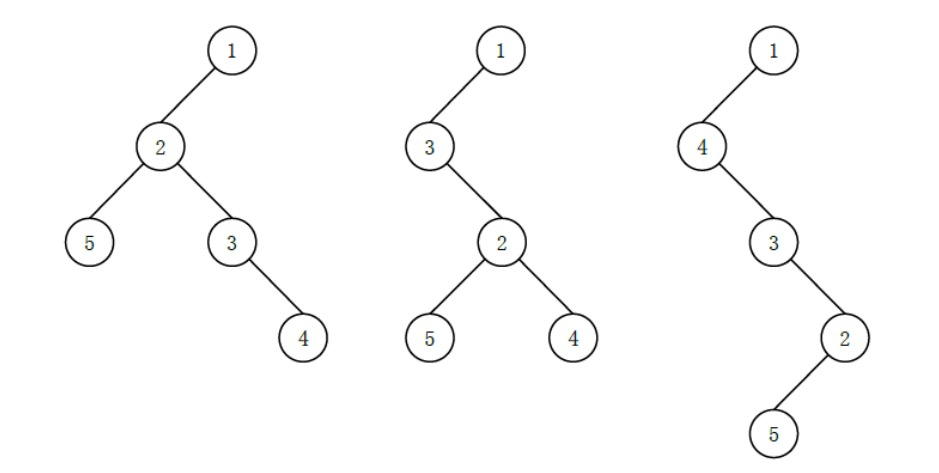
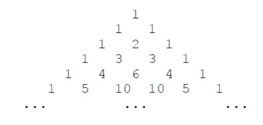
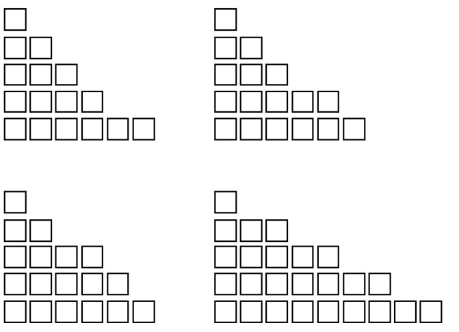
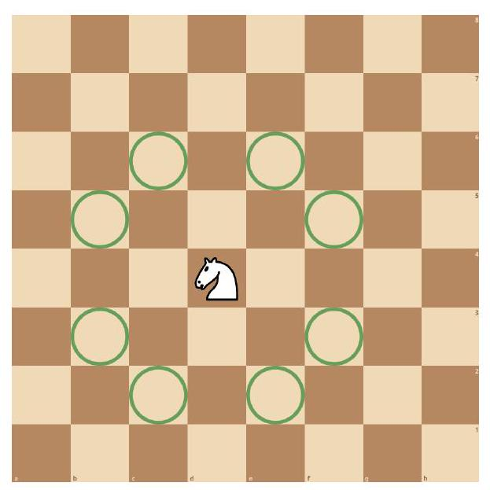

# 蓝桥杯 2021年第十二届 真题（全部组别合并，按题号排列）

> 来源: Dotcpp 蓝桥杯真题 https://www.dotcpp.com/oj/lanqiao/ ｜ 洛谷蓝桥杯题单补充 6 题 https://www.luogu.com.cn/problem/list?type=luogu&tag=361,363 ｜ 抓取时间: 2026-11-27
> 本年有效试卷 1 套、19 题次，Dotcpp 去重 19 道题，另补洛谷题 6 道。

## 本年试卷构成

| 赛段 | 科目 | 组别 | 题数 | 备注 | 题集页 |
| --- | --- | --- | --- | --- | --- |
| 省赛及国赛 | 未分类 | 综合 | 19 |  | [题集](https://www.dotcpp.com/oj/1022/) |

## 题目一览

| 题号 | 标题 | 难度 | 通过率 | 考过的语言/组别 |
| --- | --- | --- | --- | --- |
| 2604 | 砝码称重 | 中等 | 33.84% | 未区分科目 |
| 2605 | 异或数列 | 困难 | 16.38% | 未区分科目 |
| 2606 | 左孩子右兄弟 | 中等 | 37.61% | 未区分科目 |
| 2607 | 括号序列 | 困难 | 12.65% | 未区分科目 |
| 2608 | 分果果 | 困难 | 14.81% | 未区分科目 |
| 2609 | 时间显示 | 简单 | 45.59% | 未区分科目 |
| 2610 | 杨辉三角形 | 困难 | 10.54% | 未区分科目 |
| 2611 | 双向排序 | 困难 | 7.57% | 未区分科目 |
| 2612 | 最少砝码 | 简单 | 46.55% | 未区分科目 |
| 2613 | 异或变换 | 困难 | 20.71% | 未区分科目 |
| 2614 | 冰山 | 困难 | 3.56% | 未区分科目 |
| 2615 | 翻转括号序列 | 困难 | 6.80% | 未区分科目 |
| 2616 | 异或三角 | 困难 | 15.13% | 未区分科目 |
| 2617 | 积木 | 困难 | 1.01% | 未区分科目 |
| 2618 | 123 | 困难 | 13.73% | 未区分科目 |
| 2619 | 二进制问题 | 困难 | 17.04% | 未区分科目 |
| 2620 | 大写 | 简单 | 56.09% | 未区分科目 |
| 2621 | 巧克力 | 困难 | 17.32% | 未区分科目 |
| 2622 | 和与乘积 | 困难 | 15.25% | 未区分科目 |
| — | 特殊年份 | 简单 | 60.65% | 省赛 C/C++ 大学B2组 |
| — | 小平方 | 简单 | 41.30% | 省赛 C/C++ 大学AB2组 |
| — | 完全平方数 | 简单 | 26.32% | 省赛 C/C++ 大学AB2组 |
| — | 负载均衡 | 中等 | 48.01% | 省赛 C/C++ 大学AB2组 |
| — | 国际象棋 | 困难 | 50.74% | 省赛 C/C++ 大学AB2组 |
| — | 完美序列 | 中等 | 39.78% | 省赛 C/C++ 大学A2组 |

## 题目详情

### 2604 · 砝码称重

> 题号 2604 ｜ 难度 中等 ｜ 时间 1s ｜ 内存 128MB
> 通过率 33.84% ｜ 题面原文 https://www.dotcpp.com/oj/problem2604.html
> 考过的语言/组别：未区分科目（省赛及国赛合订卷）

#### 题目描述

你有一架天平和 N 个砝码，这 N 个砝码重量依次是 W1, W2, · · · , WN。

请你计算一共可以称出多少种不同的重量？

注意砝码可以放在天平两边。

#### 输入格式

输入的第一行包含一个整数 N。

第二行包含 N 个整数：W1, W2, W3, · · · , WN。

#### 输出格式

输出一个整数代表答案。

#### 样例输入

```
3

1 4 6
```

#### 提示

【样例说明】

能称出的 10 种重量是：1、2、3、4、5、6、7、9、10、11。

1 = 1；

2 = 6 4 (天平一边放 6，另一边放 4)；

3 = 4 1；

4 = 4；

5 = 6 1；

6 = 6；

7 = 1 + 6；

9 = 4 + 6 1；

10 = 4 + 6；

11 = 1 + 4 + 6。

【评测用例规模与约定】

对于 50% 的评测用例，1 ≤ N ≤ 15。

对于所有评测用例，1 ≤ N ≤ 100，N 个砝码总重不超过 100000。

---

### 2605 · 异或数列

> 题号 2605 ｜ 难度 困难 ｜ 时间 1s ｜ 内存 128MB
> 通过率 16.38% ｜ 题面原文 https://www.dotcpp.com/oj/problem2605.html
> 考过的语言/组别：未区分科目（省赛及国赛合订卷）

#### 题目描述

Alice 和 Bob 正在玩一个异或数列的游戏。初始时，Alice 和 Bob 分别有一个整数 a 和 b，有一个给定的长度为 n 的公共数列 X1, X2, · · · , Xn。

Alice 和 Bob 轮流操作，Alice 先手，每步可以在以下两种选项中选一种：

选项 1：从数列中选一个 Xi 给 Alice 的数异或上，或者说令 a 变为 a ⊕ Xi。（其中 ⊕ 表示按位异或）

选项 2：从数列中选一个 Xi 给 Bob 的数异或上，或者说令 b 变为 b ⊕ Xi。

每个数 Xi 都只能用一次，当所有 Xi 均被使用后（n 轮后）游戏结束。游戏结束时，拥有的数比较大的一方获胜，如果双方数值相同，即为平手。

现在双方都足够聪明，都采用最优策略，请问谁能获胜？

#### 输入格式

每个评测用例包含多组询问。询问之间彼此独立。

输入的第一行包含一个整数 T，表示询问数。

接下来 T 行每行包含一组询问。其中第 i 行的第一个整数 ni 表示数列长度，随后 ni 个整数 X1, X2, · · · , Xni 表示数列中的每个数。

#### 输出格式

输出 T 行，依次对应每组询问的答案。

每行包含一个整数 1、0 或 1 分别表示 Alice 胜、平局或败。

#### 样例输入

```
4

1 1

1 0

2 2 1

7 992438 1006399 781139 985280 4729 872779 563580
```

#### 提示

【评测用例规模与约定】

对于所有评测用例，1 ≤ T ≤ 200000，1 ≤ ∑<sup>T</sup><sub>i=1</sub> n<sub>i</sub> ≤ 200000，0 ≤ X<sub>i</sub> < 2<sup>20</sup>。

---

### 2606 · 左孩子右兄弟

> 题号 2606 ｜ 难度 中等 ｜ 时间 1s ｜ 内存 128MB
> 通过率 37.61% ｜ 题面原文 https://www.dotcpp.com/oj/problem2606.html
> 考过的语言/组别：未区分科目（省赛及国赛合订卷）

#### 题目描述

对于一棵多叉树，我们可以通过 “左孩子右兄弟” 表示法，将其转化成一棵

二叉树。

如果我们认为每个结点的子结点是无序的，那么得到的二叉树可能不唯一。换句话说，每个结点可以选任意子结点作为左孩子，并按任意顺序连接右兄弟。

给定一棵包含 N 个结点的多叉树，结点从 1 至 N 编号，其中 1 号结点是根，每个结点的父结点的编号比自己的编号小。请你计算其通过 “左孩子右兄弟” 表示法转化成的二叉树，高度最高是多少。注：只有根结点这一个结点的树高度为 0 。

例如如下的多叉树：



可能有以下 3 种 (这里只列出 3 种，并不是全部) 不同的 “左孩子右兄弟”

表示：



其中最后一种高度最高，为 4。

#### 输入格式

输入的第一行包含一个整数 N。

以下 N 1 行，每行包含一个整数，依次表示 2 至 N 号结点的父结点编号。

#### 输出格式

输出一个整数表示答案。

#### 样例输入

```
5

1

1

1

2
```

#### 提示

【评测用例规模与约定】

对于 30% 的评测用例，1 ≤ N ≤ 20；

对于所有评测用例，1 ≤ N ≤ 100000。

---

### 2607 · 括号序列

> 题号 2607 ｜ 难度 困难 ｜ 时间 1s ｜ 内存 128MB
> 通过率 12.65% ｜ 题面原文 https://www.dotcpp.com/oj/problem2607.html
> 考过的语言/组别：未区分科目（省赛及国赛合订卷）

#### 题目描述

给定一个括号序列，要求尽可能少地添加若干括号使得括号序列变得合法，当添加完成后，会产生不同的添加结果，请问有多少种本质不同的添加结果。两个结果是本质不同的是指存在某个位置一个结果是左括号，而另一个是右括号。

例如，对于括号序列 ((()，只需要添加两个括号就能让其合法，有以下几种不同的添加结果：()()()、()(())、(())()、(()()) 和 ((()))。

#### 输入格式

输入一行包含一个字符串 s，表示给定的括号序列，序列中只有左括号和

右括号。

#### 输出格式

输出一个整数表示答案，答案可能很大，请输出答案除以 1000000007 (即10<sup>9</sup> + 7) 的余数。

#### 样例输入

```
((()
```

#### 提示

【评测用例规模与约定】

对于 40% 的评测用例，|s| ≤ 200。

对于所有评测用例，1 ≤ |s| ≤ 5000。

---

### 2608 · 分果果

> 题号 2608 ｜ 难度 困难 ｜ 时间 1s ｜ 内存 128MB
> 通过率 14.81% ｜ 题面原文 https://www.dotcpp.com/oj/problem2608.html
> 考过的语言/组别：未区分科目（省赛及国赛合订卷）

#### 题目描述

小蓝要在自己的生日宴会上将 n 包糖果分给 m 个小朋友。每包糖果都要分出去，每个小朋友至少要分一包，也可以分多包。

小蓝已经提前将糖果准备好了，为了在宴会当天能把糖果分得更平均一些，小蓝要先计算好分配方案。

小蓝将糖果从 1 到 n 编号，第 i 包糖果重 wi。小朋友从 1 到 m 编号。每个小朋友只能分到编号连续的糖果。小蓝想了很久没想出合适的分配方案使得每个小朋友分到的糖果差不多重。因此需要你帮他一起想办法。为了更好的分配糖果，他可以再买一些糖果，让某一些编号的糖果有两份。当某个编号的糖果有两份时，一个小朋友最多只能分其中的一份。请找一个方案，使得小朋友分到的糖果的最大重量和最小重量的差最小，请输出这个差。

例如，小蓝现在有 5 包糖果，重量分别为 6, 1, 2, 7, 9，如果小蓝要分给两个小朋友，则他可以将所有糖果再买一份，两个小朋友都分到 1 至 5 包糖果，重量都是 25，差为 0。

再如，小蓝现在有 5 包糖果，重量分别为 6, 1, 2, 7, 9，如果小蓝要分给三个小朋友，则他可以将第 3 包糖果再买一份，第一个小朋友分 1 至 3 包，第二个小朋友分 3 至 4 包，第三个小朋友分第 5 包，每个小朋友分到的重量都是 9，差为 0。

再如，小蓝现在有 5 包糖果，重量分别为 6, 1, 2, 7, 9，如果小蓝要分给四个小朋友，则他可以将第 3 包和第 5 包糖果再买一份，仍然可以每个小朋友分到的重量都是 9，差为 0。

再如，小蓝现在有 5 包糖果，重量分别为 6, 1, 2, 7, 9，如果小蓝要分给五个小朋友，则他可以将第 4 包和第 5 包糖果再买一份，第一个小朋友分第 1 至 2 包重量为 7，第二个小朋友分第 3 至 4 包重量为 9，第三个小朋友分第 4 包重量为 7，第四个和第五个小朋友都分第 5 包重量为 9。差为 2。

#### 输入格式

输入第一行包含两个整数 n 和 m，分别表示糖果包数和小朋友数量。

第二行包含 n 个整数 w1, w2, · · · , wn，表示每包糖果的重量。

#### 输出格式

输出一个整数，表示在最优情况下小朋友分到的糖果的最大重量和最小重

量的差。

#### 样例输入

```
5 2

6 1 2 7 9
```

#### 提示

【评测用例规模与约定】

对于 30% 的评测用例，1 ≤ n ≤ 10，1 ≤ m ≤ 10，1 ≤ wi ≤ 10；

对于 60% 的评测用例，1 ≤ n ≤ 30，1 ≤ m ≤ 20，1 ≤ wi ≤ 30；

对于所有评测用例，1 ≤ n ≤ 100，1 ≤ m ≤ 50，1 ≤ wi ≤ 100。在评测数据中，wi 随机生成，在某个区间均匀分布。

---

### 2609 · 时间显示

> 题号 2609 ｜ 难度 简单 ｜ 时间 1s ｜ 内存 128MB
> 通过率 45.59% ｜ 题面原文 https://www.dotcpp.com/oj/problem2609.html
> 考过的语言/组别：未区分科目（省赛及国赛合订卷）

#### 题目描述

小蓝要和朋友合作开发一个时间显示的网站。在服务器上，朋友已经获取了当前的时间，用一个整数表示，值为从 1970 年 1 月 1 日 00:00:00 到当前时刻经过的毫秒数。现在，小蓝要在客户端显示出这个时间。小蓝不用显示出年月日，只需要显示出时分秒即可，毫秒也不用显示，直接舍去即可。

给定一个用整数表示的时间，请将这个时间对应的时分秒输出。

#### 输入格式

输入一行包含一个整数，表示时间。

#### 输出格式

输出时分秒表示的当前时间，格式形如 HH:MM:SS，其中 HH 表示时，值为 0 到 23，MM 表示分，值为 0 到 59，SS 表示秒，值为 0 到 59。时、分、秒不足两位时补前导 0。

#### 样例输入

```
46800999
```

#### 提示

【评测用例规模与约定】

对于所有评测用例，给定的时间为不超过 10<sup>18</sup> 的正整数。

---

### 2610 · 杨辉三角形

> 题号 2610 ｜ 难度 困难 ｜ 时间 1s ｜ 内存 128MB
> 通过率 10.54% ｜ 题面原文 https://www.dotcpp.com/oj/problem2610.html
> 考过的语言/组别：未区分科目（省赛及国赛合订卷）

#### 题目描述

下面的图形是著名的杨辉三角形：



如果我们按从上到下、从左到右的顺序把所有数排成一列，可以得到如下

数列：

1, 1, 1, 1, 2, 1, 1, 3, 3, 1, 1, 4, 6, 4, 1, ...

给定一个正整数 N，请你输出数列中第一次出现 N 是在第几个数？

#### 输入格式

输入一个整数 N。

#### 输出格式

输出一个整数代表答案。

#### 样例输入

```
6
```

#### 提示

【评测用例规模与约定】

对于 20% 的评测用例，1 ≤ N ≤ 10；

对于所有评测用例，1 ≤ N ≤ 1000000000。

---

### 2611 · 双向排序

> 题号 2611 ｜ 难度 困难 ｜ 时间 1s ｜ 内存 128MB
> 通过率 7.57% ｜ 题面原文 https://www.dotcpp.com/oj/problem2611.html
> 考过的语言/组别：未区分科目（省赛及国赛合订卷）

#### 题目描述

给定序列 (a1, a2, · · · , an) = (1, 2, · · · , n)，即 ai = i。

小蓝将对这个序列进行 m 次操作，每次可能是将 a1, a2, · · · , aqi 降序排列，或者将 aqi , aqi+1, · · · , an 升序排列。

请求出操作完成后的序列。

#### 输入格式

输入的第一行包含两个整数 n, m，分别表示序列的长度和操作次数。

接下来 m 行描述对序列的操作，其中第 i 行包含两个整数 pi, qi 表示操作类型和参数。当 pi = 0 时，表示将 a1, a2, · · · , aqi 降序排列；当 pi = 1 时，表示将 aqi , aqi+1, · · · , an 升序排列。

#### 输出格式

输出一行，包含 n 个整数，相邻的整数之间使用一个空格分隔，表示操作完成后的序列。

#### 样例输入

```
3 3

0 3

1 2

0 2
```

#### 提示

【样例说明】

原数列为 (1, 2, 3)。 第 1 步后为 (3, 2, 1)。 第 2 步后为 (3, 1, 2)。 第 3 步后为 (3, 1, 2)。与第 2 步操作后相同，因为前两个数已经是降序了。

【评测用例规模与约定】

对于 30% 的评测用例，n, m ≤ 1000；

对于 60% 的评测用例，n, m ≤ 5000；

对于所有评测用例，1 ≤ n, m ≤ 100000，0 ≤ ai ≤ 1，1 ≤ bi ≤ n。

---

### 2612 · 最少砝码

> 题号 2612 ｜ 难度 简单 ｜ 时间 1s ｜ 内存 128MB
> 通过率 46.55% ｜ 题面原文 https://www.dotcpp.com/oj/problem2612.html
> 考过的语言/组别：未区分科目（省赛及国赛合订卷）

#### 题目描述

你有一架天平。现在你要设计一套砝码，使得利用这些砝码可以称出任意小于等于 N 的正整数重量。那么这套砝码最少需要包含多少个砝码？

注意砝码可以放在天平两边。

#### 输入格式

输入包含一个正整数 N。

#### 输出格式

输出一个整数代表答案。

#### 样例输入

```
7
```

#### 提示

【样例说明】

3 个砝码重量是 1、4、6，可以称出 1 至 7 的所有重量。

1 = 1；

2 = 6 4 (天平一边放 6，另一边放 4)；

3 = 4 1；

4 = 4；

5 = 6 1；

6 = 6；

7 = 1 + 6；

少于 3 个砝码不可能称出 1 至 7 的所有重量。

【评测用例规模与约定】

对于所有评测用例，1 ≤ N ≤ 1000000000。

---

### 2613 · 异或变换

> 题号 2613 ｜ 难度 困难 ｜ 时间 1s ｜ 内存 128MB
> 通过率 20.71% ｜ 题面原文 https://www.dotcpp.com/oj/problem2613.html
> 考过的语言/组别：未区分科目（省赛及国赛合订卷）

#### 题目描述

小蓝有一个 01 串 s = s1 s2 s3 · · · sn。
以后每个时刻，小蓝要对这个 01 串进行一次变换。每次变换的规则相同。
对于 01 串 s = s1 s2 s3 · · · sn，变换后的 01 串 s′ = s′1 s′2 s′3· · · s′n 为：
s′1 = s1;
s′i = s<sub>i-1</sub> ⊕ si。
其中 a ⊕ b 表示两个二进制的异或，当 a 和 b 相同时结果为 0，当 a 和 b不同时结果为 1。
请问，经过 t 次变换后的 01 串是什么？

#### 输入格式

输入的第一行包含两个整数 n, t，分别表示 01 串的长度和变换的次数。
第二行包含一个长度为 n 的 01 串。

#### 输出格式

输出一行包含一个 01 串，为变换后的串。

#### 样例输入

```
5 3

10110
```

#### 提示

【样例说明】
初始时为 10110，变换 1 次后变为 11101，变换 2 次后变为 10011，变换 3
次后变为 11010。
【评测用例规模与约定】
对于 40% 的评测用例，1 ≤ n ≤ 100, 1 ≤ t ≤ 1000。
对于 80% 的评测用例，1 ≤ n ≤ 1000, 1 ≤ t ≤ 10<sup>9</sup>。
对于所有评测用例，1 ≤ n ≤ 10000, 1 ≤ t ≤ 10<sup>18</sup>。

---

### 2614 · 冰山

> 题号 2614 ｜ 难度 困难 ｜ 时间 1s ｜ 内存 128MB
> 通过率 3.56% ｜ 题面原文 https://www.dotcpp.com/oj/problem2614.html
> 考过的语言/组别：未区分科目（省赛及国赛合订卷）

#### 题目描述

一片海域上有一些冰山，第 i 座冰山的体积为 Vi。

随着气温的变化，冰山的体积可能增大或缩小。第 i 天，每座冰山的变化量都是 Xi。当 Xi > 0 时，所有冰山体积增加 Xi；当 Xi < 0 时，所有冰山体积减少 ቁ Xi；当 Xi = 0 时，所有冰山体积不变。

如果第 i 天某座冰山的体积变化后小于等于 0，则冰山会永远消失。

冰山有大小限制 k。如果第 i 天某座冰山 j 的体积变化后 Vj 大于 k，则它会分裂成一个体积为 k 的冰山和 Vj 赗? k 座体积为 1 的冰山。第 i 天结束前（冰山增大、缩小、消失、分裂完成后），会漂来一座体积为Yi 的冰山（Yi = 0 表示没有冰山漂来）。

小蓝在连续的 m 天对这片海域进行了观察，并准确记录了冰山的变化。小蓝想知道，每天结束时所有冰山的体积之和（包括新漂来的）是多少。

由于答案可能很大，请输出答案除以 998244353 的余数。

#### 输入格式

输入的第一行包含三个整数 n, m, k，分别表示初始时冰山的数量、观察的

天数以及冰山的大小限制。

第二行包含 n 个整数 V1, V2, · · · , Vn，表示初始时每座冰山的体积。

接下来 m 行描述观察的 m 天的冰山变化。其中第 i 行包含两个整数 Xi, Yi，

意义如前所述。

#### 输出格式

输出 m 行，每行包含一个整数，分别对应每天结束时所有冰山的体积之和

除以 998244353 的余数。

#### 样例输入

```
1 3 6

1

6 1

2 2

-1 1
```

#### 提示

【样例说明】

在本样例说明中，用 [a1, a2, · · · , an] 来表示每座冰山的体积。

初始时的冰山为 [1]。 第 1 天结束时，有 3 座冰山：[1, 1, 6]。 第 2 天结束时，有 6 座冰山：[1, 1, 2, 3, 3, 6]。 第 3 天结束时，有 5 座冰山：[1, 1, 2, 2, 5]。

【评测用例规模与约定】

对于 40% 的评测用例，n, m, k ≤ 2000；

对于 60% 的评测用例，n, m, k ≤ 20000；

对于所有评测用例，1 ≤ n, m ≤ 100000, 1 ≤ k ≤ 109, 1 ≤ Vi ≤ k, 0 ≤ Yi ≤ k,쇋? k ≤ Xi ≤ k。

---

### 2615 · 翻转括号序列

> 题号 2615 ｜ 难度 困难 ｜ 时间 1s ｜ 内存 128MB
> 通过率 6.80% ｜ 题面原文 https://www.dotcpp.com/oj/problem2615.html
> 考过的语言/组别：未区分科目（省赛及国赛合订卷）

#### 题目描述

给定一个长度为 n 的括号序列，要求支持两种操作：

1. 将 [Li, Ri] 区间内（序列中的第 Li 个字符到第 Ri 个字符）的括号全部翻转（左括号变成右括号，右括号变成左括号）。

2. 求出以 Li 为左端点时，最长的合法括号序列对应的 Ri （即找出最大的Ri 使 [Li, Ri] 是一个合法括号序列）。

#### 输入格式

输入的第一行包含两个整数 n, m，分别表示括号序列长度和操作次数。

第二行包含给定的括号序列，括号序列中只包含左括号和右括号。

接下来 m 行，每行描述一个操作。如果该行为 “1 Li Ri”，表示第一种操作，区间为 [Li, Ri] ；如果该行为 “2 Li” 表示第二种操作，左端点为 Li。

#### 输出格式

对于每个第二种操作，输出一行，表示对应的 Ri。如果不存在这样的 Ri，请输出 0。

#### 样例输入

```
7 5

((())()

2 3

2 2

1 3 5

2 3

2 1
```

#### 提示

【评测用例规模与约定】

对于 20% 的评测用例，n, m ≤ 5000；

对于 40% 的评测用例，n, m ≤ 30000；

对于 60% 的评测用例，n, m ≤ 100000；

对于所有评测用例，1 ≤ n ≤ 10<sup>6</sup>, 1 ≤ m ≤ 2 × 10<sup>5</sup>。

---

### 2616 · 异或三角

> 题号 2616 ｜ 难度 困难 ｜ 时间 1s ｜ 内存 128MB
> 通过率 15.13% ｜ 题面原文 https://www.dotcpp.com/oj/problem2616.html
> 考过的语言/组别：未区分科目（省赛及国赛合订卷）

#### 题目描述

给定 T 个数 n1, n2, · · · , nT，对每个 ni 请求出有多少组 a, b, c 满足：

1. 1 ≤ a, b, c ≤ ni；

2. a ⊕ b ⊕ c = 0，其中 ⊕ 表示二进制按位异或；

3. 长度为 a, b, c 的三条边能组成一个三角形。

#### 输入格式

输入的第一行包含一个整数 T。

接下来 T 行每行一个整数，分别表示 n1, n2, · · · , nT。

#### 输出格式

输出 T 行，每行包含一个整数，表示对应的答案。

#### 样例输入

```
2

6

114514
```

#### 提示

【评测用例规模与约定】

对于 10% 的评测用例，T = 1, 1 ≤ ni ≤ 200；

对于 20% 的评测用例，T = 1, 1 ≤ ni ≤ 2000；

对于 50% 的评测用例，T = 1, 1 ≤ ni ≤ 2<sup>20</sup>；

对于 60% 的评测用例，1 ≤ T ≤ 100000, 1 ≤ ni ≤ 2<sup>20</sup>；

对于所有评测用例，1 ≤ T ≤ 100000, 1 ≤ ni ≤ 2<sup>30</sup>。

---

### 2617 · 积木

> 题号 2617 ｜ 难度 困难 ｜ 时间 1s ｜ 内存 128MB
> 通过率 1.01% ｜ 题面原文 https://www.dotcpp.com/oj/problem2617.html
> 考过的语言/组别：未区分科目（省赛及国赛合订卷）

#### 题目描述

小蓝有大量正方体的积木（所有积木完全相同），他准备用积木搭一个巨大的图形。
小蓝将积木全部平铺在地面上，而不垒起来，以便更稳定。他将积木摆成一行一行的，每行的左边对齐，形成最终的图形。最终图形一共 n 行。
第一行小蓝摆了 H1 = w 块积木。从第二行开始，第 i 行的积木数量 Hi 都至少比上一行多 L，至多比上一行多 R（当 L = 0 时表示可以和上一行的积木数量相同），即
Hii 1 + L ≤ Hi ≤ Hii 1 + R。
给定 x, y 和 z，请问满足以上条件的方案中，有多少种方案满足第 y 行的积木数量恰好为第 x 行的积木数量的 z 倍。

#### 输入格式

输入一行包含 7 个整数 n,w, L, R, x, y,z，意义如上所述。

#### 输出格式

输出一个整数, 表示满足条件的方案数，答案可能很大，请输出答案除以998244353 的余数。

#### 样例输入

```
5 1 1 2 2 5 3
```

#### 提示

【样例说明】

符合条件的积木如图所示



【样例输入 2】
233 5 1 8 100 215 3
【样例输出 2】
308810105
【评测用例规模与约定】
对于 10% 的评测用例，1 ≤ n ≤ 10, 1 ≤ w ≤ 10, 0 ≤ L ≤ R ≤ 3；
对于 20% 的评测用例，1 ≤ n ≤ 20, 1 ≤ w ≤ 10, 0 ≤ L ≤ R ≤ 4；
对于 35% 的评测用例，1 ≤ n ≤ 500, 0 ≤ L ≤ R ≤ 10；
对于 50% 的评测用例，1 ≤ n ≤ 5000, 0 ≤ L ≤ R ≤ 10；
对于 60% 的评测用例，1 ≤ n ≤ 20000, 0 ≤ L ≤ R ≤ 10；
对于 70% 的评测用例，1 ≤ n ≤ 50000, 0 ≤ L ≤ R ≤ 10；
对于 85% 的评测用例，1 ≤ n ≤ 300000, 0 ≤ L ≤ R ≤ 10；
对于所有评测用例，1 ≤ n ≤ 500000, 1 ≤ w ≤ 109, 0 ≤ L ≤ R ≤ 40, 1 ≤ x < y ≤ n, 0 ≤ z ≤ 10<sup>9</sup>。

---

### 2618 · 123

> 题号 2618 ｜ 难度 困难 ｜ 时间 1s ｜ 内存 128MB
> 通过率 13.73% ｜ 题面原文 https://www.dotcpp.com/oj/problem2618.html
> 考过的语言/组别：未区分科目（省赛及国赛合订卷）

#### 题目描述

小蓝发现了一个有趣的数列，这个数列的前几项如下：

1, 1, 2, 1, 2, 3, 1, 2, 3, 4, ...

小蓝发现，这个数列前 1 项是整数 1，接下来 2 项是整数 1 至 2，接下来

3 项是整数 1 至 3，接下来 4 项是整数 1 至 4，依次类推。

小蓝想知道，这个数列中，连续一段的和是多少。

#### 输入格式

输入的第一行包含一个整数 T，表示询问的个数。

接下来 T 行，每行包含一组询问，其中第 i 行包含两个整数 li 和 ri，表示询问数列中第 li 个数到第 ri 个数的和。

#### 输出格式

输出 T 行，每行包含一个整数表示对应询问的答案。

#### 样例输入

```
3

1 1

1 3

5 8
```

#### 提示

【评测用例规模与约定】

对于 10% 的评测用例，1 ≤ T ≤ 30, 1 ≤ li ≤ ri ≤ 100。

对于 20% 的评测用例，1 ≤ T ≤ 100, 1 ≤ li ≤ ri ≤ 1000。

对于 40% 的评测用例，1 ≤ T ≤ 1000, 1 ≤ li ≤ ri ≤ 10<sup>6</sup>。

对于 70% 的评测用例，1 ≤ T ≤ 10000, 1 ≤ li ≤ ri ≤ 10<sup>9</sup>。

对于 80% 的评测用例，1 ≤ T ≤ 1000, 1 ≤ li ≤ ri ≤ 10<sup>12</sup>。

对于 90% 的评测用例，1 ≤ T ≤ 10000, 1 ≤ li ≤ ri ≤ 10<sup>12</sup>。

对于所有评测用例，1 ≤ T ≤ 100000, 1 ≤ li ≤ ri ≤ 10<sup>12</sup>。

---

### 2619 · 二进制问题

> 题号 2619 ｜ 难度 困难 ｜ 时间 1s ｜ 内存 128MB
> 通过率 17.04% ｜ 题面原文 https://www.dotcpp.com/oj/problem2619.html
> 考过的语言/组别：未区分科目（省赛及国赛合订卷）

#### 题目描述

小蓝最近在学习二进制。他想知道 1 到 N 中有多少个数满足其二进制表示中恰好有 K 个 1。你能帮助他吗？

#### 输入格式

输入一行包含两个整数 N 和 K。

#### 输出格式

输出一个整数表示答案。

#### 样例输入

```
7 2
```

#### 提示

【评测用例规模与约定】
对于 30% 的评测用例，1 ≤ N ≤ 106, 1 ≤ K ≤ 10。
对于 60% 的评测用例，1 ≤ N ≤ 2 × 109, 1 ≤ K ≤ 30。
对于所有评测用例，1 ≤ N ≤ 1018, 1 ≤ K ≤ 50。

---

### 2620 · 大写

> 题号 2620 ｜ 难度 简单 ｜ 时间 1s ｜ 内存 128MB
> 通过率 56.09% ｜ 题面原文 https://www.dotcpp.com/oj/problem2620.html
> 考过的语言/组别：未区分科目（省赛及国赛合订卷）

#### 题目描述

给定一个只包含大写字母和小写字母的字符串，请将其中所有的小写字母转换成大写字母后将字符串输出。

#### 输入格式

输入一行包含一个字符串。

#### 输出格式

输出转换成大写后的字符串。

#### 样例输入

```
LanQiao
```

#### 提示

【评测用例规模与约定】

对于所有评测用例，字符串的长度不超过 100。

---

### 2621 · 巧克力

> 题号 2621 ｜ 难度 困难 ｜ 时间 1s ｜ 内存 128MB
> 通过率 17.32% ｜ 题面原文 https://www.dotcpp.com/oj/problem2621.html
> 考过的语言/组别：未区分科目（省赛及国赛合订卷）

#### 题目描述

小蓝很喜欢吃巧克力，他每天都要吃一块巧克力。

一天小蓝到超市想买一些巧克力。超市的货架上有很多种巧克力，每种巧克力有自己的价格、数量和剩余的保质期天数，小蓝只吃没过保质期的巧克力，请问小蓝最少花多少钱能买到让自己吃 x 天的巧克力。

#### 输入格式

输入的第一行包含两个整数 x, n，分别表示需要吃巧克力的天数和巧克力的种类数。

接下来 n 行描述货架上的巧克力，其中第 i 行包含三个整数 ai, bi, ci，表示第 i 种巧克力的单价为 ai，保质期还剩 bi 天（从现在开始的 bi 天可以吃），数量为 ci。

#### 输出格式

输出一个整数表示小蓝的最小花费。如果不存在让小蓝吃 x 天的购买方案，输出ࠪ 1。

#### 样例输入

```
10 3

1 6 5

2 7 3

3 10 10
```

#### 提示

【样例说明】

一种最佳的方案是第 1 种买 5 块，第 2 种买 2 块，第 3 种买 3 块。前 5 天

吃第 1 种，第 6、7 天吃第 2 种，第 8 至 10 天吃第 3 种。

【评测用例规模与约定】

对于 30% 的评测用例，n, x ≤ 1000。

对于所有评测用例，1 ≤ n, x ≤ 100000，1 ≤ a<sub>i</sub>, b<sub>i</sub>, c<sub>i</sub> ≤ 10<sup>9</sup>。

---

### 2622 · 和与乘积

> 题号 2622 ｜ 难度 困难 ｜ 时间 1s ｜ 内存 128MB
> 通过率 15.25% ｜ 题面原文 https://www.dotcpp.com/oj/problem2622.html
> 考过的语言/组别：未区分科目（省赛及国赛合订卷）

#### 题目描述

给定一个数列 A = (a1, a2, · · · , an)，问有多少个区间 [L, R] 满足区间内元素的乘积等于他们的和，即 aL · aL+1 · · · aR = aL + aL+1 + · · · + aR 。

#### 输入格式

输入第一行包含一个整数 n，表示数列的长度。

第二行包含 n 个整数，依次表示数列中的数 a1, a2, · · · , an。

#### 输出格式

输出仅一行，包含一个整数表示满足如上条件的区间的个数。

#### 样例输入

```
4

1 3 2 2
```

#### 提示

【样例解释】

符合条件的区间为 [1, 1], [1, 3], [2, 2], [3, 3], [3, 4], [4, 4]。

【评测用例规模与约定】

对于 20% 的评测用例，n ≤ 3000；

对于 50% 的评测用例，n ≤ 20000；

对于所有评测用例，1 ≤ n ≤ 200000, 1 ≤ ai ≤ 200000。

---

### — · 特殊年份

> 题号 洛谷 P8752 ｜ 难度 简单（洛谷 入门） ｜ 时间 1.00s ｜ 内存 128MB
> 通过率 60.65%（洛谷站内口径） ｜ 题面原文 https://www.luogu.com.cn/problem/P8752
> 考过的语言/组别：省赛 C/C++ 大学B2组（洛谷题单）

#### 题目描述

今年是 2021 年，2021 这个数字非常特殊, 它的千位和十位相等, 个位比百位大 $1$，我们称满足这样条件的年份为特殊年份。

输入 $5$ 个年份，请计算这里面有多少个特殊年份。

#### 输入格式

输入 $5$ 行，每行一个 $4$ 位十进制数（数值范围为 $1000$ 至 $9999$)，表示一个年份。

#### 输出格式

输出一个整数，表示输入的 $5$ 个年份中有多少个特殊年份。

#### 样例输入

```
2019
2021
1920
2120
9899
```

#### 样例输出

```
2
```

#### 提示

**【样例说明】**

2021 和 9899 是特殊年份，其它不是特殊年份。

蓝桥杯 2021 第二轮省赛 B 组 F 题。

---

### — · 小平方

> 题号 洛谷 P8753 ｜ 难度 简单（洛谷 入门） ｜ 时间 1.00s ｜ 内存 128MB
> 通过率 41.30%（洛谷站内口径） ｜ 题面原文 https://www.luogu.com.cn/problem/P8753
> 考过的语言/组别：省赛 C/C++ 大学AB2组（洛谷题单）

#### 题目描述

小蓝发现，对于一个正整数 $n$ 和一个小于 $n$ 的正整数 $v$，将 $v$ 平方后对 $n$ 取余可能小于 $n$ 的一半，也可能大于等于 $n$ 的一半。

请问，在 $1$ 到 $n-1$ 中, 有多少个数平方后除以 $n$ 的余数小于 $n$ 的一半。

例如，当 $n=4$ 时，$1,2,3$ 的平方除以 $4$ 的余数都小于 $4$ 的一半。

又如，当 $n=5$ 时, $1$，$4$ 的平方除以 $5$ 的余数都是 $1$，小于 $5$ 的一半。而 $2$，$3$ 的平方除以 $5$ 的余数都是 $4$, 大于等于 $5$ 的一半。

#### 输入格式

输入一行包含一个整数 $n$ 。

#### 输出格式

输出一个整数，表示满足条件的数的数量。

#### 样例输入

```
5
```

#### 样例输出

```
2
```

#### 提示

对于所有评测用例, $1 \leq n \leq 10000$。

蓝桥杯 2021 第二轮省赛 A 组 F 题（B 组 G 题）。

---

### — · 完全平方数

> 题号 洛谷 P8754 ｜ 难度 简单（洛谷 普及−） ｜ 时间 1.00s ｜ 内存 128MB
> 通过率 26.32%（洛谷站内口径） ｜ 题面原文 https://www.luogu.com.cn/problem/P8754
> 考过的语言/组别：省赛 C/C++ 大学AB2组（洛谷题单）

#### 题目描述

一个整数 $a$ 是一个完全平方数，是指它是某一个整数的平方，即存在一个 整数 $b$，使得 $a=b^{2}$ 。

给定一个正整数 $n$，请找到最小的正整数 $x$，使得它们的乘积是一个完全平方数。

#### 输入格式

输入一行包含一个正整数 $n$。

#### 输出格式

输出找到的最小的正整数 $x$。

#### 样例输入 1

```
12
```

#### 样例输出 1

```
3
```

#### 样例输入 2

```
15
```

#### 样例输出 2

```
15
```

#### 提示

对于 $30 \%$ 的评测用例, $1 \leq n \leq 1000$，答案不超过 $1000$。

对于 $60 \%$ 的评测用例，$1 \leq n \leq 10^{8}$，答案不超过 $10^{8}$。

对于所有评测用例，$1 \leq n \leq 10^{12}$，答案不超过 $10^{12}$。

蓝桥杯 2021 第二轮省赛 A 组 G 题（B 组 H 题）。

---

### — · 负载均衡

> 题号 洛谷 P8755 ｜ 难度 中等（洛谷 普及） ｜ 时间 1.00s ｜ 内存 128MB
> 通过率 48.01%（洛谷站内口径） ｜ 题面原文 https://www.luogu.com.cn/problem/P8755
> 考过的语言/组别：省赛 C/C++ 大学AB2组（洛谷题单）

#### 题目描述

有 $n$ 台计算机，第 $i$ 台计算机的运算能力为 $v_{i}$ 。

有一系列的任务被指派到各个计算机上，第 $i$ 个任务在 $a_{i}$ 时刻分配，指定计算机编号为 $b_{i}$, 耗时为 $c_{i}$ 且算力消耗为 $d_{i}$。如果此任务成功分配，将立刻开始运行, 期间持续占用 $b_{i}$ 号计算机 $d_{i}$ 的算力, 持续 $c_{i}$ 秒。

对于每次任务分配，如果计算机剩余的运算能力不足则输出 $-1$，并取消这次分配，否则输出分配完这个任务后这台计算机的剩余运算能力。

#### 输入格式

输入的第一行包含两个整数 $n, m$，分别表示计算机数目和要分配的任务数。

第二行包含 $n$ 个整数 $v_{1}, v_{2}, \cdots v_{n}$，分别表示每个计算机的运算能力。

接下来 $m$ 行每行 $4$ 个整数 $a_{i}, b_{i}, c_{i}, d_{i}$，意义如上所述。数据保证 $a_{i}$ 严格递增，即 $a_{i}<a_{i+1}$ 。

#### 输出格式

输出 $m$ 行，每行包含一个数，对应每次任务分配的结果。

#### 样例输入

```
2 6
5 5
1 1 5 3
2 2 2 6
3 1 2 3
4 1 6 1
5 1 3 3
6 1 3 4
```

#### 样例输出

```
2
-1
-1
1
-1
0
```

#### 提示

**【样例说明】**

时刻 $1$，第 $1$ 个任务被分配到第 $1$ 台计算机，耗时为 $5$，这个任务时刻 $6$ 会结束, 占用计算机 $1$ 的算力 $3$。

时刻 $2$，第 $2$ 个任务需要的算力不足，所以分配失败了。

时刻 $3$，第 $1$ 个计算机仍然正在计算第 $1$ 个任务，剩余算力不足 $3$，所以失败。

时刻 $4$，第 $1$ 个计算机仍然正在计算第 $1$ 个任务，但剩余算力足够，分配后剩余算力 $1$。

时刻 $5$，第 $1$ 个计算机仍然正在计算第 $1$，$4$ 个任务，剩余算力不足 $4$，失败。

时刻 $6$，第 $1$ 个计算机仍然正在计算第 $4$ 个任务，剩余算力足够，且恰好用完。

**【评测用例规模与约定】**

对于 $20 \%$ 的评测用例, $n, m \leq 200$。

对于 $40 \%$ 的评测用例, $n, m \leq 2000$。

对于所有评测用例, $1 \leq n, m \leq 2\times 10^5,1 \leq a_{i}, c_{i}, d_{i}, v_{i} \leq 10^{9}, 1 \leq b_{i} \leq n$。

蓝桥杯 2021 第二轮省赛 A 组 H 题（B 组 I 题）。

---

### — · 国际象棋

> 题号 洛谷 P8756 ｜ 难度 困难（洛谷 提高） ｜ 时间 1.00s ｜ 内存 128MB
> 通过率 50.74%（洛谷站内口径） ｜ 题面原文 https://www.luogu.com.cn/problem/P8756
> 考过的语言/组别：省赛 C/C++ 大学AB2组（洛谷题单）

#### 题目描述

众所周知， “八皇后” 问题是求解在国际象棋棋盘上摆放 $8$ 个皇后，使得两两之间互不攻击的方案数。已经学习了很多算法的小蓝觉得 “八皇后” 问题太简单了，意犹末尽。作为一个国际象棋迷，他想研究在 $N \times M$ 的棋盘上，摆放 $K$ 个马，使得两两之间互不攻击有多少种摆放方案。由于方案数可能很大，只需计算答案除以 $1000000007$（即 $10^{9}+7$）的余数。

如下图所示，国际象棋中的马摆放在棋盘的方格内，走 “日” 字, 位于 $(x, y)$ 格的马（第 $x$ 行第 $y$ 列）可以攻击 $(x+1, y+2),(x+1, y-2),(x-1, y+2),(x-1, y-2),(x+2, y+1),(x+2, y-1),(x-2, y+1),(x-2, y-1)$ 共 $8$ 个 格子。



#### 输入格式

输入一行包含三个正整数 $N, M, K$, 分别表示棋盘的行数、列数和马的个数。

#### 输出格式

输出一个整数，表示摆放的方案数除以 $1000000007$（即 $10^{9}+7$）的余数。

#### 样例输入 1

```
1 2 1
```

#### 样例输出 1

```
2
```

#### 样例输入 2

```
4 4 3
```

#### 样例输出 2

```
276
```

#### 样例输入 3

```
3 20 12
```

#### 样例输出 3

```
914051446
```

#### 提示

对于 $5 \%$ 的评测用例, $K=1$;

对于另外 $10 \%$ 的评测用例, $K=2$;

对于另外 $10 \%$ 的评测用例, $N=1$;

对于另外 $20 \%$ 的评测用例, $N, M \leq 6, K \leq 5$;

对于另外 $25 \%$ 的评测用例, $N \leq 3, M \leq 20 ， K \leq 12$;

对于所有评测用例, $1 \leq N \leq 6,1 \leq M \leq 100,1 \leq K \leq 20$。

蓝桥杯 2021 第二轮省赛 A 组 I 题（B 组 J 题）。

---

### — · 完美序列

> 题号 洛谷 P8757 ｜ 难度 中等（洛谷 普及+/提高−） ｜ 时间 1.00s ｜ 内存 128MB
> 通过率 39.78%（洛谷站内口径） ｜ 题面原文 https://www.luogu.com.cn/problem/P8757
> 考过的语言/组别：省赛 C/C++ 大学A2组（洛谷题单）

#### 题目描述

一个序列中取出一些元素按照原来的顺序排列成新的序列称为该序列的一个子序列。子序列的价值为子序列中所有元素的和。

如果一个序列是单调递减的，而且除了第一个数以外的任何一个数都是上一个数的因数，则称这个序列为一个完美序列。

一个序列中的一个子序列如果是完美序列，则称为该序列的一个完美子序列。一个序列的最长完美子序列长度，称为该序列的完美长度。

给定正整数 $n$，$1$ 至 $n$ 的所有排列的完美长度的最大值，称为 $n$ 阶最大完美长度。

给定正整数 $n$，请求出 $1$ 至 $n$ 的所有排列中长度正好为 $n$ 阶最大完美长度的所有完美子序列的价值的和。

#### 输入格式

每个评测用例包含多组询问。询问之间彼此独立。

输入的第一行包含一个整数 $T$, 表示询问数。

接下来 $T$ 行, 每行包含一个整数 $n$, 表示一个给定的 $n$ 。

#### 输出格式

输出 $T$ 行，依次对应每组询问的答案。

每行包含一个整数，表示对应的答案除以 $1000000007$（即 $10^{9}+7$）的余数。

#### 样例输入

```
5
1
2
3
5
10
```

#### 样例输出

```
1
3
21
140
2268000
```

#### 提示

**【样例说明】**

当 $n=1$ 时，答案显然是 $1$ 。

当 $n=2$ 时, 全排列包括 $(1,2)$ 和 $(2,1)$, 其中 $(2,1)$ 拥有最长的完美子序列, 也就是 $(2,1)$ 本身, $2$ 阶最大完美长度为 $2$，答案即为 $2+1$ 。

当 $n=3$ 时，全排列包括 $(1,2,3)$、$(1,3,2)$、$(2,1,3)$、$(2,3,1)$、$(3,1,2)$、$(3,2,1)$ 。其中 $(2,1)$ 和 $(3,1)$ 都是最长的完美子序列，$3$ 阶最大完美长度为 $2$。

序列 $(1,2,3)$ 和 $(1,3,2)$ 中没有长度为 $2$ 的完美子序列。

序列 $(2,1,3)$ 中有完美子序列 $(2,1)$，价值和为 $3$。

序列 $(2,3,1)$ 中有完美子序列 $(2,1)$ 和 $(3,1)$，价值和为 $7$。

序列 $(3,1,2)$ 中有完美子序列 $(3,1)$，价值和为 $4$。

序列 $(3,2,1)$ 中有完美子序列 $(2,1)$ 和 $(3,1)$,价值和为 $7$。

答案为 $3+7+4+7=21$ 。

**【评测用例规模与约定】**

对于 $10 \%$ 的评测用例，$n \leq 10$;

对于 $20 \%$ 的评测用例，$n \leq 20$;

对于 $30 \%$ 的评测用例，$T \leq 20, n \leq 1000$;

对于 $40 \%$ 的评测用例，$T \leq 20, n \leq 10^{5}$;

对于所有评测用例，$1 \leq T \leq 10^{5}, 1 \leq n \leq 10^{6}$。

蓝桥杯 2021 第二轮省赛 A 组 J 题。

---
