# 蓝桥杯 2024年第十五届 真题（全部组别合并，按题号排列）

> 来源: Dotcpp 蓝桥杯真题 https://www.dotcpp.com/oj/lanqiao/ ｜ 洛谷蓝桥杯题单补充 64 题 https://www.luogu.com.cn/problem/list?type=luogu&tag=361,363 ｜ 抓取时间: 2026-11-27
> 本年有效试卷 15 套、94 题次，Dotcpp 去重 57 道题，另补洛谷题 64 道。

## 本年试卷构成

| 赛段 | 科目 | 组别 | 题数 | 备注 | 题集页 |
| --- | --- | --- | --- | --- | --- |
| 省赛 | C++ | 大学A组 | 6 |  | [题集](https://www.dotcpp.com/oj/1115/) |
| 省赛 | C++ | 大学B组 | 6 |  | [题集](https://www.dotcpp.com/oj/1116/) |
| 省赛 | C++ | 大学C组 | 6 |  | [题集](https://www.dotcpp.com/oj/1125/) |
| 省赛 | C++ | 研究生组 | 6 |  | [题集](https://www.dotcpp.com/oj/1124/) |
| 省赛 | Java | 大学A组 | 6 |  | [题集](https://www.dotcpp.com/oj/1117/) |
| 省赛 | Java | 大学B组 | 6 |  | [题集](https://www.dotcpp.com/oj/1118/) |
| 省赛 | Java | 大学C组 | 6 |  | [题集](https://www.dotcpp.com/oj/1126/) |
| 省赛 | Java | 研究生组 | 6 |  | [题集](https://www.dotcpp.com/oj/1123/) |
| 省赛 | Python | 大学A组 | 6 |  | [题集](https://www.dotcpp.com/oj/1119/) |
| 省赛 | Python | 大学B组 | 6 |  | [题集](https://www.dotcpp.com/oj/1120/) |
| 省赛 | Python | 大学C组 | 6 |  | [题集](https://www.dotcpp.com/oj/1121/) |
| 省赛 | Python | 研究生组 | 6 |  | [题集](https://www.dotcpp.com/oj/1122/) |
| 省赛第二场 | C++ | 大学B组 | 6 |  | [题集](https://www.dotcpp.com/oj/1127/) |
| 决赛 | C++ | 大学A组 | 8 |  | [题集](https://www.dotcpp.com/oj/1163/) |
| 决赛 | C++ | 大学B组 | 8 |  | [题集](https://www.dotcpp.com/oj/1162/) |

## 题目一览

| 题号 | 标题 | 难度 | 通过率 | 考过的语言/组别 |
| --- | --- | --- | --- | --- |
| 3209 | 好数 | 简单 | 43.79% | C++大学B组 |
| 3210 | R 格式 | 困难 | 10.96% | C++大学B组 |
| 3211 | 宝石组合 | 困难 | 13.52% | C++大学B组 |
| 3212 | 数字接龙 | 困难 | 12.85% | C++大学B组 |
| 3213 | 爬山 | 困难 | 1.89% | C++大学B组 |
| 3214 | 拔河 | 困难 | 14.76% | C++大学B组 |
| 3215 | 训练士兵 | 困难 | 15.72% | C++大学A组 |
| 3216 | 团建 | 困难 | 9.40% | C++大学A组 |
| 3217 | 成绩统计 | 中等 | 31.40% | C++大学A组 |
| 3218 | 零食采购 | 困难 | 17.41% | C++大学A组 |
| 3219 | 封印宝石 | 困难 | 2.96% | C++大学A组 |
| 3220 | 因数计数 | 困难 | 11.59% | C++大学A组 |
| 3221 | 数字诗意 | 困难 | 23.52% | Java大学A组、Python大学A组、Python大学C组、C++大学C组、Java大学C组 |
| 3222 | 回文数组 | 困难 | 23.26% | Java大学A组、Python大学A组、Python大学C组 |
| 3223 | 吊坠 | 困难 | 17.74% | Java大学A组、Python大学A组、C++大学C组、Java大学C组 |
| 3224 | 砍柴 | 困难 | 16.07% | Java大学A组、Python大学A组、Python大学C组、Python研究生组、Java研究生组、C++研究生组 |
| 3225 | 回文字符串 | 困难 | 11.19% | Java大学A组、Python大学C组、Java研究生组、C++大学C组、Java大学C组 |
| 3226 | 智力测试 | 困难 | 0.98% | Java大学A组、Python大学A组、Python研究生组、C++研究生组 |
| 3227 | 分布式队列 | 困难 | 23.89% | Java大学B组 |
| 3228 | 食堂 | 困难 | 0.05% | Java大学B组 |
| 3229 | 最优分组 | 困难 | 21.91% | Java大学B组 |
| 3230 | 星际旅行 | 困难 | 12.42% | Java大学B组 |
| 3231 | LITS 游戏 | 困难 | 1.80% | Java大学B组 |
| 3232 | 拼十字 | 困难 | 12.18% | Java大学B组 |
| 3233 | 最大异或结点 | 困难 | 9.60% | Python大学A组、Python研究生组、Java研究生组、C++研究生组 |
| 3234 | 连连看 | 困难 | 16.57% | Python大学B组 |
| 3235 | 神奇闹钟 | 简单 | 45.68% | Python大学B组 |
| 3236 | 蓝桥村的真相 | 困难 | 17.17% | Python大学B组 |
| 3237 | 魔法巡游 | 困难 | 21.91% | Python大学B组 |
| 3238 | 缴纳过路费 | 困难 | 0.15% | Python大学B组 |
| 3239 | 纯职业小组 | 困难 | 10.84% | Python大学B组 |
| 3240 | 封闭图形个数 | 中等 | 34.12% | Python大学C组、Python研究生组、Java研究生组、C++研究生组、C++大学C组、Java大学C组 |
| 3241 | 挖矿 | 困难 | 18.95% | Python大学C组、C++大学C组、Java大学C组 |
| 3242 | 商品库存管理 | 困难 | 11.37% | Python研究生组、Java研究生组、C++研究生组、C++大学C组、Java大学C组 |
| 3243 | 植物生命力 | 困难 | 20.85% | Python研究生组、Java研究生组、C++研究生组 |
| 3244 | 传送阵 | 困难 | 24.68% | C++大学B组 |
| 3245 | 前缀总分 | 困难 | 24.40% | C++大学B组 |
| 3246 | 遗迹 | 困难 | 14.57% | C++大学B组 |
| 3247 | 狡兔 k 窟 | 困难 | 17.32% | C++大学B组 |
| 3248 | 最强小队 | 困难 | 23.21% | C++大学B组 |
| 3249 | 质数变革 | 困难 | 8.75% | C++大学B组 |
| 3290 | 蚂蚁开会 | 困难 | 20.39% | C++大学B组 |
| 3291 | 立定跳远 | 困难 | 25.76% | C++大学B组 |
| 3292 | 最小字符串 | 困难 | 25.31% | C++大学B组 |
| 3293 | 数位翻转 | 中等 | 30.94% | C++大学B组 |
| 3294 | 数星星 | 困难 | 29.45% | C++大学B组 |
| 3295 | 套手镯 | 困难 | 21.25% | C++大学B组 |
| 3296 | 跳石头 | 困难 | 10.14% | C++大学B组 |
| 3297 | 最长回文前后缀 | 中等 | 34.19% | C++大学B组 |
| 3298 | 兔子集结 | 困难 | 14.02% | C++大学A组 |
| 3299 | 旋转九宫格 | 困难 | 14.25% | C++大学A组 |
| 3300 | 最长子段 | 困难 | 11.69% | C++大学A组 |
| 3301 | gcd 与 lcm | 困难 | 16.63% | C++大学A组 |
| 3302 | 重复的串 | 困难 | 14.90% | C++大学A组 |
| 3303 | 最强策略家 | 困难 | 18.42% | C++大学A组 |
| 3304 | 异或路径 | 中等 | 14.29% | C++大学A组 |
| 3305 | 数学题 | 困难 | 5.34% | C++大学A组 |
| — | 艺术与篮球 | 简单 | 45.57% | 省赛 C/C++ 大学A组 |
| — | 五子棋对弈 | 中等 | 46.85% | 省赛 C/C++ 大学A组 |
| — | 下一次相遇 | 简单 | 60.47% | 国赛 C/C++ 大学A组 |
| — | 儿童节快乐 | 简单 | 36.29% | 国赛 C/C++ 大学A组 |
| — | 拼正方形 | 简单 | 58.11% | 省赛 C/C++ 大学C组 |
| — | 劲舞团 | 简单 | 45.38% | 省赛 C/C++ 大学C组 |
| — | 合法密码 | 简单 | 51.25% | 国赛 C/C++ 大学B组 |
| — | 选数概率 | 中等 | 62.97% | 国赛 C/C++ 大学B组 |
| — | 穿越时空之门 | 简单 | 65.64% | 省赛 Python 大学B组 |
| — | 数字串个数 | 简单 | 55.62% | 省赛 Python 大学B组 |
| — | 报数游戏 | 简单 | 48.59% | 省赛 Java 大学B组 |
| — | 类斐波那契循环数 | 简单 | 50.43% | 省赛 Java 大学B组 |
| — | 进制 | 简单 | 59.53% | 省赛 C/C++ 大学B组（第二场） |
| — | 逆序对期望 | 简单 | 49.13% | 省赛 C/C++ 大学B组（第二场） |
| — | 七边形 | 简单 | 62.42% | 国赛 Java 大学B组 |
| — | 宝塔 | 中等 | 61.35% | 国赛 Java 大学B组 |
| — | 美丽区间 | 简单 | 29.15% | 国赛 Java 大学B组 |
| — | 园丁 | 中等 | 29.82% | 国赛 Java 大学B组 |
| — | 数据库 | 中等 | 36.36% | 国赛 Java 大学B组 |
| — | 分组 | 简单 | 32.40% | 国赛 Java 大学B组 |
| — | 背包问题 | 中等 | 22.27% | 国赛 Java 大学B组 |
| — | 最优路径 | 困难 | 38.95% | 国赛 Java 大学B组 |
| — | 房屋建造 | 困难 | 15.79% | 国赛 Java 大学B组 |
| — | 激光炮 | 中等 | 49.68% | 国赛 Java 大学B组 |
| — | 不同的总分值 | 简单 | 68.38% | 国赛 Python 大学B组 |
| — | 儿童数 | 中等 | 61.59% | 国赛 Python 大学B组 |
| — | 球衣号码 | 简单 | 45.18% | 国赛 Python 大学B组 |
| — | 切木棒 | 中等 | 38.22% | 国赛 Python 大学B组 |
| — | 马与象 | 中等 | 36.19% | 国赛 Python 大学B组 |
| — | 括号与字母 | 中等 | 26.17% | 国赛 Python 大学B组 |
| — | 全 X 数 | 困难 | 15.87% | 国赛 Python 大学B组 |
| — | 异位和 | 中等 | 30.41% | 国赛 Python 大学B组 |
| — | 设计 | 中等 | 31.94% | 国赛 Python 大学B组 |
| — | 工厂 | 中等 | 30.87% | 国赛 Python 大学B组 |
| — | 汉字田 | 简单 | 76.13% | 国赛 Python 大学A组、Java 大学A组 |
| — | 床底取牌 | 简单 | 70.87% | 国赛 Python 大学A组 |
| — | 设置密码 | 简单 | 14.14% | 国赛 Python 大学A组 |
| — | 限流器 | 简单 | 55.04% | 国赛 Python 大学A组 |
| — | 特别的数组 | 中等 | 31.93% | 国赛 Python 大学A组 |
| — | 记事本 | 中等 | 41.73% | 国赛 Python 大学A组、Java 大学A组 |
| — | 羊圈 | 中等 | 23.82% | 国赛 Python 大学A组 |
| — | 排练 | 中等 | 13.15% | 国赛 Python 大学A组 |
| — | 数字与留言 | 困难 | 26.19% | 国赛 Python 大学A组 |
| — | 药剂 | 困难 | 41.36% | 国赛 Python 大学A组 |
| — | 空间传送装置 | 中等 | 71.77% | 国赛 Java 大学A组 |
| — | 进制判断 | 简单 | 19.80% | 国赛 Java 大学A组 |
| — | 栈 | 中等 | 30.31% | 国赛 Java 大学A组 |
| — | 修改数位 | 中等 | 42.55% | 国赛 Java 大学A组 |
| — | 基因组合 | 中等 | 39.29% | 国赛 Java 大学A组 |
| — | 粉刷匠小蓝 | 中等 | 54.36% | 国赛 Java 大学A组 |
| — | 斗蛐蛐 | 困难 | 50.00% | 国赛 Java 大学A组 |
| — | 合并小球 | 困难 | 56.05% | 国赛 Java 大学A组 |
| — | 六一儿童节 | 中等 | 60.43% | 国赛 C/C++ 大学C组 |
| — | 存钱 | 简单 | 21.76% | 国赛 C/C++ 大学C组 |
| — | 集合的数量 | 中等 | 55.52% | 国赛 C/C++ 大学C组 |
| — | 挑苹果 | 中等 | 30.37% | 国赛 C/C++ 大学C组 |
| — | 循环位运算 | 中等 | 49.33% | 国赛 C/C++ 大学C组 |
| — | 树的结点值 | 中等 | 59.96% | 国赛 C/C++ 大学C组 |
| — | 分割字符串 | 中等 | 32.83% | 国赛 研究生组 |
| — | 最短路 | 困难 | 29.41% | 国赛 研究生组 |
| — | 深度优先搜索 | 困难 | 32.18% | 国赛 研究生组 |
| — | 生成树问题 | 困难 | 22.17% | 国赛 研究生组 |
| — | 瞬移 | 中等 | 28.57% | 国赛 Java 大学C组 |
| — | 召唤数学精灵 | 简单 | 60.17% | 省赛 Java 组、Python 大学A组 |

## 题目详情

### 3209 · 好数

> 题号 3209 ｜ 难度 简单 ｜ 时间 1s ｜ 内存 256MB
> 通过率 43.79% ｜ 题面原文 https://www.dotcpp.com/oj/problem3209.html
> 考过的语言/组别：C++ 大学B组

#### 题目描述

一个整数如果按从低位到高位的顺序，奇数位（个位、百位、万位 · · · ）上的数字是奇数，偶数位（十位、千位、十万位 · · · ）上的数字是偶数，我们就称之为“好数”。给定一个正整数 N，请计算从 1 到 N 一共有多少个好数。

#### 输入格式

一个整数 N。

#### 输出格式

一个整数代表答案。

#### 样例输入

```
24
```

#### 提示

对于第一个样例，24 以内的好数有 1、3、5、7、9、21、23，一共 7 个。试题 C: 好数 4第十五届蓝桥杯大赛软件赛省赛 C/C++ 大学 B 组【评测用例规模与约定】对于 10% 的评测用例，1 ≤ N ≤ 100。对于 100% 的评测用例，1 ≤ N ≤ 10<sup>7</sup>。

---

### 3210 · R 格式

> 题号 3210 ｜ 难度 困难 ｜ 时间 1s ｜ 内存 256MB
> 通过率 10.96% ｜ 题面原文 https://www.dotcpp.com/oj/problem3210.html
> 考过的语言/组别：C++ 大学B组

#### 题目描述

小蓝最近在研究一种浮点数的表示方法：R 格式。对于一个大于 0 的浮点数 d，可以用 R 格式的整数来表示。给定一个转换参数 n，将浮点数转换为 R格式整数的做法是：

1. 将浮点数乘以 2<sup>n</sup>;

2. 四舍五入到最接近的整数。

#### 输入格式

一行输入一个整数 n 和一个浮点数 d，分别表示转换参数，和待转换的浮点数。

#### 输出格式

输出一行表示答案：d 用 R 格式表示出来的值。

#### 样例输入

```
2 3.14
```

#### 提示

【样例说明】

3.14 × 2<sup>2</sup> = 12.56，四舍五入后为 13。

【评测用例规模与约定】

对于 50% 的评测用例：1 ≤ n ≤ 10，1 ≤ 将 d 视为字符串时的长度 ≤ 15。

对于 100% 的评测用例：1 ≤ n ≤ 1000，1 ≤ 将 d 视为字符串时的长度≤ 1024；保证 d 是小数，即包含小数点。

---

### 3211 · 宝石组合

> 题号 3211 ｜ 难度 困难 ｜ 时间 1s ｜ 内存 256MB
> 通过率 13.52% ｜ 题面原文 https://www.dotcpp.com/oj/problem3211.html
> 考过的语言/组别：C++ 大学B组

#### 题目描述

在一个神秘的森林里，住着一个小精灵名叫小蓝。有一天，他偶然发现了一个隐藏在树洞里的宝藏，里面装满了闪烁着美丽光芒的宝石。这些宝石都有着不同的颜色和形状，但最引人注目的是它们各自独特的 “闪亮度” 属性。每颗宝石都有一个与生俱来的特殊能力，可以发出不同强度的闪光。小蓝共找到了N 枚宝石，第 i 枚宝石的 “闪亮度” 属性值为 H<sub>i</sub>，小蓝将会从这 N 枚宝石中选出三枚进行组合，组合之后的精美程度 S 可以用以下公式来衡量：

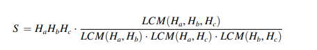

其中 LCM 表示的是最小公倍数函数。小蓝想要使得三枚宝石组合后的精美程度 S 尽可能的高，请你帮他找出精美程度最高的方案。如果存在多个方案 S 值相同，优先选择按照 H 值升序排列后字典序最小的方案。

#### 输入格式

第一行包含一个整数 N 表示宝石个数。第二行包含 N 个整数表示 N 个宝石的 “闪亮度”。

#### 输出格式

输出一行包含三个整数表示满足条件的三枚宝石的 “闪亮度”。

#### 样例输入

```
5

1 2 3 4 9
```

#### 提示

【评测用例规模与约定】

对于 30% 的评测用例：3 ≤ N ≤ 100，1 ≤ H<sub>i</sub> ≤ 1000。

对于 60% 的评测用例：3 ≤ N ≤ 2000。

对于 100% 的评测用例：3 ≤ N ≤ 10<sup>5</sup>，1 ≤ H<sup>i</sup> ≤ 10<sup>5</sup>。

---

### 3212 · 数字接龙

> 题号 3212 ｜ 难度 困难 ｜ 时间 1s ｜ 内存 256MB
> 通过率 12.85% ｜ 题面原文 https://www.dotcpp.com/oj/problem3212.html
> 考过的语言/组别：C++ 大学B组

#### 题目描述

小蓝最近迷上了一款名为《数字接龙》的迷宫游戏，游戏在一个大小为N × N 的格子棋盘上展开，其中每一个格子处都有着一个 0 . . . K − 1 之间的整数。游戏规则如下：

1. 从左上角 (0, 0) 处出发，目标是到达右下角 (N − 1, N − 1) 处的格子，每一步可以选择沿着水平/垂直/对角线方向移动到下一个格子。

2. 对于路径经过的棋盘格子，按照经过的格子顺序，上面的数字组成的序列要满足：0, 1, 2, . . . , K − 1, 0, 1, 2, . . . , K − 1, 0, 1, 2 . . . 。

3. 途中需要对棋盘上的每个格子恰好都经过一次（仅一次）。

4. 路径中不可以出现交叉的线路。例如之前有从 (0, 0) 移动到 (1, 1)，那么再从 (1, 0) 移动到 (0, 1) 线路就会交叉。

为了方便表示，我们对可以行进的所有八个方向进行了数字编号，如下图2 所示；因此行进路径可以用一个包含 0 . . . 7 之间的数字字符串表示，如下图 1是一个迷宫示例，它所对应的答案就是：41255214。

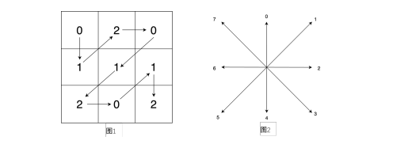

现在请你帮小蓝规划出一条行进路径并将其输出。如果有多条路径，输出字典序最小的那一个；如果不存在任何一条路径，则输出 −1。

#### 输入格式

第一行包含两个整数 N、K。接下来输入 N 行，每行 N 个整数表示棋盘格子上的数字。

#### 输出格式

输出一行表示答案。如果存在答案输出路径，否则输出 −1。

#### 样例输入

```
3 3

0 2 0

1 1 1

2 0 2
```

#### 提示

【样例说明】行进路径如图 1 所示。

【评测用例规模与约定】对于 80% 的评测用例：1 ≤ N ≤ 5。对于 100% 的评测用例：1 ≤ N ≤ 10，1 ≤ K ≤ 10。

---

### 3213 · 爬山

> 题号 3213 ｜ 难度 困难 ｜ 时间 1s ｜ 内存 256MB
> 通过率 1.89% ｜ 题面原文 https://www.dotcpp.com/oj/problem3213.html
> 考过的语言/组别：C++ 大学B组

#### 题目描述

小明这天在参加公司团建，团建项目是爬山。在 x 轴上从左到右一共有 n座山，第 i 座山的高度为 hi。他们需要从左到右依次爬过所有的山，需要花费的体力值为 S = Σ<sup>n</sup><sub>i=1</sub>hi。

然而小明偷偷学了魔法，可以降低一些山的高度。他掌握两种魔法，第一种魔法可以将高度为 H 的山的高度变为 ⌊√H⌋，可以使用 P 次；第二种魔法可以将高度为 H 的山的高度变为 ⌊H/2⌋，可以使用 Q 次。并且对于每座山可以按任意顺序多次释放这两种魔法。

小明想合理规划在哪些山使用魔法，使得爬山花费的体力值最少。请问最优情况下需要花费的体力值是多少？

#### 输入格式

输入共两行。

第一行为三个整数 n，P，Q。

第二行为 n 个整数 h<sub>1</sub>，h<sub>2</sub>，. . . ，h<sub>n</sub>。

#### 输出格式

输出共一行，一个整数代表答案。

#### 样例输入

```
4 1 1

4 5 6 49
```

#### 提示

【样例说明】将第四座山变为 ⌊√49⌋ = 7，然后再将第四座山变为 ⌊<sup>7</sup>/<sub>2</sub>⌋ = 3。体力值为 4 + 5 + 6 + 3 = 18。

【评测用例规模与约定】

对于 20% 的评测用例，保证 n ≤ 8，P = 0。

对于 100% 的评测用例，保证 n ≤ 100000，0 ≤ P ≤ n，0 ≤ Q ≤ n，0 ≤ h<sub>i</sub> ≤ 100000。

---

### 3214 · 拔河

> 题号 3214 ｜ 难度 困难 ｜ 时间 1s ｜ 内存 256MB
> 通过率 14.76% ｜ 题面原文 https://www.dotcpp.com/oj/problem3214.html
> 考过的语言/组别：C++ 大学B组

#### 题目描述

小明是学校里的一名老师，他带的班级共有 n 名同学，第 i 名同学力量值为 ai。在闲暇之余，小明决定在班级里组织一场拔河比赛。

为了保证比赛的双方实力尽可能相近，需要在这 n 名同学中挑选出两个队伍，队伍内的同学编号连续:{a<sub>l1</sub>, a<sub>l1+1</sub>, ..., a<sub>r1−1</sub>, a<sub>r1</sub>} 和 {a<sub>l2</sub>, a<sub>l2+1</sub>, ..., a<sub>r2−1</sub>, a<sub>r2</sub>}，其中 l<sub>1</sub> ≤ r<sub>1</sub> < l<sub>2</sub> ≤ r<sub>2</sub>。

两个队伍的人数不必相同，但是需要让队伍内的同学们的力量值之和尽可能相近。请计算出力量值之和差距最小的挑选队伍的方式。

#### 输入格式

输入共两行。

第一行为一个正整数 n。

第二行为 n 个正整数 a<sub>i</sub>。

#### 输出格式

输出共一行，一个非负整数，表示两个队伍力量值之和的最小差距。

#### 样例输入

```
5

10 9 8 12 14
```

#### 提示

【样例说明】

其中一种最优选择方式：队伍 1：{a<sub>1</sub>, a<sub>2</sub>, a<sub>3</sub>}，队伍 2：{a<sub>4</sub>, a<sub>5</sub>}，力量值和分别为 10 + 9 + 8 = 27，12 + 14 = 26，差距为 |27 − 26| = 1。

【评测用例规模与约定】

对于 20% 的评测用例，保证 n ≤ 50。

对于 100% 的评测用例，保证 n ≤ 10<sup>3</sup>，ai ≤ 10<sup>9</sup>。

---

### 3215 · 训练士兵

> 题号 3215 ｜ 难度 困难 ｜ 时间 1s ｜ 内存 256MB
> 通过率 15.72% ｜ 题面原文 https://www.dotcpp.com/oj/problem3215.html
> 考过的语言/组别：C++ 大学A组

#### 题目描述

在蓝桥王国中，有 n 名士兵，这些士兵需要接受一系列特殊的训练，以提升他们的战斗技能。对于第 i 名士兵来说，进行一次训练所需的成本为 pi 枚金币，而要想成为顶尖战士，他至少需要进行 ci 次训练。

为了确保训练的高效性，王国推出了一种组团训练的方案。该方案包含每位士兵所需的一次训练，且总共只需支付 S 枚金币（组团训练方案可以多次购买，即士兵可以进行多次组团训练）。

作为训练指挥官，请你计算出最少需要花费多少金币，才能使得所有的士兵都成为顶尖战士？

#### 输入格式

输入的第一行包含两个整数 n 和 S ，用一个空格分隔，表示士兵的数量和进行一次组团训练所需的金币数。接下来的 n 行，每行包含两个整数 pi 和 ci ，用一个空格分隔，表示第 i 名士兵进行一次训练的金币成本和要成为顶尖战士所需的训练次数。

#### 输出格式

输出一行包含一个整数，表示使所有士兵成为顶尖战士所需的最少金币数。

#### 样例输入

```
3 6

5 2

2 4

3 2
```

#### 提示

【样例说明】

花费金币最少的训练方式为：进行 2 次组团训练，花费 2 × 6 = 12 枚金币，此时士兵 1, 3 已成为顶尖战士；再花费 4 枚金币，让士兵 2 进行两次训练，成为顶尖战士。总花费为 12 + 4 = 16。

【评测用例规模与约定】

对于 40% 的评测用例，1 ≤ n ≤ 10<sup>3</sup>，1 ≤ p<sub>i</sub>, c<sub>i</sub> ≤ 105，1 ≤ S ≤ 10<sup>7</sup>。

对于所有评测用例，1 ≤ n ≤ 10<sup>5</sup>，1 ≤ p<sub>i</sub>, c<sub>i</sub> ≤ 106，1 ≤ S ≤ 1010。

---

### 3216 · 团建

> 题号 3216 ｜ 难度 困难 ｜ 时间 1s ｜ 内存 256MB
> 通过率 9.40% ｜ 题面原文 https://www.dotcpp.com/oj/problem3216.html
> 考过的语言/组别：C++ 大学A组

#### 题目描述

小蓝正在和朋友们团建，有一个游戏项目需要两人合作，两个人分别拿到一棵大小为 n 和 m 的树，树上的每个结点上有一个正整数权值。

两个人需要从各自树的根结点 1 出发走向某个叶结点，从根到这个叶结点的路径上经过的所有结点上的权值构成了一个正整数序列，两人的序列的最长公共前缀即为他们的得分。给出两棵树，请计算两个人最多的得分是多少。

#### 输入格式

输入的第一行包含两个正整数 n, m ，用一个空格分隔。

第二行包含 n 个正整数 c1, c2, · · · , cn ，相邻整数之间使用一个空格分隔，其中 ci 表示第一棵树结点 i 上的权值。

第三行包含 m 个正整数 d1, d2, · · · , dm ，相邻整数之间使用一个空格分隔，其中 di 表示第二棵树结点 i 上的权值。接下来 n − 1 行，每行包含两个正整数 ui, vi 表示第一棵树中包含一条 ui 和vi 之间的边。

接下来 m − 1 行，每行包含两个正整数 pi, qi 表示第二棵树中包含一条 pi和 qi 之间的边。

#### 输出格式

输出一行包含一个整数表示答案。

#### 样例输入

```
2 2

10 20

10 30

1 2

2 1
```

#### 提示

【样例说明】两个序列可以为 [10, 20] , [10, 30] ，最大前缀为 1 ；

【样例输入】

5 4

10 20 30 40 50

10 40 20 30

1 2

1 3

2 4

3 5

1 2

1 3

3 4

【样例输出】

2

【样例说明】

两个序列可以为 [10, 20, 40] , [10, 20, 30] ，最大前缀为 2 。

【评测用例规模与约定】

对于 20% 的评测用例，1 ≤ n, m ≤ 500 ；对于所有评测用例，1 ≤ n, m ≤ 2 × 10<sup>5</sup>，1 ≤ ci, di ≤ 108 ，1 ≤ u<sub>i</sub>, v<sub>i</sub> ≤ n ，1 ≤ p<sub>i</sub>, q<sub>i</sub> ≤ m ，对于任意结点，其儿子结点的权重互不相同。

---

### 3217 · 成绩统计

> 题号 3217 ｜ 难度 中等 ｜ 时间 1s ｜ 内存 256MB
> 通过率 31.40% ｜ 题面原文 https://www.dotcpp.com/oj/problem3217.html
> 考过的语言/组别：C++ 大学A组

#### 题目描述

小蓝的班上有 n 个人，一次考试之后小蓝想统计同学们的成绩，第 i 名同学的成绩为 ai 。当小蓝统计完前 x 名同学的成绩后，他可以从 1 ∼ x 中选出任意 k 名同学的成绩，计算出这 k 个成绩的方差。小蓝至少要检查多少个人的成绩，才有可能选出 k 名同学，他们的方差小于一个给定的值 T ？

提示：k 个数 v1, v2, · · · , vk 的方差 σ2 定义为：σ2 =∑<sup>k</sup><sub>i=1</sub>(v<sub>i</sub>−v')/k ，其中 v' 表示v 的平均值，v' =∑<sup>k</sup><sub>i=1</sub> v<sub>i</sub>/k 。

#### 输入格式

输入的第一行包含三个正整数 n, k, T ，相邻整数之间使用一个空格分隔。

第二行包含 n 个正整数 a<sub>1</sub>, a<sub>2</sub>, · · · , a<sub>n </sub>，相邻整数之间使用一个空格分隔。

#### 输出格式

输出一行包含一个整数表示答案。如果不能满足条件，输出 −1 。

#### 样例输入

```
5 3 1

3 2 5 2 3
```

#### 提示

【样例说明】

检查完前三名同学的成绩后，只能选出 3, 2, 5 ，方差为 1.56 ；检查完前四名同学的成绩后，可以选出 3, 2, 2 ，方差为 0.33 < 1 ，所以答案为 4 。

【评测用例规模与约定】

对于 10% 的评测用例，保证 1 ≤ n, k ≤ 10<sup>2</sup>；

对于 30% 的评测用例，保证 1 ≤ n, k ≤ 10<sup>3</sup> ；

对于所有评测用例，保证 1 ≤ n, k ≤ 10<sup>5</sup> ，1 ≤ T ≤ 2<sup>31 − 1</sup> ，1 ≤ a<sub>i</sub> ≤ n 。

---

### 3218 · 零食采购

> 题号 3218 ｜ 难度 困难 ｜ 时间 1s ｜ 内存 256MB
> 通过率 17.41% ｜ 题面原文 https://www.dotcpp.com/oj/problem3218.html
> 考过的语言/组别：C++ 大学A组

#### 题目描述

小蓝准备去星际旅行，出发前想在本星系采购一些零食，星系内有 n 颗星球，由 n − 1 条航路连接为连通图，第 i 颗星球卖第 ci 种零食特产。小蓝想出了 q 个采购方案，第 i 个方案的起点为星球 si ，终点为星球 ti ，对于每种采购方案，小蓝将从起点走最短的航路到终点，并且可以购买所有经过的星球上的零食（包括起点终点），请计算每种采购方案最多能买多少种不同的零食。

#### 输入格式

输入的第一行包含两个正整数 n, q ，用一个空格分隔。

第二行包含 n 个整数 c1, c2, · · · , cn ，相邻整数之间使用一个空格分隔。

接下来 n − 1 行，第 i 行包含两个整数 ui, vi ，用一个空格分隔，表示一条航路将星球 ui 与 vi 相连。接下来 q 行，第 i 行包含两个整数 si, ti ，用一个空格分隔，表示一个采购方案。

#### 输出格式

输出 q 行，每行包含一个整数，依次表示每个采购方案的答案。

#### 样例输入

```
4 2

1 2 3 1

1 2

1 3

2 4

4 3

1 4
```

#### 提示

【样例说明】

第一个方案路线为 {4, 2, 1, 3} ，可以买到第 1, 2, 3 种零食；第二个方案路线为 {1, 2, 4} ，可以买到第 1, 2 种零食。

【评测用例规模与约定】

对于 20% 的评测用例，1 ≤ n, q ≤ 5000 ；对于所有评测用例，1 ≤ n, q ≤ 10<sup>5</sup>，1 ≤ c<sub>i</sub> ≤ 20，1 ≤ u<sub>i</sub>, v<sub>i</sub> ≤ n，1 ≤ s<sub>i</sub>, t<sub>i</sub> ≤ n。

---

### 3219 · 封印宝石

> 题号 3219 ｜ 难度 困难 ｜ 时间 1s ｜ 内存 128MB
> 通过率 2.96% ｜ 题面原文 https://www.dotcpp.com/oj/problem3219.html
> 考过的语言/组别：C++ 大学A组

#### 题目描述

在一次探险中，勇者小蓝发现了 n 颗闪烁着奇异光芒的宝石，每颗宝石都蕴含着魔法能量，分别记作 a1, a2, . . . , an。小蓝计划用 n 个特制的魔法盒子来封印这些宝石，防止其魔法能量被滥用。

封印宝石会消耗小蓝的体力，具体地，将第 i 颗宝石放入第 j 个盒子会消耗小蓝 i − j 点体力（注：需满足 j ≤ i 才能将第 i 颗宝石放入第 j 个盒子进行有效的封印）。小蓝也可以选择将魔法盒留空，以保存体力供后续使用。

此外，为了避免魔力相冲，每个盒子最多存放一颗宝石（每个宝石也只能放进一个盒子），且任意两个相邻盒子不能存放魔力值相同的宝石，相邻的盒子允许同时为空。小蓝初始的体力值为 k。在不超出体力限制的条件下，小蓝希望找出一种宝石的放置方法，使得宝石的魔力值在这 n 个盒子中的排列顺序具有最大的字典序（注：未放置宝石的盒子在此序列中记为 −1）。

作为勇者小蓝的追随者，请你帮他找出这一放置宝石的方法。

字典序的解释： 在本题中，字典序的大小是按照宝石的魔力值进行比较的。对于两个长度同为 L 的魔力值序列 a 和 b，如果存在一个位置 i，使得a<sub>j </sub>= b<sub>j</sub> 对所有 1 ≤ j < i 成立，但是 a<sub>i</sub> < b<sub>i</sub>，则序列 a 在字典序上小于序列 b。反之，如果 a<sub>i </sub>> b<sub>i</sub>，则序列 a 在字典序上大于序列 b。如果不存在这样的 i，则序列 a 和序列 b 的字典序相等。

#### 输入格式

输入的第一行包含两个整数 n 和 k ，用一个空格分隔，分别表示宝石的数量和小蓝的初始体力值。

第二行包含 n 个整数 a1, a2, · · · , an ，相邻整数之间使用一个空格分隔，分别表示每颗宝石的魔法能量值。

#### 输出格式

输出一行包含 n 个整数，相邻整数之间使用一个空格分隔，表示每个魔法盒中宝石的魔法能量值。如果某个魔法盒为空，则对应位置输出 −1 。

#### 样例输入

```
3 3

1 3 2
```

#### 提示

【样例说明】

在开始放置宝石之前，体力为 3，宝石在盒子中的排列为 [−1, −1, −1]。1. 将第 2 个宝石放进第 1 个盒子，得到 [3, −1, −1]，体力剩余 2。2. 将第 3 个宝石放进第 2 个盒子，得到 [3, 2, −1]，体力剩余 1。最后宝石在盒子中的排列为 [3, 2, −1]。显然，没有比这更优的放置方法。

【评测用例规模与约定】

对于 20% 的评测用例，1 ≤ n ≤ 5 × 10<sup>3</sup> ，0 ≤ k ≤ 3 × 10<sup>6</sup> ，1 ≤ a<sub>i</sub> ≤ 10<sup>5</sup>。对于所有评测用例，1 ≤ n ≤ 10<sup>5</sup> ，0 ≤ k ≤ 10<sup>9</sup> ，1 ≤ a<sub>i</sub> ≤ 10<sup>9</sup>。

---

### 3220 · 因数计数

> 题号 3220 ｜ 难度 困难 ｜ 时间 1s ｜ 内存 256MB
> 通过率 11.59% ｜ 题面原文 https://www.dotcpp.com/oj/problem3220.html
> 考过的语言/组别：C++ 大学A组

#### 题目描述

小蓝随手写出了含有 n 个正整数的数组 {a1, a2, · · · , an} ，他发现可以轻松地算出有多少个有序二元组 (i, j) 满足 a<sub>j</sub> 是 a<sub>i</sub> 的一个因数。因此他定义一个整数对 (x<sub>1</sub>, y<sub>1</sub>) 是一个整数对 (x<sub>2</sub>, y<sub>2</sub>) 的“因数”当且仅当 x<sub>1</sub> 和 y<sub>1 </sub>分别是 x<sub>2</sub> 和 y<sub>2</sub>的因数。他想知道有多少个有序四元组 (i, j, k, l) 满足 (a<sub>i</sub>, a<sub>j</sub>) 是 (a<sub>k</sub>, a<sub>l</sub>) 的因数，其中 i, j, k, l 互不相等。

#### 输入格式

输入的第一行包含一个正整数 n 。第二行包含 n 个正整数 a1, a2, · · · , an ，相邻整数之间使用一个空格分隔。

#### 输出格式

输出一行包含一个整数表示答案。

#### 样例输入

```
5

3 6 2 2 7
```

#### 提示

【样例说明】

四元组 (1, 4, 2, 3) ：(3, 2) 为 (6, 2) 的因子；四元组 (1, 3, 2, 4) ：(3, 2) 为 (6, 2)的因子；四元组 (4, 1, 3, 2) ：(2, 3) 为 (2, 6) 的因子；四元组 (3, 1, 4, 2) ：(2, 3) 为(2, 6) 的因子。

【评测用例规模与约定】

对于 20% 的评测用例，n ≤ 50 ；对于 40% 的评测用例，n ≤ 10<sup>4</sup>；对于所有评测用例，1 ≤ n ≤ 10<sup>5</sup> ，1 ≤ a<sub>i</sub> ≤ 10<sup>5</sup> 。

---

### 3221 · 数字诗意

> 题号 3221 ｜ 难度 困难 ｜ 时间 1s ｜ 内存 256MB
> 通过率 23.52% ｜ 题面原文 https://www.dotcpp.com/oj/problem3221.html
> 考过的语言/组别：Java 大学A组、Python 大学A组、Python 大学C组、C++ 大学C组、Java 大学C组

#### 题目描述

在诗人的眼中，数字是生活的韵律，也是诗意的表达。

小蓝，当代顶级诗人与数学家，被赋予了 “数学诗人” 的美誉。他擅长将冰冷的数字与抽象的诗意相融合，并用优雅的文字将数学之美展现于纸上。

某日，小蓝静坐书桌前，目光所及，展现着 n 个数字，它们依次为a<sub>1</sub>, a<sub>2</sub>, . . . , a<sub>n</sub>，熠熠生辉。小蓝悟到，如果一个数能够以若干个（至少两个）**连续的正整数**相加表示，那么它就蕴含诗意。例如，数字 6 就蕴含诗意，因为它可以表示为 1 + 2 + 3。而 8 则缺乏诗意，因为它无法用连续的正整数相加表示。

小蓝希望他面前的所有数字都蕴含诗意，为此，他决定从这 n 个数字中删除一部分。请问，小蓝需要删除多少个数字，才能使剩下的数字全部蕴含诗意？

#### 输入格式

输入的第一行包含一个整数 n，表示展示的数字个数。

第二行包含 n 个整数 a1, a2, . . . , an，相邻整数之间使用一个空格分隔，表示展示的数字。

#### 输出格式

输出一行包含一个整数，表示小蓝需要删除的数字个数，以使剩下的数字全部蕴含诗意。

#### 样例输入

```
3

3 6 8
```

#### 提示

【样例说明】

在样例中，数字 3 可以表示为 1 + 2，数字 6 可以表示为 1 + 2 + 3，数字 8无法表示为连续的正整数相加，因此，需要删除的数字个数为 1。

【评测用例规模与约定】

对于 30% 的评测用例，1 ≤ n ≤ 10<sup>3</sup>，1 ≤ a<sub>i</sub> ≤ 10<sup>3</sup>。对于所有评测用例，1 ≤ n ≤ 2 × 10<sup>5</sup>，1 ≤ a<sub>i</sub> ≤ 10<sup>16</sup>。

---

### 3222 · 回文数组

> 题号 3222 ｜ 难度 困难 ｜ 时间 1s ｜ 内存 256MB
> 通过率 23.26% ｜ 题面原文 https://www.dotcpp.com/oj/problem3222.html
> 考过的语言/组别：Java 大学A组、Python 大学A组、Python 大学C组

#### 题目描述

小蓝在无聊时随机生成了一个长度为 n 的整数数组，数组中的第 i 个数为ai，他觉得随机生成的数组不太美观，想把它变成回文数组，也是就对于任意i ∈ [1, n] 满足 a<sub>i</sub> = a<sub>n−i+1</sub> 。小蓝一次操作可以指定相邻的两个数，将它们一起加1 或减 1 ；也可以只指定一个数加 1 或减 1 ，请问他最少需要操作多少次能把这个数组变成回文数组？

#### 输入格式

输入的第一行包含一个正整数 n 。

第二行包含 n 个整数 a1, a2, · · · , an ，相邻整数之间使用一个空格分隔。

#### 输出格式

输出一行包含一个整数表示答案。

#### 样例输入

```
4

1 2 3 4
```

#### 提示

【样例说明】

第一次操作将 a<sub>1</sub>, a<sub>2</sub> 加 1 ，变为 2, 3, 3, 4 ；后面两次操作将 a<sub>1</sub> 加 1 ，变为 4, 3, 3, 4 。

【评测用例规模与约定】

对于 20% 的评测用例，1 ≤ n ≤ 10；对于所有评测用例，1 ≤ n ≤ 10<sup>5</sup> ，−10<sup>6</sup> ≤ a<sub>i</sub> ≤ 10<sup>6</sup> 。

---

### 3223 · 吊坠

> 题号 3223 ｜ 难度 困难 ｜ 时间 1s ｜ 内存 256MB
> 通过率 17.74% ｜ 题面原文 https://www.dotcpp.com/oj/problem3223.html
> 考过的语言/组别：Java 大学A组、Python 大学A组、C++ 大学C组、Java 大学C组

#### 题目描述

小蓝想制作一个吊坠，他手上有 n 个长度为 m 的首尾相连的环形字符串{s1, s2, · · · , sn} ，他想用 n − 1 条边将这 n 个字符串连接起来做成吊坠，要求所有的字符串连完后形成一个整体。连接两个字符串 s<sub>i</sub>, s<sub>j</sub> 的边的边权为这两个字符串的最长公共子串的长度（可以按环形旋转改变起始位置，但不能翻转），小蓝希望连完后的这 n − 1 条边的边权和最大，这样的吊坠他觉得最好看，请计算最大的边权和是多少。

#### 输入格式

输入的第一行包含两个正整数 n, m ，用一个空格分隔。

接下来 n 行，每行包含一个长度为 m 的字符串，分别表示 s1, s2, · · · , sn 。

#### 输出格式

输出一行包含一个整数表示答案。

#### 样例输入

```
4 4

aabb

abba

acca

abcd
```

#### 提示

【样例说明】

连接 < 1, 2 >, < 2, 3 >, < 2, 4 > ，边权和为 4 + 2 + 2 = 8

【评测用例规模与约定】

对于 20% 的评测用例，1 ≤ n, m ≤ 10 ；

对于所有评测用例，1 ≤ n ≤ 200 ，1 ≤ m ≤ 50 。所有字符串由小写英文字母组成。

---

### 3224 · 砍柴

> 题号 3224 ｜ 难度 困难 ｜ 时间 1s ｜ 内存 256MB
> 通过率 16.07% ｜ 题面原文 https://www.dotcpp.com/oj/problem3224.html
> 考过的语言/组别：Java 大学A组、Python 大学A组、Python 大学C组、Python 研究生组、Java 研究生组、C++ 研究生组

#### 题目描述

小蓝和小乔正在森林里砍柴，它们有 T 根长度分别为 n<sub>1</sub>, n<sub>2</sub>, · · · , n<sub>T</sub> 的木头。对于每个初始长度为 n 的木头，小蓝和小乔准备进行交替砍柴，小蓝先出手。每次砍柴时，若当前木头长度为 x ，需要砍下一截长度为 p 的木头，然后换另一个人继续砍，其中 2 ≤ p ≤ x 且 p 必须为质数。当轮到某一方时 x = 1 或x = 0 ，它就没法继续砍柴，它就输了。它们会使用最优策略进行砍柴。请对每根木头判断是小蓝赢还是小乔赢，如果小蓝赢请输出 1 （数字 1），如果小乔赢请输出 0 （数字 0）。

#### 输入格式

输入的第一行包含一个正整数 T，接下来 T 行，每行包含一个正整数，其中第 i 的整数为 ni 。

#### 输出格式

输出 T 行，每行包含一个整数，依次表示对于每一根木头的答案。

#### 样例输入

```
3

1

2

6
```

#### 提示

【样例说明】

对于 n1 = 1 ，由于当前长度 x = 1 ，小蓝直接输掉，小乔赢；

对于 n2 = 2 ，小蓝选择 p = 2 ，轮到小乔时当前长度 x = 2 − 2 = 0 ，小乔输掉，小蓝赢；

对于 n3 = 6 ，小蓝选择 p = 5 ，轮到小乔时 x = 6 − 5 = 1 ，小乔输掉，小蓝赢。

【评测用例规模与约定】

对于 20% 的评测用例，1 ≤ ni ≤ 10<sup>3</sup>；对于所有评测用例，1 ≤ n<sub>i</sub> ≤ 10<sup>5</sup> ，1 ≤ T ≤ 10<sup>4</sup>

---

### 3225 · 回文字符串

> 题号 3225 ｜ 难度 困难 ｜ 时间 1s ｜ 内存 256MB
> 通过率 11.19% ｜ 题面原文 https://www.dotcpp.com/oj/problem3225.html
> 考过的语言/组别：Java 大学A组、Python 大学C组、Java 研究生组、C++ 大学C组、Java 大学C组

#### 题目描述

小蓝最近迷上了回文字符串，他有一个只包含小写字母的字符串 S ，小蓝可以往字符串 S 的开头处加入任意数目个指定字符：l、q、b （ASCII 码分别为：108、113、98）。小蓝想要知道他是否能通过这种方式把字符串 S 转化为一个回文字符串。

#### 输入格式

输入的第一行包含一个整数 T，表示每次输入包含 T 组数据。接下来依次描述 T 组数据。每组数据一行包含一个字符串 S 。

#### 输出格式

输出 T 行，每行包含一个字符串，依次表示每组数据的答案。如果可以将S 转化为一个回文字符串输出 Yes，否则输出 No 。

#### 样例输入

```
3

gmgq

lqpdlbll

aaa
```

#### 提示

【样例说明】

对于 gmgqlq ，可以在前面加上 qlq => qlqgmgqlq 转化为一个回文字符串；

对于 pdlbll ，无法转化为一个回文字符串;

对于 aaa ，本身就是一个回文字符串。

【评测用例规模与约定】

对于 50% 的评测用例，1 ≤ |S | ≤ 1000 ，其中 |S | 表示字符串 S 的长度；对于所有评测用例，1 ≤ T ≤ 10 ，1 ≤∑|S | ≤ 10<sup>6</sup> 。

---

### 3226 · 智力测试

> 题号 3226 ｜ 难度 困难 ｜ 时间 1s ｜ 内存 256MB
> 通过率 0.98% ｜ 题面原文 https://www.dotcpp.com/oj/problem3226.html
> 考过的语言/组别：Java 大学A组、Python 大学A组、Python 研究生组、C++ 研究生组

#### 题目描述

小蓝考上了世界上最好的魔法师学校，然而入学第一件事就是智力测试，老师给出了一个 n × m 大小的棋盘，同时对每行每列设置了权重 {R<sub>1</sub>, R<sub>2</sub>, · · · , R<sub>n</sub>}和 {C<sub>1</sub>,C<sub>2</sub>, · · · ,C<sub>m</sub>} ，因此，对于第 r 行第 c 列的格子 (r, c) ，其权重为一个二元组 (Rr,Cc) 。

小蓝可以在格子之间进行移动，若某时刻小蓝在格子 (r, c) ，那么他可以一步走到任意的格子 (r′, c) 或 (r, c′) ，其中 r′, c′ 满足:

（1）R<sub>r′</sub> > R<sub>r</sub>,C<sub>c′</sub> > Cc ，

（2）@r′′.R<sub>r′</sub> > R<sub>r′′</sub> > R<sub>r</sub>; @c′′.C<sub>c′</sub> > C<sub>c′′</sub> > C<sub>r</sub> 。

之后，老师提出了 T 个问题，第 i 个问题为：假设小蓝从格子 (s<sup>i</sup><sub>r</sub>, s<sup>i</sup><sub>c</sub>) 出发，移动到格子 (t<sup>i</sup><sub>r</sub>, t<sup>i</sup><sub>c</sub>) 有多少种不同的走法，答案对 1000000007 取模。

#### 输入格式

输入的第一行包含三个正整数 n, m, T ，相邻整数之间使用一个空格分隔。

第二行包含 n 个正整数 R<sub>1</sub>, R<sub>2</sub>, · · · , R<sub>n</sub> ，相邻整数之间使用一个空格分隔。

第三行包含 m 个正整数 C<sub>1</sub>,C<sub>2</sub>, · · · ,C<sub>m</sub> ，相邻整数之间使用一个空格分隔。

接下来 T 行，第 i 行包含四个正整数 s<sup>i</sup><sub>r</sub>, s<sup>i</sup><sub>c</sub>, t<sup>i</sup><sub>r</sub>, t<sup>i</sup><sub>c </sub>，相邻整数之间使用一个空格分隔。

#### 输出格式

输出 T 行，每行包含一个整数，依次表示每个问题的答案。

#### 样例输入

```
4 4 2

4 2 3 1

2 1 2 1

4 4 1 1

2 2 2 4
```

#### 提示

【样例说明】

询问 1：

(4, 4) → (2, 4) → (3, 4) → (1, 4) → (1, 1);

(4, 4) → (2, 4) → (3, 4) → (3, 1) → (1, 1);

(4, 4) → (2, 4) → (2, 1) → (3, 1) → (1, 1);

(4, 4) → (4, 1) → (2, 1) → (3, 1) → (1, 1)。

询问 2：不存在方案可以从 (2, 2) 走到 (2, 4) 。

【评测用例规模与约定】

对于 20% 的评测用例，1 ≤ n, m, T ≤ 10<sup>3</sup> ；

对于所有评测用例，1 ≤ n, m, T ≤ 10<sup>5</sup> ，1 ≤ R<sub>i</sub>,C<sub>i</sub> ≤ 10<sup>8</sup> ，1 ≤ s<sup>i</sup><sub>r</sub>, t<sup>i</sup><sub>r</sub> ≤ n ，1 ≤ s<sup>i</sup><sub>c</sub>, t<sup>i</sup><sub>c</sub> ≤ m 。

---

### 3227 · 分布式队列

> 题号 3227 ｜ 难度 困难 ｜ 时间 1s ｜ 内存 256MB
> 通过率 23.89% ｜ 题面原文 https://www.dotcpp.com/oj/problem3227.html
> 考过的语言/组别：Java 大学B组

#### 题目描述

小蓝最近学习了一种神奇的队列：分布式队列。简单来说，分布式队列包含 N 个节点（编号为 0 至 N − 1，其中 0 号为主节点），其中只有一个主节点，其余为副节点。主/副节点中都各自维护着一个队列，当往分布式队列中添加元素时都是由主节点完成的（每次都会添加元素到队列尾部）；副节点只负责同步主节点中的队列。可以认为主/副节点中的队列是一个长度无限的一维数组，下标为 0, 1, 2, 3 . . . ，同时副节点中的元素的同步顺序和主节点中的元素添加顺序保持一致。

由于副本的同步速度各异，因此为了保障数据的一致性，元素添加到主节点后，需要同步到所有的副节点后，才具有可见性。

给出一个分布式队列的运行状态，所有的操作都按输入顺序执行。你需要回答在某个时刻，队列中有多少个元素具有可见性。

#### 输入格式

第一行包含一个整数 N，表示节点个数。接下来包含多行输入，每一行包含一个操作，操作类型共有以下三种：add、sync 和 query，各自的输入格式如下：

1. add element：表示这是一个添加操作，将元素 element 添加到队列中；

2. sync follower_id：表示这是一个同步操作，follower_id 号副节点会从主节点中同步下一个自己缺失的元素；

3. query：查询操作，询问当前分布式队列中有多少个元素具有可见性。

#### 输出格式

对于每一个 query 操作，输出一行，包含一个整数表示答案。

#### 样例输入

```
3

add 1

add 2

query

add 1

sync 1

sync 1

sync 2

query

sync 1

query

sync 2

sync 2

sync 1

query
```

#### 提示

【样例说明】

执行到第一个 query 时，队列内容如下:

0：[1,2]

1：[]

2：[]

两个副节点中都无元素，因此答案为 0。

执行到第二个 query 时，队列内容如下:

0：[1,2,1]

1：[1,2]

2：[1]

只有下标为 0 的元素被所有节点同步，因此答案为 1。执行到第三个 query 时，队列内容如下:0：[1,2,1]1：[1,2,1]2：[1]

只有下标为 0 的元素被所有节点同步，因此答案为 1。执行到第四个 query 时，队列内容如下:0：[1,2,1]1：[1,2,1]2：[1,2,1]

三个元素都被所有节点同步，因此答案为 3。

【评测用例规模与约定】

对于 30% 的评测用例：1 ≤ 输入的操作数 ≤ 100。

对于 100% 的评测用例：1 ≤ 输入的操作数 ≤ 2000，1 ≤ N ≤ 10，1 ≤f ollower_id < N，0 ≤ element ≤ 10<sup>5</sup>。

---

### 3228 · 食堂

> 题号 3228 ｜ 难度 困难 ｜ 时间 1s ｜ 内存 256MB
> 通过率 0.05% ｜ 题面原文 https://www.dotcpp.com/oj/problem3228.html
> 考过的语言/组别：Java 大学B组

#### 题目描述

S 学校里一共有 a2 个两人寝、a3 个三人寝，a4 个四人寝，而食堂里有 b4个四人桌和 b6 个六人桌。学校想要安排学生们在食堂用餐，并且满足每个寝室里的同学都在同一桌就坐，请问这个食堂最多同时满足多少同学用餐？

#### 输入格式

采用多组数据输入。

输入共 q + 1 行。

第一行为一个正整数 q 表示数据组数。

后面 q 行，每行五个非负整数 a<sub>2</sub>，a<sub>3</sub>，a<sub>4</sub>，b<sub>4</sub>，b<sub>6</sub> 表示一组数据。

#### 输出格式

输出共 q 行，每行一个整数表示对应输入数据的答案。

#### 样例输入

```
2

3 0 1 0 1

0 2 2 1 1
```

#### 提示

【样例说明】

对于第一组数据，只有一个六人桌，因此最多安排三个两人寝的同学就餐，答案为 (2 + 2 + 2) = 6。

对于第二组数据，用一个六人桌安排两个三人寝的同学，用一个四人桌安排一个四人寝的同学，答案为 (3 + 3) + (4) = 10。

【评测用例规模与约定】

对于 20% 的评测用例，保证 a<sub>2</sub> + a<sub>3</sub> + a<sub>4</sub> ≤ 8。对于 100% 的评测用例，保证 q ≤ 100，b<sub>4</sub> + b<sub>6</sub> ≤ a<sub>2</sub> + a<sub>3</sub> + a<sub>4</sub> ≤ 100。

---

### 3229 · 最优分组

> 题号 3229 ｜ 难度 困难 ｜ 时间 1s ｜ 内存 256MB
> 通过率 21.91% ｜ 题面原文 https://www.dotcpp.com/oj/problem3229.html
> 考过的语言/组别：Java 大学B组

#### 题目描述

小蓝开了一家宠物店，最近有一种 X 病毒在动物之间进行传染，小蓝为了以防万一打算购买测试剂对自己的宠物进行病毒感染测试。为了减少使用的测试剂数目，小蓝想到了一个好方法：将 N 个宠物平均分为若干组，使得每组恰好有 K 只宠物，这样对同一组的宠物进行采样并混合后用一个试剂进行检测，如果测试结果为阴性则说明组内宠物都未感染 X 病毒；如果是阳性的话则需要对组内所有 K 只宠物单独检测，需要再消耗 K 支测试剂（当 K = 1 时，就没必要再次进行单独检测了，因为组内只有一只宠物，一次检测便能确认答案）。

现在我们已知小蓝的宠物被感染的概率为 p，请问 K 应该取值为多少才能使得期望的测试剂的消耗数目最少？如果有多个答案输出最小的 K。

#### 输入格式

第一行，一个整数 N。

第二行，一个浮点数 p。

#### 输出格式

输出一行，一个整数 K 表示答案。

#### 样例输入

```
1000

0.05
```

#### 提示

【评测用例规模与约定】

对于 30% 的评测用例：1 ≤ N ≤ 10。

对于 60% 的评测用例：1 ≤ N ≤ 1000。

对于 100% 的评测用例：1 ≤ N ≤ 10<sup>6</sup>，0 ≤ p ≤ 1。

---

### 3230 · 星际旅行

> 题号 3230 ｜ 难度 困难 ｜ 时间 1s ｜ 内存 256MB
> 通过率 12.42% ｜ 题面原文 https://www.dotcpp.com/oj/problem3230.html
> 考过的语言/组别：Java 大学B组

#### 题目描述

小明国庆节准备去某星系进行星际旅行，这个星系里一共有 n 个星球，其中布置了 m 道双向传送门，第 i 道传送门可以连接 ai，bi 两颗星球（ai , bi 且任意两颗星球之间最多只有一个传送门）。

他看中了一款 “旅游盲盒”，一共有 Q 个盲盒，第 i 个盲盒里的旅行方案规定了旅行的起始星球 xi 和最多可以使用传送门的次数 yi。只要从起始星球出发，使用传送门不超过规定次数能到达的所有星球都可以去旅行。

小明关心在每个方案中有多少个星球可以旅行到。小明只能在这些盲盒里随机选一个购买，他想知道**能旅行到的不同星球的数量**的期望是多少。

#### 输入格式

输入共 m + Q + 1 行。

第一行为三个正整数 n，m，Q。

后面 m 行，每行两个正整数 a<sub>i</sub>，b<sub>i</sub>。

后面 Q 行，每行两个整数 x<sub>i</sub>，y<sub>i</sub>。

#### 输出格式

输出共一行，一个浮点数（四舍五入保留两位小数）。

#### 样例输入

```
3 2 3

1 2

2 3

2 1

2 0

1 1
```

#### 提示

【样例说明】

第一个盲盒可以旅行到 1, 2, 3。

第二个盲盒可以旅行到 2。

第三个盲盒可以旅行到 1, 2。

所以期望是 (3 + 1 + 2)/3 = 2.00。

【评测用例规模与约定】

对于 20% 的评测用例，保证 n ≤ 300。

对于 100% 的评测用例，保证 n ≤ 1000，m ≤ min{n(n−1)/2, 5n}，Q ≤ 50000，0 ≤ y<sub>i</sub> ≤ n。

---

### 3231 · LITS 游戏

> 题号 3231 ｜ 难度 困难 ｜ 时间 1s ｜ 内存 256MB
> 通过率 1.80% ｜ 题面原文 https://www.dotcpp.com/oj/problem3231.html
> 考过的语言/组别：Java 大学B组

#### 题目描述

俄罗斯方块是一款风靡全球的游戏，在游戏中有多种方格图案，我们只关注这四个经典的方块图案：LITS，如下图所示：


LITS 这四种方块都是由四个相同大小的小方块组成的。

现在给出一副大小为 N × N 的格子图，每个格子上都有一个数字 0/1，如果格子处的数字为 1 说明这个格子上有一个小方块，数字为 0 则没有。你需要判断从这个格子图上是否可以找出 LITS 四个方块图案（每个方块图案之间都是独立的，不存在不同的图案公用同一个小方块的情况）。其中LITS 方块的形状旋转任意个 90 度都是合法的，但不允许翻转。

#### 输入格式

第一行一个整数 T，表示有 T 组数据。

每组数据的第一行包含一个整数 N，表示格子图大小。

接下来输入 N 行，每行 N 个值为 0/1 的整数，表示格子布局。

#### 输出格式

对于每组数据，输出一行包含一个字符串。如果此组数据满足题意则输出“Yes”，否则输出 “No”。

#### 样例输入

```
2

5

1 1 1 1 1

1 0 1 1 0

1 0 0 0 1

1 0 1 0 1

1 1 1 1 1

5

1 0 0 1 1

1 1 1 1 1

1 1 1 1 0

1 1 1 0 1

0 1 1 1 1
```

#### 提示

【样例说明】

对于样例中的第二个格子图，一种 LITS 的摆放方案如下：

1 0 0 1 1

L S T T T

L S S T 0

L L S 0 1

0 I I I I

【评测用例规模与约定】

对于 30% 的评测用例：1 ≤ N ≤ 5。

对于 60% 的评测用例：1 ≤ N ≤ 10。

对于 100% 的评测用例：1 ≤ T ≤ 10，1 ≤ N ≤ 50。

---

### 3232 · 拼十字

> 题号 3232 ｜ 难度 困难 ｜ 时间 1s ｜ 内存 256MB
> 通过率 12.18% ｜ 题面原文 https://www.dotcpp.com/oj/problem3232.html
> 考过的语言/组别：Java 大学B组

#### 题目描述

在 LQ 国神秘的古老森林，有一座被称为 “拼十字” 的神秘遗迹。据传，“拼十字” 是由古代文明建造的，它是一个巨大的石头结构，由两个巨大的矩形交叉叠放在一起，形成了一个庄严而神秘的十字形状。这个遗迹被认为是连接人类和神灵之间的通道，拥有神秘的力量和能量。

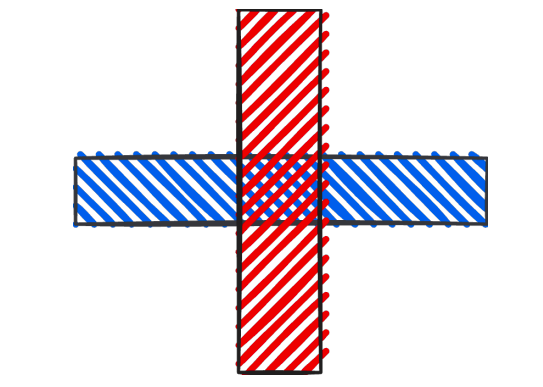

现在给出 N 个矩形，其中第 i 个矩形的长度和宽度分别问 li，wi，并且矩形颜色 ci 为红 (0)/黄 (1)/蓝 (2) 中的一种。现在小蓝想知道在这 N 个矩形中有多少对矩形可以 “拼十字”？

两个矩形可以“拼十字”的充要条件是：

1. 两个矩形的颜色不同；

2. 矩形 1 的长度严格大于矩形 2 的长度并且矩形 1 的宽度严格小于矩形 2的宽度。

注意，矩形长度和宽度属性是固定的，是不可以通过旋转矩形而发生转变的。

#### 输入格式

第一行一个整数 N，表示有 N 个矩形。接下来 N 行，每行输入三个整数 l、w、c 表示一个矩形的长、宽和颜色。

#### 输出格式

输出一个整数表示答案。由于答案可能会很大，所以你需要将答案对109 + 7 取模之后输出。

#### 样例输入

```
5

1 10 0

6 6 0

8 6 1

6 10 0

1 2 1
```

#### 提示

【样例说明】

第 3 个矩形可以和第 1 个矩形拼十字，第 3 个矩形也可以和第 4 个矩形拼十字。所以一共有两对矩形可以拼十字，答案为 2。

【评测用例规模与约定】对于 30% 的评测用例：1 ≤ N ≤ 5000。对于 100% 的评测用例：1 ≤ N ≤ 10<sup>5</sup>，1 ≤ l,w ≤ 10<sup>5</sup>，0 ≤ c ≤ 2。

---

### 3233 · 最大异或结点

> 题号 3233 ｜ 难度 困难 ｜ 时间 1s ｜ 内存 256MB
> 通过率 9.60% ｜ 题面原文 https://www.dotcpp.com/oj/problem3233.html
> 考过的语言/组别：Python 大学A组、Python 研究生组、Java 研究生组、C++ 研究生组

#### 题目描述

小蓝有一棵树，树中包含 N 个结点，编号为 0, 1, 2, · · · , N − 1 ，其中每个结点上都有一个整数 Xi 。他可以从树中任意选择两个不直接相连的结点 a 、b并获得分数 Xa ⊕ Xb ，其中 ⊕ 表示按位异或操作。

请问小蓝可以获得的最大分数是多少？

#### 输入格式

输入的第一行包含一个整数 N ，表示有 N 个结点。

第二行包含 N 个整数 X1, X2, · · · , XN ，相邻整数之间使用一个空格分隔。

第三行包含 N 个整数 F1, F2, · · · , FN ，相邻整数之间使用一个空格分隔，其中第 i 个整数表示 i 的父结点编号，Fi = −1 表示结点 i 没有父结点。

#### 输出格式

输出一行包含一个整数表示答案。

#### 样例输入

```
5

1 0 5 3 4

-1 0 1 0 1
```

#### 提示

【样例说明】

选择编号为 3 和 4 的结点，x3 = 3 ，x4 = 4 ，他们的值异或后的结果为3 ⊕ 4 = 7 。

【评测用例规模与约定】

对于 50% 的评测用例，1 ≤ N ≤ 1000 ；

对于所有评测用例，1 ≤ N ≤ 10<sup>5</sup>, 0 ≤ X<sub>i</sub> ≤ 2<sup>31</sup> − 1 ，−1 ≤ F<sub>i</sub> ≤ N ，Fi , 0 。

---

### 3234 · 连连看

> 题号 3234 ｜ 难度 困难 ｜ 时间 1s ｜ 内存 256MB
> 通过率 16.57% ｜ 题面原文 https://www.dotcpp.com/oj/problem3234.html
> 考过的语言/组别：Python 大学B组

#### 题目描述

小蓝正在和朋友们玩一种新的连连看游戏。在一个 n × m 的矩形网格中，每个格子中都有一个整数，第 i 行第 j 列上的整数为 Ai, j 。玩家需要在这个网格中寻找一对格子 (a, b) − (c, d) 使得这两个格子中的整数 Aa,b 和 Ac,d 相等，且它们的位置满足 |a − c| = |b − d| > 0 。请问在这个 n × m 的矩形网格中有多少对这样的格子满足条件。

#### 输入格式

输入的第一行包含两个正整数 n, m ，用一个空格分隔。

接下来 n 行，第 i 行包含 m 个正整数 A<sub>i,1</sub>, A<sub>i,2</sub>, · · · , A<sub>i,m</sub> ，相邻整数之间使用一个空格分隔。

#### 输出格式

输出一行包含一个整数表示答案。

#### 样例输入

```
3 2

1 2

2 3

3 2
```

#### 提示

【样例说明】

一共有以下 6 对格子：(1, 2) − (2, 1) ，(2, 2) − (3, 1) ，(2, 1) − (3, 2) ，(2, 1) −(1, 2) ，(3, 1) − (2, 2) ，(3, 2) − (2, 1) 。

【评测用例规模与约定】

对于 20% 的评测用例，1 ≤ n, m ≤ 50 ；对于所有评测用例，1 ≤ n, m ≤ 1000 ，1 ≤ A<sub>i, j </sub>≤ 1000 。

---

### 3235 · 神奇闹钟

> 题号 3235 ｜ 难度 简单 ｜ 时间 1s ｜ 内存 256MB
> 通过率 45.68% ｜ 题面原文 https://www.dotcpp.com/oj/problem3235.html
> 考过的语言/组别：Python 大学B组

#### 题目描述

小蓝发现了一个神奇的闹钟，从纪元时间（1970 年 1 月 1 日 00:00:00 ）开始，每经过 x 分钟，这个闹钟便会触发一次闹铃（纪元时间也会响铃）。这引起了小蓝的兴趣，他想要好好研究下这个闹钟。

对于给出的任意一个格式为 yyyy-MM-dd HH:mm:ss 的时间，小蓝想要知道在这个时间点之前（包含这个时间点）的最近的一次闹铃时间是哪个时间？

注意，你不必考虑时区问题。

#### 输入格式

输入的第一行包含一个整数 T，表示每次输入包含 T 组数据。

接下来依次描述 T 组数据。

每组数据一行，包含一个时间（格式为 yyyy-MM-dd HH:mm:ss ）和一个整数 x ，其中 x 表示闹铃时间间隔（单位为分钟）。

#### 输出格式

输出 T 行，每行包含一个时间（格式为 yyyy-MM-dd HH:mm:ss ），依次表示每组数据的答案。

#### 样例输入

```
2

2016-09-07 18:24:33 10

2037-01-05 01:40:43 30
```

#### 提示

【评测用例规模与约定】

对于所有评测用例，1 ≤ T ≤ 10，1 ≤ x ≤ 1000，保证所有的时间格式都是合法的。

---

### 3236 · 蓝桥村的真相

> 题号 3236 ｜ 难度 困难 ｜ 时间 1s ｜ 内存 256MB
> 通过率 17.17% ｜ 题面原文 https://www.dotcpp.com/oj/problem3236.html
> 考过的语言/组别：Python 大学B组

#### 题目描述

在风景如画的蓝桥村，n 名村民围坐在一张古老的圆桌旁，参与一场思想的较量。这些村民，每一位都有着鲜明的身份：要么是誉满乡野的诚实者，要么是无可救药的说谎者。当会议的钟声敲响，一场关于真理与谬误的辩论随之展开。每位村民轮流发言，编号为 i 的村民提出了这样的断言：坐在他之后的两位村民——也就是编号 i + 1 和 i + 2（注意，编号是环形的，所以如果 i 是最后一个，则 i + 1 是第一个，以此类推）之中，一个说的是真话，而另一个说的是假话。在所有摇曳不定的陈述中，有多少真言隐藏在谎言的面纱之后？

请你探索每一种可能的真假排列组合，并计算在所有可能的真假组合中，说谎者的总数。

#### 输入格式

输入的第一行包含一个整数 T，表示每次输入包含 T 组数据。

接下来依次描述 T 组数据。

每个数据一行包含一个整数 n，表示村落的人数。

#### 输出格式

输出 T 行，每行包含一个整数，依次表示每组数据的答案。

#### 样例输入

```
2

3

3
```

#### 提示

【样例说明】

在样例中，可能的组合有「假，假，假」「真，真，假」「真，假，真」「假，真，真」，说谎者的总数为 3 + 1 + 1 + 1 = 6。

【评测用例规模与约定】

对于 10% 的评测用例，T = 1，3 ≤ n ≤ 10。

对于 40% 的评测用例，1 ≤ T ≤ 10<sup>2</sup>，3 ≤ n ≤ 3 × 10<sup>3</sup>。

对于所有评测用例，1 ≤ T ≤ 10<sup>5</sup>，3 ≤ n ≤ 10<sup>18</sup>。

---

### 3237 · 魔法巡游

> 题号 3237 ｜ 难度 困难 ｜ 时间 1s ｜ 内存 256MB
> 通过率 21.91% ｜ 题面原文 https://www.dotcpp.com/oj/problem3237.html
> 考过的语言/组别：Python 大学B组

#### 题目描述

在蓝桥王国中，两位魔法使者，小蓝与小桥，肩负着维护时空秩序的使命。他们每人分别持有 N 个符文石，这些石头被赋予了强大的力量，每一块上都刻有一个介于 1 到 109 之间的数字符号。小蓝的符文石集合标记为 s<sub>1</sub>, s<sub>2</sub>, . . . , s<sub>N</sub>，小桥的则为 t<sub>1</sub>, t<sub>2</sub>, . . . , t<sub>N</sub>。

两位魔法使者的任务是通过使用符文石，在各个时空结点间巡游。每次巡游遵循这样一条法则：当小蓝使用了符文石 si 到达新的结点后，小桥必须选用一个序号更大的符文石（即某个 tj 满足 j > i）前往下一个结点。同理，小桥抵达之后，小蓝需要选择一个序号 k > j 的符文石 sk 继续他们的巡游。为了成功地穿梭时空，两个连续使用的符文石上的数字符号必须有共鸣，这种共鸣只有当数字符号中**至少包含一个**特定的元素——星火（数字 0）、水波（数字 2）或者风语（数字 4）时，才会发生。例如，符号序列 126, 552, 24, 4 中的每对连续符文都包含了至少一个共鸣元素，则它们是一系列成功的巡游；而如果是 15, 51, 5，则不成立，因为它们之间的共鸣元素不包含星火、水波或风语中的任意一个。

小蓝总是先启程，使用他的符文石开启巡游。

你的任务是计算这对魔法使者能够执行的最长时空巡游序列的长度。这样的序列形式为 s<sub>i1</sub>, t<sub>i2</sub>, s<sub>i3</sub>, t<sub>i4</sub>, . . .，其中序列索引满足 i<sub>1</sub> < i<sub>2</sub> < i<sub>3</sub> < i<sub>4</sub> < . . .，并且序列中每一对相邻的符文石都至少包含一个共鸣元素。

#### 输入格式

输入的第一行包含一个整数 N，表示每位魔法使者持有的符文石数量。第二行包含 N 个整数 s<sub>1</sub>, s<sub>2</sub>, · · · , s<sub>N</sub> ，相邻整数之间使用一个空格分隔，表示小蓝的符文石上刻有的数字符号。第三行包含 N 个整数 t<sub>1</sub>, t<sub>2</sub>, · · · , t<sub>N</sub> ，相邻整数之间使用一个空格分隔，表示小桥的符文石上刻有的数字符号。

#### 输出格式

输出一行包含一个整数，表示小蓝和小桥在遵守所有规则的情况下，最多能进行多少次时空巡游。

#### 样例输入

```
5

126 393 581 42 44

204 990 240 46 52
```

#### 提示

【样例说明】

小蓝和小桥可以选择以下符文石序列进行巡游：

s1(126) → t3(240) → s4(42) → t5(52)

这里，数字 2 作为共鸣元素连接了 s<sub>1 </sub>和 t<sub>3</sub>、s<sub>4</sub> 和 t<sub>5</sub>，数字 2、4 作为共鸣元素连接了 t<sub>3</sub> 和 s<sub>4</sub>。

【评测用例规模与约定】对于 30% 的评测用例，1 ≤ N ≤ 10<sup>3</sup>，1 ≤ s<sub>i</sub>, t<sub>i</sub> ≤ 10<sup>5</sup>。对于所有评测用例，1 ≤ N ≤ 10<sup>5</sup>，1 ≤ s<sub>i</sub>, t<sub>i</sub> ≤ 10<sup>9</sup>。

---

### 3238 · 缴纳过路费

> 题号 3238 ｜ 难度 困难 ｜ 时间 1s ｜ 内存 256MB
> 通过率 0.15% ｜ 题面原文 https://www.dotcpp.com/oj/problem3238.html
> 考过的语言/组别：Python 大学B组

#### 题目描述

在繁华的商业王国中，N 座城市被 M 条商路巧妙地连接在一起，形成了一个错综复杂的无向图网络。每条商路是双向通行的，并且任意两座城市之间最多只有一条直接的商路。每条商路都有它的规则，其中最引人注目的就是穿过商路，需要缴纳过路费。因此，商人们在选择商路时必须格外认真。

有一位名叫小蓝的商人，他对于商路的花费有着自己独到的见解。在小蓝眼中，一条路线包含一条或多条商路，但路线的成本并不是沿途累积的过路费总和，而是这条路线上最贵的那一次收费。这个标准简单而直接，让他能迅速评估出一条路线是否划算。

于是，他设立了一个目标，即找出所有城市对，这些城市之间的最低路线成本介于他心中预设的两个数 L 和 R 之间。他相信，这样的路线既不会太廉价，以至于路况糟糕；也不会过于昂贵，伤害他精打细算的荷包。

作为小蓝的助手，请你帮助小蓝统计出所有满足条件的城市对数量。

#### 输入格式

输入的第一行包含四个整数 N, M, L, R，表示有 N 座城市和 M 条双向通行的商路，以及小蓝心中预设的最高过路费的下限 L 和上限 R。

接下来 M 行，每行包含三个整数 u, v,w，表示城市 u 和城市 v 之间有一条双向通行的商路，过路费为 w。保证每对城市之间最多只有一条直接的商路。

#### 输出格式

输出一行包含一个整数，表示满足条件的城市对数量。

#### 样例输入

```
5 5 1 2

1 2 2

1 3 5

1 4 1

2 4 5

2 5 4
```

#### 提示

【样例说明】

在样例中，满足条件的城市对有 (1, 2)，(1, 4)，(2, 4)。

【评测用例规模与约定】

对于 30% 的评测用例，1 ≤ N ≤ 10<sup>3</sup>，1 ≤ M ≤ min(2 × 10<sup>3</sup>,N×(N−1)/2)，1 ≤ L ≤ R ≤ 10<sup>5</sup>，1 ≤ u, v ≤ N, u , v，1 ≤ w ≤ 10<sup>5</sup>。

对于所有评测用例，1 ≤ N ≤ 10<sup>5</sup>，1 ≤ M ≤ min(2 × 10<sup>5</sup>,N×(N−1)/2)，1 ≤ L ≤R ≤ 10<sup>9</sup>,1 ≤ u, v ≤ N, u , v，1 ≤ w ≤ 10<sup>9</sup>。

---

### 3239 · 纯职业小组

> 题号 3239 ｜ 难度 困难 ｜ 时间 1s ｜ 内存 256MB
> 通过率 10.84% ｜ 题面原文 https://www.dotcpp.com/oj/problem3239.html
> 考过的语言/组别：Python 大学B组

#### 题目描述

在蓝桥王国，国王统治着一支由 n 个小队组成的强大军队。每个小队都由相同职业的士兵组成。具体地，第 i 个小队包含了 bi 名职业为 ai 的士兵。

近日，国王计划在王宫广场举行一场盛大的士兵检阅仪式，以庆祝王国的繁荣昌盛。然而，在士兵们入场的过程中，一场突如其来的风暴打乱了他们的行列，使得不同小队的士兵混杂在一起，次序乱成一团，

尽管国王无法知道每个士兵的具体职业，但为了确保仪式能顺利进行，国王打算从这些混乱的士兵中选出一部分，组成 k 个“纯职业小组”进行检阅。一个“纯职业小组”定义为由 3 名同职业的士兵组成的队伍。

请问，国王至少需要选择多少名士兵，才能确保这些士兵可以组成 k 个“纯职业小组”。

#### 输入格式

输入的第一行包含一个整数 T，表示每次输入包含 T 组数据。

接下来依次描述 T 组数据。每组数据的第一行包含两个整数 nt 和 k ，用一个空格分隔，表示小队的数量和要组成的纯职业小组的数量。

接下来的 nt 行，每行包含两个整数 ai 和 bi ，用一个空格分隔，表示第 i个小队中士兵的职业和数量。

#### 输出格式

输出 T 行，每行包含一个整数，依次表示每组数据的答案，即为了组成 k个“纯职业小组”，国王至少需要选择的士兵数量。

如果无论如何也无法组成 k个“纯职业小组”，则输出 −1。

#### 样例输入

```
2

3 2

1 3

2 3

3 3

3 5

1 3

2 3

3 3
```

#### 提示

【样例说明】

在第一个样例中，要想组成 2 个“纯职业小组”，国王至少需要选择 8 名士兵。若只选择了 7 名士兵，则这 7 名士兵的职业可能为 1, 1, 1, 2, 2, 3, 3，无法组成 2 个“纯职业小组”。

在第二个样例中，即使选择了所有士兵，也无法组成 5 个“纯职业小组”，因此输出 −1。

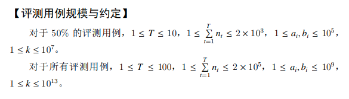

---

### 3240 · 封闭图形个数

> 题号 3240 ｜ 难度 中等 ｜ 时间 1s ｜ 内存 256MB
> 通过率 34.12% ｜ 题面原文 https://www.dotcpp.com/oj/problem3240.html
> 考过的语言/组别：Python 大学C组、Python 研究生组、Java 研究生组、C++ 研究生组、C++ 大学C组、Java 大学C组

#### 题目描述

在蓝桥王国，数字的大小不仅仅取决于它们的数值大小，还取决于它们所形成的“封闭图形”的个数。

封闭图形是指数字中完全封闭的空间，例如数字 1、2、3、5、7 都没有形成封闭图形，而数字 0、4、6、9 分别形成了 1 个封闭图形，数字 8 则形成了 2个封闭图形。值得注意的是，封闭图形的个数是可以累加的。例如，对于数字68，由于 6 形成了 1 个封闭图形，而 8 形成了 2 个，所以 68 形成的封闭图形的个数总共为 3。

在比较两个数的大小时，如果它们的封闭图形个数不同，那么封闭图形个数较多的数更大。例如，数字 41 和数字 18，它们对应的封闭图形的个数分别为 1 和 2，因此数字 41 小于数组 18。如果两个数的封闭图形个数相同，那么数值较大的数更大。例如，数字 14 和数字 41，它们的封闭图形的个数都是 1，但 14 < 41，所以数字 14 小于数字 41。如果两个数字的封闭图形个数和数值都相同，那么这两个数字被认为是相等的。

小蓝对蓝桥王国的数字大小规则十分感兴趣。现在，他将给定你 n 个数a<sub>1</sub>, a<sub>2</sub>, . . . , a<sub>n</sub>，请你按照蓝桥王国的数字大小规则，将这 n 数从小到大排序，并输出排序后结果。

#### 输入格式

输入的第一行包含一个整数 n ，表示给定的数字个数。

第二行包含 n 个整数 a1, a2, . . . , an ，相邻整数之间使用一个空格分隔，表示待排序的数字。

#### 输出格式

输出一行包含 n 个整数，相邻整数之间使用一个空格分隔，表示按照蓝桥王国的数字大小规则从小到大排序后的结果。

#### 样例输入

```
3

18 29 6
```

#### 提示

【样例说明】

对于给定的数字序列 [18, 29, 6]，数字 18 的封闭图形个数为 2，数字 29 的封闭图形个数为 1，数字 6 的封闭图形个数为 1。按照封闭图形个数从小到大排序后，得到 [29, 6, 18]。由于数字 29 和数字 6 的封闭图形个数相同，因此需要进一步按照数值大小对它们进行排序，最终得到 [6, 29, 18]。

【评测用例规模与约定】

对于 50% 的评测用例，1 ≤ n ≤ 2 × 10<sup>3</sup>，1 ≤ a<sub>i</sub> ≤ 10<sup>5</sup>。对于所有评测用例，1 ≤ n ≤ 2 × 10<sup>5</sup>，1 ≤ a<sub>i </sub>≤ 10<sup>9</sup>。

---

### 3241 · 挖矿

> 题号 3241 ｜ 难度 困难 ｜ 时间 1s ｜ 内存 256MB
> 通过率 18.95% ｜ 题面原文 https://www.dotcpp.com/oj/problem3241.html
> 考过的语言/组别：Python 大学C组、C++ 大学C组、Java 大学C组

#### 题目描述

小蓝正在数轴上挖矿，数轴上一共有 n 个矿洞，第 i 个矿洞的坐标为 ai 。小蓝从 0 出发，每次可以向左或向右移动 1 的距离，当路过一个矿洞时，就会进行挖矿作业，获得 1 单位矿石，但一个矿洞不能被多次挖掘。小蓝想知道在移动距离不超过 m 的前提下，最多能获得多少单位矿石？

#### 输入格式

输入的第一行包含两个正整数 n, m ，用一个空格分隔。第二行包含 n 个整数 a<sub>1</sub>, a<sub>2</sub>, · · · , a<sub>n</sub> ，相邻整数之间使用一个空格分隔。

#### 输出格式

输出一行包含一个整数表示答案。

#### 样例输入

```
5 4

0 -3 -1 1 2
```

#### 提示

【样例说明】

路径：0 → −1 → 0 → 1 → 2，可以对 {0, −1, 1, 2} 四个矿洞挖掘并获得最多4 块矿石。

【评测用例规模与约定】

对于 20% 的评测用例，1 ≤ n ≤ 10<sup>3</sup> ；

对于所有评测用例，1 ≤ n ≤ 10<sup>5</sup> ，−10<sup>6</sup> ≤ a<sub>i </sub>≤ 10<sup>6</sup> ，1 ≤ m ≤ 2 × 10<sup>6</sup> 。

---

### 3242 · 商品库存管理

> 题号 3242 ｜ 难度 困难 ｜ 时间 1s ｜ 内存 256MB
> 通过率 11.37% ｜ 题面原文 https://www.dotcpp.com/oj/problem3242.html
> 考过的语言/组别：Python 研究生组、Java 研究生组、C++ 研究生组、C++ 大学C组、Java 大学C组

#### 题目描述

在库存管理系统中，跟踪和调节商品库存量是关键任务之一。小蓝经营的仓库中存有多种商品，这些商品根据类别和规格被有序地分类并编号，编号范围从 1 至 n。初始时，每种商品的库存量均为 0。

为了高效地监控和调整库存量，小蓝的管理团队设计了 m 个操作，每个操作涉及到一个特定的商品区间，即一段连续的商品编号范围（例如区间 [L, R]）。执行这些操作时，区间内每种商品的库存量都将增加 1。然而，在某些情况下，管理团队可能会决定不执行某些操作，使得这些操作涉及的商品区间内的库存量不会发生改变，维持原有的状态。

现在，管理团队需要一个评估机制，来确定如果某个操作未被执行，那么最终会有多少种商品的库存量为 0。对此，请你为管理团队计算出，对于每个操作，如果不执行该操作而执行其它操作，库存量为 0 的商品的种类数。

#### 输入格式

输入的第一行包含两个整数 n 和 m，分别表示商品的种类数和操作的个数。接下来的 m 行，每行包含两个整数 L 和 R，表示一个操作涉及的商品区间。

#### 输出格式

输出 m 行，每行一个整数，第 i 行的整数表示如果不执行第 i 个操作，则最终库存量为 0 的商品种类数。

#### 样例输入

```
5 3

1 2

2 4

3 5
```

#### 提示

【样例说明】考虑不执行每个操作时，其余操作对商品库存的综合影响：

- **不执行操作 1**：剩余的操作是操作 2（影响区间 [2, 4]）和操作 3（影响区间 [3, 5]）。执行这两个操作后，商品库存序列变为 [0, 1, 2, 2, 1]。在这种情况下，只有编号为 1 的商品的库存量为 0。因此，库存量为 0 的商品种类数为 1。

- **不执行操作 2**：剩余的操作是操作 1（影响区间 [1, 2]）和操作 3（影响区间 [3, 5]）。执行这两个操作后，商品库存序列变为 [1, 1, 1, 1, 1]。在这种情况下，所有商品的库存量都不为 0。因此，库存量为 0 的商品种类数为 0。

- **不执行操作 3**：剩余的操作是操作 1（影响区间 [1, 2]）和操作 2（影响区间 [2, 4]）。执行这两个操作后，商品库存序列变为 [1, 2, 1, 1, 0]。在这种情况下，只有编号为 5 的商品的库存量为 0。因此，库存量为 0 的商品种类数为 1。

【评测用例规模与约定】对于 20% 的评测用例，1 ≤ n, m ≤ 5 × 10<sup>3</sup>，1 ≤ L ≤ R ≤ n。对于所有评测用例，1 ≤ n, m ≤ 3 × 10<sup>5</sup>，1 ≤ L ≤ R ≤ n。

---

### 3243 · 植物生命力

> 题号 3243 ｜ 难度 困难 ｜ 时间 1s ｜ 内存 256MB
> 通过率 20.85% ｜ 题面原文 https://www.dotcpp.com/oj/problem3243.html
> 考过的语言/组别：Python 研究生组、Java 研究生组、C++ 研究生组

#### 题目描述

小蓝是一位资深的植物学家，他专注于研究植物的相互关系和生命力。在他所照料的森林中，每个品种的植物都拥有独特的生命力，彼此之间互不相同。

植物的生命力会影响其下级品种的生长。具体地，如果下级品种的生命力数值无法被上级品种的生命力数值整除，或者下级品种的生命力数值大于上级品种的生命力数值时，它们便会受到压制，无法茁壮成长。

为了深入研究和定量分析这一现象，小蓝构建了一种模型。他将森林中的植物品种关系抽象成了一棵包含 n 个结点的树，结点的编号从 1 到 n，代表不同的植物品种。其中，树的根结点编号为 s，结点 i（1 ≤ i ≤ n）的生命力表示为 ai。

现在，小蓝想要对于每个结点 i，统计其子树（以 i 为根的子树）中同时满足以下两个条件的子结点的数量：

1. 子结点的生命力小于结点 i 的生命力 ai。

2. 子结点的生命力无法被结点 i 的生命力 ai 整除。

请你帮助小蓝计算出所有子树中满足条件的结点个数的总和。

#### 输入格式

输入的第一行包含两个整数 n 和 s，分别表示结点的数量和根结点的编号。

第二行包含 n 个互不相同的整数 a1, a2, · · · , an，相邻整数之间使用一个空格分隔，其中 ai 表示编号为 i 的结点的生命力。

接下来的 n − 1 行，每行包含两个整数 u 和 v ，用一个空格分隔，表示编号为 u 和 v 的结点之间存在一条边。

#### 输出格式

输出一行包含一个整数，表示所有子树中满足条件的结点个数的总和。

#### 样例输入

```
6 1

6 5 3 2 4 1

1 2

1 3

2 4

2 5

3 6
```

#### 提示

【样例说明】

在给定的样例中，树的结构如下：

1

/ \

2  3

/  \   \

4  5   6

在以 1 为根的子树中，满足条件的结点有 2, 5，个数为 2。

在以 2 为根的子树中，满足条件的结点有 4, 5，个数为 2。

在以 3 ∼ 6 为根的子树中，没有满足条件的结点，个数均为 0。因此答案为 2 + 2 = 4。

【评测用例规模与约定】

对于 30% 的评测用例，1 ≤ n ≤ 2 × 10<sup>3</sup>，1 ≤ s, u, v, a<sub>i</sub> ≤ n，a<sub>1</sub>, a<sub>2</sub>, . . . , a<sub>n</sub> 互不相同。

对于所有评测用例，1 ≤ n ≤ 10<sup>5</sup>，1 ≤ s, u, v, a<sub>i</sub> ≤ n，a<sub>1</sub>, a<sub>2</sub>, . . . , a<sub>n</sub> 互不相同。

---

### 3244 · 传送阵

> 题号 3244 ｜ 难度 困难 ｜ 时间 1s ｜ 内存 256MB
> 通过率 24.68% ｜ 题面原文 https://www.dotcpp.com/oj/problem3244.html
> 考过的语言/组别：C++ 大学B组

#### 题目描述

小蓝在环球旅行时来到了一座古代遗迹，里面并排放置了 n 个传送阵，进入第 i 个传送阵会被传送到第 ai 个传送阵前，并且可以随时选择退出或者继续进入当前传送阵。小蓝为了探寻传送阵中的宝物，需要选择一个传送阵进入，然后连续进入之后的传送阵。小蓝希望尽可能多地进入传送门以便搜索宝物，同时他可以使用一次魔法，从某个传送阵 j 走到相邻的（第 j − 1 或第 j + 1 个）传送阵，请问小蓝最多能到达多少个不同的传送阵？一个传送阵可多次进入，但在计算答案时只算一个。

#### 输入格式

输入的第一行包含一个正整数 n 。第二行包含 n 个正整数 a1, a2, · · · , an ，相邻整数之间使用一个空格分隔。

#### 输出格式

输出一行包含一个整数表示答案。

#### 样例输入

```
5

2 1 5 4 3
```

#### 提示

【样例说明】

小蓝的路径可以是：1 → 2 → 3 → 5 。其中 2 → 3 使用魔法。

【评测用例规模与约定】

对于 20% 的评测用例，1 ≤ n ≤ 1000 ；对于所有评测用例，1 ≤ n ≤ 10<sup>6</sup>，且 a 是 1 至 n 的一个排列。

---

### 3245 · 前缀总分

> 题号 3245 ｜ 难度 困难 ｜ 时间 1s ｜ 内存 256MB
> 通过率 24.40% ｜ 题面原文 https://www.dotcpp.com/oj/problem3245.html
> 考过的语言/组别：C++ 大学B组

#### 题目描述

给定 n 个由小写英文字母组成的字符串 s1, s2, · · · , sn ，定义前缀总分为V =∑<sub>i<j</sub> P(s<sub>i</sub>, s<sub>j</sub>) ，其中 P(s<sub>i</sub>, s<sub>j</sub>) 表示 s<sub>i</sub>, s<sub>j</sub> 的最长公共前缀的长度。

小蓝可以选择其中一个字符串，并修改其中的一个字符。请问修改后前缀总分最大为多少？

#### 输入格式

输入的第一行包含一个正整数 n 。接下来 n 行，每行包含一个字符串 si 。

#### 输出格式

输出一行包含一个整数表示答案。

#### 样例输入

```
3

aab

bbb

abb
```

#### 提示

【样例说明】

将第二个字符串改为 abb ，得分为 P(aab, abb)+P(aab, abb)+P(abb, abb) =1 + 1 + 3 = 5 。

【评测用例规模与约定】

对于 20% 的评测用例，1 ≤ n ≤ 20 ；

对于所有评测用例，1 ≤ n ≤ 200 ，1 ≤ |si| ≤ 200 ，其中 |s<sub>i</sub>| 表示 s<sub>i</sub> 的长度。

---

### 3246 · 遗迹

> 题号 3246 ｜ 难度 困难 ｜ 时间 1s ｜ 内存 256MB
> 通过率 14.57% ｜ 题面原文 https://www.dotcpp.com/oj/problem3246.html
> 考过的语言/组别：C++ 大学B组

#### 题目描述

小蓝找到了一个外星文明留下来的遗迹，遗迹大门的屏幕上有一个长度为m 的字符串 t 和一个输入框，下面还有一个键盘，键盘为一个长度为 n 的字符串 s ，由一个可以横向移动的指针来敲击键盘，指针可以向左移或向右移，不能移出键盘。

小蓝需要在键盘字符串 s 上先指定指针初始位置然后不断移动指针的位置，过程中通过敲击指针所在的字符来进行输入。然而，指针最多只能移动 L 的距离，小蓝想输入一个尽可能长的一个 t 的前缀，请问他最多能输入多少位。

#### 输入格式

输入的第一行包含三个正整数 n, m, L ，相邻整数之间使用一个空格分隔。

第二行包含一个长度为 n 的字符串 s 。

第三行包含一个长度为 m 的字符串 t 。

#### 输出格式

输出一行包含一个整数表示答案。

#### 样例输入

```
3 6 5

abc

acbbac
```

#### 提示

【样例说明】

初始选择指针位于键盘 abc 上的 a ，输入 acbbac 这 6 个字符分别需要指针移动 0, 2, 1, 0, 1, 2 的距离，而最大移动距离为 5 ，所以最多输入 5 个字符，移动 0 + 2 + 1 + 0 + 1 = 4 的距离。

【评测用例规模与约定】

对于 20% 的评测用例，1 ≤ m ≤ 20；

对于所有评测用例，1 ≤ n ≤ 10<sup>3</sup> ，1 ≤ m ≤ 10<sup>5</sup> ，1 ≤ L ≤ 10<sup>9</sup> 且 s, t 中只包含小写字母，且 s 中一定包含所有 t 中出现过的字母，数据保证随机。

---

### 3247 · 狡兔 k 窟

> 题号 3247 ｜ 难度 困难 ｜ 时间 1s ｜ 内存 256MB
> 通过率 17.32% ｜ 题面原文 https://www.dotcpp.com/oj/problem3247.html
> 考过的语言/组别：C++ 大学B组

#### 题目描述

一只兔子名叫小蓝，它异常狡猾，在土中挖了若干洞窟并且设置了很多出入口来应对紧急情况。它一共有 n 个通往地面的出入口，在地面上这 n 个出入口之间由 n − 1 条长度为 1 的双向通路连成一个连通图。第 i 个出入口属于第 ci个洞窟，因此小蓝可以在任意一个属于 ci 的出入口从地面进入洞窟然后从任意一个属于 ci 的出入口跑出到达地面。

小蓝提出了 m 个逃跑路线，第 i 个路线希望从出入口 si 逃往 ti ，它希望在逃跑的过程中在地面上跑动的距离尽可能短，请为每条路线计算逃跑时在地面上跑动的最短距离。

#### 输入格式

输入的第一行包含两个正整数 n, m ，用一个空格分隔。

第二行包含 n 个正整数 c1, c2, · · · , cn ，相邻整数之间使用一个空格分隔。

接下来 n − 1 行，第 i 行包含两个整数 ui, vi ，用一个空格分隔，表示地面上的一条通路连接 ui 和 vi 。

接下来 m 行，第 i 行包含两个整数 si, ti ，用一个空格分隔。

#### 输出格式

输出 m 行，每行包含一个整数，依次表示每个询问的答案。

#### 样例输入

```
6 3

1 3 2 1 2 3

1 2

1 3

2 4

2 5

3 6

2 6

3 2

4 3
```

#### 提示

对于 20% 的评测用例，1 ≤ n, m, ci ≤ 100 ；

对于所有评测用例，1 ≤ n, m, c<sub>i</sub> ≤ 5000 ，1 ≤ u<sub>i</sub>, v<sub>i</sub>, s<sub>i</sub>, t<sub>i</sub> ≤ n 。

---

### 3248 · 最强小队

> 题号 3248 ｜ 难度 困难 ｜ 时间 1s ｜ 内存 256MB
> 通过率 23.21% ｜ 题面原文 https://www.dotcpp.com/oj/problem3248.html
> 考过的语言/组别：C++ 大学B组

#### 题目描述

在蓝桥王国，一支勇士队伍依照既定的顺序排列。队伍由 n 位勇士组成，每位勇士都有一个力量值，分别为 a1, a2, . . . , an。

国王下达了一项命令，要求从这支队伍中选拔一支精英小队，这支小队需满足以下条件：

1. 小队成员必须按照原队伍的次序来组成，即小队成员的排列顺序必须与原队伍保持一致。

2. 小队的首位和末位勇士的力量必须大于小队中其他所有勇士的力量。

对于一个小队，其强度与成员数量成正比，即成员数量越多，小队越强大。

现在，国王想要知道，最强小队的成员数量是多少。请你帮他找到并计算出最强小队的成员数量。

#### 输入格式

输入的第一行包含一个整数 n，表示勇士的数量。

第二行包含 n 个整数 a1, a2, . . . , an ，相邻整数之间使用一个空格分隔，表示每位勇士的力量值。

#### 输出格式

输出一行包含一个整数，表示最强小队的成员数量。

#### 样例输入

```
3

3 1 2
```

#### 提示

【样例说明】

在给定的样例中，勇士队伍的力量值为 [3, 1, 2]，我们可以选择的精英小队组建方法有：

1. 只选择第一位勇士，即 [3]。

2. 只选择第二位勇士，即 [1]。

3. 只选择第三位勇士，即 [2]。

4. 选择第一位勇士和第二位勇士，即 [3, 1]。

5. 选择第一位勇士和第三位勇士，即 [3, 2]。

6. 选择第二位勇士和第三位勇士，即 [1, 2]。

7. 选择所有勇士，即 [3, 1, 2]。

显然，选择所有勇士 [3, 1, 2] 组成的小队是最强的。因此，最强小队的成员数量为 3。

【评测用例规模与约定】

对于 10% 的评测用例，1 ≤ n ≤ 10<sup>2</sup>，1 ≤ a<sub>i</sub> ≤ 10<sup>3</sup>。

对于 30% 的评测用例，1 ≤ n ≤ 10<sup>3</sup>，1 ≤ a<sub>i</sub> ≤ 10<sup>5</sup>。

对于所有评测用例，1 ≤ n ≤ 10<sup>5</sup>，1 ≤ a<sub>i</sub> ≤ 10<sup>9</sup>。

---

### 3249 · 质数变革

> 题号 3249 ｜ 难度 困难 ｜ 时间 1s ｜ 内存 256MB
> 通过率 8.75% ｜ 题面原文 https://www.dotcpp.com/oj/problem3249.html
> 考过的语言/组别：C++ 大学B组

#### 题目描述

质数一直以来都是数学领域中的一个重要概念。传统的数论定义质数为只有两个正因子的自然数。然而，在一次变革中，小蓝提出了一个新的质数定义：绝对值只有两个正因子的数均为质数。根据小蓝的定义，质数序列如下：. . . , −7, −5, −3, −2, 2, 3, 5, 7, . . .

现给定一个包含 n 个整数的数组 a，记为 a1, a2, . . . , an，以及 q 个操作，每个操作由三个整数 op、k 和 x 组成。小蓝将按顺序执行这些操作，依次改变数组 a 中的元素值。具体地，对于一个操作：

- 若 op 等于 1，则对于数组 a 中满足 i mod k = 0 的元素 ai，将其替换为从大到小第 x 个小于它的质数。

- 若 op 等于 2，则对于数组 a 中满足 i mod k = 0 的元素 ai，将其替换为从小到大第 x 个大于它的质数。

由于小蓝不喜欢负数，也不喜欢太大的数，所以如果在所有操作结束后某个元素的值小于 0，小蓝会将其替换为 0；如果某个元素的值大于 1000000，小蓝会将其替换为 1。

请问，在所有操作结束后，数组 a 中的元素分别为多少。

#### 输入格式

输入的第一行包含两个整数 n 和 q ，用一个空格分隔，表示数组 a 的长度和操作的数量。

第二行包含 n 个整数 a1, a2, . . . , an，表示初始时数组 a 中的元素。

接下来 q 行，每行包含三个整数 op、k 和 x，表示一个操作。

#### 输出格式

输出一行，包含 n 个整数，表示在所有操作结束后，数组 a 中的元素值。

#### 样例输入

```
5 3

2 3 6 9 12

1 2 1

1 2 1

2 3 4
```

#### 提示

【样例说明】

初始时，数组 a 的元素为 [2, 3, 6, 9, 12]。

执行第一个操作，将 a2 替换为从小到大第 1 个大于它的质数，即 a2 变为 5。将 a4 替换为从小到大第 1 个大于它的质数，即 a4 变为 11。数组变为[2, 5, 6, 11, 12]。

执行第二个操作，将 a2 替换为从小到大第 1 个大于它的质数，即 a2 变为 7。将 a4 替换为从小到大第 1 个大于它的质数，即 a4 变为 13。数组变为[2, 7, 6, 13, 12]。

执行第三个操作，将 a3 替换为从大到小第 4 个小于它的质数，即 a3 变为−2。数组变为 [2, 7, −2, 13, 12]。

操作结束后，将数组中所有小于 0 的元素变为 0，大于 1000000 的元素变为 1，因此最后的数组为 [2, 7, 0, 13, 12]。

【评测用例规模与约定】

对于 30% 的评测用例，1 ≤ n, q ≤ 2 × 10<sup>3</sup>，1 ≤ op ≤ 2，1 ≤ k ≤ n，1 ≤ x, a<sub>i</sub> ≤ 10<sup>5</sup>。对于所有评测用例，1 ≤ n, q ≤ 2 × 10<sup>5</sup>，1 ≤ op ≤ 2，1 ≤ k ≤ n，1 ≤ x, a<sub>i</sub> ≤10<sup>6</sup>。

---

### 3290 · 蚂蚁开会

> 题号 3290 ｜ 难度 困难 ｜ 时间 1s ｜ 内存 128MB
> 通过率 20.39% ｜ 题面原文 https://www.dotcpp.com/oj/problem3290.html
> 考过的语言/组别：C++ 大学B组

#### 题目描述

二维平面上有 n 只蚂蚁，每只蚂蚁有一条线段作为活动范围，第 i 只蚂蚁的活动范围的两个端点为 (u<sup>i</sup><sub>x</sub>, u<sup>i</sup><sub>y</sub>),(v<sup>i</sup><sub>x,</sub> v<sup>i</sup><sub>y</sub>)。现在蚂蚁们考虑在这些线段的交点处设置会议中心。为了尽可能节省经费，它们决定只在所有交点为整点的地方设置会议中心，请问需要设置多少个会议中心？

#### 输入格式

输入共 n + 1 行。第一行为一个正整数 n。后面 n 行，每行 4 个由空格分开的整数表示 uix, uiy, vix, viy。

#### 输出格式

输出共 1 行，一个整数表示答案。

#### 样例输入

```
4

0 0 4 4

0 4 4 0

2 0 0 4

2 1 2 3
```

#### 提示

【样例说明】

所有线段之间共有 3 个不同的交点：(0, 4),(43,43),(2, 2), 其中整点有 2 个：(0, 4),(2, 2)。

【评测用例规模与约定】

对于 20% 的评测用例，保证 0 ≤ uix, uiy, vix, viy ≤ 100。对于 100% 的评测用例，保证 n ≤ 500，0 ≤ uix, uiy, vix, viy ≤ 10000，保证任意蚂蚁的活动范围不会退化成一个点，不保证任意两条线段之间交点数量有限。

---

### 3291 · 立定跳远

> 题号 3291 ｜ 难度 困难 ｜ 时间 1s ｜ 内存 128MB
> 通过率 25.76% ｜ 题面原文 https://www.dotcpp.com/oj/problem3291.html
> 考过的语言/组别：C++ 大学B组

#### 题目描述

在运动会上，小明从数轴的原点开始向正方向立定跳远。项目设置了 n 个检查点 a1, a2, . . . , an 且 ai ≥ ai−1 > 0。小明必须先后跳跃到每个检查点上且只能跳跃到检查点上。同时，小明可以自行再增加 m 个检查点让自己跳得更轻松。

在运动会前，小明制定训练计划让自己单次跳跃的最远距离达到 L，并且学会一个爆发技能可以在运动会时使用一次，使用时可以在该次跳跃时的最远距离变为 2L。小明想知道，L 的最小值是多少可以完成这个项目？

#### 输入格式

输入共 2 行。

第一行为两个正整数 n, m。

第二行为 n 个由空格分开的正整数 a1, a2, . . . , an。

#### 输出格式

输出共 1 行，一个整数表示答案。

#### 样例输入

```
5 3

1 3 5 16 21
```

#### 提示

【样例说明】

增加检查点 10, 13, 19，因此每次跳跃距离为 2, 2, 5, 3, 3, 3, 2，在第三次跳跃时使用技能即可。

【评测用例规模与约定】

对于 20% 的评测用例，保证 n ≤ 102，m ≤ 103，ai ≤ 103。

对于 100% 的评测用例，保证 2 ≤ n ≤ 105，m ≤ 108，0 < ai ≤ 108。

---

### 3292 · 最小字符串

> 题号 3292 ｜ 难度 困难 ｜ 时间 1s ｜ 内存 128MB
> 通过率 25.31% ｜ 题面原文 https://www.dotcpp.com/oj/problem3292.html
> 考过的语言/组别：C++ 大学B组

#### 题目描述

给定一个长度为 N 且只包含小写字母的字符串 S，和 M 个小写字母c<sub>1</sub>, c<sub>2</sub>, . . . , c<sub>M</sub>。现在你要把 M 个小写字母全部插入到字符串 S 中，每个小写字母都可以插入到任意位置。

请问能得到的字典序最小的字符串是什么？

#### 输入格式

第一行包含两个整数 N 和 M。

第二行包含一个长度为 N 的字符串 S。

第三行包含 M 个小写字母 c<sub>1</sub>, c<sub>2</sub>, . . . , c<sub>M</sub>。

#### 输出格式

输出一个长度为 N + M 的字符串代表答案。

#### 样例输入

```
4 3

abbc

cba
```

#### 提示

【评测用例规模与约定】

对于 20% 的评测用例，M = 1。对于 100% 的评测用例，1 ≤ N, M ≤ 10<sup>5</sup>。

---

### 3293 · 数位翻转

> 题号 3293 ｜ 难度 中等 ｜ 时间 1s ｜ 内存 128MB
> 通过率 30.94% ｜ 题面原文 https://www.dotcpp.com/oj/problem3293.html
> 考过的语言/组别：C++ 大学B组

#### 题目描述

小明创造了一个函数 f(x) 用来翻转 x 的二进制的数位（无前导 0）。比如f(11) = 13，因为 11 = (1011)<sub>2</sub>，将其左右翻转后，变为 13 = (1101)<sub>2</sub>；再比如f(3) = 3，f(0) = 0，f(2) = f(4) = f(8) = 1 等等。

小明随机出了一个长度为 n 的整数数组 {a1, a2, ..., an}，他想知道，在这个数组中选择最多 m 个不相交的区间，将这些区间内的数进行二进制数位翻转（将ai 变为 f(ai)）后，整个数组的和最大是多少？

#### 输入格式

输入共 2 行。

第一行为两个正整数 n, m。

第二行为 n 个由空格分开的整数 a1, a2, ..., an。

#### 输出格式

输出共 1 行，一个整数表示答案。

#### 样例输入

```
5 3

11 12 13 14 15
```

#### 提示

【样例说明 1】只翻转 a1，和为 13 + 12 + 13 + 14 + 15 = 67。

再比如：

【样例输入 2】6 223 8 11 19 16 35

【样例输出 2】134

【样例说明 2】翻转区间 [a3, a4] 和 [a6]，和为 23 + 8 + 13 + 25 + 16 + 49 = 134。

【评测用例规模与约定】

对于 20% 的评测用例，保证 n, m ≤ 20。

对于 100% 的评测用例，保证 n, m ≤ 1000，0 ≤ a<sub>i </sub>≤ 10<sup>9</sup>。

---

### 3294 · 数星星

> 题号 3294 ｜ 难度 困难 ｜ 时间 1s ｜ 内存 128MB
> 通过率 29.45% ｜ 题面原文 https://www.dotcpp.com/oj/problem3294.html
> 考过的语言/组别：C++ 大学B组

#### 题目描述

小明正在一棵树上数星星，这棵树有 n 个结点 1, 2, . . . , n。他定义树上的一个子图 G 是一颗星星，当且仅当 G 同时满足：

- G 是一棵树。
- 2. G 中存在某个结点，其度数为 |V<sub>G</sub>| − 1。其中 |V<sub>G</sub>| 表示这个子图含有的结点数。

两颗星星不相同当且仅当它们包含的结点集合 V<sub>G</sub> 不完全相同。小明想知道这棵树上有多少颗不同的星星包含的结点的数量在区间 [L, R] 中，答案对1000000007 取模。

#### 输入格式

输入共 n + 1 行。

第一行为一个正整数 n。

后面 n − 1 行，每行两个正整数表示树上的一条边。

第 n + 1 行，两个正整数 L, R。

#### 输出格式

输出共 1 行，一个整数表示答案。

#### 样例输入

```
6

1 2

1 3

2 4

2 5

3 6

3 4
```

#### 提示

【样例说明】

包含 3 个结点的星星有 5 个，它们的结点集合分别为 {1, 2, 3}，{1, 2, 4}，{1, 2, 5}，{2, 4, 5}，{1, 3, 6}。包含 4 个结点的星星有 1 个，它的结点集合为 {1, 2, 4, 5}。

【评测用例规模与约定】

对于 20% 的评测用例，保证 n ≤ 20。

对于 100% 的评测用例，保证 n ≤ 10<sup>5</sup>; 1 ≤ L ≤ R ≤ n。

---

### 3295 · 套手镯

> 题号 3295 ｜ 难度 困难 ｜ 时间 1s ｜ 内存 128MB
> 通过率 21.25% ｜ 题面原文 https://www.dotcpp.com/oj/problem3295.html
> 考过的语言/组别：C++ 大学B组

#### 题目描述

小蓝在 LQ 集市上发现一个套手镯的游戏，在一个大小为 108 × 108 矩形平面上摆放着 N 个圆形的手镯。玩家可以将一个大小为 w × h 的矩形方框放置在这个平面上（玩家只可以沿着水平/垂直方向放置方框，即可以将方框旋转 90度，但不可以旋转至其他角度），位于这个矩形方框内部的手镯就是玩家获得的奖励。

可以将这个矩形平面看作是一个二维坐标系，左下角的坐标为 (0, 0)。手镯和方框的厚度可以忽略不计, 允许多个手镯重叠放置。

小蓝想要尝试一次，请问他最多可以获得多少手镯？

#### 输入格式

第一行输入三个整数 N、w、h。

接下来输入 N 行，每行三个整数 x, y,r，表示第 i 个手镯的圆心坐标和半径。

#### 输出格式

输出一个整数表示答案。

#### 样例输入

```
8 12 9

18 22 1

3 17 2

21 28 1

7 18 2

10 2 2

4 24 2

19 13 1

14 15 1
```

#### 提示

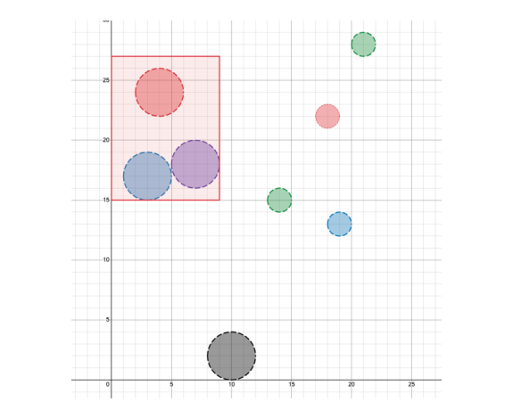

【评测用例规模与约定】

对于 50% 的评测用例：1 ≤ N ≤ 100，1 ≤ w, h, x, y,r ≤ 200。

对于 100% 的评测用例：1 ≤ N ≤ 1000，1 ≤ w, h, x, y,r ≤ 10<sup>8</sup>，1 ≤min{w, h} ≤ 200。保证所有手镯都位于平面内部。

---

### 3296 · 跳石头

> 题号 3296 ｜ 难度 困难 ｜ 时间 1s ｜ 内存 128MB
> 通过率 10.14% ｜ 题面原文 https://www.dotcpp.com/oj/problem3296.html
> 考过的语言/组别：C++ 大学B组

#### 题目描述

小明正在和朋友们玩跳石头的小游戏，一共有 n 块石头按 1 到 n 顺序排成一排，第 i 块石头上写有正整数权值 c<sub>i</sub>。

如果某一时刻小明在第 j 块石头，那么他可以选择跳向第 j + c<sub>j</sub> 块石头（前提 j + c<sub>j</sub> ≤ n）或者跳向第 2j 块石头（前提 2 j ≤ n），没有可跳跃的目标时游戏结束。

假如小明选择从第 x 块石头开始跳跃，如果某块石头有可能被小明经过（“经过” 指存在某一时刻小明在这个石头处），则将这块石头的权值纳入得分集合 S<sub>x</sub>，那么小明从第 x 块石头开始跳跃的得分为 |S<sub>x</sub>|。

比如如果小明从第 x 块石头出发，所有可能经过的石头上的权值分别为5, 3, 5, 2, 3，那么 S x = {5, 3, 2} 得分为 |S<sub>x</sub>| = 3。小明可以任选一块石头开始跳跃，请求出小明最多能获得的分数。

#### 输入格式

输入共 2 行。第一行为一个正整数 n。第二行为 n 个由空格分开的正整数 c<sub>1</sub>, c<sub>2</sub>, . . . , c<sub>n</sub>。

#### 输出格式

输出共 1 行，一个整数表示答案。

#### 样例输入

```
5

4 3 5 2 1
```

#### 提示

【样例说明】

从第一块石头出发得分最多，路径有以下几种：

- 1号 → 5 号：选择从 1 号跳到 1 + c1=5 号。
- 1 号 → 2 号 → 5 号：第一次选择从 1 号跳到 2 × 1=2 号，第二次选择从2 号跳到 2 + c2 = 5 号。
- 1 号 → 2 号 → 4 号：第一次选择从 1 号跳到 2 × 1=2 号，第二次选择从2 号跳到 2 × 2 = 4 号

所以所有可能经过的石头的权值的集合为 S 1 = {c<sub>1</sub>, c<sub>2,</sub> c<sub>4</sub>, c<sub>5</sub>} = {4, 3, 2, 1}，得分为 |S<sub>1</sub>| = 4。

【评测用例规模与约定】

对于 20% 的评测用例，保证 n ≤ 20。

对于 100% 的评测用例，保证 n ≤ 40000，c<sub>i</sub> ≤ n。

---

### 3297 · 最长回文前后缀

> 题号 3297 ｜ 难度 中等 ｜ 时间 1s ｜ 内存 128MB
> 通过率 34.19% ｜ 题面原文 https://www.dotcpp.com/oj/problem3297.html
> 考过的语言/组别：C++ 大学B组

#### 题目描述

小明特别喜欢回文串，然而回文串太少见了，因此他定义了一个字符串的相同长度的、不相交的前缀和后缀是 “回文前后缀”，当且仅当这个前缀和后缀拼起来是个回文串。那么字符串 S = c<sub>1</sub>c<sub>2</sub>c<sub>3</sub>, . . . , c<sub>n</sub> 的 “最长回文前后缀” 的长度L(S ) 即为 arg maxxS <sub>[1,x]</sub> = (S <sub>[n−x+1,n</sub><sub>]</sub>)T 其中 S <sub>[i, j]</sub> 表示 S 的一个子串 c<sub>i</sub>c<sub>i+1</sub> . . . c<sub>j</sub>，S<sup>T</sup> 表示翻转 S 得到的字符串。

对于一个给定的字符串 S，小明希望对其进行改造使得 L(S′) 尽可能大。改造允许将字符串中一个任意长度的子串删除。比如删除 S = abcdebi jbba 中的子串 S <sub>[3,5]</sub> 后 S 变成了 abbi jbba。

小明想知道改造后的新字符串 S′ 的 “最长回文前后缀” 的长度 L(S′) 最大是多少？

#### 输入格式

输入共 1 行，一个字符串 S。

#### 输出格式

输出共 1 行，一个整数表示答案。

#### 样例输入

```
abcdebijbba
```

#### 提示

【样例说明】

如题干中的方案删除 S <sub>[3,5]</sub> 后，S′ = abbi jbba，L(S′) = 3。

【评测用例规模与约定】

对于 20% 的评测用例，保证 |S | ≤ 500。

对于 100% 的评测用例，保证 |S | ≤ 500000，S 仅包含小写字母。

---

### 3298 · 兔子集结

> 题号 3298 ｜ 难度 困难 ｜ 时间 1s ｜ 内存 128MB
> 通过率 14.02% ｜ 题面原文 https://www.dotcpp.com/oj/problem3298.html
> 考过的语言/组别：C++ 大学A组

#### 题目描述

在森林幽静的一隅，有一村落居住着 n 只兔子。

某个月光皎洁的夜晚，这些兔子列成一队，准备开始一场集结跳跃活动。村落中的每只兔子都占据一个位置，对于第 i 只兔子，其位置为 pi 。我们称位置较小的为左边，位置较大的为右边。

按照兔子村落的习俗，每只兔子都会选择距离自己最近的兔子作为同伴，并向同伴所在的方向进行跳跃。如果一只兔子左边和右边的兔子距离它一样近，那么它会选择左边的兔子作为同伴。

兔子的每次跳跃，只能向左或向右移动一个单位距离。也就是说，如果一只兔子当前位于 x 的位置，那么它下一次跳跃后会到达 x − 1 或者 x + 1 的位置。

当两只相互靠近的兔子之间的距离为 1 时，左边的兔子会停在原地，而右边的兔子会跳到左边兔子的位置上，完成集结。

兔子们会一直跳跃，直到与自己最初选择的同伴完成集结后停下。

请问，当所有兔子都完成集结后，每只兔子都分别位于哪个位置上？

#### 输入格式

输入的第一行包含一个整数 n，表示兔子的数量。

第二行包含 n 个整数 p1, p2, · · · , pn ，相邻整数之间使用一个空格分隔，表示每只兔子的初始位置。

#### 输出格式

输出一行包含 n 个整数，表示每只兔子完成集结后的位置。

#### 样例输入

```
5

2 5 7 9 1
```

#### 提示

【样例说明】

兔子 1 选择的同伴为兔子 5，兔子 5 选择的同伴为兔子 1。由于它们彼此间的距离为 1，因此兔子 5 会停在原地，而兔子 1 会跳到位置 1 上，与兔子 5完成集结。

兔子 2 选择的同伴为兔子 3，兔子 4 选择的同伴也为兔子 3。对于兔子 3来说，兔子 2 和兔子 4 与它的距离相同，所以它会选择左边的兔子 2 作为同伴。兔子 2 会向右跳一个位置，兔子 3 会向左跳一个位置，兔子 4 会向左跳一个位置。此时，兔子 2 和兔子 3 均位于位置 6，完成集结（停止跳跃）。兔子 4会继续向左跳跃，直到跳到位置 6 后与兔子 3 完成集结。

【评测用例规模与约定】

对于 40% 的评测用例，2 ≤ n ≤ 500，1 ≤ pi ≤ 105，p1, p2, · · · , pn 各不相同。

对于所有评测用例，2 ≤ n ≤ 105，1 ≤ pi ≤ 109，p1, p2, · · · , pn 各不相同。

---

### 3299 · 旋转九宫格

> 题号 3299 ｜ 难度 困难 ｜ 时间 3s ｜ 内存 128MB
> 通过率 14.25% ｜ 题面原文 https://www.dotcpp.com/oj/problem3299.html
> 考过的语言/组别：C++ 大学A组

#### 题目描述

给定一个 3 × 3 的九宫格，每个格子内分别含有一个数字，每个格子里的数字互不相同。每步我们可以选择任意一个 2 × 2 的区域将其顺时针旋转，例如:

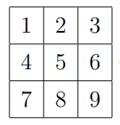          —旋转右上角 —>             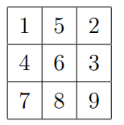

问最少需要几步才能将给定的状态旋转为:

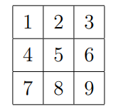

#### 输入格式

输入的第一行包含一个整数 T 表示询问的组数。接下来依次输入每组询问。每组询问包含三行，每行包含三个数，表示询问的九宫格的状态。

#### 输出格式

输出 T 行，每行包含一个整数表示本次询问的答案。

#### 样例输入

```
2

1 2 3

4 5 6

7 8 9

1 5 2

4 6 3

7 8 9
```

#### 提示

对于 60% 的评测用例，T = 1 ；

对于所有评测用例，T ≤ 10<sup>5</sup> 。

---

### 3300 · 最长子段

> 题号 3300 ｜ 难度 困难 ｜ 时间 1s ｜ 内存 128MB
> 通过率 11.69% ｜ 题面原文 https://www.dotcpp.com/oj/problem3300.html
> 考过的语言/组别：C++ 大学A组

#### 题目描述

给定一个长度为 n 的序列 (s1, s2, · · · , sn) 和三个数 a, b, c ，你需要找出一对L, R 满足如下式子:

∑<sup>R</sup><sub>i=L</sub>si > a(bR − cL), 1 ≤ L ≤ R ≤ n

即，序列中的第 L 至 R 项之和大于 a · (b · R − c · L)，求出满足条件的 L, R中 R − L + 1 的最大值。

#### 输入格式

输入的第一行包含四个整数 n, a, b, c ，相邻整数之间使用一个空格分隔。

第二行包含 n 个整数 s1, s2, · · · , sn ，相邻整数之间使用一个空格分隔。

#### 输出格式

输出一行包含一个整数表示答案。

#### 样例输入

```
4 1 5 6

1 2 3 4
```

#### 提示

【评测用例规模与约定】

对于 60% 的评测用例，n ≤ 5000 ；

对于所有评测用例，1 ≤ n ≤ 3 × 10<sup>5</sup> ，1 ≤ a, b, c ≤ 1000 ，|si| ≤ 10<sup>9</sup> 。

---

### 3301 · gcd 与 lcm

> 题号 3301 ｜ 难度 困难 ｜ 时间 1s ｜ 内存 128MB
> 通过率 16.63% ｜ 题面原文 https://www.dotcpp.com/oj/problem3301.html
> 考过的语言/组别：C++ 大学A组

#### 题目描述

给定两个数 x, y ，求有多少种不同的长度为 n 的序列 (a1, a2, · · · , an)，其所有元素的最大公约数为 x 且最小公倍数为 y 。

两个序列 (a1, a2, · · · , an) 与 (b1, b2, · · · , bn) 不同，是指存在至少一个位置 i满足 ai , bi 。

由于答案可能很大，请输出答案对 998244353 取模后的结果。

#### 输入格式

输入的第一行包含一个整数 Q 表示询问次数。

接下来 Q 行，每行包含三个整数 x,y,n 表示一组询问，相邻整数之间使用一个空格分隔。对于每个询问，保证至少存在一个满足条件的序列。

#### 输出格式

输出 Q 行，每行包含一个整数，依次表示每个询问的答案。

#### 样例输入

```
3

3 6 2

12 144 3

233 251640 10
```

#### 提示

【评测用例规模与约定】

对于 40% 的评测用例，n ≤ 30 ；

对于 70% 的评测用例，n ≤ 5000 ；

对于所有评测用例，1 ≤ Q ≤ 100 ，2 ≤ n ≤ 10<sup>5</sup> ，1 ≤ x, y ≤ 10<sup>9</sup> 。

---

### 3302 · 重复的串

> 题号 3302 ｜ 难度 困难 ｜ 时间 1s ｜ 内存 128MB
> 通过率 14.90% ｜ 题面原文 https://www.dotcpp.com/oj/problem3302.html
> 考过的语言/组别：C++ 大学A组

#### 题目描述

给定一个仅含小写字母的字符串 S ，问有多少个长度为 n 的仅含小写字母的字符串中恰好出现了两次 S 。答案对 998244353 取模。

#### 输入格式

输入一行包含一个字符串 S 和一个整数 n，用一个空格分隔。

#### 输出格式

输出一行包含一个整数表示答案。

#### 样例输入

```
aba 6
```

#### 提示

【评测用例规模与约定】

对于 40% 的评测用例，n ≤ 20，|S | ≤ 6 ；

另有 10% 的评测用例，n ≤ 500，|S | ≤ 2 ；

对于 70% 的评测用例，n ≤ 10<sup>5</sup> ；

对于所有评测用例，1 ≤ n ≤ 10<sup>9</sup>，1 ≤ |S | ≤ 30 。

---

### 3303 · 最强策略家

> 题号 3303 ｜ 难度 困难 ｜ 时间 2s ｜ 内存 128MB
> 通过率 18.42% ｜ 题面原文 https://www.dotcpp.com/oj/problem3303.html
> 考过的语言/组别：C++ 大学A组

#### 题目描述

在一场智力对弈的游戏中，两位玩家小蓝和小乔需要对一个初始值均为 0、大小为 n × n 的矩阵进行操作，以展现他们的智慧和谋略，并确定谁才是最强的策略家。操作规则如下：

• 小蓝拥有先手操作权，完成操作后轮到小乔，然后再轮到小蓝，依此规律交替进行。• 在小蓝的每个回合中，他可以选择矩阵中的 2 个元素，并将这些元素的值变更为 1。

• 在小乔的第 1 个回合中，他可以选择一个大小为 1 × 1 的子矩阵，并将该子矩阵内的所有元素的值重置为 0。在小乔的第 2 个回合中，他可以选择一个 2 × 2 的子矩阵，并将该子矩阵内的所有元素的值重置为 0。以此类推，在小乔的第 i 个回合中，他可以选择一个大小为 i × i 的子矩阵，并将该子矩阵内所有元素的值重置为 0。

• 在双方各进行了 n 次操作后，游戏结束。

设在整个游戏过程中，矩阵中值为 1 的元素的数量最多时为 X。

小蓝致力于最大化 X 的值，小乔致力于最小化 X 的值。

假设两位玩家都具有完美的逻辑推理能力，并总是采取最佳策略。请问，X的值会是多少（即在整个游戏过程中，矩阵中值为 1 的元素的数量最多时是多少）？

#### 输入格式

输入的第一行包含一个整数 T，表示数据的组数。接下来 T 行，每行包含一个整数 n，表示矩阵的大小。

#### 输出格式

对于每组数据，输出一行包含一个整数，表示答案。

#### 样例输入

```
2

2

5
```

#### 提示

【样例说明】

在第一个样例中，小蓝和小乔需要轮流操作一个 2 × 2 的矩阵。

初始矩阵状态：

| 0 0 |

| 0 0 |

小蓝的第 1 个回合：将两个值为 0 的元素变更为 1。可能的状态为：

| 1 1 |

| 0 0 |

小乔的第 1 个回合：小乔只能选择一个 1 × 1 的子矩阵将元素重置为 0。为了最小化值为 1 的元素数量，小乔需要将已经是 1 的一个元素重置为 0。可能的状态为：

| 0 1 |

| 0 0 |

小蓝的第 2 个回合： 小蓝再次将两个元素值为 0 的元素变更 1。可能的状态为：

| 1 1 |

| 1 0 |

小乔的第 2 个回合： 小乔可以选择一个 2 × 2 的子矩阵（即整个矩阵），并且把所有值重置为 0。

| 0 0 |

| 0 0 |

因此，在双方都采取最佳策略下，矩阵中值为 1 的元素最多时能达到 3 个。

【评测用例规模与约定】

对于 30% 的评测用例，1 ≤ T ≤ 10<sup>3</sup>，1 ≤ n ≤ 10<sup>3</sup>。

对于所有评测用例，1 ≤ T ≤ 10<sup>5</sup>，1 ≤ n ≤ 10<sup>9</sup>。

---

### 3304 · 异或路径

> 题号 3304 ｜ 难度 中等 ｜ 时间 1s ｜ 内存 256MB
> 通过率 14.29% ｜ 题面原文 https://www.dotcpp.com/oj/problem3304.html
> 考过的语言/组别：C++ 大学A组

#### 题目描述

给定一棵有 n 个结点的树，结点 1 至 n 编号。编号为 x > 1 的结点与编号为 ⌊√x⌋ 的结点有一条权值为 x − ⌊ √x⌋<sup>2</sup> 的边。

定义一条路径的价值为这条路径上的所有边的权值的异或和。如果两条路径包含不同的边，则认为这两条路径不同。求这棵树的所有本质不同的简单路的价值的乘积（价值为 0 的除外），答案对 998244353 取模。

#### 输入格式

输入一行包含一个整数 n 。

#### 输出格式

输出一行包含一个整数表示答案。

#### 样例输入

```
5
```

#### 提示

【评测用例规模与约定】

对于 40% 的评测用例，n ≤ 10<sup>3</sup> ；

对于 70% 的评测用例，n ≤ 10<sup>6</sup> ；

对于所有评测用例，1 ≤ n ≤ 10<sup>9</sup> 。

---

### 3305 · 数学题

> 题号 3305 ｜ 难度 困难 ｜ 时间 5s ｜ 内存 256MB
> 通过率 5.34% ｜ 题面原文 https://www.dotcpp.com/oj/problem3305.html
> 考过的语言/组别：C++ 大学A组

#### 题目描述

求∑<sup>n</sup><sub>i=1</sub>∑<sup>m</sup><sub>j=1</sub> | f(i j)| ，其中 | f(x)| 当 x 是完全平方数时为 1 ，否则为 0 。

#### 输入格式

输入一行包含两个正整数，用一个空格分隔，表示题目描述中的 n 和 m 。

#### 输出格式

输出一行包含一个正整数表示答案。提示：数据保证答案不会超出 unsigned long long 表示范围。

#### 样例输入

```
2 3
```

#### 提示

【样例输入 2】

1000000000 1000000000

【样例输出 2】

12735999860

【评测用例规模与约定】

对于 15% 的评测用例，n, m ≤ 10<sup>5</sup> ；

对于 30% 的评测用例，n ≤ 10<sup>7</sup>，m ≤ 10<sup>9</sup> ；

对于 50% 的评测用例，n, m ≤ 10<sup>11</sup>；

对于 70% 的评测用例，n, m ≤ 10<sup>15</sup> ；

对于所有评测用例，1 ≤ n, m ≤ 1.5 × 10<sup>16</sup> 。

---

### — · 艺术与篮球

> 题号 洛谷 P10385 ｜ 难度 简单（洛谷 入门） ｜ 时间 1.00s ｜ 内存 512MB
> 通过率 45.57%（洛谷站内口径） ｜ 题面原文 https://www.luogu.com.cn/problem/P10385
> 考过的语言/组别：省赛 C/C++ 大学A组（洛谷题单）

#### 题目描述

小蓝出生在一个艺术与运动并重的家庭中。
妈妈是位书法家，她希望小蓝能通过练习书法，继承她的艺术天赋，并练就一手好字。爸爸是一名篮球教练，他希望小蓝能通过篮球锻炼身体，培养运
动的激情和团队合作的精神。
为了既满足妈妈的期望，又不辜负爸爸的心意，小蓝决定根据日期的笔画数来安排自己的练习。首先，他会将当天的日期按照 `YYYYMMDD` 的格式
转换成一个 $8$ 位数，然后将这 $8$ 位数对应到汉字上，计算这些汉字的总笔画数。如果总笔画数超过 $50$，他就去练习篮球；如果总笔画数不超过 $50$，他就去练习书法。
例如，在 $2024$ 年 $1$ 月 $1$ 日这天，日期可表示为一个 $8$ 位数字 $20240101$，其转换为汉字是“二零二四零一零一”。日期的总笔画数为 $2 + 13 + 2 + 5 + 13 +
1 + 13 + 1 = 50$，因此在这天，小蓝会去练习书法。
以下是汉字的笔画数对照表：

|汉字|笔画数|汉字|笔画数|
| -----------: | -----------: | -----------: | -----------: |
|零 |$13 $|五 |$4$|
|一 |$1$|  六 |$4$|
|二 |$2$|  七 |$2$|
|三 |$3$|  八 |$2$|
|四 |$5$| 九 |$2$|

现在，请你帮助小蓝统计一下，在 $2000$ 年 $1$ 月 $1$ 日到 $2024$ 年 $4$ 月 $13$ 日
这段时间内，小蓝有多少天是在练习篮球？

#### 输入格式

这是一道结果填空题，你只需要算出结果后提交即可。本题的结果为一个整数，在提交答案时只填写这个整数，填写多余的内容将无法得分。

#### 输出格式

这是一道结果填空题，你只需要算出结果后提交即可。本题的结果为一个整数，在提交答案时只填写这个整数，填写多余的内容将无法得分。

---

### — · 五子棋对弈

> 题号 洛谷 P10386 ｜ 难度 中等（洛谷 普及） ｜ 时间 1.00s ｜ 内存 512MB
> 通过率 46.85%（洛谷站内口径） ｜ 题面原文 https://www.luogu.com.cn/problem/P10386
> 考过的语言/组别：省赛 C/C++ 大学A组（洛谷题单）

#### 题目描述

“在五子棋的对弈中，友谊的小船说翻就翻？” 不！对小蓝和小桥来说，五子棋不仅是棋盘上的较量，更是心与心之间的沟通。这两位挚友秉承着 “友谊第一，比赛第二” 的宗旨，决定在一块 $5 × 5$ 的棋盘上，用黑白两色的棋子来决出胜负。但他们又都不忍心让对方失落，于是决定用一场**和棋（平局）** 作为彼此友谊的见证。
比赛遵循以下规则：
1. 棋盘规模：比赛在一个 $5 × 5$ 的方格棋盘上进行，共有 $25$ 个格子供下棋使用。
2. 棋子类型：两种棋子，黑棋与白棋，代表双方。小蓝持白棋，小桥持黑棋。
3. 先手规则：白棋（小蓝）具有先手优势，即在棋盘空白时率先落子（下棋）。
4. 轮流落子：玩家们交替在棋盘上放置各自的棋子，每次仅放置一枚。
5. 胜利条件：率先在横线、竖线或斜线上形成连续的五个同色棋子的一方获胜。
6. 平局条件：当所有 $25$ 个棋盘格都被下满棋子，而未决出胜负时，游戏以平局告终。

在这一设定下，小蓝和小桥想知道，有多少种不同的棋局情况（终局不同看成不同情况，终局相同而落子顺序不同看成同一种情况），既确保棋盘下满又保证比赛结果为平局。

#### 输入格式

这是一道结果填空题，你只需要算出结果后提交即可。本题的结果为一个整数，在提交答案时只填写这个整数，填写多余的内容将无法得分。

#### 输出格式

这是一道结果填空题，你只需要算出结果后提交即可。本题的结果为一个整数，在提交答案时只填写这个整数，填写多余的内容将无法得分。

---

### — · 下一次相遇

> 题号 洛谷 P10575 ｜ 难度 简单（洛谷 入门） ｜ 时间 1.00s ｜ 内存 512MB
> 通过率 60.47%（洛谷站内口径） ｜ 题面原文 https://www.luogu.com.cn/problem/P10575
> 考过的语言/组别：国赛 C/C++ 大学A组（洛谷题单）

#### 题目描述

2024 年 6 月 1 日，这一天显得格外特别，因为欢乐的儿童节与星期六巧合地相遇了，这无疑为孩子们增添了诸多喜悦，让孩子们可以尽情地沉浸在这愉快的周末与浓厚的节日氛围当中。

不过，这也不禁引人思索，下一次的 6 月 1 日儿童节再度与星期六相遇，将会是在哪一年呢？请你以四位整数的格式给出答案。

#### 输入格式

这是一道结果填空题，你只需要算出结果后提交即可。本题的结果为一个整数，在提交答案时只填写这个整数，填写多余的内容将无法得分。

#### 输出格式

这是一道结果填空题，你只需要算出结果后提交即可。本题的结果为一个整数，在提交答案时只填写这个整数，填写多余的内容将无法得分。

---

### — · 儿童节快乐

> 题号 洛谷 P10576 ｜ 难度 简单（洛谷 普及−） ｜ 时间 1.00s ｜ 内存 512MB
> 通过率 36.29%（洛谷站内口径） ｜ 题面原文 https://www.luogu.com.cn/problem/P10576
> 考过的语言/组别：国赛 C/C++ 大学A组（洛谷题单）

#### 题目描述

五彩斑斓的气球在蓝天下悠然飘荡，轻快的音乐在耳边持续回荡，小朋友们手牵着手一同畅快欢笑。在这样一片安乐祥和的氛围下，六一来了。

今天是六一儿童节，小蓝老师为了让大家在节日里享受解题的乐趣，特地准备了一道有趣的题目。

题目内容为：求出所有满足以下条件的整数 $n$ 的总和：

1. $(n+10120300500)$ 是一个完全平方数。
2. $(n-10120300500)$ 也是一个完全平方数。

一个数如果可以表示为另一个整数的平方，那么这个数就叫做完全平方数。例如，$4$ 可以表示为 $2$ 的平方，$9$ 可以表示为 $3$ 的平方，因此 $4$ 和 $9$ 都是完全平方数。

请大家用心仔细地思考，求出答案。同时祝大家儿童节快乐，解题过程开心顺遂！

#### 输入格式

这是一道结果填空题，你只需要算出结果后提交即可。本题的结果为一个整数，在提交答案时只填写这个整数，填写多余的内容将无法得分。

#### 输出格式

这是一道结果填空题，你只需要算出结果后提交即可。本题的结果为一个整数，在提交答案时只填写这个整数，填写多余的内容将无法得分。

---

### — · 拼正方形

> 题号 洛谷 P10898 ｜ 难度 简单（洛谷 普及−） ｜ 时间 1.00s ｜ 内存 512MB
> 通过率 58.11%（洛谷站内口径） ｜ 题面原文 https://www.luogu.com.cn/problem/P10898
> 考过的语言/组别：省赛 C/C++ 大学C组（洛谷题单）

#### 题目描述

小蓝正在玩拼图游戏，他有 $7385137888721$ 个 $2 \times 2$ 的方块和 $10470245$ 个 $1 \times 1$ 的方块，他需要从中挑出一些来拼出一个正方形，比如用 $3$ 个 $2 \times 2$ 和 $4$ 个 $1 \times 1$ 的方块可以拼出一个 $4 \times 4$ 的正方形，用 $9$ 个 $2 \times 2$ 的方块可以拼出一个 $6 \times 6$ 的正方形，请问小蓝能拼成的最大的正方形的边长为多少。

#### 输入格式

这是一道结果填空的题，你只需要算出结果后提交即可。本题的结果为一个整数，在提交答案时只填写这个整数，填写多余的内容将无法得分。

#### 输出格式

这是一道结果填空的题，你只需要算出结果后提交即可。本题的结果为一个整数，在提交答案时只填写这个整数，填写多余的内容将无法得分。

---

### — · 劲舞团

> 题号 洛谷 P10899 ｜ 难度 简单（洛谷 普及−） ｜ 时间 1.00s ｜ 内存 512MB
> 通过率 45.38%（洛谷站内口径） ｜ 题面原文 https://www.luogu.com.cn/problem/P10899
> 考过的语言/组别：省赛 C/C++ 大学C组（洛谷题单）

#### 题目描述

小蓝最近迷上了一款名为“劲舞团”的游戏，具体来说，只要按照游戏中给出的键位提示依次按出对应的键位，游戏人物便可以跟随节奏跳舞。对于连续的 $K$ 次正确敲击，如果任意连续的两次敲击间间隔时间都小于等于 $1\texttt s$，那么
我们称这是一次 $K$ 连击。现在给出一局小蓝的游戏记录文件，log.txt 中记录了 $N$ 条记录，每条记录有三个字段，依次为正确的敲击字符、小蓝打出的字符、打出字符的时间对应的毫秒时间戳。现在请你计算下最长的 $K$ 连击是多少，你
只需要输出 $K$ 的值。

#### 输入格式

为了方便评测，输入数据已替换为 log.txt。在洛谷评测时，你可以从标准输入读取 log.txt，也可以从下发文件中下载。

#### 输出格式

这是一道结果填空的题，你只需要算出结果后提交即可。本题的结果为一个整数，在提交答案时只填写这个整数，填写多余的内容将无法得分。

---

### — · 合法密码

> 题号 洛谷 P10906 ｜ 难度 简单（洛谷 普及−） ｜ 时间 1.00s ｜ 内存 512MB
> 通过率 51.25%（洛谷站内口径） ｜ 题面原文 https://www.luogu.com.cn/problem/P10906
> 考过的语言/组别：国赛 C/C++ 大学B组（洛谷题单）

#### 题目描述

小蓝正在开发自己的 OJ 网站。他要求网站用户的密码必须符合以下条件：

1. 长度大于等于 $8$ 个字符，小于等于 $16$ 个字符。
2. 必须包含至少 $1$ 个数字字符和至少 $1$ 个符号字符。

例如 `lanqiao2024!`、`+-*/0601`、`8((>w<))8` 都是合法的密码。

而 `12345678`、`##**##**`、`abc0!#`、`lanqiao20240601!?` 都不是合法的密码。

请你计算以下的字符串中，有多少个子串可以当作合法密码？只要两个子串的开头字符和末尾字符在原串中的位置不同，就算作不同的子串。

字符串为：

```plain
kfdhtshmrw4nxg#f44ehlbn33ccto#mwfn2waebry#3qd1ubwyhcyuavuajb#vyecsycuzsmwp31ipzah#catatja3kaqbcss2th
```

#### 输入格式

这是一道结果填空题，你只需要算出结果后提交即可。本题的结果为一个整数，在提交答案时只填写这个整数，填写多余的内容将无法得分。

#### 输出格式

这是一道结果填空题，你只需要算出结果后提交即可。本题的结果为一个整数，在提交答案时只填写这个整数，填写多余的内容将无法得分。

---

### — · 选数概率

> 题号 洛谷 P10908 ｜ 难度 中等（洛谷 普及） ｜ 时间 1.00s ｜ 内存 512MB
> 通过率 62.97%（洛谷站内口径） ｜ 题面原文 https://www.luogu.com.cn/problem/P10908
> 考过的语言/组别：国赛 C/C++ 大学B组（洛谷题单）

#### 题目描述

一个数组中有 $a$ 个 $1$，$b$ 个 $2$，$c$ 个 $3$。设 $P_{i,j}$ 表示在数组中随机选取两个数，其中一个数为 $i$，另一个数为 $j$ 的概率。比如 $P_{1,2} = \dfrac{ab}{C(a+b+c,2)}$，其中 $C(N, M)$ 为组合数，表示从 $N$ 个不同元素中任取 $M$ 个的方案数。

当 $a=\text{?},b=\text{?},c=\text{?}$ 时，满足 $P_{1,2}=\dfrac{517}{2091},P_{2,3}=\dfrac{2632}{10455},P_{1,3}=\dfrac{308}{2091}$，且 $a + b + c$ 最小。保证 $a + b + c$ 最小的解是唯一的。

你需要提交一个格式为 $a,b,c$ 的字符串。例如假设你计算的结果是 $a =12, b = 34, c = 56$，那么你需要提交的字符串是 `12,34,56`。

#### 输入格式

这是一道结果填空题，你只需要算出结果后提交即可。本题的结果为一个整数，在提交答案时只填写这个整数，填写多余的内容将无法得分。

#### 输出格式

这是一道结果填空题，你只需要算出结果后提交即可。本题的结果为一个整数，在提交答案时只填写这个整数，填写多余的内容将无法得分。

---

### — · 穿越时空之门

> 题号 洛谷 P10999 ｜ 难度 简单（洛谷 普及−） ｜ 时间 1.00s ｜ 内存 512MB
> 通过率 65.64%（洛谷站内口径） ｜ 题面原文 https://www.luogu.com.cn/problem/P10999
> 考过的语言/组别：省赛 Python 大学B组（洛谷题单）

#### 题目描述

随着 $2024$ 年的钟声回荡，传说中的时空之门再次敞开。这扇门是一条神秘的通道，它连接着二进制和四进制两个不同的数码领域，等待着勇者们的探索。在二进制的领域里，勇者的力量被转换成了力量数值的二进制表示中各数位之和。

在四进制的领域里，力量的转换规则相似，变成了力量数值的四进制表示中各数位之和。

穿越这扇时空之门的条件是严苛的：当且仅当勇者在二进制领域的力量等同于四进制领域的力量时，他才能够成功地穿越。

国王选定了小蓝作为领路人，带领着力量值从 $1$ 到 $2024$ 的勇者们踏上了这段探索未知的旅程。作为小蓝的助手，你的任务是帮助小蓝计算出，在这 $2024$ 位勇者中，有多少人符合穿越时空之门的条件。

#### 输出格式

一行一个整数表示答案。

---

### — · 数字串个数

> 题号 洛谷 P11000 ｜ 难度 简单（洛谷 普及−） ｜ 时间 1.00s ｜ 内存 512MB
> 通过率 55.62%（洛谷站内口径） ｜ 题面原文 https://www.luogu.com.cn/problem/P11000
> 考过的语言/组别：省赛 Python 大学B组（洛谷题单）

#### 题目描述

小蓝想要构造出一个长度为 $10000$ 的数字字符串，有以下要求：

1. 小蓝不喜欢数字 $0$，所以数字字符串中不可以出现 $0$；

1. 小蓝喜欢数字 $3$ 和 $7$，所以数字字符串中必须要有 $3$ 和 $7$ 这两个数字。

请问满足题意的数字字符串有多少个？这个数字会很大，你只需要输出其对 $10^9 + 7$ 取余后的结果。

#### 输出格式

一行一个整数表示答案。

---

### — · 报数游戏

> 题号 洛谷 P11041 ｜ 难度 简单（洛谷 入门） ｜ 时间 1.00s ｜ 内存 512MB
> 通过率 48.59%（洛谷站内口径） ｜ 题面原文 https://www.luogu.com.cn/problem/P11041
> 考过的语言/组别：省赛 Java 大学B组（洛谷题单）

#### 题目描述

小蓝和朋友们在玩一个报数游戏。由于今年是 $2024$ 年，他们决定要从小到大轮流报出是 $20$ 或 $24$ 倍数的正整数。前 $10$ 个被报出的数是：$20,24,40,48,60,72,80,96,100,120$。请问第 $202420242024$ 个被报出的数是多少？

这是一道结果填空的题，你只需要算出结果后提交即可。本题的结果为一个整数，在提交答案时只输出这个整数，填写多余的内容将无法得分。

#### 输入格式

本题无输入。

#### 输出格式

一行一个整数，表示你算出的答案。

---

### — · 类斐波那契循环数

> 题号 洛谷 P11042 ｜ 难度 简单（洛谷 普及−） ｜ 时间 1.00s ｜ 内存 512MB
> 通过率 50.43%（洛谷站内口径） ｜ 题面原文 https://www.luogu.com.cn/problem/P11042
> 考过的语言/组别：省赛 Java 大学B组（洛谷题单）

#### 题目描述

对于一个有 $n$ 位的十进制数 $N = d_1d_2d_3\dots d_n$，可以生成一个类斐波那契数列 $S$，数列 $S$ 的前 $n$ 个数为 $\{S_1=d_1,S_2=d_2,S_3=d_3,\dots,S_n=d_n\}$，数列 $S$ 的第 $k(k>n)$ 个数为 $\sum^{k−1}_{i=k−n} S_i$。如果这个数 $N$ 会出现在对应的类斐波那契数列 $S$ 中，那么 $N$ 就是一个类斐波那契循环数。

例如对于 $197$，对应的数列 $S$ 为 $\{1, 9, 7, 17, 33, 57, 107, 197, \dots \}$，$197$ 出现在 $S$ 中，所以 $197$ 是一个类斐波那契循环数。

请问在 $0$ 至 $10^7$ 中，最大的类斐波那契循环数是多少？

这是一道结果填空的题，你只需要算出结果后提交即可。本题的结果为一个整数，在提交答案时只输出这个整数，填写多余的内容将无法得分。

#### 输入格式

本题无输入。

#### 输出格式

一行一个整数，表示你算出的答案。

---

### — · 进制

> 题号 洛谷 P12121 ｜ 难度 简单（洛谷 普及−） ｜ 时间 1.00s ｜ 内存 512MB
> 通过率 59.53%（洛谷站内口径） ｜ 题面原文 https://www.luogu.com.cn/problem/P12121
> 考过的语言/组别：省赛 C/C++ 大学B组（第二场）（洛谷题单）

#### 题目描述

$8100178706957568$ 这个数在用 $x$ 进制表示时（$x \in [11, 36]$），仅包含数字而不包含字母，请问 $x$ 是多少。比如 $2588$ 用 $16$ 进制表示为 $a1c$，包含字母 $a$ 和 $c$。

#### 输入格式

这是一道结果填空的题，你只需要算出结果后提交即可。本题的结果为一个整数，在提交答案时只填写这个整数，填写多余的内容将无法得分。

---

### — · 逆序对期望

> 题号 洛谷 P12122 ｜ 难度 简单（洛谷 普及−） ｜ 时间 1.00s ｜ 内存 512MB
> 通过率 49.13%（洛谷站内口径） ｜ 题面原文 https://www.luogu.com.cn/problem/P12122
> 考过的语言/组别：省赛 C/C++ 大学B组（第二场）（洛谷题单）

#### 题目描述

有一个数组，包含 $1$ 到 $n$ 这 $n$ 个整数，初始为一个从小到大的有序排列：$\{1, 2, 3, 4, \dots , n\}$。一次随机交换操作指：均匀随机选取两个位置 $i, j \in [1, n]$ 且 $i \neq j$，然后交换数组中这两个位置上的数。那么对于 $n = 51$，对初始数组进行两次随机交换操作之后，数组中的逆序对的数量的期望是多少个。

#### 输入格式

这是一道结果填空的题，你只需要算出结果后提交即可。本题的结果为一个实数，在提交答案时只填写这个实数，四舍五入保留两位小数，填写多余的内容将无法得分。

---

### — · 七边形

> 题号 洛谷 P12252 ｜ 难度 简单（洛谷 普及−） ｜ 时间 1.00s ｜ 内存 512MB
> 通过率 62.42%（洛谷站内口径） ｜ 题面原文 https://www.luogu.com.cn/problem/P12252
> 考过的语言/组别：国赛 Java 大学B组（洛谷题单）

#### 题目描述

小蓝迷上了七边形，他正尝试用小球来拼接出他喜欢的七边形图案。下图是他拼出的前四个七边形，第 $1$ 至第 $4$ 个七边形图案消耗的小球数量依次是 $1$、$7$、$18$、$34$。请问对于第 $20240601$ 个七边形图案，需要消耗的小球数量是多少？

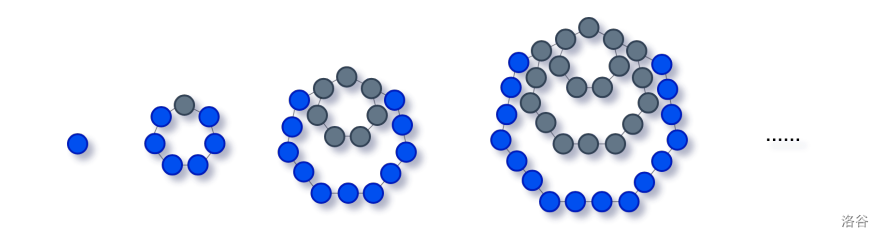

#### 输出格式

这是一道结果填空的题，你只需要算出结果后提交即可。本题的结果为一个整数，在提交答案时只需要**编写一个程序输出这个整数**，输出多余的内容将无法得分。

---

### — · 宝塔

> 题号 洛谷 P12253 ｜ 难度 中等（洛谷 普及） ｜ 时间 1.00s ｜ 内存 512MB
> 通过率 61.35%（洛谷站内口径） ｜ 题面原文 https://www.luogu.com.cn/problem/P12253
> 考过的语言/组别：国赛 Java 大学B组（洛谷题单）

#### 题目描述

小蓝最近迷上了宝塔游戏，这是一款迷宫填数游戏，玩家需要按照规则将高度为 $1$ 至 $N$ 的宝塔放置在一个 $N \times N$ 大小的水平放置的棋盘当中，每个宝塔占据棋盘的一个方格。具体规则如下：

1. 宝塔的高度只有 $1, 2, \ldots, N$。
2. 每一行、每一列中不可以出现相同高度的宝塔。
3. 棋盘周围的箭头中的数字表示从这个位置看向棋盘时可以看到的宝塔个数。

下图 1 是一个棋盘以及答案以供参考。图 2 是你需要解决的问题，你需要输出 $25$ 个数字表示答案，按照棋盘布局从左至右、从上至下的顺序输出即可。例如对于图 1 对应的棋盘而言，输出的答案是：$1432432121433214$。题目保证答案只有一个。

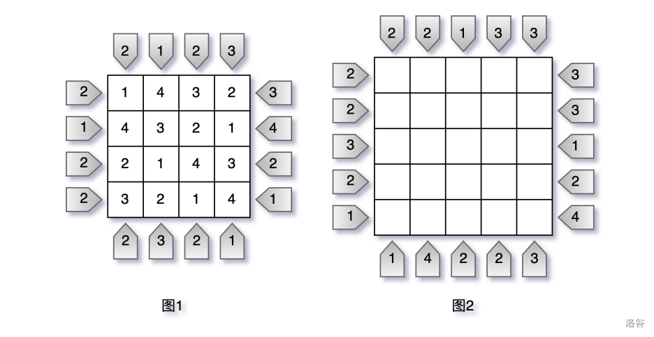

#### 输出格式

这是一道结果填空的题，你只需要算出结果后提交即可。本题的结果为一个整数，在提交答案时只需要**编写一个程序输出这个整数**，输出多余的内容将无法得分。

---

### — · 美丽区间

> 题号 洛谷 P12254 ｜ 难度 简单（洛谷 普及−） ｜ 时间 3.00s ｜ 内存 512MB
> 通过率 29.15%（洛谷站内口径） ｜ 题面原文 https://www.luogu.com.cn/problem/P12254
> 考过的语言/组别：国赛 Java 大学B组（洛谷题单）

#### 题目描述

美丽区间是这样的一组区间：$[L_1, R_1]$、$[L_2, R_2]$、$[L_3, R_3] \dots$。构造美丽区间需要满足以下条件：

1. $L_1 = 1$；
2. $L_i \leq R_i$；
3. $R_i - L_i \geq K$；
4. 对于任意的 $i > 1$，有 $L_i = R_{i-1} + 1$；
5. $\gcd(L_i, R_i) = 1$，其中 $\gcd$ 指两个数的最大公约数；
6. 在满足上述条件的情况下，$L_i$、$R_i$ 之间的差尽可能的小。

#### 输入格式

第一行输入一个整数 $K$。

第二行输入一个整数 $T$，表示有 $T$ 组测试用例。

接下来 $T$ 行，每行输入一个整数 $n$。

#### 输出格式

对每个输入的整数 $n$，输出一行，包含一个整数，表示 $n$ 属于第几个美丽区间。

#### 样例输入

```
10
3
123
33
10
```

#### 样例输出

```
11
3
1
```

#### 提示

### 样例说明

- 第 $1$ 个美丽区间为：$[1, 11]$。
- 第 $2$ 个美丽区间为：$[12, 23]$。
- 第 $3$ 个美丽区间为：$[24, 35]$。
- ……
- 第 $11$ 个美丽区间为：$[120, 131]$。

### 评测用例规模与约定

- 对于 $60\%$ 的评测用例：$1 \leq T \leq 10^3$，$1 \leq K \leq 10^6$，$1 \leq n \leq 10^6$。
- 对于 $100\%$ 的评测用例：$1 \leq T \leq 10^6$，$1 \leq K \leq 10^6$，$1 \leq n \leq 10^6$。

---

### — · 园丁

> 题号 洛谷 P12255 ｜ 难度 中等（洛谷 普及+/提高−） ｜ 时间 3.00s ｜ 内存 512MB
> 通过率 29.82%（洛谷站内口径） ｜ 题面原文 https://www.luogu.com.cn/problem/P12255
> 考过的语言/组别：国赛 Java 大学B组（洛谷题单）

#### 题目描述

小明是一位尽职尽责的园丁。这天他负责维护一棵树，树上有 $n$ 个结点 $1, 2, \ldots, n$，根结点为 $1$，结点 $i$ 的权值为 $a_i$。他需要更改一些结点的权值为任意正整数，使得对于任意一个至少有 $2$ 个儿子结点的结点 $i$ 满足：任意两个 $i$ 的儿子结点的权值的乘积都不是完全平方数。请问小明至少需要修改多少个结点的权值？

#### 输入格式

输入共 $n+1$ 行。

第一行为一个正整数 $n$。

第二行为 $n$ 个由空格分开的正整数 $a_1, a_2, \ldots, a_n$。

后面 $n-1$ 行，每行两个正整数表示树上的一条边。

#### 输出格式

输出共 $1$ 行，一个整数表示答案。

#### 样例输入

```
6
1 2 9 8 4 4
1 2
1 3
1 4
2 5
2 6
```

#### 样例输出

```
2
```

#### 提示

### 样例说明

其中一种方案：将结点 $2, 5$ 的权值分别修改为 $3, 2$。

### 评测用例规模与约定

- 对于 $20\%$ 的评测用例，保证 $n \leq 10^3$。
- 对于 $100\%$ 的评测用例，保证 $1\leq n \leq 10^5$，$1 \leq a_i \leq 10^9$。

---

### — · 数据库

> 题号 洛谷 P12256 ｜ 难度 中等（洛谷 普及+/提高−） ｜ 时间 3.00s ｜ 内存 512MB
> 通过率 36.36%（洛谷站内口径） ｜ 题面原文 https://www.luogu.com.cn/problem/P12256
> 考过的语言/组别：国赛 Java 大学B组（洛谷题单）

#### 题目描述

小蓝最近设计了一款“阅后即焚”数据库，顾名思义这个数据库只有两种操作：增加一条数据和删除一条数据。简言之，这款数据库中只有一个表，且这个表只有两列：$id$ 和 $value$，其中每条数据都有一个独一无二的编号 $id$，$value$ 则是这条数据对应的存储内容。

数据库操作语句有且仅有两种：

1. $\text{INSERT}$ $id$ $value$：插入一条新的数据，编号为 $id$，内容为 $value$。
2. $\text{DELETE}$ $id$：删除编号为 $id$ 的数据。

现在给出 $N$ 条数据库语句，我们保证按照给出的语句顺序执行是合法的，合法指的是：$\text{INSERT}$ 时数据库中一定不存在编号为 $id$ 的数据，$\text{DELETE}$ 时数据库中一定存在编号为 $id$ 的数据，且同一个编号 $id$ 不会被 $\text{INSERT}$ / $\text{DELETE}$ 多次。

你可以任意调整这些语句的执行顺序，现在请问一共有多少个不同的语句执行顺序，能够使得调整之后的语句顺序依旧是合法的并且按序执行之后数据库内容和给出的初始语句顺序执行后的结果一致。结果一致指的是二者包含的 $id$ 集合是相同的，并且相同的 $id$ 对应的 $value$ 也是相同的。

#### 输入格式

第一行一个整数 $N$ 表示有 $N$ 条数据库语句。

接下来输入 $N$ 行，每行一条数据库语句。

#### 输出格式

一行一个整数，表示答案。由于答案可能过大，请将答案对 $1\,000\,000\,007$ 取模之后输出。

#### 样例输入

```
4
INSERT 1 1
INSERT 2 2
DELETE 1
DELETE 2
```

#### 样例输出

```
6
```

#### 提示

### 样例说明

一共有 $6$ 种不同的排列方式：

| 1 | 2 | 3 | 4 | 5 | 6 |
| :----------: | :----------: | :----------: | :----------: | :----------: | :----------: |
| INSERT 1 1 | INSERT 1 1 | INSERT 2 2 | INSERT 2 2 | INSERT 1 1 | INSERT 2 2 |
| INSERT 2 2 | INSERT 2 2 | INSERT 1 1 | INSERT 1 1 | DELETE 1 | DELETE 2 |
| DELETE 1 | DELETE 2 | DELETE 1 |DELETE 2 | INSERT 2 2 | INSERT 1 1 |
| DELETE 2 | DELETE 1 | DELETE 2 | DELETE 1 | DELETE 2 | DELETE 1 |

它们都是合法的并且执行完后数据库中的内容都一样：没有任何数据。

### 评测用例规模与约定

- 对于 $30\%$ 的评测用例，$1 \leq N \leq 10$。
- 对于 $60\%$ 的评测用例，$1 \leq N \leq 1000$。
- 对于 $100\%$ 的评测用例，$1 \leq N \leq 10^5$，$id$ 和 $value$ 均是 32 位有符号整数。

---

### — · 分组

> 题号 洛谷 P12257 ｜ 难度 简单（洛谷 普及−） ｜ 时间 3.00s ｜ 内存 512MB
> 通过率 32.40%（洛谷站内口径） ｜ 题面原文 https://www.luogu.com.cn/problem/P12257
> 考过的语言/组别：国赛 Java 大学B组（洛谷题单）

#### 题目描述

小明班上有 $n$ 名同学，老师准备按上一次考试的分数对同学们进行分组，第 $i$ 名同学的分数为 $a_i$。老师希望把同学们分为尽可能多的小组，且满足每个小组中的同学分数的最大值至少是最小值的两倍。请问最多能分出多少个小组？如果把所有人分到同一组都不能满足条件则输出 $0$。

#### 输入格式

输入共 $2$ 行。

第一行为一个正整数 $n$。

第二行为 $n$ 个由空格分开的正整数表示 $a_1, a_2, \ldots, a_n$。

#### 输出格式

输出共 $1$ 行，一个整数表示答案。

#### 样例输入

```
6
3 5 2 1 4 2
```

#### 样例输出

```
3
```

#### 提示

### 样例说明

其中一种分组方式：第一组 $\{a_4, a_1\} = \{1, 3\}$，第二组 $\{a_3, a_2\} = \{2, 5\}$，第三组 $\{a_6, a_5\} = \{2, 4\}$。

### 评测用例规模与约定

- 对于 $20\%$ 的评测用例，保证 $n \leq 10$。
- 对于 $100\%$ 的评测用例，保证 $1\leq n \leq 10^5$，$0 < a_i \leq 10^8$。

---

### — · 背包问题

> 题号 洛谷 P12258 ｜ 难度 中等（洛谷 普及+/提高−） ｜ 时间 3.00s ｜ 内存 512MB
> 通过率 22.27%（洛谷站内口径） ｜ 题面原文 https://www.luogu.com.cn/problem/P12258
> 考过的语言/组别：国赛 Java 大学B组（洛谷题单）

#### 题目描述

神奇商店中一共有 $N$ 种不同的物品，第 $i$ 种物品的重量为 $W_i$，每种物品的数量都是无限个。店主会从中挑选任意种商品，每种商品可以选择任意个并将其装入到一个背包之中，从而可以组合出多种背包（这个背包可以容纳无限多的物品），其中背包的重量就是其中所含物品的重量之和。

小蓝想要的背包中至少要有 $K$ 件物品。小蓝想要知道，在所有满足他要求的背包中，如果将背包重量从小到大排序并去除重复的重量，排名第 $L$ 的重量是多少。

#### 输入格式

第一行输入三个整数，用空格分隔，依次是 $N$、$K$、$L$。

第二行输入 $N$ 个用空格分隔的整数表示 $N$ 件物品的重量。

#### 输出格式

输出一行，包含一个整数表示答案。

#### 样例输入

```
7 2 7
84 21 12 3 65 5 41
```

#### 样例输出

```
13
```

#### 提示

### 样例说明

背包中物品个数大于等于 $2$ 时，从小到大依次出现的背包重量为：

$6 = 3 + 3$、$8 = 3 + 5$、$9 = 3 + 3 + 3$、$10 = 5 + 5$、$11 = 3 + 3 + 5$、$12 = 3 + 3 + 3 + 3$、$13 = 3 + 5 + 5$。

### 评测用例规模与约定

- 对于 $40\%$ 的评测用例，$1 \leq W_i \leq 100$，$1 \leq L \leq 10$。
- 对于 $100\%$ 的评测用例，$1 \leq N \leq 10$，$1 \leq K \leq 10$，$1 \leq W_i \leq 10^9$，$1 \leq L \leq 10^5$

---

### — · 最优路径

> 题号 洛谷 P12259 ｜ 难度 困难（洛谷 省选/NOI−） ｜ 时间 3.00s ｜ 内存 512MB
> 通过率 38.95%（洛谷站内口径） ｜ 题面原文 https://www.luogu.com.cn/problem/P12259
> 考过的语言/组别：国赛 Java 大学B组（洛谷题单）

#### 题目描述

给出一个具有 $N$ 个点、$M$ 条边的无向图（可能存在重边和自环）。其中每条边都有一个 $w$ 属性表示无向边的权重。

你可以从这个图中任意选两个不同的点 $start$、$end$，并以 $start$ 作为起点，$end$ 作为终点找出一条从 $start$ 到 $end$ 的路径（这条路径可以多次经过同一个点，也可以多次经过同一条边），将这条路径上经过的所有边的权重求一个异或和便得到了这条路径的风险值。

小蓝想要找到一条风险值最小的路径，请问最小的风险值是多少？

#### 输入格式

第一行输入两个整数 $N$，$M$。

接下来输入 $M$ 行，每行三个整数 $u$、$v$、$w$，表示一条无向边连接 $u$、$v$ 两个点，权重为 $w$。

#### 输出格式

输出一个整数表示最小的风险值。如果不存在任何一条满足题意的路径，输出 $-1$。

#### 样例输入

```
3 4
1 1 9
2 3 3
2 3 8
3 3 1
```

#### 样例输出

```
2
```

#### 提示

### 样例说明

先走第二条边，再走第四条边，风险值 $3 \oplus 1 = 2$。

### 评测用例规模与约定

- 对于 $60\%$ 的评测用例，$1 \leq N \leq 50$，$0 \leq M \leq 10^3$。
- 对于 $100\%$ 的评测用例，$1 \leq N \leq 500$，$0 \leq M \leq 10^4$，$1 \leq u, v \leq N$，$1 \leq w \leq 10^3$。

---

### — · 房屋建造

> 题号 洛谷 P12260 ｜ 难度 困难（洛谷 省选/NOI−） ｜ 时间 3.00s ｜ 内存 512MB
> 通过率 15.79%（洛谷站内口径） ｜ 题面原文 https://www.luogu.com.cn/problem/P12260
> 考过的语言/组别：国赛 Java 大学B组（洛谷题单）

#### 题目描述

有一个由 $N$ 行 $N$ 列方格组成的建筑用地，每个方格，我们用 `#` 表示这是一堵墙，`.` 表示是一片空地，其中只有在空地上才可以进行房屋建造。小蓝想要在这片区域上建造两个房屋：通过水平/垂直方向可以连通在一起的区域属于同一个房屋。由于建筑物料有限，小蓝最多只能在 $K$ 个空地上进行房屋建造，同时他希望自己的房屋面积尽可能的大，所以他必须用光所有的 $K$ 块空地来建造房屋。

请问一共有多少种不同的建造方案。

#### 输入格式

第一行输入三个整数 $N$、$K$。

接下来输入 $N$ 行，每行输入一个长度为 $N$ 的字符串，表示方格布局。

#### 输出格式

输出一个整数表示答案。

#### 样例输入 1

```
3 3
###
.##
##.
```

#### 样例输出 1

```
0
```

#### 样例输入 2

```
3 3
.#.
.##
..#
```

#### 样例输出 2

```
5
```

#### 提示

### 样例说明

- 对于样例 $1$：$K = 3$，但只有两个空地，所以没有符合题意的解，答案为 $0$。
- 对于样例 $2$，答案如下所示，我们用 `@` 表示建筑物：

```
@#. @#@ @#. .#@ .#@
.## @## @## @## .##
@@# ..# .@# @.# @@#
```

### 评测用例规模与约定

- 对于 $50\%$ 的评测用例：$1 \leq N \leq 5$，$1 \leq K \leq 5$。
- 对于 $100\%$ 的评测用例：$1 \leq N \leq 8$，$1 \leq K \leq 8$。

---

### — · 激光炮

> 题号 洛谷 P12261 ｜ 难度 中等（洛谷 普及+/提高−） ｜ 时间 3.00s ｜ 内存 512MB
> 通过率 49.68%（洛谷站内口径） ｜ 题面原文 https://www.luogu.com.cn/problem/P12261
> 考过的语言/组别：国赛 Java 大学B组（洛谷题单）

#### 题目描述

小明在二维平面上放置了 $n$ 门激光炮，第 $i$ 门激光炮位于坐标 $(-10^5, a_i)$，射向靶点 $(10^5, b_i)$，形成 $n$ 条线段。他想使用一条垂直于 $x$ 轴且其中一个端点在 $x$ 轴上的线段挡住所有激光炮的发射路线，这条线段的长度最短为多少？

#### 输入格式

输入共 $n+1$ 行。

第一行为一个正整数 $n$。

后面 $n$ 行，每行 2 个由空格分开的非负整数表示 $a_i, b_i$。

#### 输出格式

输出共 $1$ 行，一个浮点数表示答案（输出四舍五入到 $2$ 位小数）。

#### 样例输入

```
3
0 100000
100000 200000
200000 0
```

#### 样例输出

```
133333.33
```

#### 提示

### 样例说明

第 $2,3$ 门激光炮发射路线的交点为 $(-\frac{100000}{3}, \frac{400000}{3})$，因此，只需要在 $(-\frac{100000}{3}, 0)$ 处放置一条长度为 $\frac{400000}{3} = 133333.33$ 的线段即可挡住所有 3 门激光炮。

### 评测用例规模与约定

- 对于 $20\%$ 的评测用例，保证 $n \leq 10^2$。
- 对于 $100\%$ 的评测用例，保证 $n \leq 10^5$，$0 \leq a_i, b_i \leq 10^6$。

---

### — · 不同的总分值

> 题号 洛谷 P12266 ｜ 难度 简单（洛谷 普及−） ｜ 时间 1.00s ｜ 内存 512MB
> 通过率 68.38%（洛谷站内口径） ｜ 题面原文 https://www.luogu.com.cn/problem/P12266
> 考过的语言/组别：国赛 Python 大学B组（洛谷题单）

#### 题目描述

在今年蓝桥杯的决赛中，一共有 $10$ 道题目，每道题目的分数依次为 $5$ 分，$5$ 分，$10$ 分，$10$ 分，$15$ 分，$15$ 分，$20$ 分，$20$ 分，$25$ 分，$25$ 分。

假设某位参赛选手在解答每一道题时，要么能得到该题的全部分数，要么就得 $0$ 分。那么请问，这位参赛选手在完成这 $10$ 道题之后，所能获得的总分值存在多少种不同的情况？

注意，总分值仅需关注选手 $10$ 道题的总得分，而无需关注具体是由哪些题获得了相应的分数。例如，选手第一道题获得 $5$ 分其余题均为 $0$ 分，与第二道题获得 $5$ 分其余题均为 $0$ 分，应视为同一种情况。

#### 输出格式

这是一道结果填空的题，你只需要算出结果后提交即可。本题的结果为一个整数，在提交答案时只需要**编写一个程序输出这个整数**，输出多余的内容将无法得分。

---

### — · 儿童数

> 题号 洛谷 P12267 ｜ 难度 中等（洛谷 普及） ｜ 时间 1.00s ｜ 内存 512MB
> 通过率 61.59%（洛谷站内口径） ｜ 题面原文 https://www.luogu.com.cn/problem/P12267
> 考过的语言/组别：国赛 Python 大学B组（洛谷题单）

#### 题目描述

若一个正整数 $n$ 满足 $n^{61}$ 整除 $2024!$，即 $2024!$ 除以 $n^{61}$ 的余数为 $0$，则称 $n$ 为“儿童数”。其中 $2024!$ 表示 2024 的阶乘，即 $1 \times 2 \times \cdots \times 2024$。

现在，请你计算在区间 $[1, \infty)$ 内一共有多少个“儿童数”。

#### 输出格式

这是一道结果填空的题，你只需要算出结果后提交即可。本题的结果为一个整数，在提交答案时只需要**编写一个程序输出这个整数**，输出多余的内容将无法得分。

---

### — · 球衣号码

> 题号 洛谷 P12268 ｜ 难度 简单（洛谷 普及−） ｜ 时间 3.00s ｜ 内存 512MB
> 通过率 45.18%（洛谷站内口径） ｜ 题面原文 https://www.luogu.com.cn/problem/P12268
> 考过的语言/组别：国赛 Python 大学B组（洛谷题单）

#### 题目描述

在篮球之都，有一支传奇的篮球队，名为“坤之队”。这支球队由 $n$ 位才华横溢的球员组成，编号分别为 $1, 2, \ldots, n$。

今年，坤之队共参加了 $m$ 场激烈的比赛。在每场比赛前，坤之队的教练阿坤都会举行一个出征仪式。他会指定其中一名球员为队长，并将其球衣的号码设为 $0$。同时，为了保持队员之间的秩序和团结，教练还会对其他球员的球衣号码进行调整。具体来说，站在队长右边的每个球员的球衣号码将比他左边球员的球衣号码大 $1$，而站在队长左边的每个球员的球衣号码将比他右边球员的球衣号码大 $1$。球队中可能会有相同的球衣号码。

举个例子，假设坤之队有 $n = 5$ 名球员，阿坤在一场比赛前指定编号为 $3$ 的球员为队长，那么球员们球衣的号码就会变为 $[2, 1, 0, 1, 2]$。

经过 $m$ 轮比赛的激烈角逐后，阿坤希望你能帮助他确定，每个球员所拥有过的最大球衣号码是多少。

#### 输入格式

输入的第一行包含两个正整数 $n$ 和 $m$，用一个空格分隔，分别表示球员数量和比赛场次数。

第二行包含 $m$ 个整数 $p_1, p_2, \ldots, p_m$，表示每场比赛前被指定为队长的球员的编号。

#### 输出格式

输出一行包含 $n$ 个整数，相邻整数之间使用一个空格分隔，依次表示每个球员所拥有过的最大球衣编号。

#### 样例输入

```
6 2
1 3
```

#### 样例输出

```
2 1 2 3 4 5
```

#### 提示

### 样例说明

- 在第一场比赛的出征仪式中，阿坤指定了编号为 1 的球员为队长。此时球员们的球衣号码为：
$$[0,1,2,3,4,5]$$
- 在第二场比赛的出征仪式中，阿坤指定了编号为 3 的球员为队长。此时球员们的球衣号码为：
$$[2,1,0,1,2,3]$$
- 因此，每个球员所拥有过的最大球衣号码为：
$$[2,1,2,3,4,5]$$

### 评测用例规模与约定

- 对于 $20\%$ 的评测用例，$1 \leq m \leq n \leq 100$，$1 \leq p_i \leq n$，$p_1, p_2, \ldots, p_m$ 各不相同。
- 对于 $50\%$ 的评测用例，$1 \leq m \leq n \leq 10^3$，$1 \leq p_i \leq n$，$p_1, p_2, \ldots, p_m$ 各不相同。
- 对于所有评测用例，$1 \leq m \leq n \leq 10^5$，$1 \leq p_i \leq n$，$p_1, p_2, \ldots, p_m$ 各不相同。

---

### — · 切木棒

> 题号 洛谷 P12269 ｜ 难度 中等（洛谷 普及） ｜ 时间 3.00s ｜ 内存 512MB
> 通过率 38.22%（洛谷站内口径） ｜ 题面原文 https://www.luogu.com.cn/problem/P12269
> 考过的语言/组别：国赛 Python 大学B组（洛谷题单）

#### 题目描述

给定 $n$ 根木棒，第 $i$ 根木棒的长度为 $L_i$。

每次你可以选择任意一根木棒并将其切成两段，切完后两段的长度都必须为整数。被切成两段的木棍也可以被选择继续切成两段。

请问，如果一共切 $m$ 次，在所有的方案中，切完后木棒中最长的一根最短是多少？

#### 输入格式

输入的第一行包含两个整数 $n, m$，用一个空格分隔。

第二行包含 $n$ 个正整数 $L_1, L_2, \ldots, L_n$，依次表示每根木棍的长度。

#### 输出格式

输出一行包含一个整数表示答案。

#### 样例输入

```
3 3
3 4 6
```

#### 样例输出

```
3
```

#### 提示

### 评测用例规模与约定

- 对于 $60\%$ 的评测用例，$n \leq 5000$；
- 对于所有评测用例，$1 \leq n \leq 3 \times 10^5$，$1 \leq m, L_i \leq 10^9$。

---

### — · 马与象

> 题号 洛谷 P12270 ｜ 难度 中等（洛谷 普及） ｜ 时间 3.00s ｜ 内存 512MB
> 通过率 36.19%（洛谷站内口径） ｜ 题面原文 https://www.luogu.com.cn/problem/P12270
> 考过的语言/组别：国赛 Python 大学B组（洛谷题单）

#### 题目描述

小蓝有一个大小为 $N \times N$ 的棋盘（棋子可以走的位置有 $(N+1) \times (N+1)$ 个），棋盘上只有两个棋子：一个马和一个象，他们的行动规则是：马走日，马可以走到一个日字形状的对角；象飞田，象可以走到一个田字形状的对角，即斜着走两格（注意无需遵守象棋中的蹩马腿、塞象眼的规则）。在下图所示的大小为 $4 \times 4$ 的棋盘上，展示了两种棋子具体的行进方式：

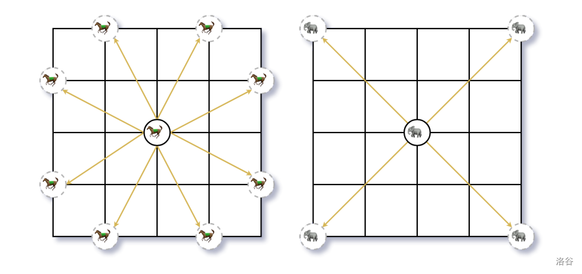

在任意一方先手、每一方都可以连续走任意步的情况下，请问有没有可能出现一方吃掉另一方的局面，如果有，请输出最少需要经过几步可以达到这个局面，否则输出 $-1$。注意：棋子不能走出棋盘。

#### 输入格式

输入一行包括五个整数 $N, x_1, y_1, x_2, y_2$ ，相邻整数之间使用一个空格分隔，表示棋盘大小、马的初始位置 $(x_1, y_1)$ 以及象的初始位置 $(x_2, y_2)$。

#### 输出格式

输出一行包含一个整数表示答案。如果答案不存在输出 $-1$。

#### 样例输入 1

```
4 0 2 1 2
```

#### 样例输出 1

```
3
```

#### 样例输入 2

```
4 2 2 2 3
```

#### 样例输出 2

```
2
```

#### 提示

### 样例说明 1

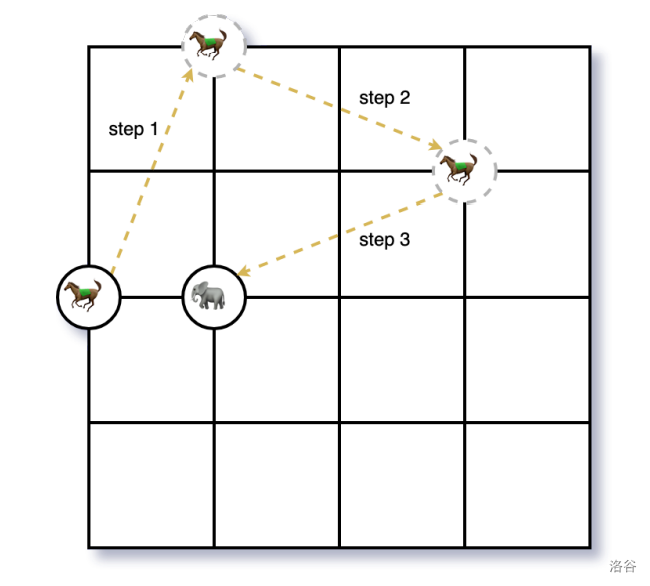

### 样例说明 2

各走一步可能出现一方吃掉另一方的局面。

### 评测用例规模与约定

- 对于 $50\%$ 的评测用例，$1 \leq N \leq 10$；
- 对于所有评测用例，$1 \leq N \leq 50$，$0 \leq x_1, y_1, x_2, y_2 \leq N$。

---

### — · 括号与字母

> 题号 洛谷 P12271 ｜ 难度 中等（洛谷 普及+/提高−） ｜ 时间 5.00s ｜ 内存 512MB
> 通过率 26.17%（洛谷站内口径） ｜ 题面原文 https://www.luogu.com.cn/problem/P12271
> 考过的语言/组别：国赛 Python 大学B组（洛谷题单）

#### 题目描述

给定一个仅包含小写字母和括号的字符串 $S$，保证括号可以两两匹配。

给出 $Q$ 组询问，每组询问给出一个小写字母 $c_i$ 和一个数 $x_i$，询问 $S$ 中有多少对匹配的括号之间有不少于 $x_i$ 个 $c_i$。

#### 输入格式

输入的第一行包含一个字符串 $S$。

第二行包含一个整数 $Q$。

接下来 $Q$ 行，每行包含一个小写字母 $c_i$ 和一个整数 $x_i$ 表示一组询问，用一个空格分隔。

#### 输出格式

输出 $Q$ 行，每行包含一个整数，依次表示每个询问的答案。

#### 样例输入

```
((a)()((b)((c))))
3
a 2
b 1
c 1
```

#### 样例输出

```
0
3
4
```

#### 提示

### 评测用例规模与约定

- 对于 $40\%$ 的评测用例，$|S|, Q \leq 5000$；
- 对于 $70\%$ 的评测用例，$|S| \leq 100000$；
- 对于所有评测用例，$1 \leq |S| \leq 10^6$，$1 \leq Q \leq 100000$，$0 \leq x_i < 10^6$。其中 $|S|$ 表示 $S$ 的长度。

---

### — · 全 X 数

> 题号 洛谷 P12272 ｜ 难度 困难（洛谷 提高） ｜ 时间 3.00s ｜ 内存 512MB
> 通过率 15.87%（洛谷站内口径） ｜ 题面原文 https://www.luogu.com.cn/problem/P12272
> 考过的语言/组别：国赛 Python 大学B组（洛谷题单）

#### 题目描述

我们称 $22222, 3333, 7777$ 等由单一数字组成的十进制数为全 $X$ 数。

给定一个整数 $n$，小蓝想知道 $n$ 的所有倍数中最小的全 $X$ 数是多少。由于答案可能很大，你只需要输出答案对 $998244353$ 取模的结果。如果不存在任何答案，请输出 $-1$。

#### 输入格式

输入一行包含一个整数 $n$。

#### 输出格式

输出一行包含一个整数表示答案。

#### 样例输入

```
12
```

#### 样例输出

```
444
```

#### 提示

### 评测用例规模与约定

- 对于 $50\%$ 的评测用例，$n \leq 5000$；
- 对于 $75\%$ 的评测用例，$n \leq 10^6$；
- 对于所有评测用例，$1 \leq n \leq 10^9$。

---

### — · 异位和

> 题号 洛谷 P12273 ｜ 难度 中等（洛谷 普及+/提高−） ｜ 时间 3.00s ｜ 内存 512MB
> 通过率 30.41%（洛谷站内口径） ｜ 题面原文 https://www.luogu.com.cn/problem/P12273
> 考过的语言/组别：国赛 Python 大学B组（洛谷题单）

#### 题目描述

给定一个数组 $A$，我们称 $A$ 的异位和数组为另一个等长的数组 $B = F(A)$，满足

$$B_i = \sum_{j \neq i} A_j$$

类似地，其二次异位和数组为 $F(F(A))$，三次异位和数组为 $F(F(F(A)))$，以此类推。

给定若干次询问，每次问 $A$ 的 $k_i$ 次异位和数组的第 $x_i$ 个元素的值是多少。输出答案对 $998244353$ 取模后的结果。

#### 输入格式

输入的第一行包含一个整数 $n$。

第二行包含 $n$ 个整数 $A_1, A_2, \ldots, A_n$，相邻整数之间使用一个空格分隔。

第三行包含一个整数 $Q$ 表示询问次数。

接下来 $Q$ 行，每行包含两个整数 $k_i, x_i$ 表示一组询问，用一个空格分隔。

#### 输出格式

输出 $Q$ 行，每行包含一个整数，依次表示每个询问的答案。

#### 样例输入

```
5
1 2 3 4 5
4
1 1
2 5
7 3
999 4
```

#### 样例输出

```
14
50
49152
781284616
```

#### 提示

### 评测用例规模与约定

- 对于 $60\%$ 的评测用例，$1 \leq n, Q, k_i \leq 5000$；
- 对于所有评测用例，$1 \leq n, Q \leq 10^5$，$1 \leq A_i, k_i \leq 10^9$，$1 \leq x_i \leq n$。

---

### — · 设计

> 题号 洛谷 P12274 ｜ 难度 中等（洛谷 普及+/提高−） ｜ 时间 3.00s ｜ 内存 512MB
> 通过率 31.94%（洛谷站内口径） ｜ 题面原文 https://www.luogu.com.cn/problem/P12274
> 考过的语言/组别：国赛 Python 大学B组（洛谷题单）

#### 题目描述

小蓝是 H 市的市长，她正在用设计软件规划 H 市的道路建设。

小蓝可以选定两个地区，用一条双向道路将这两个地区连接。由于预算等因素的动态变化，小蓝经常需要拆除一些已经建设好的道路，同时，她希望知道对于当前的两个地区，是否存在一条由多条道路组成的路径能够连接这两个地区。

#### 输入格式

输入的第一行包含两个正整数 $n, m$，用一个空格分隔，其中 $n$ 表示地区个数，$m$ 表示操作次数。

接下来 $m$ 行，每行表示一个操作。对于每一行：

- $1$ $x_i$ $y_i$ 表示小蓝修建了一条连接地区 $x_i$ 与地区 $y_i$ 的双向道路。
- $2$ 表示小蓝拆除了当前 H 市中还未被拆除的最后修建的一条道路，如果当前城市中已经不存在道路，则小蓝不会进行任何操作。
- $3$ $x_i$ $y_i$ 表示小蓝希望知道地区 $x_i$ 与地区 $y_i$ 是否连通，即是否存在一条由多条道路组成的路径能够连接这两个地区。

#### 输出格式

对于每个操作 $3$ 输出 `Yes` 或 `No`，其中 `Yes` 表示连通，`No` 表示不连通。

#### 样例输入 1

```
2 5
3 1 2
1 1 2
3 1 2
2
3 1 2
```

#### 样例输出 1

```
No
Yes
No
```

#### 样例输入 2

```
3 8
1 1 2
1 1 3
1 2 3
2
3 2 3
2
3 1 2
3 2 3
```

#### 样例输出 2

```
Yes
Yes
No
```

#### 提示

### 评测用例规模与约定

- 对于 $50\%$ 的评测用例，$n, m \leq 3000$。
- 对于所有评测用例，$1 \leq n, m \leq 300000$，$1 \leq x_i, y_i \leq n$，$x_i \neq y_i$。

---

### — · 工厂

> 题号 洛谷 P12275 ｜ 难度 中等（洛谷 普及+/提高−） ｜ 时间 3.00s ｜ 内存 512MB
> 通过率 30.87%（洛谷站内口径） ｜ 题面原文 https://www.luogu.com.cn/problem/P12275
> 考过的语言/组别：国赛 Python 大学B组（洛谷题单）

#### 题目描述

H 市是一座制造业十分发达的城市。在 H 市中，工厂可以生产 $n$ 种不同的物品，部分物品都可以以特定的价格 $a_i$ 在市场上售出而带来收益。生产方式分为两类，使用第一类生产方式每个工人可以在一天时间内生产若干件物品 $y$。使用第二类生产方式，每个工人可以在一天时间内使用若干件物品 $x$ 生产若干件物品 $y$，其中 $x \leq y$，即只能将编号较小的物品加工成编号较大的物品。

小蓝作为 H 市的市长自然希望能够最大化收益，由于 H 市的人口非常多，你只需要帮她计算出平均一天内每个工人能够获得的最大收益即可。

#### 输入格式

输入的第一行包含两个正整数 $n, m$，用一个空格分隔，其中 $n$ 表示物品种数，$m$ 表示生产方式总数。

第二行包含 $n$ 个正整数 $a_i$，相邻整数之间使用一个空格分隔，表示物品的售价，若 $a_i = 0$ 则表示这种物品无法在市场上售出。

接下来 $m$ 行，每行包含四个非负整数 $x_i, y_i, k_i, w_i$，相邻整数之间使用一个空格分隔，表示一个工人可以在一天时间内使用 $k_i$ 件物品 $x_i$ 生产 $w_i$ 件物品 $y_i$。特殊地，如果 $k_i = 0$（此时 $x_i$ 不一定为 $0$，请忽略 $x_i$ 的值）则表示该种生产方式是第一类生产方式，不需要原材料。

#### 输出格式

输出一行包含一个实数，四舍五入保留正好两位小数，表示平均每个工人在一天时间内能够获得的最大收益。

#### 样例输入

```
3 3
1 0 2
1 1 0 6
1 2 5 10
2 3 6 10
```

#### 样例输出

```
9.52
```

#### 提示

### 样例说明

$1$ 个工人可以在一天时间内生产 $6$ 份小麦，或者将 $5$ 份小麦加工成 $10$ 份面粉，或者将 $6$ 份面粉加工成 $10$ 份饼干。

那么最理想的情况是 $5$ 个工人生产小麦，$6$ 个工人将小麦加工成面粉，$10$ 个工人将面粉加工成饼干后在市场上以 $2$ 的价格出售。

此时需要 $21$ 个工人生产，共能获得 $200$ 的收益。平均每个工人一天时间内获得的收益约为 $9.52$。

### 评测用例规模与约定

- 对于 $50\%$ 的评测用例，$1 \leq n, m \leq 300$，$w_i = 1$，$0 \leq k_i \leq 1$；
- 另存在 $20\%$ 的评测用例，$x_i = y_i$；
- 对于所有评测用例，$1 \leq n, m \leq 300000$，$0 \leq a_i \leq 10^6$，$1 \leq w_i \leq 10$，$0 \leq k_i \leq 10$，$1 \leq x_i \leq y_i \leq n$。保证数据中至少存在一个 $k_i = 0$。

---

### — · 汉字田

> 题号 洛谷 P12276 ｜ 难度 简单（洛谷 普及−） ｜ 时间 1.00s ｜ 内存 512MB
> 通过率 76.13%（洛谷站内口径） ｜ 题面原文 https://www.luogu.com.cn/problem/P12276
> 考过的语言/组别：国赛 Python 大学A组、Java 大学A组（洛谷题单）

#### 题目描述

在中国传统文化中，汉字“田”具有非常重要的地位。其最初的象形意义展现了一块被四等分的农田，四个等分代表农田的不同区域，中间交叉点则代表了田间的道路或水渠。在古代，农田的划分与耕作是社会经济的根基，所以“田”字不仅代表农田，还象征着土地、财产和生产力。到了现代，虽“田”字的直接象形意义已经不再明显，但它仍是生活中不可或缺的一部分，在语言文字以及数学逻辑思维训练中都发挥着作用。比如在几何问题中，“田字格”常常被用来帮助理解空间问题。

现在，若将汉字“田”抽象为一个由 $9$ 个点组成的图形，这些点分布在田字格的四个角、四条外边的中点以及田字格的中心。那么请问，一共有多少条直线恰好只经过这 $9$ 个点中的任意两个点？

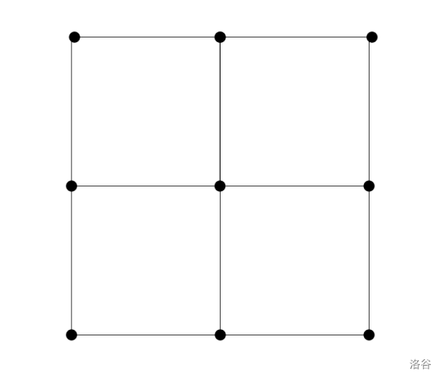

#### 输出格式

这是一道结果填空的题，你只需要算出结果后提交即可。本题的结果为一个整数，在提交答案时只需要**编写一个程序输出这个整数**，输出多余的内容将无法得分。

---

### — · 床底取牌

> 题号 洛谷 P12277 ｜ 难度 简单（洛谷 普及−） ｜ 时间 1.00s ｜ 内存 512MB
> 通过率 70.87%（洛谷站内口径） ｜ 题面原文 https://www.luogu.com.cn/problem/P12277
> 考过的语言/组别：国赛 Python 大学A组（洛谷题单）

#### 题目背景

原题题面存在歧义，洛谷题面明确了是**一定能**凑齐六张卡牌最少从床底下取出多少张卡牌。

#### 题目描述

最近，小蓝对拼单词的游戏特别着迷。他有一盒专门用于拼单词的字母卡片，其中每张卡片上分别印有 $\tt l$、$\tt a$、$\tt n$、$\tt q$、$\tt i$、$\tt o$ 中的一个字母，并且每种字母对应的卡牌都有 $5$ 张。

小蓝给自己设定了一个目标，即拼出单词 $\tt{lanqiao}$。对此，他需要 $2$ 张 $\tt a$ 以及 $\tt l$、$\tt n$、$\tt q$、$\tt i$、$\tt o$ 各 $1$ 张。

然而，很不幸的是，小蓝在玩耍时不小心把卡片盒打翻了，所有的卡片一下子都掉进了床底下。因为床底下光线非常暗，小蓝根本无法看清卡片上的字母。

那么请问，要想**一定能**凑齐 $\tt l$、$\tt a$、$\tt n$、$\tt q$、$\tt i$、$\tt a$、$\tt o$ 这 $6$ 张卡牌，小蓝最少需要从床底下取出几张卡牌呢？

#### 输出格式

这是一道结果填空的题，你只需要算出结果后提交即可。本题的结果为一个整数，在提交答案时只需要**编写一个程序输出这个整数**，输出多余的内容将无法得分。

---

### — · 设置密码

> 题号 洛谷 P12278 ｜ 难度 简单（洛谷 普及−） ｜ 时间 3.00s ｜ 内存 512MB
> 通过率 14.14%（洛谷站内口径） ｜ 题面原文 https://www.luogu.com.cn/problem/P12278
> 考过的语言/组别：国赛 Python 大学A组（洛谷题单）

#### 题目描述

小蓝设计了一个管理系统，管理系统需要支持设置用户的密码，并给出密码的强度。合法密码要求如下:

只能包含大小写字母、数字和特殊字符 `~!@#$%^&*()_`，以上字符的 ASCII 码依次为: $126$，$33$，$64$，$35$，$36$，$37$，$94$，$38$，$42$，$40$，$41$，$95$。

密码的强度按下列方式判断:

- 强密码: 密码长度 $\geq 12$ ，同时包含大写字母、小写字母、数字、特殊字符，或包含包括特殊字符在内的其中三种，且特殊字符的种类数 $\geq 3$；
- 中密码: 密码长度 $\geq 8$ ，不属于强密码，至少有大写字母、小写字母、数字、特殊字符中的两种；
- 弱密码: 密码长度 $\geq 6$ ，不属于强密码或中密码。

三者都不是的密码同样视为不合法的密码。

给定若干个字符串 (每行一个)，判断其是否能作为密码，能作为密码时判断密码的强度。

对每个字符串输出 $0,1,2,3$ 中的一个，分别对应不合法的密码、弱密码、中密码、强密码四种情况。

#### 输入格式

输入的第一行包含一个整数 $T$ ，表示需要判断的密码的个数。

接下来 $T$ 行，每行包含一个字符串 $S_i$ ，表示一个需要判断的密码。保证每个字符串中仅包含 ASCII 码中的可打印字符（ASCII 码在 $32$ 至 $126$ 之间，包含 $32$ 和 $126$）。

#### 输出格式

输出 $T$ 行，每行包含一个数字 $A_i$ 表示第 $i$ 个密码的强度。

#### 样例输入

```
4
@Qaq1
123456
lanqiao2024
a1@R7c1h(GO*q3)
```

#### 样例输出

```
0
1
2
3
```

#### 提示

### 评测用例规模与约定

- 对于 $80\%$ 的评测用例，$T = 1$；
- 对于所有评测用例，$1 \leq T \leq 10^5$，$1 \leq |S_i| \leq 32$，其中 $|S_i|$ 表示 $S_i$ 的长度。

---

### — · 限流器

> 题号 洛谷 P12279 ｜ 难度 简单（洛谷 普及−） ｜ 时间 3.00s ｜ 内存 512MB
> 通过率 55.04%（洛谷站内口径） ｜ 题面原文 https://www.luogu.com.cn/problem/P12279
> 考过的语言/组别：国赛 Python 大学A组（洛谷题单）

#### 题目描述

小蓝最近为自己的服务开发了一套 OpenAPI，为了防止接口被恶意盗刷，他需要搭建一套分布式限流组件。

简而言之，我们想要限制在时间区间 $[k \cdot N, (k + 1) \cdot N) (k = 0, 1, 2, \cdots)$ 中，接口最多只允许成功访问 $M$ 次，对于超出限制的访问则返回异常状态表示请求失败。

现在给出某个客户端对 API 请求的时间戳，请你统计下其中有多少次的请求是成功的。

#### 输入格式

输入的第一行包含三个整数 $N, M, L$，相邻整数之间使用一个空格分隔。

第二行包含 $L$ 个整数 $t_1, t_2, \cdots, t_L$，相邻整数之间使用一个空格分隔，表示 $L$ 次 API 访问的时间戳。

#### 输出格式

输出一行包含一个整数表示 API 请求成功的次数。

#### 样例输入

```
60 5 10
0 60 15 60 0 50 60 1 1 61
```

#### 样例输出

```
9
```

#### 提示

### 样例说明

$[0,60)$ 内访问了 $6$ 次，有 $1$ 次会访问失败，$5$ 次访问成功；$[60,120)$ 内访问了 $4$ 次，均成功；总计成功访问 $5+4=9$ 次。

### 评测用例规模与约定

对于所有评测用例，$1 \leq N, M, L \leq 1000$，$0 \leq t_i \leq 1000$。

---

### — · 特别的数组

> 题号 洛谷 P12280 ｜ 难度 中等（洛谷 普及） ｜ 时间 3.00s ｜ 内存 512MB
> 通过率 31.93%（洛谷站内口径） ｜ 题面原文 https://www.luogu.com.cn/problem/P12280
> 考过的语言/组别：国赛 Python 大学A组（洛谷题单）

#### 题目描述

如果一个数组中的所有元素都互不相同，我们称其为一个特别的数组。

给定一个数组 $(a_1, a_2, \cdots, a_n)$，你可以选择一对 $L, R$ 并将数组中的第 $L$ 至 $R$ 个元素移除。求对给定的数组进行一次这样的操作后可以得到的特别的数组的长度最大是多少。

#### 输入格式

输入的第一行包含一个整数 $n$，表示数组的长度。

第二行包含 $n$ 个整数 $a_1, a_2, \cdots, a_n$，相邻整数之间使用一个空格分隔。

#### 输出格式

输出一行包含一个整数表示进行一次移除操作后可以得到的特别的数组的最大长度。

#### 样例输入

```
9
1 2 3 4 2 5 7 6 3
```

#### 样例输出

```
7
```

#### 提示

### 样例说明

移除第 $2, 3$ 个元素可以得到 $1 \ 4 \ 2 \ 5 \ 7 \ 6 \ 3$。

### 评测用例规模与约定

- 对于 $60\%$ 的评测用例，$n \leq 5000$；
- 对于所有评测用例，$1 \leq n, a_i \leq 10^5$。

---

### — · 记事本

> 题号 洛谷 P12281 ｜ 难度 中等（洛谷 普及） ｜ 时间 3.00s ｜ 内存 512MB
> 通过率 41.73%（洛谷站内口径） ｜ 题面原文 https://www.luogu.com.cn/problem/P12281
> 考过的语言/组别：国赛 Python 大学A组、Java 大学A组（洛谷题单）

#### 题目描述

小蓝经常用记事本记录文字，最近他发现记事本功能太少，因此他写了一款插件用来支持记事本更多的文本编辑功能，这些功能如下表所示：

| 命令 | 功能 |
| :---: | :---: |
| $[n]\mathrm{h}$ | 光标向左移动 $[n]$ 个字符（到最左侧则停止）。 |
| $[n]\mathrm{l}$ | 光标向右移动 $[n]$ 个字符（到最右侧则停止）。 |
| $\mathrm{insert}$ "$[text]$" | 在当前光标位置插入文本 $[text]$，同时光标移动到 $[text]$ 右侧。 |
| $\mathrm d [n]\mathrm{h}$ | 删除光标左侧 $[n]$ 个字符（不足 $[n]$ 则全删除）。 |
| $\mathrm d [n]\mathrm{l}$ | 删除光标右侧 $[n]$ 个字符（不足 $[n]$ 则全删除）。 |

小蓝建立了一个新的文本文件，初始是空白的，在经过若干次上述操作之后，请将文本内容输出。

#### 输入格式

输入的第一行包含一个整数 $T$，表示操作次数。

接下来 $T$ 行，每行包含一个命令，格式如上表所示。

#### 输出格式

输出一行包含一个字符串表示最终文本内容。

#### 样例输入

```
9
d1h
insert "hello"
insert " world"
7h
d2h
insert "11"
3l
d1l
insert "0"
```

#### 样例输出

```
he11o w0rld
```

#### 提示

### 评测用例规模与约定

对于所有评测用例，$1 \leq T \leq 100$，$1 \leq |text| \leq 100$，$1 \leq n \leq 100$，$text$ 仅包含大小写字母、数字、空格。

---

### — · 羊圈

> 题号 洛谷 P12282 ｜ 难度 中等（洛谷 普及+/提高−） ｜ 时间 3.00s ｜ 内存 512MB
> 通过率 23.82%（洛谷站内口径） ｜ 题面原文 https://www.luogu.com.cn/problem/P12282
> 考过的语言/组别：国赛 Python 大学A组（洛谷题单）

#### 题目描述

小蓝养了 $m$ 头羊，它们站成一排，第 $i$ 头羊有 $p_i$ 的概率跑掉。小蓝为了不让他的羊跑掉，购买了 $n$ 个羊圈，第 $i$ 个羊圈最多可以框住连续的 $l_i$ 只羊，让它们无法逃跑。小蓝想知道，在合理安排羊圈位置的情况下，能跑掉的羊的数量的期望的最小值是多少？

请注意：羊圈不一定都使用，也不一定按顺序使用。

#### 输入格式

输入的第一行包含两个正整数 $n, m$，用一个空格分隔。

第二行包含 $n$ 个正整数 $l_1, l_2, \cdots, l_n$，相邻整数之间使用一个空格分隔。

第三行包含 $m$ 个浮点数 $p_1, p_2, \cdots, p_m$，每个浮点数小数点后不超过 $2$ 位小数，相邻浮点数之间使用一个空格分隔。

#### 输出格式

输出一行包含一个浮点数表示答案，四舍五入保留正好两位小数。

#### 样例输入

```
3 10
1 2 3
0.1 0.2 0.3 0.4 0.5 0.6 0.7 0.8 0.9 1.0
```

#### 样例输出

```
1.00
```

#### 提示

### 样例说明

第一个羊圈框住第 $5$ 头羊，第二个羊圈框住第 $9$ 至第 $10$ 头羊，第三个羊圈框住第 $6$ 至第 $8$ 头羊，剩下的羊逃跑的数量的期望为 $0.1 + 0.2 + 0.3 + 0.4 = 1.0$

### 评测用例规模与约定

- 对于 $20\%$ 的评测用例，$1 \leq n \leq 8$；
- 对于所有评测用例，$1 \leq n \leq 15$，$1 \leq m \leq 200$，$1 \leq l_i \leq m$，$0 \leq p_i \leq 1$。

---

### — · 排练

> 题号 洛谷 P12283 ｜ 难度 中等（洛谷 普及+/提高−） ｜ 时间 3.00s ｜ 内存 512MB
> 通过率 13.15%（洛谷站内口径） ｜ 题面原文 https://www.luogu.com.cn/problem/P12283
> 考过的语言/组别：国赛 Python 大学A组（洛谷题单）

#### 题目描述

小蓝的班上有 $n$ 名同学正在为校庆活动排练节目，他们在舞台上站成一排。若把他们看做在数轴上，从左到右第 $i$ 名同学的位置即为 $a_i$。为了美观，小蓝想在队伍中插入一些新同学，使得在新队伍中，对于任意三名相邻的同学的位置 $a_{i-1}, a_i, a_{i+1}$ 满足 $a_{i+1} - a_i \leq 2(a_i - a_{i-1})$。小蓝想知道最少增加多少名同学可以满足条件。

#### 输入格式

输入的第一行包含一个正整数 $n$。

第二行包含 $n$ 个正整数 $a_1, a_2, \cdots, a_n$ ，相邻整数之间使用一个空格分隔。

#### 输出格式

输出一行包含一个整数表示答案。

#### 样例输入

```
4
1 3 16 17
```

#### 样例输出

```
2
```

#### 提示

### 样例说明

其中一种方案：在 $6, 10$ 处插入两名同学，新队伍为 $1, 3, 6, 10, 16, 17$，满足条件。

### 评测用例规模与约定

- 对于 $20\%$ 的评测用例，$1 \leq n \leq 10^3$；
- 对于所有评测用例，$1 \leq n \leq 10^5$，$1 \leq a_i \leq 10^8$，$a_{i+1} > a_i$。

---

### — · 数字与留言

> 题号 洛谷 P12284 ｜ 难度 困难（洛谷 提高） ｜ 时间 3.00s ｜ 内存 512MB
> 通过率 26.19%（洛谷站内口径） ｜ 题面原文 https://www.luogu.com.cn/problem/P12284
> 考过的语言/组别：国赛 Python 大学A组（洛谷题单）

#### 题目描述

在一个阳光明媚的上午，小蓝走进了数学教室。他的目光很快被黑板上两个孤零零的数字 $x, y$ 吸引。数学老师总爱出些奇妙的谜题，今天显然也不例外。老师留言称，这两个数字暗含着一层不同寻常的心意，要想揭开这份心意的神秘面纱，就必须在 $1 \sim x$ 之间找到三个不同的正整数，使得这三个数的和除以 $2024$ 的余数值为 $y$，且这三个数的各个数位都不得包含数字 $2$ 和 $4$。

现在，请你帮助小蓝，求出有多少种不同的满足条件的三个数的组合。由于这个答案可能很大，你只需要输出答案对 $10^9 + 7$ 取余后的结果即可。

注意，如果通过改变三个正整数的顺序可以得到相同的组合，则这样的组合也被视为同一种。例如，对于 $x = 10, y = 9$，无论是 $1 + 3 + 5$ 还是 $5 + 3 + 1$，都只算作一种。

#### 输入格式

输入一行包含两个整数 $x, y$，用一个空格分隔。

#### 输出格式

输出一行包含一个整数，表示答案对 $10^9 + 7$ 取余后的结果。

#### 样例输入

```
10 9
```

#### 样例输出

```
1
```

#### 提示

### 样例说明

满足条件的组合仅有一组：$(1, 3, 5)$。

### 评测用例规模与约定

- 对于 $10\%$ 的评测用例，$1 \leq x \leq 700$，$0 \leq y \leq 2023$。
- 对于 $30\%$ 的评测用例，$1 \leq x \leq 10^5$，$0 \leq y \leq 2023$。
- 对于所有评测用例，$1 \leq x \leq 10^{12}$，$0 \leq y \leq 2023$。

---

### — · 药剂

> 题号 洛谷 P12285 ｜ 难度 困难（洛谷 省选/NOI−） ｜ 时间 3.00s ｜ 内存 512MB
> 通过率 41.36%（洛谷站内口径） ｜ 题面原文 https://www.luogu.com.cn/problem/P12285
> 考过的语言/组别：国赛 Python 大学A组（洛谷题单）

#### 题目描述

小蓝今天的实验内容是合并 $N$ 瓶试剂。每瓶试剂初始都有一个魔法值 $a_i$，所有魔法值都是正整数。

每次小蓝会随机从手头的试剂中选出两瓶，将其合并。合并时，两瓶试剂会发生化学反应，产生强大的力量，也有可能效果没有那么好。但无论如何，小蓝会得到一瓶全新的，可以和其他试剂合并的试剂。我们认为，小蓝在合并两瓶试剂时，如果两瓶试剂的魔法值分别是 $x$ 和 $y$，有 $\frac{1}{2}$ 的概率，小蓝得到的新试剂魔法值为 $x+y$，对于另 $\frac{1}{2}$ 概率，小蓝得到的新试剂的魔法值为 $xy$。

像这样，小蓝重复合并操作 $n-1$ 次，最后只会剩下一瓶试剂。小蓝希望知道，最后这瓶试剂的魔法值期望是多少。为了方便，假定这个值是 $ans$，你只需要告诉小蓝，$ans$ 乘上 $2^{n-1}\displaystyle \prod_{i=2}^{n}C_i^2$ 的结果，其中 $C_i^2$ 是组合数。不难证明这个值一定是一个整数。但这个乘积显然太大了，小蓝只希望你告诉她这个乘积对整数 $mo$ 取模之后的结果。

#### 输入格式

输入的第一行包含两个正整数 $N, mo$，用一个空格分隔。

第二行包含 $N$ 个正整数，相邻整数之间使用一个空格分隔，其中第 $i$ 个正整数表示第 $i$ 瓶试剂的魔法值 $a_i$。

#### 输出格式

输出一行包含一个整数表示答案，即最后一瓶试剂魔法值的期望乘上 $2^{n-1}\displaystyle \prod_{i=2}^{n}C_i^2$ 的结果。

#### 样例输入

```
3 1000000007
1 2 3
```

#### 样例输出

```
75
```

#### 提示

### 样例说明

可能的合并情形较多，这里给出样例中两种可能的情况：

- 第一次小蓝随机选中魔法值为 $1$ 和 $3$ 的试剂进行合并，得到魔法值为 $1+3=4$ 的一瓶新的试剂。
- 然后小蓝对仅剩的两瓶试剂进行合并，得到 $4 \times 2=8$ 的一瓶试剂。
- 因此这种情况最终试剂的魔法值为 $8$。

又或者：

- 第一次小蓝随机选中魔法值为 $1$ 和 $2$ 的试剂进行合并，得到魔法值为 $1 \times 2=2$ 的一瓶新的试剂。
- 然后小蓝对仅剩的两瓶试剂进行合并，得到 $2+3=5$ 的一瓶试剂。
- 因此这种情况最终试剂的魔法值为 $5$。

### 评测用例规模与约定

- 对于 $30\%$ 的评测用例，$1 \leq N \leq 5$，$mo = 10^9 + 7$；
- 对于 $50\%$ 的评测用例，$1 \leq N \leq 50$，$mo = 10^9 + 7$；
- 对于 $70\%$ 的评测用例，$1 \leq N \leq 300$，$mo = 10^9 + 7$；
- 对于 $80\%$ 的评测用例，$mo = 10^9 + 7$；
- 对于所有评测用例，$1 \leq N \leq 3000$，$1 \leq a_i \leq 10^9$，$1 \leq mo \leq 10^9 + 7$。

---

### — · 空间传送装置

> 题号 洛谷 P12286 ｜ 难度 中等（洛谷 普及+/提高−） ｜ 时间 1.00s ｜ 内存 512MB
> 通过率 71.77%（洛谷站内口径） ｜ 题面原文 https://www.luogu.com.cn/problem/P12286
> 考过的语言/组别：国赛 Java 大学A组（洛谷题单）

#### 题目描述

蓝桥王国拥有 $42$ 座城市以及 $42$ 位骑士。这些骑士按照 $1$ 到 $42$ 的编号顺序，分别居住在对应编号的城市中。即第 $1$ 位骑士居住在城市 $1$，第 $2$ 位骑士居住在城市 $2$，依此类推。

最近，王国中引入了一项革命性技术：空间传送装置。该装置可以根据一个长度为 $42$ 的数字排列 $a$，将所有骑士一次性传送至新的城市。

排列 $a$ 必须由 $1 \sim 42$ 共 $42$ 个数字组成，且每个数字只出现一次。在传送操作中，位于城市 $i$（$i = 1, 2, 3, \cdots, 42$）的骑士会被传送到城市 $a_i$。例如，如果 $a_1$ 的值为 $3$，那么当前位于城市 $1$ 的骑士会被传送至城市 $3$。

为测试技术的可靠性，王国决定连续 $2024$ 天每天使用同一排列 $a$ 进行一次传送操作。

小蓝负责为这次测试设计排列 $a$，她的目标是确保所有骑士在经过 $2024$ 天传送后，都能返回自己的起始城市。而在此之前的任何一天，不会出现所有骑士都回到起始城市的情况。

请问，有多少种不同的数字排列 $a$ 能满足小蓝的需求？由于答案可能很大，因此你只需要将答案对 $10^9 + 7$ 取模后提交即可。

数字排列 $a$ 是由 $1$ 到 $42$ 这 $42$ 个数字按照一定顺序排列而成的序列。每个数字在排列中只能出现一次，且所有数字必须全部包含在排列中。

如果两个排列中至少有一个位置上的数字不同，则这两个排列被视为不同的数字排列。例如，$\{1, 2, 3, \cdots, 42\}$ 和 $\{1, 3, 2, \cdots, 42\}$ 就是不同的数字排列，因为它们在第二个位置上的数不相同。

#### 输出格式

这是一道结果填空的题，你只需要算出结果后提交即可。本题的结果为一个整数，在提交答案时只需要**编写一个程序输出这个整数**，输出多余的内容将无法得分。

---

### — · 进制判断

> 题号 洛谷 P12287 ｜ 难度 简单（洛谷 普及−） ｜ 时间 3.00s ｜ 内存 512MB
> 通过率 19.80%（洛谷站内口径） ｜ 题面原文 https://www.luogu.com.cn/problem/P12287
> 考过的语言/组别：国赛 Java 大学A组（洛谷题单）

#### 题目描述

小蓝有 $n$ 个数，他将这 $n$ 个数分别转换成了 $2, 4, 8, 16$ 进制之一的形式。其中 $16$ 进制用大写字母 $A$ 至 $F$ 表示大于等于 $10$ 的数位。

小蓝现在有这 $n$ 个数转换后的结果 $A_i$，但他不记得具体每个数转换后是几进制了，他现在只知道转换后的 $A_i$ 以及其原本应该小于等于某个数 $B_i$（$10$ 进制表示）。

请你帮他找出每个数原本在 $10$ 进制下的值，如果不存在唯一结果请输出 $-1$。

#### 输入格式

输入的第一行包含一个整数 $n$。

接下来 $n$ 行，每行包含两个整数 $A_i, B_i$，用一个空格分隔，其中 $A_i$ 是 $2, 4, 8, 16$ 进制中的一种，$B_i$ 是十进制。

#### 输出格式

输出 $n$ 行，每行包含一个整数表示答案。

#### 样例输入

```
2
1010 23
A1 160
```

#### 样例输出

```
10
-1
```

#### 提示

### 评测用例规模与约定

- 对于 $40\%$ 的评测用例，$n = 1$；
- 对于 $70\%$ 的评测用例，$1 \leq n \leq 10$；
- 对于所有评测用例，$1 \leq n \leq 1000$，$1 \leq \mathrm{length}(A_i) \leq 30$，$1 \leq B_i \leq 10^9$，其中 $\mathrm{length}(A_i)$ 表示 $A_i$ 的长度（数位个数）。

---

### — · 栈

> 题号 洛谷 P12288 ｜ 难度 中等（洛谷 普及） ｜ 时间 3.00s ｜ 内存 512MB
> 通过率 30.31%（洛谷站内口径） ｜ 题面原文 https://www.luogu.com.cn/problem/P12288
> 考过的语言/组别：国赛 Java 大学A组（洛谷题单）

#### 题目描述

小蓝有一个栈，他不断地向这个栈的顶端添加数字。小蓝希望栈中不存在相同的数，当他加入了一个之前已经存在的数时，栈中之前存在的那个数会消失（其它原有元素的相对顺序不变），小蓝还想随时知道栈中所有相邻的数中和为奇数的总共有多少组，请你计算出小蓝要求的结果。

#### 输入格式

输入的第一行包含一个整数 $n$。

接下来 $n$ 行，每行包含一个整数 $A_i$，表示被添加的数。

#### 输出格式

输出 $n$ 行，每行包含一个整数表示每次添加数后的答案。

#### 样例输入

```
4
1
2
3
2
```

#### 样例输出

```
0
1
2
1
```

#### 提示

### 评测用例规模与约定

- 对于 $30\%$ 的评测用例，$1 \leq n \leq 1000$，$A_i \leq 300$；
- 对于 $70\%$ 的评测用例，$1 \leq n \leq 10^5$，$A_i \leq 1000$；
- 对于所有评测用例，$1 \leq n \leq 5 \times 10^5$，$1 \leq A_i \leq 10^6$。

---

### — · 修改数位

> 题号 洛谷 P12289 ｜ 难度 中等（洛谷 普及） ｜ 时间 3.00s ｜ 内存 512MB
> 通过率 42.55%（洛谷站内口径） ｜ 题面原文 https://www.luogu.com.cn/problem/P12289
> 考过的语言/组别：国赛 Java 大学A组（洛谷题单）

#### 题目描述

给定一个 $n$ 位的没有前导零的十进制数 $m$，你可以将其任意位 $a_i$ 改为任意其它数字 $b_i$，花费为 $|b_i - a_i|$。我们希望通过最少的花费使得修改后的数中存在连续的 $10$ 位，包含了从 $0$ 到 $9$ 的所有数字，且每个数字恰好出现一次。

请输出最少需要的花费是多少（修改后也要求没有前导零）。

#### 输入格式

输入一行包含一个整数表示 $m$。

#### 输出格式

输出一行包含一个整数表示答案。

#### 样例输入

```
123456789301
```

#### 样例输出

```
1
```

#### 提示

### 样例说明

将右边第 $3$ 位改为 $2$ 是一种方案，此时后 $10$ 位恰好含有 $0 \sim 9$ 各一个。

### 评测用例规模与约定

- 对于 $40\%$ 的评测用例，$10 \leq n \leq 500$；
- 对于 $60\%$ 的评测用例，$10 \leq n \leq 5000$；
- 对于所有评测用例，$10 \leq n \leq 10^6$，请注意 $n$ 表示数位个数。

---

### — · 基因组合

> 题号 洛谷 P12290 ｜ 难度 中等（洛谷 普及+/提高−） ｜ 时间 3.00s ｜ 内存 512MB
> 通过率 39.29%（洛谷站内口径） ｜ 题面原文 https://www.luogu.com.cn/problem/P12290
> 考过的语言/组别：国赛 Java 大学A组（洛谷题单）

#### 题目描述

在医学领域，两位杰出的医生，小蓝和小乔，正在研究一种新型的基因治疗方案。他们需要从 $n$ 个候选基因中分别选择一个，并通过某种特定的运算将它们组合起来，以评估治疗方案的有效性。

已知这 $n$ 个候选基因可以用一个数组 $\{a_1, a_2, \cdots, a_n\}$ 来表示，其中 $a_i$ 代表第 $i$ 个基因的特性数值。而将两个基因组合起来的方式，则是将它们的特性数值进行异或运算（用符号 $\oplus$ 表示）。

小蓝倾向于激进的治疗方案，他总是希望所选基因组合的异或值尽可能大，以获得显著的治疗效果。小乔则更注重治疗的稳定性，他总是希望所选基因组合的异或值尽可能小，以降低治疗风险。

现在，两位医生需要决定先后选择的顺序。

假设双方都足够聪明，且都会使用最佳策略来最大化或最小化基因组合的异或值。请问，如果小蓝先选择基因，小乔后选择，那么他们能够得到的基因组合的最大异或值会是多少？反之，如果小乔先选择基因，小蓝后选择，那么他们能够得到的基因组合的最小异或值又会是多少？

#### 输入格式

输入的第一行包含一个整数 $n$，表示候选基因的数量。

第二行包含 $n$ 个整数 $a_1, a_2, \cdots, a_n$，相邻整数之间使用一个空格分隔，依次表示每个基因的特性数值。

#### 输出格式

输出一行，包含两个整数。第一个整数表示小蓝先选择基因时能够得到的基因组合的最大异或值；第二个整数表示小乔先选择基因时能够得到的基因组合的最小异或值。

#### 样例输入

```
4
2 3 5 6
```

#### 样例输出

```
3 5
```

#### 提示

### 样例说明

在给定样例中，候选基因的数量为 $4$，特性数值分别为 $2$、$3$、$5$ 和 $6$。

当小蓝先选择基因时，小蓝可以选择特性值为 $6$ 的基因，使基因组合的异或值尽可能大，小乔则会选择特性值为 $5$ 的基因，使基因组合的异或值尽可能小：$6 \oplus 5 = 3$。

当小乔先选择基因时，小乔可以选择特性值为 $6$ 的基因，使基因组合的异或值尽可能小，小蓝则会选择特性值为 $3$ 的基因，使基因组合的异或值尽可能大：$6 \oplus 3 = 5$。

### 评测用例规模与约定

- 对于 $30\%$ 的评测用例，$2 \leq n \leq 10^3$，$1 \leq a_i \leq 10^5$。
- 对于所有评测用例，$2 \leq n \leq 10^5$，$1 \leq a_i \leq 10^9$。

---

### — · 粉刷匠小蓝

> 题号 洛谷 P12291 ｜ 难度 中等（洛谷 普及+/提高−） ｜ 时间 3.00s ｜ 内存 512MB
> 通过率 54.36%（洛谷站内口径） ｜ 题面原文 https://www.luogu.com.cn/problem/P12291
> 考过的语言/组别：国赛 Java 大学A组（洛谷题单）

#### 题目描述

小蓝是一名勤劳的粉刷匠，今天他收到了一份来自蓝桥学院的委托，需要为学院的 $n$ 面墙进行粉刷。这 $n$ 面墙从左到右依次排列，编号从 $1$ 到 $n$。起初，所有墙的颜色均为白色。

学院希望小蓝能将其中一部分墙刷成蓝色，以营造一种冷色调的艺术氛围。为此，学院给小蓝提供了一个长度为 $n$ 的数组 $\{a_1, a_2, \cdots, a_n\}$，来指定每面墙的颜色要求。具体地，如果 $a_i = 0$，则第 $i$ 面墙保持白色；如果 $a_i = 1$，则小蓝需要将第 $i$ 面墙刷成蓝色。

小蓝每次只能刷一面墙，他会将一面墙完整的刷完后再刷另一面墙。为了确保整体墙面的视觉效果，学院还提一个小小的要求：在粉刷过程中，如果要将第 $i$ 面墙刷成蓝色，那么它右侧（第 $i + 1$ 面墙 $\sim$ 第 $n$ 面墙）蓝色的墙的个数必须是偶数（包括 $0$ 个）。

现在，请你计算小蓝共有多少种刷墙顺序可以满足学院的要求？由于答案可能很大，因此你只需要给出答案对 $10^9 + 7$ 取模后的结果即可。

在本题中，不同的刷墙方法只与小蓝刷墙的顺序有关。例如，先刷第 $1$ 面墙再刷第 $2$ 面墙，与先刷第 $2$ 面墙再刷第 $1$ 面墙，被视为两种不同的方法。

#### 输入格式

输入的第一行包含一个正整数 $n$，表示墙的数量。

第二行包含 $n$ 个整数 $a_1, a_2, \cdots, a_n$，相邻整数之间使用一个空格分隔，按编号从 $1$ 到 $n$ 的顺序依次表示每面墙的颜色要求。

#### 输出格式

输出一行包含一个整数，表示满足要求的刷墙顺序数量对 $10^9 + 7$ 取模后的结果。

#### 样例输入 1

```
4
1 1 1 1
```

#### 样例输出 1

```
4
```

#### 样例输入 2

```
2
0 0
```

#### 样例输出 2

```
1
```

#### 提示

### 样例说明

在样例 $1$ 中，有 $4$ 面墙，且都需要刷为蓝色。总共有以下 $4$ 种粉刷顺序可以满足学院的要求：

1. $[1,2,3,4]$：先刷第 $1$ 面，再刷第 $2$ 面，然后刷第 $3$ 面，最后刷第 $4$ 面。
2. $[1,3,4,2]$：先刷第 $1$ 面，再刷第 $3$ 面，然后刷第 $4$ 面，最后刷第 $2$ 面。
3. $[2,3,1,4]$：先刷第 $2$ 面，再刷第 $3$ 面，然后刷第 $1$ 面，最后刷第 $4$ 面。
4. $[3,4,1,2]$：先刷第 $3$ 面，再刷第 $4$ 面，然后刷第 $1$ 面，最后刷第 $2$ 面。

在样例 2 中，有 $2$ 面墙，且都要保持白色。只有 $1$ 种刷墙方法可以满足学院的要求，即不刷任何一面墙壁。

### 评测用例规模与约定

- 对于 $20\%$ 的评测用例，$1 \leq n \leq 13$，$a_i = 1$。
- 对于所有评测用例，$1 \leq n \leq 2 \times 10^5$，$0 \leq a_i \leq 1$。

---

### — · 斗蛐蛐

> 题号 洛谷 P12292 ｜ 难度 困难（洛谷 省选/NOI−） ｜ 时间 3.00s ｜ 内存 512MB
> 通过率 50.00%（洛谷站内口径） ｜ 题面原文 https://www.luogu.com.cn/problem/P12292
> 考过的语言/组别：国赛 Java 大学A组（洛谷题单）

#### 题目描述

小蓝最近非常热衷于斗蛐蛐。她有 $n$ 只不同的蛐蛐，每只蛐蛐的战斗力都可以用一个数 $a_i$ 表示，含义是当第 $i$ 只蛐蛐攻击别的蛐蛐时有 $a_i$ 的概率打倒对方，有 $1 - a_i$ 的概率无事发生。

小蓝将 $n$ 只蛐蛐按编号由 $1$ 到 $n$ 顺时针的顺序排成一圈，然后从 $1$ 号蛐蛐开始发生以下的过程直到只剩下 $1$ 只蛐蛐：

1. 这只蛐蛐以各 $1/2$ 的概率选定顺时针或逆时针方向。
2. 这只蛐蛐攻击这个方向上第一只未被打倒的蛐蛐。
3. 无论这次攻击是否打倒了蛐蛐，顺时针方向的下一只蛐蛐开始行动。

现在小蓝希望知道，最后剩下的蛐蛐是 $i$ 号蛐蛐的概率是多少。为了防止精度误差，她希望你给出这个值在模素数 $m$ 下的结果。

#### 输入格式

输入的第一行包含两个正整数 $n, m$，用一个空格分隔。

第二行包含 $n$ 个正整数，其中第 $i$ 个正整数表示第 $i$ 只蛐蛐在模 $m$ 下的战斗力 $a_i$。

#### 输出格式

输出一行包含 $n$ 整数，相邻整数之间使用一个空格分隔，其中第 $i$ 个整数表示最后一只蛐蛐是 $i$ 号蛐蛐的概率在模 $m$ 下的表示。

#### 样例输入

```
2 1000000007
500000004 500000004
```

#### 样例输出

```
666666672 333333336
```

#### 提示

### 样例说明

一共两只蛐蛐，蛐蛐的战斗力都是 $1/2$，$1$ 号蛐蛐攻击 $2$ 号蛐蛐若成功，则 $1$ 号蛐蛐获胜，若失败则相当于双方位置交换，所以最终 $1$ 号蛐蛐获胜概率 $p$ 满足 $p = 1/2 + 1/2(1 - p)$ 解得 $p = 2/3$。

### 评测用例规模与约定

- 对于 $30\%$ 的评测用例，$n \leq 8$，$a_i = (m + 1)/2$，即 $a_i$ 在模 $m$ 意义下为 $\frac{1}{2}$；
- 对于 $50\%$ 的评测用例，$n \leq 8$；
- 对于所有评测用例，$2 \leq a_i < m \leq 10^9 + 7$，$2 \leq n \leq 15$，$m$ 必定为一个大于 $2$ 的素数。

---

### — · 合并小球

> 题号 洛谷 P12293 ｜ 难度 困难（洛谷 省选/NOI−） ｜ 时间 3.00s ｜ 内存 1536MB
> 通过率 56.05%（洛谷站内口径） ｜ 题面原文 https://www.luogu.com.cn/problem/P12293
> 考过的语言/组别：国赛 Java 大学A组（洛谷题单）

#### 题目描述

给定 $n$ 个小球，其中第 $i$ 个小球位于数轴的 $x_i$ 处，小球上有数字 $y_i$。

每经过一秒，每个小球都有 $\frac{1}{2}$ 的概率向右移动一步。当任意小球到达位置 $T$ 时，小球会被立刻取走。

如果某一秒，有两个相邻的小球，左边的向右移动且右边的不动，那么两个小球会合并成一个，且合并后小球的数字为合并前的小球数字的乘积。

求所有小球都被取走时的数字之和的期望值，答案对 $998244353$ 取模。

#### 输入格式

输入的第一行包含两个整数 $n, T$，用一个空格分隔。

接下来 $n$ 行，每行包含两个数 $x_i, y_i$，用一个空格分隔。

#### 输出格式

输出一行包含一个整数表示答案。

#### 样例输入

```
3 5
2 1
3 1
4 1
```

#### 样例输出

```
406692146
```

#### 提示

### 样例说明

$\frac{59}{27} \equiv 406692146 \pmod{998244353}$，其中 $\frac{1}{27} \equiv 480636170 \pmod{998244353}$。

### 评测用例规模与约定

- 对于 $20\%$ 的评测用例，$n \leq 5$，$T \leq 10$；
- 对于 $40\%$ 的评测用例，$n \leq 10$，$T \leq 20$；
- 对于所有评测用例，$1 \leq n < T \leq 100$，$1 \leq x_{i-1} < x_i < T$，$1 \leq y_i \leq 10^9$。

---

### — · 六一儿童节

> 题号 洛谷 P12312 ｜ 难度 中等（洛谷 普及） ｜ 时间 3.00s ｜ 内存 512MB
> 通过率 60.43%（洛谷站内口径） ｜ 题面原文 https://www.luogu.com.cn/problem/P12312
> 考过的语言/组别：国赛 C/C++ 大学C组（洛谷题单）

#### 题目描述

在蓝桥小镇，每年的六一儿童节是许多孩子最期待的日子。在这一天，神秘的数字精灵会出现，为孩子们带来惊喜和祝福。

今年的六一儿童节格外特别，因为数字精灵带来了一项有趣的挑战给小镇上的孩子们。

挑战的内容是：从数字 $1$ 至 $20240601$ 中找出两个不同的整数 $x$ 和 $y$，使得 $x, y$ 满足 $x$ 小于 $y$，且 $x^x + y^y$ 能够被 $6421$ 整除。成功找到这样一对数字的孩子们将会得到数字精灵准备的豪华大礼包。

对此，请你帮助孩子们计算出所有符合条件的整数对 $(x, y)$ 的数量，帮助小镇上的孩子们解决数字精灵的挑战，让他们能够在六一儿童节收获满满的快乐和难忘的回忆！

#### 输出格式

这是一道结果填空的题，你只需要算出结果后提交即可。本题的结果为一个整数，在提交答案时只需要**编写一个程序输出这个整数**，输出多余的内容将无法得分。

---

### — · 存钱

> 题号 洛谷 P12313 ｜ 难度 简单（洛谷 普及−） ｜ 时间 2.00s ｜ 内存 512MB
> 通过率 21.76%（洛谷站内口径） ｜ 题面原文 https://www.luogu.com.cn/problem/P12313
> 考过的语言/组别：国赛 C/C++ 大学C组（洛谷题单）

#### 题目描述

小蓝将钱存在了银行，每天银行会按照小蓝存款的 $0.005\%$ 给予小蓝一定的利息，上一天结束时的存款余额会在下一天开始时参与利息的计算，余额的最小单位为 $0.01$ 元（$1$ 分），每天的利息小于 $0.01$ 元的部分忽略不计。

给定小蓝在 $M$ 天内的存取记录，求小蓝每天结束时的存款数量。

一开始小蓝的余额为 $0$，保证任何时候取出的钱不会超出余额。

#### 输入格式

输入的第一行包含一个整数 $M$ 表示天数。

接下来 $M$ 行，每行包含一个实数 $A_i$，小数位数不超过 $2$ 位，表示小蓝在第 $i$ 天的净存取量（正数表示存款，负数表示取款，$0$ 表示不存不取，单位为元）。

#### 输出格式

输出 $M$ 行，每行包含一个实数 $B_i$，保留正好两位小数，表示第 $i$ 天结束时小蓝存款的余额（单位为元）。

#### 样例输入

```
4
10000.00
-10000.01
300.01
500.02
```

#### 样例输出

```
10000.00
0.49
300.50
800.53
```

#### 提示

### 评测用例规模与约定

- 对于 $40\%$ 的评测用例，$1 \leq M \leq 50$，$0 \leq |A_i| \leq 50$；
- 对于所有评测用例，$1 \leq M \leq 2 \times 10^5$，$0 \leq |A_i| \leq 10^4$，$A_i$ 的小数点后最多只有两位数字。

---

### — · 集合的数量

> 题号 洛谷 P12314 ｜ 难度 中等（洛谷 普及） ｜ 时间 1.00s ｜ 内存 512MB
> 通过率 55.52%（洛谷站内口径） ｜ 题面原文 https://www.luogu.com.cn/problem/P12314
> 考过的语言/组别：国赛 C/C++ 大学C组（洛谷题单）

#### 题目背景

截止 2025 年 4 月 23 日，蓝桥杯官网本题测试数据不符合测试点范围要求（或者说，本题数据点范围限制不明确），存在类似如下的数据：

```
9
{}
{}
{""}
{"ejoa"}
{"aehr","ncuy"}
{"lidm","dgxy"}
{"fzxh"}
{"vtfh","vtfh","ksoc","vtfh"}
{"ksoc","vtfh","ksoc","vtfh"}
```

洛谷的数据剔除了此类情况。如果需要在蓝桥杯题库提交本题请注意这个问题。

#### 题目描述

小蓝有 $n$ 个集合，这些集合中的元素还未去重。每个集合 $S_i$ 最多含有 $5$ 个长度不大于 $4$ 的仅含小写字母的字符串 $S_{i,j}$。

你需要计算小蓝的这些集合去重后有多少个（集合内的元素和集合之间都要去重）。

每个集合用 `{"abc"}`，`{"a","b","c","d"}` 的形式输入 (无空格)。

#### 输入格式

输入的第一行包含一个整数 $n$。

接下来 $n$ 行，每行包含一个字符串，描述一个集合 $S_i$。

#### 输出格式

输出一行包含一个整数表示答案。

#### 样例输入

```
3
{"a","b","b","b"}
{"a","a","b","b"}
{"a","a","a","b"}
```

#### 样例输出

```
1
```

#### 提示

### 样例说明

三个集合本质上都是 `{"a","b"}`。

### 评测用例规模与约定
- 对于 $40\%$ 的评测用例，$n \leq 10$；
- 对于所有评测用例，$1 \leq n \leq 1000$，$|S_i| \leq 5$，$|S_{i,j}| \leq 4$ 。

---

### — · 挑苹果

> 题号 洛谷 P12315 ｜ 难度 中等（洛谷 普及） ｜ 时间 1.00s ｜ 内存 512MB
> 通过率 30.37%（洛谷站内口径） ｜ 题面原文 https://www.luogu.com.cn/problem/P12315
> 考过的语言/组别：国赛 C/C++ 大学C组（洛谷题单）

#### 题目描述

老师在班级里准备给同学们发苹果，一共有 $n$ 种苹果，第 $i$ 种苹果的美味值为 $a_i$，每名同学需要选择一个非负整数 $x$，这名同学可以获得所有满足条件 $[(a_i + x) \bmod k] \leq t$ 的苹果每种一个。小蓝使用魔法偷偷得知了 $k$ 和 $t$ 的值，小蓝想知道自己最多能获得多少个苹果。

#### 输入格式

输入的第一行包含三个正整数 $n, k, t$，相邻整数之间使用一个空格分隔。

第二行包含 $n$ 个正整数 $a_1, a_2, \cdots, a_n$，相邻整数之间使用一个空格分隔。

#### 输出格式

输出一行包含一个整数表示答案。

#### 样例输入

```
5 5 1
8 4 6 7 6
```

#### 样例输出

```
3
```

#### 提示

### 样例说明

取 $x = 4$ 时，第 $3, 4, 5$ 种苹果都能获得。

### 评测用例规模与约定

- 对于 $20\%$ 的评测用例，$1 \leq n, t, k \leq 1000$；
- 对于所有评测用例，$1 \leq n \leq 10^5$，$1 \leq a_i \leq 10^8$，$1 \leq t, k \leq 10^8$。

---

### — · 循环位运算

> 题号 洛谷 P12316 ｜ 难度 中等（洛谷 普及+/提高−） ｜ 时间 1.00s ｜ 内存 512MB
> 通过率 49.33%（洛谷站内口径） ｜ 题面原文 https://www.luogu.com.cn/problem/P12316
> 考过的语言/组别：国赛 C/C++ 大学C组（洛谷题单）

#### 题目背景

蓝桥杯原题为 **做完 $m$ 次操作**，根据下载得到的测试数据分析应当为 **做了不超过 $m$ 次操作**。洛谷的题面根据实际测试数据进行编写。

#### 题目描述

给定 $n$ 个数 $A_i$，每个数我们都将其视为一个 $32$ 位的二进制数。你可以进行 $m$ 次操作，每次选择任意一个数将其循环左移一次。

循环左移表示将某个数的二进制位均左移一位，同时最高位移动到最低位。例如对于一个 $8$ 位二进制数 $10010010$，循环左移一次后为 $00100101$，两次后为 $01001010$。

问做了**不超过** $m$ 次操作后，$n$ 个数的和最大是多少。

#### 输入格式

输入的第一行包含两个整数 $n, m$，用一个空格分隔。

接下来 $n$ 行，每行包含一个整数 $A_i$。

#### 输出格式

输出一行包含一个整数表示答案。

#### 样例输入

```
3 9
2365587456
2399141888
9437184
```

#### 样例输出

```
7535067152
```

#### 提示

### 评测用例规模与约定

- 对于 $30\%$ 的评测用例，$n, m \leq 12$；
- 对于 $60\%$ 的评测用例，$n, m \leq 100$；
- 对于所有评测用例，$1 \leq n, m \leq 1000$，$0 \leq A_i < 2^{32}$。

---

### — · 树的结点值

> 题号 洛谷 P12317 ｜ 难度 中等（洛谷 普及） ｜ 时间 1.00s ｜ 内存 512MB
> 通过率 59.96%（洛谷站内口径） ｜ 题面原文 https://www.luogu.com.cn/problem/P12317
> 考过的语言/组别：国赛 C/C++ 大学C组（洛谷题单）

#### 题目描述

给定一棵包含 $n$ 个结点的树，其树根编号为 $1$。我们规定其第 $i$ 个结点的值为其对应的子树内所有与 $i$ 奇偶性相同的结点数量。请按编号从小到大的顺序输出其每个结点的值。

#### 输入格式

输入的第一行包含一个整数 $n$。

接下来 $n-1$ 行描述每个结点的父结点，其中第 $i$ 行包含一个整数 $F_{i+1}$，表示第 $i+1$ 个结点的父结点。

#### 输出格式

输出 $n$ 行，每行包含一个整数表示编号为 $i$ 的结点的值。

#### 样例输入

```
5
1
2
1
2
```

#### 样例输出

```
3
1
1
1
1
```

#### 提示

### 评测用例规模与约定

- 对于 $40\%$ 的评测用例，$1 \leq n \leq 5000$；
- 对于所有评测用例，$1 \leq n \leq 2 \times 10^5$，$1 \leq F_i < i$。

---

### — · 分割字符串

> 题号 洛谷 P12318 ｜ 难度 中等（洛谷 普及+/提高−） ｜ 时间 1.00s ｜ 内存 512MB
> 通过率 32.83%（洛谷站内口径） ｜ 题面原文 https://www.luogu.com.cn/problem/P12318
> 考过的语言/组别：国赛 研究生组（洛谷题单）

#### 题目描述

给定一个仅含小写字母的字符串 $S$ ，你可将其分割成任意份子串。我们要求分割后任何一段的长度都不大于 $5$ ，且相邻的两个子串不能含有相同的字母。例如 $\tt{abcdae}$ 分割为 $\tt{abcd}$ 和 $\tt{ae}$ 都含 $\tt{a}$，不合法，但可以分割为 $\tt{abcda}$ 和 $\tt{e}$，或者 $\tt{ab}$、$\tt{cd}$、$\tt{ae}$ 等。

问该字符串的所有长度小于等于 $5$ 的本质不同的子串中，哪些在任何分割方案中都没有出现过，按字典序将它们全部输出。

#### 输入格式

输入一行包含一个字符串表示 $S$。

#### 输出格式

输出的第一行包含一个整数 $t$ ，表示题目要求的字符串的数量。

接下来 $t$ 行，每行包含一个要求的字符串 $r_i$ ，按字典序排序。

#### 样例输入

```
abab
```

#### 样例输出

```
4
ab
aba
ba
bab
```

#### 提示

### 评测用例规模与约定

- 对于 $30\%$ 的评测用例，$|S| \leq 10$；
- 对于 $60\%$ 的评测用例，$|S| \leq 5000$；
- 对于所有评测用例，$1 \leq |S| \leq 10^5$。

---

### — · 最短路

> 题号 洛谷 P12319 ｜ 难度 困难（洛谷 提高） ｜ 时间 1.00s ｜ 内存 512MB
> 通过率 29.41%（洛谷站内口径） ｜ 题面原文 https://www.luogu.com.cn/problem/P12319
> 考过的语言/组别：国赛 研究生组（洛谷题单）

#### 题目描述

给定一个包含 $n$ 个点的图 $G$，用邻接矩阵 $A_{i,j}$ 表示，其中 $A_{i,j} = 0$ 表示无边，$A_{i,j} > 0$ 表示有边，$A_{i,j}$ 的值为边权。

给定 $m$ 次询问，每次询问你需要找出从 $a_i$ 到 $b_i$ 恰好经过 $c_i$ 条边的边权和最小的路径。对于每次询问，你可以选择某一条边，将其中的一次经过的边权整除 $2$（如果多次经过一条边，只有一次整除 $2$，其它次按原边权计算）。

#### 输入格式

输入的第一行包含一个整数 $n$。

接下来 $n$ 行，每行包含 $n$ 个整数，表示邻接矩阵 $A_{i,j}$，相邻整数之间使用一个空格分隔。

接下来一行包含一个整数 $m$。

接下来 $m$ 行，每行包含 3 个整数 $a_i, b_i, c_i$ 表示一次询问，相邻整数之间使用一个空格分隔。

#### 输出格式

输出 $m$ 行，每行包含一个整数依次表示每次询问的答案。如果有恰好经过 $c_i$ 条边的路径，输出路径的最小权值和。如果没有恰好经过 $c_i$ 条边的路径，输出 $-1$。

#### 样例输入

```
3
0 1 1
0 1 0
1 0 0
4
2 1 1
1 2 2
1 3 3
3 1 4
```

#### 样例输出

```
-1
1
2
-1
```

#### 提示

### 评测用例规模与约定

- 对于 $40\%$ 的评测用例，$m = 1$，$c_i \leq 50$；
- 另有 $10\%$ 的评测用例，$m \leq 100$，$c_i \leq 50$；
- 另有 $20\%$ 的评测用例，$m = 1$，$c_i < 2^{24}$；
- 对于所有评测用例，$1 \leq n \leq 50$，$1 \leq m \leq 1000$，$1 \leq a_i, b_i \leq n$，$1 \leq c_i \leq 10^9$，$0 \leq A_{i,j} \leq 10^9$。

---

### — · 深度优先搜索

> 题号 洛谷 P12320 ｜ 难度 困难（洛谷 省选/NOI−） ｜ 时间 1.00s ｜ 内存 512MB
> 通过率 32.18%（洛谷站内口径） ｜ 题面原文 https://www.luogu.com.cn/problem/P12320
> 考过的语言/组别：国赛 研究生组（洛谷题单）

#### 题目描述

小蓝正在学习深度优先搜索。给出一段小蓝写的代码

```cpp
void dfs(int rt, int deep, int fa) {
    a[++cnt] = deep;
    for (int i = head[rt]; i; i = e[i].next)
        if (e[i].to != fa) dfs(e[i].to, deep + 1, rt);
}
```

对一个有根树执行 `dfs(root, 0, 0)` 可以生成一个长度为树中结点个数的序列，依次表示对遍历的所有结点的深度，小蓝认为假如一个序列能够通过对一个有根树执行 `dfs` 得到，这个序列就是合法的。现在小蓝有一个只包含 $-1$ 和非负整数的序列，小蓝想要知道，有多少种把 $-1$ 替换成任意非负整数的方案，使得该序列合法。

#### 输入格式

输入的第一行包含一个正整数 $n$ 表示序列长度。

第二行包含 $n$ 个非负整数或 $-1$，相邻整数之间使用一个空格分隔，表示序列中的数 $a_i$。

#### 输出格式

输出一行包含一个整数，表示答案除以 $10^9 + 7$ 的余数。

#### 样例输入 1

```
2
1 -1
```

#### 样例输出 1

```
0
```

#### 样例输入 2

```
4
0 1 -1 1
```

#### 样例输出 2

```
2
```

#### 提示

### 样例说明

对于样例 $2$，两个合法的序列是 $\{0, 1, 1, 1\}$ 和 $\{0, 1, 2, 1\}$。

### 评测用例规模与约定

- 对于 $30\%$ 的评测用例，保证序列中不会出现两个连续的 $-1$，即若 $a_i = -1$，则 $a_{i+1} \neq -1$。
- 对于 $50\%$ 的评测用例，$n \leq 300$；
- 对于所有评测用例，$1 \leq n \leq 1000000$，$-1 \leq a_i \leq n$。

---

### — · 生成树问题

> 题号 洛谷 P12321 ｜ 难度 困难（洛谷 省选/NOI−） ｜ 时间 1.50s ｜ 内存 512MB
> 通过率 22.17%（洛谷站内口径） ｜ 题面原文 https://www.luogu.com.cn/problem/P12321
> 考过的语言/组别：国赛 研究生组（洛谷题单）

#### 题目描述

给定 $n$ 个点，编号 $1$ 至 $n$，任意两点 $x, y$ 之间均有且仅有一条边。如果 $x \cdot y$ 为完全平方数（也即存在整数 $z$ 满足 $z^2 = x \cdot y$），那么其边权为 $1$，否则为 $0$。

小蓝想要得到一棵生成树，其除 $1$ 以外的每个点都有一个编号小于自己的点与其相邻。求小蓝想得到的所有生成树中，边权和为 $0$ 至 $n-1$ 的分别各有多少种，请输出答案对 $998244353$ 取模的结果。

#### 输入格式

输入一行包含一个整数 $n$。

#### 输出格式

输出 $n$ 行，每行包含一个整数，依次表示边权和为 $0 \sim n-1$ 的生成树种数。

#### 样例输入

```
4
```

#### 样例输出

```
4
2
0
0
```

#### 提示

### 评测用例规模与约定

- 对于 $60\%$ 的评测用例，$n \leq 5000$；
- 对于 $85\%$ 的评测用例，$n \leq 10^5$；

对于所有评测用例，$1 \leq n \leq 3 \times 10^5$。

---

### — · 瞬移

> 题号 洛谷 P12322 ｜ 难度 中等（洛谷 普及） ｜ 时间 3.00s ｜ 内存 512MB
> 通过率 28.57%（洛谷站内口径） ｜ 题面原文 https://www.luogu.com.cn/problem/P12322
> 考过的语言/组别：国赛 Java 大学C组（洛谷题单）

#### 题目描述

小蓝在环游宇宙的过程中误入了一个数轴上的秘境，秘境的入口为 $1$，这是小蓝的初始位置，出口为 $L$，小蓝每次可以选取两个正整数 $x, y$，其中 $x, y \in \{a_1, a_2, \cdots, a_n\}$，并向右瞬间移动 $x + y$ 的距离，然而，秘境有大小限制，如果小蓝当前位置为 $p$，则瞬移后的位置为 $(p + x + y - 1) \bmod L + 1$，当小蓝的位置在出口 $L$ 时即可离开秘境，请问小蓝最少瞬移多少次之后可以离开秘境？

#### 输入格式

输入的第一行包含两个正整数 $n, L$，用一个空格分隔。

第二行包含 $n$ 个整数 $a_1, a_2, \cdots, a_n$，相邻整数之间使用一个空格分隔。

#### 输出格式

输出一行包含一个整数表示答案，如果小蓝永远无法离开秘境，输出 $-1$。

#### 样例输入

```
2 10
1 2
```

#### 样例输出

```
3
```

#### 提示

### 样例说明

- 第一次选取 $x = 1, y = 1$，到达位置 $3$，
- 第二次选取 $x = 1, y = 2$，到达位置 $6$，
- 第三次选取 $x = 2, y = 2$，到达位置 $10$。

### 评测用例规模与约定

- 对于 $20\%$ 的评测用例，$1 \leq n \leq 200$，$1 \leq L \leq 200$；
- 对于所有评测用例，$1 \leq n \leq 2000$，$1 \leq L \leq 2000$，$0 \leq a_i \leq 10^8$。

---

### — · 召唤数学精灵

> 题号 洛谷 P13870 ｜ 难度 简单（洛谷 普及−） ｜ 时间 3.00s ｜ 内存 512MB
> 通过率 60.17%（洛谷站内口径） ｜ 题面原文 https://www.luogu.com.cn/problem/P13870
> 考过的语言/组别：省赛 Java 组、Python 大学A组（洛谷题单）

#### 题目描述

数学家们发现了两种用于召唤强大的数学精灵的仪式，这两种仪式分别被称为累加法仪式 $A(n)$ 和累乘法仪式 $B(n)$。

累加法仪式 $A(n)$ 是将从 $1$ 到 $n$ 的所有数字进行累加求和，即：$A(n) = 1 + 2 + \cdots + n$。

累乘法仪式 $B(n)$ 则是将从 $1$ 到 $n$ 的所有数字进行累乘求积，即：$B(n) = 1 \times 2 \times \cdots \times n$。

据说，当某个数字 $i$ 满足 $A(i) - B(i)$ 能被 $100$ 整除时，数学精灵就会被召唤出来。

现在，请你寻找在 $1$ 到 $2024041331404202$ 之间有多少个数字 $i$，能够成功召唤出强大的数学精灵。

#### 输出格式

这是一道结果填空题，你只需要算出结果后提交即可。本题的结果为一个整数，在提交答案时只输出这个整数，填写多余的内容将无法得分。

#### 样例输入

```

```

#### 样例输出

```

```

---
